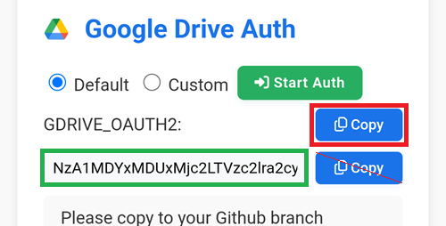

(aaps-ci-google-drive-auth)=

# Compilación en el navegador – Paso 3: autorizar Google Drive

```{note}
Este es el **Paso 3** de la [Compilación en el navegador](BrowserBuild.md). Primero completa el [Paso 2 – Crear tu almacén de claves de firma](BrowserBuildKeystore.md).
```

```{warning}
No importa qué instrucciones seguiste antes (Opción 1 u Opción 2): DEBES añadir la autorización de Google Drive para poder usar la compilación en el navegador.
```

Nota: si ya hiciste esta parte con el vídeo, ahora puedes saltar al [Paso 4 – Compilar el APK](BrowserBuildAPK.md).

```{warning}
Si la autorización de Google no empieza o la página de preparación falla, cierra la página de preparación, abre otra vez `aaps-ci-preparation.html` de la misma forma que en el Paso 2 y empieza este paso de nuevo. Consulta la [solución de problemas](#aaps-ci-preparation-web).
```

Vuelve a la pestaña de la página de preparación.

Desplázate hacia abajo hasta la sección Google Drive Auth y toca Start Auth.


Selecciona tu cuenta de Google.


Desplázate hacia abajo y acepta el acceso. La página web lo necesita para obtener la clave de autenticación de Google Drive.

Toca Continue.


El campo `GDRIVE_OAUTH2` se rellenará; toca el botón Copy de arriba.



Vuelve a la pestaña de GitHub.

Desplázate hacia abajo hasta Repository secrets y toca New repository secret.

Si seguiste la Opción 1, deberías ver esto:


Si seguiste la Opción 2, habrá más claves:


En el campo Name, pega el texto que acabas de copiar. Mantén pulsado el cuadro de texto para mostrar el menú de pegar.


Cambia a la pestaña de la página de preparación.

Toca el segundo botón Copy.


Vuelve a la pestaña de GitHub.

1. En el campo Secret, pega el texto que acabas de copiar. Mantén pulsado el cuadro de texto para mostrar el menú de pegar.

2. Toca Add secret.


Ahora deberías tener dos (Opción 1) o cinco (Opción 2) secretos.


Ahora GitHub podrá guardar el archivo APK de AAPS en tu Google Drive cuando esté compilado.

----

**Siguiente: [Paso 4 – Compilar el APK](BrowserBuildAPK.md) →**
