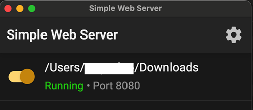

(aaps-ci-option1-computer)=

# Opción 1 · Ordenador – Generar un nuevo almacén de claves

```{note}
[Opción 1](BrowserBuildO1.md) (generar un nuevo almacén de claves) en un **ordenador** (Windows / Mac / Linux).
```

## 1. Descargar el archivo de preparación

:::{include} BrowserBuildDownloadPrep.md
:::

## 2. Iniciar un servidor local y generar el almacén de claves

Usar un ordenador (Windows/Mac/Linux)

Abre la página web [https://simplewebserver.org/download.html](https://simplewebserver.org/download.html)

Instala Simple Web Server</br> Si usas Windows o Mac, puedes instalarlo desde Microsoft Store o desde Mac App Store.</br> Si tu navegador pregunta si quieres abrir la app de la tienda, permítelo.</br></br> </br>

Ejemplo en Mac:

- get → install → open (obtener → instalar → abrir)</br></br> </br></br>

- Haz clic en Get Started</br></br> </br></br>

- Haz clic en New Server</br></br> </br></br>

- En Folder Path, selecciona la carpeta donde está aaps-ci-preparation.html y luego haz clic en Create Server.</br></br> </br></br>

- Si ves esta pantalla, el servidor ya está iniciado.</br></br> </br></br>

- No cierres Simple Web Server. Cambia a tu navegador y abre</br> [http://127.0.0.1:8080/aaps-ci-preparation.html](http://127.0.0.1:8080/aaps-ci-preparation.html)</br></br>

- Para los siguientes pasos, consulta el vídeo de abajo a partir del minuto 1:37.

  <!--crowdin: exclude-->
  <div align="center" style="max-width: 360px; margin: auto; margin-bottom: 2em;">
    <div style="position: relative; width: 100%; aspect-ratio: 9/16;">
      <iframe
        src="https://geo.dailymotion.com/player/x9rdrpy.html?video=x9rdrpy&startTime=97&loop=true&mute=true"
        loading="lazy"
        style="position: absolute; top: 0; left: 0; width: 100%; height: 100%;"
        frameborder="0"
        allowfullscreen>
      </iframe>
    </div>
  </div>

----

**Siguiente: [Paso 3 – Autorizar Google Drive](BrowserBuildGoogleDrive.md) →**
