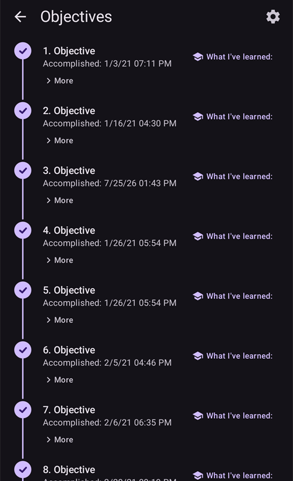

# Completar los objetivos

**AAPS** tiene una serie de **Objetivos** que hay que completar. Ayudan al usuario a avanzar desde el lazo abierto básico hasta el lazo cerrado híbrido y todas las funciones de **AAPS**. Completar los **Objetivos** sirve para asegurar que:

* Has configurado todo correctamente en tu instalación de **AAPS**;
* Has aprendido las funciones esenciales de **AAPS**; y
* Entiendes lo básico de lo que puede hacer tu sistema, para ganar confianza al usar **AAPS**.

Cuando instalas **AAPS** por primera vez, debes completar cada objetivo antes de pasar al siguiente. Las nuevas funciones se desbloquean poco a poco a medida que avanzas en cada **Objetivo**.

Los **Objetivos 1 a 8** te guían desde la configuración de **AAPS** en tu teléfono hasta el lazo cerrado híbrido «básico». Esto tardará unas 6 semanas en completarse. Puedes avanzar hasta el **Objetivo 5** con una bomba virtual (y mientras tanto usar otro método para administrar la insulina). Los **Objetivos 9 y 10** sirven para probar funciones más avanzadas de **AAPS** con el fin de controlar mejor tu diabetes. Tardarás hasta 3 meses en completarlos, quizá más. Puedes ver más detalles sobre el tiempo estimado aquí: [¿Cuánto tiempo llevará?](#preparing-how-long-will-it-take)

Además de avanzar en los **Objetivos**, si lo necesitas, también puedes borrar tu progreso y [volver a un objetivo anterior](#go-back-in-objectives).

## Haz una copia de seguridad de tus ajustes

```{admonition} Note
:class: note

¡Se recomienda exportar tus ajustes de **AAPS** después de completar cada **Objetivo**!
```

Te recomendamos mucho [exportar tus ajustes](../Maintenance/ExportImportSettings.md) después de completar cada objetivo, para no perder el progreso hecho en **AAPS**. Esta exportación crea un **archivo de ajustes** (.json) que debes guardar como copia de seguridad en uno o más lugares seguros (p. ej., Google Drive, disco duro, adjunto de correo electrónico, _etc._). Así se guarda todo el progreso hecho en **AAPS**. Si pierdes el teléfono o borras tu progreso sin querer, puedes volver a cargar el archivo json en **AAPS** importando un archivo de ajustes reciente. También necesitas una copia de seguridad del **archivo de ajustes** si por cualquier motivo necesitas un nuevo teléfono para **AAPS** (teléfono nuevo, perdido o roto, _etc._)

El archivo de **ajustes** no solo guarda tu progreso en los **Objetivos**, sino también todos tus ajustes de **AAPS**, como el **bolo máximo**, _etc._

Si no tienes una copia de seguridad de tus ajustes y le pasa algo a tu teléfono con **AAPS**, tendrás que empezar los **Objetivos** otra vez desde el principio. Avanzar en los **Objetivos** lleva tiempo. Es mejor evitar tener que completarlos otra vez, por ejemplo porque perdiste el teléfono.

(objectives-objective1)=
## Objetivo 1: Configurar la visualización y la monitorización, analizar las basales y los ratios

El **Objetivo 1** pide al usuario hacer la configuración técnica básica en **AAPS**. No se puede avanzar hasta completar este paso.

- Selecciona el MCG/FGM correcto en [Configuración → Fuente de glucosa](#Config-Builder-bg-source). Consulta [Fuente de glucosa](../Getting-Started/CompatiblesCgms.md) para más información.
- Selecciona la bomba correcta en [Configuración → Bomba](#Config-Builder-pump) para que tu bomba pueda comunicarse con **AAPS**. Selecciona **bomba virtual** si usas un modelo de bomba que no tiene un driver de **AAPS** para el lazo, o si quieres hacer los primeros **Objetivos** mientras usas otro sistema para administrar la insulina. Consulta [bomba de insulina](../Getting-Started/CompatiblePumps.md) para más información.
- Si usas Nightscout:
  - Sigue las instrucciones de la página [Nightscout](../SettingUpAaps/Nightscout.md) para que **Nightscout** pueda recibir y mostrar los datos de **AAPS**.
  - Ten en cuenta que la URL en **NSClientV3** debe ir **_sin_ «/api/v1/»** al final; consulta [Ajustes → NSClientV3](#Preferences-nsclient).
- Si usas Tidepool:
  - Sigue las instrucciones de la página [Tidepool](../SettingUpAaps/Tidepool.md) para que **Tidepool** pueda recibir y mostrar los datos de **AAPS**.

Nota: *puede que tengas que esperar a la siguiente lectura de glucosa del sensor antes de que **AAPS** la reconozca.*

(objectives-objective2)=
## Objetivo 2: Aprender a controlar AAPS

El **Objetivo 2** pide hacer varias «tareas», como se ve en la captura de pantalla de abajo. Cada tarea muestra su estado (**1**): el texto naranja «**No completado**» cambia a «**¡Completado, bien hecho!**» en cuanto **AAPS** registra la acción. Toca **Pista** (**2**) debajo de una tarea para abrir la documentación relacionada, si todavía no conoces bien una acción concreta.


Las tareas para completar el **Objetivo 2** son:
- Pon tu **Perfil** al 90 % durante 10 min.
  - _Pista_: toca el nombre de tu perfil en la pantalla principal para abrir la pantalla **Perfil**. Luego usa el botón **Activar** (▶) y pon el porcentaje y la duración. Más información en [Cambio de perfil y porcentaje del perfil](../DailyLifeWithAaps/ProfileSwitch-ProfilePercentage.md).
  - _Nota_: **AAPS** no acepta dosis basales menores de 0,05 U/h. Si tu **Perfil** tiene dosis de 0,06 U/h o menos, tendrás que crear un **Perfil** temporal con dosis basales más altas antes de completar esta tarea. Vuelve a tu **Perfil** normal después de completar esta tarea.
- Simula «darte una ducha» [desconectando tu bomba](#AapsScreens-loop-status) en **AAPS** durante 1 h.
  - _Pista_: pulsa el icono del lazo en la pantalla principal para abrir el diálogo del lazo y luego elige una duración en **Desconectar bomba**.
- Termina «la ducha» volviendo a conectar tu bomba.
  - _Pista_: pulsa el icono de «desconectada» para abrir otra vez el diálogo del lazo y elige **Vuelve a conectar la bomba**.
- Pon un [**Objetivo temporal**](../DailyLifeWithAaps/TempTargets.md) personalizado con una duración de 10 min.
  - _Pista_: pulsa el rango objetivo en la pantalla principal para abrir la pantalla de objetivo temporal.
- Muestra el contenido del complemento **Lazo**.
  - _Pista_: abre **Configuración → Lazo** y toca «**Abrir complemento**».
- Desplaza o amplía el gráfico de glucosa para ver periodos de tiempo más largos o más cortos.


(objectives-objective3)=
## Objetivo 3: Demostrar tus conocimientos

El **Objetivo 3** pide al usuario aprobar un examen tipo test que comprueba tus conocimientos de **AAPS**.

Para algunos usuarios, el **Objetivo 3** es el objetivo más difícil de completar. Lee la documentación de **AAPS** junto con las preguntas. Si de verdad te quedas atascado después de buscar en la documentación de **AAPS**, busca «Objective 3» en el grupo de [Facebook](https://www.facebook.com/groups/AndroidAPSUsers) o de [Discord](https://discord.gg/4fQUWHZ4Mw) (porque es probable que tu pregunta ya se haya hecho antes y que el grupo ya la haya respondido). Estos grupos pueden darte pistas amables o llevarte a la parte correcta de la documentación de **AAPS**.

Mientras tanto:
- Para reducir el número de notificaciones o decisiones que te pide el sistema (dosis basales temporales) en lazo abierto, pon un rango objetivo amplio en tu **Perfil**, _p. ej._, 90–150 mg/dl o 5,0–8,5 mmol/l.
- Quizás quieras poner un límite superior más amplio por la noche, o incluso desactivar el lazo abierto.

Para seguir con el **Objetivo 3**, toca la fila de una pregunta para abrirla. Lee con atención cada pregunta y selecciona tu respuesta o respuestas.

¡En cada pregunta puede haber más de una respuesta correcta! Si eliges una respuesta incorrecta, la pregunta se bloqueará durante 1 hora antes de que puedas volver a responderla. Ten en cuenta que el orden de las respuestas puede cambiar la próxima vez que respondas. Así te aseguras de leerlas con atención y de entender de verdad si cada respuesta es correcta o no.

```{admonition} __What happens if new question(s) are added to an Objective when I update to a newer version of AAPS?__
:class: note
De vez en cuando se añaden nuevas funciones a **AAPS** que pueden requerir añadir una nueva pregunta a los **Objetivos**, sobre todo al **Objetivo 3**. Por eso, cada nueva pregunta añadida al **Objetivo 3** aparecerá como «incompleta», porque **AAPS** te pedirá que la respondas. No te preocupes: como cada **Objetivo** es independiente, **no perderás las funciones que ya tienes en AAPS**, siempre que los demás **Objetivos** sigan completados.
```

## Objetivo 4: Empezar con un lazo abierto

El fin del **Objetivo 4** es ver con qué frecuencia **AAPS** compara la dosis basal del usuario con los niveles de glucosa y recomienda ajustes de la dosis basal temporal. En este **Objetivo** activarás el lazo abierto por primera vez. Aceptarás 20 cambios propuestos de la dosis basal temporal y, si hace falta, los aplicarás a mano en tu bomba. También verás el efecto de los [**Objetivos temporales**](../DailyLifeWithAaps/TempTargets.md). Si todavía no sabes cómo poner un cambio de la dosis basal temporal en **AAPS**, mira las acciones de la bomba en el panel **Administrar** ([¿Dónde está la pestaña Acciones?](#screens-action-tab)).

Tiempo mínimo para completar este objetivo: **7 días**. Es un tiempo de espera obligatorio. No es posible pasar al siguiente **Objetivo**, aunque ya se hayan hecho todos los cambios de la dosis basal.

- Selecciona el lazo abierto pulsando el [icono del lazo](#AapsScreens-loop-status) en la pantalla principal y eligiendo **Lazo abierto** como modo de funcionamiento.
- Aplica a mano al menos 20 de las sugerencias de basal temporal durante 7 días: introdúcelas en tu bomba (física) y confirma en AAPS que las has aceptado. Comprueba que estos ajustes de la dosis basal aparecen en **AAPS** y en **Nightscout**.
- Usa [**Objetivos temporales**](../DailyLifeWithAaps/TempTargets.md) cuando sea necesario. Después de tratar una hipoglucemia, usa el «Objetivo temporal ante Hipoglucemia» predefinido para evitar que el sistema corrija de más en el rebote.
- Si en este punto todavía usas el [Modo sencillo](#preferences-simple-mode), probablemente es un buen momento para desactivarlo.

Para reducir el número de cambios propuestos de la dosis basal en lazo abierto, también puedes usar los consejos del [**Objetivo 3**](#objective-3-prove-your-knowledge). Además, puedes cambiar el porcentaje mínimo de los cambios recomendados de la dosis basal con el ajuste «**Cambio mínimo en modo abierto**» en **Ajustes → Lazo**. Cuanto más alto sea el valor, menos notificaciones de cambio recibirás.


```{admonition} Note
:class: note

¡No tienes que aplicar todas y cada una de las recomendaciones del sistema!
```
(objectives-objective5)=
## Objetivo 5: Comprender tu lazo abierto, incluidas sus recomendaciones de basal temporal

En el **Objetivo 5** empezarás a entender cómo se calculan las recomendaciones de basal temporal. Esto incluye la [lógica que decide la basal](#aaps-screens-how-predictions-become-a-dosing-decision), analizar el efecto observando las [líneas de predicción en **Inicio de AAPS**](#aaps-screens-prediction-lines) (o en Nightscout) y mirar los cálculos detallados que se muestran en la pantalla del complemento **OpenAPS SMB** (**Configuración → APS → Abrir complemento**).

Tiempo estimado para completar este objetivo: **7 días**.

Este **Objetivo** te pide determinar y configurar tu valor de «Tasa basal máxima» (max-basal), como se describe en [Funciones clave de AAPS](#Open-APS-features-max-u-h-a-temp-basal-can-be-set-to). Este valor se puede poner en [Ajustes → OpenAPS SMB](#Preferences-openaps-smb-settings). En el [Modo sencillo](#preferences-simple-mode), **AAPS** pone este valor automáticamente y no tienes que cambiarlo. Si todavía usas una bomba virtual, asegúrate de que este ajuste de seguridad está puesto tanto en **AAPS** como en tu bomba de insulina.

Puedes poner el [objetivo de glucosa de tu **Perfil**](#profile-glucose-targets) más alto de lo normal hasta que te sientas cómodo con los cálculos y ajustes de **AAPS**. Puedes probar a ajustar el **objetivo de glucosa** de tu **Perfil** a un rango más estrecho (por ejemplo, de 1 mmol/l [20 mg/dl] de ancho o menos) y observar el resultado.


```{admonition} If you have been using a virtual pump, change to a real insulin pump now!
:class: note

Si usas el lazo abierto con una bomba virtual, **detente aquí**. Pulsa verificar al final de este **Objetivo** solo cuando ya uses una bomba «real» que administra insulina.

```


(objectives-objective6)=
## Objetivo 6: Empezar a cerrar el lazo con Suspensión por glucosa baja


```{admonition} Closed loop will not correct high **BG** values in **Objective 6** as it is limited to **Low Glucose Suspend** only!
:class: note
¡Todavía tendrás que corregir tú mismo los valores altos de glucosa (a mano, con correcciones con la bomba o con pluma)!
```

En el **Objetivo 6** cerrarás el lazo y activarás su modo **Suspensión por glucosa baja (LGS)** mientras el [max IOB](#Open-APS-features-maximum-total-iob-openaps-cant-go-over) está en cero. Tienes que quedarte en modo LGS durante 5 días para completar este **objetivo**. Usa este tiempo para comprobar si los ajustes de tu **Perfil** son correctos y si los eventos LGS no se activan demasiado a menudo.

Tiempo mínimo para completar este objetivo: **5 días**. Es un tiempo de espera obligatorio. No puedes pasar al siguiente **Objetivo** antes de que termine este tiempo.

Es muy importante que tu **Perfil** actual (basal, ISF, IC) esté bien probado antes de cerrar el lazo en modo **LGS**. Unos ajustes incorrectos del **Perfil** pueden llevarte a hipoglucemias que tendrás que tratar a mano. Un **Perfil** correcto ayuda a necesitar menos tratamientos de glucosa baja durante los 5 días.

**Si todavía tienes hipoglucemias frecuentes o graves, considera ajustar mejor la [DIA de tu tipo de insulina](#Config-Builder-insulin-dia), la basal, el ISF y los ratios de carbohidratos.** Consulta el grupo de [Facebook](https://www.facebook.com/groups/AndroidAPSUsers) o de [Discord](https://discord.gg/4fQUWHZ4Mw), donde se habla mucho de esto.


Durante el **Objetivo 6**, **AAPS** cambiará el ajuste maxIOB a cero. **Este cambio termina al pasar al Objetivo 7.**

Esto significa que, durante el **Objetivo 6**, si los niveles de glucosa del sensor bajan, **AAPS** reducirá por ti la insulina basal administrada. Pero si los niveles de glucosa del sensor suben, **AAPS** subirá la dosis basal por encima del valor de tu **Perfil** solo si la **IOB basal** es negativa por una **LGS** anterior. En los demás casos, **AAPS** no subirá la basal por encima del valor actual de tu perfil, aunque los niveles de glucosa suban. Esta precaución sirve para evitar hipoglucemias mientras aprendes a usar **AAPS**.

**Por eso, tienes que tratar los valores altos de glucosa con bolos de corrección manuales.**

- Si tu IOB es negativa (ver la captura de pantalla de abajo), en el **Objetivo 6** se puede activar una dosis basal temporal (TBR) > 100 %.


- Pon tu rango objetivo un poco más alto de lo habitual, para tener un margen de seguridad.
- Activa el modo «Suspensión por glucosa baja» pulsando el icono del lazo en la pantalla principal y eligiendo **Suspensión por glucosa baja (LGS)** como modo de funcionamiento.
- Observa las basales temporales activas en el texto de basal de color turquesa de la pantalla INICIO o en la línea de basal turquesa del gráfico de INICIO.
- Es posible que tengas picos temporales después de tratar una hipoglucemia, sin poder subir la basal en el rebote.

(objectives-objective7)=
## Objetivo 7: Ajustar el lazo cerrado, subir maxIOB por encima de 0 y bajar poco a poco los objetivos de glucosa

Para completar el **Objetivo 7** tienes que cerrar el lazo y subir tu [maxIOB](#Open-APS-features-maximum-total-iob-openaps-cant-go-over). En el **Objetivo 6**, **maxIOB** se puso a cero automáticamente por el modo Suspensión por glucosa baja. Ahora ya no es así. **AAPS** empezará a usar el valor de maxIOB que definiste para corregir los valores altos de glucosa. En el [Modo sencillo](#preferences-simple-mode), **AAPS** pone maxIOB automáticamente y no tienes que cambiarlo.

Tiempo mínimo para completar este objetivo: **1 día**. Es un tiempo de espera obligatorio. No es posible pasar al siguiente **Objetivo** hasta que termine este periodo de tiempo.

- Selecciona **Lazo cerrado** pulsando el [icono del lazo](#AapsScreens-loop-status) en la pantalla principal y eligiendo **Lazo cerrado** como modo de funcionamiento. Quédate en **Lazo cerrado** durante 1 día.

- Sube poco a poco tu «IOB total máxima que OpenAPS no puede superar» (en OpenAPS se llama «max-iob») por encima de 0, hasta encontrar los ajustes que mejor funcionan para ti.

La recomendación por defecto para este ajuste es «**bolo medio de una comida + 3 veces la basal diaria máxima**», donde «basal diaria máxima» es el valor máximo por hora en cualquier franja horaria del día.


Esta recomendación debe considerarse como un punto de partida. Si usas esta regla pero ves que AAPS da demasiada insulina cuando sube la glucosa, quizás necesites:
* bajar el valor «IOB total máxima que OpenAPS no puede superar»;
* revisa los ajustes de tu **Perfil**, con un solo cambio cada vez.

Si eres muy resistente a la insulina, también puedes subir el valor de **maxIOB** con mucho cuidado.

Cuando tengas confianza en qué valor de **maxIOB** va bien con tu lazo, baja tus **objetivos de glucosa** al nivel que quieras.

(objectives-objective8)=
## Objetivo 8: Ajustar las basales y los ratios si es necesario, y después activar Autosens

En este **objetivo** revisarás cómo funciona tu **Perfil** y usarás la función [Autosens](#Open-APS-features-autosens) como indicador de ajustes incorrectos.

Tiempo mínimo para completar este objetivo: **7 días**. Es un tiempo de espera obligatorio. No es posible pasar al siguiente **Objetivo** hasta que termine este periodo de tiempo.

Activa [Autosens](../DailyLifeWithAaps/KeyAapsFeatures.md) durante 7 días (en el [Modo sencillo](#preferences-simple-mode) está activado por defecto) y mira la [línea blanca del gráfico de **Inicio**](#AapsScreens-section-g-additional-graphs), que muestra cómo tu sensibilidad a la insulina sube o baja por el ejercicio, las hormonas, etc. Vigila la pantalla del complemento **OpenAPS SMB** (**Configuración → APS → Abrir complemento**), que muestra cómo **AAPS** ajusta la sensibilidad, las basales y los objetivos según sea necesario.

Es un buen momento para revisar tus ajustes de [Detección de sensibilidad](#Config-Builder-sensitivity-detection). Puedes ver tu sensibilidad en la pantalla principal en un [gráfico adicional](#AapsScreens-section-g-additional-graphs).

Además, puedes usar [Autotune](#autotune-how-autotune-calculates-adjustments) una sola vez para comprobar que tus basales siguen siendo correctas, o hacer una prueba de basal tradicional.

(objectives-objective9)=
## Objetivo 9: Activar funciones adicionales de oref1 para el uso durante el día, como el super micro bolo (SMB)

En el **Objetivo 9** empezarás a usar **«Super Micro Bolo (SMB)»** como una función principal. Después de estudiar las lecturas obligatorias, entenderás bien qué son los SMB, cómo funcionan y por qué la basal se pone a cero temporalmente después de dar SMB (basal temporal a cero).

Tiempo mínimo para completar este objetivo: **28 días**. Es un tiempo de espera obligatorio. No puedes pasar al siguiente objetivo hasta que termine este tiempo.

- La [sección SMB de esta documentación](#Open-APS-features-super-micro-bolus-smb) y la [explicación de oref1 en la documentación de OpenAPS](https://openaps.readthedocs.io/en/latest/docs/Customize-Iterate/oref1.html) son lecturas obligatorias para entender los **SMB** y la idea de la **basal temporal a cero**.
- Cuando lo hayas hecho, puedes [subir maxIOB](#Open-APS-features-maximum-total-iob-openaps-cant-go-over) para que los **SMB** funcionen mejor. Ahora maxIOB incluye toda la **IOB**, no solo la basal acumulada. Este límite pausa los **SMB** hasta que la IOB baje por debajo de este valor (_p. ej._, si **maxIOB** está en 7 U y se da un bolo de 8 U para una comida, los SMB se pausan y no se dan hasta que la **IOB** baje de 7 U). Un buen comienzo es poner **maxIOB** = **bolo medio de una comida + 3 veces la basal diaria máxima**, donde «basal diaria máxima» es el valor máximo por hora en cualquier franja horaria del día. Consulta el [objetivo 7](#objective-7-tuning-the-closed-loop-raising-maxiob-above-0-and-gradually-lowering-bg-targets) como referencia.
- Evalúa la velocidad de absorción de tus carbohidratos y considera cambiar el parámetro «min_5m_carbimpact» en [Ajustes → Ajustes de absorción → min_5m_carbimpact](#Preferences-min_5m_carbimpact) si te parece demasiado lenta o demasiado rápida.

(objectives-objective10)=
## Objetivo 10: Automatización

Las **Automatizaciones** están disponibles cuando se inicia el **Objetivo 10**.

Tiempo mínimo para completar este objetivo: **28 días**. Es un tiempo de espera obligatorio. No puedes pasar al siguiente objetivo hasta que termine este tiempo.

Primero lee la página de la documentación [Automatización](../DailyLifeWithAaps/Automations.md).

Configura la regla de automatización más básica; por ejemplo, que active una notificación de Android dentro de unos minutos:
- Abre **Administrar → Automatización** y toca el botón **+** (**Añadir regla**).
- Escribe un **Nombre de la tarea**, por ejemplo «Mi primera notificación de automatización».
- En **Condición**, toca «**EDITAR**».
  - Toca «**Añadir activador**» y selecciona «**Tiempo**». **AAPS** crea una entrada para hoy a la hora actual.
  - Cambia la hora para que se active dentro de unos minutos.
  - Toca el icono **Guardar** (arriba a la derecha) para volver a la regla.
- En **Acción**, toca «**AÑADIR**» y selecciona «**Notificación**».
  - Escribe un mensaje en la tarjeta de la acción, por ejemplo «Mi primera automatización».
- Toca el icono **Guardar** (arriba a la derecha) y comprueba que la regla está en **Activado**.
- Espera hasta que la hora active la notificación (según tu teléfono, puede llegar unos minutos tarde)

Después puedes probar a configurar una **Automatización** más útil. La página de la documentación da algunos ejemplos, y puedes buscar capturas de pantalla de «Automation» en el grupo de [Facebook](https://www.facebook.com/groups/AndroidAPSUsers). También hay un canal específico en la comunidad de [Discord](https://discord.gg/4fQUWHZ4Mw).

Por ejemplo, si cada mañana desayunas lo mismo a la misma hora antes del colegio o del trabajo, puedes crear una **Automatización** como «objetivo-antes-del-desayuno» que pone un **Objetivo temporal** un poco más bajo 30 minutos antes de desayunar. En este caso, tu condición probablemente incluirá «Hora de Repetición», que consiste en seleccionar días concretos de la semana (lunes, martes, miércoles, jueves, viernes) y una hora concreta (06:30). La acción será «Iniciar objetivo temporal» con un valor objetivo más bajo de lo habitual y una duración de 30 minutos.

## Cuando todos los objetivos están completados

Cuando hayas completado todos los **Objetivos**, la lista muestra cada uno con una marca y la fecha en que se completó. El elemento **Objetivos** desaparece de la barra de navegación inferior; todavía puedes abrir la lista con **Configuración → Restricciones → Objetivos → Abrir complemento**.



Pulsa «**Más**» debajo de un objetivo para ver otra vez sus tareas:


(CompletingTheObjectives-go-back-in-objectives)=
## Volver atrás en los objetivos

Si por cualquier motivo quieres volver atrás en los **Objetivos**, abre el **Objetivo** terminado con «**Más**» y toca «**Restablecer estado finalizado**»:


Del mismo modo, el **Objetivo** en el que estás trabajando ahora se puede reiniciar con «**Restablecer estado iniciado**».
