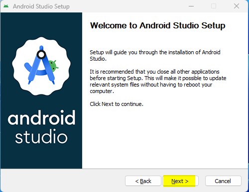
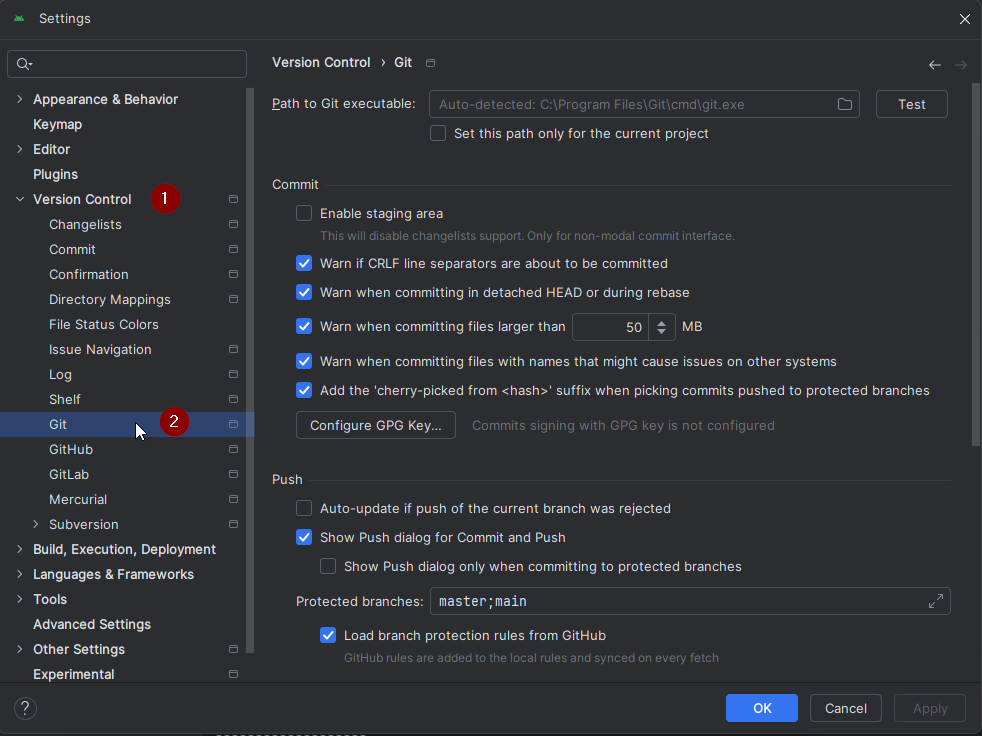
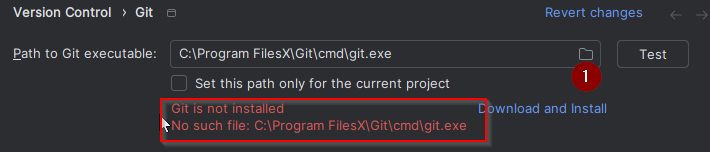
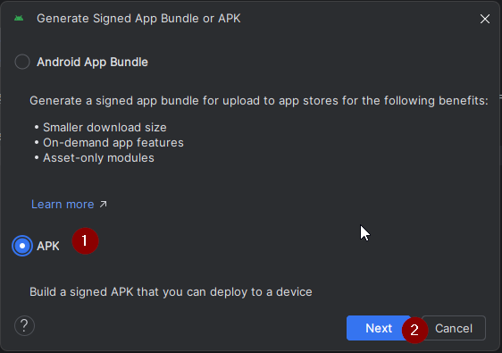

<!-- Android Studio Build, FKA Computer Build. Preserve filenames to avoid breaking URLs. -->

# Compilación con Android Studio

Este es el método tradicional para compilar tu app AAPS.

Puedes compilar la app sin ordenador con el método [Compilación en el navegador](./BrowserBuild.md).

## Compílala tú en lugar de descargarla

**La app AAPS (un archivo apk) no está disponible para descargar, debido a las normas sobre dispositivos médicos. Es legal compilar la app para tu propio uso, ¡pero no debes dar una copia a otras personas!**

Consulta la página de [preguntas frecuentes](../UsefulLinks/FAQ.md) para más detalles.

---

(Building-APK-recommended-specification-of-computer-for-building-apk-file)=
## Especificaciones del ordenador y del software para compilar AAPS

* Puede ser necesaria una versión concreta de **[Android Studio](https://developer.android.com/studio/)** para compilar el APK. Mira la tabla de abajo:

| Versión de AAPS             | Versión<br/>preferida de<br/>Android Studio | Versión<br/>alternativa de<br/>Android Studio | Gradle | JVM |
| --------------------------- | ------------------------------------------------------- | --------------------------------------------------------- | ------ |:--- |
| 2.6.2                       | 3.6.1                                                   |                                                           | 5.6.4  | 11  |
| 2.8.2.1                     | 4.1.1                                                   |                                                           | 6.1.1  | 13  |
| [3.1.0.3](#version3100)     | 2020.3.1                                                | probado hasta Quail 4                                     | 7.3.3  | 17  |
| [3.2.0.4](#version3204)     | Hedgehog (2023.1.1)                                     | probado hasta Quail 4                                     | 8.2    | 17  |
| [3.3.1.3](#version3300)     | Ladybug Feature Drop (2024.2.2)                         | probado hasta Quail 4                                     | 8.10   | 21  |
| [3.3.2](#version3300)       | Meerkat (2024.3.1)                                      | probado hasta Quail 4                                     | 8.11.1 | 21  |
| [3.3.2.1](#version3321)     | Narwhal (2025.1.2)                                      | probado hasta Quail 4                                     | 8.13   | 21  |
| [3.4.2.6](#version3426)     | Panda 2 (2025.3.2)                                      | probado hasta Quail 4                                     | 9      | 21  |
| [4.0.0-beta1](#version4000) | Rabbit 1                                                | hasta la última Rabbit 1                                  | 9.8    | 21  |

La «versión preferida» incluye la versión adecuada de JVM. La versión preferida es también la versión mínima que puedes usar para compilar **AAPS**. **NO** podrás compilar con una versión más antigua que la «preferida». Si usas otra versión, puedes tener problemas relacionados con la versión de JVM. Consulta la página [Solución de problemas para Android Studio](#troubleshooting_androidstudio-uncommitted-changes) para resolver estos problemas. Si tu versión actual de Android Studio no está en la tabla, primero tienes que actualizarla.

La versión de Gradle está ligada al código fuente: siempre obtendrás la versión correcta de Gradle al descargar o actualizar el código fuente. Se menciona aquí solo como referencia; no tienes que hacer nada con ella.

* Android Studio no es compatible con [sistemas Windows de 32 bits](#troubleshooting_androidstudio-unable-to-start-daemon-process). Recuerda que **una CPU de 64 bits y un sistema operativo de 64 bits son condiciones obligatorias.** Si tu sistema NO cumple esta condición, tienes que cambiar el hardware o el software afectado, o todo el sistema.

<table class="tg">
<tbody>
  <tr>
    <th class="tg-baqh">SO (solo 64 bits)</th>
    <td class="tg-baqh">Windows 8 o superior</td>
    <td class="tg-baqh">Mac OS 10.14 o superior</td>
    <td class="tg-baqh">Cualquier Linux compatible con Gnome, KDE o Unity DE;&nbsp;&nbsp;GNU C Library 2.31 o posterior</td>
  </tr>
  <tr>
    <th class="tg-baqh"><p align="center">CPU (solo 64 bits)</th>
    <td class="tg-baqh">Arquitectura de CPU x86_64; Intel Core de 2.ª generación o más nuevo, o CPU AMD compatible con <br><a href="https://developer.android.com/studio/run/emulator-acceleration#vm-windows" target="_blank" rel="noopener noreferrer"><span style="text-decoration:var(--devsite-link-text-decoration,none)">Windows Hypervisor</span></a></td>
    <td class="tg-baqh">Chips basados en ARM, o Intel Core de 2.ª generación o más nuevo compatible con <br><a href="https://developer.android.com/studio/run/emulator-acceleration#vm-mac" target="_blank" rel="noopener noreferrer"><span style="text-decoration:var(--devsite-link-text-decoration,none)">Hypervisor.Framework</span></a></td>
    <td class="tg-baqh">Arquitectura de CPU x86_64; Intel Core de 2.ª generación o más nuevo, o procesador AMD compatible con AMD Virtualization (AMD-V) y SSSE3</td>
  </tr>
  <tr>
    <th class="tg-baqh"><p align="center">RAM</th>
    <td class="tg-baqh" colspan="3"><p align="center">16 GB o más</td>
  </tr>
  <tr>
    <th class="tg-baqh"><p align="center">Disco</th>
    <td class="tg-baqh" colspan="3"><p align="center">Al menos 30 GB de espacio libre. Se recomienda un SSD.</td>
  </tr>
  <tr>
    <th class="tg-baqh"><p align="center">Resolución</th>
    <td class="tg-baqh" colspan="3"><p align="center">Mínimo 1280 x 800<br></td>
  </tr>
  <tr>
    <th class="tg-baqh"><p align="center">Internet</th>
    <td class="tg-baqh" colspan="3"><p align="center">Banda ancha</td>
  </tr>
</tbody>
</table>

**Se recomienda mucho (no es obligatorio) usar un SSD (disco de estado sólido) en lugar de un HDD (disco duro), porque tardarás menos en compilar el archivo APK de AAPS.**  Aun así, puedes usar un HDD para compilar el archivo APK de **AAPS**. Si lo haces, la compilación puede tardar mucho en terminar, pero una vez que empiece, puedes dejarla funcionando sola.

## Ayuda y soporte durante la compilación

Si tienes problemas al compilar la app **AAPS**, hay una sección específica de [**solución de problemas para Android Studio**](../GettingHelp/TroubleshootingAndroidStudio.md). Consúltala primero.

Si crees que algo en las instrucciones de compilación está mal, falta o es confuso, o si sigues teniendo problemas, contacta con el grupo de usuarios de **AAPS** en [Facebook](https://www.facebook.com/groups/AndroidAPSUsers) o [Discord](https://discord.gg/4fQUWHZ4Mw). Si quieres cambiar algo tú mismo (actualizar capturas de pantalla, _etc._), envía un [pull request (PR)](../SupportingAaps/HowToEditTheDocs.md).

## Guía paso a paso para compilar la app AAPS

```{admonition} WARNING
:class: warning
Si ya has compilado AAPS antes, no necesitas hacer otra vez todos los pasos siguientes.
¡Ve directamente a la [guía de actualización](../Maintenance/UpdateToNewVersion.md)!
```

```{contents} The overall steps for building the **AAPS** apk file
:depth: 1
:local: true
```

En esta guía encontrarás capturas de pantalla de _ejemplo_ de la compilación del archivo apk de **AAPS**. **Android Studio**, el programa que usamos para compilar el apk de **AAPS**, se actualiza con frecuencia. Por eso estas capturas pueden no ser idénticas a tu instalación, pero deberías poder seguirlas igualmente.

Como **Android Studio** funciona en Windows, Mac OS X y Linux, también puede haber pequeñas diferencias en los pasos según la plataforma.

(install-git-if-you-dont-have-it)=
### Instalar Git

```{admonition} Why Git? 
:class: dropdown

Git es un «_sistema de control de versiones_» (VCS, por sus siglas en inglés).\
Git es un programa que permite seguir los cambios en el código y colaborar con otras personas. Usarás Git para hacer una copia del código fuente de **AAPS** desde el sitio web de GitHub a tu ordenador. Después, usarás Android Studio en tu ordenador para compilar la aplicación **AAPS** (apk). 
```

(BuildingAaps-steps-for-installing-git)=
#### Pasos para instalar Git

1.  Comprueba que no tienes ya **Git** instalado. Para hacerlo, escribe «git» en la barra de búsqueda de Windows. Si ves **«Git bash»** u otra forma de Git, ya está instalado y puedes pasar directamente a [instalar Android Studio](#install-android-studio):


2. Si no tienes Git instalado, descarga e instala la última versión para tu sistema desde la sección «Download» de [**esta página**](https://git-scm.com/downloads). Cualquier versión reciente de Git debería funcionar. Elige la versión correcta para tu sistema: Mac, Windows o Linux.

**Nota para usuarios de Mac:** la página web de Git también te guiará para instalar un programa adicional llamado «homebrew» que ayuda en la instalación. Si instalas Git con Homebrew, no hace falta cambiar ninguna preferencia.

(Make_a_note_of_Git_path)=

* Durante la instalación, cuando se te pida «select destination location», anota _dónde_ se instala Git (la «**ruta de instalación**»). Tendrás que comprobarla en el siguiente paso. Será algo similar a "C:\Program Files\Git\cmd\git.exe"

*  Durante los pasos de la instalación de Git, acepta todas las opciones predeterminadas.

*  Después de la instalación, si olvidaste anotar dónde se instaló Git, puedes encontrarlo así: escribe «git» en la barra de búsqueda del PC, haz clic derecho en «Git bash», selecciona «Abrir ubicación del archivo» y pasa el ratón sobre el icono de «Git bash»: así verás dónde está instalado.

* Reinicia tu ordenador antes del siguiente paso.

(Building-APK-install-android-studio)=
### Instalar Android Studio

- **Tienes que estar conectado a internet todo el tiempo durante los pasos siguientes, porque Android Studio descarga varias actualizaciones**

```{admonition} What is Android Studio?
:class: dropdown
Android Studio es un programa que funciona en tu ordenador. Permite descargar código fuente de internet (con Git) y compilar apps para teléfonos inteligentes (y relojes inteligentes). Si compilas una app nueva o actualizada en tu PC con Android Studio, no puedes «romper» la versión actual de **AAPS** que tengas funcionando en lazo en un teléfono: son procesos totalmente separados. 
```

Una de las cosas más importantes al instalar Android Studio es **¡tener paciencia!** Durante la instalación y la configuración, Android Studio descarga muchas cosas, y eso lleva tiempo.

```{admonition} Different UI
:class: warning
Nota importante: Android Studio cambió su interfaz en las últimas versiones. Esta guía muestra los pasos con la *nueva interfaz*. Las capturas de pantalla se hicieron con «Ladybug», así que las versiones más nuevas pueden verse un poco diferentes. Si todavía usas la interfaz antigua, puede que quieras cambiar primero Android Studio a la nueva interfaz siguiendo [estas instrucciones](#computerbuild-NewUI).
```

La versión de Android Studio es muy importante. Consulta las [instrucciones de arriba](#Building-APK-recommended-specification-of-computer-for-building-apk-file) para elegir la versión correcta de Android Studio.

Descarga la [versión actual de Android Studio](https://developer.android.com/studio) o una versión anterior desde el [**Archives**](https://developer.android.com/studio/archive) (archivo) y acepta los acuerdos de descarga.


Cuando termine la descarga, abre la aplicación descargada para instalarla en tu ordenador. ¡Quizás tengas que aceptar o confirmar algunos avisos de Windows sobre aplicaciones descargadas!

Instala Android Studio haciendo clic en «Next», como se ve en las siguientes capturas de pantalla. ¡**No** necesitas cambiar ningún ajuste!



Si quieres ahorrar espacio en el disco duro, puedes desmarcar Android Virtual Device: no se usa para compilar **AAPS**.


Ahora haz clic en «Install»:


Cuando termine, pulsa «Next»


En el último paso, haz clic en «Finished» para iniciar Android Studio por primera vez.


Te preguntará si quieres ayudar a mejorar Android Studio. Elige la opción que prefieras; no cambia nada en los siguientes pasos.


La pantalla de bienvenida te da la bienvenida a la instalación de Android Studio. Pulsa «Next».


Selecciona «Standard» como tipo de instalación.


Comprueba los ajustes haciendo clic de nuevo en «Next».


Ahora tienes que aceptar los acuerdos de licencia. Hay dos secciones (1 + 3) en el lado izquierdo: selecciónalas una después de otra y en cada una selecciona «Accept» (2 + 4) en el lado derecho.

Después ya puedes hacer clic en el botón «Finish» (5).


Ahora se descargarán e instalarán algunos paquetes de Android. Ten paciencia y espera.

Cuando termine, verás la siguiente pantalla, donde puedes seleccionar de nuevo «Finish».


Ahora verás la pantalla de bienvenida de Android Studio.


(Building-APK-download-AAPS-code)=
### Descargar el código de AAPS

```{admonition} Why can it take a long time to download the AAPS code?
:class: dropdown

La primera vez que se descarga **AAPS**, Android Studio se conecta por internet al sitio web de GitHub para descargar el código fuente de **AAPS**. Esto debería tardar más o menos 1 minuto. 

Después Android Studio usará **Gradle** (una herramienta de desarrollo para apps de Android) para encontrar los demás componentes necesarios para compilar en tu ordenador. 
```

En la pantalla de bienvenida de Android Studio, comprueba que «**Projects**» (1) está resaltado a la izquierda.

Luego haz clic en «**Clone Repository**» (2) a la derecha:


Ahora le diremos a Android Studio de dónde obtener el código:


* «Repository URL» debe estar seleccionado (por defecto) a la izquierda (1).
* «Git» debe estar seleccionado (por defecto) como control de versiones (2).
* Ahora copia esta URL:
    ```
    https://github.com/nightscout/AndroidAPS.git
    ```
    y pégala en el cuadro de texto de la URL (3).

* Comprueba que la carpeta (por defecto) donde se guardará el código clonado no existe ya en tu ordenador (4). Puedes cambiarlo a otra carpeta, ¡pero recuerda dónde lo guardaste!
* Ahora haz clic en el botón «Clone» (5).

```{admonition} INFORMATION
:class: note
Anota la carpeta. ¡Es donde se guarda tu código fuente!
```

Ahora verás una pantalla que te dirá que el repositorio se está clonando:


En algún momento, Android Studio se cerrará y se abrirá de nuevo. Puede que te pregunte si confías en el proyecto. Haz clic en «Trust project» (confiar en el proyecto):

  


Solo para usuarios de Windows: si tu cortafuegos pide permiso, concede el acceso:

 

Después de que el repositorio se haya clonado con éxito, Android Studio abrirá el proyecto clonado.

(computerbuild-NewUI)=
```{admonition} New UI
:class: note
Android Studio cambió su interfaz hace poco. ¡Las instalaciones nuevas de Android Studio usan la nueva interfaz por defecto!

Solo si tu Android Studio se ve diferente, puede que tengas que cambiar a la nueva interfaz:
Haz clic en el menú de hamburguesa arriba a la izquierda y selecciona **Settings** (o **Preferences** en ordenadores de Apple).
En **Appearance & Behavior**, ve a **New UI** y marca **Enable new UI**. Después reinicia Android Studio para empezar a usarla.

Si no encuentras la opción **New UI**, no te preocupes: ¡ya la estás usando!
```


Cuando Android Studio se abra, espera con paciencia (puede tardar unos minutos) y, sobre todo, **no** actualices el proyecto aunque te lo sugiera la ventana emergente.

Android Studio iniciará automáticamente un «Gradle project sync» (sincronización del proyecto con Gradle), que tardará unos minutos en terminar. Puedes ver que (todavía) está en marcha:


```{admonition} NEVER UPDATE GRADLE!
:class: warning

Puede que Android Studio te recomiende actualizar el sistema gradle. **¡No actualices nunca gradle!** Te dará problemas.
```

Solo en ordenadores con Windows: puede que recibas una notificación de que Windows Defender está funcionando. Haz clic en **Automatically** y confirma: ¡la compilación será más rápida!


Puedes dejar la sincronización de Gradle en marcha y seguir ya con los siguientes pasos.

(Building-APK-set-git-path-in-preferences)=
### Configurar la ruta de Git en las preferencias de Android Studio

Ahora vamos a decir a Android Studio dónde encontrar Git, que instalaste [antes](#install-git-if-you-dont-have-it).

* Solo para usuarios de Windows: asegúrate de haber reiniciado el ordenador después de [instalar Git](#install-git-if-you-dont-have-it). Si no, reinicia ahora y vuelve a abrir Android Studio

En la esquina superior izquierda de **Android Studio**, abre el menú de hamburguesa y ve a **File** > **Settings** (en Windows) o **Android Studio** > **Preferences** (en Mac). Se abre la siguiente ventana. Haz clic para desplegar la lista llamada **Version Control** (1) y selecciona **Git** (2)



Comprueba si **Android Studio** puede encontrar automáticamente la ruta correcta en **Path to Git executable** haciendo clic en el botón «Test» (1):


Si la configuración automática funciona, tu versión actual de **Git** aparecerá junto a la ruta.

   


Si **git.exe** no se encuentra automáticamente, o si al hacer clic en «Test» aparece un error, puedes
* escribir a mano la ruta que anotaste [antes](#BuildingAaps-steps-for-installing-git), o
* haz clic en el icono de carpeta (1) y ve a mano a la carpeta donde se instaló **git.exe** [antes](#BuildingAaps-steps-for-installing-git)
* ¡Verifica tus ajustes con el botón **Test**!

  

(Building-APK-generate-signed-apk)=
### Compilar el APK «firmado» de AAPS

```{admonition} Why does the AAPS app need to be "signed"?
:class: dropdown

Android exige que cada app esté _firmada_, para asegurar que más adelante solo se pueda actualizar desde la misma fuente de confianza que publicó la app original. Para más información sobre este tema, sigue [este enlace](https://developer.android.com/studio/publish/app-signing.html#generate-key). 

Para lo que necesitamos, esto solo significa que generamos un archivo de firma o «almacén de claves» (keystore) y lo usamos cuando compilamos la app **AAPS**.
```


**Importante: ¡asegúrate de que la sincronización de gradle ha terminado con éxito antes de seguir!**


Haz clic en el menú hamburguesa arriba a la izquierda para abrir la barra de menú. Selecciona **Build** (1) y luego **Generate Signed App Bundle / APK** (2)


Selecciona «APK» (1) en lugar de «Android App Bundle» y haz clic en «Next» (2):



En la siguiente pantalla, comprueba que «Module» está en «AndroidAPS.app» (1). La parte antes de «.app» es el nombre de la carpeta en la que clonaste el código.

(Building-APK-wearapk)=
```{admonition} INFORMATION!
:class: note
Si quieres crear el apk para tu reloj, ¡ahora tienes que seleccionar AndroidAPS.wear!
```


Haz clic en «Create new...» (2) para empezar a crear tu almacén de claves.

```{admonition} INFORMATION!
:class: note
Solo tendrás que crear el almacén de claves una vez.
Si ya has compilado AAPS antes, NO crees un almacén de claves nuevo: selecciona el que ya tienes e introduce sus contraseñas.
```

**_Nota:_** el almacén de claves (key store) es un archivo donde se guarda la información para firmar la app. Está cifrado y la información está protegida con contraseñas.


* Haz clic en el símbolo de «carpeta» (1) para elegir una ruta en tu ordenador para tu almacén de claves.

  **No** uses la carpeta donde guardaste tu código fuente, sino una carpeta que también pasarías a un ordenador nuevo.

```{admonition} WARNING!
:class: warning
Anota dónde se guarda tu almacén de claves. ¡Lo necesitarás cuando compiles la próxima actualización de AndroidAPS!
```

* Ahora elige una contraseña sencilla (y anótala), escríbela en el campo de contraseña (2) y confírmala (2).

  Las contraseñas del almacén de claves y de la clave no tienen que ser complicadas. Si en el futuro pierdes tu contraseña, consulta [Reinstalar AAPS con un nuevo almacén de claves](#reinstall-aaps).

```{warning}
**Evita los caracteres especiales en tus contraseñas.** Usa solo letras y números para las contraseñas del almacén de claves y de la clave. En concreto, no uses `$`, el acento grave (backtick), `"` ni `\`. Si más adelante cambias a la [Compilación en el navegador](#aaps-ci-option2) y vuelves a usar este almacén de claves, estos caracteres pueden hacer fallar el paso de firma; consulta [Compilación en el navegador: solución de problemas](#aaps-ci-password-special-characters).
```

* El alias predeterminado (3) de tu clave es «key0»; no lo cambies.

* Ahora necesitas una contraseña para tu clave. Para hacerlo fácil, si quieres, puedes usar la misma contraseña que usaste antes para tu almacén de claves. Escribe una contraseña (4) y confírmala.

```{admonition} WARNING!
:class: warning
¡Anota estas contraseñas! ¡Las necesitarás cuando compiles la próxima actualización de AAPS!
```

* La validez es de 25 años por defecto; déjala así.

* Escribe tu nombre y apellidos (5). No hace falta añadir más información, pero puedes hacerlo si quieres (6-7).

* Haz clic en «OK» (8) para continuar:


En la página **Generate signed App Bundle or APK** ahora aparecerá la ruta a tu almacén de claves. Ahora vuelve a escribir la contraseña del almacén de claves (1) y la contraseña de la clave (2), y marca la casilla (3) para recordar las contraseñas. Así no tendrás que escribirlas de nuevo la próxima vez que compiles el apk (por ejemplo, al actualizar a una nueva versión de AAPS). Haz clic en «Next» (4):


En la siguiente pantalla, selecciona la variante de compilación «fullRelease» (1) y haz clic en «Create» (3). Recuerda la carpeta de destino que aparece en (2), porque después encontrarás allí el archivo apk compilado.

   

Ahora Android Studio compilará el apk de **AAPS**. Mostrará «Gradle Build running» (2) abajo a la derecha. El proceso lleva algo de tiempo, según tu ordenador y tu conexión a internet, así que **¡ten paciencia!** Si quieres ver cómo avanza la compilación, haz clic en el pequeño martillo «build» (1) en la parte de abajo de Android Studio:


Ahora puedes ver el progreso de la compilación:


Android Studio mostrará el mensaje «BUILD SUCCESSFUL» cuando termine la compilación. Puede aparecer una notificación emergente en la que puedes hacer clic para seleccionar «locate». Si no la viste, haz clic en el icono de notificaciones (1) para abrir las notificaciones (Notifications) y luego en **locate** (2):


**_Si la compilación no ha funcionado, consulta la sección [Solución de problemas para Android Studio](../GettingHelp/TroubleshootingAndroidStudio.md)._**

En el cuadro de notificaciones, haz clic en el enlace azul «locate»:

 Se abrirá tu gestor de archivos y te mostrará el archivo apk que acabas de compilar.

   

¡Enhorabuena! Ya has compilado el archivo apk de **AAPS**. En la siguiente sección de la documentación pasarás este archivo a tu teléfono.

```{tip}
Si crees que en el futuro quizá quieras usar un reloj inteligente Android Wear, este es el mejor momento para compilar el apk de AAPS Wear, para que esté sincronizado con tu apk de AAPS.
```

Pasa a la siguiente etapa: [Transferir e instalar **AAPS**](../SettingUpAaps/TransferringAndInstallingAaps.md).


