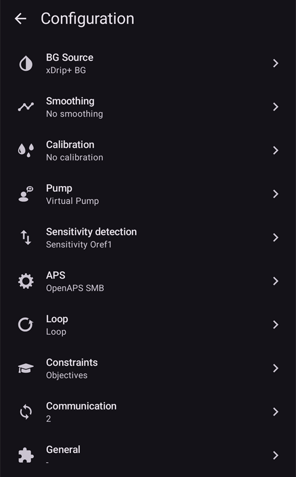
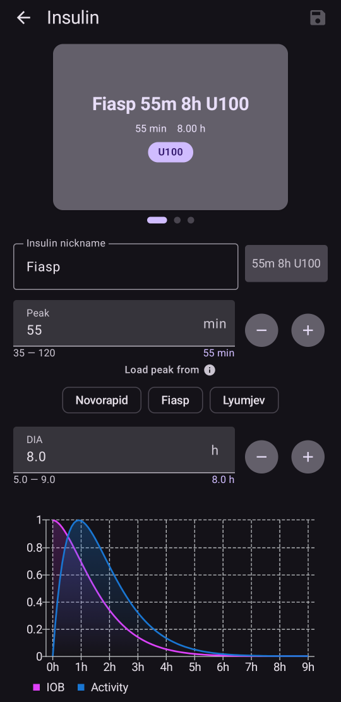
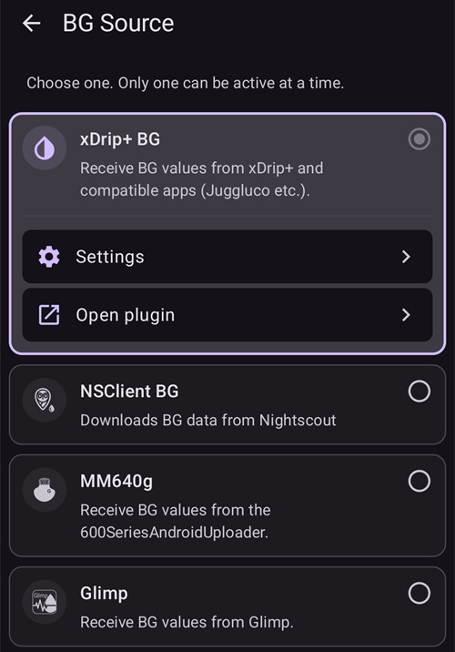
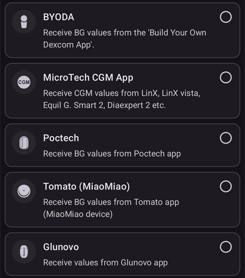
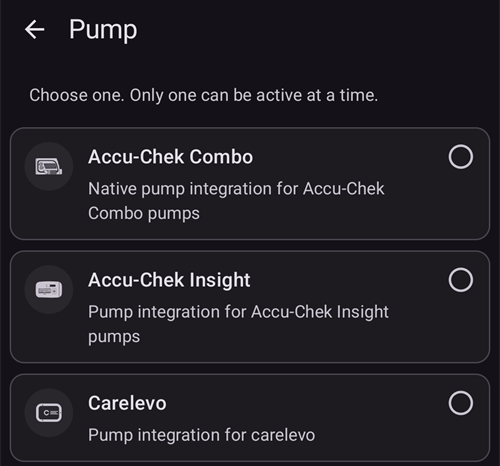
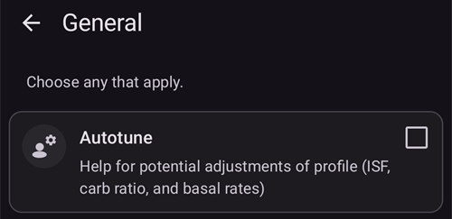

# Configuración (Tabla de configuraciones)

```{admonition} ¿Vienes de AAPS v3? :class: note La **Tabla de configuraciones** ahora se llama **Configuración** y está en el **menú** (☰). Consulta [Qué cambió en AAPS v4](#v4-changes).

    <br />En **Configuración** eliges qué complementos están activos (MCG, bomba, algoritmo APS, sensibilidad, sincronización, …) y abres cada complemento y sus ajustes. La [guía paso a paso](#configuration-v4) está abajo; el resto de esta página describe cada sección en detalle.
    
    (configuration-v4)=
    ## Configuración en AAPS v4
    
    En **AAPS** v4, toca el **menú** (☰) en la esquina **superior izquierda** de la pantalla principal y elige **Configuración** (*«Configura tus ajustes (MCG, bomba, etc.) y activa las funciones»*).
    
    
    
    Los complementos están agrupados por **categoría**, por ejemplo *Suavizado*, *Calibración*, *Detección de sensibilidad*, *APS*, *Comunicación* y *General*. Cada fila muestra el nombre de la categoría y el complemento **activo en ese momento** (p. ej. *APS → OpenAPS SMB*). Toca una fila para abrir una categoría.
    
    
    
    Dentro de una categoría ves los complementos disponibles para ella. En las categorías de una sola opción eliges el complemento activo; algunas categorías permiten elegir varios (*«Selecciona todas las opciones que correspondan»*). Cada complemento ofrece dos acciones:
    
    - **Abrir complemento**: abre la pantalla propia del complemento.
    - **Ajustes**: abre las preferencias del complemento (los ajustes pueden estar agrupados en secciones que se despliegan).
    
    
    
    (configuration_sync_icon)=
    ### El icono del móvil: «sincronizado desde el máster»
    
    Un pequeño **icono de móvil (teléfono)** junto a una categoría o un ajuste significa que ese elemento está **sincronizado desde el máster**: su valor o selección llega a este dispositivo por el canal NSClientV3 (Nightscout).
    
    En un **cliente** (**AAPSClient**) estos elementos se **mantienen sincronizados con el máster**. El icono solo se muestra en un cliente, por eso no aparece en la captura de arriba, que se hizo en la app principal de **AAPS**. En un cliente suele aparecer en *Suavizado*, *Calibración*, *Detección de sensibilidad* y *APS*. Cómo se mantienen alineados el máster y los clientes, y qué ajustes puedes cambiar desde cada lado, se explica en [Control máster ↔ cliente](#client-master-config-prefs).
    
    El mismo icono también aparece **dentro de los ajustes**, junto a cada preferencia que se sincroniza. En el ejemplo de abajo, *Límite de tiempo de absorción* lleva el icono; los ajustes sin el icono se configuran en cada dispositivo:
    
    
    
    Los elementos **sin** el icono se configuran **en cada dispositivo**. El ejemplo más importante es la propia conexión **NSClientV3 (Comunicación)**: la **URL de Nightscout**, el **token de acceso** y los **websockets** se configuran en cada teléfono por separado, por eso **no** muestran el icono del móvil.
    
    ---
    
    (Config-Builder-tab-or-hamburger-menu)=
    ## Abrir la pantalla de un complemento
    
    Cada pantalla de complemento se abre de una de estas formas (las pestañas y la casilla del ojo de **AAPS** v3 ya no existen, consulta [Qué cambió en AAPS v4](#v4-changes)):
    
    - **Configuración** → la categoría del complemento → **Abrir complemento**,
    - el panel **Administrar** de la barra de navegación inferior, para las pantallas que más usas (Perfil, Configuración de insulina, Bomba, Automatización, Comida...),
    - un botón de [QuickLaunch](../DailyLifeWithAaps/QuickLaunch.md) que añades tú,
    - la **barra de búsqueda** de la pantalla principal.
    
    ```{contents}
    :backlinks: entry
    :depth: 2
    

(ConfigBuilder_Profile)=

## Perfil

Este módulo no se puede desactivar porque es una parte central de **AAPS**.

Consulta [Tu perfil de AAPS](../SettingUpAaps/YourAapsProfile.md) para entender lo básico de lo que contiene tu **Perfil**.

(insulin)= (Config-Builder-insulin)=

## Insulina


En **AAPS** 4 la insulina ya no es un complemento que se elige en **Configuración**. Abre **Administrar → Configuración de insulina** para configurar la insulina que usas.

El editor de insulina te permite:

* dar al perfil de insulina un **Apodo de la insulina** para reconocerla fácilmente,
* ajustar el **Pico** (tiempo hasta la máxima actividad de la insulina, en minutos) y la **DIA** (duración de la acción de la insulina, en horas), escribiendo el valor o con los botones **–** / **+**,
* tocar un botón de **Cargar pico desde**: **Novorapid** (75 min), **Fiasp** (55 min) o **Lyumjev** (45 min), para poner en un solo paso el tiempo de pico estándar de esa insulina.

Los rangos permitidos son los mismos para cualquier insulina:

* **DIA**: de 5 a 9 horas (de 5 a 10 horas si el tipo de paciente es **Embarazada**). Consulta [Duración de la acción de la insulina (DIA) y pico](#Config-Builder-insulin-dia) para elegir un valor.
* **Pico**: de 35 a 120 minutos.

Las curvas de **IOB** (insulina activa) y de **Actividad** que se muestran abajo en el editor cambian a medida que cambias los valores, así ves enseguida cómo tus ajustes afectan a la acción de la insulina.

Más información para entender el perfil de insulina tal como se muestra en **AAPS** [aquí](#AapsScreens-insulin-profile).

(Config-Builder-insulin-change-active)=

### Cambiar la insulina en uso (DIA o pico)

La insulina marcada como **ACTIVO** es la que usa tu perfil en curso. Sus campos están en gris: no puedes editarla ni borrarla. Así, el nombre de la insulina que aparece en tu perfil en curso siempre coincide con los ajustes que se usan de verdad.

Para cambiar la DIA o el pico que usas:

1. Abre **Administrar → Configuración de insulina**. Si la pantalla se abre en modo solo lectura (un **✏️ lápiz** en la barra superior), toca el lápiz y desbloquea tus ajustes.
2. Toca **+** (*Añadir nueva insulina*). **AAPS** crea una copia de la insulina que se ve en pantalla.
3. Pon el nuevo **Pico** y/o la nueva **DIA** y luego toca el icono de guardar (arriba a la derecha).
4. Toca **▶** (*Activar insulina*) y confirma. La nueva insulina queda marcada como **ACTIVO**.

```{admonition} El nombre incluye el pico y la DIA :class: note **AAPS** añade automáticamente el pico, la DIA y la concentración al nombre de la insulina (por ejemplo *Fiasp 55m 8h U100*), así puedes distinguir tus configuraciones de un vistazo.

    <br />Puedes borrar la insulina antigua cuando ya no esté activa.
    
    ### Los botones «Cargar pico desde»
    
    En **AAPS** 4 no hay una lista de tipos de insulina para elegir. Todas las insulinas usan la misma curva de actividad exponencial; solo cambian su **Pico** y su **DIA**. Los botones de **Cargar pico desde** del editor de insulina ponen con un toque el pico recomendado para las insulinas más comunes (el pequeño ⓘ junto a **Cargar pico desde** las muestra con sus valores de pico). Después puedes ajustar el **Pico** y la **DIA**.
    
    Cambia el pico respecto a su valor recomendado solo si entiendes el efecto que tiene. El [gráfico de la curva de insulina](#AapsScreens-insulin-profile) te ayuda a entender las curvas.
    
    #### Novorapid
    
    
    
    * recomendado para Humalog, Novolog y Novorapid (llamado *Rapid-Acting Oref* en **AAPS** v3)
    * Pico = 75 minutos después de la inyección
    
    #### Fiasp
    
    
    
    * recomendado para Fiasp (llamado *Ultra-Rapid Oref* en **AAPS** v3)
    * Pico = 55 minutos después de la inyección
    
    (Config-Builder-lyumjev)=
    #### Lyumjev
    
    
    
    * recomendado para Lyumjev
    * Pico = 45 minutos después de la inyección
    
    #### Pico personalizado
    
    * En **AAPS** 4 no hay un tipo de insulina «Free-Peak Oref» aparte: introduce cualquier **Pico** (de 35 a 120 minutos) directamente en el [editor de insulina](#Config-Builder-insulin), sin usar un botón predefinido.
    * Un pico personalizado es útil si usas una insulina que no está en la lista o una mezcla de distintas insulinas.
    
    (Config-Builder-insulin-dia)=
    ### Duración de la acción de la insulina (DIA) y pico
    
    ```{warning}
    En el lazo, bajar la DIA o el pico siempre aumenta la insulina administrada. La DIA funciona en AAPS de forma distinta que en los sistemas AID comerciales, y cambiar estos ajustes sin cuidado puede cambiar la dosis de insulina mucho más o mucho menos de lo esperado.
    

AAPS modela la evolución de la acción de la insulina con una fórmula matemática, que se configura con la **DIA** y con el ajuste muy relacionado del **pico**. La DIA es la duración teórica hasta que la IOB llega a cero, y el pico es el momento en el que el efecto de la insulina es más fuerte. Así se obtiene una curva de IOB y una curva de actividad, que es simplemente la **velocidad** a la que baja la IOB.

Ten en cuenta que, cuando AAPS está en lazo, es normal tener periodos de [basal temporal a cero](#Open-APS-features-super-micro-bolus-smb). Esta insulina basal que falta se resta por completo de la IOB, y por eso en la práctica la IOB llega a cero muchas horas antes que la DIA configurada. Puedes ver por separado la [IOB de bolo y la IOB basal](#aaps-screens-iob-cob-basal-sens) desde la pantalla principal.

Para configurar la DIA y el pico, toca **Administrar** en la pantalla principal y luego toca **Configuración de insulina**. AAPS muestra la configuración de insulina activa así:


En este ejemplo, el pico es de 55 minutos, la DIA es de 8 horas y la [concentración de insulina](#Insulin-Concentration) es la estándar de 100 UI/ml.

Por la influencia de la basal temporal a cero explicada arriba y por la fórmula que AAPS usa para la bajada de la IOB, la mayoría de los usuarios pone una DIA claramente más alta que en los sistemas comerciales. En general, a muchas personas les funciona bien una **DIA** de 9 h. Cuando tengas más experiencia con AAPS y un perfil bien ajustado, puedes intentar encontrar valores personales de DIA y pico con la información de abajo.

````{admonition} Detalles sobre el efecto de la configuración de DIA y pico :class: dropdown

Como en AAPS la dosis basal influye de forma indirecta en la bajada de la IOB, unas dosis basales demasiado altas pueden ocultar una DIA demasiado alta, y al revés. Tiene sentido ajustar primero con cuidado las dosis basales antes de ajustar la DIA y el pico. Además, ten en cuenta que los ajustes de DIA y pico se influyen entre sí: el efecto de la DIA depende del pico, y al revés.

Estos gráficos muestran el efecto exacto de la DIA y del pico en las curvas de IOB, en todo el rango de valores permitidos.

Ajuste de la DIA:

```{image} ../images/iob_remaining_static_peak.png :width: 400px

    <br />Ajuste del pico:
    
    ```{image} ../images/iob_remaining_static_dia.png
    :width: 400px
    

Por último, una comparación ajustando la DIA y el pico a la vez. La idea es que ambos valores se ajustan en la misma proporción, de modo que `49/35 ~ 7/5`. O, de forma parecida, `120/93 ~ 9/7`. Los intervalos serán coherentes sea cual sea la DIA o el pico de partida, siempre que el cambio relativo sea el mismo para ambos.

```{image} ../images/iob_remaining_uniform.png :width: 400px

    <br />Ten en cuenta que, cuando la DIA y el pico se ajustan de esta forma, cada punto de la curva se desplaza en la misma proporción.
    
    ````
    
    #### Más información sobre la configuración de DIA y pico
    
    * [Detalles técnicos e historia de OpenAPS, el predecesor de AAPS](https://openaps.readthedocs.io/en/latest/docs/While%20You%20Wait%20For%20Gear/understanding-insulin-on-board-calculations.html#understanding-the-new-iob-curves-based-on-exponential-activity-curves) (en inglés).
    * [Why we are regularly wrong in the duration of insulin action (DIA) times we use, and why it matters…](https://www.diabettech.com/insulin/why-we-are-regularly-wrong-in-the-duration-of-insulin-action-dia-times-we-use-and-why-it-matters/) (por qué nos equivocamos a menudo con la DIA) en Diabettech.
    * [Exponential Insulin Curves + Fiasp](https://web.archive.org/web/20220630154425/http://seemycgm.com/2017/10/21/exponential-insulin-curves-fiasp/) en See My CGM (archivo).
    * [Revised Humalog model in a closed loop](https://bionicwookiee.com/2022/04/13/revised-humalog-model-in-a-closed-loop/) y otros artículos en Bionic Wookie, que recomiendan una DIA de 9 h para Lyumjev, Fiasp, NovoRapid y Humalog.
    
    (Config-Builder-bg-source)=
    ## Fuente de glucosa
    Selecciona la fuente de glucosa que usas. Consulta la página [Fuente de glucosa](../Getting-Started/CompatiblesCgms.md) para más información sobre la configuración.
    
    
    
    Desplázate hacia abajo para ver las demás fuentes:
    
    
    
    
    
    * [xDrip+ BG](../CompatibleCgms/xDrip.md): también para apps compatibles como [Juggluco](../CompatibleCgms/Juggluco.md)
    * [NSClient BG](../CompatibleCgms/CgmNightscoutUpload.md): solo si sabes lo que haces, consulta [Fuente de glucosa](../Getting-Started/CompatiblesCgms.md).
    * [MM640g](../CompatibleCgms/MM640g.md)
    * Glimp: solo se admite la versión 4.15.57 y posteriores
    * [BYODA (Build Your Own Dexcom App)](#DexcomG6-if-using-g6-with-build-your-own-dexcom-app).
    * Aplicación MicroTech MCG: para el MCG Aidex / LinX
    * [Poctech](../CompatibleCgms/PocTech.md)
    * Tomato (MiaoMiao): app Tomato para el dispositivo MiaoMiao
    * [Glunovo](https://infinovo.com/): app Glunovo para el sistema MCG Glunovo
    * Intelligo: app Intelligo
    * Syai/Ottai: para las apps Syai y Ottai (consulta [Syai Tag](../CompatibleCgms/SyaiTagX1.md) y [Ottai](../CompatibleCgms/OttaiM8.md))
    * Aplicación Sibionic SI: app SI parcheada o app Sibionics para el MCG Sibionics
    * Aplicación Sino: app parcheada para el MCG Sinocare
    * Lector de notificaciones: lee los valores de glucosa de las notificaciones que muestran las apps oficiales de MCG (Dexcom, Medtronic, Eversense, etc.)
    * Instara: app Instara
    * Glucosa aleatoria: genera datos de glucosa aleatorios para pruebas. Solo se puede activar en una versión de ingeniería (para desarrolladores) con la **Bomba virtual**, así que en una instalación normal de **AAPS** no se puede usar.
    
    ## Suavizado
    
    
    
    Consulta [Suavizado de los datos de glucosa en la sangre](../CompatibleCgms/SmoothingBloodGlucoseData.md).
    
    ## Calibración
    
    Elige cómo trata **AAPS** los valores que recibe de tu sensor:
    
    - **Sin calibración**: los valores del sensor se usan tal como llegan. Úsalo cuando el sensor ya viene calibrado de fábrica y es preciso. Es la opción por defecto.
    - **Calibración lineal**: **AAPS** corrige los valores del sensor con una pendiente y un desplazamiento que calcula a partir de tus mediciones capilares.
    
    Cómo funciona la **Calibración lineal**:
    
    - Necesita que se haya registrado un **cambio de sensor**, para saber cuándo empezó la sesión del sensor. Las primeras 2 horas de una sesión se omiten como periodo de calentamiento.
    - Necesita al menos **2 mediciones capilares**. Las mediciones recientes cuentan más que las antiguas.
    - La corrección solo se aplica cuando el resultado está en un rango seguro. Si tus mediciones están demasiado juntas, solo se corrige el desplazamiento.
    - **Abrir complemento** muestra el estado de la calibración, la pendiente y la corrección en uso, y la lista de mediciones capilares. Puedes añadir una medición con **Añadir calibración** y eliminar una incorrecta.
    
    ```{admonition} Calibra con cuidado
    :class: warning
    Un valor capilar incorrecto produce valores de glucosa incorrectos y, por tanto, una dosis de insulina incorrecta. Lávate las manos antes de medir y no calibres mientras tu glucosa cambia rápido.
    


(Config-Builder-pump)=

## Bomba

Selecciona la bomba que usas. Consulta la página [Bombas compatibles](../Getting-Started/CompatiblePumps.md) para más información sobre la configuración.



Desplázate hacia abajo para ver todos los controladores de bomba:


Cuando seleccionas otra bomba, **AAPS** te pide que confirmes el cambio:


* [Dana R](../CompatiblePumps/DanaR-Insulin-Pump.md)
* Dana R Coreano (para la bomba DanaR del mercado coreano)
* Dana Rv2 (bomba DanaR con actualización de firmware no oficial)
* [Dana-i/RS](../CompatiblePumps/DanaRS-Insulin-Pump.md)
* [Accu-Chek Insight](../CompatiblePumps/Accu-Chek-Insight-Pump.md)
* [Accu Chek Combo](../CompatiblePumps/Accu-Chek-Combo-Pump-v2.md)
* Omnipod para [Omnipod Eros](../CompatiblePumps/OmnipodEros.md)
* Dash para [Omnipod DASH](../CompatiblePumps/OmnipodDASH.md)
* [Medtronic](../CompatiblePumps/MedtronicPump.md)
* [Diaconn G8](../CompatiblePumps/DiaconnG8.md)
* [EOPatch2](../CompatiblePumps/EOPatch2.md)
* [Medtrum](../CompatiblePumps/MedtrumNano.md)
* [Equil 5.3](../CompatiblePumps/Equil5.3.md)
* [Carelevo](../CompatiblePumps/CareLevo.md)
* Bomba virtual: lazo abierto - solo sugerencias de **AAPS** 
  * cuando das tus primeros pasos con **AAPS**, durante los primeros [objetivos](../SettingUpAaps/CompletingTheObjectives.md)
  * para una bomba que todavía no tiene controlador

(config-builder-wrong-pump-data)=

### Mensaje: «Los datos proceden de una bomba diferente»

**AAPS** recuerda la bomba a la que está conectado (tipo de bomba y número de serie). Si recibe datos de otra bomba, por ejemplo después de cambiar tu bomba por una nueva del mismo modelo, muestra este mensaje e ignora los datos de esa bomba:


Para usar la nueva bomba, cambia el controlador de la bomba: selecciona **Bomba virtual**, confirma y luego vuelve a seleccionar tu bomba. Después **AAPS** registra la bomba a la que está conectado ahora.

(Config-Builder-sensitivity-detection)=

## Detección de sensibilidad


Selecciona el tipo de detección de sensibilidad. Para más detalles sobre los distintos modelos, [lee aquí](../DailyLifeWithAaps/SensitivityDetectionAndCob.md). Analiza los datos históricos sobre la marcha y hace ajustes si detecta que reaccionas a la insulina con más sensibilidad (o al contrario, con más resistencia) de lo habitual. Puedes encontrar más detalles sobre cómo se calcula el propio ratio de sensibilidad en [Funciones clave de AAPS > Autosens](#Open-APS-features-autosens).

Puedes ver tu sensibilidad en la pantalla principal en un [gráfico adicional](#AapsScreens-section-g-additional-graphs): selecciona SEN y mira la línea blanca. Nota: necesitas estar en el [Objetivo 8](#objectives-objective8) para que la detección de sensibilidad/[Autosens](#Open-APS-features-autosens) ajuste automáticamente la cantidad de insulina administrada. Antes de llegar a ese objetivo, el porcentaje de Autosens / la línea en tu gráfico se muestra solo como información.

### Ajustes de absorción

Si usas Oref1 con **SMB**, debes cambiar **min_5m_carbimpact** a 8. Este valor solo se usa cuando faltan lecturas del **MCG** o cuando la actividad física «gasta» toda la subida de glucosa que, si no, haría que **AAPS** redujera los COB. Cuando la [absorción de carbohidratos](../DailyLifeWithAaps/CobCalculation.md) no se puede calcular de forma dinámica a partir de la reacción de tu glucosa, aplica a tus carbohidratos una reducción por defecto. Básicamente, es una medida de seguridad.

(Config-Builder-aps)=

## APS


Selecciona el algoritmo APS que quieres usar para ajustar la terapia. Puedes ver los detalles activos del algoritmo elegido con **Abrir complemento**.

* OpenAPS AMA 
  * Advanced Meal Assist (asistente avanzado de comidas): algoritmo antiguo, ya no se recomienda.
  * En pocas palabras, la ventaja es que, después de ponerte un bolo de comida, el sistema puede subir la basal temporal más rápido SI introduces los carbohidratos de forma fiable.
* [OpenAPS SMB](#Open-APS-features-super-micro-bolus-smb) 
  * Super Micro Bolus: el algoritmo más reciente, recomendado para todos los usuarios.
  * A diferencia de AMA, SMB no usa basales temporales para controlar la glucosa, sino sobre todo pequeños **Super Micro Bolos**.
  * Nota: se recomienda usar este algoritmo desde el principio, aunque no recibirás SMB hasta el [Objetivo 9](#objectives-objective9).
* [Auto ISF](#Open-APS-features-auto-isf) 
  * Algoritmo experimental para usuarios avanzados. Solo aparece en la lista cuando se han completado los objetivos.

Si cambias del algoritmo AMA al SMB, debes cambiar a mano *min_5m_carbimpact* a **8** (valor por defecto para SMB) en [Ajustes → Ajustes de absorción](#Preferences-min_5m_carbimpact).

## Lazo

Este módulo no se puede desactivar porque es una parte central de **AAPS**.


## Restricciones


### Objetivos

**AAPS** tiene un programa de aprendizaje (una serie de objetivos) que tienes que cumplir paso a paso. Te guiará de forma segura en la configuración de un sistema de lazo cerrado.

Consulta la página [Objetivos](../SettingUpAaps/CompletingTheObjectives.md) para más información.

## Comunicación

En esta categoría (llamada **Sincronización** en **AAPS** v3) eliges si quieres que **AAPS** envíe tus datos y adónde.


Desplázate hacia abajo para ver el resto de la lista:


### NSClientV3

Se puede usar como [servidor de informes](../SettingUpAaps/SettingUpTheReportingServer.md) y/o para [seguimiento remoto](../RemoteFeatures/RemoteMonitoring.md) y [control remoto](../RemoteFeatures/RemoteControl.md).

Consulta [Sincronización con el servidor de informes](#SetupWizard-synchronization-with-the-reporting-server-and-more) para configurar la sincronización con NSClientV3.

### Tidepool

Se puede usar como [servidor de informes](../SettingUpAaps/SettingUpTheReportingServer.md).

Consulta [Tidepool](../SettingUpAaps/Tidepool.md).

### xDrip

Se usa para **enviar** datos, como valores de glucosa y tratamientos, a xDrip+ en el mismo teléfono. Sus ajustes también incluyen **Enviar estado a xDrip+**, una línea de estado con IOB y COB que muestran xDrip+ y algunas apps complementarias para relojes.

### Open Humans

Consulta [Open Humans](../SupportingAaps/OpenHumans.md).

(Config-Builder-wear)=

### Reloj

Supervisa y controla **AAPS** desde un reloj Wear OS. La configuración del reloj se explica en [Reloj inteligente Wear OS](../WearOS/WearOsSmartwatch.md). Después de activar el complemento, elige sus opciones en [Ajustes > Reloj](#preferences-wear). El uso del reloj se explica en [Manejo de AAPS con tu reloj inteligente Wear OS](../RemoteFeatures/RemoteControlWearOS.md).

(external-companion-apps)=

### Aplicaciones complementarias externas

Emite los datos de estado de **AAPS** en el teléfono para que otras apps instaladas en él puedan mostrarlos, por ejemplo apps complementarias para relojes o widgets. Los datos emitidos incluyen la glucosa y su tendencia, IOB, COB, basal y basal temporal, nombre del perfil, estado del lazo, batería del teléfono y de la bomba, nivel del reservorio y progreso del bolo. Actívalo solo si una app complementaria que usas te pide estos datos.

Las apps que se sabe que leen estos datos son [WatchDrip+](https://bigdigital.home.blog/) (relojes Xiaomi y Amazfit), [GlucoDataHandler](https://github.com/pachi81/GlucoDataHandler) (complicaciones y widgets de Wear OS, y Android Auto con GlucoDataAuto) y la app G-Watch. Su configuración se describe en [Relojes inteligentes y AAPS](#watches-external-companion-apps). Algunas de ellas también usan **Enviar estado a xDrip+** del complemento **xDrip** de arriba para una línea de estado con IOB y COB.

En versiones anteriores este complemento se llamaba **Samsung Tizen**, por la [app G-Watch para relojes Samsung Tizen](#Watchfaces-tizen) para la que se creó primero.

### Garmin

Conexión con dispositivos Garmin (Fenix, Edge...)

## Tratamientos

Abre el **menú** (☰) y selecciona [Historial de tratamientos](#aaps-screens-treatments) para ver los tratamientos registrados. Si quieres editar o borrar una entrada (p. ej. comiste menos carbohidratos de lo esperado), selecciona «Eliminar» e introduce el nuevo valor (cambia la hora si hace falta) con **Tratamientos → Carbohidratos** en la barra de navegación inferior (consulta [Carbohidratos](#screens-bolus-carbs)).

## General

En **AAPS** 4 la categoría **General** de **Configuración** solo contiene **Autotune**. Las demás funciones descritas abajo están siempre disponibles y ya no hace falta activarlas aquí; cada párrafo dice dónde encontrarlas.



### Inicio

La [pantalla principal](#AapsScreens-the-homescreen) de **AAPS** ya no es un complemento y no tiene ajustes propios en **Configuración**. Las opciones que antes estaban aquí están en **Ajustes** (icono del engranaje): [Mostrar notas en los diálogos](#Preferences-show-notes-field-in-treatments-dialogs), [Luces de estado](#Preferences-status-lights) y el [Porcentaje de bolo](#Preferences-deliver-this-part-of-bolus-wizard-result) que usa el asistente de bolo. La opción de superbolo de **AAPS** 3.x [no está disponible como ajuste](#Preferences-advanced-settings-overview) en **AAPS** 4.

(Config-Builder-actions)=

### Acciones

La pestaña Acciones de **AAPS** 3.x ya no existe. Sus botones ahora están en el panel **Administrar**; consulta [¿Dónde está la pestaña Acciones?](#screens-action-tab).

### Automatización

**Administrar → Automatización** te permite gestionar tus [automatizaciones](../DailyLifeWithAaps/Automations.md), a partir del [Objetivo 10](#objectives-objective10).

(Config-Builder-sms-communicator)=

### Comunicador por SMS

Permite a los cuidadores controlar a distancia algunas funciones de **AAPS** por SMS. Consulta [Comandos SMS](../RemoteFeatures/SMSCommands.md) para más información sobre la configuración.

### Comida

**Administrar → Comida** muestra los alimentos predefinidos en la base de datos de comida de Nightscout. Consulta el [Readme de Nightscout](https://github.com/nightscout/cgm-remote-monitor#food-custom-foods) para más información sobre la configuración.

Nota: las entradas no se pueden usar en la calculadora de **AAPS**. (Solo lectura)

(Config-Builder-autotune)=

### Autotune

Puedes activar Autotune, consulta [aquí](../AdvancedOptions/Autotune.md).

### Mantenimiento

Abre el **menú** (☰) y selecciona **Mantenimiento** para exportar / importar ajustes y gestionar los archivos de registro.


### Tabla de configuraciones

Ahora se llama **Configuración**: esta misma página.