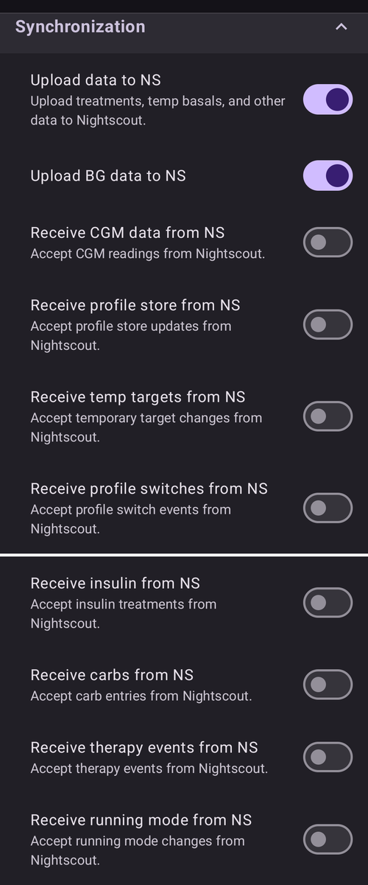

# Nightscout

(Nightscout-security-considerations)=

## Consideraciones de seguridad

Nightscout es el servidor de informes y de seguimiento de **AAPS**: **AAPS** sube tus datos a él, y tú o tus cuidadores pueden verlos en el sitio web de Nightscout o en apps de seguimiento. Contiene tus datos médicos, perfiles y tratamientos, así que vale la pena pensar en cómo proteger tu sitio web de Nightscout.

En **AAPS** 4, el control remoto no pasa por el sitio web de Nightscout. Mientras el control de clientes está activado ([modo reforzado](#client-master-control-hardened-mode)), **AAPS** **no aplica** los tratamientos ni los objetivos introducidos directamente en Nightscout. En su lugar, las órdenes remotas llegan desde un **AAPSClient** emparejado; consulta [Control máster ↔ cliente](#client-master-control).

Ten muchísimo cuidado si usas Nightscout como fuente de datos de glucosa de AAPS.

### Ajustes de Nightscout

Puedes impedir el acceso público a tu sitio de Nightscout con los [roles de autenticación](https://nightscout.github.io/nightscout/security): comparte tu URL solo con un token `readable`, nunca con un token `admin`.

El `API_SECRET` de Nightscout es la contraseña principal de tu sitio: no la compartas públicamente.

(Nightscout-aaps-settings)=

### Ajustes de AAPS

Aceptar datos de Nightscout (cambios de perfil, tratamientos, ...) es opcional y está desactivado por defecto. Los interruptores descritos abajo están ocultos mientras el control de clientes está activado (modo reforzado) y en [modo sencillo](#preferences-simple-mode).

* Abre los ajustes de **Sincronización** del complemento NSClientV3 de una de estas formas: 1) **Ajustes** (icono del engranaje en la pantalla principal) -> **NSClientV3** -> **Sincronización**, o 2) **Configuración** (menú ☰) -> **Comunicación** -> «**Ajustes**» debajo de NSClientV3.
* Activa «Subir datos a NS».
* «Subir datos de glucemia a Nightscout» está en los ajustes de tu fuente de glucosa (**Configuración → Fuente de glucosa → Ajustes**). Actívalo, salvo que tu fuente de datos de glucosa de AAPS sea Nightscout: en ese caso **no** lo actives.
* No actives «Recibir datos de MCG desde NS» salvo que Nightscout sea tu fuente de datos de glucosa.

#### No sincronizar desde Nightscout

Keeping all the "Receive … from NS" options disabled makes sure no Nightscout change will be used by AAPS:

#### Aceptar cambios desde Nightscout

Activar estas opciones te permite cambiar ajustes de AAPS desde Nightscout, como modificar y cambiar perfiles, objetivos temporales y añadir carbohidratos, que AAPS tendrá en cuenta. Solo se muestran cuando el control de clientes y el modo sencillo están desactivados.  
Ten en cuenta que los tratamientos de insulina solo se usarán para cálculos, como «No poner bolo, solo registrar».

### Configuraciones de seguridad adicionales

Mantén tu teléfono actualizado como se describe en [la seguridad es lo primero](#preparing-safety-first).

(Nightscout-manual-nightscout-setup)=

## Configuración manual de Nightscout

Se supone que ya tienes un sitio de Nightscout; si no, visita la página de [Nightscout](http://nightscout.github.io/nightscout/new_user/) para ver las instrucciones completas de instalación. Las instrucciones de abajo son ajustes que también tendrás que añadir a tu sitio de Nightscout. Tu sitio de Nightscout debe tener al menos la versión 15, así que comprueba que usas la [última versión](https://nightscout.github.io/update/update/#updating-your-site-to-the-latest-version); si no, recibirás un mensaje de error en tu app de AAPS.

* [Edita tus variables](https://nightscout.github.io/nightscout/setup_variables/#nightscout-configuration)

* Agrega o edita las variables de la siguiente manera:
  
  * `ENABLE` = `careportal boluscalc food bwp cage sage iage iob cob basal dbsize pushover pump openaps`
  * `DEVICESTATUS_ADVANCED` = `true`
  * `SHOW_FORECAST` = `openaps`
  * `PUMP_FIELDS` = `reservoir battery clock`
  * Se pueden configurar varias alarmas para [monitorear la bomba](https://github.com/nightscout/cgm-remote-monitor#pump-pump-monitoring), se recomienda en particular la alarma de porcentaje de batería: 
    * `PUMP_WARN_BATT_P` = `51`
    * `PUMP_URGENT_BATT_P` = `26` 

* Guarda los cambios. Ahora tu sitio de Nightscout debería permitirte mostrar las píldoras. Puedes hacer que se muestren por defecto añadiéndolas en `SHOW_PLUGINS`.
  
  * `SHOW_PLUGINS` = `careportal boluscalc food bwp cage sage iage iob cob basal dbsize pushover pump openaps`
  
  

## Nightscout como SaaS de pago (Software as a Service, software como servicio)

Usa la interfaz web del proveedor para configurar las variables. Si hace falta, contacta con el servicio de soporte del proveedor.