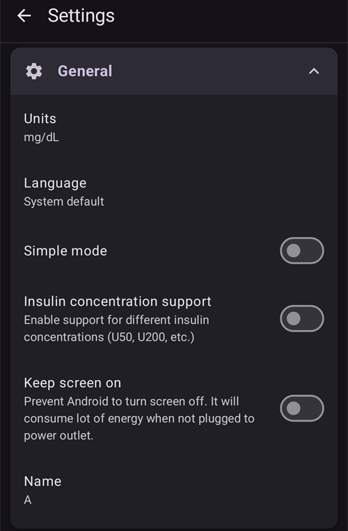
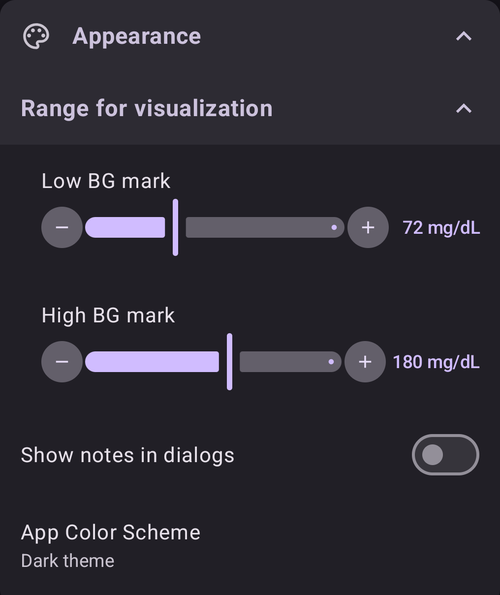
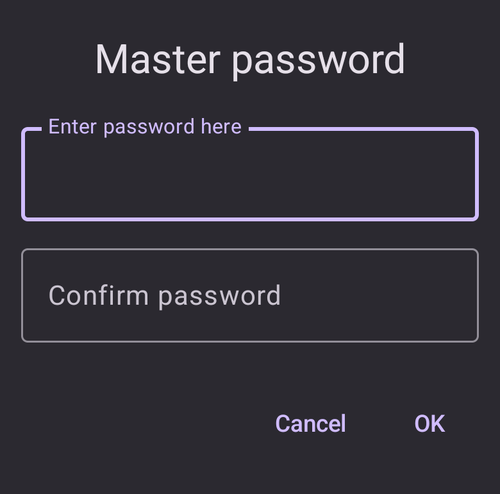
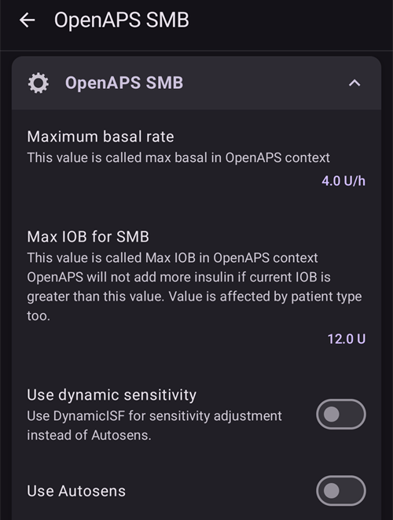
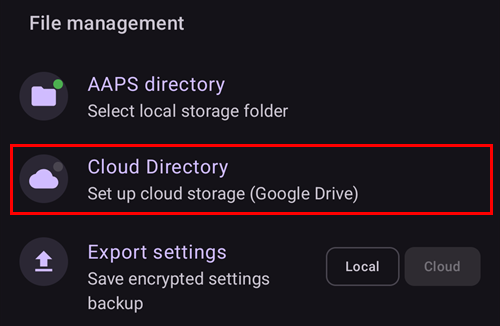

# Ajustes

En **AAPS** v4, las preferencias están en la pantalla **Ajustes**. Hay tres formas de llegar a ellas; los detalles están en [Hacer cambios en la configuración de AAPS](../SettingUpAaps/ChangeAapsConfiguration.md):

1. Pulsa el icono **Ajustes** (rueda dentada) en la esquina superior derecha de la pantalla principal: todos los ajustes, agrupados en secciones desplegables.
2. En **Configuración**, pulsa «**Ajustes**» debajo de un complemento activo: solo los ajustes de ese complemento.
3. Usa la **barra de búsqueda** en la parte superior de la pantalla principal: empieza a escribir parte del texto que buscas. Así encuentras ajustes concretos (también los que no se ven en la pantalla Ajustes), diálogos y documentación.


- Las **secciones** se abren y se cierran al pulsarlas. Las secciones que ves dependen de los complementos que tienes activados y del [Modo sencillo](#preferences-simple-mode).


```{contents}
:backlinks: entry
:depth: 2
```

(Preferences-general)=
## General



**KEEP**

- Elige las unidades mmol/l o mg/dl según prefieras.

**KEEP**

- By default **AAPS** follows the language of the phone (recommended).

- If you want **AAPS** in another language than the phone, choose it here. On Android 13 and newer, **AAPS** registers it as its own app language in Android, so all its screens, the main screen, the widgets and the way numbers are written follow it.

- Cuando cambias el idioma, los textos de **AAPS** pasan al nuevo idioma de inmediato. Si algunos textos siguen en el idioma anterior, reinicia **AAPS**.
- On Android 12 this setting is not shown: **AAPS** always uses the language of the phone.
- Ajuste oculto en el [modo sencillo](#preferences-simple-mode).

(preferences-simple-mode)= **Modo sencillo**

El **modo sencillo** está activado por defecto cuando instalas **AAPS** por primera vez. En el **modo sencillo**, muchos ajustes están ocultos y las preferencias se sustituyen por valores predefinidos. Cuando ya conozcas bien la interfaz y los ajustes de **AAPS**, deberías desactivar el modo sencillo.

**KEEP**

- Activa el soporte para distintas concentraciones de insulina (U50, U200...). Actívalo solo si de verdad usas una concentración distinta de U100, y lee las advertencias con atención.
- Ajuste oculto en el [modo sencillo](#preferences-simple-mode).

**Mantener pantalla encendida**

- Obliga a Android a mantener la pantalla encendida siempre. Es útil para presentaciones, etc. Pero consume mucha batería. Por eso se recomienda conectar el teléfono a un cargador.

**KEEP**

- El nombre de la persona que usa este teléfono. Distingue esta instancia de **AAPS** en los informes y en la sincronización, por ejemplo si dos niños con diabetes tipo 1 de tu familia usan **AAPS**.
- Se usa en los nombres de los archivos de ajustes exportados.
- Se muestra en la [esfera Dual](../WearOS/WearOsSmartwatch.md).

(Preferences-skin)=
### KEEP

La elección de tema (skin) de **AAPS** 3.x (Original, Baja resolución, Pantalla grande...) ya no existe en **AAPS** 4. La nueva interfaz se adapta a tu pantalla de forma automática, y el esquema de colores se puede cambiar en [Apariencia](#preferences-appearance).

(preferences-appearance)=
## KEEP



(Preferences-range-for-visualization)=
### KEEP

Elige los límites alto y bajo del gráfico de glucosa en la pantalla principal de **AAPS** y en el reloj. Es solo la visualización, no el rango objetivo de tu glucosa. Ejemplo: 70 - 180 mg/dl o 3,9 - 10 mmol/l

(Preferences-show-notes-field-in-treatments-dialogs)=
### KEEP

Te permite añadir notas de texto cortas a tus tratamientos (asistente de bolo, carbohidratos, insulina...).

Ajuste oculto en el [modo sencillo](#preferences-simple-mode).

### KEEP

Elige entre el tema claro, el tema oscuro o seguir el ajuste del sistema del teléfono.

(Preferences-protection)=
## Protección


(Preferences-master-password)=
### KEEP

Obligatoria para poder [exportar los ajustes](../Maintenance/ExportImportSettings.md), porque están cifrados desde la versión 2.7.

**La protección biométrica puede no funcionar en teléfonos OnePlus. Es un problema conocido de OnePlus en algunos teléfonos.**



(Preferences-settings-protection)=
### KEEP

- Protege tus ajustes con una contraseña o con la autenticación biométrica del teléfono (p. ej., si [un niño usa **AAPS**](../RemoteFeatures/RemoteMonitoring.md)). Si activas esta función, se te pedirá autenticarte cada vez que quieras abrir cualquier vista relacionada con los ajustes.

- Las pantallas de gestión (**Perfil**, **Configuración de insulina**, **Objetivo temporal**, **Asistente rápido**) se abren entonces en **solo lectura**. Puedes seguir activando o usando una entrada, pero las opciones de añadir, editar, clonar y borrar se ocultan hasta que desbloquees tus ajustes. Consulta [La protección de ajustes ahora también bloquea las pantallas de gestión](#v4changes-read-only-management).

- Usa una contraseña personalizada si quieres usar la contraseña maestra solo para proteger los [ajustes exportados](../Maintenance/ExportImportSettings.md) y otra contraseña distinta para editar los ajustes.

- Si usas una contraseña personalizada, pulsa en la línea «Contraseña de ajustes» para fijar la contraseña como se describe [arriba](#Preferences-master-password).

### KEEP

Si la aplicación está protegida, tienes que introducir la contraseña o usar la autenticación biométrica del teléfono para abrir **AAPS**, y otra vez cuando vuelvas a ella después del [tiempo de espera de protección](#Preferences-password-and-pin-retention).

**AAPS** se cerrará de inmediato si se introduce una contraseña incorrecta, pero seguirá funcionando en segundo plano si antes se abrió correctamente.

### KEEP

- La protección de bolo puede ser útil si **AAPS** lo usa un niño pequeño y tú [das bolos por SMS](../RemoteFeatures/SMSCommands.md).

- La **Protección de bolo** solo se puede elegir cuando la **Protección de ajustes** (nivel 2) está configurada.

- En el ejemplo de abajo, la protección de bolo usa la **Contraseña maestra**: **AAPS** la pide antes de abrir un diálogo de tratamiento como **Insulina**. Con **Biométrico**, si la autenticación biométrica no funciona, puedes introducir la contraseña maestra en su lugar.


(Preferences-password-and-pin-retention)=
### Conservación de la contraseña y el PIN

El **Tiempo de espera de protección** define cuánto tiempo (en segundos) siguen desbloqueadas las funciones de ajustes o de bolo después de introducir bien la contraseña.

## Seguridad de los tratamientos


(preferences-patient-type)=
### KEEP

- Los límites de seguridad se fijan según la edad que eliges en este ajuste.
- Si empiezas a alcanzar estos límites fijos (como el bolo máximo), es el momento de subir un nivel.
- It's a bad idea to select higher than real age because it can lead to overdosing by entering the wrong value in the insulin dialog (by skipping the decimal separator, for example).
- Si quieres saber los números concretos de estos límites de seguridad fijos, busca la función del algoritmo que usas en [esta página](../DailyLifeWithAaps/KeyAapsFeatures.md).

(Preferences-maximum-bolus)=
### KEEP

- Define la cantidad máxima de insulina en bolo, en unidades de insulina, que **AAPS** puede administrar de una vez.
- Este ajuste existe como límite de seguridad para evitar la administración de un bolo enorme por una entrada accidental o un error del usuario.
- Se recomienda poner aquí una cantidad razonable, más o menos la cantidad máxima de insulina en bolo que es probable que necesites para una comida o una dosis de corrección.
- Esta restricción también se aplica a los resultados de la calculadora de bolo.

### KEEP

- Define la cantidad máxima de carbohidratos, en gramos, para la que la calculadora de bolo de **AAPS** puede calcular una dosis.
- Este ajuste existe como límite de seguridad para evitar la administración de un bolo enorme por una entrada accidental o un error del usuario.
- Se recomienda poner aquí una cantidad razonable, más o menos la cantidad máxima de carbohidratos que es probable que necesites para una comida.

## Fuente de glucosa

Los ajustes de la [fuente de glucosa](#Config-Builder-bg-source) que elegiste aparecen en su propia sección. Por ejemplo, con **xDrip+ BG**:


- **Subir datos de glucemia a Nightscout**: deja que **AAPS** suba a Nightscout los valores de glucosa recibidos. Actívalo solo si la propia aplicación del MCG no los sube ya.
- **Registrar cambio de sensor**: crea de forma automática un evento de terapia de cambio de sensor cuando se inserta el sensor.

## La pantalla principal

En **AAPS** 3.x estos ajustes estaban agrupados en una sección «Inicio». En **AAPS** 4 se configuran directamente desde los elementos de la pantalla principal a los que pertenecen.

(Preferences-buttons)=
### Botones de Lanzamiento Rápido

Define qué botones de acción se ven en la pantalla principal: pulsa la pequeña **rueda dentada** abajo en el centro de la pantalla principal («Configurar Lanzamiento Rápido») y pulsa **Añadir** para las acciones a las que quieres acceder rápido (tratamientos, acciones del MCG, entradas del portal de cuidados...).


(Preferences-quick-wizard)=
### Asistente rápido

Crea botones personalizados para ciertas comidas o tentempiés estándar, que se mostrarán en la pantalla principal. Útil para comidas estándar que comes a menudo.

Para cada botón defines los carbohidratos y el método de cálculo del bolo. Después defines en qué periodo de tiempo se verá el botón en tu pantalla principal; solo un botón por periodo. El botón no se verá fuera del intervalo de tiempo indicado o si tienes suficiente IOB para cubrir los carbohidratos definidos en el botón del Asistente rápido. Si pones horas distintas para las distintas comidas, siempre tendrás el botón de comida estándar adecuado en la pantalla principal, según la hora del día.

Para gestionar tus ajustes preestablecidos del asistente rápido, escribe «QuickWizard» en la barra de búsqueda de la pantalla principal y abre **Asistente rápido - Gestionar ajustes preestablecidos del asistente rápido**.

Si pulsas el botón del asistente rápido, **AAPS** calculará y propondrá un bolo para esos carbohidratos según tus ratios actuales (teniendo en cuenta la glucosa o la insulina activa si está configurado).

La propuesta debe confirmarse antes de que se administre la insulina.

(Preferences-default-temp-targets)=
### Objetivos temporales por defecto

Los [objetivos temporales (TT)](../DailyLifeWithAaps/TempTargets.md) te permiten cambiar tu objetivo de glucosa durante un tiempo determinado. Si fijas un TT por defecto, puedes cambiar fácilmente tu objetivo para actividad, comida pronto, etc.

Pulsa el **rango objetivo** en la pantalla principal para abrir la pantalla **Objetivo temporal**. Desliza entre las tarjetas de ajustes preestablecidos (Comiendo Pronto, Actividad, Hipo) y cambia el objetivo y la duración de cada uno en **Ajustes preestablecidos**. Los valores preestablecidos son:

* Comiendo Pronto: objetivo 90 mg/dl / 5,0 mmol/l, duración 45 min
* Actividad: objetivo 140 mg/dl / 7,8 mmol/l, duración 90 min
* Hipo: objetivo 160 mg/dl / 8,9 mmol/l, duración 60 min


Aprende a [activar los objetivos temporales aquí](#TempTargets-where-can-i-select-a-temp-target).

### Cantidades estándar de insulina para Cebar/Llenar

Si quieres llenar el tubo o cebar la cánula desde **AAPS**, puedes hacerlo con los botones **Cebar/Llenar** en el panel de estado desplegado de la pantalla principal.

Las cantidades por defecto de los tres botones de llenado se pueden definir en los ajustes de **Cebar/Llenar**, según la longitud de tu catéter. Escribe «prime» en la barra de búsqueda de la pantalla principal para abrirlos.


(Preferences-status-lights)=
### Luces de estado

Las luces de estado avisan de forma visual de:

- Edad del sensor
- Edad de la insulina (días de uso del reservorio)
- Nivel del reservorio/cartucho (unidades)
- Edad de la cánula
- Edad de la batería de la bomba
- KEEP

Si se supera el umbral de aviso, los valores se muestran en amarillo. Si se supera el umbral crítico, los valores se muestran en rojo.

Para cambiar los umbrales, despliega el panel de estado en la pantalla principal (flecha a la derecha de la fila de estado) y pulsa el pequeño icono **Ajustes** junto a «Estado»:


Pulsa un elemento (**Cánula**, **Insulina**, **Sensor** o **Batería de la bomba**) para abrir sus umbrales de aviso y críticos:


La última opción te permite importar esos ajustes desde Nightscout, si están definidos allí. Consulta la [documentación de Nightscout](https://nightscout.github.io/nightscout/setup_variables/#age-pills) para más información.

(Preferences-deliver-this-part-of-bolus-wizard-result)=
### Ajustes del asistente de bolo

Escribe «bolus» en la barra de búsqueda de la pantalla principal para abrir los ajustes del **Asistente de bolo**:


El **Porcentaje de bolo** fija el [porcentaje por defecto](#AapsScreens-section-j) del bolo calculado al usar el asistente de bolo.

El valor por defecto es 100 %: sin corrección. Aunque pongas aquí otro valor, puedes cambiarlo cada vez que uses el asistente de bolo. Si este ajuste es 75 % y tuvieras que poner un bolo de 10 U, el asistente de bolo propondrá un bolo de comida de solo 7,5 unidades.

Con [SMB](#objectives-objective9), muchas personas no se ponen el 100 % de la insulina necesaria para la comida, sino solo una parte (p. ej., 75 %), y dejan que los SMB con UAM (detección de comidas no anunciadas) hagan el resto. Usar aquí un valor menor del 100 % puede ser útil:
* para personas con digestión lenta: administrar todo el bolo por adelantado puede causar una hipoglucemia, porque la insulina actúa más rápido que la digestión.
* para dejar más margen a **AAPS** para gestionar por sí mismo la **subida de glucosa**. En ambos casos, **AAPS** compensará la parte que falta del bolo con SMB, si y cuando lo considere adecuado.

**KEEP**

Si está activado y usas el asistente de bolo cuando tienes hiperglucemia, recibirás un aviso que te pregunta si quieres ponerte el bolo antes y comer más tarde, cuando tu **glucosa** vuelva al rango.

(Preferences-advanced-settings-overview)=
### KEEP

La opción Superbolo de **AAPS** 3.x no está disponible como ajuste en **AAPS** 4.

## Lazo

Consulta [Pantallas de AAPS > La pantalla principal > Estado del lazo](#AapsScreens-loop-status) para cambiar ahora el modo del lazo.

(Preferences-minimal-request-change)=
### KEEP

Con el **Lazo abierto**, recibirás notificaciones cada vez que **AAPS** recomiende ajustar la dosis basal. Para reducir el número de notificaciones, puedes usar un [rango objetivo de glucosa más amplio](#profile-glucose-targets) o aumentar el porcentaje del ajuste «**Cambio mínimo en modo abierto**». Define el cambio relativo necesario para mostrar una notificación.


## Advanced Meal Assist (AMA) o Super Micro Bolus (SMB)

Según tus ajustes en [Configuración > APS](../SettingUpAaps/ConfigBuilder.md), puedes elegir entre dos algoritmos:

- [Advanced Meal Assist (OpenAPS AMA)](#Open-APS-features-advanced-meal-assist-ama): estado del algoritmo en 2017
- [Super Micro Bolus (OpenAPS SMB)](#Open-APS-features-super-micro-bolus-smb): el algoritmo más reciente, recomendado para principiantes

As of [**AAPS** version 3.3](#version3300), the [Dynamic ISF](../DailyLifeWithAaps/DynamicISF.md) feature has been moved into OpenAPS SMB.

### OpenAPS AMA

Todos los ajustes de OpenAPS AMA se describen en su sección en [Funciones clave de AAPS > Advanced Meal Assist (AMA)](#Open-APS-features-advanced-meal-assist-ama).

(Preferences-openaps-smb-settings)=
### OpenAPS SMB

Todos los ajustes de OpenAPS SMB se describen en su sección en [Funciones clave de AAPS > Super Micro Bolus (SMB)](#Open-APS-features-super-micro-bolus-smb).

La lista de ajustes que ves depende de tu avance en los [Objetivos](../SettingUpAaps/CompletingTheObjectives.md) y del [Modo sencillo](#preferences-simple-mode). En una instalación nueva solo se muestra **Usar sensibilidad dinámica**. Cuando completas los objetivos, la sección se ve así:




Los **Ajustes avanzados** al final de la sección tienen valores que normalmente no tienes que cambiar:


## Ajustes de absorción


(Preferences-min_5m_carbimpact)=
### Impacto mínimo de carbohidratos en 5m para SMB (min_5m_carbimpact)

Ajuste oculto en el [modo sencillo](#preferences-simple-mode).

El algoritmo usa el BGI (impacto en la glucosa) para saber cuándo [se absorben los carbohidratos](../DailyLifeWithAaps/CobCalculation.md).

Cuando la absorción de carbohidratos no se puede calcular de forma dinámica a partir de la reacción de tu glucosa, **AAPS** aplica a tus carbohidratos una absorción por defecto. Básicamente, es una medida de seguridad. Este valor solo se usa cuando faltan lecturas del **MCG** o cuando la actividad física «gasta» toda la subida de glucosa que, si no, haría que **AAPS** redujera el COB.

Dicho de forma sencilla: el algoritmo «sabe» cómo *debería* comportarse tu glucosa con la dosis actual de insulina, etc. Siempre que hay una desviación positiva respecto al comportamiento esperado, se absorben/reducen algunos carbohidratos. Cambio grande = muchos carbohidratos, etc.

min_5m_carbimpact define el impacto por defecto de la absorción de carbohidratos cada 5 minutos. Para la referencia completa del parámetro, consulta la [documentación de OpenAPS sobre preferencias y ajustes de seguridad](https://openaps.readthedocs.io/en/latest/docs/While%20You%20Wait%20For%20Gear/preferences-and-safety-settings.html?highlight=carbimpact#min-5m-carbimpact).

El valor estándar es 3 para AMA y 8 para SMB.

El gráfico de COB en la pantalla principal muestra cuándo se usa min_5m_carbimpact con puntos naranjas en la parte superior de la curva de COB.


### KEEP

Tiempo tras el cual cualquier comida se considera absorbida; los carbohidratos restantes se descartan. Si comes a menudo comidas ricas en grasa o proteína, tendrás que aumentar el tiempo de absorción de las comidas.

### Ajustes avanzados: ratio de Autosens


- Define el ratio mínimo y máximo de [Autosens](#Open-APS-features-autosens).
- Normalmente no se deben cambiar los valores estándar (máx. 1,2 y mín. 0,7).

## Bomba


### Guardián BT

Activa el BT watchdog si es necesario (p. ej., con bombas Dana). Apaga el Bluetooth durante un segundo si no es posible conectar con la bomba. Puede ayudar en algunos teléfonos en los que el Bluetooth se bloquea.

## Configuración de la bomba

Las opciones de aquí cambian según el controlador de bomba que hayas elegido en [Configuración > Bomba](#Config-Builder-pump). Empareja y configura tu bomba según las [instrucciones de cada bomba](../Getting-Started/CompatiblePumps.md).

Por ejemplo, con la **Bomba virtual** la sección se llama **Ajustes de bomba virtual**. Eliges el **Tipo de bomba** que imita la bomba virtual y si su estado se sube a Nightscout:


## Tidepool

Más información en la página de [Tidepool](../SettingUpAaps/Tidepool.md).

(Preferences-nsclient)=
## NSClientV3


El complemento NSClient (que aparece como **NSClientV3** en el menú de configuración) sincroniza tus datos con Nightscout. Usa la API v3 de Nightscout.

```{admonition} Data uploaders
:class: warning

Con NSClientV3, todos los programas que suben datos deben usar la API v3 de Nightscout. Si otro programa que sube datos (por ejemplo, tu app de MCG) no es compatible con la API v3, **deja que AAPS suba todos los datos** (glucosa, tratamientos, ...) a Nightscout y desactiva ese otro programa.
```

- Pon tu *URL de Nightscout* (p. ej., <https://yoursitename.yourplatform.dom>).
- **Asegúrate de que la URL NO tiene /api/v1/ al final.**
- En Nightscout, crea un *[token de administrador (Admin)](https://nightscout.github.io/nightscout/security/#create-a-token)* (necesitas [Nightscout 15](https://nightscout.github.io/update/update/) para usar la API V3) e introdúcelo en **Token de acceso de Nightscout** (¡no tu API Secret!). En **AAPSClient** puedes escanear en su lugar el código QR del teléfono principal, que crea un token propio para el cliente. Un cliente emparejado con el PIN recibe su propio token del teléfono principal después del emparejamiento. Consulta [El token de Nightscout propio del cliente](#client-master-control-own-token).
- Esto permite leer y escribir datos entre el sitio web de Nightscout y **AAPS**.
- Si te quedas atascado en el Objetivo 1, revisa bien que no haya errores de escritura aquí.
- Deja activado «Usar WebSockets» (recomendado).

(Preferences-nsclient-synchronization)=
### KEEP


Las opciones de sincronización dependen de cómo quieras usar **AAPS**.

Puedes elegir qué datos quieres [subir a Nightscout y descargar de Nightscout](#Nightscout-aaps-settings).

Mientras el control del cliente está activo (siempre en el Modo sencillo), estos ajustes están ocultos: **AAPS** está entonces en [modo reforzado](#client-master-control-hardened-mode), no acepta cambios hechos directamente en Nightscout y sube todos sus datos.

### Opciones de alarmas


- Las opciones de alarmas te permiten elegir qué alarmas de Nightscout usar en la aplicación. **AAPS** dará una alarma cuando se active una alarma de Nightscout.
- Para que las alarmas suenen, tienes que fijar los valores de las alarmas Urgent High, High, Low y Urgent Low en tus [variables de Nightscout](https://nightscout.github.io/nightscout/setup_variables/#alarms).
- Solo funcionan mientras tienes conexión con Nightscout y están pensadas para padres y cuidadores.
- Si tienes la fuente del **MCG** en tu teléfono (p. ej., xDrip o BYODA), usa esas alarmas en lugar de las alarmas de Nightscout.
- Avisos de Nightscout repite los [avisos (announcements)](https://nightscout.github.io/nightscout/discover/#announcement) de Nightscout en las notificaciones de **AAPS**.
- Puedes cambiar el umbral de las alarmas de datos antiguos y datos antiguos urgentes, que suenan cuando no se reciben datos de Nightscout durante cierto tiempo.

### Control remoto

El interruptor «**Permitir el control del cliente**» ya no está en estos ajustes: está arriba en **Administrar → Clientes autorizados**, donde se gestionan los clientes emparejados. Consulta la página [Control máster ↔ cliente](../RemoteFeatures/ClientMasterControl.md), que incluye el [modo reforzado](#client-master-control-hardened-mode), que este interruptor activa.

### KEEP


- Los ajustes de conexión definen cuándo se activa la conexión con Nightscout.
- Limita la subida a Nightscout solo a wifi o incluso a ciertos SSID de wifi.
- Si quieres usar solo una red wifi concreta, puedes escribir su SSID.
- Puedes separar varios SSID con punto y coma.
- Para borrar todos los SSID, escribe un espacio en blanco en el campo.

(Preferences-advanced-settings-nsclient)=
### Advanced settings (NSClientV3)


Las opciones de los ajustes avanzados se explican por sí mismas.

## Comunicador por SMS

Más información en la página de [Comandos SMS](../RemoteFeatures/SMSCommands.md).

(preferences-wear)=
## Reloj

Esta sección se muestra cuando el complemento **Reloj** está activado en [Configuración > Comunicación](#Config-Builder-wear). Más información en las páginas [Reloj inteligente Wear OS](../WearOS/WearOsSmartwatch.md) y [Manejo de AAPS con tu reloj inteligente Wear OS](../RemoteFeatures/RemoteControlWearOS.md).


- **Control desde el reloj**: permite enviar tratamientos y otras acciones desde el reloj. Sin él, el reloj solo muestra datos: el teléfono rechaza cualquier orden del reloj, y al pulsar una complicación que abriría una pantalla de control se abre en su lugar el menú de **AAPS** en el reloj.

**Ajustes del asistente en el reloj** define qué cálculos se incluyen en el resultado del asistente de bolo en el reloj. En el reloj solo introduces los carbohidratos; estos interruptores sustituyen a las opciones que elegirías en el asistente de bolo del teléfono:

- **Incluir glucosa en el asistente**: añade una corrección por la diferencia entre tu glucosa actual y tu objetivo.
- **Incluir objetivo temporal en el asistente**: usa el objetivo temporal activo en lugar del objetivo del perfil para esta corrección.
- **Incluir tendencia en el asistente**: tiene en cuenta la tendencia actual de la glucosa.
- **Incluir COB en el asistente**: añade insulina para los carbohidratos que aún quedan activos.
- **Incluir IOB en el asistente**: resta la insulina que aún queda activa.


**Configuración personalizada de esferas** contiene **Autorizar esferas de reloj personalizadas**. Un archivo de esfera de reloj personalizada puede incluir valores para algunos ajustes del reloj. Si este interruptor está activado, al cargar esa esfera se pueden cambiar esos ajustes en el reloj; si está desactivado, la esfera se carga pero los ajustes no cambian:


**Configuración general** contiene **Notificar sobre SMB**, para recibir una notificación en el reloj cada vez que se administra un SMB:


## Autotune

Esta sección se muestra cuando el complemento **Autotune** está activado en [Configuración > General](#Config-Builder-autotune). Los ajustes se describen en la página [Autotune](../AdvancedOptions/Autotune.md).


## Automatización


Elige qué servicio de ubicación se debe usar:

- Usar ubicación pasiva: **AAPS** solo obtiene la ubicación si otras aplicaciones la piden
- Usar ubicación de red: ubicación de tu wifi
- Usar ubicación GPS (¡Atención! ¡Puede provocar una descarga excesiva de la batería!)

## Alertas locales


Los ajustes se explican por sí mismos.

**Override Do Not Disturb mode** (on by default): the **AAPS** alarms ring even when the phone is silent or in Do Not Disturb. Turn it off if **AAPS** should respect those modes: the alarms do not ring then, and in Do Not Disturb they only vibrate, on the phone and on the watch. Loop suggestions that arrive during Do Not Disturb are shown without a sound.

When an alarm rings, the alarm screen offers **Silence alarm** (the screen stays open, so you can read the message) and **Silence and close**. Swiping the alarm notification away in the notification tray mutes the alarm. When you open **AAPS** later, an alarm you did not answer is shown again.

(preferences-maintenance-settings)=
## Ajustes de mantenimiento


**Destinatario del correo electrónico**: el destinatario estándar de los registros es <logs@aaps.app>.

**Cantidad de registros a enviar**: cuántos de los archivos de registro más recientes se adjuntan cuando envías los registros.

**KEEP**


Puedes ayudar a mejorar **AAPS** enviando informes de errores (crash reports) a los desarrolladores.

**Exportación de ajustes desatendida**<br/> Si activas esta función, permites que **AAPS** exporte los ajustes sin que tengas que intervenir. For this the master password is securely stored on your phone (only) at the next manual export. La contraseña guardada se usará durante un máximo de 4 semanas. Pasadas 4 semanas, recibirás un aviso de que la contraseña está a punto de caducar. Durante un periodo de gracia de 1 semana, puedes renovar la contraseña exportando los ajustes de forma manual desde el menú de mantenimiento.

Cuando termina el periodo de gracia de 1 semana, la contraseña guardada caduca y cualquier exportación automática de ajustes se cancela con un aviso al usuario, que le pide volver a introducir la contraseña. Las [(**exportaciones automáticas de ajustes**)](../DailyLifeWithAaps/Automations.md#automating-preference-settings-export) se registrarán en las listas 'Portal de cuidados' y 'Entrada de usuario' de **AAPS**, en Tratamientos.

Después de activar esta opción, haz una exportación manual de los ajustes, en la que se te pedirá la contraseña, para que **AAPS** pueda guardarla.

### KEEP

AAPS guarda registros (logs) para resolver problemas.

No desactives esta función: ayuda a entender las causas si algo va mal.

Si tienes que enviar los registros a los desarrolladores, describe bien el problema en el correo. Es preferible enviar los registros solo cuando te los pidan, tras un [informe de problema en GitHub](https://github.com/nightscout/AndroidAPS/issues).

Encontrarás los registros de AAPS en la memoria de tu teléfono -> Android -> data -> info.nightscout.androidaps -> files.

La gestión de registros (ajustes de registros, enviar y borrar registros) y la gestión de archivos están en la pantalla **Mantenimiento**, que se abre desde el **menú** (☰) en la esquina superior izquierda de la pantalla principal:


(preferences-maintenance-logdirectory)=

### Configurar el directorio local de AAPS

La pantalla **Mantenimiento** también incluye el **Directorio de AAPS**. Este ajuste permite al usuario elegir una carpeta (directorio) del teléfono donde **AAPS** guardará las preferencias, los registros y otros archivos. Cuando eliges un directorio, su ruta (por ejemplo `Documents/AAPS`) se muestra debajo de **Directorio de AAPS**, así siempre ves dónde se guardan tus archivos.

Se recomienda mucho usar un directorio directamente en el nivel principal de la memoria del teléfono. El valor por defecto es AAPS.


Si eliges un subdirectorio de AAPS, verás un mensaje de error. Pulsa «OK» y vuelve a intentarlo eligiendo el directorio correcto (un nivel más arriba). No elijas «DESCARTAR» a menos que sepas bien lo que haces.


Android puede quitar el permiso del directorio sin avisar, por ejemplo después de reinstalar **AAPS** o borrar su almacenamiento. Cuando pasa esto, **AAPS** muestra una notificación permanente **Se perdió el acceso al directorio de AAPS** y la exportación local de ajustes deja de funcionar hasta que vuelvas aquí y elijas otra vez el directorio. Hazlo pronto; si no, tus copias de seguridad en el teléfono dejan de actualizarse.

(preferences-maintenance-cloud)=

### Configurar un directorio en la nube

Puedes exportar tus ajustes, registros y datos CSV a un servicio en la nube.

1. Abre el **menú** (☰), elige **Mantenimiento** y pulsa **Directorio en la nube** (en **Gestión de archivos**).

   

2. En **Seleccionar tipo de almacenamiento**, elige **Google Drive**.

   

3. Se abre una página de inicio de sesión de Google. Elige la cuenta de Google donde se guardarán tus copias de seguridad (puedes usar una [cuenta de Google exclusiva](../UsefulLinks/DedicatedGoogleAccountForAaps.md)).

   

4. Comprueba que es la cuenta correcta y pulsa **Continuar** para dar acceso a **AAPS**. Si ya configuraste antes el directorio en la nube, la página dice que **AAPS** ya tiene algo de acceso.

   

5. De vuelta en **AAPS**, aparece el mensaje **Autenticación en la nube completada con éxito** en la parte inferior de la pantalla principal:

   

   En el menú **Mantenimiento**, **Directorio en la nube** tiene ahora un punto verde, y están disponibles los botones **Nube** junto a **Enviar registros**, **Exportar ajustes**, **Importar ajustes** y **Exportar entradas de usuario a Excel (CSV)**.

   

Para dejar de exportar a la nube, pulsa el icono **✕** (**Restablecer ajustes**) al final de la fila **Directorio en la nube** en el menú **Mantenimiento** (se muestra cuando hay un servicio en la nube configurado) y confirma **Borrar ajustes en la nube**. Así se vuelve al almacenamiento local y se borra la autorización.

## Open Humans

¡Puedes ayudar a la comunidad donando tus datos a proyectos de investigación científicos! Los detalles se describen en la [página de Open Humans](../SupportingAaps/OpenHumans.md).

En **Ajustes → Open Humans** puedes definir cuándo se deben subir los datos
- solo si está conectado a wifi
- solo si está cargando
