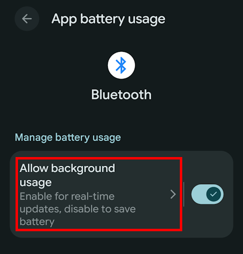
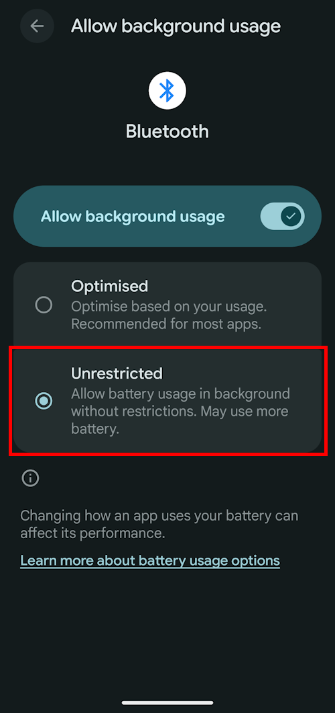
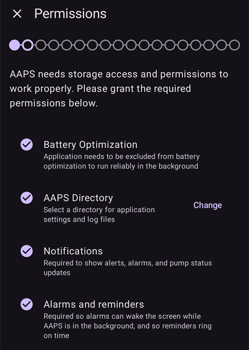
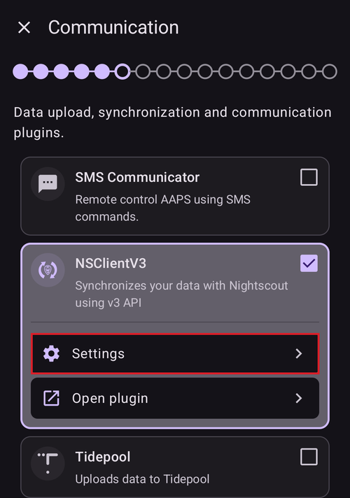

# Asistente de configuración

```{contents} In this page
:backlinks: entry
:depth: 2
```

Cuando abres **AAPS** por primera vez, te guía el «**Asistente de configuración**» para hacer rápidamente y de una vez toda la configuración básica de la app. El **Asistente de configuración** te guía para que no olvides nada importante. Por ejemplo, los **ajustes de permisos** son fundamentales para configurar **AAPS** correctamente.

Sin embargo, no es obligatorio configurarlo todo por completo la primera vez que usas el **Asistente de configuración**. Puedes salir del asistente fácilmente y volver a él más tarde. Después del **Asistente de configuración** hay tres formas de optimizar o cambiar la configuración. Se explican en la siguiente sección. Por eso no pasa nada si te saltas algunos puntos del Asistente de configuración: puedes configurarlos fácilmente más tarde.

Durante el uso del **Asistente de configuración**, y justo después, es posible que no notes cambios importantes en **AAPS**. Para activar tu lazo de **AAPS**, debes seguir los **Objetivos**, que activan una función tras otra. Empezarás el **Objetivo 1** al final del Asistente de configuración. Tú controlas **AAPS**, y no al revés.

```{admonition} Preview Objectives
:class: note
Si quieres conocer la estructura de los objetivos, lee [Completar los objetivos](../SettingUpAaps/CompletingTheObjectives.md), pero luego vuelve aquí para usar primero el Asistente de configuración.

```

Por experiencia sabemos que las personas que empiezan a menudo se presionan para configurar **AAPS** lo más rápido posible. Esto puede causar frustración, porque hay mucho que aprender.

Así que tómate tu tiempo para configurar tu lazo: los beneficios de un lazo de **AAPS** que funciona bien son enormes.

```{admonition} Ask for Help
:class: note
Si hay un error en la documentación o tienes una idea mejor para explicar algo, puedes pedir ayuda a la comunidad como se explica en [Conectar con otros usuarios](../GettingHelp/WhereCanIGetHelp.md).
```
## Mensaje de bienvenida

Cuando se abre el Asistente de configuración, te saluda con un breve mensaje de bienvenida y enseguida muestra un panel «**Permisos necesarios**» en la parte inferior de la pantalla (ver la siguiente sección).

Cuando hayas concedido los permisos, el panel se cierra y la pantalla de bienvenida muestra un botón «**Siguiente**». Pulsa «**SIGUIENTE**» para continuar:


## Permisos necesarios

**AAPS** necesita algunos permisos para funcionar correctamente. El asistente los agrupa en un único panel «**Permisos necesarios**», cada uno con su propio botón «**Conceder**». Concédelos uno a uno: el icono junto a cada elemento cambia a una marca de verificación cuando está hecho.


### Optimización de batería

El consumo de batería en los teléfonos es importante, porque la capacidad de las baterías todavía es bastante limitada. Por eso, el sistema operativo Android de tu teléfono limita qué aplicaciones pueden ejecutarse y consumir tiempo de CPU y, por tanto, batería.

Sin embargo, **AAPS** necesita funcionar de forma regular, _p. ej._ para recibir los valores de glucosa cada pocos minutos y luego aplicar el algoritmo para decidir cómo actuar según tus niveles de glucosa y tus ajustes. Por eso debe excluirse de la optimización de batería.

Pulsa «**Conceder**» junto a «**Optimización de batería**» y luego selecciona «**Permitir**» en el diálogo «¿Permitir que la aplicación se ejecute siempre en segundo plano?»:


(SetupWizard-StoragePermission)=

### Directorio de AAPS

**AAPS** necesita guardar sus ajustes y la información de registro en el almacenamiento permanente de tu teléfono. Almacenamiento permanente significa que los datos siguen disponibles incluso después de reiniciar tu teléfono. El resto de la información simplemente se pierde, porque no se guarda en el almacenamiento permanente.

Pulsa «**Conceder**» junto a «**Directorio de AAPS**». Se abre el sistema de archivos de tu teléfono y puedes elegir dónde guarda **AAPS** su información.

```{tip}
Se recomienda elegir el directorio predeterminado de AAPS.</br>
**No** selecciones un subdirectorio de AAPS.
```

El directorio predeterminado es **AAPS**, pero puedes usar cualquier directorio propio que quieras. Crea el directorio si es necesario, entra en él y elige «**USAR ESTA CARPETA**»:


Confirma con «**PERMITIR**» que quieres dar a **AAPS** acceso al directorio seleccionado:


### Notificaciones

Android exige un permiso especial a las apps que quieren enviarte notificaciones.

Desactivar las notificaciones, _p. ej._ de las redes sociales, es una buena función, pero es esencial que permitas a **AAPS** enviarte notificaciones.

Pulsa «**Conceder**» junto a «**Notificaciones**» y selecciona «**Permitir**» en el aviso del sistema:


### Alarmas y recordatorios

En **Android 14 y versiones posteriores**, **AAPS** necesita el permiso «**Alarmas y recordatorios**» para que las alarmas puedan encender la pantalla mientras **AAPS** está en segundo plano, y para que los recordatorios (por ejemplo, de una **Automatización**) suenen a tiempo.

Este elemento solo se muestra mientras se necesita. Cuando **AAPS** está excluido de la optimización de batería (ver arriba), Android concede las alarmas exactas automáticamente y el elemento desaparece. Si todavía aparece en la lista, pulsa «**Conceder**» junto a «**Alarmas y recordatorios**». Se abre una pantalla de ajustes del sistema para **AAPS**. Activa el interruptor y vuelve a **AAPS**. En Android 13 y versiones anteriores este elemento no aparece y no tienes que hacer nada.

Cuando todos los permisos muestran una marca de verificación (tres, o cuatro en Android 14 y posteriores), el panel «**Permisos necesarios**» se cierra solo y puedes pulsar «**SIGUIENTE**» en la pantalla de bienvenida para continuar.

(setup-wizard-bluetooth-battery-optimisation)=
### Optimización de batería de Bluetooth

```{admonition} Extra Android setting, not part of the Wizard
:class: note
Lo siguiente es una configuración adicional de Android que se hace fuera del Asistente de configuración. No es uno de los botones «Conceder» de arriba, pero es importante para una conexión fiable con la bomba.
```

Las versiones más nuevas de Android también aplican la optimización de batería a la aplicación Bluetooth del sistema.

Además de desactivar la optimización de batería para **AAPS**, probablemente también tendrás que desactivarla para la aplicación Bluetooth del sistema. Si no lo haces, puede haber cortes e interrupciones en la conexión con la bomba.

***NOTA: La documentación de xDrip explica cómo hacerlo aquí: [documentación de xDrip](https://navid200.github.io/xDrip/docs/BluetoothBatteryOpt.html)***

Sigue estos pasos en Android 16. En otras versiones los pasos serán un poco distintos de las capturas de pantalla:

1. Abre los ajustes de Android, busca **Aplicaciones** y abre los ajustes de aplicaciones.

   

2. Verás los ajustes de aplicaciones, pero hay que ampliar la lista para ver todas las aplicaciones: toca **Ver todas las aplicaciones**.

   

3. Como la aplicación Bluetooth es una aplicación del sistema, está oculta por defecto, así que hay que mostrar las aplicaciones del sistema. Toca los **tres puntos** (⋮) arriba a la derecha (1). Luego toca **Mostrar sistema** (2).

   

4. Busca la aplicación `Bluetooth` y toca `Bluetooth` y/o `Legacy Bluetooth`. Si están las dos, sigue el procedimiento para ambas.

   ***NOTA: Puedes ignorar `Bluetooth MIDI Service`, AAPS no lo usa***

           

   1. En Android 12 toca `Battery`, en Android 13+ toca `App battery usage`,

   )

5. En Android 12+ selecciona la opción `Unrestricted`. En Android 15+ tienes que desplegar el ajuste `Allow background usage`: toca la sección marcada en rojo para hacerlo y luego sigue el paso 6 para terminar.

       

6. En Android 16 selecciona `Unrestricted`

   

## Acuerdo de licencia

El acuerdo de licencia de usuario final contiene información importante sobre los aspectos legales del uso de **AAPS**. Léelo con atención.

Si no entiendes el acuerdo de licencia de usuario final o no puedes aceptarlo, ¡no uses **AAPS** en absoluto!

Si lo entiendes y lo aceptas, pulsa el botón «**LO ENTIENDO Y ACEPTO**» y sigue el Asistente de configuración:


Cuando lo aceptas, aparece un botón «**Siguiente**». Pulsa «**SIGUIENTE**».

La siguiente pantalla, «**Permisos**», muestra de nuevo la lista de permisos. Todos deberían mostrar una marca de verificación, porque los concediste al principio. Si falta alguno, pulsa «**Conceder**» junto a él. Pulsa «**SIGUIENTE**» para continuar:



## KEEP

Como la configuración de **AAPS** contiene algunos datos sensibles (_p. ej._ el token de acceso de tu servidor Nightscout), se cifra con una contraseña que estableces aquí.

El asistente muestra «**Contraseña no establecida**». Pulsa «**Establecer**»:


Se abre la pantalla «**Protección**». Pulsa «**Contraseña maestra**» (aparece como «Contraseña no establecida»):


Escribe la misma contraseña en los dos campos y pulsa «**OK**»:


Vuelve atrás con la flecha de la esquina superior izquierda. El asistente muestra ahora «**¡Contraseña establecida!**»:


```{admonition} Do not lose your Master Password
:class: danger
**NO PIERDAS TU CONTRASEÑA MAESTRA**. Anótala, _p. ej._ en Google Drive, que es un buen lugar porque Google hace copias de seguridad por ti. Tu teléfono o tu ordenador pueden fallar y quizá no tengas una copia actual. Si olvidas tu contraseña maestra, puede ser difícil recuperar más tarde la configuración de tu perfil y tu progreso en los **Objetivos**.
```

Cuando termines, pulsa «**SIGUIENTE**» para ir a la siguiente pantalla.

(setup-wizard-import-settings)=
## Importar ajustes

Esta pantalla solo se muestra cuando **AAPS** encuentra ajustes exportados antes en el directorio de **AAPS** («Configuración guardada encontrada»), por ejemplo cuando reinstalas la app o cambias a un teléfono nuevo.

- Para restaurar tu configuración anterior, pulsa «**Importar ajustes**»; consulta [Exportar e importar ajustes](../Maintenance/ExportImportSettings.md).
- Para empezar con una configuración nueva, pulsa «**SIGUIENTE**» y continúa con el asistente.


## Unidades (mg/dl <-> mmol/l)

Selecciona si tus valores de glucosa están en mg/dl o en mmol/l y luego pulsa el botón «**SIGUIENTE**»:


## Ajustes de pantalla

Aquí estableces el «**Valor de hipoglucemia**» y el «**Valor de hiperglucemia**» para mostrar la glucosa del sensor. Los valores de glucosa entre estos dos límites se muestran como «en rango». Por ahora puedes dejar los valores predeterminados (72 y 180 mg/dl) y cambiarlos más tarde.

Los valores que eliges solo cambian la presentación gráfica del diagrama, nada más.

Tu objetivo de glucosa, _p. ej._, se configura por separado en tu perfil.

El rango para analizar el TIR (tiempo en rango) se configura por separado en tu servidor de informes.

Ajusta los límites con los botones «−» / «+» si es necesario y luego pulsa el botón «**SIGUIENTE**»:


(SetupWizard-synchronization-with-the-reporting-server-and-more)=
## Comunicación

La pantalla «**Comunicación**» muestra los complementos que se usan para subir, sincronizar y difundir tus datos:

- **Comunicador por SMS**: control remoto de **AAPS** con comandos SMS
- **NSClientV3**: sincroniza tus datos con Nightscout usando la API v3
- **Tidepool**: sube datos a Tidepool
- **xDrip**: envía datos a xDrip
- **Open Humans**: sube y dona tus datos de diabetes a proyectos científicos
- **Reloj**: sigue y controla **AAPS** desde un reloj WearOS
- **Aplicaciones complementarias externas**: envío de datos a varias aplicaciones externas
- **Garmin**: conexión con un dispositivo Garmin


Desplázate hacia abajo para ver el resto de la lista:


Podrías configurar varios de ellos ahora, pero para el primer uso nos centraremos solo en el servidor de informes. Si no puedes configurarlo ahora, sáltalo por el momento: puedes configurarlo más tarde.

En este ejemplo usamos Nightscout como servidor de informes. Marca la casilla a la derecha de «**NSClientV3**» para activarlo. Con Tidepool es aún más sencillo, porque solo necesitas tus datos personales de inicio de sesión.

Una vez activado, pulsa «**Ajustes**» debajo de NSClientV3 para configurarlo:



Aquí configuras el servidor de informes Nightscout. Los ajustes de NSClientV3 se muestran en una sola página que se puede desplazar:


Pulsa «**URL de Nightscout**» e introduce la dirección de tu servidor Nightscout personal (la URL que configuraste tú o que te dio tu proveedor de servicio). Confirma con «**OK**».

Pulsa «**Token de acceso de Nightscout**» e introduce el token de acceso de tu servidor Nightscout. Sin este token, el acceso no funcionará. Si todavía no lo tienes, consulta la documentación sobre cómo configurar el servidor de informes.

Deja activado «**Usar WebSockets**» para tener comunicación en tiempo real con Nightscout.

Por ahora puedes dejar las demás secciones con sus valores predeterminados. Las describimos aquí para que sepas dónde encontrarlas más tarde:

**Opciones de alarmas**: alarmas de Nightscout, anuncios y límites para datos antiguos. Por ahora deja los interruptores desactivados; solo las abrimos para que conozcas las opciones.

**Ajustes de conexión**: elige cómo se transfieren los datos. Los cuidadores deben activar «**Usar datos móviles**». De lo contrario, el teléfono de la persona que cuidan (_p. ej._ un niño o una niña) no puede subir datos fuera del alcance del Wi-Fi, _p. ej._ de camino a la escuela. Otras personas pueden desactivar la transferencia por datos móviles para ahorrar datos o batería. Si tienes dudas, déjalo todo activado.


**Ajustes avanzados**: activa «**Registrar evento de inicio de la aplicación**» si quieres ver en Nightscout cuándo se reinicia la app (útil para cuidadores). Deja activados «**Crear anuncios a partir de errores**» y «**Crear anuncios de carbohidratos necesarios**». Deja desactivado «**Usar sincronización lenta (Slow Sync)**»; solo lo usarías si el servidor Nightscout tarda en procesar una gran cantidad de datos.


Vuelve a la lista de complementos y pulsa «**SIGUIENTE**» para ir a la siguiente pantalla.

## Control de clientes

Desde la versión 4 de **AAPS**, los dispositivos cliente con **AAPSClient** se pueden **emparejar** con este teléfono (el **máster**) y controlarlo con comandos firmados enviados a través de Nightscout. Esta es la nueva forma recomendada de controlar **AAPS** a distancia. Consulta [Control máster ↔ cliente](../RemoteFeatures/ClientMasterControl.md) para ver la explicación completa y la configuración.

No tienes que configurar nada en esta pantalla ahora. Puedes emparejar clientes en cualquier momento más tarde desde **Administrar → Clientes autorizados**. Allí añades un cliente con un **código QR** (también configura Nightscout en el cliente) o con un **PIN**, y le das un **rol**.

- «**Clientes autorizados**»: administra los dispositivos cliente emparejados que pueden controlar este máster.
- «**Aceptación de datos de Nightscout**»: aceptar tratamientos y datos introducidos directamente en Nightscout (la forma antigua y menos segura) ahora está desactivado por defecto. Abre estos ajustes solo si todavía lo necesitas, _p. ej._ para introducir datos a través de Nightscout o de aplicaciones de terceros.

Cuando el control de clientes ya está activado (siempre en el [Modo sencillo](#preferences-simple-mode)), este teléfono está en [modo reforzado](#client-master-control-hardened-mode): solo acepta cambios de clientes emparejados, así que la pantalla explica el modo reforzado en lugar de ofrecer los ajustes de «**Aceptación de datos de Nightscout**».


«**Aceptación de datos de Nightscout**» abre los ajustes de «**Sincronización**», donde cada tipo de datos recibidos de Nightscout tiene su propio interruptor:


Pulsa «**SIGUIENTE**» para ir a la siguiente pantalla.

(setup-wizard-instance-name)=
## ¿Quién usa este teléfono?

Aquí introduces el nombre de la persona que usa este teléfono. Sirve para distinguir esta instancia de **AAPS** de otras en los informes y al sincronizar, por ejemplo si dos niños de tu familia usan **AAPS**. También se usa en los nombres de los archivos de ajustes exportados y se muestra en el reloj.

Puede ser cualquier cosa. Puedes cambiarlo más tarde en **Ajustes → General → Nombre de la instancia**.

Pulsa «**SIGUIENTE**» para ir a la siguiente pantalla.


## Tipo de paciente

Aquí seleccionas tu «Tipo de paciente». Es importante, porque el software de **AAPS** tiene límites distintos según la edad del paciente. Esto es importante por razones de seguridad.

Aquí también configuras el **bolo máximo permitido** para una comida. Es decir, el bolo más grande que necesitas para cubrir tus comidas habituales. Es una función de seguridad para ayudar a evitar una sobredosis por error al darte un bolo para una comida.

El segundo límite es parecido, pero se refiere a la cantidad máxima de carbohidratos que esperas comer.

Después de establecer estos valores, pulsa «**SIGUIENTE**» para ir a la siguiente pantalla:


## Insulina

Aquí configuras la insulina que usas en tu bomba. Los nuevos perfiles de insulina necesitan una **DIA de al menos 5 h**.

Pulsa el botón «**Insulina**» para abrir el editor de insulina:


En el editor puedes dar a la insulina un **apodo** y establecer su **Pico** (en minutos) y su **DIA** (en horas). La forma más rápida es cargar un valor predefinido con «**Cargar pico desde**»: elige **Novorapid**, **Fiasp** o **Lyumjev** y el pico se rellena automáticamente. El gráfico de la parte inferior muestra una vista previa de la curva de actividad de la insulina resultante.


Elige el valor predefinido que corresponde a tu insulina, por ejemplo **Fiasp**:


```{admonition} Use your insulin brand's preset peak
:class: danger
No cambies el pico a menos que seas experto: normalmente los valores predefinidos funcionan bien para cada marca de insulina.
```

Si eres nuevo en **AAPS**, establece la **DIA** en 9 horas. Consulta [Duración de la acción de la insulina (DIA) y pico](#Config-Builder-insulin-dia) para entender por qué.

```{admonition} "Insulin configuration changed" dialog
:class: note
Si un cliente emparejado (_p. ej._ otro teléfono) ha cambiado la configuración de la insulina, aparece un diálogo. Pulsa **OK** para cargar sus cambios o **Cancelar** para seguir editando (lo que guardes después sobrescribirá sus cambios).
```


Pulsa el icono de guardar (arriba a la derecha) y luego pulsa «**SIGUIENTE**» para ir a la siguiente pantalla.

## Fuente de glucosa

Aquí seleccionas de dónde recibe **AAPS** los datos de glucosa. Lee la documentación de tu [fuente de glucosa](../Getting-Started/CompatiblesCgms.md).

Hay muchas fuentes disponibles. Desplázate por la lista y selecciona la que usas:


Cuando seleccionas una fuente, su tarjeta se despliega y muestra dos botones: «**Ajustes**» para ajustar cómo se reciben los datos y «**Abrir complemento**» para abrir la pantalla propia de la fuente. En el ejemplo de abajo está seleccionado **Dexcom (BYODA)**. Algunas fuentes no tienen nada que configurar en este paso, así que normalmente puedes pasar directamente a la siguiente pantalla:


Después de hacer tu selección, pulsa «**SIGUIENTE**» para ir a la siguiente pantalla.

(setup-wizard-profile)=
## Perfil

Ahora llegamos a una parte muy importante del Asistente de configuración.

Lee la documentación sobre los [perfiles](../SettingUpAaps/YourAapsProfile.md) antes de introducir los datos de tu perfil en la siguiente pantalla.

```{admonition} Working profile required - no exceptions here !
:class: danger
Un perfil exacto es necesario para que **AAPS** actúe de forma segura.

Es necesario que hayas determinado y comentado tu perfil con tu médico, y que se haya comprobado que funciona con pruebas de basal, ISF e IC.

Si un robot recibe datos incorrectos, fallará, y lo hará siempre. **AAPS** solo puede trabajar con la información que recibe. Si tu perfil es demasiado fuerte, corres el riesgo de hipoglucemia, y si es demasiado débil, de hiperglucemia. 
```

Pulsa el botón «**Perfil**» para abrir el editor de perfiles:


El editor se abre vacío («No hay registros disponibles»). Pulsa el botón «**+**» de abajo para crear un perfil nuevo:


Más adelante puedes tener varios perfiles si los necesitas. Aquí solo creamos uno.

```{admonition} Profile only for tutorial - not for your usage
:class: note
El perfil de ejemplo solo sirve para mostrarte cómo introducir los datos.

No pretende ser un perfil exacto ni muy optimizado, porque las necesidades de cada persona son muy distintas.

¡No lo uses para hacer lazo de verdad!
```

El perfil nuevo (por ejemplo «**LocalProfile1**») tiene cuatro pestañas: **IC**, **ISF**, **BAS** y **OBJ**. Pulsa el lápiz junto al nombre del perfil para cambiarle el nombre. Rellena todas las pestañas: una pestaña sigue en rojo y muestra un mensaje de error hasta que contiene valores válidos:


Pulsa «**IC**» e introduce tus valores de [IC](#your-aaps-profile-insulin-to-carbs-ratio). Usa el botón «**+**» para añadir más bloques de tiempo:


Pulsa «**ISF**» e introduce tus [valores de ISF](#your-aaps-profile-insulin-sensitivity-factor):


Pulsa «**BAS**» e introduce tus [valores de basal](#your-aaps-profile-basal-rates):


Pulsa «**OBJ**» e introduce tus valores objetivo de glucosa.

Para el lazo abierto, este objetivo puede ser un rango más amplio. De lo contrario, **AAPS** te avisa todo el tiempo para cambiar la basal temporal u otro ajuste, lo que puede ser agotador.

Más tarde, con el lazo cerrado, normalmente tendrás un solo valor para el límite superior y el inferior. Así es más fácil para **AAPS** alcanzar el objetivo y darte un mejor control general de la diabetes.


Cuando las cuatro pestañas son válidas, el **icono de guardar** (arriba a la derecha) se activa. Púlsalo para guardar el perfil:


Cierra el editor con la «**X**» de la esquina superior izquierda. El resumen del perfil muestra entonces su nombre, su basal diaria total (∑), las unidades y los valores de IC e ISF con sus gráficos:


```{admonition} Several defined but only one active profile
:class: note
Puedes tener varios perfiles definidos, pero solo un perfil activado funciona en cada momento.
```

Pulsa el botón «**▶**» (activar) abajo a la derecha. Se abre la pantalla «**Activar**». Como todavía no hay ninguna insulina en uso, primero te pide que selecciones la insulina que usas, para que el cambio de perfil pueda registrarla. El botón «**Activar**» sigue en gris hasta que lo hagas:


Pulsa «**Seleccionar insulina**» y elige la insulina que configuraste antes. Deja el porcentaje en 100 % y pulsa «**Activar**»:


Aparece un diálogo de cambio de perfil. En este caso, déjalo como está y confirma con «**OK**»:

```{admonition} Profile switch dialog
:class: note
Más adelante aprenderás a usar este diálogo general en situaciones como una enfermedad o el deporte, en las que tienes que cambiar tu perfil según las circunstancias.
```


Tu perfil ya está activo. Pulsa «**SIGUIENTE**» para ir a la siguiente pantalla.

## Bomba de insulina

Ahora seleccionas tu bomba de insulina. Lee la documentación de tu [bomba de insulina](../Getting-Started/CompatiblePumps.md).

Desplázate por la lista y selecciona tu bomba. En este ejemplo usamos la «**Bomba virtual**», que es útil mientras todavía estás aprendiendo y aún no has conectado una bomba real:


Hay muchas bombas compatibles. Desplázate hacia abajo para encontrar la tuya:


Cuando seleccionas una bomba real, **AAPS** pide una confirmación, porque copiará las tasas basales de tu perfil a la bomba y sobrescribirá las tasas basales guardadas en ella. Pulsa «**OK**» solo si las tasas basales de tu perfil de **AAPS** son correctas. De lo contrario, pulsa «**Cancelar**» y cambia a la bomba más tarde:


Si la bomba que seleccionas se comunica por Bluetooth, **AAPS** pide permiso para conectarse a dispositivos cercanos cuando terminas el asistente (ver [Permiso de Bluetooth](#bluetooth-permission)).

Si ya has configurado tu perfil y sabes cómo conectar tu bomba, puedes conectarla ahora. Si no, deja la **Bomba virtual** por el momento. Puedes cambiarla en cualquier momento, o salir del Asistente de configuración con la flecha de la esquina superior izquierda y dejar que **AAPS** te muestre primero algunos valores de glucosa.

Pulsa «**SIGUIENTE**» para ir a la siguiente pantalla.

## Algoritmo APS

Usa el algoritmo OpenAPS SMB como tu algoritmo APS. A pesar del nombre, la función SMB del algoritmo está desactivada hasta que conozcas bien AAPS y hayas completado los primeros objetivos. De todas formas, OpenAPS SMB es más nuevo y en general mejor que OpenAPS AMA.

SMB está desactivado al principio porque la función SMB reacciona más rápido a una subida de glucosa: usa un Super Micro Bolo en lugar de aumentar el porcentaje de la basal. Como al principio tu perfil normalmente no es tan bueno como después de tener algo de experiencia, la función está desactivada al principio.

```{admonition} Only use the older algorithm **OpenAPS AMA** if you know what you are doing
:class: note
OpenAPS AMA es el algoritmo más básico y no admite microbolos para corregir valores altos. Puede haber situaciones en las que sea mejor usar este algoritmo, pero no es lo recomendado.
```

Selecciona «**OpenAPS SMB**» y luego pulsa «**Ajustes**» para ver los detalles:


La única opción aquí es «**Usar sensibilidad dinámica**». Déjala desactivada y no cambies nada por ahora: solo lee el texto.

Por las limitaciones de los **Objetivos**, de momento no puedes usar ni el «lazo cerrado» ni las «funciones SMB».

Vuelve atrás y pulsa «**SIGUIENTE**» para ir a la siguiente pantalla:


## Detección de sensibilidad

Deja seleccionado «**Sensibilidad Oref1**» como complemento de sensibilidad estándar:


Si pulsas «**Ajustes**» puedes revisar los ajustes de absorción. Por ahora los valores predeterminados (_p. ej._ un límite de absorción de 6 h) están bien.


Pulsa «**SIGUIENTE**» para ir a la siguiente pantalla.

## Empezar el Objetivo 1

Ahora entras en los Objetivos: la forma de obtener acceso a más funciones de **AAPS**.

Pulsa «**Abrir Objetivos**»:


Aquí empezamos el Objetivo 1, aunque ahora mismo nuestra configuración todavía no está lista para completar este objetivo. Pero este es el comienzo.

Pulsa el botón «**Iniciar**» junto a «**1. Objetivo**»:


El objetivo se despliega y muestra sus comprobaciones. Puedes ver que ya has avanzado algo, mientras que otros elementos todavía están por hacer:


Vuelve atrás y luego pulsa «**FINALIZAR**» para completar el Asistente de configuración:


Después de pulsar «**FINALIZAR**» llegas a la pantalla principal de **AAPS**. Puede abrirse un panel de «**Notificación**» con mensajes informativos, por ejemplo sobre el cambio de perfil que acabas de hacer. Pulsa «**Descartar**» debajo de cada mensaje para quitarlo.

Si sales del Asistente de configuración por accidente en cualquier momento, puedes volver a iniciar el asistente o cambiar la [configuración del lazo de AAPS](../SettingUpAaps/ChangeAapsConfiguration.md) manualmente.

## Permiso de Bluetooth

Si seleccionas una bomba que se conecta por Bluetooth (por ejemplo **Omnipod Dash**), un aviso te recuerda que **AAPS** necesita permiso de Bluetooth. Por ahora puedes pulsar «**Descartar**»: el permiso se concede después de terminar el asistente:


Cuando termina el Asistente de configuración, la pantalla principal de **AAPS** muestra un panel «**Permisos necesarios**». Los demás permisos ya están concedidos. Pulsa «**Conceder**» junto a «**Bluetooth**»:


Selecciona «**Permitir**» para que **AAPS** pueda encontrar tu bomba y conectarse a ella:


Si tu lazo de **AAPS** ya está totalmente configurado, pasa a la siguiente sección [«Completar los objetivos»](../SettingUpAaps/CompletingTheObjectives.md).
