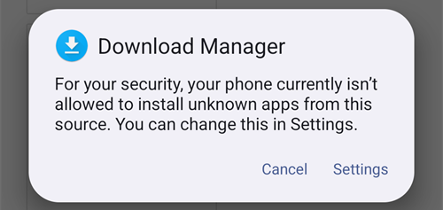

# Transferir e instalar AAPS en tu teléfono

En la sección anterior, [Compilar **AAPS**](../SettingUpAaps/BuildingAaps.md), compilaste la app **AAPS** (un archivo .apk) en un ordenador.

Los siguientes pasos son **pasar** el archivo APK de **AAPS** (y otras apps que puedas necesitar, como BYODA, xDrip u otra app receptora del MCG) a tu teléfono Android y después **instalar** la(s) app(s). Después de instalar **AAPS** en el teléfono, podrás pasar a la [**configuración del lazo de AAPS**](../SettingUpAaps/SetupWizard.md).

Esta página también explica la [verificación de desarrolladores de Android](#android-developer-verification), un cambio que Google introduce desde septiembre de 2026 y que afecta a la instalación de apps compiladas por uno mismo, y los [métodos de instalación gratuitos](#android-developer-verification-free-methods) que siguen funcionando después del cambio.

```{contents} Table of contents
:depth: 1
:local: true
```

## Instalar AAPS tocando el archivo APK

Hoy instalas **AAPS** pasando el archivo APK a tu teléfono y abriéndolo («tocándolo»). Hay varias formas de pasar el archivo APK de **AAPS** de tu ordenador al teléfono. Aquí explicamos dos formas distintas:

* Opción 1: usar tu Google Drive (Gdrive)
* Opción 2: usar un cable USB

Ten en cuenta que enviar el archivo por correo electrónico puede dar problemas, y no se recomienda.

```{admonition} Android developer verification
:class: warning
Google introduce la [verificación de desarrolladores de Android](#android-developer-verification) desde septiembre de 2026 (primero en Brasil, Indonesia, Singapur y Tailandia; en todo el mundo en 2027). Donde se aplique, se bloquea la instalación de un APK tocando el archivo, como se describe en las dos opciones de abajo. En ese caso, usa uno de los [métodos de instalación gratuitos](#android-developer-verification-free-methods) que están más abajo en esta página.
```

### Opción 1. Usar Google Drive para transferir archivos

Abre [Google.com](https://www.google.com/) en tu navegador e inicia sesión en tu cuenta de Google.

Arriba a la derecha, selecciona la app Drive en el menú de Google.


Haz clic en **Nuevo** arriba a la izquierda (o haz clic derecho en una zona vacía debajo de tus archivos y carpetas) y selecciona **Subir archivo**.


El archivo apk ya debería estar subido a Google Drive.

#### Usa la app Google Drive para abrir el archivo apk e instalarlo

Cambia a tu teléfono y abre la app Google Drive. Es una app preinstalada; la encuentras junto a las demás apps de Google o buscando el nombre de la app.


Inicia la instalación del apk tocando el nombre del archivo en la app Google Drive del teléfono.


Si recibes un aviso de seguridad que dice que ahora no puedes instalar apps desde Google Drive, toca «Ajustes» y permítelo solo durante ese momento. Después vuelve a prohibirlo, porque dejarlo siempre activado es un riesgo de seguridad.


Cuando termine la instalación, este paso está hecho.

Deberías ver el icono de **AAPS** y poder abrir la app.

```{warning}
**AVISO DE SEGURIDAD IMPORTANTE**
¿Te acordaste de volver a prohibir la instalación desde Google Drive?
```

Ahora continúa con la [configuración del lazo de AAPS](../SettingUpAaps/SetupWizard.md).

### Opción 2. Usar un cable USB para transferir archivos

La segunda forma de pasar el archivo apk de AAPS es con un [cable USB](https://support.google.com/android/answer/9064445?hl=en).

Copia el archivo desde su ubicación en tu ordenador a la carpeta «downloads» (Descargas) del teléfono.

En tu teléfono, tendrás que permitir la instalación desde orígenes desconocidos. En internet encontrarás explicaciones de cómo hacerlo (_p. ej._ [aquí](https://www.expressvpn.com/de/support/vpn-setup/enable-apk-installs-android/) o [aquí](https://www.androidcentral.com/unknown-sources)).

Cuando hayas pasado el archivo arrastrándolo, abre la carpeta «Descargas» en el teléfono y toca el archivo apk de AAPS:


La primera vez, Android te dice que el teléfono no puede instalar apps desconocidas de esta fuente. Toca «**Ajustes**»:



Activa «**Permitir de esta fuente**» y vuelve atrás:


Toca otra vez el archivo apk y selecciona «**Instalar**»:


Cuando termine la instalación, toca «**Abrir**» para iniciar **AAPS**, o «**Listo**» para abrirlo más tarde:


```{warning}
**AVISO DE SEGURIDAD IMPORTANTE**
Recuerda desactivar otra vez «Permitir de esta fuente» después de la instalación, porque dejarlo siempre activado es un riesgo de seguridad.
```

Ahora continúa con la [configuración del lazo de AAPS](../SettingUpAaps/SetupWizard.md).

(transferring-installing-play-protect-warning)=
## Advertencia de Google Play Protect

Al instalar **AAPS**, Google Play Protect puede avisarte de que la app no es segura, que se creó para una versión antigua de Android y que no incluye las últimas protecciones de privacidad.


Esto es normal en una app que has compilado tú. Toca **Más detalles** y después **Instalar de todos modos**.

Si la instalación está **bloqueada** con un mensaje sobre un desarrollador no verificado (no solo una advertencia), consulta [Verificación de desarrolladores de Android](#android-developer-verification) más abajo.

(android-developer-verification)=

## Verificación de desarrolladores de Android

Google introduce la **verificación de desarrolladores de Android**: en la mayoría de los teléfonos Android, las apps solo se instalarán si un desarrollador verificado las ha registrado en Google. Esto también vale para las apps instaladas desde un archivo APK («sideloading»), que es como instalas la app **AAPS** que has compilado tú.

### Qué cambia

Cuando instales **AAPS** en un teléfono con servicios de Google (un dispositivo Android «certificado», casi todos los teléfonos que se venden con Play Store), Android comprobará si la app viene de un desarrollador registrado en Google. Si no, se bloquea la instalación normal tocando el archivo APK.

**La comprobación se hace cuando se instala o se actualiza una app.** No elimina las apps que ya están instaladas y funcionando.

Google lo introduce poco a poco:

| Cuándo                   | Qué pasa                                                                                                                                            |
| ------------------------ | --------------------------------------------------------------------------------------------------------------------------------------------------- |
| Agosto de 2026           | Las cuentas de desarrollador gratuitas de «distribución limitada» se abren en todo el mundo, y el «flujo avanzado» empieza a llegar a los teléfonos |
| 30 de septiembre de 2026 | La verificación se aplica en **Brasil, Indonesia, Singapur y Tailandia** a las apps instaladas desde Google Play y algunas otras tiendas de apps    |
| 2027                     | La obligación se amplía al **resto del mundo** y a **todas las instalaciones**, incluidos los archivos APK                                          |

Google publica los detalles en las páginas de [verificación de desarrolladores de Android](https://developer.android.com/developer-verification), con unas [preguntas frecuentes](https://developer.android.com/developer-verification/guides/faq). Google todavía puede cambiar fechas y detalles; esta página se actualizará según avance la introducción.

### ¿Me afecta esto?

- **Compilar AAPS no se ve afectado en absoluto.** La [compilación en el navegador](#browser-build), la [compilación con Android Studio](ComputerBuild.md) y la [compilación por línea de comandos](CLIBuild.md) funcionan igual que antes, y tu almacén de claves no cambia.
- **Tu AAPS actual sigue funcionando.** La verificación solo se comprueba al instalar o actualizar una app.
- **Si vives en Brasil, Indonesia, Singapur o Tailandia:** desde el 30 de septiembre de 2026 la verificación se aplica a las apps instaladas desde Google Play y algunas otras tiendas de apps. Google dice que la instalación directa de un archivo APK no forma parte de este primer paso, así que **AAPS** debería instalarse como siempre. Aun así, prepara ya uno de los [métodos de instalación gratuitos](#android-developer-verification-free-methods) de abajo, para que no te pille por sorpresa si esto cambia.
- **Si vives en otro lugar:** para ti no cambia nada antes de 2027, y no hacer nada por ahora es una opción válida. Pero configura uno de los [métodos de instalación gratuitos](#android-developer-verification-free-methods) de abajo mientras todo funciona: descubrir el bloqueo el día en que se rechaza una actualización, con las 24 horas de espera del [flujo avanzado](#android-developer-verification-advanced-flow) por delante, es el peor momento.
- **Teléfonos antiguos:** la verificación se aplica a teléfonos con Android 7 o superior, es decir, a todos los teléfonos que pueden ejecutar **AAPS**.

(android-developer-verification-free-methods)=

## Formas gratuitas de instalar AAPS

**No** tienes que pagar nada a Google para seguir usando **AAPS**. Hay varios métodos gratuitos; elige el que se ajuste a tu situación.

```{admonition} Which method should I use?
:class: tip
- Tienes un **ordenador** (da igual cómo hayas compilado **AAPS**): usa [ADB](#android-developer-verification-adb) o, si prefieres evitar la línea de comandos, el [instalador web](#android-developer-verification-web). Los dos están exentos de la verificación, no tienen límites y no necesitan cuenta de Google.
- **No tienes ningún ordenador**: usa el [flujo avanzado](#android-developer-verification-advanced-flow) en tu teléfono.
- Prefieres registrarte en Google para que la instalación normal «tocando el APK» siga funcionando: existe una [cuenta gratuita de distribución limitada](#android-developer-verification-limited-account), pero no se ha probado con **AAPS**.
```

(android-developer-verification-adb)=

### Opción 1: instalar con ADB (se necesita un ordenador)

ADB (Android Debug Bridge) es la herramienta oficial de Google para instalar apps desde un ordenador en un teléfono con un cable USB. Google ha confirmado que **las apps instaladas con ADB no necesitan verificación**: no hay tiempo de espera, ni límite de dispositivos, ni registro.

Preparación (solo una vez):

1. En tu teléfono, activa las opciones para desarrolladores ocultas: ve a **Ajustes** > **Información del teléfono** (en algunos teléfonos **Información de software**) y toca siete veces **Número de compilación**, hasta que el teléfono confirme que eres desarrollador.
1. Vuelve a los **Ajustes** principales, abre la nueva entrada **Opciones para desarrolladores** y activa **Depuración por USB**.
1. En tu ordenador, comprueba que ADB está disponible:
   - Si usas **Android Studio**, ADB ya está instalado con él.
   - Si no, descarga las [SDK Platform Tools](https://developer.android.com/tools/releases/platform-tools) gratuitas de Google y descomprime la carpeta. No hace falta instalar nada; ADB es el programa `adb` que está dentro de esa carpeta.

Instalar (y después actualizar) **AAPS**:

1. Conecta el teléfono al ordenador con un cable USB. No hace falta pasar antes el archivo APK al teléfono: ADB lo envía directamente desde el ordenador.
1. En el teléfono, acepta el mensaje **¿Permitir depuración por USB?** (solo la primera vez).
1. En el ordenador, abre un terminal (símbolo del sistema) en la carpeta que contiene ADB y el archivo APK de **AAPS**, y ejecuta:

   ```
   adb install -r app-full-release.apk
   ```

   Cambia `app-full-release.apk` por el nombre real de tu archivo APK. La opción `-r` actualiza un **AAPS** ya instalado y conserva todos sus datos y ajustes.

1. Espera hasta que aparezca `Success`. **AAPS** ya está instalado en tu teléfono.

El mismo comando sirve para todas las actualizaciones futuras. Las [páginas de Wear OS](../WearOS/WearOsSmartwatch.md) ya usan ADB de la misma forma para instalar la app del reloj.

Si prefieres no usar cable: en Android 11 y posteriores, la **depuración inalámbrica** (también en **Opciones para desarrolladores**) hace lo mismo por Wi-Fi, después de emparejar una vez con un código que aparece en el teléfono.

(android-developer-verification-web)=

### Opción 2: instalar desde una página web (ordenador, sin línea de comandos)

Si la línea de comandos no es para ti, una página web puede hacer exactamente lo mismo que ADB, directamente desde tu navegador. Como se comunica con el teléfono por el mismo mecanismo que ADB, tiene la **misma exención de la verificación**, pero no hay nada que descargar, ninguna carpeta que descomprimir y ningún comando que escribir.

Es el camino más fácil si usaste la [compilación en el navegador](#browser-build) y nunca has abierto una línea de comandos.

1. Activa la **Depuración por USB** en el teléfono (pasos 1 y 2 del [método ADB](#android-developer-verification-adb) de arriba; solo una vez).
1. Abre el **[instalador web de AAPS](#web-installer)** en tu navegador.
1. Conecta el teléfono con un cable USB y sigue las instrucciones de la página: conectar, elegir tu archivo APK e instalar.

Tres cosas que debes saber:

- Solo funciona en **Chrome, Edge u Opera**. Firefox y Safari no pueden comunicarse con dispositivos USB.
- Solo un programa puede usar la conexión ADB del teléfono a la vez, así que **cierra Android Studio** (o cualquier otro programa que use ADB) antes de conectar.
- Una página web conectada de esta forma tiene control total de tu teléfono. **Usa solo la dirección de arriba**, de la documentación de **AAPS**; nunca una página de instalación encontrada en un buscador. El instalador web de **AAPS** funciona por completo en tu navegador: tu archivo APK no se sube a ningún sitio.

```{admonition} No computer? A second phone works too
:class: tip
El instalador web también funciona desde **Chrome en otro teléfono Android** con un cable USB-C a USB-C, así que un padre o una madre puede instalar **AAPS** en el teléfono de su hijo o hija sin tener ningún ordenador en casa.
```

(android-developer-verification-advanced-flow)=

### Opción 3: el «flujo avanzado» en tu teléfono (sin ordenador)

Google ofrece una vía de escape para usuarios con experiencia que entienden los riesgos de instalar apps no verificadas, llamada **flujo avanzado**. Google empezó a llevarlo a los teléfonos en agosto de 2026, antes de la obligación, así que puedes configurarlo ya. Es una configuración única en el propio teléfono, que **tarda 24 horas** en completarse:

1. Activa las opciones para desarrolladores ocultas (consulta el paso 1 del método ADB de arriba) y después abre **Ajustes** > **Opciones para desarrolladores** > **Apps de desarrolladores no verificados**.
1. Activa **Permitir apps de desarrolladores no verificados**. El teléfono te pide el bloqueo de pantalla para confirmar que eres tú.
1. El teléfono te pregunta si alguien te está pidiendo que actives este ajuste, y explica que los bancos, las agencias del gobierno o la policía nunca te lo pedirían. Lee la advertencia y confirma que nadie te está presionando ni guiando (es una protección contra estafadores).
1. **Reinicia tu teléfono.** Así empieza un **tiempo de espera de 24 horas** (solo una vez).
1. Después de 24 horas, vuelve a **Ajustes** > **Opciones para desarrolladores** > **Apps de desarrolladores no verificados** para terminar la configuración.
1. Elige si quieres permitir las apps no verificadas durante **7 días** o **de forma indefinida**. Para **AAPS**, elige **de forma indefinida**; si no, tu siguiente actualización se bloqueará cuando pasen los 7 días.

Después de esta configuración, instalar o actualizar el APK de **AAPS** funciona como hoy, con una advertencia más de que la app es de un desarrollador no verificado: toca **Instalar de todos modos**.

Conviene saber:

- Después puedes volver a desactivar las **Opciones para desarrolladores**: el flujo avanzado sigue activado. Google tampoco da a las apps (como las apps de bancos) ninguna forma de detectar que el flujo avanzado está activado.
- Si desactivas el flujo avanzado, se vuelve a bloquear la instalación **o actualización** de **AAPS** (tu **AAPS** instalado sigue funcionando). Tienes 10 minutos para volver a activarlo; después, el tiempo de espera de 24 horas empieza otra vez.
- Cambiar el reloj del teléfono no acorta el tiempo de espera, y ADB no puede saltárselo.
- Google dice que tu elección acompaña a tu cuenta de Google en tus otros dispositivos, así que un teléfono nuevo no debería significar otra espera de 24 horas.
- Si no encuentras **Apps de desarrolladores no verificados** en las opciones para desarrolladores, tu teléfono todavía no ha recibido la función. La entrega un componente del sistema llamado **Android Developer Verifier**, que Google distribuye poco a poco a través de Play Store. Puedes ayudar a que llegue antes abriendo **Android Developer Verifier** en Play Store.

```{note}
Google dice que es una primera versión y que aún puede cambiar las pantallas y los pasos; esta sección se actualizará con capturas de pantalla cuando esté disponible la versión final.
```

(android-developer-verification-limited-account)=

### Opción 4: registrarse en Google (cuenta gratuita de distribución limitada)

Google ofrece un tipo de cuenta de desarrollador **gratuita** para aficionados y uso personal, llamada **cuenta de distribución limitada**, abierta a todo el mundo desde agosto de 2026:

- **Sin documento oficial de identidad** y **sin tarifa** (a diferencia de la cuenta de desarrollador de pago, que no se necesita para el uso personal de **AAPS**). Sí necesitas una cuenta de Google con verificación en 2 pasos, un perfil de pagos de Google con tu nombre legal y tu dirección, y una dirección de correo electrónico de contacto.
- Registras el nombre de paquete de tu app en la Android Developer Console de Google y autorizas los teléfonos en los que se puede instalar, hasta **20 dispositivos**, mediante un enlace entre el teléfono y la consola con un código QR o un vínculo.
- Después del registro, la instalación normal (tocando el archivo APK) vuelve a funcionar en los teléfonos autorizados, sin ADB y sin el flujo avanzado.
- Una cuenta de distribución limitada se puede cambiar después a una cuenta completa, pero no al revés.

```{warning}
Google no ha explicado cómo funciona el registro cuando muchas personas compilan la misma app de código abierto: cada **AAPS** compilado por uno mismo usa el mismo nombre de paquete (`info.nightscout.androidaps`) con una clave de firma diferente, y las preguntas frecuentes de Google dicen que un nombre de paquete que ya usan otros no se puede reclamar directamente y necesita una revisión adicional. No se sabe el resultado de esa revisión, y la cuenta de desarrollador de pago (25 $ y un documento oficial de identidad) no ayuda aquí: pagar solo quita el límite de 20 dispositivos, no la revisión del nombre de paquete.

Por eso todavía no se pueden escribir instrucciones paso a paso. Esta sección se completará cuando se haya probado el registro con **AAPS**. Mientras tanto, ADB, el instalador web y el flujo avanzado de arriba son alternativas fiables.
```

## Lo que no cambia

- Compilar **AAPS** tú mismo, con cualquiera de los tres [métodos de compilación](BuildingAaps.md).
- Tu cuenta de GitHub, tu repositorio de compilación (AAPS Builder) o fork, y tu almacén de claves.
- Tu app **AAPS** instalada, tus ajustes y tus [objetivos](CompletingTheObjectives.md).
- Los teléfonos sin servicios de Google y, en general, las [instalaciones con ADB](#android-developer-verification-adb).

## Dónde obtener ayuda

1. **Lee** las [preguntas frecuentes sobre la verificación de desarrolladores](https://developer.android.com/developer-verification/guides/faq) de Google para dudas sobre la verificación en sí.
2. **Pregunta** en el canal *#AAPS* de [Discord](https://discord.gg/4fQUWHZ4Mw), o en otro de los [canales de la comunidad](../GettingHelp/WhereCanIGetHelp.md), si una instalación se bloquea.
3. Cuando pidas ayuda, indica la marca y el modelo de tu teléfono, la versión de Android, tu país y el mensaje exacto que aparece cuando falla la instalación.

```{toctree}
:hidden:

Instalador web de AAPS <WebInstaller.md>
```
