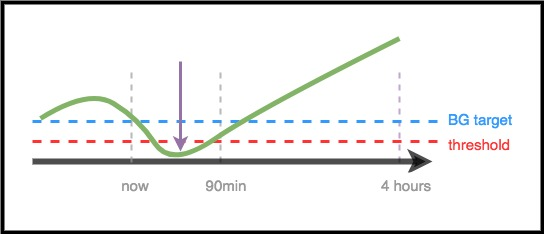

# Para médicos: introducción general y guía de AAPS

```{note}
Esta página es una introducción general para médicos. Se revisó por última vez en junio de 2026. AAPS se desarrolla de forma continua. Para obtener la información más exacta y actual, consulte siempre la [documentación principal de AAPS](../index.md).
```

Esta página está pensada para médicos interesados en la tecnología de páncreas artificial de código abierto, como AAPS, o para pacientes que quieren compartir esta información con sus médicos.

Esta guía ofrece información general sobre los lazos cerrados «hazlo tú mismo» (DIY) y, en concreto, sobre cómo funciona AAPS. Para más detalles sobre todos estos temas, consulte la [documentación completa de AAPS en línea](../index.md). Si tiene preguntas, pida más detalles a su paciente o, si lo desea, consulte a la comunidad en cualquier momento. (Si no usa redes sociales (por ejemplo, [Twitter](https://twitter.com/kozakmilos) o Facebook), puede escribir un correo a developers@aaps.app). [También puede encontrar algunos de los estudios más recientes & resultados relacionados aquí](https://openaps.org/outcomes/).

## Pasos para crear un lazo cerrado «hazlo tú mismo» (DIY):

Para empezar a usar AAPS, hay que seguir estos pasos:

* Conseguir una [bomba compatible](../Getting-Started/CompatiblePumps.md), un [dispositivo Android compatible](../Getting-Started/Phones.md) y una [fuente de MCG compatible](../Getting-Started/CompatiblesCgms.md).
* [Descargar el código fuente de AAPS y compilar el software](../SettingUpAaps/BuildingAaps.md).
* [Configurar el software para que se comunique con sus dispositivos para la diabetes, y definir los ajustes y las preferencias de seguridad](../SettingUpAaps/SetupWizard.md).

## Cómo funciona un lazo cerrado DIY

Sin un sistema de lazo cerrado, una persona con diabetes recoge los datos de su bomba y de su MCG, decide qué hacer y actúa.

Con la administración automatizada de insulina, el sistema hace lo mismo: recoge datos de la bomba, del MCG y de cualquier otro lugar donde se registre información (como Nightscout), usa esta información para hacer los cálculos y decidir cuánta insulina más o menos se necesita (por encima o por debajo de la tasa basal de base), y usa tasas basales temporales para hacer los ajustes necesarios y mantener la glucosa en el rango objetivo o llevarla de nuevo a él.

Si el dispositivo que ejecuta AAPS se rompe o queda fuera del alcance de la bomba, cuando termina la última tasa basal temporal la bomba vuelve a funcionar como una bomba estándar, con las tasas basales preprogramadas.

## Cómo se recopilan los datos:

Con AAPS, un dispositivo Android ejecuta una app especial que hace los cálculos. El dispositivo se comunica por Bluetooth con una bomba compatible. AAPS se puede comunicar con otros dispositivos y con la nube por Wi-Fi o datos móviles para recoger más información, y para informar al paciente, a los cuidadores y a los seres queridos de lo que hace y por qué.

El dispositivo Android tiene que:

* comunicar con la bomba y leer el historial - cuánta insulina se ha entregado
* comunicarse con el MCG (ya sea directamente, o a través de la nube) para ver qué están haciendo/han estado haciendo los BG

Cuando el dispositivo ha recogido estos datos, el algoritmo se ejecuta y toma las decisiones según los ajustes (ISF, ratio de carbohidratos, DIA, objetivo, etc.). Si es necesario, entonces emite comandos a la bomba para modificar la velocidad de entrega de la insulina.

También recogerá cualquier información sobre los bolos, el consumo de hidratos de carbono y los ajustes temporales de los objetivos de la bomba o de Nightscout para usarla para el cálculo de las tasas de entrega de insulina.

## ¿Cómo sabe qué hacer?

El software de código abierto está diseñado para que sea fácil para el dispositivo hacer el trabajo que la gente realiza (en el modo manual) para calcular cómo se debe ajustar la entrega de insulina. Primero recoge datos de todos los dispositivos de apoyo y de la nube, prepara los datos y hace los cálculos. Hace predicciones de los niveles de glucosa esperados durante las próximas horas en diferentes escenarios, y calcula los ajustes necesarios para mantener la glucosa en el rango objetivo o llevarla de nuevo a él. A continuación, se envían los ajustes necesarios a la bomba. Luego lee los datos de nuevo y lo hace una y otra vez.

Como el parámetro de entrada más importante es el nivel de glucosa que viene del MCG, es importante tener datos de MCG de alta calidad.

AAPS está diseñado para registrar de forma transparente todos los datos de entrada que recoge, la recomendación resultante y cada acción realizada. Por lo tanto, es fácil responder a la pregunta en cualquier momento, "¿por qué está haciendo X?" revisando los registros.

## Ejemplos de toma de decisiones del algoritmo de AAPS:

AAPS usa el mismo algoritmo central y el mismo conjunto de funciones que OpenAPS. El algoritmo hace varias predicciones (basadas en valores, y la situación) que representan diferentes escenarios de lo que podría suceder en el futuro. En Nightscout, estas se muestran como «líneas púrpura». AAPS usa diferentes colores para distinguir estas [líneas de predicción](#aaps-screens-prediction-lines). En los registros se describe cuál de estas predicciones y qué periodo de tiempo determinan las acciones necesarias.

### A continuación se muestran ejemplos de las líneas de predicción púrpura, y cómo pueden diferir:


(clinicianguide-dosing-scenarios)=

### A continuación, se muestran ejemplos de diferentes periodos de tiempo que influyen en los ajustes necesarios en la entrega de insulina:

### Escenario 1 - Basal temporal a cero por seguridad

En este ejemplo, el BG está aumentando en el corto plazo; sin embargo, se prevé que será bajo en un período de tiempo más largo. De hecho, se prevé que baje por debajo del objetivo *y* del umbral de seguridad. Por seguridad, para evitar la hipoglucemia, AAPS pondrá una basal temporal a cero (tasa basal temporal al 0 %) hasta que la glucosa final (eventualBG), en cualquier periodo de tiempo, esté por encima del umbral.


### Escenario 2 - Basal temporal a cero por seguridad

En este ejemplo, se prevé que la BG esté baja en el corto plazo, pero se prevé que finalmente estará por encima de la meta. Sin embargo, como la hipoglucemia a corto plazo está por debajo del umbral de seguridad, AAPS pondrá una basal temporal a cero hasta que ningún punto de la línea de predicción esté por debajo del umbral.



### Escenario 3 - Se necesita más insulina

En este ejemplo, una predicción a corto plazo muestra que irá por debajo del objetivo. Sin embargo, no se prevé que esté por debajo del umbral de seguridad. La glucosa final (eventual BG) está por encima del objetivo. Por eso, AAPS no añadirá insulina que pueda contribuir a una hipoglucemia a corto plazo (es decir, insulina que haría que la predicción baje por debajo del umbral). Después valorará añadir insulina para bajar hasta el objetivo el nivel más bajo de la glucosa final prevista, cuando sea seguro hacerlo. *(Dependiendo de la configuración y la cantidad y el momento de la insulina necesaria, este tipo de insulina puede ser entregado a través de basales temporales o SMB (super micro bolos) ).*


### Escenario 4 - Basal temporal baja por seguridad

En este ejemplo, AAPS ve que la glucosa está subiendo muy por encima del objetivo. Sin embargo, por el tiempo de acción de la insulina, ya hay suficiente insulina en el cuerpo para llevar la glucosa al rango con el tiempo. De hecho, se prevé que la glucosa termine por debajo del objetivo. Por eso, AAPS no dará insulina extra, para no contribuir a una hipoglucemia a más largo plazo. A pesar de que BG está alto/subiendo, es probable que haya una baja tasa basal temporal aquí.


## Optimizar los ajustes y hacer cambios

Como médico, quizá no tenga experiencia con AAPS ni con los lazos cerrados «hazlo tú mismo» (DIY). Por eso puede resultarle difícil ayudar a su paciente a optimizar sus ajustes o a hacer cambios para mejorar sus resultados. Tenemos varias herramientas y [guías](https://openaps.readthedocs.io/en/latest/docs/Customize-Iterate/optimize-your-settings.html) en la comunidad que ayudan a los pacientes a realizar ajustes pequeños y probados para mejorar sus ajustes.

Lo más importante para los pacientes es hacer un cambio a la vez, y observar el impacto durante 2-3 días antes de elegir cambiar o modificar otro valor (a menos que sea obviamente un mal cambio que empeore las cosas, en cuyo caso deberían revertir inmediatamente a la configuración anterior). La tendencia humana es cambiar todo a la vez; pero si alguien lo hace, entonces se puede acabar con la configuración subóptima para el futuro, y les resulta difícil volver a un estado bueno conocido.

Una de las herramientas más potentes para realizar los cambios de configuración es una herramienta de cálculo automatizada para las tasas basales, ISF y coeficiente de carbohidratos. Esto se llama «[Autotune](#autotune-how-autotune-calculates-adjustments)». Está diseñado para que se ejecute de forma independiente/manualmente, y permita que los datos le guíen a usted o a su paciente en la realización de cambios incrementales en los valores. En la comunidad, la buena práctica es ejecutar (o revisar) primero los informes de Autotune, antes de intentar hacer ajustes manuales. Autotune está integrado en AAPS como complemento (**Configuración** → **General** → **Autotune**); consulte [Autotune](../AdvancedOptions/Autotune.md). Se puede ejecutar a demanda o de forma automática. Como estos parámetros son necesarios tanto para la administración de insulina con una bomba estándar como con un lazo cerrado, comentar los resultados de Autotune y el ajuste de estos parámetros es el punto de unión natural con el médico.

Adicionalmente, el comportamiento humano (aprendido de la forma manual de la diabetes) a menudo influye en los resultados, incluso con un lazo cerrado de DIY. Por ejemplo, si se prevé que la glucosa baje y AAPS reduce la insulina durante la bajada, puede bastar una pequeña cantidad de carbohidratos (por ejemplo, 3–4 g) para subir la glucosa desde 70 mg/dl (3,9 mmol/l). Sin embargo, en muchos casos una persona puede tratar la hipoglucemia con muchos más carbohidratos (por ejemplo, siguiendo la regla de los 15). Esto causa una subida más rápida, por la glucosa extra y porque la insulina ya se había reducido en el periodo antes de la hipoglucemia.

## OpenAPS

**Esta guía se ha adaptado de [The clinician's guide to OpenAPS](https://openaps.readthedocs.io/en/latest/docs/Resources/clinician-guide-to-OpenAPS.html).** OpenAPS es un sistema desarrollado para funcionar en un pequeño ordenador portátil (normalmente llamado «rig»). AAPS usa muchas de las técnicas de OpenAPS y comparte gran parte de su lógica y sus algoritmos. Por eso esta guía es muy parecida a la guía original. Gran parte de la información sobre OpenAPS se puede adaptar fácilmente a AAPS. La principal diferencia es la plataforma de hardware en la que se ejecuta cada parte del software.

## Resumen

Esto es un resumen general de cómo funciona AAPS. Para más detalles, pregunte a su paciente, consulte a la comunidad o lea la documentación completa de AAPS disponible en línea.

Lectura recomendada adicional:

* La [documentación completa de AAPS](../index.md)
* La publicación [OpenAPS Reference Design](https://OpenAPS.org/reference-design/), que explica cómo se ha diseñado OpenAPS para la seguridad: https://openaps.org/reference-design/
* La [documentación completa de OpenAPS](https://openaps.readthedocs.io/en/latest/index.html) 
  * Consulte [cómo convierte AAPS las predicciones en una decisión de dosificación](#aaps-screens-how-predictions-become-a-dosing-decision) en esta documentación, o la [documentación de determine-basal de OpenAPS](https://openaps.readthedocs.io/en/latest/docs/While%20You%20Wait%20For%20Gear/Understand-determine-basal.html#understanding-the-determine-basal-logic) para ver el algoritmo en todo detalle técnico