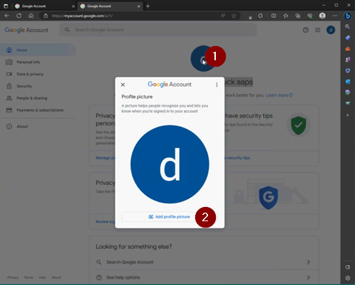
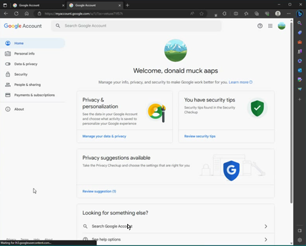
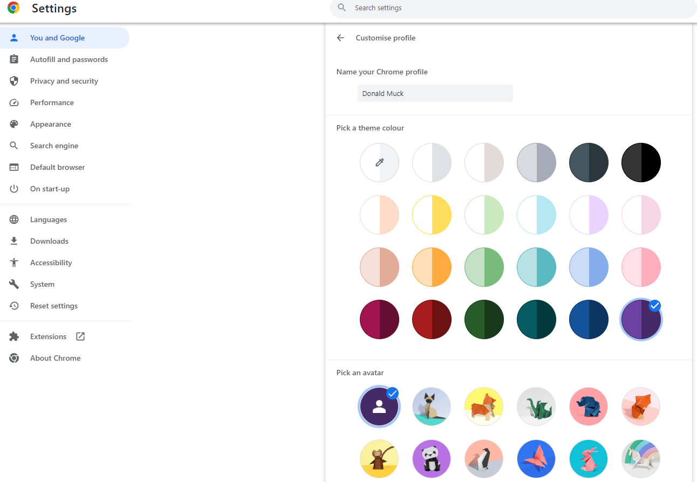
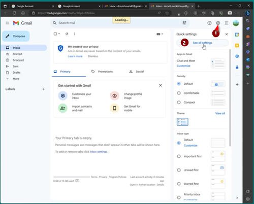

# Una cuenta de Google dedicada para AAPS (opcional)

Algunos usuarios de **AAPS** prefieren usar también su cuenta de correo principal para **AAPS**. Otros usuarios de **AAPS** (o sus cuidadores) crean una cuenta de correo solo para **AAPS**. Esto es opcional; abajo mostramos un ejemplo de cómo hacerlo.

Si no quieres crear una cuenta de Gmail solo para **AAPS**, puedes ir directamente a la siguiente sección, [Compilar AAPS](../SettingUpAaps/BuildingAaps.md).

```{admonition} Advantages of a dedicated Google account for AAPS
:class: dropdown

- Con un espacio propio en Google Drive no corres el riesgo de llenar el límite de tu Google Drive personal con **Exportar ajustes**.
- Cada versión de **AAPS** (y de las apps de apoyo como xDrip, BYODA, etc.) se guardará en un único lugar, que no depende del hardware de tu ordenador. Si te roban, pierdes o se rompe el ordenador o el teléfono, seguirás teniendo acceso.
- Si todos usan la misma configuración, con una estructura de carpetas parecida, la ayuda en línea entre usuarios es más sencilla.
- Según la configuración (ver abajo), tendrás una identidad separada, como un alias, para comunicarte con la comunidad. Esto puede proteger tu privacidad. 
- Los niños con DT1 pueden mantener su propia cuenta de correo «de uso diario» como menores, mientras usan **AAPS** y funciones relacionadas que necesitan una cuenta de adulto.
- Gmail permite registrar hasta 4 cuentas con el mismo número de teléfono.
```

## Cómo configurar una cuenta de Google dedicada para AAPS

(⌛Unos 10 minutos)


Requisitos:

* Tienes un PC con Windows (Windows 10 o posterior) y un teléfono Android (Android 12 o posterior) en el que estará la app **AAPS**. Los dos deben tener las últimas actualizaciones de seguridad, acceso a Internet y permisos de administrador, porque algunos pasos necesitan descargar e instalar programas.
* El teléfono Android ya está configurado con tu dirección de correo personal «de uso diario», por ejemplo una cuenta de Gmail.

```{admonition} Things to consider when setting up your new account
:class: dropdown
- Por privacidad, puedes usar un nombre distinto del tuyo que tenga relación con la cuenta (por ejemplo, t1dsuperstar). Así puedes usarlo en los foros públicos de **AAPS** sin mostrar tu identidad. Como Google pide un correo de recuperación y un número de teléfono, aún se puede rastrear.
- La nueva cuenta de **AAPS** usará para la verificación el mismo número de teléfono que tu cuenta «_de uso diario_». Usará la dirección de correo «de uso diario» para la verificación;
- Configuraremos el reenvío de correo para que todo correo enviado a la nueva cuenta de AAPS se reenvíe a la cuenta principal (así no tienes que revisar dos buzones distintos);
- Usa contraseñas distintas para tu cuenta de Gmail _de uso diario_ y para la cuenta de Gmail de AAPS
- Si usas la «verificación en 2 pasos» de Google (autenticación multifactor) en una cuenta de Gmail, actívala también en la otra.
- Si piensas usar las «llaves de acceso» (Passkeys) de Google, registra varios dispositivos. Así no te quedarás sin acceso a tu cuenta. Hazlo solo en dispositivos a los que nadie más pueda acceder (_es decir_, no en un PC con una cuenta compartida que otras personas pueden desbloquear).
```


```{admonition} Video Walkthrough!
:class: note
Haz clic [aquí](<https://drive.google.com/file/d/1dMZTIolO-kd2eB0soP7boEVtHeCDEQBF/view?usp=drive_link>) para ver un vídeo que muestra paso a paso cómo crear una cuenta de Google dedicada.
```

 Estos son los pasos que se muestran en el vídeo:

En este ejemplo: 
- Tu cuenta de Google actual «_de uso diario_» es <donald.muck42@gmail.com> ; 
- Tu nueva cuenta de Gmail «_AAPS_» será: <donald.muck42.aaps@gmail.com>; 


### Ve a <https://account.google.com> 

 Si ya has iniciado sesión en Google, esto te llevará a la página **Mi cuenta** de tu cuenta «de uso diario». (1) Haz clic arriba a la derecha de la página, en tu foto de perfil (en este caso, una simple  (2) elige «_Añadir otra cuenta_».


### Introduce los datos de tu NUEVA cuenta: 

- Introduce la nueva cuenta: 
- Crear la cuenta
- para mi uso personal. 


### Introduce tus datos personales:
 - Introduce el nombre
 - apellidos
 - fecha de nacimiento (tienes que ser mayor de edad)

### Elige tu NUEVA dirección de correo y la contraseña

Este ejemplo añade «.AAPS» a la dirección actual de Donald Muck…\
Establece una contraseña

### Introduce un número de teléfono que pueda recibir el SMS de verificación

Gmail te enviará un código único que tienes que introducir para la verificación.

### Introduce la dirección de correo de recuperación

En este caso será tu correo actual «_de uso diario_»…

### Terminar de configurar la cuenta

Gmail mostrará el nombre de la cuenta. Te pedirá aceptar los términos y condiciones de Gmail y confirmar tus ajustes de personalización.

### Personalizar cómo se muestra el nuevo perfil

Ahora deberías estar en la página Mi cuenta de Gmail, con tu nueva cuenta de correo para **AAPS**. Por defecto, la foto de perfil será la primera letra de tu nombre. Cámbiala por algo único para evitar confusiones… en este ejemplo, Donald.Muck.AAPS ha sustituido  por 

\


### Abre el sitio web de Gmail en las dos ventanas para configurar la nueva cuenta

Para no tener que revisar otra cuenta de correo, reenvía todos los correos de la nueva cuenta de **AAPS** a tu cuenta de uso diario\
Esta parte puede ser un poco confusa, porque tendrás que cambiar varias veces entre las dos cuentas. Para hacerlo más fácil, abre 2 ventanas del navegador, una encima de la otra:

1. Mueve tu navegador actual a la parte superior de la pantalla y cambia su tamaño para que ocupe solo la mitad de arriba de la pantalla…
2. Haz clic derecho en el logotipo de tu navegador en la barra de tareas
3. En el menú, elige «Nueva ventana»... y ajústala para que ocupe solo la mitad de abajo de la pantalla.

Abre <https://gmail.com> en cada ventana del navegador. Asegúrate de que tu cuenta personal está arriba y la nueva cuenta de **AAPS** está abajo, y que se reconoce fácilmente por la foto de perfil en la esquina superior derecha. (si hace falta, siempre puedes cambiar de cuenta haciendo clic en la foto de perfil y eligiendo la cuenta correcta.



La página de inicio de Gmail debería verse así:\


 ### En la nueva cuenta de Gmail (ventana de abajo), abre los ajustes de Gmail…

- Haz clic en el engranaje a la izquierda de la foto de perfil
- y luego elige «**Ver todos los ajustes**»



### Configurar el reenvío…

- Haz clic en la pestaña de ajustes «Forwarding and POP/IMAP» (Reenvío y correo POP/IMAP)
- Haz clic en «add a forwarding address» (Añadir una dirección de reenvío)
- Añade tu dirección de correo «de todos los días»
- Gmail enviará un código de verificación a tu dirección de correo «de uso diario».
- Vuelve a tu perfil de todos los días y haz clic en el enlace para confirmar que aceptas el reenvío (o copia el código del correo de verificación de Gmail en tu ventana de Gmail «de todos los días» y pégalo en tu ventana de Gmail «nueva, dedicada a AAPS»).

Hay que cambiar bastantes veces entre las ventanas, pero así, cuando revises los correos de tu cuenta «de todos los días», también verás los correos reenviados desde tu cuenta dedicada a AAPS, como las alertas de Gmail.


### Verificar la dirección de correo de reenvío

- En el Gmail «de uso diario» (ventana de arriba) recibirás el correo de confirmación del reenvío de Gmail («Gmail forwarding Confirmation»).
- Ábrelo y haz clic en el enlace para confirmar la solicitud («click the link to confirm the request»)

### Archivar los correos reenviados en la nueva cuenta de Gmail dedicada (ventana de abajo)

<!---->

1. Actualiza la ventana de abajo
2. Marca «forward incoming email» (Reenviar una copia del correo entrante)
3. Y archiva la copia de Gmail (para mantener limpio tu nuevo buzón dedicado)
4. Desplázate hasta el final de la página para guardar los cambios\
   


¡Enhorabuena! Ya has creado una cuenta de Google dedicada a AAPS. El siguiente paso es [compilar la app AAPS](../SettingUpAaps/BuildingAaps.md).