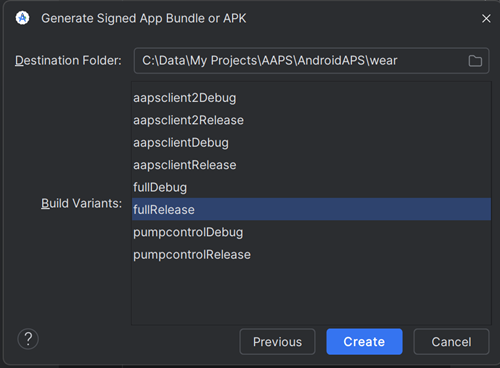

# Compilar la app AAPS para Wear

La app **AAPS** para un reloj inteligente Wear OS (el **APK de Wear**, `aaps-wear-….apk`) es un archivo de instalación distinto de la app **AAPS** del teléfono. Necesitas las dos: la app del teléfono ejecuta el lazo, y la app del reloj muestra sus datos y puede enviarle comandos. La app del reloj se instala desde el teléfono, consulta [Configurar AAPS en tu reloj Wear OS](WearOsSmartwatch.md).

Las dos apps solo funcionan juntas cuando coinciden:

- **La misma versión de AAPS** en el teléfono y en el reloj.
- **El mismo almacén de claves (keystore)** para firmar las dos apps.

La forma más sencilla de asegurarlo es compilar las dos apps **a la vez**, en la misma compilación. La compilación en el navegador lo hace por ti: cada compilación genera juntos el APK del teléfono y el APK de Wear. Con Android Studio o con la línea de comandos, compilas el APK de Wear como un segundo paso, justo después del APK del teléfono.

```{note}
¿Ya usas **AAPS** en tu teléfono, pero no tienes un APK de Wear de la misma compilación? Compila de nuevo las dos apps, con el mismo almacén de claves, y vuelve a instalar también la app del teléfono. Es poco probable que un APK de Wear compilado meses después, o con otra versión de Android Studio, sea compatible con la app del teléfono.
```

## Versiones de Wear OS compatibles

**AAPS** funciona en relojes con **Wear OS 3.0, 3.2 o 3.5** (Android 11, nivel de API 30) **o más reciente** (Wear OS 4, 5 y 6). Los relojes con Wear OS 2 no son compatibles.

```{warning}
Las esferas de AAPS están disponibles para relojes inteligentes Wear OS con nivel de API de 30 a 33 (Wear OS 3.0, 3.2, 3.5 y 4).<br>
Las versiones más nuevas de Wear OS rompen poco a poco las esferas de AAPS; consulta [Cambios en las esferas de Wear OS](#wearos-watchface-changes) y las [limitaciones de Wear OS 5](#BuildingAapsWearOs-WearOS5).
```

(building-aaps-wear-os-method)=

## Obtener el APK de Wear con tu método de compilación

Sigue la sección del método que usas para [compilar AAPS](../SettingUpAaps/BuildingAaps.md).

(building-aaps-wear-os-browser)=

### Compilación en el navegador (recomendado)

**No tienes que hacer nada más.** Cada compilación en el navegador genera dos archivos con el mismo código fuente y el mismo almacén de claves:

- `aaps-….apk`: la app del teléfono.
- `aaps-wear-….apk`: la app del reloj.

El APK de Wear sigue la [variante](#browserbuild-variant) que seleccionaste para la compilación: `fullRelease` da la app **AAPS Wear**, `aapsclientRelease` la app **AAPSClient Wear** y `pumpcontrolRelease` la app **PumpControl Wear**. Cada app de Wear solo se comunica con su app del teléfono correspondiente.

Dónde encontrar el APK de Wear:

- **AAPS Builder**: en la página de la compilación, desplázate hacia abajo hasta **Artifacts** y descarga `aaps-wear-….apk` junto a la app del teléfono, como se muestra en [Paso 6 – Instalar la app en tu teléfono](#aaps-builder-step6). Descárgalo en el teléfono que ejecuta **AAPS** si instalas la app del reloj desde el teléfono (Wear Installer 2 o Easy Fire Tools), o en tu ordenador si usas ADB.

  

- **Fork con Google Drive**: abre tu Google Drive, la carpeta `AAPS` y después la carpeta de la versión que compilaste. Contiene el APK del teléfono y el APK de Wear, consulta [Paso 4: compilar el APK](#github-build-apk).

  

Guarda el APK de Wear junto con el APK del teléfono en tus copias de seguridad. Con **AAPS Builder**, los archivos se quedan en la página de la compilación solo durante 14 días.

Siguiente paso: instala el APK de Wear en el reloj, consulta [Configurar AAPS en tu reloj Wear OS](WearOsSmartwatch.md).

(building-aaps-wear-os-android-studio)=

### Android Studio

El APK de Wear se compila como el APK del teléfono, como una segunda compilación firmada. Hazlo justo después del APK del teléfono, con la misma versión de Android Studio y el mismo almacén de claves.

- Sigue las instrucciones de [Compilación con Android Studio](../SettingUpAaps/ComputerBuild.md).
- Cuando llegues a la [selección del módulo](#Building-APK-wearapk) en «Compilar el APK firmado de AAPS», asegúrate de seleccionar **`AndroidAPS.wear`**.


Selecciona «**fullRelease**» para generar el archivo APK de Wear de **AAPS**.



Si lo prefieres, en el menú desplegable puedes compilar **“pumpcontrolRelease”**; con esta versión solo puedes controlar la bomba a distancia, sin lazo.

Siguiente paso: instala el APK de Wear en el reloj, consulta [Configurar AAPS en tu reloj Wear OS](WearOsSmartwatch.md).

(building-aaps-wear-os-troubleshooting)=

#### Solución de problemas de la compilación con Android Studio

Al compilar la app completa de **AAPS** (y de hecho cualquier app firmada), Android Studio genera un archivo .json en la misma carpeta. Esto causa errores de [cambios sin confirmar (uncommitted changes)](#troubleshooting_androidstudio-uncommitted-changes) cuando intentas compilar la siguiente app firmada, como la app de Wear de **AAPS**. La forma más rápida de resolverlo es ir a la carpeta donde se compiló la app completa de AAPS; tu carpeta será probablemente algo como:

`C:\Users\Your Name\AndroidStudioProjects\AndroidAPS\app\aapsclient\release.`

Borra el archivo .json que no necesitas o muévelo fuera de la carpeta. Después intenta compilar de nuevo la app de Wear de **AAPS**. Si eso no funciona, la [guía de solución de problemas](../GettingHelp/TroubleshootingAndroidStudio.md) más detallada te ayudará a encontrar el archivo que causa el problema, que también podría ser tu archivo de almacén de claves (keystore).

(building-aaps-wear-os-cli)=

### Línea de comandos

Sigue las [Instrucciones para compilar con la línea de comandos](../SettingUpAaps/CLIBuild.md) y repite los pasos de compilar y firmar para el módulo `wear`, con el mismo almacén de claves:

```sh
./gradlew :wear:assembleFullRelease
```

El APK de Wear sin firmar se guarda en `wear/build/outputs/apk/full/release/`. Fírmalo con `apksigner` igual que el APK del teléfono y después instálalo en el reloj, consulta [Configurar AAPS en tu reloj Wear OS](WearOsSmartwatch.md).
