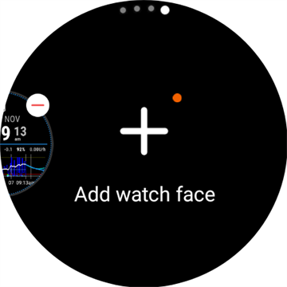

# Configurar AAPS en tu reloj Wear OS

Las instrucciones de abajo son para el apk de **AAPS Wear** que tienes que compilar. Si aún no lo has compilado, consulta la guía enlazada [aquí](../WearOS/BuildingAapsWearOS.md). Al compilar, asegúrate de usar el mismo archivo de almacén de claves (keystore) que usaste para el apk de **AAPS** del teléfono.

También puedes usar parte de esta información para los apk **Wear** de **AAPSClient** y de **PumpControl**. Cada app **Wear** se comunica con su app del teléfono correspondiente. Por ejemplo: la app **AAPSClient Wear** se puede usar para mostrar los datos de **AAPSClient** y no los datos de **AAPS**. Si tienes varias variantes de cliente instaladas a la vez (**AAPSClient**, **AAPSClient2**, **AAPSClient3**), los mosaicos de cada una llevan una pequeña cabecera con el color de acento de esa variante. Así puedes distinguirlos al deslizar.

## Versiones de Wear OS y compatibilidad

(wearos-watchface-changes)=

### Cambios en las esferas de Wear OS (efecto en las esferas de AAPS)

```{admonition} Why newer Wear OS watches break AAPS watchfaces
:class: warning

En junio de 2025, Google [anunció cambios](https://android-developers.googleblog.com/2025/06/upcoming-changes-to-wear-os-watch-faces.html) que retiran poco a poco el antiguo motor de esferas (el motor AndroidX / Wearable Support Library, o "WSL") en favor del nuevo formato declarativo **Watch Face Format**. Las esferas personalizadas de **AAPS** usan el motor antiguo. Por eso, cuanto más nueva es la versión de Wear OS, más probable es que una esfera de AAPS funcione mal o deje de funcionar.

Esto afecta solo a las **esferas**: las **complicaciones**, los mosaicos y las funciones de control remoto de AAPS no se ven afectados. Por eso también **una actualización del firmware o del sistema de un reloj Wear OS puede romper las esferas de AAPS**, y después no se puede volver a una versión anterior de Wear OS en el reloj. Si tu esfera de AAPS funciona ahora, **desactiva las actualizaciones automáticas del reloj**.
```

La tabla de abajo resume cómo afecta el cambio de Google a las esferas de AAPS (motor antiguo) según la versión de Wear OS:

| Versión de Wear OS      | Android base | Nivel de API | Efecto en las esferas de AAPS (antiguas)                                                                                                                                                                |
| ----------------------- | ------------ | ------------ | ------------------------------------------------------------------------------------------------------------------------------------------------------------------------------------------------------- |
| Wear OS 6               | Android 16   | 36           | **Las esferas antiguas ya no están disponibles**: en su lugar, AAPS instala una [esfera en Watch Face Format](#wearos-aaps-v4-watchface): tu esfera personalizada o la esfera de complicaciones AAPS V4 |
| Wear OS 5               | Android 14   | 34           | **Grave**: el modo activo (interactivo) falla a menudo, las complicaciones se congelan y las animaciones se paran                                                                                       |
| Wear OS 4               | Android 13   | 33           | **Moderado**: limitación de recursos, actualizaciones perdidas, fallos parciales                                                                                                                        |
| Wear OS 3.0 / 3.2 / 3.5 | Android 11   | 30           | **Bajo**: el motor antiguo sigue siendo compatible                                                                                                                                                      |

Si tu reloj tiene una versión en la que las esferas de AAPS no son fiables, puedes mostrar los datos de AAPS con **complicaciones** en una esfera compatible, o usar [GlucoDataHandler](https://play.google.com/store/apps/details?id=de.michelinside.glucodatahandler) con una complicación, que recibe los datos del complemento [Aplicaciones complementarias externas](#external-companion-apps) de **AAPS**. En **Wear OS 6 y versiones más nuevas**, AAPS instala una esfera de reemplazo hecha con el nuevo formato (ver abajo).

(wearos-aaps-v4-watchface)=

### Wear OS 6 y versiones más nuevas: la esfera que instala AAPS

Los relojes con **Wear OS 6 o más nuevo** no pueden usar las esferas clásicas de AAPS como esferas. Para estos relojes, la app de AAPS para el reloj trae dos esferas hechas con el nuevo **Watch Face Format** de Google. Wear OS permite que una app instale solo **una** esfera, así que tú eliges cuál de las dos está en el reloj:

- **Esfera personalizada** (por defecto): muestra la esfera personalizada que cargaste desde el teléfono con **Cargar esfera** (ver [Cambiar a una esfera de AAPS](#WearOS_changing-to-AAPS-watchface)). El reloj dibuja tu diseño como una imagen, así que funcionan todas las esferas personalizadas que ya existen. Los espacios de complicaciones que puede definir una esfera personalizada **no están disponibles** en esta imagen, porque Wear OS solo envía datos de complicaciones a una esfera real. Mantén pulsada la esfera para llegar a su único ajuste: si la pantalla siempre activa muestra un reloj simple o tu propio diseño, atenuado.
- **Esfera de complicaciones** (la esfera **AAPS V4**): sus **siete espacios de complicaciones** vienen **configurados con datos de AAPS**: valor de glucosa, IOB, COB, la [complicación Gráfico BG](#Watchfaces-complications), tasa basal / objetivo temporal y el icono de **Modo de funcionamiento** en el espacio de arriba a la izquierda (tócalo para cambiar el modo del lazo desde el reloj). Toca la hora de arriba para abrir la app de alarmas del reloj. Puedes cambiar lo que muestra cada espacio en el editor de esferas.

La elección se hace en el teléfono: abre el complemento **Reloj** y, en **Esfera instalada en el reloj**, selecciona una de las dos. Esta tarjeta solo aparece mientras hay un reloj con Wear OS 6 o más nuevo conectado. **AAPS** te pide confirmar, porque el reloj cambia su esfera de inmediato. Si cambias de la **Esfera de complicaciones** a la otra, las complicaciones que cambiaste en el editor de esferas también vuelven a los valores por defecto. La confirmación te lo avisa. Mientras está seleccionada la **Esfera de complicaciones**, los botones de la esfera personalizada se ocultan y en su lugar se muestra una vista previa de la esfera. Si cargas una esfera personalizada mientras está seleccionada la **Esfera de complicaciones**, **AAPS** te recuerda que cambies a **Esfera personalizada** para verla en el reloj.

- La esfera seleccionada se **instala y activa automáticamente** la primera vez que la app de AAPS se ejecuta en un reloj así, y se **actualiza automáticamente** junto con la app del reloj.
- Si quitaste la esfera, aparece la opción **Instalar esfera** al final del **menú principal** de AAPS en el reloj. Tócala para volver a instalarla.

Mientras hay conectado un reloj con Wear OS 5 o más antiguo, la tarjeta **Esfera instalada en el reloj** no aparece (el mecanismo que usa necesita Wear OS 6). Allí las esferas clásicas funcionan como antes.

(wearos-complications-watchface-setup)=

### Esfera de complicaciones: configuración recomendada

La **Esfera de complicaciones** tiene siete espacios de complicaciones. Mantén pulsada la esfera, toca **Personalizar** y elige una fuente de datos para cada espacio. Los espacios están numerados como en el editor de esferas: **1** izquierda, **2** centro, **3** derecha, **4** el gráfico, **5** abajo, **6** arriba a la izquierda y **7** arriba a la derecha.

| Configuración por defecto                                                                                    | Configuración alternativa                                                                                        |
| ------------------------------------------------------------------------------------------------------------ | ---------------------------------------------------------------------------------------------------------------- |
|  |  |

| Espacio | Posición              | Por defecto                                                                                 | Alternativa                                    |
| ------- | --------------------- | ------------------------------------------------------------------------------------------- | ---------------------------------------------- |
| 1       | Izquierda             | Icono IOB                                                                                   | COB & IOB                                      |
| 2       | Centro                | Glucosa en sangre                                                                           | Glucosa en sangre                              |
| 3       | Derecha               | Icono COB                                                                                   | Tasa basal y objetivo de glucosa               |
| 4       | Gráfico               | Gráfico BG                                                                                  | Gráfico BG                                     |
| 5       | Abajo                 | Tasa basal y objetivo de glucosa                                                            | Batería de teléfono que sube los datos         |
| 6       | Arriba a la izquierda | Modo de funcionamiento                                                                      | Modo de funcionamiento                         |
| 7       | Arriba a la derecha   | Batería de teléfono que sube los datos, o un acceso directo a **Silenciar alertas de AAPS** | Acceso directo a **Silenciar alertas de AAPS** |

El acceso directo **Silenciar alertas de AAPS** se elige entre las complicaciones **App shortcut** (acceso directo a app) propias del reloj. Al tocarlo, se silencia la alarma que está sonando en el teléfono.

```{tip}
Activa **Always-on display** (pantalla siempre activa) en el reloj (**Ajustes** > **Pantalla**). Así la esfera sigue mostrando tu glucosa cuando bajas la muñeca, en lugar de una pantalla en negro o un reloj simple.
```

```{admonition} No complication data while the watch is locked
:class: note
Si hay un **Tipo de bloqueo** configurado en **Ajustes** > **Seguridad y privacidad**, el reloj oculta los datos de las complicaciones mientras está bloqueado, y la esfera muestra espacios vacíos hasta que lo desbloquees. Para que los datos sigan visibles, desactiva **Ocultar información** en el mismo menú.
```

### Wear OS 3

Instala el apk de **AAPS Wear** con [Wear Installer 2](https://youtu.be/abgN4jQqHb0?si=5L7WUeYMSd_8IdPV), Easy Fire Tools (descrito más abajo) o ADB.  
Sin limitaciones en las funciones de **AAPS Wear**.

(BuildingAapsWearOs-WearOS5)=

### Wear OS 4 y Wear OS 5

Ejemplo: Galaxy Watch 4, 5, 6, 7 y Ultra o Pixel Watch que **no** se han actualizado todavía a Wear OS 6. Comprueba la versión en **Ajustes** > **Acerca del reloj** > **Software**.

Instala el apk de **AAPS Wear** con [Wear Installer 2](https://youtu.be/abgN4jQqHb0?si=5L7WUeYMSd_8IdPV) (para Wear OS 5, sigue [este vídeo](https://www.youtube.com/watch?v=yef_qGvcCnk)). Todas las funciones de **AAPS Wear** funcionan, pero las esferas clásicas de **AAPS** tienen límites, como se describe en la tabla de arriba: van limitadas en Wear OS 4 y fallan a menudo en Wear OS 5.

```{admonition} Wear OS 5
:class: warning
En Wear OS 5, la esfera de AAPS se tiene que seleccionar con Wear Installer 2 justo después de instalar la app Wear: el instalador ofrece la esfera **AAPS (Custom)** al final de la instalación. Si cambias a otra esfera por error, repite la instalación. Changing the watchface settings (Dark, Matching divider, etc.) may not be possible.

Si la esfera clásica te funciona ahora, **desactiva las actualizaciones automáticas del reloj**: es probable que la próxima actualización del firmware la rompa. Si aun así actualizas a Wear OS 6, lee la sección de arriba: **AAPS** instalará entonces su propia esfera en el nuevo formato.
```

Si la esfera no es lo bastante fiable, considera usar [GlucoDataHandler](https://play.google.com/store/apps/details?id=de.michelinside.glucodatahandler) con una complicación. Necesita el complemento [Aplicaciones complementarias externas](#external-companion-apps) activado en **AAPS**.

### Wear OS 6 y versiones más nuevas

Ejemplo: Galaxy Watch 4 y más nuevos con One UI 8 Watch, Pixel Watch después de la actualización de 2025. La mayoría de los relojes Galaxy y Pixel ya han recibido esta actualización.

Instala el apk de **AAPS Wear** con [Wear Installer 2](https://youtu.be/abgN4jQqHb0?si=5L7WUeYMSd_8IdPV). Las esferas clásicas no están disponibles. **AAPS** instala automáticamente la esfera seleccionada en el teléfono, ver [la esfera que instala AAPS](#wearos-aaps-v4-watchface). Sin limitaciones en las funciones de **AAPS Wear**.

## Cómo configurar un reloj inteligente Samsung Galaxy Watch 4 con **AAPS**

Esta sección supone que eres totalmente nuevo con los relojes inteligentes. Te da una orientación básica sobre un reloj popular, el **Galaxy Watch 4**, y después una guía paso a paso para configurar **AAPS** en el reloj.

_Esta guía se escribió para un Galaxy Watch con Wear OS 3._ En Wear OS 4 y posteriores, el reloj pide un **código de emparejamiento** cuando un teléfono o un ordenador se conecta por ADB. Wear Installer 2 y el procedimiento con el terminal [de abajo](#BuildingAapsWearOs-WearOS5-TShoot) lo admiten.

Aquí tienes guías básicas de configuración para el [Galaxy Watch 5](https://www.youtube.com/watch?v=Y5upzOIxwTU) y el [Galaxy Watch 6](https://www.youtube.com/watch?v=D6bq20KzPW0)

## Familiarizarse con el reloj inteligente

After basic setup of your watch according to the video above, go to the playstore on the phone and download the following apps: "Galaxy Wearable", “Samsung” and either “Easy Fire tools” or "Wear Installer 2".

Hay muchos vídeos de YouTube de terceros que te ayudan a familiarizarte con tu nuevo reloj inteligente, por ejemplo:

[https://www.youtube.com/watch?v=tSVkqWNmO2c](https://www.youtube.com/watch?v=tSVkqWNmO2c)

La app “Galaxy Wearable” también tiene una sección con un manual de instrucciones. Abre Galaxy Wearable en el teléfono, busca el reloj e intenta emparejar el reloj con el teléfono. Depending on your version, this may prompt you to install one more app, “galaxy watch 4 plugin”, from the playstore (takes a while to download). Instálala en el teléfono y después intenta otra vez emparejar el reloj y el teléfono en la app Wearable. Pasa por una serie de menús y marca varias preferencias.

## Configurar una cuenta de Samsung

Asegúrate de que la cuenta de correo que usas para configurar la cuenta de Samsung tiene una fecha de nacimiento con la que el usuario tiene 13 años o más. Si no, es muy difícil aprobar los permisos de Samsung. Si le has dado a tu hijo o hija menor de 13 años una cuenta de Gmail y usas esa dirección de correo, no puedes cambiarla sin más a una cuenta de adulto. Una forma de evitarlo es cambiar la fecha de nacimiento actual para que la edad actual sea de 12 años y 364 días. Al día siguiente, la cuenta pasará a ser una cuenta de adulto y podrás seguir con la configuración de la cuenta de Samsung.

(remote-control-transferring-the-aaps-wear-app-onto-your-aaps-phone)=

## Transferir la app Wear de **AAPS** a tu teléfono con **AAPS**

Puedes pasar el Wear.apk de Android Studio a tu teléfono de una de estas formas:

a)  con un cable USB, copia el archivo apk de Wear de **AAPS** al teléfono y después instálalo en el reloj por “side-load” (carga lateral). Transfiere Wear.apk al teléfono por USB a la carpeta de descargas; o

b)  corta y pega Wear.apk desde Android Studio en tu Google Drive.


Para instalar AAPS en el reloj por carga lateral puedes usar: 1) Wear Installer 2 2) Easy Fire tools 3) Android Debug Bridge (ADB) Aquí recomendamos Wear Installer 2, porque las instrucciones y el proceso del vídeo son muy claros y están bien explicados. Si Wear Installer 2 no te funciona, prueba Easy Fire Tools o ADB. Los dos se describen abajo.

### Usar Wear Installer 2 para instalar **AAPS** Wear por carga lateral desde el teléfono en el reloj

 

Wear Installer 2, desarrollado por [Malcolm Bryant](https://www.youtube.com/@Freepoc), se puede descargar desde Google Play a tu teléfono y sirve para instalar por carga lateral la app Wear de AAPS en el reloj. La app incluye un práctico [vídeo](https://youtu.be/abgN4jQqHb0?si=5L7WUeYMSd_8IdPV) «cómo hacer la carga lateral».

```{tip}
Para relojes con Wear OS 5, sigue [este vídeo](https://www.youtube.com/watch?v=yef_qGvcCnk).
Consulta los consejos para solucionar problemas [más abajo](#BuildingAapsWearOs-WearOS5-TShoot).
```

Aquí tienes todos los detalles necesarios (mejor abre el vídeo en otro dispositivo para poder verlo mientras configuras el teléfono).

Como dice el vídeo, cuando termines, desactiva la depuración ADB en el reloj para no gastar la batería del reloj inteligente.

Como alternativa, pero no para Wear OS 5, puedes:

### Usar Easy Fire tools para instalar **AAPS** Wear por carga lateral en el reloj

1)   Descarga _[Easy Fire Tools](https://play.google.com/store/apps/details?id=de.agondev.easyfiretools&hl=en)_ desde Play Store en el teléfono


2)  Activa el modo de desarrollador en el reloj (cuando esté configurado y conectado al teléfono):

Ve a **Ajustes** > **Sistema** > **Acerca de** > **Versiones** (los nombres de los menús cambian según la marca del reloj; en algunos relojes es **Acerca del reloj** > **Información de software** > **Versión de software**).


Toca rápido varias veces **Número de compilación** (o **Versión de software**) hasta que un mensaje te diga que ya eres desarrollador.


Vuelve a **Ajustes** > **Sistema**: ahora aparece un nuevo menú **Opciones de desarrollador**.

En **Opciones de desarrollador**, activa **Depuración ADB** y **Depuración inalámbrica**, y confirma los avisos. Después, Depuración inalámbrica muestra la **dirección IP y puerto** del reloj, por ejemplo: **192.168.1.214** : 5555. Solo necesitas la dirección IP (aquí **192.168.1.214**), no el número de puerto después de los dos puntos. Ten en cuenta que la dirección IP puede cambiar, por ejemplo cada vez que cambias a un teléfono nuevo para AAPS.


PASO 3)     Introduce la dirección IP, _por ejemplo_ **192.168.1.214**, en Easy Fire tools en el teléfono (abre el menú de la izquierda (hamburguesa), ve a ajustes e introduce la dirección IP).


Después pulsa el icono del enchufe arriba a la derecha. Se pondrá verde cuando esté conectado.


PASO 4) Sigue las instrucciones de [aquí](https://wearablestouse.com/blog/2022/01/04/install-apps-apk-samsung-galaxy-watch-4/?utm_content=cmp-true) para instalar por carga lateral (es decir, transferir) aaps-wear.apk en el reloj inteligente con Easy Fire tools


(BuildingAapsWearOs-WearOS5-TShoot)=

### Usar el terminal
Conecta tu reloj inteligente y tu ordenador a la misma red Wi-Fi.

- Para instalar ADB, descárgalo desde: https://developer.android.com/tools/releases/platform-tools
- Abre un terminal.
- En Windows, crea una carpeta nueva llamada `adb` en tu disco `C:`. Abre el archivo `platform-tools-latest-windows.zip` que descargaste antes. Copia todos los archivos de `platform-tools` a `C:\adb` y abre esta carpeta con un símbolo del sistema (clic derecho y Abrir en Terminal). Escribe el comando de abajo para añadir la carpeta donde está ADB a la ruta (PATH): `setx PATH "%PATH%;C:\adb"`
- En Mac, en lugar de instalarlo a mano, puedes usar homebrew: `brew install android-platform-tools`

En el reloj:
- Ve a Ajustes → Acerca del reloj → **Información de software**
- Toca Versión de software 7 veces hasta que veas que el modo de desarrollador está activado.
- Ve a Ajustes → Opciones de desarrollador. Activa la **depuración ADB**
- Ve a Ajustes → Opciones de desarrollador → Depuración inalámbrica → **Vincular nuevo dispositivo**

Verás que aparecen un código de emparejamiento Wi-Fi, la dirección IP y el puerto:


- En el terminal: `adb pair ipaddress:port` Por ejemplo: `adb pair 10.10.1.125:36299`
- Se te pedirá el código de emparejamiento. Introdúcelo.
- Verás una respuesta:<br> `Successfully paired to 10.10.1.125:36299 [guid=adb-RXXXW20LMKJY-eh5zBj]`<br>
- En el terminal escribe: <br>`adb devices`.<br> Deberías ver algo así:<br> `List of devices attached`<br> `10.10.1.125:36299  offline`<br> `adb-RFAW20LMKJY-eh5zBj._adb-tls-connect._tcp   device`<br>

- Ahora ve a la carpeta de tu ordenador donde está el apk de Wear y escribe<br> `adb install wear-full.apk` <br>cambiando wear-full.apk por el nombre de tu archivo apk.
- Verás:<br> `Performing Streamed Install`<br> `Success`


(wear-os-5-troubleshooting)=

### Recomendaciones generales para solucionar problemas con Wear OS 5

- No uses el anclaje de red por Wi-Fi (Wi-Fi Tethering). Eso no funcionará.
- No necesitas activar la depuración adb en el teléfono (solo en el reloj). Desactiva la depuración adb en el teléfono.
- Asegúrate de conectarte a tu red local, donde el teléfono y el reloj se pueden ver (no uses la red Wi-Fi de invitados para conectarte).
- Asegúrate de que el reloj y el teléfono están en la misma red y en el mismo dispositivo Wi-Fi. Sobre todo los repetidores Wi-Fi o los puntos de acceso pueden causar problemas.
- Asegúrate de estar cerca de tu router principal y después reinicia el teléfono y el reloj.

**Emparejamiento:**

- Reloj: Depuración inalámbrica: anota la dirección IP.
- Wear Installer: introduce la IP en la app Wear Installer.
- Selecciona Pair new (emparejar nuevo dispositivo), anota el código de emparejamiento y el número de puerto que aparecen.
- Wear Installer: introduce el código de emparejamiento + espacio + número de puerto.
- Wear Installer debería indicar que el emparejamiento ha funcionado. Si no es así, sal de Wear Installer y vuelve a intentarlo.

Una vez emparejado, deberías poder instalar el apk de Wear de AAPS:

- Sal o cierra y después reinicia Wear Installer.
- En la depuración inalámbrica, anota la IP y el número de puerto, y asegúrate de comprobar o introducir la IP y el número de puerto en Wear Installer.
- Nota: ¡el número de puerto es distinto del que se usa para el emparejamiento!

## Configurar la conexión entre el reloj y el teléfono desde **AAPS**

El último paso es configurar **AAPS** en el teléfono para que interactúe con **Wear.apk** en el reloj. Para ello, activa el complemento Reloj:

* Ve a la app **AAPS** en el teléfono

* Abre el **menú** (☰) en la esquina de arriba a la izquierda y ve a **Configuración** > **Comunicación**

* Marca la casilla **Reloj**


Para poner bolos o hacer otras acciones desde el reloj, activa también **Control desde el reloj** en [Ajustes > Reloj](#preferences-wear).

To change to a different **AAPS**  watchface, long-press the watchface on the home screen of the watch and tap **Customize**. Después desliza hacia la derecha hasta llegar a todas las esferas de **AAPS**.

Si el Wear.apk de **AAPS** se ha instalado bien por carga lateral en el reloj inteligente, se verá así:


En algunos relojes inteligentes, como los Samsung Galaxy, la opción 'Conexión remota' en Funciones avanzadas de Samsung Galaxy tiene que estar **activada** para usar **Wear.apk** y **AAPS** a distancia por Wi-Fi.


(wear-os-watch-phone-communication)=

### Solucionar problemas de comunicación entre el reloj con **AAPS** y el teléfono con **AAPS**

1.  Si EasyFire tools no se conecta o si recibes ‘authorisation failed’ (autorización fallida) > comprueba que la dirección IP es correcta.
2.  Comprueba que el reloj inteligente está conectado a internet (y no solo conectado al teléfono por Bluetooth).
3.  Comprueba que el teléfono con **AAPS** y el reloj inteligente están emparejados o vinculados en la app de Samsung.
4.  También puede ayudar reiniciar por completo el teléfono y el reloj inteligente (es decir, apagar el teléfono y volver a encenderlo)
5.  Si has conseguido descargar el Wear.apk en tu teléfono pero no recibes datos de glucosa, _comprueba_ que has instalado por carga lateral el apk Wear de **AAPS** correcto en el reloj: la app del reloj de una compilación en el navegador es el archivo `aaps-wear-….apk`, ver [Compilar la app AAPS para Wear](../WearOS/BuildingAapsWearOS.md). Si el archivo que instalaste es uno de estos: a) un apk Wear de **AAPSClient** (mientras el teléfono usa **AAPS**); b) un archivo `.aab`; o c) un archivo con la palabra ‘debug’ en el nombre, entonces no seleccionaste el apk de Wear OS correcto al compilar.
6.  Comprueba que tu router no aísla los dispositivos entre sí.

Encontrarás más consejos para solucionar problemas [aquí](https://freepoc.org/wear-installer-help-page/#:~:text=If%20you%20are%20having%20problems,your%20phone%20and%20your%20watch.)

(WearOS_changing-to-AAPS-watchface)=

## Cambiar a una esfera de AAPS en tu reloj Wear OS

Hay varias esferas disponibles en la compilación estándar del APK de AAPS para Wear OS. Estarán disponibles cuando hayas instalado el APK de AAPS Wear en tu reloj. Estos son los pasos para elegir una:

1. En tu reloj (suponiendo que es Wear OS), mantén pulsada la esfera actual para abrir la pantalla de selección de esferas y desplázate del todo a la derecha hasta ver el botón "Add Watch Face" (añadir esfera). Selecciónalo



2. Desplázate por la lista hasta encontrar "AAPS (Custom)" (según el reloj, las esferas de las apps instaladas aparecen en una sección "Descargadas" o agrupadas por app) y pulsa en el centro de la imagen para añadirla a tu lista corta de esferas actuales. No te preocupes por el aspecto actual de la esfera "AAPS (Custom)". En el siguiente paso elegirás el diseño que prefieras.


3. Ahora abre AAPS en tu teléfono y abre el complemento Reloj: **Configuración** > **Comunicación** > **Reloj** > **Abrir complemento** (marca primero **Reloj** si no está activado).


4. Pulsa el botón "Cargar esfera" y elige la esfera que te guste


5. Mira tu reloj: la esfera "AAPS (Custom)" ahora debería mostrar el diseño que has elegido. Espera unos segundos a que se actualice. La pantalla **Reloj** del teléfono ahora muestra el nombre de la esfera cargada y una vista previa. **Información de esferas** muestra sus detalles y los campos que contiene, y **Más esferas** abre el [sitio de intercambio](../ExchangeSiteCustomWatchfaces/index.md), donde puedes descargar otras esferas personalizadas. Ahora puedes personalizar las complicaciones, etc. Para ello, mantén pulsada la esfera y después pulsa el botón "Personalizar" en la imagen de la esfera.

```{admonition} Complications on a custom watchface
:class: note
Las esferas personalizadas hechas con la versión 3.0 o más nueva del formato de esferas personalizadas pueden tener hasta cinco espacios de complicaciones, con la posición y el tamaño definidos por la esfera (**Diseño de la complicación**). En el reloj, mantén pulsada la esfera, toca **Personalizar** y toca de **Complicación 1** a **Complicación 5** para elegir la fuente de datos de cada espacio. Las mismas filas aparecen en la app AAPS del reloj en **Configuración** > **AAPS(personalizado)**. Si tocas una allí, se abre el mismo selector. **Prioridad del tipo de complicación** decide si un espacio prefiere un valor o indicador, un texto o un icono cuando la fuente de datos ofrece varios. Un cambio de prioridad solo se aplica la próxima vez que elijas una fuente de datos para ese espacio.

Estos espacios solo funcionan en relojes con **Wear OS 5 o más antiguo**, donde la esfera personalizada funciona como una esfera real. En **Wear OS 6 y versiones más nuevas**, la esfera personalizada se muestra como una imagen sin sus espacios de complicaciones, y los pasos 1 y 2 de arriba no hacen falta: asegúrate de que **Esfera personalizada** está seleccionada en **Esfera instalada en el reloj**, en el complemento **Reloj** del teléfono (ver [la esfera que instala AAPS](#wearos-aaps-v4-watchface)).
```

## Leyenda de esferas AAPSv2


A - tiempo desde la última ejecución del lazo

B - lectura del MCG

C - minutos desde la última lectura del MCG

D - cambio respecto a la última lectura del MCG (en mmol o mg/dl)

E - cambio medio de la lectura del MCG en los últimos 15 minutos

F - batería del teléfono

G - dosis basal (en U/h con la dosis estándar y en % durante una TBR)

H - BGI (blood glucose impact) -> the degree to which BG “should” be rising or falling based on insulin activity alone.

I - carbohidratos (carbohidratos activos | e-carbs en el futuro)

J - insulina activa (de bolo | de basal)
