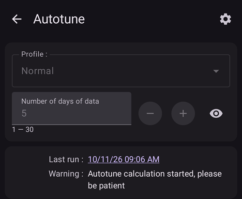

# Comment utiliser le plugin Autotune

Le plugin Autotune est une implémentation de l'algorithme autotune OpenAPS dans AAPS. It analyzes your recent AAPS history to suggest adjustments to your basal rates, ISF and carb ratio.

Autotune Plugin is available in AAPS releases since [3.4](#version3400) but is hidden by default.

(autotune-how-autotune-calculates-adjustments)=
## How Autotune calculates adjustments

Autotune looks back over your recent AAPS history — CGM readings, boluses, carbs and temporary basal rates — and works out where your **Profile** (basal rates, ISF, carb ratio) doesn't quite match what actually happened to your BG.

For each 5-minute data point, it compares your **actual BG change** to the change your Profile predicted, and sorts the resulting deviation into one of three buckets:

* deviations that happened with no carbs on board and no insulin activity (used to tune **basal rates**, hour by hour),
* deviations that happened after a bolus/correction with no carbs (used to tune **ISF**), or
* deviations that happened while carbs were absorbing (used to tune **carb ratio**).

It then looks at the pattern of deviations in each bucket (using percentiles rather than a simple average, so a few noisy data points don't skew the result) and proposes a new value for that hour/parameter.

To keep any single run from overcorrecting, each Autotune run only ever moves a value a fraction of the way towards what the data suggests: up to 10% for ISF and carb ratio, and up to 20% for each basal segment. Overall drift is further capped by the **Max autosens ratio** / **Min autosens ratio** settings (see [Other settings](#autotune-other-settings) below) — the same bounds that limit Autosens. This is why Autotune is meant to be run repeatedly (day after day, or nightly) rather than trusted after a single run: results should converge gradually, and a big jump on one run is a sign to double check your data (missed carbs, a bad sensor day, _etc._) rather than to trust it blindly.

Autotune can be run three ways: manually as a one-off from within the plugin (as described below), automatically every night via an [automation rule](#autotune-run-autotune-with-an-automation-rule), or — outside of AAPS entirely — as a standalone command-line tool against exported data, which is how some community guides describe using it without a phone actively running AAPS.

*For the underlying oref0 algorithm in full mathematical detail, see [OpenAPS's Autotune documentation](https://openaps.readthedocs.io/en/latest/docs/Customize-Iterate/autotune.html).*

## Afficher le plugin Autotune

Create an empty file named `enable_autotune` in the `extra` subfolder of your phone [AAPS directory](#preferences-maintenance-settings).

***NOTE: Ensure you check in the **AAPS** settings where your AAPS Directory is, and that you placed the file in the correct one, a number of several have been caught out putting the file into the wrong folder.***


Restart **AAPS**. Then open the **menu** (☰), select **Configuration**, then the **General** category, and tick **Autotune**. The card then shows **Settings** and **Open plugin**:


## Interface utilisateur Autotune

Tap **Open plugin** on the **Autotune** card to open the Autotune screen:


- Vous pouvez sélectionner le profil d'entrée que vous voulez régler dans le menu déroulant Profil (par défaut, votre profil actif actuel est sélectionné)
  - Note: each time you select a new profile, previous results will be removed and the **Number of days of data** will be set to its default value
- Then **Number of days of data** (called **Tune days** in older versions) is to select the number of days used in calculation to tune your profile. La valeur minimale est de 1 jour et la valeur maximale de 30 jours. Ce nombre ne devrait pas être trop petit pour obtenir des résultats itératifs et lisses corrects (au-dessus de 7 jours pour chaque calcul)
  - Note: each time you change the **Number of days of data**, previous results will be removed
- Dernier run affiche la date du dernier calcul et permet d'afficher votre dernier calcul valide. Si vous n'avez pas lancé Autotune le jour en cours, ou si les résultats précédents ont été supprimés avec une modification du paramètre de calcul ci-dessus, vous pouvez alors récupérer les paramètres et les résultats de la dernière exécution réussie.
- L'avertissement vous montre par exemple des informations sur le profil sélectionné (si vous avez plusieurs valeurs G/I ou plusieurs valeurs SI)
  - Remarque : Le calcul Autotune fonctionne avec une seule valeur de G/I et une seule valeur de SI. Il n'existe actuellement aucun algorithme Autotune pour ajuster un G/I circadien ou une SI circadienne. Si votre profil d'entrée a plusieurs valeurs, vous pouvez voir dans la section Avertissement la valeur moyenne prise en compte pour calculer votre profil.
- Check Input Profile button open the Profile Viewer to allow you a quick verification of your profile (Units, IC, ISF, basal and target)
  - Remarque : Autotune ne réglera que le G/I (valeur unique), la SI (valeur unique) et les débits de basal (avec variation circadienne). Units and target will remain unchanged in output profile.

- "Run Autotune" will launch Autotune calculation with selected profile and the selected number of days of data
  - Remarque : Le calcul Autotune peut prendre beaucoup de temps. Une fois lancé, vous pouvez passer à une autre vue (écran d'accueil ...) et revenir plus tard dans le plugin Autotune pour voir les résultats

  

- Ensuite, au cours de l'exécution vous verrez les résultats intermédiaires ci-dessous

  - Remarque : Pendant l'exécution, les paramètres sont verrouillés, vous ne pouvez donc plus modifier le profil d'entrée sélectionné ou le nombre de jour. Vous devrez attendre la fin du calcul actuel si vous voulez lancer un nouveau calcul avec d'autres paramètres.

  

- Une fois le calcul automatique terminé, vous verrez le résultat (Tuned Profil) et les quatre boutons ci-dessous.

  

- Il est important de toujours comparer le profil d'entrée (colonne "Profil"), le profil de sortie (colonne "Tuned") et le pourcentage de variation pour chaque valeur (colonne "%").

- Pour les débits de basal, vous avez aussi le nombre de "jours manquants". Il vous manque des jours quand Autotune n'a pas assez de données catégorisées comme « Basal » pour calculer le débit de basal pour cette période (par exemple après chaque repas lorsque vous avez une absorption de glucides). Ce nombre doit être aussi bas que possible, surtout lors de périodes où la basale est prépondérante (par exemple pendant la nuit ou à la fin de l'après-midi)

- Le bouton « Comparer les profils » ouvre la vue Comparateur de profil. Le profil d'entrée est en bleu, et le profil de sortie (nommé "Tuned") est en rouge.

  - Remarque : dans l'exemple ci-dessous, le profil d'entrée a une variation circadienne pour le G/I et la SI, mais le profil calculé en sortie a une seule valeur. Si pour vous il est important d'obtenir un profil de sortie circadien, voir [Profil avec G/I ou SI Circadiens](#autotune-circadian-ic-or-isf-profile) ci-dessous.

  

- Si vous faites confiance aux résultats (faible pourcentage de variation entre le profil d'entrée et le profil de sortie), vous pouvez cliquer sur le bouton "Activer le profil" puis cliquer sur OK pour valider.

  - Activate Tuned profile will automatically create a new profile "Tuned" in your profile list (**Manage → Profile**).
  - If you already have a profile named "Tuned" in **Manage → Profile**, then this profile will be updated with calculated Autotune profile before the activation

  

- Si vous pensez que le profil Tuned doit être ajusté (par exemple si vous pensez que certaines variations sont trop importantes), puis vous pouvez cliquer sur le bouton "Copier vers profil local"

  - A new profile with the prefix "Tuned" and the date and time of the run will be created in **Manage → Profile**

  

- You can then edit the Tuned profile: open **Manage** > **Profile**, swipe to the card named "Tuned" with the date and time of the run, and tap the **Edit** (pencil) button

  - the values in the profile will be rounded in the user interface to your pump capabilities

  

- Si vous souhaitez remplacer votre profil d'entrée par le résultat Autotune, cliquez sur le bouton "Mettre à jour profil d'entrée" et validez la fenêtre pop-up avec OK

  - Remarque : si vous cliquez sur "Activer le profil" après avoir cliqué sur "Mettre à jour profil d'entrée", alors vous activerez votre profil mis à jour et non le profil par défaut "Tuned" ?

  

- Si vous avez mis à jour votre profil d'entrée, alors le bouton "Mettre à jour profil d'entrée" est remplacé par le bouton "Réinitialiser profil d'entrée" (voir capture d'écran ci-dessous). You can that way immediately see if your current input profile in **Manage → Profile** already includes the result of last run or not. Vous avez aussi la possibilité de récupérer votre profil d'entrée initial sans les résultats Autotune avec ce bouton

  


## Paramètres Autotune

(autotune-plugin-settings)=

### Paramètres du plugin Autotune

  

```{admonition} Only DEV
:class: note
The **Auto switch profile** feature is only available in Dev/Engineering mode.
```

- **Auto switch profile** (default Off): see [Run Autotune with an automation rule](#autotune-run-autotune-with-an-automation-rule) below. Si vous activez ce paramètre, le profil d'entrée sera automatiquement mis à jour par le profil Tuned, et il sera activé.
  - **Soyez prudent, vous devez prendre confiance en vérifiant pendant plusieurs jours qu'après une mise à jour et l'activation du profil Tuned sans aucune modification, cela améliore effectivement votre boucle**

- **Categorize UAM as basal** (default Off): This setting is for the users using AndroidAPS without any carbs entered (Full UAM). Il empêchera (quand désactivé) de catégoriser les RNS en tant que basal.
  - Remarque : si vous avez au moins une heure d'absorption de glucides détectée pendant une journée, alors toutes les données catégorisées comme "RNS" seront catégorisées en tant que basal, quel que soit ce paramètre (Activé ou Désactivé)
- **Default tune days** (default 5): You can define the default value with this setting. Each time you select a new profile in the Autotune plugin, the **Number of days of data** will be replaced by this default value
- **Use circadian IC/ISF** (default Off): see [Circadian IC or ISF profile](#autotune-circadian-ic-or-isf-profile) below.

(autotune-other-settings)=
### Other settings

- Autotune utilise également les ratio Max et Min Autosens pour limiter la variation. You can see and adjust these values in [**Settings** > **Absorption settings** > **Advanced Settings**](../SettingUpAaps/Preferences.md) (**Autosens max** and **Autosens min**).

  


## Fonctionnalités avancées

(autotune-circadian-ic-or-isf-profile)=

### Profil avec G/I ou SI Circadiens

- If you have important variation of IC and/or you ISF in your profile, and you fully trust in your circadian time and variation, then you can enable **Use circadian IC/ISF** (called "Apply average result in circadian IC/ISF" in older versions)

  - Notez que le calcul Autotune sera toujours fait avec une seule valeur, et que la variation circadienne ne sera pas ajustée par Autotune. Ce paramètre n'applique que la variation moyenne calculée pour le G/I et/ou la SI sur vos valeurs circadiennes

- Vous pouvez voir dans la copie d'écran ci-dessous le profil Tuned avec ce paramètre desactivé (à gauche) et activé (à droite)

  


### Ajuster des jours spécifiques de la semaine

- If you tap the **eye** icon on the right of the **Number of days of data** field, you will see the day selection. Vous pouvez spécifier quels jours de la semaine doivent être inclus dans le calcul Autotune (en capture d'écran ci-dessous, vous pouvez voir un exemple pour les "jours de travail" avec le samedi et le dimanche enlevé du calcul Autotune)
  - If the number of days included in Autotune calculation is lower than the **Number of days of data**, then you will see how many days will be included on the right of the days selector (10 days in the example below)
  - This setting gives good results only if the number of remaining days is not to small (for example if you Tune a specific profile for week end days with only Sunday and Saturday selected, you should set **Number of days of data** to at least 21 or 28 to have 6 or 8 days included in Autotune calculation)

  

- During Autotune calculation, you can see the progress of the calculations ("Partial result day 1 / 4 tuned" in the example below, with Saturday and Sunday excluded)

  


(autotune-run-autotune-with-an-automation-rule)=

## Exécuter Autotune avec une règle d'automatisation

```{admonition} Only DEV
:class: note
The **Auto switch profile** feature is only available in Dev/Engineering mode.
```

La première étape est de définir le déclencheur correct pour une règle d'automatisation avec Autotune :

Remarque : pour plus d'informations sur la façon de définir une règle d'automatisation, voir [ici](../DailyLifeWithAaps/Automations.md).

- Vous devez sélectionner le déclencheur Période répétitive : il ne faut exécuter Autotune au maximum qu'une seule fois par jour, Autotune est conçu pour être exécuté tous les jours (à chaque nouvelle exécution, vous décalez la période de calcul d'un jour et rapidement les modifications du profil devrait être très faibles)

  

- Il est préférable au début d'exécuter Autotune pendant la journée pour pouvoir vérifier les résultats. Si vous voulez exécuter Autotune dans la nuit, vous devez sélectionner dans le déclencheur 4 heure du matin ou plus tàrd pour inclure le jour courant dans le calcul Autotune suivant.

  

- Then you can select the **Autotune profile** action (in the **Loop & insulin** group)

  

- You can then adjust the parameters of the action for your run. In a new action, **Select profile to tune** shows the first profile of your local profile list, the **Tune days** field is empty and all days are selected. Choose the profile to tune and enter the number of **Tune days** (1 to 30).

  

- After a few days, if you fully trust Autotune results and percentage of modification is low, you can modify [Autotune settings](#autotune-plugin-settings) "**Auto switch profile**" to enabled to automatically update and activate profile tuned after calculation.

Remarque : si vous souhaitez modifier automatiquement les profils pour des jours spécifiques de la semaine (par exemple un profil pour "jours de fin de semaine" et un autre pour "jours ouvrables"), puis créez une règle pour chaque profil, sélectionnez les mêmes jours dans le déclencheur et dans l'action Autotune, Le réglage des jours doit être assez élevé pour être sûr que le réglage sera fait avec au moins 6 ou 8 jours, et n'oubliez pas de sélectionner l'heure après 4AM dans le déclencheur...

- See below an example of rule that runs every working day (Monday to Friday) at 04:00 and tunes the profile "Normal" with 14 **Tune days**, working days only (so only 10 days are included in the Autotune calculation).

  


## Trucs et astuces

Autotune fonctionne avec les informations existantes dans votre base de données, donc si vous venez d'installer AAPS sur un nouveau téléphone, vous devrez attendre plusieurs jours avant de pouvoir lancer Autotune avec suffisamment de jours pour obtenir des résultats pertinents.

Autotune n'est qu'une aide, il est important de vérifier régulièrement si vous êtes d'accord avec le profil calculé. Si vous avez le moindre doute, modifiez les paramètres Autotune (par exemple le nombre de jours) ou copiez les résultats dans le profil local et ajustez le profil avant de l'utiliser.

Utilisez toujours Autotune plusieurs jours manuellement pour vérifier les résultats avant de les appliquer. Et ce n'est que lorsque vous faites entièrement confiance aux résultats Autotune et quand la variation devient très faible entre le profil précédent et le profil calculé que vous pouvez commencer à utiliser l'automatisation (jamais avant)

- Autotune peut très bien fonctionner pour certains utilisateurs et pas du tout pour d'autres, donc **Si vous ne faites pas confiance au résultat Autotune, ne l'utilisez pas**

It's also important to analyze Autotune results to understand (or try to understand) why Autotune proposes these modifications

- vous pouvez avoir une augmentation ou une diminution de la globalité du profil (par exemple une augmentation du débit de basal total associé à la diminution des valeurs de la SI et du G/I). il pourrait être associé à plusieurs jours successifs avec correction autosens supérieure à 100% (plus d'agressivité requise) ou inférieure à 100% (vous êtes plus sensible)
- Parfois, Autotune propose un équilibre différent entre les taux de basal et la SI et G/I (ex basal inférieur et SI / G/I plus agressifs)

Nous recommandons de ne pas utiliser Autotune dans les cas suivants :

- Vous n'entrez pas tous vos glucides
  - Si vous n'entrez pas de correction de glucides pour une hypoglycémie, Autotune verra une augmentation imprévue de votre glycémie et augmentera vos taux de basal les 4 heures précédentes, cela pourrait être le contraire de ce que vous avez besoin pour éviter une hypoglycémie, en particulier si c'est au milieu de la nuit. C'est pourquoi il est important d'entrer tous les glucides, en particulier pour la correction des hypo.
- Vous avez beaucoup de périodes avec des RNS détectée lors de la journée.
  - Avez-vous entré tous vos glucides et les avez vous correctement estimés ?
  - Toutes les périodes RNS (sauf si vous n'entrez jamais vos glucides dans AAPS et que le paramètre Categoriser UAM en tant que basal est désactivé) seront catégorisées en basal, cela peut augmenter beaucoup votre Basal (beaucoup plus que nécessaire).

- L'absorption des glucides est très lente : si la plupart de vos glucides sont calculés avec un paramètre min_5m_carbimpact (vous pouvez voir ces périodes avec un petit point orange en haut de la courbe), le calcul des GA pourrait être erroné et conduire à de mauvais résultats.
  - Quand vous faites du sport, vous êtes généralement plus sensible et votre glycémie ne monte pas beaucoup, donc pendant ou après un exercice, il est habituel de voir quelques périodes avec des glucides lents. Mais si vous avez trop souvent une absorption lente inattendue des glucides, alors vous aurez besoin d'un ajustement de profil (valeur plus élevée de G/I) ou d'un min_5m_carbimpact un peu plus élevé.
- Vous avez un "très mauvais jours", par exemple coincé plusieurs heures en hyperglycémie avec une énorme quantité d'insuline pour pouvoir descendre à l'intérieur de la cible, ou après un changement de capteur, vous avez obtenu de longues périodes avec des glycémies erronées. Si pendant les précédentes semaines vous avez seulement un ou deux "mauvais jours", vous pouvez désactiver manuellement ces jours dans le calcul automatique pour les exclure du calcul, et à nouveau **vérifiez soigneusement si vous pouvez faire confiance aux résultats**
- Si le pourcentage de modification est trop important
  - Vous pouvez essayer d'augmenter le nombre de jours pour obtenir des résultats plus lisses
