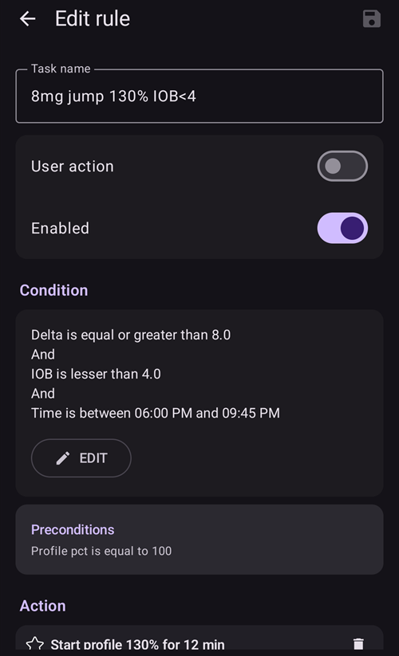

# Boucle fermée complète

```{contents} In this page
:backlinks: entry
:depth: 2
```

Le grand avantage de la boucle fermée complète **FCL** est qu'elle peut imiter un pancréas artificiel et rendre la gestion quotidienne plus facile, sans avoir besoin de faire un bolus pour les repas.

La **boucle fermée hybride** ('HCL') est basée sur un algorithme, mais l'utilisateur doit quand même faire lui-même des bolus avant les repas. En conséquence, la boucle peut faire une coupure temporaire (basal temporaire à zéro) pour éviter de donner trop d'insuline.

En **FCL**, les bolus liés à la taille du repas ne sont plus nécessaires : laissez faire l'algorithme !  **AAPS** peut gérer les repas sans que l'utilisateur fasse de bolus, et sans saisie de glucides, dans un mode appelé « repas non signalés » **(« RNS »)**. Les **RNS** permettent à **AAPS** de mieux tolérer des saisies de glucides incorrectes, en étant plus agressif.

## A quoi pouvez-vous vous attendre ?

De nombreuses études publiées montrent les bons résultats que la **FCL** peut obtenir. Pour en savoir plus, voir :

1)   National Library of Medicine, PubMed [First Use of Open-Source Automated Insulin Delivery AndroidAPS in Full Closed-Loop Scenario: Pancreas4ALL Randomized Pilot Study](https://pubmed.ncbi.nlm.nih.gov/36826996/);

2)  ClinicalTrials.gov National Library of Medicine, Clinical Trial [Feasibility and Safety Study of the Automated Insulin Delivery Closed Loop System Pancreas4ALL (ASAP)](https://www.clinicaltrials.gov/study/NCT04835350?term=Feasibility%20and%20Safety%20Study%20of%20the%20Automated%20Insulin%20Delivery%20Closed%20Loop%20System%20Pancreas4ALL%20(ASAP)&rank=1)

Pour réussir la **FCL**, l'utilisateur doit :

- vérifier qu'il remplit les conditions de la **FCL** ;
- mettre en place des **Automatisations** adaptées aux besoins de sa gestion quotidienne ; et
- affiner et ajuster les paramètres d'**AAPS** (surtout les **Automatisations**).


## Pourquoi passer (ou ne pas passer) de la HCL à la FCL : points généraux

La **FCL** n'est pas pour tout le monde :

- Certains utilisateurs de la **FCL** atteignent un TIR (70-180) d'environ 90 % et une HbA1c sous 6 %, mais d'autres utilisateurs préfèrent un contrôle plus serré. Surtout, limiter les valeurs au-dessus de 140 mg/dl avec une alimentation riche en glucides rapides demande sans doute un pré-bolus.
- L'ajustement d'**AAPS** peut être difficile. Elle n'est pas pour les utilisateurs qui se sentent dépassés par AAPS.  Il vous faudra quelques semaines pour ajuster et affiner votre **FCL**. Ce temps investi peut donner de meilleurs résultats et un meilleur contrôle de la **glycémie**.
- La gestion des repas peut devenir plus facile, mais le sport peut rester difficile en **FCL**. La plupart d'entre nous aiment limiter les collations pendant le sport pour contrôler leur poids.
- Il reste des difficultés pour mettre en place une **FCL** pour les enfants (voir plus bas).


## Boucle fermée hybride bien ajustée (HCL)

Il est conseillé de d'abord mettre en place une **HCL** bien ajustée avant de penser à passer à la **FCL**.  Réussir la **FCL** demande un ajustement très personnel des paramètres de l'utilisateur, pour qu'**AAPS** puisse donner l'insuline en imitant de près VOTRE mode de boucle fermée hybride qui marche bien.

La **FCL** demande à l'utilisateur de mettre en place et d'ajuster ses **Automatisations**. Mais l'utilisateur doit bien comprendre ses besoins en insuline avant de se lancer dans la **FCL**. Des erreurs peuvent être cachées par d'autres erreurs qui les compensent. Cela peut créer un système **FCL** instable, difficile à corriger plus tard. Vous pouvez vous attendre à atteindre avec votre FCL un %TIR comparable à celui que vous avez aujourd'hui en **HCL**.

**La FCL est un réglage DIY (fait par vous-même) d'Automatisations, défini par l'utilisateur en analysant ses données de sa HCL qui marche bien et de ses premiers essais de FCL, pendant l'ajustement de ses paramètres.**

## Insuline ultra-rapide (Lyumjev, Fiasp)

La **FCL** demande une insuline rapide.  Ainsi, au début de la hausse de **glycémie** liée au repas, la **FCL** peut garder la **glycémie** dans la cible (en général, sous 180 mg/dl (10 mmol/l)).

Une étude de modélisation (pour les détails, voir LINK FullLoop V2/March2023, section 2.2) peut montrer en chiffres que les *insulines plus rapides*

Source :

 


IEEE Control Systems Magazine, ResearchGate [The Artificial Pancreas and Meal Control: An Overview of Postprandial Glucose Regulation in Type 1 Diabetes](https://www.researchgate.net/publication/322866519_The_Artificial_Pancreas_and_Meal_Control_An_Overview_of_Postprandial_Glucose_Regulation_in_Type_1_Diabetes);

- donnent des pics de **glycémie** nettement plus bas que les insulines plus lentes ;
- tolèrent un premier bolus de repas donné avec quelques minutes de retard, sans pics trop élevés ; et
- réduisent l'effet des différentes quantités de glucides (tailles de repas) sur le pic de **glycémie**.

La **FCL** a peu de chances d'être efficace avec une autre insuline que Lyumjev ou Fiasp, sauf si l'utilisateur suit un régime modéré à pauvre en glucides.

Mais Fiasp ou Lyumjev peuvent causer des occlusions fréquentes de la pompe, même après avoir optimisé par exemple la longueur de l'aiguille. Il est important de surveiller la durée d'utilisation de la canule ou du pod. Beaucoup d'utilisateurs trouvent que 48 heures est la limite d'efficacité de l'insuline avant un échec de la canule ou du pod.

## Conditions préalables

Des valeurs de **glycémie** et une connexion Bluetooth stables sont nécessaires pour qu'**AAPS** marche au mieux sans perdre de temps précieux. La **FCL** demande un système techniquement stable 24 h/24 et 7 j/7 :

- les **performances de votre MGC**. Votre MGC ne doit pas donner de valeurs de **glycémie** en dents de scie, que la **FCL** pourrait prendre pour le signe d'un début de repas. De même, les calibrations du **MGC** peuvent donner des résultats en dents de scie.
- comment et où le lissage du **MGC** est fait, et ce que cela peut signifier pour votre ajustement. Surtout la façon dont le delta est défini, et le fait qu'AAPS le reconnaisse comme le signe d'un début de repas.
- la stabilité du Bluetooth pour la pompe et le MGC ;
- éviter les occlusions de la pompe (ou au moins les reconnaître tôt) ;
- le flux de données, les applications de votre téléphone et les différences entre les jours d'utilisation du capteur ;
- garder tous les composants d'**AAPS** bien chargés et des pièces de rechange à proximité ; et
- changer la canule (ou le pod) toujours assez tôt pour réduire le risque d'occlusion ;

Ces points varient selon les composants de votre système **AAPS** et votre mode de vie.

## Restrictions liées aux repas

- Mettre en place une **FCL** peut être plus facile pour les personnes dont l'alimentation ne contient pas d'aliments à effet rapide et fort sur la **glycémie**, et dont les repas ne changent pas beaucoup d'un jour à l'autre. Cela ne veut pas forcément dire pauvre en glucides.

- Une alimentation riche en graisses ou en protéines, ou une digestion lente/gastroparésie, rendent les choses plutôt plus faciles pour la **FCL**, car les glucides tardifs couvrent bien les « queues » inévitables d'action tardive du bolus nécessaire autour du pic.

### Index glycémique et effet sur la glycémie

The challenge for the **UAM** mode rises with rising 'Effect on Blood Glucose' ('EBG')

- Commencez avec un effet modéré ou faible, et ajustez les paramètres de votre **Profil**. Seulement ensuite, « testez » des repas avec un **EBG** élevé.
- Pensez à un bolus initial < 50 % si vous mangez des aliments à **EBG** très élevé.

1) **Pas d'EBG** : par ex. viande fraîche, poisson, œufs, bacon, huiles, fromage. 2) **EBG faible** : par ex. légumes frais et baies, champignons, noix, lait, yaourt, fromage blanc. 3) **EBG modéré** : par ex. pain/pâtes complets, pommes de terre, riz sauvage, avoine, fruits secs. 4) **High EBG**: e.g. wheat breads, baguette, toast, waffles, cookies, mash potatoes, noodles, rice. 5) **EBG très élevé** : par ex. sucre, boissons sucrées, jus de fruits, cornflakes, bonbons, sucreries, chips, bretzels salés.


Les repas les plus difficiles pour la **FCL** sont ceux qui contiennent seulement des aliments à **EBG** élevé et très élevé (voir en rouge sur l'image) : la **glycémie** monte très vite, et il y a peu de graisses, de protéines ou de fibres pour équilibrer la « queue » inévitable d'action de l'insuline qui vient des efforts pour contrôler la glycémie haute plus tôt.

Manger de façon irrégulière des collations et des boissons sucrées, pleines de glucides à absorption rapide, pose problème pour la **FCL**.


## Se préparer à l'activité / au sport

Pour faire du sport ou être actif, avec une pompe ou une boucle fermée hybride, il est conseillé de réduire l'**IA** avant l'effort.

Avec la **FCL**, l'algorithme est réglé pour détecter les **RNS** et donner automatiquement de l'insuline contre les hausses de **glycémie**.  Une **Cible Temp** haute et un **pourcentage de profil** plus bas (actifs déjà vers le début du repas) doivent être réglés bien avant toute activité.

Une activité physique inhabituelle ou irrégulière pose des difficultés pour la **FCL**. Le sport demande de prévoir à l'avance (surtout si vous voulez réduire le besoin de glucides ou de collations de secours en cas d'hypo pendant le sport). After an active day it is recommended that a lower  **Percentage Profile** is set for overnight after the evening meal is fully digested: set in **Automations** an elevated (>100 mg/dL) **BG**  target, with **Enable SMB with high temp target** switched off in **AAPS** **Settings**.

## Difficultés pour les enfants

La **FCL** peut poser des difficultés en plus chez les enfants, par exemple :

- Lyumjev ou Fiasp peuvent ne pas être disponibles ou mal tolérés.
- Le débit basal horaire peut être très bas, ce qui est une mauvaise base pour de grands **SMB**.
- L'alimentation peut être riche en aliments sucrés. Avec le faible volume sanguin d'un petit corps, il y a une forte tendance aux pics de **glycémie** très élevés.
- Les hormones de croissance et les grands changements de sensibilité à l'insuline rendent difficile de garder la **FCL** bien ajustée.


## Activer les SMB renforcés : sécurité

En **HCL**, il y a des limites de sécurité sur la taille des bolus que la boucle peut donner automatiquement.

Les utilisateurs de la **FCL** n'ont plus besoin de faire un gros bolus au début du repas. Cela veut dire que les limites de taille des **SMB** doivent être élargies pour que la boucle puisse donner des **SMB** assez grands.

Si vous utilisez **AAPS** en version Master, il est conseillé de régler les **Paramètres** d'**AAPS** avec la taille maximale de **SMB** autorisée que la **FCL** peut donner (maxUAMSMBBasalMinutes=120, c'est-à-dire 2 heures de basal à cette heure de la journée).

Si votre débit basal est très bas, les limites de **SMB** qui en résultent peuvent être trop basses pour bien contrôler les hausses de **glycémie** après le repas. Une solution possible est d'éviter les aliments qui causent de forts pics de **glycémie**. L'algorithme [Auto ISF](#Open-APS-features-auto-isf) (disponible seulement dans une version dev avec le mode ingénierie) a un paramètre **Extension de plage SMB maxi** qui augmente le maximum standard de 2 heures de basal par un facteur >1, et vous permet d'augmenter le **Ratio d'injection SMB** par défaut de 50 %.

**Suivez les instructions pour permettre à AAPS d'imiter votre bolus avec quelques SMB**.

Vérifiez régulièrement l'écran du plugin **APS** (**Configuration → APS → Ouvrir le plugin**) pour voir si vos **SMB** peuvent être assez grands pour donner l'insuline dont la boucle a besoin au début des repas.

Dans le cas contraire, vos efforts d'ajustement n'aboutiront parfois à rien !


```{admonition} Boosting **ISF** can become dangerous
:class: danger

Observez et analysez avec soin la taille des **SMB** juste après le début de votre repas. Ajustez par étapes, et ne changez pas plus de 1 ou 2 paramètres à la fois.

Les paramètres d'**AAPS** doivent être assez bien réglés pour gérer la variété de (vos !) repas.
```

## Détection des repas / vos Automatisations pour renforcer

Pour réussir la **FCL**, la **SI** est le paramètre d'ajustement principal. Avec **AAPS** Master + **Automatisations**, un **changement de profil > 100 % doit être déclenché automatiquement quand un repas est reconnu** (par les deltas de glycémie), et donner la **SI** renforcée.

**AAPS** Master permet un **Profil** temporaire jusqu'à 130 % en mode **HCL**. Le renforcement de la **SI** se fait en 3 étapes :

- Step 1 -  review the **ISF** applicable for this meal time hour within the **Profile**, and see whether e.g. Autosens suggest a modification that takes care of the current (last few hours’) insulin sensitivity status of the body.
- Étape 2 - appliquez un facteur (1/Profil%, réglé dans l'**Automatisation**) pour renforcer la **SI**.
- Étape 3 - vérifiez que la **SI** proposée reste dans les limites de sécurité réglées.

### Modèles d'Automatisations pour la FCL

Cases à cocher en haut. Vous avez le choix :

- Dans votre liste d'**Automatisations**, vous pouvez décocher la case (à gauche de chaque champ) => Cela désactive cette **Automatisation**. Par exemple, vous pouvez le faire pour toutes les **Automatisations** **FCL** du petit-déjeuner, pour passer en **HCL** au petit-déjeuner.

- Pour chaque règle d'**Automatisation**, vous pouvez cocher la case Actions utilisateur => les Actions définies ne seront alors pas exécutées automatiquement quand les Conditions sont remplies. À la place, l'écran principal d'**AAPS** vous préviendra chaque fois que votre **FCL** donnerait automatiquement un **SMB**. Vous pouvez alors répondre « oui » ou « non ». C'est très utile pendant votre phase d'ajustement.

Cette fonction peut être utile dans certaines situations, comme le syndrome du « pied au sol », où la **glycémie** monte soudain au lever le matin, mais où l'utilisateur veut éviter une réponse complètement automatique « petit-déjeuner commencé ».

La section ci-dessous explique comment regrouper les Conditions des **Automatisations** et comment gérer les situations où **AAPS** doit augmenter (ou réduire) l'insuline donnée. Comme la **SI** ne peut pas être ajustée directement, augmenter le **pourcentage de profil** au-dessus de 100 % a le même effet pour ce que nous voulons faire.

### Gros SMB automatisés lors de hausse de glycémie

The key to successful **FCL**: **at the beginning of BG increases from meals, very large automatic SMBs must be given by the loop as quickly as possible** “to catch up” with the required **IOB** needed (compare with your typical administered bolus for similar meal in **HCL**!)

To achieve this, data from your **HCL** should be analyzed to determine which **deltas** might not be meal-related and which might be.

- Comme vous pouvez définir l'**Automatisation** dans une plage horaire choisie, il suffit d'analyser cette plage.
- Si vous faites des repas très différents (par ex. un petit-déjeuner riche en glucides, mais un déjeuner pauvre en glucides), vous pouvez faire deux (groupes d') **Automatisations** différents, un pour chaque plage horaire.
- Excluez les nuits si vous voyez parfois des sauts dus à des fausses hypos de compression.
- Habituellement, il suffit d'utiliser le delta des 5 dernières minutes.
- Mais vous pouvez aussi utiliser un des deltas moyens. En comparant les deltas dans les conditions de vos **Automatisations**, vous pouvez même définir des actions plus ou moins agressives selon que la **glycémie** monte de façon accélérée ou non.

> ( delta – short avg delta )>n   est une formule qui peut servir à détecter une accélération, pour déclencher le premier **SMB** au premier signe de hausse de la **glycémie**. -                                                                             
> Attention : impossible à utiliser avec des valeurs de **MGC** de mauvaise qualité ou très lissées !

Un **MGC** avec des données irrégulières met l'utilisateur en difficulté car, pour rester prudent, vous devez choisir un delta assez grand pour être sûr qu'il est bien le signe d'un début de repas. Cela veut dire :

- la **FCL** perd du temps en plus, ce qui donne des pics de **glycémie** plus hauts et un %**TIR** plus bas ;
- vous ne pouvez pas utiliser un delta plus précoce ou plus petit, qui pourrait déclencher, même sans repas, les **SMB** qui doivent remplacer le bolus de l'utilisateur en **FCL**.

De plus, les premières hausses après un repas se font avec une **IA basse**. Avec cela en tête, une Automatisation (#1) pour un dîner pourrait ressembler à ceci :



Automatisation #1

Si les Conditions sont remplies, **AAPS** donnera 1 ou 2 **SMB** dans les 12 minutes suivantes, avec une **SI** renforcée selon le **pourcentage de profil** augmenté (dans l'exemple, un renfort de 30 % de l'insulinReq). Tant que ces Conditions sont remplies, la règle d'**Automatisation** est prolongée de 12 minutes de plus. Un repas pauvre en glucides peut faire monter la **glycémie** plus lentement. Elle peut être complétée par une autre Automatisation (#2) qui se déclenche à un delta plus faible et donne un renfort d'insuline plus faible.


La même **Automatisation** se déclenchera sans doute aussi lors de repas plus riches en glucides, une fois finie la hausse forte définie dans l'Automatisation #1.

Vous devez « échelonner » ces deux (+ peut-être une troisième) **Automatisations** pour qu'elles correspondent à ce que vous voyez avec vos repas (leur variété) => Trouver les bonnes tailles de saut, les bons critères d'**IA** et les bonnes amplifications sera un ajustement par essais successifs.  De plus, si vous ajoutez des plages horaires adaptées dans les Conditions, vous pouvez facilement faire des Automatisations différentes pour vos différents repas de la journée (petit-déjeuner, déjeuner, dîner).

Notez que, encore pendant la phase de hausse (!), le « trop-plein » d'**IA** doit être bloqué, pour que les effets tardifs de l'**insuline** (la « **queue** » après 3 à 5 heures) ne dépassent pas la capacité de freinage de la boucle par basal temporaire à zéro (« retirer » du basal pour réduire le risque d'hypo).

Avec les grands repas, il y a **parfois une deuxième hausse**. À ce moment-là, l'IA a en général aussi un peu baissé, et les Automatisations plus agressives agissent de nouveau. (Vérifiez que la condition d'IA dans l'Automatisation #2 n'est pas réglée trop bas pour que cela arrive).

Peu après les premiers **SMB** vient une **phase d'équilibre**, où une administration modérée d'insuline doit couvrir les glucides absorbés en plus. (Sauf pour les repas pauvres en glucides, où la boucle peut voir une hausse de **glycémie** trop faible et passer tout de suite en basal temporaire à zéro).

L'écran principal d'**AAPS** (où vous voyez GA=0 en boucle complète **RNS**) peut, dans cette phase, demander des glucides en plus. En mode **RNS**, cela veut simplement dire que vous pouvez faire un contrôle de vraisemblance très grossier : est-il probable que cette quantité de glucides soit dans votre corps, pas encore absorbée, venant de votre repas d'il y a environ une heure (dont vous n'avez rien dit à votre boucle) ?


### Seuil d'IA

Souvent, les **Automatisations** #1 et/ou #2 font monter l'IA à des niveaux qui suffisent en général pour **vos** repas. Pour un ajustement personnel, regardez dans vos données **HCL** les valeurs d'IA maximales lors de repas bien gérés (souvent : votre bolus de repas), et à partir de quel niveau une hypo (ou un besoin de glucides en plus) est arrivée à la fin.

Les **seuils d'IA** raisonnables, à partir desquels vous devez réduire l'agressivité de votre boucle, ne sont pas forcément les mêmes pour chaque repas. Mais surtout dans la première heure après le début d'un repas, qui est très importante en mode **RNS**. Ce sera différent pour chaque utilisateur. Chez certains utilisateurs, seulement environ 30 g/heure sont absorbés, et il peut être possible de définir une **IA** utile, quel que soit le repas.

Pour des repas exceptionnels, ou pour le baisser si du sport suit, le seuil d'**IA** peut être changé rapidement dans votre **Automatisation**.

Automation (#3), "iobTH reached => **SMBs** off”, is defined to end (or pause, until another wave of carb-related rise hits) the aggressive **SMB** boosting.


Automatisation #3

Elle indique à la boucle qu'au-dessus de votre **seuil d'IA**, il vaut mieux ne plus utiliser de **SMB**

- L'exemple donné le fait en réglant CT=111 (un nombre un peu arbitraire ; choisissez un nombre >100 que vous reconnaissez facilement comme votre arrêt automatique des **SMB**)
- Dans **AAPS**, [Paramètres → OpenAPS SMB](#Preferences-openaps-smb-settings), en général n'autorisez pas les **SMB** avec une cible élevée.                                                                                                                   
  L'insuline nécessaire devra alors être donnée avec beaucoup plus de prudence, par le goulot d'étranglement des **DBT**

**Attention : l'Automatisation #3 ne marche que s'il n'y a pas de CT active.** Donc, si vous avez utilisé une EatingSoonTT, elle doit être terminée à ce moment-là, en général 30 à 40 minutes après le début du repas.

Une façon de le faire est de créer une Condition d'**Automatisation** qui arrête une EatingSoonTT en cours avec la Condition **IA**>65% * iobTH.
> Comment utiliser une EatingSoonTT Certains utilisateurs activent une EatingSoonTT (cible temporaire « repas bientôt ») environ une heure ou plus avant le début du repas (en appuyant sur le bouton CT, ou automatiquement par une cible de **glycémie** plus basse dans le **Profil** si les heures des repas sont assez fixes), juste pour être sûr d'avoir une **glycémie** de départ basse et une **IA** un peu plus élevée. But, assuming the **FCL** is always en route towards target, this might not yield much and you may prefer to define an **Automation** that sets an EatingSoonTT at recognition of meal start (glucose delta, or acceleration = delta > avg delta). Une **CT** basse est importante à ce stade, car chaque **SMB** est calculé par votre boucle avec (glycémie prévue moins CT)/sens ; une CT basse rend donc l'insulinReq plus grand.

Après les premiers **SMB** renforcés, votre iobTH et l'**Automatisation** #3 doivent trouver un bon équilibre : limiter le pic de glycémie, sans causer d'hypo après le repas.

Si votre petit-déjeuner a une quantité de glucides très différente de votre dîner moyen, il peut être utile de définir des **Automatisations** qui s'appliquent aux heures correspondantes de la journée, avec un **iobTH** différent (et peut-être aussi des deltas différents et un **pourcentage de profil** différent). Vous, en définissant vos types de repas et vos paramètres (surtout l'**iobTH**), et la boucle, en gérant la courbe de **glycémie**, devez tous les deux accepter une certaine hauteur de pic pour réduire le risque d'hypo vers la fin de la **DAI** des **SMB**.

### Stagnation à des glycémies hautes

Si, après un repas « riche », vous voyez une stagnation longue avec une **glycémie haute**, l'**Automatisation** #4 (ci-dessous), « post-meal High », aide à gérer la résistance due aux graisses : après des repas à plusieurs plats, une grande pizza grasse ou une soirée raclette, la courbe de glycémie peut former deux bosses ou, très souvent, un long plateau haut.


Automatisation #4


Automatisation #5

L'Automatisation #4, « post-meal High » (glycémie haute après le repas), convient aussi en boucle fermée hybride.

En plus, une Automatisation de fin #5, « Stop pmH », est nécessaire, pour réduire l'agressivité de l'administration d'insuline dès que la glycémie baisse. (Mais souvent la boucle limitera de toute façon l'insuline pour éviter une hypo, car la glycémie prévue est déjà basse).

## Prévention des hypos

Le problème de base est que la **FCL** en **RNS** (sans saisie de glucides) ne peut **pas savoir combien de grammes de glucides restent** à absorber, et donc si ces glucides vont utiliser cette « queue » d'insuline sans que vous fassiez une hypo.

Avec des **SMB** renforcés, la **FCL** a « rattrapé » ce que nous faisions avant avec un bolus de repas. Mais **à la fin de l'action de l'insuline (la « queue »), la prévention des hypos peut devenir un vrai sujet**.

Pour préparer la **FCL**, l'utilisateur doit regarder de près l'**évolution de l'IA dans le temps** pour des repas typiques, et juger **quand elle devient trop forte, et comment vous pouvez le corriger en ajustant vos Automatisations**. C'est possible car nous avons plusieurs leviers de réglage. Il peut être difficile de bien régler cela

En général, cela n'a pas de sens de continuer à optimiser les paramètres pour un seul type de repas. Quand vous avez un réglage assez bon, par exemple pour un type de déjeuner que vous mangez souvent, testez comment il marche avec d'autres types de repas, et quel « compromis » vous feriez.

Pour éviter une hypo 3 à 5 heures après le repas, réduisez l'agressivité avant que trop d'IA ne s'accumule. Approches possibles :

- Devenez de plus en plus doux avec la **SI** déjà pendant la hausse de la glycémie, comme dans les exemples d'Automatisations #1 et #2.
- Définissez le seuil d'IA à partir duquel **AAPS** devient beaucoup plus prudent (Automatisation #3, ci-dessus). Notez que cette **IA** peut être dépassée par le dernier **SMB** donné avant qu'elle ne s'applique, puis encore par des DBT si la boucle voit un insulinReq. Les glucides absorbés vont faire baisser l'IA en sens inverse.
- Le seuil d'IA peut être différent selon les repas : en clonant les automatisations, vous pouvez facilement faire des différences pour les plages horaires du petit-déjeuner, du déjeuner et du dîner (ou même selon des lieux, comme la cantine de l'entreprise, ou chez la belle-mère, etc.)
> Vous pouvez faire encore plus de différences dans ces plages horaires en réglant des CT différentes pour un repas pauvre en glucides ou un repas à glucides rapides, etc. Ainsi vous pouvez « coder » différentes classes de repas qui peuvent arriver à cette heure de la journée, et les gérer avec des **Automatisations** ajustées pour elles. Ce n'est sans doute pas nécessaire, sauf si vos habitudes alimentaires changent beaucoup.

Avant un repas spécial, vous pouvez augmenter votre seuil d'**IA**, ou faire un autre changement dans n'importe laquelle de vos Automatisations en moins de 5 secondes, directement sur votre téléphone AAPS (**Gestion → Automatisation**).

Le risque d'hypo quelques heures après le repas dépend surtout de la composition du repas : est-ce que les **queues d'insuline, qui viennent de la lutte contre la plus grande partie des glucides**, seront **utilisées par des « glucides étendus »** (absorption de glucides forte ou retardée, protéines, graisses, fibres) ?

Avec le temps, vous apprendrez à reconnaître des schémas, vous ajusterez vos Automatisations, et peut-être même un peu vos habitudes alimentaires. Par exemple, une petite (!) collation tardive de temps en temps peut aider à garder un bon **équilibre entre l'action de l'insuline et l'absorption des glucides** pendant **toute** la durée du repas (digestion, absorption). Cela rend la vie plus facile pour votre boucle (et pour vous).

### Ordre des Automatisations programmées

Des problèmes peuvent venir de définitions qui se chevauchent dans les **Automatisations**. Exemple : le problème est que delta >8 est aussi delta >5, donc il peut y avoir deux **Automatisations** en concurrence. Que fait alors la boucle ? Elle décide toujours selon l'ordre dans lequel vos **Automatisations** apparaissent dans **Gestion → Automatisation**.  Exemple : la règle delta > +8 doit venir en premier (et lancer le renfort le plus fort si toutes les conditions sont remplies) ; ensuite vient le test delta >5 (avec une réponse plus douce). Dans l'ordre inverse, la règle delta>8 ne s'appliquerait jamais, car la règle delta>5 s'applique déjà, et c'est terminé.
> Conseil pour les Automatisations : il est très facile de changer leur ordre. Dans **Gestion → Automatisation**, appuyez longuement sur la poignée **=** à droite d'une règle et faites-la glisser à une autre position.

De plus, il est très facile et rapide de modifier des conditions ou des actions à tout moment, en quelques secondes, directement sur votre smartphone AAPS ; par exemple avant un repas très spécial. (Mais n'oubliez pas de revenir à la normale pour le jour suivant).

(full-closed-loop-troubleshooting)=

## Dépannage

### Comment revenir en boucle fermée hybride

Vous pouvez décocher les cases des **Automatisations** liées à votre **FCL**, revenir aux bolus de repas et saisir de nouveau les glucides. Si vous avez enlevé les boutons **Insuline** ou **Assistant** de votre écran principal, remettez-les dans la configuration de la [barre d'outils QuickLaunch](#quicklaunch) (ils restent toujours disponibles dans **Traitements** dans la barre de navigation en bas). Attention : c'est de nouveau à vous de faire les bolus de repas.

Il peut être sage de faire la **FCL** seulement pour les repas (plages horaires) où les **Automatisations** sont complètement définies et cochées, et de décocher seulement celles des autres repas pour lesquels vous voulez faire de la **HCL** (ou pour lesquels rien n'est encore défini, pendant votre période de transition).

Par exemple, il est tout à fait possible, sans étape en plus une fois les **Automatisations** du dîner définies, de faire la **FCL** seulement pour les dîners, alors que le petit-déjeuner et le déjeuner restent en **HCL** comme d'habitude.


### Les conditions préalables de la FCL sont-elles toujours remplies ?

- Le **Profil** de base est-il toujours correct ?
- La qualité du **MGC** s'est-elle dégradée ?
- Voir les conditions préalables (ci-dessus).

### La glycémie monte trop haut

- Les repas ne sont pas reconnus assez tôt
    - Vérifiez la stabilité (ou l'instabilité) du Bluetooth
    - Vérifiez si vous pouvez régler des deltas plus petits pour déclencher le premier **SMB**
    - Essayez un apéritif ou une soupe quelques minutes avant le début du repas
- Les SMB sont trop faibles
    - Vérifiez l'ordre des **Automatisations** (par ex. : grand delta avant petit delta)
    - Vérifiez (en temps réel) dans l'écran du plugin **APS** si le basal horaire du profil et les minutes réglées (max 120) limitent la taille des SMB autorisée
    - Vérifiez (en temps réel) dans l'écran du plugin **APS** si le %profil doit être augmenté
- Si tous vos paramètres sont à la limite, vous devrez peut-être accepter la glycémie haute temporaire, ou adapter votre alimentation.
> Si vous êtes prêt à tester une version dev, [Auto ISF](#Open-APS-features-auto-isf) permet aussi des tailles de SMB encore plus grandes. Certains utilisateurs font aussi un petit pré-bolus dans leur « FCL ». Mais cela change le comportement de la courbe de glycémie, et donc la détection des hausses et les **SMB** déclenchés. Ce n'est donc pas facile à mettre en place avec un vrai bénéfice global.
- Les utilisateurs pilotes ont fait une observation importante : la façon dont vos courbes de glycémie et d'IA arrivent au début du repas compte beaucoup pour la hauteur du pic dû aux glucides : Descendre (par ex. vers une EatingSoonTT activée), avoir un peu d'IA, et une courbe qui part déjà vers une forte accélération positive semble très utile pour garder des pics bas.

### La glycémie descend trop bas

- Les repas sont reconnus à tort
    - Vérifiez si vous pouvez régler des deltas plus grands pour déclencher le premier **SMB**
    - Cochez « Actions utilisateur » dans l'Automatisation concernée ; ainsi, à l'avenir, vous pourrez décider sur le moment de bloquer l'exécution de l'Automatisation si ce n'est pas un repas
    - Pour éviter que des collations déclenchent des **SMB** comme pour un repas, réglez une CT>100 quand vous prenez une collation (comme vous le feriez de toute façon pour le sport et pour les collations anti-hypo)
- Les SMB donnent au total trop d'insuline
    - Vérifiez (en temps réel) dans l'écran du plugin **APS** si l'**Extension de plage SMB maxi** doit être réduite
    - Vérifiez (en temps réel) dans l'écran du plugin **APS** si le **pourcentage de profil** doit être réduit
    - Le Ratio d'injection SMB peut sans doute être réduit. Notez que dans ce cas, cela s'applique à tous les **SMB** (toutes les plages horaires),
- Problèmes avec la « queue » d'insuline après les repas
    - Vous devrez peut-être prendre une collation (si vous voyez une prévision d'hypo) ou des comprimés de glucose (si vous êtes déjà en hypo). Mais notez que les glucides nécessaires que la boucle peut vous indiquer à un moment sont très probablement exagérés, car la boucle n'a aucune information sur les glucides que vous avez mangés et qui attendent encore d'être absorbés (alors que vous pouvez estimer combien il en reste, y compris à partir des graisses et des protéines).
    - Une information utile serait de savoir si le problème vient surtout déjà de la phase de hausse de la glycémie. Alors, un iobTH plus bas peut être une solution simple.
    - Si vous avez souvent besoin de glucides en plus, notez combien de grammes il a fallu (sans compter ce que vous avez peut-être pris en trop et qui a de nouveau demandé de l'insuline).  Ensuite, utilisez la valeur G/I de votre profil pour estimer combien d'insuline en moins le **SMB** aurait dû donner, et utilisez cette information pour votre ajustement (pour le **pourcentage de profil** dans les **Automatisations**, ou peut-être aussi pour votre iobTH). This may relate to the **SMBs** given when glucose was high, or also to the **SMBs** during the **BG** rise.
    - Il se peut que vous deviez simplement accepter des pics de **glycémie** plus hauts pour ne pas descendre trop bas. Ou changez d'alimentation pour quelque chose avec moins de glucides et plus de protéines et de graisses.


### Plus d'informations

Restez en contact avec d'autres utilisateurs de la **FCL**.

Discussion sur la boucle fermée complète avec des Automatisations :

- Anglais :   [Canal Discord](https://discord.gg/ChXj8BaKwA)

- Allemand :  [German Looper Community](https://de.loopercommunity.org/t/ueber-die-kategorie-full-loop/10107)
