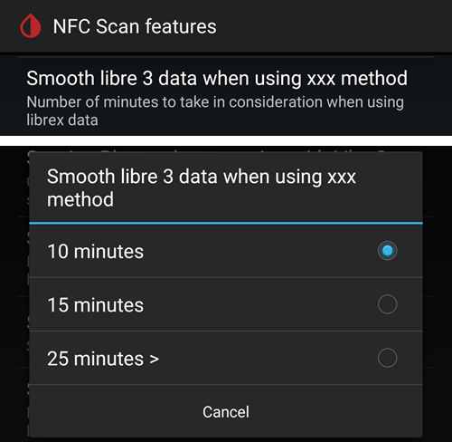
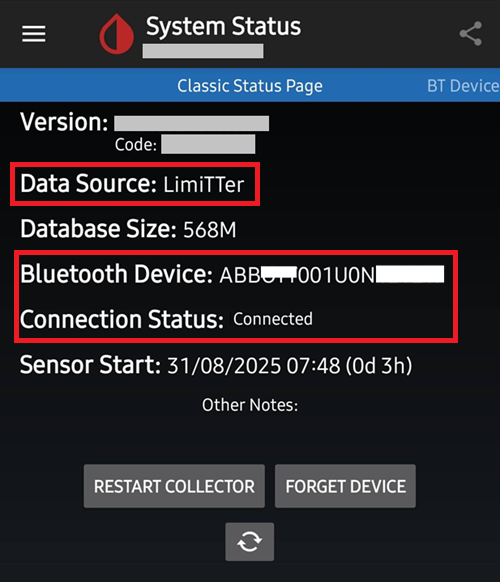

# Comment configurer le FSL 2 et OOP2 pour utiliser une connexion Bluetooth native dans xDrip

Transféré de [MinimalL00per](https://www.minimallooper.com/post/how-to-setup-freestyle-libre-2-and-oop2-to-use-a-native-Bluetooth-connection-in-xdrip) en markdown et **révisé/mis à jour** : 25 août 2025 psonnera

Une liste de définitions se trouve en bas de ce document. Si vous ne connaissez pas certains termes ou abréviations, vous pouvez *[aller plus bas](#minimallooper-definitions)* pour une explication.

 

## Configuration

### Matériel

- *FSL2 et 2+* **REMARQUE : les versions US, CAN, NZ et AUS ne sont PAS prises en charge**

**(OPTIONNEL) Lecteur** (pas compatible avec le FSL2+)

- Lecteur 1 (avec un firmware à jour)

- Lecteur 2

*REMARQUE : si vous voulez utiliser le lecteur dans cette solution, vous DEVEZ D'ABORD DÉMARRER le capteur avec le LECTEUR. Sinon, vous ne pourrez pas utiliser le lecteur pour obtenir les valeurs du capteur activé. Une fois le capteur préchauffé, vous pouvez lire les valeurs avec l'application LL ou xDrip.*

### Logiciel

**OOP** - Out of Process Algorithm (algorithme externe), une application Android APK externe qui aide à récupérer les données brutes du capteur pour obtenir les glycémies. xDrip envoie les données brutes BT collectées du FSL2 à OOP, et les glycémies sont renvoyées à xDrip.

- **OOP2**

  - **Fonctionne seulement avec les capteurs européens FSL2/2+**

  - Code source fermé (pas disponible sur GitHub)

  - Le but est de déchiffrer les valeurs brutes chiffrées du capteur et de les renvoyer à xDrip. Ensuite, xDrip peut utiliser soit les données brutes, qui demandent un étalonnage, soit fournir des glycémies proches de celles du lecteur 1.

[***xDrip***](https://jamorham.github.io/)

- [*Nightly*](https://github.com/NightscoutFoundation/xDrip/releases) : dernier code source, compilé chaque nuit. Pas testé en profondeur

- [*Stable*](https://xdrip-plus-updates.appspot.com/stable/xdrip-plus-latest.apk) : dernière version stable testée.

- **REMARQUE : les nouveaux capteurs demandent une application OOP2 à jour. Pour cela, il est recommandé d'utiliser au moins la dernière version publiée de xDrip (Stable), qui correspond au dernier OOP2.**

 

## Procédure

- *Téléchargez et installez d'abord les applications ci-dessous*
- *Désinstaller les applications qui peuvent créer des conflits*
- *Comment démarrer un capteur FSL2 en mode Bluetooth natif avec LL et xDrip
  - [*Étape 1 : installation et configuration des applications*](#minimallooper-step1)
  - [*Étape 2 : configuration des paramètres xDrip*](#minimallooper-step2)
  - [*Étape 3 : poser physiquement le capteur*](#minimallooper-step3)
  - [*Étape 4 : démarrer l'application LL et démarrer le capteur avec le tout premier scan NFC*](#minimallooper-step4)
  - [*Étape 5 : ouvrir xDrip et faire un SCAN NFC du capteur FSL2*](#minimallooper-step5)
  - [*Étape 6 : démarrer le nouveau capteur dans xDrip*](#minimallooper-step6)
  - [*Étape 7 : attendre 60 secondes et scanner à nouveau le capteur en NFC*](#minimallooper-step7)
  - [*Étape 8 : collecte des données entre 3 et 15 minutes*](#minimallooper-step8)
  - [*Étape 9 : vérifier que le capteur est connecté et envoie des données*](#minimallooper-step9)

- *[Notes](#minimallooper-notes)*
- *[Avantages](#minimallooper-advantages)*
- *[Inconvénients](#minimallooper-disadvantages)*
- <u>*\[Dépannage\](#minimallooper-troubleshooting)*</u>

## Avant de commencer

Il est fortement recommandé de suivre cette procédure avec un **nouveau capteur**. Certains utilisateurs ont pu se connecter à un capteur déjà en cours (***voir [plus bas](#minimallooper-started-sensor)***), mais il est très probable que l'application LL ou le lecteur crée une nouvelle clé privée partagée pour la communication pendant la connexion. Cela signifie qu'après l'association, xDrip ne connaît pas la nouvelle clé et ne pourra pas communiquer avec le capteur. Essayez de vous connecter à un capteur en cours à vos propres risques, de préférence vers la fin de la vie du capteur.

### Téléchargez et installez d'abord les applications ci-dessous

(Libre2_OOP2)=

- **OOP2** - Les versions de oop2 se trouvent ici :

  (*Remarque : vous devez être connecté à Google pour accéder au lien.*)

*[oop2.apk](https://drive.google.com/file/d/1106h2s12b3Ev9gKCTU2G75q8h9ChHjcz/view?usp=sharing)* - OOP2_21_09_25 (05d1989) **2025.09.21** (dernière version)

- **xDrip** - la **<u>dernière version</u>** (version minimale 2025.09.26) se trouve ici :

[*xDrip.apk*](https://github.com/NightscoutFoundation/xDrip/releases)

(minimallooper-started-sensor)=

### Et si mon capteur est déjà démarré ? Puis-je quand même obtenir des valeurs dans xDrip ? OUI !

Beaucoup de personnes ont demandé si cette méthode fonctionne avec un capteur déjà actif, et je peux répondre un grand **OUI** : vous pouvez démarrer un capteur déjà en cours.

1.  **D'ABORD**, assurez-vous d'avoir fait les changements de configuration et de paramètres dans xDrip, et d'avoir installé et configuré OOP2 comme indiqué ci-dessous.

2.  **ENSUITE**, passez à l'*étape 5* et **ASSUREZ-VOUS** d'avoir forcé l'arrêt de LL avant de commencer. Puis suivez la procédure jusqu'au bout.

*REMARQUE : vous ne pourrez pas utiliser votre capteur FSL2 activé avec le lecteur FSLReader S'IL n'a pas d'abord été démarré avec le FSLReader. S'il A ÉTÉ démarré d'abord avec le FSLReader, vous pourrez **scanner** le capteur et obtenir des valeurs À LA FOIS avec le lecteur et avec des applications comme LL et xDrip.*

## Comment démarrer un capteur FSL2 en mode Bluetooth natif avec LL et xDrip

*REMARQUE : si des paramètres sur les captures d'écran ne sont pas mis en évidence par un CADRE et sont DÉCOCHÉS (c.-à-d. désactivés), alors GARDEZ-LES DÉSACTIVÉS. Les captures d'écran montrent une configuration qui fonctionne pour TOUS les paramètres affichés. Si vous voulez essayer d'activer ou de désactiver d'autres fonctions une fois que votre capteur fonctionne, vous pouvez le faire à vos propres risques.*

(minimallooper-step1)=

### Étape 1 : installation et configuration des applications

**Installez et configurez OOP2**, puis vérifiez qu'il fonctionne en ouvrant simplement l'application.


**Paramètres**

- *Use service* **on**

- *Use foreground service* **on**

- *Timer Duration* **5 minutes**

  - Passez à **1 sec** si vous n'obtenez pas de résultats assez vite (la capture d'écran ci-dessous montre ce réglage).

**Version 2 : 93e5cac-2020.12.08 (dernière version)**


**Installez xDrip**, version minimale : la dernière version publiée. Plus de documentation sur l'installation et la configuration de xDrip se trouve [*ici*](../CompatibleCgms/xDrip.md).

(minimallooper-step2)=

### Étape 2 : configuration des paramètres xDrip

**Hardware Data Source** : Libre Bluetooth


**NFC Scan features** : *les paramètres non mentionnés sont supposés désactivés.*

- *Use NFC feature* : **on**
- *Sensor Age or Expiry* : **on**
- *Scan when not in xDrip* : **on**
- *Use Any-tag optimized reading method* : **off**, mais essayez **on** si vous avez du mal à scanner


- *Starting Bluetooth connection with FSL2 sensor* : **Always connect to libre2 sensors**


- *Smooth libre 3 data when using xxx method* : laissez la valeur par défaut. Augmentez la valeur pour les capteurs bruités, diminuez-la quand ils sont stables.



**Less Common Settings -\> Bluetooth Settings** (*ces paramètres sont importants et peuvent varier selon votre téléphone/configuration*)

- *Turn Bluetooth on* : **on**
- *Trust Auto-Connect* : **on**
- *Use Background Scans* : **on**
- *Always discover services* : **on**

Vous pouvez configurer xDrip avec le code QR ci-dessous. Vous devez le scanner (ou charger l'image) dans xDrip -> Auto Configure.

```{admonition} QR Code
:class: dropdown


```


Après avoir scanné le code QR ci-dessus, si vous avez un téléphone Samsung (c'est aussi utile pour beaucoup de marques chinoises), scannez l'autre code QR ci-dessous pour changer les paramètres et obtenir une connexion plus fiable :

- *Trust Auto-Connect* : **off**
- *Use Background Scans* : **off**

```{admonition} QR Code
:class: dropdown


```


**Advanced settings for FSL2** (*optionnel mais utile*)

- *show Raw values in Graph* : **on**

- *show Sensor info in Status* : **on**


**Extra Logging Settings** (*nécessaire pour le débogage si cela ne fonctionne pas correctement*)

- *Extra tags for logging* : entrez cette valeur

`BgReading:d,jamorham librereceiver:v,LibreOOPAlgorithm:v,jamorham nsemulator:v,DexCollectionService:v`


(minimallooper-OOPsettings)=

**Less Common Settings -\> Other misc options**

> **Paramètres pour la configuration OOP2**

- *Out of process Libre algorithm* : **OFF**

(*ASSUREZ-VOUS QUE CE PARAMÈTRE EST **OFF** POUR OOP2, SINON VOUS N'AUREZ PAS DE VALEURS !*)


(minimallooper-step3)=

### Étape 3 : poser physiquement le capteur

(minimallooper-step4)=

### Étape 4 : démarrer l'application LL et démarrer le capteur avec le tout premier scan NFC

Démarrez l'application LL, scannez le capteur qui vient d'être posé, puis fermez et désactivez ou désinstallez l'application LL. **Vous devez quand même attendre les 60 minutes complètes de préchauffage du capteur avant de continuer et de démarrer le capteur dans xDrip**. Ne vous fiez pas aux valeurs précédentes, car le capteur est encore en train de s'étalonner en interne et les valeurs varient énormément.

#### Étape 4a (OPTIONNEL, utiliser le FSLReader) :

**Démarrez le capteur FSL2 (pas 2+) en le scannant avec le FSLReader lors du tout premier scan NFC**

Si vous voulez pouvoir utiliser le **FSLReader** en plus de l'application LL ou de xDrip pour lire les valeurs du capteur FSL2, **vous devez D'ABORD scanner le capteur FSL2 qui vient d'être posé avec le lecteur FSL.** Une fois le préchauffage du capteur terminé, vous pouvez utiliser l'application LL ou xDrip pour scanner les valeurs.

*REMARQUE : l'application LL n'est nécessaire que pour le TOUT PREMIER scan NFC après la pose du capteur. Elle sert à envoyer le signal d'initialisation du préchauffage. Ensuite, l'application DOIT être désactivée (paramètres de l'application -\> forcer l'arrêt) ou désinstallée. Vous pouvez utiliser l'application patchée 2.3 ou les versions officielles, cela n'a pas d'importance. Le plus important est d'empêcher l'application LL de tourner quand xDrip essaie de démarrer l'association BT avec le capteur, car l'application LL perturbe la communication et gêne la reconnexion Bluetooth.*

*Certains utilisateurs disent qu'il suffit de désactiver l'**autorisation de localisation** de l'application LL dans les paramètres système Android pour l'empêcher de gêner la connexion. Quelques utilisateurs disent que cela fonctionne. Encore une fois, **je recommande de désactiver ou de désinstaller l'application**, mais vous pouvez essayer cela si vous voulez faire un essai.*

(minimallooper-step5)=

### Étape 5 : ouvrir xDrip et faire un SCAN NFC du capteur FSL2

(*Rappel ! Assurez-vous que LL est désactivée (localisation coupée) ou désinstallée ET que vous avez attendu les 60 minutes complètes de préchauffage et d'étalonnage interne du capteur.*)

Faites un **SCAN NFC** du capteur FSL2 avec xDrip. Cela envoie un signal au capteur pour activer l'appairage Bluetooth afin de démarrer le processus d'association (bonding). Une petite notification s'affiche brièvement en bas de l'écran d'accueil de xDrip avec le texte **Scanning**, suivie de la notification **Scanned OK!** quand le scan NFC du capteur FSL 2 a réussi.


(minimallooper-step6)=

### Étape 6 : démarrer le nouveau capteur dans xDrip

Sur l'**écran d'accueil de xDrip**, appuyez sur le **menu hamburger** en haut à gauche. Puis choisissez **Start Sensor**.

Sur l'écran **Start New Sensor**, appuyez sur **Start Sensor**. Une question s'affiche : **Did you insert it today?** (L'avez-vous posé aujourd'hui ?) Répondez en appuyant sur **NOT TODAY**.


*REMARQUE : si vous avez appuyé par erreur sur "YES, TODAY", vous devez faire "stop sensor" dans le menu principal de xDrip, puis "start sensor" en reprenant à l'étape 5.*

(minimallooper-step7)=

### Étape 7 : attendre 60 secondes et scanner à nouveau le capteur en NFC

Un deuxième scan NFC est nécessaire pour **AJOUTER** le capteur comme appareil Bluetooth que xDrip utilisera pour récupérer les valeurs. Une fois terminé, vous verrez une notification indiquant **NEW SENSOR STARTED**.


Une attente de 60 secondes est imposée, car le capteur ne peut pas être scanné plus d'une fois par minute pendant ce processus. Si le capteur est scanné trop tôt, l'avertissement **Not so quickly, wait 60 seconds** s'affiche sur l'écran d'accueil de xDrip.


Ouvrez les journaux d'événements de xDrip (event logs) et vérifiez que le capteur est bien appairé avec xDrip.


(minimallooper-step8)=

### Étape 8 : collecte des données entre 3 et 15 minutes

Entre 3 et 15 minutes, assez de données sont collectées pour afficher les premières valeurs. *Si vous ne recevez toujours pas de valeurs à ce moment-là, redémarrer le téléphone aide parfois.*

Si vous avez un téléphone Samsung (ou de beaucoup de marques chinoises) et que vous avez des problèmes pour recevoir les données, scannez le code QR ci-dessous dans xDrip -> Auto Configure.

```{admonition} QR Code
:class: dropdown


```

Il changera les paramètres Bluetooth de xDrip comme suit :

- *Trust Auto-Connect* : **off**
- *Use Background Scans* : **off**

(minimallooper-step9)=

### Étape 9 : vérifier que le capteur est connecté et envoie des données

Appuyez sur le menu hamburger en haut à gauche de l'écran d'accueil de xDrip et choisissez **System Status**. Sur l'écran System Status, le champ **Bluetooth Device:** actif affiche le nom Bluetooth du FSL2 au format **ABB___XXXXXXXXXXX**, où les XXX représentent le numéro de série du capteur. Le champ **Connection Status** affiche **Connected** et le champ **Sensor Start:** affiche l'heure de démarrage du capteur.



Sur l'écran **BT Device** (balayez vers la gauche), vous pouvez vérifier d'autres détails de connexion du capteur, et aussi utiliser cet écran pour résoudre les problèmes de connexion. Voici une liste des champs et de leur rôle, pour vous aider à résoudre les problèmes de connexion.

*REMARQUE : **<u>NE TOUCHEZ PAS</u> et NE MODIFIEZ PAS Bluetooth Pairing, qui doit rester sur <u>Disabled</u>** dans cette fenêtre. Sinon, xDrip essaiera un appairage direct, qui échouera (Not bonded), et vous devrez recommencer toute la procédure depuis l'étape 5.*


- **Phone Service State:** la dernière fois que le téléphone a établi une connexion BT avec le capteur (cela doit être il y a moins de 5 minutes)
- **Bluetooth Device:** affiche l'état actuel de la connexion (**Connected** ou **Disconnected**)
- **Device Mac Address** : c'est l'identifiant matériel du capteur
- **Bluetooth Pairing** : doit afficher **<u>Disabled, tap to enable</u>**. Faites attention à NE PAS appuyer dessus. Si vous appuyez dessus par erreur, appuyez à nouveau jusqu'à ce qu'il revienne sur Disabled.
- **Slowest wake up** : vous pouvez l'ignorer. xDrip ne passe pas son temps à attendre les valeurs : il commence à les attendre après un certain temps (en général 5 minutes). Si aucune donnée n'arrive à ce moment-là, vous verrez "Woke up early", ce qui signifie que xDrip attendait des données mais qu'il n'y en a pas. Slowest wake up est le plus long délai observé avant de recevoir normalement les données.
- **Next Wake up** : doit indiquer 5 minutes


(minimallooper-notes)=

### Notes

- **Utiliser des scans NFC LL APRÈS la fin de l'association/appairage dans xDrip** : vous pouvez faire des scans NFC, mais l'association/appairage avec xDrip doit d'abord être terminé. Regardez toujours xDrip pour voir si vous êtes proche de la valeur des 5 minutes (par ex. il y a 4 minutes). Si c'est proche de 5 min, attendez que la nouvelle valeur BT arrive, puis faites le scan NFC. Si vous tombez au mauvais moment, cela perturbe le processus BT dans xDrip et il ne reçoit pas les valeurs BT. Il peut alors falloir un certain temps pour refaire l'association et retransmettre, et parfois la connexion BT d'un capteur peut être « volée » par LL. Cependant, entre ces valeurs BT, je n'ai eu aucun problème pour faire un scan NFC suivi tout de suite de la désactivation de l'application. Je ne suis pas sûr qu'il faille désactiver LL à chaque fois, mais je le fais par sécurité.

- - **Que se passe-t-il ?** Quand une connexion Bluetooth est établie, une clé privée partagée est créée. Elle est nécessaire pour permettre la communication entre le capteur et l'application ou l'appareil qui s'y connecte. Il est très probable que l'application LL ou le lecteur crée une nouvelle clé privée partagée pour la communication pendant la connexion. Cela signifie qu'après l'association, xDrip ne connaît pas la nouvelle clé et ne pourra pas communiquer avec le capteur.

  - Plusieurs utilisateurs disent que l'application LL peut être redémarrée après avoir réussi à démarrer le capteur et à recevoir des valeurs dans xDrip. Dans les autorisations Android de l'application LL, il suffit de désactiver le paramètre **Allow Location** (autoriser la localisation). Une fois cela fait, vous devriez pouvoir utiliser l'application LL et xDrip en même temps. Je vous recommande de ne pas choisir d'application par défaut pour le scan NFC, et de choisir à chaque scan NFC l'application qui doit lire le capteur. Et N'OUBLIEZ PAS, au prochain changement de capteur, de forcer l'arrêt de l'application LL après le scan NFC initial de préchauffage du nouveau capteur. Une fois le capteur configuré et les valeurs reçues dans xDrip, vous pouvez redémarrer l'application LL.

&nbsp;

- **Redémarrage du téléphone** : après le redémarrage, et après avoir désactivé l'application ou forcé son arrêt, PENSEZ à vérifier que l'application LL ne tourne PAS. Je vous conseille de tester un redémarrage pour voir si LL redémarre tout seul. Vous pouvez regarder les paramètres de l'application LL dans les paramètres des applications Android de votre téléphone. Si elle est encore activée, désactivez à nouveau l'application LL. La désinstaller peut être le seul moyen d'éviter cela. Cela évite que LL vole par accident l'association BT. De plus, après un redémarrage, il faut aussi 3 à 15 minutes pour recevoir les valeurs BT du capteur. Soyez patient et prévoyez-le si vous redémarrez peu avant un moment où vous avez besoin d'une glycémie pour un bolus, un repas, etc.

&nbsp;

- **Paramètres d'optimisation de la batterie** : assurez-vous d'EXCLURE ces applications des paramètres d'optimisation de la batterie de votre téléphone

  - xDrip

  - OOP 2

  - LL

  - AAPS

&nbsp;

- **Utiliser le mode avion :** dans certaines situations, on active le mode avion (quand on prend l'avion ;-), ou la nuit quand on ne veut pas de signaux Wi-Fi ou mobiles avec le téléphone près de la tête). Cela peut causer des problèmes de communication Bluetooth lors de l'activation du mode avion. Si vous activez le mode avion sur le téléphone, puis activez le Bluetooth, des glycémies seront perdues. La seule solution est de redémarrer le collecteur dans xdrip+ -\> System Status -\> Classic Status Page. Après le redémarrage du collecteur, les glycémies sont réapparues.

 

(minimallooper-advantages)=

### Avantages

- **L'application LL patchée n'est plus nécessaire** Vous n'avez plus besoin d'une version patchée de l'application LL pour récupérer les valeurs du capteur FSL2. Vous pouvez utiliser l'application LL patchée, mais les versions officielles de l'application LL peuvent faire le premier scan NFC d'initialisation de la même manière que l'application patchée. Il n'y a aucune différence pour le scan NFC d'initialisation qui démarre le capteur.

&nbsp;

- **Un appareil de scan NFC tiers n'est plus nécessaire** Les appareils de scan NFC tiers (comme Miaomiao, Bubble ou Blucon) ne sont plus nécessaires *(mais peuvent encore être utilisés)* pour obtenir les valeurs, car le capteur seul peut maintenant les envoyer par Bluetooth. Moins de matériel signifie moins de pannes possibles, moins d'appareils à recharger et une configuration plus simple.

&nbsp;

- **Vous pourrez toujours scanner les valeurs en NFC avec le lecteur FSL2 (version 1 avec firmware à jour ou version 2) SI le capteur FSL2 a été démarré D'ABORD avec le lecteur FSL.** Le lecteur FSL2 autonome peut encore être utilisé pour scanner les valeurs du capteur actif une fois qu'il est associé en Bluetooth à xDrip.

  - Vous **DEVEZ** démarrer le capteur avec le tout premier scan NFC pour lancer le préchauffage du capteur **D'ABORD avec le lecteur FSL**. Après cette étape, d'autres applications pourront aussi faire des lectures NFC du capteur maintenant activé.
- D'après ce que je comprends, le capteur FSL2 (tant qu'il n'a pas établi de connexion et n'essaie pas d'en établir une) annonce toujours sa présence (et sa disponibilité) en BLE exactement toutes les 2 minutes (visible par tout appareil capable de rechercher des appareils Bluetooth). Le premier appareil qui répond à cette annonce gagne la course et devient le *seul* appareil autorisé à se connecter et à lire le capteur, car une clé privée partagée est créée pendant la connexion par scan NFC. Cette clé sert à déchiffrer la communication du FSL 2. Le capteur n'est alors plus disponible pour les autres appareils qui n'ont pas cette clé privée partagée et qui essaient peut-être aussi de se connecter. Il semble que le lecteur FSL 2 gagne toujours cette course, quel que soit l'« adversaire ».

&nbsp;

- **Configuration avec un minimum de matériel** Mon but a toujours été de garder le moins possible d'appareils médicaux sur mon corps. Le FSL2 avec le système Omnipod a permis d'atteindre ce but. C'est encore plus important quand je voyage (sur de courtes ou de longues distances), car le nombre d'articles et de changements de matériel diminue. J'ai donc plus de place pour d'autres choses dans mes bagages. J'espère qu'à l'avenir il y aura une pompe patch avec seulement un réservoir remplaçable, et dont la puce et le moteur seront une pièce réutilisable que l'on garde. Cela réduirait les déchets et les emballages lors des changements de site, ce qui laisserait encore plus de place dans ma valise pour d'autres choses.

&nbsp;

- **Plus de trou d'une heure lors du changement de capteur** Comme vous pouvez démarrer un autre capteur avec l'application LL par un scan NFC initial, le capteur actuel peut continuer à fonctionner et à envoyer des valeurs par Bluetooth en même temps. Après 20 minutes, vous pouvez obtenir des valeurs du nouveau capteur, mais il vaut mieux attendre 1 heure pour que le capteur s'étalonne correctement en interne. Cela signifie que vous pouvez arrêter le capteur actuel et démarrer le nouveau (après l'avoir posé et préchauffé avec le scan NFC de LL une heure plus tôt). En 3 à 15 minutes, vous aurez vos étalonnages initiaux et vos valeurs.

&nbsp;

(minimallooper-disadvantages)=

### Inconvénients

- **Redémarrage du téléphone :** comme le processus Bluetooth doit redémarrer quand votre téléphone redémarre, vous devez d'abord vous assurer de désactiver manuellement l'application LL (si vous ne l'avez pas désinstallée), puis attendre patiemment les premières valeurs (3 à 15 min). Il faut donc choisir le moment des redémarrages pour qu'ils n'arrivent pas à des moments critiques, comme les bolus de correction, les repas ou les collations.

&nbsp;

- **Vous ne pouvez pas utiliser LL et xDrip en même temps pour les valeurs Bluetooth**. LL essaiera toujours de « voler » la connexion Bluetooth et l'association avec le capteur. Si cela arrive, vous êtes bloqué avec LL pour le reste de la vie du capteur. Donc, faire tourner les applications en même temps ne fonctionne pas toujours. Comme je l'explique plus bas, vous pouvez activer l'application LL et faire un scan NFC pour obtenir la valeur LL (si vous devez comparer, ou voulez récupérer l'historique pour vous ou pour les rapports de votre endocrinologue). Mais vous devez la désactiver dès que vous avez votre valeur, et ne pas essayer de le faire dans la minute où xDrip va récupérer sa valeur Bluetooth. Je ne sais pas comment le lecteur FSL2 fonctionne dans ce cas, mais je le testerai plus tard.
- Plusieurs utilisateurs disent que l'application LL peut être redémarrée après avoir réussi à démarrer le capteur et à recevoir des valeurs dans xDrip. Dans les autorisations Android de l'application LL, il suffit de désactiver le paramètre **Allow Location** (autoriser la localisation). Une fois cela fait, vous devriez pouvoir utiliser l'application LL et xDrip en même temps. Je vous recommande de ne pas choisir d'application par défaut pour le scan NFC, et de choisir à chaque scan NFC l'application qui doit lire le capteur. Et N'OUBLIEZ PAS, au prochain changement de capteur, de forcer l'arrêt de l'application LL après le scan NFC initial de préchauffage du nouveau capteur. Une fois le capteur configuré et les valeurs reçues dans xDrip, vous pouvez redémarrer l'application LL.

&nbsp;

- **Les appareils de scan NFC tiers peuvent encore être utilisés**. Oui, j'ai mis cela dans les inconvénients, mais je voulais aussi montrer que si quelque chose ne va pas avec le capteur et que LL en prend le contrôle, vous pouvez toujours revenir à un appareil de scan NFC posé sur le capteur pour obtenir les valeurs dans xDrip. Vous pouvez aussi utiliser cet appareil à la place d'une connexion Bluetooth directe si vous êtes plus à l'aise avec une configuration qui utilise un appareil de scan NFC tiers (Miaomiao, Bubble, Blucon). Certains téléphones ne fonctionnent pas bien avec l'association Bluetooth native au capteur et la récupération des données. Vous pouvez utiliser ces appareils en secours ou de façon normale. Dans les deux cas, vous gardez cette option.
- Si vous voulez utiliser le **lecteur FSL** comme appareil de scan NFC pour lire les valeurs, vous DEVEZ démarrer le capteur FSL2 avec le **TOUT PREMIER scan NFC** pour préchauffer le capteur **D'ABORD AVEC LE LECTEUR**.

&nbsp;

- **Les données LV ne seront pas envoyées automatiquement** Comme l'application LL n'a pas de connexion Bluetooth permanente (car LL ne doit pas tourner en même temps que xDrip une fois que le capteur envoie activement des valeurs Bluetooth), elle ne reçoit pas automatiquement les valeurs du capteur. Cela signifie que les glycémies ne sont pas envoyées automatiquement à LV, ni donc aux autres téléphones avec LL. Je considère cela comme un inconvénient, car je sais que beaucoup de parents comptent sur cette fonction, ainsi que les personnes qui doivent utiliser les rapports LV pour leur équipe soignante. Vous pouvez encore ouvrir l'application LL et scanner toutes les 8 heures pour récupérer dans LL les données passées du capteur (3 fois par jour, au moins toutes les 8 heures, mais il faudrait sans doute plus de scans pour avoir les données des 24 heures). Mais là encore, c'est une procédure manuelle.

&nbsp;

(minimallooper-definitions)=

### Définitions

- **BT** - Bluetooth

- **BLE** - Bluetooth Low Energy (Bluetooth basse consommation)

- **FSL** - FreeStyle Libre
  - **Libre 1 (FSL1)** - NFC seulement. Première version du capteur

  - **FSL2 (FSL2)** - Bluetooth et NFC. Deuxième version du capteur.

  - **Libre 3 (FSL3)** - Bluetooth et NFC. Troisième version du capteur, plus petite. Pas pris en charge par OOP2 (voir Juggluco).

- **LL** - LibreLink, **application** utilisée pour démarrer le capteur avec le scan NFC initial

- **LV** - LibreView, service cloud pour partager les données avec votre équipe de diabétologie (vous pouvez aussi utiliser Tidepool ou Nightscout)

- **MM** - MiaoMiao, nom et fabricant d'un appareil de scan NFC tiers qui envoie les valeurs à xDrip par Bluetooth.

- **NFC** - Near Field Communication (communication en champ proche), une action physique : vous approchez le capteur NFC de votre téléphone de votre capteur de glucose pour démarrer une lecture. On parle souvent de « scanner le capteur », de « scan du capteur » ou de « scan NFC ». Ce processus n'utilise pas du tout le Bluetooth.

- **OOP1** - Out of Process Algorithm version 1, l'application tierce qui reçoit les valeurs brutes (envoyées à xDrip par le capteur, par Bluetooth ou scan NFC), puis utilise un algorithme (très proche de l'algorithme matériel de la puce du capteur) pour traiter ces valeurs brutes. Elle renvoie à xDrip une glycémie étalonnée (par l'algorithme OOP1, pas par les étalonnages natifs de xDrip), que xDrip affiche ou traite ensuite avec son propre étalonnage (avec une mesure au doigt) si nécessaire.

- **OOP2** - Out of Process Algorithm version 2, l'application tierce qui reçoit les données chiffrées envoyées par le capteur FSL 2 (par Bluetooth ou scan NFC), puis les déchiffre. Une fois déchiffrées, les données sont envoyées à xDrip.

 

(minimallooper-troubleshooting)=

### Dépannage

#### Échec du scan NFC du capteur

- Assurez-vous que le lecteur NFC de votre téléphone est activé dans les paramètres Android.
- Le lecteur NFC doit être compatible avec les puces **ISO 15693**. Certains téléphones Cubot sont très difficiles à utiliser.
- Consultez la documentation de votre téléphone pour trouver la position de l'antenne NFC. Approchez-le du capteur et restez dessus 10 secondes : la lecture NFC de xDrip prend plus de temps que l'application du fabricant ou le lecteur.
- Essayez de fermer xDrip avant de scanner le capteur.
- Assurez-vous qu'aucune autre application ne veut lire le capteur (lors du scan, vous pouvez voir un choix entre plusieurs applications : choisissez xDrip mais ne bougez pas le téléphone).
- Essayez toutes les combinaisons des paramètres NFC de xDrip *Use faster multi-block reading method* et *Use Any-tag optimized reading method*, en sachant que les scans NFC sont en général plus fiables avec ces deux options sur **off**.

#### Bloqué sur la collecte des premières valeurs

*Remarque : le FSL 2 n'est pas reconnu comme une source de données fiable quand il est étalonné manuellement.*

Réglez la stratégie d'[étalonnage OOP2](#minimallooper-OOPsettings) sur « No calibration » jusqu'à ce que tout fonctionne.

Ensuite, vous pouvez décider d'étalonner ou non.


#### Le capteur est reconnu comme un FSL1


Assurez-vous d'utiliser les dernières versions de xDrip et de OOP2.

#### La connexion au capteur échoue

- Vérifiez que OOP1 est désactivé (voir [ici](#minimallooper-OOPsettings))


- Vérifiez que OOP2 n'est pas mis en veille par les applications et paramètres d'économie de batterie du téléphone
- Vérifiez que Google Play Protect est désactivé, car il arrête OOP2
- Avez-vous modifié Bluetooth Pairing dans System Status ? Touchez-le à nouveau pour le remettre sur **<u>Disabled</u>**


#### Valeurs manquées

Vérifiez que OOP2 affiche des valeurs différentes de 0 ou -1. Sinon, cela peut indiquer que votre capteur est en train de lâcher (exemple ci-dessous en mmol/l).


Si l'âge du capteur n'avance pas, cela peut aussi indiquer un problème avec votre capteur. Cela signifie que xDrip a reçu une valeur, mais l'a rejetée car elle n'était pas acceptable (erreur du capteur).


#### Recommencer l'appairage du capteur depuis le début

1. Menu xDrip -> Stop sensor (cela n'arrête pas le FSL2, cela met seulement xDrip dans l'état « non démarré »)
2. Menu xDrip -> System status -> Forget device
3. Scannez le capteur avec le NFC de xDrip. Attendez au moins une minute
4. Menu xDrip -> Start sensor. Attendez au moins une minute
5. Scannez le capteur avec le NFC de xDrip plusieurs fois, en attendant toujours au moins une minute entre deux scans
