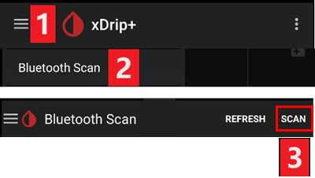

# Paramètres xDrip

Si ce n'est pas déjà fait, téléchargez et installez la dernière version de xDrip depuis la [page des versions de xDrip](https://github.com/NightscoutFoundation/xDrip/releases).

Désactivez l'optimisation de la batterie et autorisez l'activité en arrière-plan pour l'application xDrip.

## Paramètres de base pour tous les systèmes MGC & MGF

### Désactiver l'envoi vers Nightscout

Ne laissez aucune autre application envoyer des données (glycémie et traitements) vers Nightscout.

→ Menu hamburger (1) → Settings (2) → Cloud Upload (3) -> Nightscout Sync (REST-API)(4) → Mettez `Enabled` sur **OFF** (5)

#### Désactiver l'étalonnage automatique et les traitements

Vérifiez que `Automatic Calibration` (7) est désactivé. Si la case `Automatic Calibration` est cochée, activez une fois `Download treatments` (6), puis décochez `Automatic Calibration` et désactivez à nouveau `Download treatments`.

Appuyez sur `Extra Options`(8)

    {admonition} Avertissement de sécurité
    :class: warning
    Vous devez désactiver « Upload treatments » dans xDrip. Sinon, les traitements peuvent être comptés deux fois dans AAPS, ce qui donne des GA et des IA faux.

Désactivez `Upload treatments`(9) et assurez-vous de **NE PAS** utiliser `Back-fill data` (11).

L'option `Alert on failures` doit aussi être désactivée (10). Sinon, vous aurez une alarme toutes les 5 minutes en cas de problème de Wi-Fi ou de réseau mobile, ou si le serveur n'est pas disponible.

### **Inter-app Settings** (diffusion)

Si vous utilisez AAPS et que les données doivent être transmises, par exemple à AAPS, vous devez activer la diffusion dans xDrip, dans Inter-App settings.

→ Menu hamburger (1) → Settings (2) → Inter-app settings (3) → Broadcast locally sur **ON** (4)

Pour que les valeurs soient identiques dans AAPS et dans xDrip, vous devez activer `Send the displayed glucose value` (5).

Activez Compatible Broadcast (6).

Si vous avez aussi activé `Accept treatments` dans xDrip et `Activer les diffusions vers xDrip+` dans le plugin xDrip d'AAPS, alors xDrip recevra d'AAPS les informations sur l'insuline, les glucides et le débit basal.

Si vous activez `Accept Calibrations`, xDrip utilisera les étalonnages d'AAPS. Soyez prudent si vous utilisez cette fonction avec des capteurs Dexcom : lisez d'abord [ceci](https://navid200.github.io/xDrip/docs/Calibrate-G6.html).

Pensez à désactiver Import Sounds pour éviter que xDrip fasse sonner une sonnerie chaque fois qu'AAPS envoie un changement de débit basal ou de profil.

(xdrip-identify-receiver)=

#### Identifier le récepteur

- Si vous avez des problèmes avec la diffusion locale (AAPS ne reçoit pas les valeurs de glycémie de xDrip), allez dans → Menu hamburger (1) Settings (2) → Inter-app settings (3) → Identify receiver (7) et saisissez `info.nightscout.androidaps` pour la version AAPS (si vous utilisez la version PumpControl, saisissez plutôt `info.nightscout.aapspumpcontrol` !!).
- Attention : la correction automatique a parfois tendance à changer le i en majuscule. Vous **devez utiliser uniquement des lettres minuscules** en tapant `info.nightscout.androidaps` (ou `info.nightscout.aapspumpcontrol` pour PumpControl). Un I majuscule empêcherait l'application de recevoir les valeurs de glycémie de xDrip.
    
    

## Utiliser AAPS pour étalonner dans xDrip

- Si vous voulez pouvoir étalonner avec AAPS, allez dans xDrip dans Settings → Interapp Compatibility → Accept Calibrations et choisissez ON. 
- Vous pouvez aussi vérifier les options dans Settings → Less Common Settings → Advanced Calibration Settings.

## Capteurs Dexcom

Tout ce qui concerne le capteur et le transmetteur Dexcom eux-mêmes (démarrage, arrêt, remplacement, étalonnage, dépannage) est décrit et tenu à jour dans la [documentation Dexcom de xDrip](https://navid200.github.io/xDrip/docs/Dexcom_page.html). Suivez ces instructions pour le capteur ; les paramètres qui connectent xDrip à **AAPS** (décrits plus haut sur cette page) sont la seule partie propre à AAPS.

### Dexcom G6 et ONE

- Configurez xDrip en suivant les [paramètres recommandés](https://navid200.github.io/xDrip/docs/G6-Recommended-Settings.html).
- Les transmetteurs Dexcom G6 et ONE peuvent être connectés en même temps au récepteur Dexcom (ou à la pompe t:slim) et à une application sur votre téléphone.
- Si vous utilisez xDrip comme récepteur, désinstallez d'abord l'application Dexcom. **Vous ne pouvez pas connecter xDrip et l'application Dexcom au transmetteur en même temps !**
- Si vous avez besoin de Clarity et voulez profiter des fonctions de xDrip, utilisez l'application [Build Your Own Dexcom App](#DexcomG6-if-using-g6-with-build-your-own-dexcom-app) avec la diffusion locale vers xDrip, ou utilisez xDrip en application compagnon qui reçoit les notifications de l'application Dexcom officielle (avec un retard possible des valeurs de glycémie).

#### Redémarrages du capteur

- Avec les transmetteurs actuels, xDrip utilise toujours l'[algorithme natif](https://navid200.github.io/xDrip/docs/Native-Algorithm.html) du transmetteur ; il n'y a aucune raison de le désactiver.
- Les [redémarrages préventifs](https://navid200.github.io/xDrip/docs/Preemptive-Restart.html) fonctionnent seulement avec les anciens transmetteurs (firmware 1.6.5.25 ou plus ancien). Sur ceux-ci, ils sont nécessaires pour éviter que le capteur s'arrête après 10 jours. Les transmetteurs récents (Firefly) les ignorent.
- Pour redémarrer un capteur avec un transmetteur Firefly, il faut [retirer le transmetteur](https://navid200.github.io/xDrip/docs/Remove-transmitter.html), et les valeurs peuvent être très fausses après le redémarrage, ce qui est dangereux en boucle : lisez entièrement [Restart a sensor](https://navid200.github.io/xDrip/docs/Restart-G6-sensor.html) (redémarrer un capteur) et [étalonnez avec soin](https://navid200.github.io/xDrip/docs/Calibrate-after-G6Restart.html).

(xdrip-connect-g6-transmitter-for-the-first-time)=

#### Démarrer, arrêter et remplacer les capteurs

Suivez les instructions :

- [Démarrer un transmetteur G6 ou ONE](https://navid200.github.io/xDrip/docs/Starting-G6.html)
- [Arrêter et démarrer un capteur G6 ou ONE](https://navid200.github.io/xDrip/docs/Dexcom/StartG6Sensor.html)
- [Retirer le transmetteur d'un capteur](https://navid200.github.io/xDrip/docs/Remove-transmitter.html)
- La [durée de vie du transmetteur](https://navid200.github.io/xDrip/docs/Transmitter-lifetime.html) ne peut être prolongée ([réinitialisation matérielle](https://navid200.github.io/xDrip/docs/Hard-Reset.html)) que sur des transmetteurs modifiés ou dont la pile a été changée, pas sur les Firefly.

(xdrip-replace-transmitter)=

#### Remplacer un transmetteur

- Éteignez le récepteur Dexcom d'origine (si vous en utilisez un) et ne le rallumez pas avant que xDrip affiche des valeurs.
- Oubliez l'appareil dans xDrip (System Status → Forget Device) ET dans les paramètres Bluetooth du smartphone (affiché comme DexcomXX, où XX sont les deux derniers chiffres du numéro de série du transmetteur).
- Gardez l'ancien transmetteur hors de portée Bluetooth pour éviter qu'il se reconnecte.
- Puis suivez [Démarrer un transmetteur G6 ou ONE](https://navid200.github.io/xDrip/docs/Starting-G6.html).

### Dexcom G7, ONE+ et Stelo

- Suivez les [instructions G7, ONE+ et Stelo](https://navid200.github.io/xDrip/docs/Dexcom/G7.html) (une version récente de xDrip est nécessaire, voir la page liée).
- Voir aussi la [page Dexcom G7, ONE+ et Stelo](../CompatibleCgms/DexcomG7.md) pour les configurations possibles avec **AAPS**.

(xdrip-troubleshooting-dexcom-g5-g6-and-xdrip)=

### Dépannage Dexcom et xDrip

- [Dépannage de la connexion G6/ONE](https://navid200.github.io/xDrip/docs/Connectivity-troubleshoot.html)
- [Dépannage G7/ONE+/Stelo](https://navid200.github.io/xDrip/docs/Dexcom/G7_Troubleshooting.html)
- [Problème au démarrage d'un nouveau capteur](https://navid200.github.io/xDrip/docs/Dexcom/SensorFailedStart.html)
- Liste complète : voir **Troubleshooting** sur la [page Dexcom de xDrip](https://navid200.github.io/xDrip/docs/Dexcom_page.html).

## Libre 1

- Configurer votre bridge NFC vers Bluetooth dans xDrip
    
    → Menu hamburger (1) → Settings (2) → Less common settings (3) → Bluetooth Settings (4)

- Dans Bluetooth Settings, cochez les cases exactement comme sur les captures d'écran ci-dessous (5)
    
    - Désactivez les watchdogs (chiens de garde) : ils réinitialisent le Bluetooth du téléphone et coupent la connexion avec votre pompe.
    
    

- Vous pouvez essayer d'activer les paramètres suivants (7)
    
    - Use scanning
    - Trust Auto-Connect
    - Use Background Scans

- Si vous perdez facilement la connexion avec le bridge ou si vous avez du mal à rétablir la connexion, **DÉSACTIVEZ-LES** (8).
    
    

- Laissez toutes les autres options désactivées, sauf si vous savez pourquoi vous voulez les activer.
    
    

### Niveau de batterie du transmetteur Freestyle Libre

- Le niveau de batterie des bridges comme MiaoMiao et Bubble peut être affiché dans AAPS (pas pour Blucon).
- Les détails se trouvent sur la [page des captures d'écran](#screens-sensor-level-battery).

### Connecter le transmetteur Libre & démarrer le capteur

- Si votre capteur en a besoin (Libre 2 UE et Libre 1 US), installez la dernière version de l'algorithme « out of process ».

- Votre capteur doit déjà être démarré avec l'application du fabricant ou le lecteur (xDrip ne peut pas démarrer ni arrêter les capteurs Libre).

- Réglez la source de données sur Libre Bluetooth.
    
    → Menu hamburger (1) → Settings (2) → Choisissez Libre Bluetooth dans Hardware Data source (3)
    
    

- Recherchez le Bluetooth et connectez le bridge.
    
    → Menu hamburger (1) → Scan Bluetooth (2) → Scan (3)
    
    - Si xDrip ne trouve pas le bridge, vérifiez qu'il n'est pas connecté à l'application du fabricant. Mettez-le en charge et réinitialisez-le.
    
    

- Démarrez le capteur dans xDrip.
    
        {admonition} Avertissement de sécurité
        :class: warning
        N'utilisez pas les données du capteur avant la fin de la période de préchauffage d'une heure : les valeurs peuvent être extrêmement élevées et entraîner de mauvaises décisions dans AAPS.
    
    → Menu hamburger (1) → Start sensor (2) → Start sensor (3) → Indiquez l'heure exacte à laquelle vous l'avez démarré avec le lecteur ou l'application du fabricant. Si vous ne l'avez pas démarré aujourd'hui, répondez « Not Today » (4).

(xdrip-libre2-patched-app)=

## Application patchée Libre 2

- Réglez la source de données sur l'application Libre patchée.
    
    → Menu hamburger (1) → Settings (2) → Choisissez Libre (patched App) dans Hardware Data source (3)
    
    

- Vous pouvez ajouter `BgReading:d,xdrip libre_receiver:v` dans Less Common Settings->Extra Logging Settings->Extra tags for logging. Cela permettra de consigner des messages d'erreur supplémentaires pour le dépannage.

