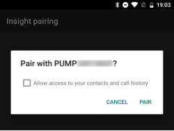

# Accu-Chek Insight

**Ce logiciel fait partie d'une solution de pancréas artificiel DIY (à faire soi-même). Ce n'est pas un produit, mais il exige que VOUS lisiez, appreniez et compreniez le système, y compris comment l'utiliser. Il ne gère pas tout votre diabète à votre place, mais il vous permet d'améliorer votre diabète et votre qualité de vie, si vous êtes prêt à y consacrer le temps nécessaire. Ne vous précipitez pas, prenez le temps d'apprendre. Vous êtes le seul responsable de ce que vous faites avec ce système.**

```{admonition} L'Accu-Chek Insight est en cours d'arrêt :class: note

Roche se retire du marché des pompes à insuline pour recentrer son offre diabète sur le MGC Accu-Chek SmartGuide. Roche a annoncé la fin des ventes des pompes Accu-Chek Combo et Accu-Chek Insight ; sa dernière micropompe, l'Accu-Chek Solo, est aussi en cours d'arrêt (dernières livraisons en Allemagne fin 2025). Ce changement se fait région par région. Il commence en Allemagne, et les autres marchés européens devraient suivre. Le support de l'Insight est déjà indiqué comme terminé (voir [Pompes qui ne sont plus vendues](./Future-possible-Pump-Drivers.md)). Si vous dépendez de cette pompe, préparez à l'avance le passage à une pompe prise en charge.

    <br />```{note}
    Avant que **AAPS** ait un pilote Insight intégré, l'Insight était contrôlée par l'application séparée [SightRemote](https://github.com/TebbeUbben/SightRemote). SightRemote n'est plus nécessaire et n'est plus maintenue : si elle est encore installée depuis cette époque, désinstallez-la et utilisez une version actuelle d'**AAPS**.
    

```{contents} Table des matières :depth: 1 :local: true

    <br />## Fonctions de la pompe avec AAPS
    
    * Communique avec **AAPS** par le Bluetooth intégré de votre téléphone, sans appareil de communication supplémentaire.
    * Gestion automatique de l'heure d'été et du fuseau horaire.
    
    ## Matériel et logiciel nécessaires
    
    * Une pompe Roche Accu-Chek Insight (tous les firmwares fonctionnent)
    
    Remarque : AAPS écrit toujours les données dans le **premier profil de débit basal de la pompe**.
    
    * Un téléphone Android avec Android 12 ou plus récent (voir [Téléphones](../Getting-Started/Phones.md))
    * L'application AAPS installée sur votre téléphone
    
    ## Configuration
    
    * La pompe Insight ne doit être connectée qu'à un seul appareil à la fois. Si vous avez déjà utilisé la télécommande Insight (lecteur), vous devez supprimer le lecteur de la liste des appareils appairés de votre pompe : **Menu** > **Settings** > **Communication** > **Remove device**.
    
       
    
    * Dans [Configuration > Pompe](#Config-Builder-pump), choisissez la carte **Accu-Chek Insight**. Une seule pompe peut être active à la fois.
    
       
    
       Une fois le plugin choisi, la carte **Accu-Chek Insight** affiche deux boutons, **Paramètres** et **Ouvrir le plugin** :
    
       
    
       **Paramètres** ouvre les paramètres du pilote Accu-Chek Insight (voir [Paramètres dans AAPS](#Accu-Chek-Insight-Pump-settings-in-aaps)).
    
       **Ouvrir le plugin** (ou **Gestion → Pompe**) ouvre l'écran de la pompe Accu-Chek Insight. Avant l'appairage d'une pompe, il ressemble à ceci :
    
       
    
    (accu-chek-insight-pairing)=
    ### Appairage
    
    * Sur l'écran de la pompe, touchez **Appairage de Insight**. L'assistant d'appairage s'ouvre et recherche les appareils Bluetooth à proximité (en haut de l'image ci-dessous).
    * Sur la pompe Insight, allez dans **Menu** > **Settings** > **Communication** > **Add Device**. La pompe affiche l'écran suivant (en bas de l'image ci-dessous) avec le numéro de série de la pompe.
    
       
    
    * De retour sur votre téléphone, touchez le numéro de série de la pompe dans la liste des appareils Bluetooth. Si Android vous demande de confirmer l'appairage, touchez **Appairer**.
    
       
    
    * La pompe et le téléphone affichent tous les deux un code. Vérifiez que les codes sont identiques sur les deux appareils. Confirmez sur la pompe, et touchez **Oui** sur le téléphone. (Touchez **Non** si les codes ne correspondent pas.)
    
       
    
    * Le téléphone affiche **Appairage terminé**. Touchez **Quitter** pour revenir à l'écran de la pompe.
    
       
    
    * Pour vérifier que tout va bien, regardez l'écran de la pompe (**Gestion → Pompe**). Une fois la pompe appairée, l'écran affiche des informations sur la pompe, comme le **Numéro de série**, la **Date de fabrication**, la **Version du logiciel** et l'**Adresse Bluetooth**.
    
       
    
       ```{admonition} Ancienne capture d'écran
       :class: note
       Sauf le haut de la première image, les captures d'écran d'appairage ci-dessus viennent d'une version plus ancienne d'**AAPS** et peuvent être différentes dans **AAPS** 4.
       ```
    
    * Pour supprimer l'appairage, touchez **Désappairer** sur l'écran de la pompe et confirmez **Réinitialiser les informations d'appairage ?**. Le bouton **Appairage de Insight** apparaît alors de nouveau.
    
    Remarque : il n'y a pas de connexion permanente entre la pompe et le téléphone. **AAPS** se connecte seulement quand c'est nécessaire (par exemple pour régler un débit basal temporaire, donner un bolus ou lire l'historique de la pompe). Sinon, les piles du téléphone et de la pompe se videraient beaucoup trop vite.
    
    (Accu-Chek-Insight-Pump-settings-in-aaps)=
    ## Paramètres dans AAPS
    
    Ouvrez les paramètres avec **Paramètres** sur la carte **Accu-Chek Insight** dans **Configuration** > **Pompe**, ou avec l'icône en forme de roue dentée en haut à droite de l'écran de la pompe.
    
    
    
    Dans les paramètres Insight d'**AAPS**, vous pouvez activer les options suivantes :
    
    * **Enreg. changement de réservoir** : enregistre automatiquement un changement de cartouche d'insuline quand vous lancez le programme "fill cannula" (remplir la canule) sur la pompe.
    
    * **Enreg. changement de tubulure** : ajoute une note dans la base de données d'**AAPS** quand vous lancez le programme "tube filling" (remplissage de la tubulure) sur la pompe.
    
    * **Enreg. changement de site** : ajoute une note dans la base de données d'**AAPS** quand vous lancez le programme "cannula filling" (remplissage de la canule) sur la pompe. **Remarque : un changement de site réinitialise aussi Autosens.**
    
    * **Enreg. changement batterie** : enregistre un changement de pile quand vous mettez une nouvelle pile dans la pompe.
    
    * **Enreg. changement mode de fonctionnement** : ajoute une note dans la base de données d'**AAPS** chaque fois que vous démarrez, arrêtez ou mettez en pause la pompe.
    
    * **Enreg. alertes** : ajoute une note dans la base de données d'**AAPS** chaque fois que la pompe émet une alerte (sauf les rappels, l'annulation de bolus et l'annulation de DBT, qui ne sont pas enregistrés).
    
    * **Activer l’émulation de DBT** : la pompe Insight peut seulement régler des débits basaux temporaires (DBT) jusqu'à 250 %. Pour contourner cette limite, l'émulation de DBT demande à la pompe d'injecter un bolus étendu pour l'insuline en plus si un DBT de plus de 250 % est demandé.
    
      **Remarque : n'utilisez qu'un seul bolus étendu à la fois. Plusieurs bolus étendus en même temps peuvent provoquer des erreurs.**
    
    * **Désactiver les vibrations des bolus manuels** : empêche la pompe Insight de vibrer quand elle injecte un bolus manuel (ou un bolus étendu). Disponible seulement avec le firmware Insight 3.x.
    
    * **Désactiver les vibrations des bolus automatiques** : empêche la pompe Insight de vibrer quand elle injecte un bolus automatique (SMB ou basal temporaire avec émulation de DBT). Disponible seulement avec le firmware Insight 3.x.
    
    * **Durée min. de récupération [s]** et **Durée max. de récupération [s]** : combien de temps **AAPS** attend avant de réessayer après une tentative de connexion échouée. Vous pouvez choisir entre 0 et 20 secondes. Si vous avez des problèmes de connexion, choisissez un temps d'attente plus long.
        <br><br>Exemple pour durée min. de récupération = 5 et durée max. de récupération = 20
        <br><br>pas de connexion -> attendre <b>5</b> s
          <br>  nouvel essai -> pas de connexion -> attendre <b>6</b> s
          <br>  nouvel essai -> pas de connexion -> attendre <b>7</b> s
          <br>  nouvel essai -> pas de connexion -> attendre <b>8</b> s
          <br>...
          <br>nouvel essai -> pas de connexion -> attendre <b>20</b> s
          <br>nouvel essai -> pas de connexion -> attendre <b>20</b> s
          <br>...
    
    * **Délai de déconnexion [s]** : combien de temps (en secondes) **AAPS** attend avant de se déconnecter de la pompe quand une opération est terminée. Vous pouvez choisir entre 0 et 15 secondes. La valeur par défaut est 5 secondes.
    
    Pour les périodes où la pompe était arrêtée, **AAPS** enregistre un débit basal temporaire de 0 %.
    
    ### L'écran de la pompe
    
    L'écran de la pompe Accu-Chek Insight (**Gestion → Pompe**) affiche l'état actuel de la pompe, par exemple **État**, **Dernière connexion**, **Mode de fonctionnement**, **Pile**, **Niveau du réservoir**, les doses totales quotidiennes du jour (**DTQ Bolus**, **DTQ Basale**), les débits basaux et le dernier bolus. Une fois la pompe appairée, il a ces boutons :
    
    * **Actualiser** : actualise l'état de la pompe.
    * **Activer la notification de la fin DBT (réglage de pompe)** / **Désactiver la notification de la fin de DBT (réglage de pompe)** : une pompe Insight standard émet une alarme quand un DBT se termine. Ce bouton active ou désactive cette alarme sans avoir besoin du logiciel de configuration.
    * **Désappairer** : supprime l'appairage avec la pompe (voir [Appairage](#accu-chek-insight-pairing)).
    
    
    
    ```{admonition} Ancienne capture d'écran
    :class: note
    La capture d'écran ci-dessus vient d'une version plus ancienne d'**AAPS**. Dans **AAPS** 4, l'écran de la pompe est différent et a aussi un bouton **Désappairer**.
    

## Paramètres de la pompe

Configurez les alarmes dans la pompe comme suit :

* Menu > Settings > Device settings > Mode settings > Quiet > Signal > Sound
* Menu > Settings > Device settings > Mode settings > Quiet > Volume > 0 (supprimez toutes les barres)
* Menu > Modes > Signal mode > Quiet

Cela coupe le son de toutes les alarmes de la pompe, et AAPS décide si une alarme est importante pour vous. Si AAPS n'acquitte pas une alarme, son volume augmente (d'abord un bip, puis une vibration).

(Accu-Chek-Insight-Pump-vibration)=

### Vibration

Selon la version du firmware de votre pompe, l'Insight vibre brièvement à chaque bolus injecté (par exemple quand AAPS envoie un SMB ou quand l'émulation de DBT injecte un bolus étendu).

* Firmware 1.x : Aucune vibration par conception.
* Firmware 2.x : Les vibrations ne peuvent pas être désactivées.
* Firmware 3.x : AAPS injecte les bolus sans vibration.

La version du firmware se trouve dans le menu.

## Remplacement de pile

La durée de vie de la pile de l'Insight, lorsque vous bouclez, est comprise entre 10 et 14 jours, et au maximum 20 jours. L'utilisateur qui a signalé cela utilise des piles au lithium Energizer.

La pompe Insight dispose d'une petite batterie interne pour garder les fonctions essentielles comme l'horloge en cours d'exécution pendant que vous changez la pile. Si le changement de la pile prend trop de temps, cette batterie interne peut manquer d'énergie, l'heure sera remise à zéro, et il vous sera demandé d'entrer à nouveau la date et l'heure après avoir mis la nouvelle pile. Si cela arrive, toutes les entrées d'AAPS avant le changement de pile ne sont plus prises en compte dans les calculs, car l'heure correcte ne peut pas être déterminée.

(Accu-Chek-Insight-Pump-insight-specific-errors)=

## Erreurs spécifiques à Insight

### Bolus étendu

Il ne faut utiliser qu'un seul bolus étendu à la fois car plusieurs bolus étendus en même temps peuvent provoquer des erreurs.

### Délai expiré

Parfois, la pompe Insight ne répond pas pendant qu'**AAPS** établit la connexion. **AAPS** affiche alors la notification "Expiration pendant l'appairage - réinitialiser le Bluetooth".


Si cela arrive, désactivez le Bluetooth sur la pompe ET sur le téléphone pendant environ 10 secondes, puis réactivez-le.

## Voyager avec différents fuseaux horaires avec une pompe Insight

Pour les voyages avec changement de fuseau horaire, voir la section [Voyager avec changement de fuseau horaire avec les pompes](#timezone-traveling-insight).

## Où obtenir de l'aide

Le pilote Insight est développé par la communauté, de manière **bénévole**. Avant de demander de l'aide, merci de :

1. **Lire** la section de cette documentation qui concerne votre problème, pour vérifier comment la fonction doit marcher.
2. **Demander** sur le canal *#AAPS* sur [Discord](https://discord.gg/4fQUWHZ4Mw), ou dans un des autres [canaux de la communauté](../GettingHelp/WhereCanIGetHelp.md).
3. **Signaler un bug** en cherchant dans les [tickets existants](https://github.com/nightscout/AndroidAPS/issues) ; si le vôtre n'y est pas, ouvrez un [nouveau ticket](https://github.com/nightscout/AndroidAPS/issues) et joignez vos [fichiers log](../GettingHelp/AccessingLogFiles.md).

Pour demander de l'aide, indiquez la marque et le modèle de votre téléphone, la version d'Android, la version d'**AAPS** et une description simple du problème (ce qui a changé, quand cela a fonctionné pour la dernière fois).