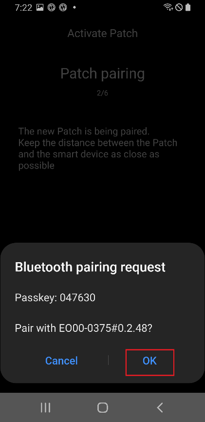

# EOPatch2

Le patch a besoin d'une insuline rapide U-100, comme NovoRapid ou Humalog. Utilisez l'insuline rapide que votre médecin vous a prescrite.

La plus petite dose que le patch peut délivrer est de 0,05 U. Réglez chaque débit basal de votre **Profil** à au moins 0,05 U/h, par pas de 0,05 U/h. Sinon, **AAPS** arrondit chaque débit à la valeur de 0,05 U/h la plus proche (jamais à 0) et utilise les débits que le patch délivre vraiment ; le total d'insuline par jour est donc un peu différent de votre **Profil**. De la même façon, les bolus doivent être d'au moins 0,05 U.

```{contents} Table of contents
:depth: 1
:local: true
```

## Fonctionnalités de la pompe avec AAPS

* Communique avec **AAPS** par le Bluetooth natif de votre téléphone, sans appareil de communication supplémentaire.
* Les changements d'heure d'été et de fuseau horaire doivent être faits à la main.

## Configuration de la pompe

1. Ouvrez le **menu** (☰) en haut à gauche de l'écran principal d'**AAPS** et sélectionnez **Configuration**.
1. Dans la section **Pompe**, sélectionnez **EOPatch2**.
1. Appuyez sur la touche Retour pour revenir à l'écran principal.

 

Une fois le plugin sélectionné, la carte **EOPatch2** affiche deux boutons, **Paramètres** et **Ouvrir le plugin** :


## Paramètres

Il y a deux façons d'ouvrir les paramètres EOPatch2 :

* appuyez sur **Paramètres** sur la carte **EOPatch2** dans **Configuration**, ou
* ouvrez l'écran de la pompe (**Gestion** → **Pompe**) et appuyez sur l'icône en forme de roue dentée en haut à droite.

Il y a trois paramètres :


### Alertes réservoir bas

Un avertissement s'affiche quand l'insuline restante dans le patch descend à cette quantité ou moins. Vous pouvez le régler de 10 à 50 U, par pas de 5 U. La valeur par défaut est 10 U.

### Rappel d'expiration du Patch

Vous rappelle combien de temps il reste avant l'expiration du patch actuel. Vous pouvez le régler de 1 à 24 heures, par pas de 1 heure. La valeur par défaut est 4 heures.

### Rappels sonores du Patch

Quand cette option est activée, le patch émet un bip quand un bolus, un bolus étendu ou un débit basal temporaire commence et quand il se termine. Elle n'a aucun effet sur votre débit basal normal. Par défaut, elle est désactivée.

## Activer un nouveau patch

### Ouvrir l'assistant d'activation

Ouvrez l'écran de la pompe avec **Gestion** → **Pompe** (ou appuyez sur **Ouvrir le plugin** sur la carte **EOPatch2** dans **Configuration**). Quand aucun patch n'est actif, l'écran affiche **Non activé** et un bouton **Activer le Patch** en bas.

Appuyez sur **Activer le Patch** pour démarrer l'assistant.


L'assistant vous guide à chaque étape. La ligne de points en haut montre où vous en êtes.

```{note}
Si vous n'avez jamais activé de **Profil** dans **AAPS**, l'assistant affiche d'abord une page **Profil nécessaire**. Sélectionnez le profil à utiliser et appuyez sur **Activer le profil**.
```

### Remplissage de l'insuline

Insérez l'aiguille de la seringue dans le port de remplissage d'insuline du patch. Poussez lentement le piston pour remplir le patch. Dès qu'il y a plus de 80 U dans le patch, il émet un bip et démarre.

Quand vous entendez le bip, appuyez sur **Démarrer l'appairage**.


```{warning}
- Ne tournez pas le levier de l'aiguille avant que l'assistant vous le demande. Le tourner trop tôt peut causer de graves problèmes pendant le remplissage ou le contrôle de sécurité.
- Le patch contient de 80 à 200 U. Si vous mettez moins de 80 U, le patch ne fonctionne pas.
- Sortez l'insuline du réfrigérateur 15 à 30 minutes avant le remplissage, pour qu'elle soit à température ambiante. L'insuline doit être à au moins 10 °C.
```

### Appairage du Patch

**AAPS** essaie maintenant de s'appairer automatiquement avec le patch. Pendant l'appairage, deux demandes d'appairage Bluetooth Android s'affichent. Appuyez sur **OK** sur la première. Appuyez à nouveau sur **OK** sur la deuxième, qui affiche une clé d'accès.

```{warning}
- Pendant l'appairage, gardez le patch et votre téléphone à moins de 30 cm l'un de l'autre.
- Après le démarrage du patch, il émet un bip toutes les 3 minutes jusqu'à la fin de l'appairage.
- Vous devez terminer l'activation du patch dans les 60 minutes après son démarrage. Si vous ne pouvez pas, retirez le patch.
```

  

```{admonition} Older screenshot
:class: note
Les deux captures d'écran de l'appairage Bluetooth viennent d'une ancienne version d'**AAPS** : l'écran d'**AAPS** derrière la demande d'appairage Android est différent dans **AAPS** 4.
```

### Sélectionner l'insuline

Sélectionnez l'insuline avec laquelle vous avez rempli le patch et appuyez sur **Suivant**. **AAPS** applique un changement de profil avec cette insuline après l'activation.

### Préparez-vous à coller le Patch

Retirez le ruban adhésif du patch, puis appuyez sur **Suivant**.

Si une aiguille dépasse, ou si le patch est mouillé, sale ou si son ruban adhésif est plié, appuyez plutôt sur **Supprimer** et utilisez un nouveau patch.


### Localisation du site

Cette étape n'apparaît que si **Gérer la rotation du site de la pompe** est activé dans les paramètres de rotation des sites. Appuyez sur l'endroit du schéma du corps où vous allez coller le patch et appuyez sur **Suivant**, ou appuyez sur **Ignorer**.

### Coller le Patch

L'insuline doit aller dans une zone avec du tissu graisseux sous la peau, mais avec peu de nerfs ou de vaisseaux sanguins. L'abdomen, le bras ou la cuisse sont de bons choix. Nettoyez et séchez le site, puis collez le patch sur votre peau.

Vérifiez le site de perfusion, puis appuyez sur **Démarrer la vérification de sécurité**.

```{warning}
- Appuyez de façon égale sur les bords de l'adhésif du patch, pour que tout le patch colle bien à votre peau.
- Si le patch ne colle pas complètement, de l'air peut passer entre le patch et votre peau. Cela affaiblit l'adhésif et la résistance à l'eau du patch.
```


### Contrôle de sécurité

Le contrôle de sécurité dure environ 30 secondes. Quand il est terminé, le patch émet un bip. S'il échoue, appuyez sur **Réessayer**.

```{warning}
Pour une utilisation sûre, ne tournez pas le levier de l'aiguille avant la fin du contrôle de sécurité.
```

 

```{admonition} Older screenshot
:class: note
Les captures d'écran de **Préparez-vous à coller le Patch** à **Contrôle de sécurité** viennent d'une ancienne version d'**AAPS** et peuvent être différentes dans **AAPS** 4.
```

### Insertion de l'aiguille

Tenez fermement le patch. Tournez le levier de l'aiguille vers le haut de plus de 100° pour insérer l'aiguille. Le patch émet un bip quand l'aiguille est bien insérée. Continuez ensuite à tourner le levier jusqu'au bout pour l'enlever. Appuyez sur **Suivant**.

```{caution}
Si vous passez à l'étape suivante sans avoir entendu le bip, une **Erreur d'insertion de l'aiguille** s'affiche. Vérifiez le bip et appuyez sur **Réessayer**. Si l'erreur reste, appuyez sur **Supprimer** pour désactiver le patch.
```

### Activation du Patch terminée

La dernière page confirme que le patch est actif et qu'il vous préviendra quand il approchera de sa date d'expiration. Appuyez sur **Terminer** pour revenir à l'écran de la pompe.

## Retirer le Patch

Remplacez le patch quand il a peu d'insuline, quand il expire ou s'il est défectueux. Nous recommandons de ne pas utiliser un patch plus de 84 heures après son démarrage.

1. Ouvrez l'écran de la pompe (**Gestion** → **Pompe**). Quand un patch est actif, appuyez sur **Retirer le Patch**.
1. La page **Retirer le Patch** affiche le temps restant et l'insuline restante dans le patch. Appuyez sur **Retirer le Patch**.
1. Une fenêtre vous demande de confirmer. Appuyez à nouveau sur **Retirer le Patch**.
1. Quand le patch a été désactivé, l'assistant affiche **La suppression du Patch est terminée.** Retirez le patch de votre corps et appuyez sur **Confirmer**.

Ensuite, l'assistant passe directement à l'activation d'un nouveau patch (voir ci-dessus). Appuyez sur la flèche de retour si vous voulez vous arrêter ici.

Quand aucun patch n'est actif, **AAPS** affiche la pompe comme suspendue et enregistre un débit basal temporaire de 0 U/h ; ainsi, aucune insuline basale n'est comptée dans l'IA jusqu'à l'activation du patch suivant.

   

```{admonition} Older screenshot
:class: note
Les captures d'écran ci-dessus viennent d'une version plus ancienne d'**AAPS**. Dans **AAPS** 4, vous ouvrez l'écran de la pompe avec **Gestion** → **Pompe**, et le bouton s'appelle **Retirer le Patch**.
```

```{admonition} If the patch does not respond
:class: warning
Si **AAPS** ne peut pas joindre le patch, il peut afficher une page expliquant comment arrêter l'alarme du patch à la main : retirez le patch de votre corps, enlevez le ruban adhésif et utilisez un trombone pour appuyer fermement dans le trou à côté du port de remplissage d'insuline.

La page **Retirer le Patch** a aussi un bouton **Forcer la réinitialisation**. Il efface seulement le patch dans **AAPS**, sans envoyer de commande au patch. Le patch continue à délivrer de l'insuline jusqu'à ce que sa batterie soit vide ou que vous l'éteigniez à la main. Utilisez-le seulement si le retrait normal échoue, et retirez le patch de votre corps.
```

## Suspendre et reprendre l'injection d'insuline

Suspendre l'injection d'insuline annule aussi tout bolus étendu et tout débit basal temporaire. Quand vous reprenez, ils ne sont **pas** redémarrés. Tant que l'injection d'insuline est suspendue, le patch émet un bip toutes les 15 minutes.

### Suspendre l'injection d'insuline

1. Ouvrez l'écran de la pompe (**Gestion** → **Pompe**) et appuyez sur **Suspendre la pompe**.
1. Une fenêtre explique ce qui sera suspendu. Appuyez sur **Confirmer**.
1. Dans la fenêtre **Durée de suspension Basal**, choisissez la durée de la suspension : 30 min, 1 h, 1 h 30 ou 2 h. Appuyez sur **Confirmer**.

L'injection d'insuline est suspendue pendant la durée choisie.

  

```{admonition} Older screenshot
:class: note
Les captures d'écran ci-dessus viennent d'une version plus ancienne d'**AAPS**. Dans **AAPS** 4, vous ouvrez l'écran de la pompe avec **Gestion** → **Pompe**, et le bouton s'appelle **Suspendre la pompe**.
```

### Reprendre l'injection d'insuline

1. Ouvrez l'écran de la pompe (**Gestion** → **Pompe**) et appuyez sur **Reprendre la pompe**.
1. Dans la fenêtre **Reprendre l'injection d'insuline**, appuyez sur **Confirmer**.

 

```{admonition} Older screenshot
:class: note
Les captures d'écran ci-dessus viennent d'une version plus ancienne d'**AAPS**. Dans **AAPS** 4, vous ouvrez l'écran de la pompe avec **Gestion** → **Pompe**, et le bouton s'appelle **Reprendre la pompe**.
```

```{warning}
Quand la durée de suspension est terminée, **AAPS** affiche un avertissement **Fin de la suspension d'insuline**. L'injection d'insuline ne reprend **pas** tant que vous ne l'avez pas confirmée. Si vous ne le faites pas, vous pourriez développer une hyperglycémie.
```

(eopatch2-alarms-and-warnings)=

## Alarmes et avertissements

### Alarmes

Les alarmes concernent des situations urgentes, de priorité maximale, et demandent une action immédiate de votre part. **AAPS** déclenche une alarme qui continue jusqu'à ce que vous l'acquittiez, et affiche le message sous forme de notification sur l'écran **Vue d'ensemble**. Une alarme signifie qu'il y a un problème avec le patch utilisé. Dans de nombreux cas, le patch doit être retiré et remplacé par un nouveau.

Quand vous appuyez sur **Confirmer** dans la notification, **AAPS** traite l'alarme. Pour la plupart des alarmes, cela désactive le patch. Pour une alarme **Température inadaptée**, le bouton est **Réessayer**.

 

```{admonition} Older screenshot
:class: note
Les captures d'écran des alarmes viennent d'une ancienne version d'**AAPS** et peuvent être différentes dans **AAPS** 4.
```

Les différentes alarmes sont expliquées ci-dessous.

| Alarme                            | Explication                                                                                                                                                                         |
| --------------------------------- | ----------------------------------------------------------------------------------------------------------------------------------------------------------------------------------- |
| Réservoir vide                    | Le patch n'a plus d'insuline.                                                                                                                                                       |
| Le Patch a expiré                 | La durée d'utilisation du patch est terminée et il ne peut plus délivrer d'insuline.                                                                                                |
| Occlusion                         | Le circuit d'insuline du patch semble bouché.                                                                                                                                       |
| Échec de l'auto-test au démarrage | Le patch a trouvé une erreur inattendue pendant son auto-test après le démarrage.                                                                                                   |
| Température inadaptée             | Le patch est en dehors de sa température normale de fonctionnement pendant l'activation ou l'utilisation. Déplacez le patch dans un endroit à température adaptée (de 4,4 à 37 °C). |
| Erreur d'insertion de l'aiguille  | L'aiguille n'a pas été bien insérée pendant l'activation. Vérifiez que le bord d'insertion de l'aiguille du patch et le levier de l'aiguille sont bien alignés.                     |
| Erreur batterie du Patch          | La batterie interne du patch est presque vide et le patch va s'éteindre.                                                                                                            |
| Erreur d'activation du Patch      | Le patch n'a pas été complètement activé dans les 60 minutes après son démarrage.                                                                                                   |
| Erreur Patch                      | Le patch a trouvé une erreur inattendue pendant l'activation ou l'utilisation.                                                                                                      |

### Avertissements

Les avertissements concernent des situations de priorité moyenne ou basse. Un avertissement s'affiche sous forme de notification sur l'écran **Vue d'ensemble**.


```{admonition} Older screenshot
:class: note
Cette capture d'écran vient d'une ancienne version d'**AAPS** : dans **AAPS** 4, l'avertissement s'affiche sur l'écran principal, qui est différent.
```

Les différents avertissements sont expliqués ci-dessous.

| Attention                       | Explication                                                                                                                                                |
| ------------------------------- | ---------------------------------------------------------------------------------------------------------------------------------------------------------- |
| Fin de la suspension d'insuline | La durée de suspension que vous avez choisie est terminée. Appuyez sur **Reprendre la pompe** dans la notification pour redémarrer l'injection d'insuline. |
| Réservoir bas                   | L'insuline restante dans le patch est inférieure à la quantité réglée dans **Alertes réservoir bas**.                                                      |
| Le Patch a expiré               | La période d'utilisation du patch est terminée.                                                                                                            |
| Le Patch va bientôt expirer     | Le patch doit être retiré dans 1 heure.                                                                                                                    |
| Activation du Patch incomplète  | L'activation du patch a été interrompue pendant plus de 3 minutes après l'appairage. Ouvrez l'écran de la pompe et terminez l'activation du patch.         |
| Batterie du Patch faible        | La batterie du patch est faible.                                                                                                                           |

## Où obtenir de l'aide

Le pilote EOPatch2 est développé par la communauté, de manière **bénévole**. Avant de demander de l'aide, merci de :

1. **Lisez** la section correspondante de cette documentation pour vérifier comment la fonction doit marcher.
2. **Demandez** sur le canal *#AAPS* de [Discord](https://discord.gg/4fQUWHZ4Mw), ou dans un des autres [canaux de la communauté](../GettingHelp/WhereCanIGetHelp.md).
3. **Signalez un bug** : cherchez d'abord dans les [tickets existants](https://github.com/nightscout/AndroidAPS/issues) ; si le vôtre n'y est pas, ouvrez un [nouveau ticket](https://github.com/nightscout/AndroidAPS/issues) et joignez vos [fichiers log](../GettingHelp/AccessingLogFiles.md).

Quand vous demandez de l'aide, indiquez la marque et le modèle de votre téléphone, la version d'Android, la version d'**AAPS** et une description simple du problème (ce qui a changé, quand cela a fonctionné pour la dernière fois).
