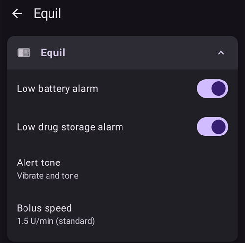
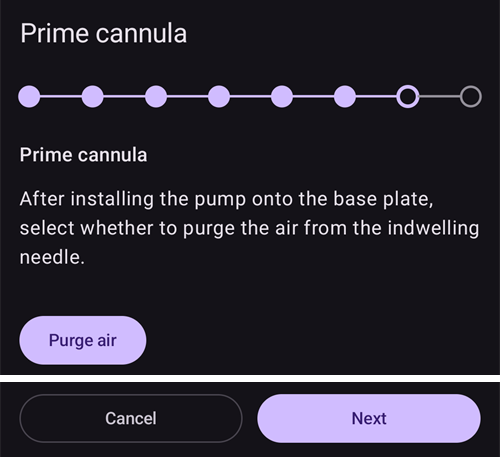
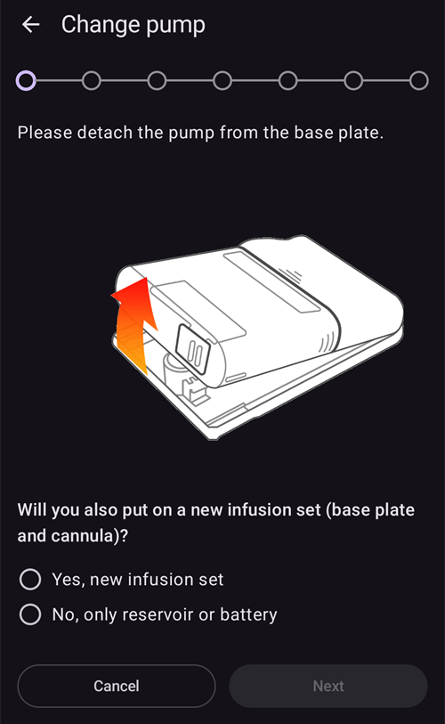

# Equil

Ces instructions expliquent comment configurer la pompe à insuline Equil.

```{contents} Table of contents
:depth: 1
:local: true
```

## Fonctionnalités de la pompe avec AAPS

* Pompe patch sans tubulure qui communique avec **AAPS** par le Bluetooth natif de votre téléphone, sans appareil de communication supplémentaire.
* **AAPS** traite l'Equil comme une pompe patch avec un réservoir de 200 U : l'écran principal affiche les voyants d'état d'une pompe patch, et **Amorcer/Remplir** et **Changement pile pompe** ne sont pas proposés. Le remplissage, l'amorçage et le changement de pile se font dans les assistants de la pompe.
* Quand la pompe est suspendue ou arrêtée, **AAPS** enregistre un débit basal temporaire de 0 U/h ; ainsi, aucune insuline basale n'est comptée dans l'IA.
* Les changements d'heure d'été et de fuseau horaire doivent être faits à la main.

## Configuration matérielle et logicielle requise
* **Matériel Equil compatible**

  Actuellement, les Equil 5.3 et 5.4 sont prises en charge.

* **AAPS** compilé et installé en suivant les instructions [Compilation d'AAPS](../SettingUpAaps/BuildingAaps.md)

## Configuration

### Sélectionner la pompe Equil

Ouvrez le **menu** (☰) en haut à gauche, choisissez **[Configuration](#Config-Builder-pump)**, et sous **Pompe**, sélectionnez **Equil**.

Une fois le plugin sélectionné, la carte **Equil** affiche deux boutons, **Paramètres** et **Ouvrir le plugin** :


**Ouvrir le plugin** (ou **Gestion** → **Pompe**) ouvre l'écran de la pompe Equil. Avant l'appairage d'une pompe, il ressemble à ceci :


### Paramètres

Ouvrez les paramètres Equil avec **Paramètres** sur la carte **Equil**, ou avec l'icône en forme de roue dentée en haut à droite de l'écran de la pompe.



* **Alarme batterie faible** : vous avertit quand la pile de la pompe est faible.
* **Alerte réservoir bas** : vous avertit quand il reste peu d'insuline dans le réservoir.
* **Son d'alerte** : comment la pompe vous alerte : **Muet**, **Vibreur uniquement**, **Son uniquement** ou **Son et vibreur**.
* **Vitesse du bolus** : la vitesse à laquelle un bolus est délivré : **1,5 U/min (standard)**, **3 U/min**, **6 U/min** ou **12 U/min**. Un bolus plus rapide peut donner plus d'alarmes d'occlusion.


```{admonition} Max basal and max bolus on the patch
:class: note
Le patch lui-même refuse tout débit basal supérieur à un maximum qu'**AAPS** y programme. **AAPS** prend la plus grande valeur entre votre [paramètre](../SettingUpAaps/Preferences.md) **basal max** et le débit basal horaire le plus élevé de votre **Profil** ; ainsi, le patch accepte toujours votre profil et les débits basaux temporaires demandés par la boucle. **AAPS** envoie aussi au patch votre bolus maximum autorisé.

Quand vous modifiez votre **basal max** ou votre **bolus max**, **AAPS** envoie automatiquement les nouvelles valeurs au patch. Elles sont aussi envoyées à chaque changement de profil. Il n'y a rien à régler sur le patch lui-même.
```

### Appairer la pompe

Sur l'écran de la pompe, appuyez sur **Appairer**. Un assistant vous guide à chaque étape. La ligne de points en haut montre où vous en êtes.

Si Android demande si **AAPS** peut trouver les appareils à proximité et s'y connecter, appuyez sur **Autoriser**. **AAPS** en a besoin pour trouver la pompe.


L'assistant a les étapes suivantes. Appuyez sur **Suivant** pour continuer, ou sur **Annuler** pour quitter l'assistant.

1. **Profil nécessaire** : affiché seulement si vous n'avez jamais activé de **Profil** dans **AAPS**. Sélectionnez le profil à utiliser et appuyez sur **Activer le profil**.
1. **Assembler la pompe** : assemblez la pompe, le réservoir rempli et la pile chargée.

   

1. **Trouver la Pompe** : **AAPS** recherche les pompes Equil à proximité. Sélectionnez votre pompe dans la liste.

   
1. **Appairer l'appareil** : vous pouvez saisir un mot de passe d'appairage dans **Définir le mot de passe d'appairage**. Il doit faire 4 caractères, choisis parmi `ABCDEF0123456789`. Appuyez sur **Appairer**.

   

1. **Sélectionner l'insuline** : affiché seulement si vous avez configuré plus d'une insuline. Sélectionnez l'insuline qui est dans le réservoir.
1. **Amorcer / Remplir** : la pompe ne doit **pas** être sur sa plaque de base. Appuyez sur **Amorcer/Remplir** et amorcez le réservoir jusqu'à ce qu'une goutte d'insuline apparaisse au bout de l'aiguille. Appuyez sur **Suivant**.

   
1. **Rotation du site** : affiché seulement si **Gérer la rotation du site de la pompe** est activé dans les paramètres de rotation des sites. Appuyez à l'endroit où vous allez attacher la pompe, ou appuyez sur **Ignorer**.
1. **Attacher la pompe** : attachez la pompe à sa plaque de base.

   
1. **Amorcer la canule** : une fois la pompe sur la plaque de base, appuyez sur **Purger l'air** pour retirer l'air de la canule. Appuyez sur **Suivant**.

   

1. **Confirmer** : placez la pompe sur votre corps et appuyez sur **Terminer**.

   

```{warning}
Si vous définissez votre propre mot de passe d'appairage (recommandé pour votre sécurité), conservez-le dans un endroit sûr. Le mot de passe est enregistré dans la pompe. La pompe le demande à chaque nouvel appairage jusqu'à ce que vous la dissociiez correctement dans **AAPS**. Jusque-là, la pompe ne peut pas non plus être utilisée avec la télécommande d'origine (PDA).
```

### Écran de la pompe après l'appairage

Une fois la pompe appairée, l'écran de la pompe affiche ces boutons :

* **Actualiser** : lit tout de suite l'état et l'historique de la pompe.
* **Suspendre** / **Reprendre l'injection** : arrête ou redémarre l'injection d'insuline.
* **Changer le réservoir** : vous guide pour détacher la pompe, mettre un nouveau réservoir (et, si besoin, une nouvelle pile), amorcer et la rattacher. La première étape demande *Allez-vous également mettre un nouveau set de perfusion (plaque de base et canule) ?*
  * **Oui, un nouvel ensemble de perfusion** : vous choisissez le site, la canule est amorcée, et **AAPS** enregistre un changement d'insuline et un changement de canule.
  * **Non, uniquement le réservoir ou la batterie** : la canule n'est pas amorcée et **AAPS** enregistre seulement un changement d'insuline.

  Après un changement de réservoir, le niveau de pile affiche **-** jusqu'à ce qu'**AAPS** le relise dans la pompe.

  

* **Historique** : affiche les événements enregistrés par la pompe.
* **Dissocier l'appareil** : vous guide pour détacher la pompe et la dissocier d'**AAPS**. Cela arrête l'injection d'insuline, ramène le piston de la pompe tout en bas et supprime l'appairage.

### Alarmes

* L'alarme d'insuline basse sonne une fois à chaque niveau (10 U, 5 U et 2 U) et quand le réservoir est vide. L'alarme de pile faible sonne une fois à 10 % et une fois à 5 %. Chaque niveau ne déclenche l'alarme qu'une fois jusqu'au prochain changement de réservoir.
* Les alarmes et les arrêts de la pompe sont aussi enregistrés comme annonces dans les traitements, à l'heure où la pompe les a enregistrés ; vous pouvez ainsi voir plus tard quand et pourquoi la pompe s'est arrêtée.
* Si le réservoir se vide pendant un bolus, **AAPS** enregistre seulement l'insuline délivrée jusque-là et vous indique les deux quantités.

## Où obtenir de l'aide

Le pilote Equil est développé par la communauté, de manière **bénévole**. Avant de demander de l'aide, merci de :

1. **Lisez** la section correspondante de cette documentation pour vérifier comment la fonction doit marcher.
2. **Demandez** sur le canal *#AAPS* de [Discord](https://discord.gg/4fQUWHZ4Mw), ou dans un des autres [canaux de la communauté](../GettingHelp/WhereCanIGetHelp.md).
3. **Signalez un bug** : cherchez d'abord dans les [tickets existants](https://github.com/nightscout/AndroidAPS/issues) ; si le vôtre n'y est pas, ouvrez un [nouveau ticket](https://github.com/nightscout/AndroidAPS/issues) et joignez vos [fichiers log](../GettingHelp/AccessingLogFiles.md).

Quand vous demandez de l'aide, indiquez la marque et le modèle de votre téléphone, la version d'Android, la version d'**AAPS** et une description simple du problème (ce qui a changé, quand cela a fonctionné pour la dernière fois).
