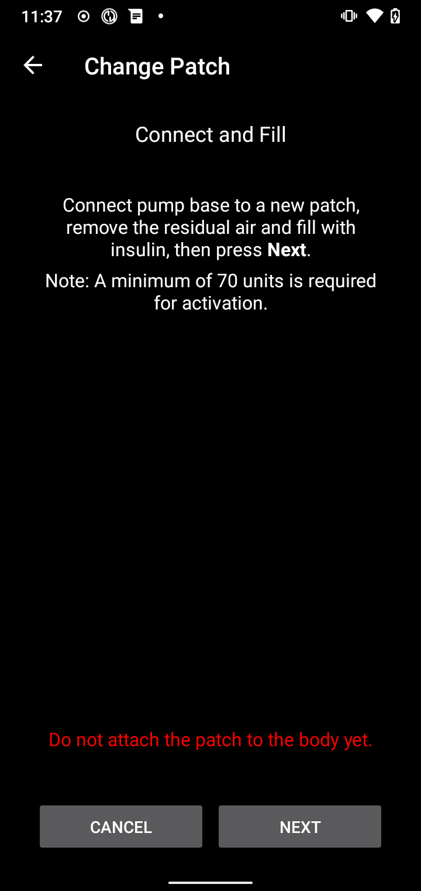
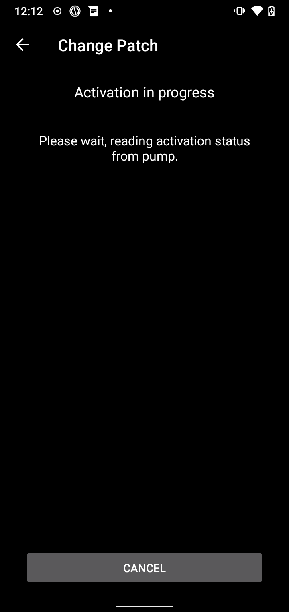

(medtrum-nano-300u)=
# Medtrum Nano 200U / 300U

Ces instructions sont pour la configuration de la pompe à insuline Medtrum.

```{contents} Table of contents
:depth: 1
:local: true
```

## Fonctionnalités de la pompe avec AAPS
* Toutes les fonctionnalités de boucle fonctionnent (SMB, DBT, etc.)
* Gestion automatique de l'heure d'été et du fuseau horaire
* Le bolus étendu n'est pas pris en charge par le pilote AAPS

## Configuration matérielle et logicielle requise
* **Base de pompe et réservoirs Medtrum compatibles**
    - Actuellement pris en charge 
        - Medtrum TouchCare Nano 200U avec les références de base de pompe  **MD0201** et **MD8201**.
        - Medtrum TouchCare 300U avec la référence de base de pompe : **MD8301**.
        - Si vous avez un modèle non pris en charge et êtes prêt à faire un don de matériel ou à participer aux tests, veuillez nous contacter via discord [ici](https://discordapp.com/channels/629952586895851530/1076120802476441641).
* **AAPS compilé et installé** en suivant les instructions de [Compilation d'AAPS](../SettingUpAaps/BuildingAaps.md).
* **Un téléphone Android compatible** avec une connexion Bluetooth BLE
    - Voir les [notes de version](../Maintenance/ReleaseNotes.md) d'AAPS

## Avant de commencer

**LA SÉCURITÉ AVANT TOUT** Ne faites pas cette procédure dans un environnement où vous ne pouvez pas corriger une erreur (des patchs de rechange, de l'insuline et des appareils de contrôle de la pompe sont indispensables).

**Le PDM et l'application Medtrum ne fonctionnent pas avec un patch activé par AAPS.** Avant, vous avez peut-être utilisé votre PDM ou l'application Medtrum pour envoyer des commandes à votre pompe. Pour des raisons de sécurité, vous ne pouvez utiliser le patch activé qu'avec le dispositif ou l'application qui a été utilisé pour l'activer.

*Cela ne signifie PAS que vous devez vous débarrasser de votre PDM. Il est recommandé de le garder rangé de côté, pour servir de solution de secours en cas d'urgence, par exemple si vous perdez votre téléphone ou si AAPS ne fonctionne pas correctement.*

**Votre pompe ne s'arrête pas de délivrer de l'insuline quand elle n'est pas connectée à AAPS** Les débits basaux par défaut sont programmés sur la pompe, comme définis dans le profil actif actuel. Tant qu'AAPS est opérationnel, il enverra des commandes de débit basal temporaire d'une durée de 120 minutes maximum. Si, pour une raison quelconque, la pompe ne reçoit pas de nouvelle commande (par exemple parce que la communication a été perdue en raison de la distance pompe - téléphone), la pompe reviendra au débit basal par défaut programmé sur la pompe une fois le débit basal temporaire terminé.

**Le profil AAPS ne prend pas en charge des débits basaux par plages de 30 minutes** Si vous débutez avec AAPS et réglez votre profil de débit basal pour la première fois, sachez que les débits basaux qui commencent à la demi-heure ne sont pas pris en charge. Vous devrez ajuster votre profil de débit basal pour qu'il commence à l'heure pile. Par exemple, si vous avez un débit de basal de 1,1 unités qui commence à 09h30 et a une durée de 2 heures se terminant à 11h30, cela ne marchera pas. Vous devrez déplacer ce débit basal de 1,1 unité sur une plage horaire de 9h00–11h00 ou de 10h00–12h00. Même si la pompe Medtrum elle-même prend en charge des débits basaux par pas de 30 min, AAPS n'est actuellement pas en mesure de les prendre en compte avec ses algorithmes.

**Les débits basaux de 0 U/h dans le profil ne sont PAS pris en charge dans AAPS** La pompe Medtrum accepte un débit basal de zéro, mais AAPS utilise des multiples du débit basal du profil pour décider des traitements automatiques. Il ne peut donc pas fonctionner avec un débit basal de zéro. Le débit basal minimum du profil est de 0,05 U/h.

Un débit basal temporaire de zéro est possible avec la fonction « Déconnecter la pompe , ou avec une combinaison de « Désactiver la Boucle  / débit basal temporaire ou de « Suspendre la boucle  / débit basal temporaire.

## Configuration

```{caution}
Quand vous activez un patch avec **AAPS**, vous **DEVEZ** éteindre tous les autres appareils qui peuvent communiquer avec la base de pompe Medtrum, par exemple un PDM actif ou l'application Medtrum.
```

### Étape 1 : Sélectionnez la pompe Medtrum

#### Option 1 : Nouvelles installations

Si vous installez **AAPS** pour la première fois, l'**Assistant de configuration** vous guide pendant la configuration. Choisissez **Medtrum** quand vous arrivez à l'étape **Pompe**.

En cas de doute, vous pouvez aussi choisir **Pompe virtuelle** et choisir **Medtrum** plus tard, après la configuration d'**AAPS** (voir l'option 2).


#### Option 2 : l'écran Configuration

Sur une installation existante, vous pouvez choisir la pompe **Medtrum** dans [Configuration > Pompe](#Config-Builder-pump) 

Ouvrez le **menu** en haut à gauche (☰), appuyez sur **Configuration** > **Pompe** et choisissez la carte **Medtrum**. Une seule pompe peut être active à la fois.


Une fois choisie, la carte **Medtrum** affiche deux boutons, **Paramètres** et **Ouvrir le plugin** 


**Ouvrir le plugin** (ou **Gestion → Pompe**) ouvre l'écran de la pompe Medtrum. Il sert à changer les patchs et à voir l'état de la pompe. Avant l'activation d'un patch, il ressemble à ceci 


(medtrum-step-2)=
### Étape 2 : Modifier les paramètres Medtrum

Appuyez sur **Paramètres** sur la carte **Medtrum** dans **Configuration** > **Pompe**. Vous pouvez aussi appuyer sur l'icône en forme d'engrenage en haut à droite de l'écran de la pompe Medtrum. Cela ouvre les **Paramètres de la pompe Medtrum** 


```{note}
Il n'y a plus de paramètre **Numéro de série**. **AAPS** trouve votre base de pompe par un scan Bluetooth la première fois que vous activez un patch (voir [Étape 3](#medtrum-activate-patch)) et retient son numéro de série. Pour utiliser une autre base de pompe, voir [Dissocier](#medtrum-unpair).
```

#### Paramètres d'Alarme

***Par défaut : Bip.***

Ce paramètre change la façon dont la pompe vous avertit en cas d'alerte ou d'erreur.

- **Bip**  le patch émet un bip lors des alarmes et des alertes.
- **Silencieux**  le patch ne vous avertit pas lors des alarmes et des alertes.

Remarque  en mode silencieux, **AAPS** déclenche quand même l'alarme, selon le réglage du volume de votre téléphone. Si vous ne réagissez pas à l'alarme, le patch finit par émettre un bip.

#### Notification sur l'alerte pompe

***Par défaut : Activé.***

Ce paramètre change la façon dont **AAPS** affiche les notifications pour les alertes non critiques de la pompe. Quand il est activé, une notification s'affiche sur le téléphone en cas d'alerte de la pompe, par exemple 
- Batterie faible
- Réservoir bas (20 unités)
- Le patch expire bientôt

Nous recommandons de le laisser activé quand les alarmes de la pompe sont réglées sur **Silencieux**. Dans les deux cas, ces alertes sont aussi affichées sur l'écran de la pompe Medtrum, sous [Alarmes actives](#medtrum-active-alarms).

(medtrum-patch-expiration)=
#### Expiration du Patch

***Par défaut : Activé.***

Ce paramètre modifie le comportement du patch. Quand il est activé, le patch expire après 3 jours et donne une alerte sonore si le son est activé. Après 3 jours et 8 heures, le patch s'arrête de fonctionner.

Si ce paramètre est désactivé, le patch ne vous avertit pas avant de s'arrêter. Avec un firmware récent de la base de pompe, un patch fonctionne au maximum 5 jours.

#### Avertissement d'expiration de la pompe [heures]

***Par défaut  72 heures.***

Ce paramètre change le moment de l'alerte d'expiration. Quand [Expiration du Patch](#medtrum-patch-expiration) est activé, **AAPS** affiche une notification ce nombre d'heures après l'activation.

#### Insuline maximale horaire [Unités]

***Par défaut  25U.***

Ce paramètre change la quantité maximale d'insuline qui peut être délivrée en une heure. Si cette limite est dépassée, le patch se suspend et donne une alarme. Vous pouvez réinitialiser l'alarme avec le bouton **Réinitialiser les alarmes** sur l'écran de la pompe, voir [Réinitialiser les alarmes](#nano-reset-alarms).

Réglez-le sur une valeur adaptée à vos besoins en insuline.

#### Insuline maximale quotidienne [Unités]

***Par défaut  80U.***

Ce paramètre change la quantité maximale d'insuline qui peut être délivrée en un jour. Si cette limite est dépassée, le patch se suspend et donne une alarme. Vous pouvez réinitialiser l'alarme avec le bouton **Réinitialiser les alarmes** sur l'écran de la pompe, voir [Réinitialiser les alarmes](#nano-reset-alarms).

Réglez-le sur une valeur adaptée à vos besoins en insuline.

#### Scanner en cas d'erreur de connexion

***Par défaut  Désactivé.***

Se trouve sous **Paramètres Avancés**.

Activez-le seulement si vous avez des problèmes de connexion. Quand il est activé, le pilote recherche à nouveau la pompe avant d'essayer de s'y reconnecter. Vérifiez que l'autorisation de localisation pour **AAPS** est réglée sur « Toujours autoriser .

### Étape 2b  Paramètres d'alerte d'AAPS

Ces paramètres ne font pas partie du pilote Medtrum. Ouvrez-les avec l'icône **Paramètres** (engrenage) en haut à droite de l'écran principal. Voir [Paramètres](../SettingUpAaps/Preferences.md) pour plus d'informations.

#### BT Watchdog

Ouvrez **Paramètres** > **Pompe** 


**BT Watchdog** éteint le Bluetooth du téléphone pendant une seconde si **AAPS** ne peut pas se connecter à la pompe. Cela peut aider sur certains téléphones où le Bluetooth se bloque.

Activez ce paramètre si vous avez souvent des problèmes de connexion avec votre pompe.

#### Alertes locales

Ouvrez **Paramètres** > **Alertes locales** 


##### Alerte si la pompe est hors de portée

***Par défaut : Activé.***

Ce paramètre est forcé à activé quand le pilote Medtrum est activé. Il vous avertit quand la pompe est hors de portée. Cela peut arriver quand la pompe est trop loin, ou quand elle ne répond pas à cause d'un patch ou d'une base de pompe défectueux, par exemple quand de l'eau s'infiltre entre la base de pompe et le patch.

Pour des raisons de sécurité, ce paramètre ne peut pas être désactivé.

##### Seuil d'alerte pompe hors de portée

***Par défaut  30 min.***

Ce paramètre change combien de temps **AAPS** attend avant de vous avertir que la pompe est hors de portée.

Vous pouvez changer ce paramètre avec la pompe Medtrum, mais nous recommandons de le garder à 30 minutes pour des raisons de sécurité.

(medtrum-activate-patch)=
### Étape 3  Activer le patch

**Avant de continuer **
- Préparez votre base de pompe Medtrum et un nouveau patch réservoir.
- Éteignez les autres appareils qui peuvent communiquer avec la pompe Medtrum (PDM et application Medtrum).
- Idéalement, vérifiez qu'**AAPS** est configuré et qu'un [profil est activé](../DailyLifeWithAaps/ProfileSwitch-ProfilePercentage.md). Si aucun profil n'est actif, l'activation commence par une étape **Profil nécessaire**, où vous choisissez le profil à activer.

#### Démarrer l'activation

Ouvrez l'[écran de la pompe Medtrum](#nano-overview) (**Gestion → Pompe**) et appuyez sur **Changer le Patch**. Si vous avez configuré la [protection des paramètres](#Preferences-protection), vous devez d'abord entrer votre mot de passe ou votre code PIN.

Si un patch est déjà actif, on vous demande d'abord de le désactiver, voir [Désactiver le patch](#nano-deactivate-patch).

L'activation est un assistant étape par étape. Suivez les instructions pour remplir et activer un nouveau patch. Appuyez sur **Annuler** à n'importe quelle étape pour arrêter.

```{important}
Ne posez le patch sur votre corps et n'insérez la canule que quand l'assistant vous le demande (après la fin de l'amorçage).
```

Les premières étapes que vous voyez dépendent de votre configuration 

1. **Profil nécessaire**  seulement si aucun profil n'est actif. Choisissez le profil à appliquer, puis continuez.
2. **Trouver la Pompe**  seulement la première fois, ou après avoir utilisé [Dissocier](#medtrum-unpair). Connectez la base de pompe à un patch neuf pour l'allumer. **AAPS** recherche les bases de pompe Medtrum proches (leur nom commence par `MT`). Appuyez sur la vôtre dans la liste. **AAPS** enregistre son numéro de série, puis passe directement au remplissage du patch.

   

3. **Activer le Patch**  seulement quand **AAPS** connaît déjà votre base de pompe. L'écran affiche « Aucun Patch actif. Appuyez sur **Suivant** pour commencer le processus d'activation.  Vérifiez que la base de pompe n'est **pas** encore connectée au patch, puis appuyez sur **Suivant**.


#### Connecter et remplir le patch



Connectez la base de pompe au patch, retirez l'air restant et remplissez le patch avec de l'insuline. Il faut au minimum 70 unités pour l'activation. L'écran affiche le niveau du réservoir. Ne fixez pas encore le patch sur votre corps.

Quand le patch est détecté et rempli, le bouton **Suivant** apparaît. Appuyez dessus.

#### Sélectionner l'insuline

Cette étape apparaît seulement si vous avez configuré plus d'une insuline dans **AAPS**. Choisissez l'insuline avec laquelle vous remplissez le patch. **AAPS** applique un changement de profil avec cette insuline après l'activation.

#### Amorcer le patch


Ne retirez **pas** le verrou de sécurité. Appuyez à moitié sur le bouton de l'aiguille du patch, puis appuyez sur **Suivant** pour démarrer l'amorçage.


Attendez la fin de l'amorçage.


Quand l'amorçage est terminé, appuyez sur **Suivant** pour continuer.

#### Rotation du site

Cette étape apparaît seulement si vous gérez les sites de pompe avec la [Rotation du site](#Aapsscreens-site-rotation) (paramètre **Gérer la rotation du site de la pompe**). Choisissez où vous placez le patch sur votre corps, ou passez cette étape.

#### Fixer le patch


Nettoyez la peau et retirez les autocollants. Retirez le verrou de sécurité, fixez le patch sur votre corps et appuyez sur le bouton de l'aiguille pour insérer la canule.

Appuyez sur **Suivant** pour activer le patch.

#### Activer le patch


**AAPS** active la pompe et règle le débit basal initial. Veuillez patienter. Quand l'activation est terminée, l'écran suivant apparaît 


```{admonition} Older screenshot
:class: note
À part **Trouver la Pompe**, les captures d'écran de l'activation ci-dessus viennent d'une ancienne version d'**AAPS** et peuvent être différentes dans **AAPS** 4.
```

Il affiche combien d'unités restent dans le patch. Appuyez sur **OK** pour revenir à l'écran de la pompe.

```{tip}
Après une nouvelle activation, [exportez vos paramètres](../Maintenance/ExportImportSettings.md). Cela vous permet de récupérer cette session de patch plus tard, par exemple sur un nouveau téléphone.
```

(nano-deactivate-patch)=

### Désactiver le patch

Pour désactiver le patch actif, ouvrez l'[écran de la pompe Medtrum](#nano-overview) (**Gestion → Pompe**) et appuyez sur **Changer le Patch**.


On vous demande de confirmer que vous voulez désactiver le patch actuel. **Cette action est définitive.** Appuyez sur **Suivant** pour désactiver, ou sur **Annuler** pour revenir à l'écran de la pompe.


Si **AAPS** ne peut pas désactiver le patch (par exemple parce que la base de pompe a déjà été retirée du patch), appuyez sur **Supprimer** pour oublier la session de patch actuelle. Vous pouvez ensuite activer un nouveau patch.


Quand la désactivation est terminée, rétractez l'aiguille et retirez le patch de votre corps. Retirez la base de pompe et jetez le patch usagé. Appuyez sur **OK** pour revenir à l'écran de la pompe, ou sur **Suivant** pour commencer à activer un nouveau patch.

(nano-resume-interrupted-activation)=

### Reprendre une activation interrompue

Si l'activation d'un patch est interrompue, par exemple parce que la batterie du téléphone est vide, vous pouvez la reprendre. Ouvrez l'[écran de la pompe Medtrum](#nano-overview) (**Gestion → Pompe**) et appuyez sur **Changer le Patch**.


Appuyez sur **Suivant** pour reprendre l'activation. Appuyez sur **Supprimer** pour réinitialiser l'état d'activation, afin de pouvoir activer un nouveau patch.



```{admonition} Older screenshot
:class: note
Les captures d'écran de **Désactiver le patch** et **Reprendre une activation interrompue** viennent d'une ancienne version d'**AAPS** et peuvent être différentes dans **AAPS** 4.
```

Le pilote lit l'état d'activation dans la pompe. Si cela fonctionne, l'assistant reprend à l'étape où il s'était arrêté.

(nano-overview)=

## Écran de la pompe

L'écran de la pompe Medtrum (**Gestion → Pompe**) affiche l'état actuel du patch Medtrum. Il a aussi des boutons pour changer le patch, réinitialiser les alarmes et actualiser l'état. Un bandeau en haut affiche les états importants, par exemple **Patch non activé** ou **La pompe est suspendue**.


L'écran peut afficher les lignes suivantes. Certaines lignes n'apparaissent que quand elles ont une valeur.

- **Dernière connexion**  il y a combien de temps **AAPS** s'est connecté à la pompe pour la dernière fois.
- **Dernier bolus**  le dernier bolus délivré.
- **Pile**  la tension actuelle de la pile du patch.
- **Réservoir**  le niveau actuel du réservoir.
- **Numéro de série**  le numéro de série de votre base de pompe.
- **État de la pompe**  l'état actuel de la pompe. Par exemple **Actif** (le patch est activé et fonctionne normalement) ou **Arrêté** (le patch n'est pas activé).
- **Débit de basal**  le débit basal de votre profil qui est en cours.
- **Basal Temp**  le débit basal temporaire, s'il y en a un en cours.
- **Bolus actif**  le bolus qui est délivré en ce moment.
- **Alarmes actives**  voir [ci-dessous](#medtrum-active-alarms).
- **Type de pompe**  le modèle de votre base de pompe.
- **Version du FW**  la version du firmware de la base de pompe.
- **N° du Patch**  le numéro de séquence du patch activé. Il augmente de un chaque fois que vous activez un nouveau patch.
- **Activation**  la date et l'heure d'activation du patch, et depuis combien de temps.
- **Expiration du Patch**  la date et l'heure d'expiration du patch. Affiche **Non activé** si [Expiration du Patch](#medtrum-patch-expiration) est désactivé.

(medtrum-active-alarms)=
### Alarmes actives

Cette ligne affiche les alarmes actives en ce moment, par exemple un réservoir bas ou un patch qui expire.

### Actualiser

Ce bouton actualise l'état du patch. Il est disponible seulement quand un patch est actif et qu'**AAPS** n'est pas connecté à la pompe à ce moment.

### Changer le Patch

Ce bouton démarre l'assistant de changement de patch. Voir [Activer le patch](#medtrum-activate-patch) pour plus d'informations.

(medtrum-unpair)=
### Dissocier

Ce bouton apparaît seulement quand **AAPS** connaît une base de pompe. Il efface le numéro de série enregistré de la base de pompe et se déconnecte. La prochaine fois que vous activez un patch, **AAPS** recherche à nouveau une base de pompe (l'étape **Trouver la Pompe**). Utilisez-le si vous passez à une autre base de pompe. Faites-le seulement quand aucun patch n'est actif.

(nano-reset-alarms)=

### Réinitialiser les alarmes

Le bouton **Réinitialiser les alarmes** n'apparaît sur l'écran de la pompe que quand le patch s'est suspendu lui-même, par exemple après une alarme d'insuline maximale quotidienne. Appuyez dessus pour réinitialiser les alarmes et reprendre l'administration d'insuline.


```{admonition} Older screenshot
:class: note
La capture d'écran ci-dessus vient d'une version plus ancienne d'**AAPS**. Dans **AAPS** 4, l'écran de la pompe est différent, mais le bouton **Réinitialiser les alarmes** fonctionne de la même façon.
```

## Changer de téléphone, exporter/importer les paramètres

Quand vous passez à un nouveau téléphone, faites ceci 
* [Exportez les paramètres](../Maintenance/ExportImportSettings.md) sur votre ancien téléphone.
* Transférez le fichier de paramètres de l'ancien téléphone vers le nouveau, et importez-le dans **AAPS**. Cochez **Remplacer aussi les paramètres de pompe** sur l'écran d'importation, sinon la session de patch n'est pas transférée sur le nouveau téléphone.

Le fichier de paramètres importé doit venir de la session de patch que vous utilisez maintenant, sinon le patch ne se connectera pas (voir [Pompes sans tubulure](#ExportImportSettings-tubeless-pumps)).

Après une importation des paramètres, le pilote synchronise l'historique avec la pompe. Cela peut prendre du temps, selon l'âge du fichier de paramètres. La progression (« Synchronisation des enregistrements, ... restant ) est affichée sur l'écran principal 


(medtrum-nano-troubleshooting)=

## Dépannage

### Problèmes de connexion

Si vous avez des délais de connexion dépassés ou d'autres problèmes de connexion 
- Dans les paramètres de l'application Android pour **AAPS**, réglez l'autorisation de localisation sur « Toujours autoriser .
- Essayez d'activer **Scanner en cas d'erreur de connexion** (Paramètres Medtrum > **Paramètres Avancés**) et **BT Watchdog** (**Paramètres** > **Pompe**), voir [Étape 2](#medtrum-step-2).

### Problèmes Bluetooth
Pour les problèmes connus de connexion Bluetooth, de pertes de connexion avec la pompe/les pods, ou d'activation et de connexion, voir [Dépannage Bluetooth](../GettingHelp/BluetoothTroubleshooting.md)

### Activation interrompue

Si l'activation est interrompue, par exemple par une batterie de téléphone vide ou un plantage du téléphone, vous pouvez la reprendre. Appuyez sur **Changer le Patch** sur l'écran de la pompe et suivez les étapes de [Reprendre une activation interrompue](#nano-resume-interrupted-activation).

### Éviter les erreurs du patch

Le patch peut donner différentes erreurs. Pour éviter des erreurs fréquentes 
- Vérifiez que la base de pompe est bien en place dans le patch et qu'aucun espace n'est visible.
- Quand vous remplissez le patch, n'appuyez pas trop fort sur le piston. N'essayez pas de remplir le patch au-delà du maximum prévu pour votre modèle.

## Où obtenir de l'aide

Tout le travail de développement du pilote Medtrum est fait par la communauté, de manière **bénévole**. Merci de vous en souvenir et de suivre les règles ci-dessous avant de demander de l'aide 

-  **Niveau 0 :** Lisez la section correspondante de cette documentation pour vous assurer que vous comprenez comment la fonctionnalité avec laquelle vous avez des difficultés est censée fonctionner.
-  **Niveau 1 ** Si vous avez encore des problèmes que vous ne pouvez pas résoudre avec ce document, allez sur le canal *#Medtrum* sur **Discord** avec [ce lien d'invitation](https://discord.gg/4fQUWHZ4Mw).
-  **Level 2:** Search existing issues to see if your issue has already been reported at [Issues](https://github.com/nightscout/AAPS/issues). If it exists, please confirm/comment/add information on your problem. Sinon, créez un [nouveau problème (issue)](https://github.com/nightscout/AndroidAPS/issues) et joignez [vos fichiers log](../GettingHelp/AccessingLogFiles.md).
-  **Soyez patient - la plupart des membres de notre communauté sont des bénévoles de bonne nature, et résoudre les problèmes nécessite souvent du temps et de la patience de la part des utilisateurs et des développeurs.**