# Omnipod Eros

These instructions are for configuring the Omnipod Eros generation pump (**NOT Omnipod Dash**).

```{admonition} Omnipod Eros is being phased out
:class: note

The [Omnipod System](https://www.omnipod.com/current-podders/resources/omnipod-system) (the original Omnipod, comprising both the Personal Diabetes Manager (PDM) and the Pod) is being discontinued, and the end date varies by country. For example, it will no longer be available in Canada after 30 June 2026. If you rely on the Eros pump, plan ahead for a transition to a supported pump.
```

**Ce logiciel est une partie d'un système de pancréas artificiel "Do it yourself" (faire soi-même), et ce n’est pas un produit fini destiné à la mise sur le marché. VOUS devez obligatoirement lire, apprendre et comprendre ce système, y compris la façon de l’utiliser. Attention, vous êtes le seul responsable de ce que vous faite avec ce système.**

```{contents} Table of contents
:depth: 1
:local: true
```

## Configuration matérielle et logicielle requise

- **Périphérique de communication Pod**

> Composant qui permet la communication entre votre téléphone avec AAPS et les Pods de génération Eros.
> 
> > -   [Site internet OrangeLink](https://getrileylink.org/product/orangelink)
> > -  [RileyLink 433MHz](https://getrileylink.org/product/rileylink433)
> > -   [Site internet Emalink](https://github.com/sks01/EmaLink) - [Contact](mailto:getemalink@gmail.com)
> > -   DiaLink - [Contact](mailto:Boshetyn@ukr.net)
> > -   [Site internet LoopLink](https://www.getlooplink.org/) - [Contact](https://jameswedding.substack.com/) - Non testé

-   **Téléphone Mobile**

> Composant qui utilisera AAPS et enverra des commandes de contrôle au périphérique de communication Pod.
> 
> > - Supported [Android phone](#Phones-list-of-tested-phones) with **AAPS** and related components set up.

-   **Dispositif d'injection d'Insuline**

> Composant qui interprétera les commandes reçues du périphérique de communication Pod en provenance de votre téléphone AAPS.
> 
> > - Un nouveau pod Omnipod (génération Eros - **PAS DASH**)

These instructions assume that you are starting a new pod session. If this is not the case, please be patient and start this process at your next pod change.

In this page, **RileyLink** means any of the pod communication devices listed above.

## Avant de commencer

**SÉCURITÉ D'ABORD** - ne pas essayer ce processus dans un environnement où vous ne pouvez pas récupérer une erreur (pods supplémentaires, insuline, RileyLink chargé et les smartphones sont nécessaires).

**Votre PDM Omnipod ne fonctionnera plus après l'activation de votre pod par le driver AAPS Omnipod**. Vous avez précédemment utilisé votre PDM Omnipod pour envoyer des commandes à votre pod Omnipod Eros. Un pod Omnipod Eros ne permet qu'à un seul appareil de la communiquer avec lui. The device that successfully activates the pod is the only device allowed to communicate with it from that point forward. Cela signifie qu'une fois que vous activez un pod Omnipod Eros avec votre RileyLink via le pilote AAPS Omnipod, **vous ne pourrez plus utiliser votre PDM avec votre pod**. Le pilote AAPS Omnipod avec le RileyLink est maintenant votre PDM. *Cela ne veut pas dire que vous pouvez jeter votre PDM, il est recommandé de le garder comme une sauvegarde, et en cas d'urgence si jamais AAPS ne fonctionnait pas correctement.*

**Only one RileyLink at a time can communicate with a pod.** **AAPS** remembers one paired RileyLink. If you pair a different one, it replaces the previous one.

**Votre pod ne s'arrêtera pas lorsque le RileyLink sera hors de portée.** Lorsque votre RileyLink est hors de portée ou que le signal est bloqué pour communiquer avec le pod actif, votre pod continuera à injecter l'insuline basale. Lors de l'activation d'un pod, le profil basal défini dans AAPS sera programmé dans le nouveau pod. Si vous perdez le contact avec le pod, il retournera à ce profil de basal. Vous ne serez pas en mesure d'émettre de nouvelles commandes tant que le RileyLink ne reviendra pas à portée et qu'il n'aura pas à nouveau rétablit la connexion.

**Les profils de débit de base de 30 min ne sont PAS pris en charge dans AAPS.** Si vous êtes nouveau sur AAPS et que vous configurez votre profil de débit de basal pour la première fois, veuillez noter que les débits de basal commençant par une demi-heure ne sont pas pris en charge et que vous devrez ajuster votre profil de débit de basal pour démarrer sur les heures. Par exemple, si vous avez un débit de basal de 1,1 unités qui commence à 09h30 et a une durée de 2 heures se terminant à 11h30, cela ne marchera pas.  Vous devrez mettre à jour ce taux de basal de 1,1 soit sur une plage horaire de 9h00 à 11h00 soit de 10h00 à 12h00.  Même si les changements de débit de basal du profil toutes les 30 min sont supportés par le matériel Omnipod lui-même, AAPS n'est pas en mesure de les prendre en compte avec ses algorithmes actuellement.

## Activation du pilote Omnipod dans AAPS

Vous pouvez activer le pilote Omnipod dans AAPS de **deux façons**:

### Option 1 : L'Assistant de configuration

After installing a new version of AAPS, the **Setup Wizard** starts automatically. If you have already exported your settings from a previous installation, you can import them in the wizard. For new installations, continue below.

Go through the [Setup Wizard](../SettingUpAaps/SetupWizard.md) until you reach the **Pump** step, then select **Omnipod Eros** (the description reads "Pump integration for Omnipod Eros").


The Setup Wizard does not pair your RileyLink. After finishing the wizard, open the Omnipod pump screen and pair it as described in the [RileyLink Setup section](#OmnipodEros-rileylink-setup).

**OU**

### Option 2: The Configuration screen

Open the top-left **menu** (☰) > **Configuration** > **Pump** and select the **radio button** of **Omnipod Eros**.

Once it is selected, the **Omnipod Eros** card shows two buttons, **Settings** and **Open plugin**:


**Settings** opens the settings of the Omnipod driver (see [Omnipod Settings](#OmnipodEros-omnipod-settings)):


**Open plugin** opens the Omnipod pump screen. You can also open it at any time from the main screen with **Manage** > **Pump**. This page calls it the **Omnipod pump screen**. Before a RileyLink is paired and a pod is activated, it looks like this:


### Verification of Omnipod Driver Selection

To verify that you have enabled the Omnipod driver, open **Manage** > **Pump** from the main screen. You should see the **Omnipod Eros** pump screen shown above. If you have not paired a RileyLink yet, **RileyLink Status** shows **Not Started** and **Pod Status** shows **No Active Pod**.

## Configuration Omnipod

All pod and RileyLink functions are buttons on the [Omnipod pump screen](#OmnipodEros-omnipod-pod-tab) (**Manage** > **Pump**). Some buttons only appear in certain situations, for example when a pod is active.

>  Rafraîchir la connectivité et l'état du Pod
> 
>  Gestion du Pod (activer, désactiver, tester les bips, stats du RileyLink et historique du Pod)

```{admonition} Older screenshot
:class: note
The screenshots above are from an earlier **AAPS** version. In **AAPS** 4 there is no **POD MGMT** button or Pod Management menu: **Refresh** and all pod management actions are buttons on the Omnipod pump screen.
```

(OmnipodEros-rileylink-setup)=

### Configuration RileyLink

If you have already paired your RileyLink, continue to the [Activating a Pod section](#OmnipodEros-activating-a-pod) below.

*Note: A good visual indicator that the RileyLink is not connected is that the treatment buttons (QuickLaunch toolbar) on the main screen will be missing. Cela se produira également pendant environ les 30 premières secondes après le démarrage d'AAPS, car il se connecte activement au RileyLink.*

1. Make sure that your RileyLink is fully charged and powered on.

2. Place the RileyLink [close to your phone](#OmnipodEros-optimal-omnipod-and-rileylink-positioning) (~30 cm away or less).

3. Open the Omnipod pump screen (**Manage** > **Pump**) and press **Pair RileyLink**.

4. The **Pair RileyLink** screen starts scanning for Bluetooth devices right away. Tap your RileyLink in the list of found devices.

   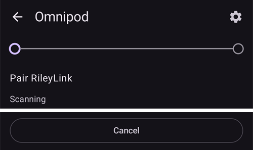

5. When **RileyLink paired successfully** is shown with the name and address of your device, press **OK**.

6. Back on the Omnipod pump screen, check that **RileyLink Status** changes to **Connected**. **Pod Status** should show **No Active Pod**. If the RileyLink does not connect, press **Reset RileyLink**, or restart **AAPS**.

 

 


```{admonition} Older screenshot
:class: note
The six screenshots above (after step 6) are from an earlier **AAPS** version. In **AAPS** 4 you pair the RileyLink with the **Pair RileyLink** button on the Omnipod pump screen instead of **RileyLink Configuration** in the Omnipod settings, and scanning starts automatically.
```

```{note}
To switch to another RileyLink (for example a backup device), press **Pair RileyLink** again and select the new device. It replaces the one paired before. You do not need to remove the old device first.
```

(OmnipodEros-activating-a-pod)=

### Activation d’un Pod

Before you can activate a pod, make sure your RileyLink is paired and **RileyLink Status** shows **Connected**. The **Activate Pod** button stays disabled until the RileyLink is ready.

*RAPPEL : La communication avec le Pod pour l'activation de celui-ci se fait sur des périodes limitées pour des raisons de sécurité. Avant d'être appairé le signal radio du Pod est plus faible, mais après l'appairage, il fonctionnera à pleine puissance. During these procedures, make sure that your pod is* [within close proximity](#OmnipodEros-optimal-omnipod-and-rileylink-positioning) *(~30 cm away or less) but not on top of or right next to the RileyLink.*

01. Open the Omnipod pump screen (**Manage** > **Pump**) and press **Activate Pod**.

    If you have never activated a profile, a **Profile required** step appears first. Select the profile to apply on activation.

    >   
    > 
    > ```{admonition} Older screenshot
    >     :class: note
    >     The screenshots above are from an earlier **AAPS** version. In **AAPS** 4 **Activate Pod** is a button on the Omnipod pump screen instead of in the **POD MGMT** menu.
    > ```

02. L'écran **Remplir le pod** s'affiche. Fill a new pod with enough insulin for 3 days and listen for two beeps. They mean that the minimum amount of 80 units has been filled. Empty the fill syringe completely, even after hearing the two beeps. Lors du calcul de la quantité totale d'insuline dont vous avez besoin pendant 3 jours, veuillez prendre en compte que l'amorçage du pod utilisera de 12 à 15 unités. Do not remove the pod's needle cap yet.

    > 
    > 
    > Ensure the new pod and RileyLink are within close proximity of each other (~30cm or less) and press **Next**.

03. **Select Insulin** (only shown if you have more than one insulin configured): select the insulin you are filling the pod with and press **Next**. A profile switch with this insulin is applied after activation.

04. Sur l'écran **Initialiser le Pod** le pod commencera à amorcer (vous entendrez un clic suivi d'une série de tics pendant que le pod s'amorce). Si le RileyLink est hors de portée du pod en cours d'activation, vous recevrez un message d'erreur **Aucune réponse du Pod**. If this occurs, [move the RileyLink closer](#OmnipodEros-optimal-omnipod-and-rileylink-positioning) (~30 cm away or less) to but not on top of or right next to the Pod and press **Retry**.

    >  

05. When priming is successful, a green checkmark is shown and the **Next** button becomes enabled. Press **Next**.

    > 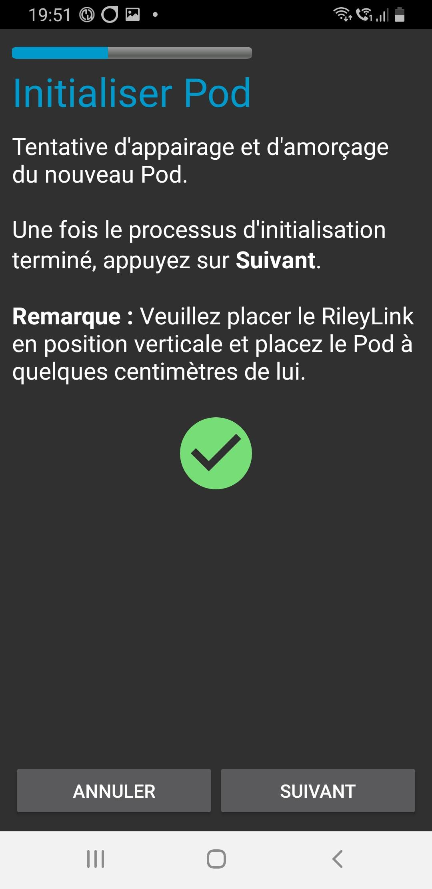

06. **Site location** (only shown if **Manage pump site rotation** is enabled in [Site Rotation](#Aapsscreens-site-rotation)): select where you place the pod on your body and press **Next**.

07. The **Attach Pod** screen is displayed. Prepare the infusion site of the new pod. Remove the pod's plastic needle cap and white paper backing from the adhesive and apply the pod to your chosen site on your body. If the cannula sticks out, press **Cancel** and discard the pod. When finished, press **Next**.

    > 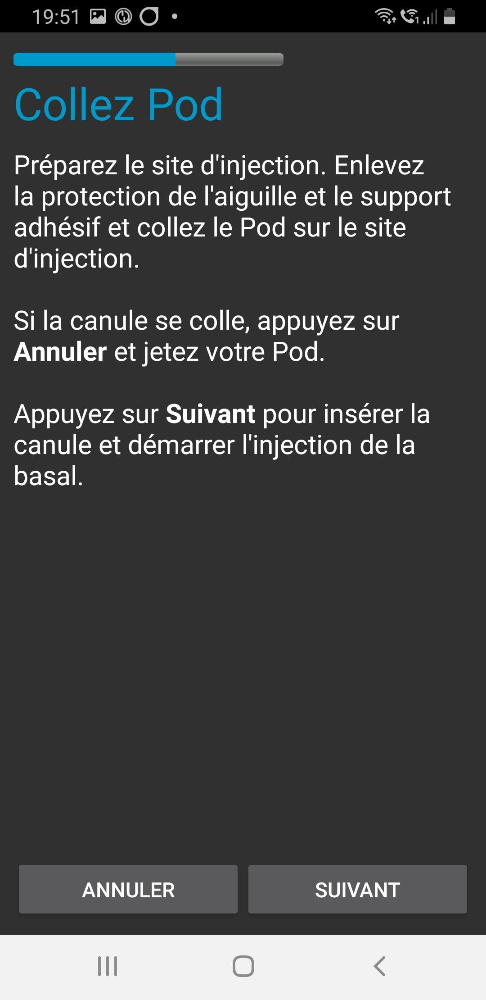

08. A confirmation dialog appears: "When you press OK, the cannula will be inserted". **ONLY press OK if you are ready to deploy the cannula**.

    > 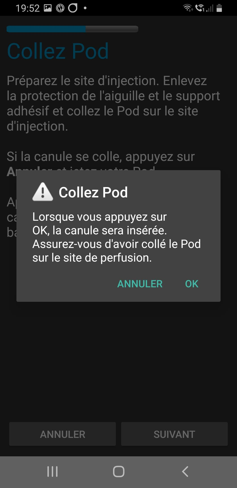

09. On the **Insert Cannula** screen, it may take some time before the Omnipod responds and inserts the cannula (1-2 minutes maximum), so be patient.

    > Si le RileyLink est hors de portée du pod en cours d'activation, vous recevrez un message d'erreur **Aucune réponse du Pod**. If this occurs, move the RileyLink closer (~30 cm away or less) to but not on top of or right next to the Pod and press **Retry**.
    > 
    > Si le RileyLink est hors de portée Bluetooth ou n'a pas de connexion active avec le téléphone, vous recevrez un message d'erreur **Pas de réponse du RileyLink**. If this occurs, move the RileyLink closer to the phone and press **Retry**.
    > 
    > *REMARQUE : Avant d'insérer la canule, il est recommandé de pincer la peau près du point d'insertion de la canule. Cela permet une insertion en douceur de l'aiguille et réduira les risques d'occlusions.*
    > 
    > 
    > 
    >  

10. Une coche verte s'affiche, et le bouton **Suivant** est activé en cas d'insertion de canule réussie. Press **Next**.

    > 

11. The **Pod Activated** screen is displayed. Check that the cannula has been inserted correctly, and change your pod if you think it has not. Press **Finish**. Félicitations ! Vous avez démarré une nouvelle session de Pod actif.

    >  
    > 
    > ```{admonition} Older screenshot
    >     :class: note
    >     The screenshots in steps 2 to 11 are from an earlier **AAPS** version and may look different in **AAPS** 4. The **Select Insulin** and **Site location** steps are not pictured.
    > ```

12. You are returned to the Omnipod pump screen. The **Activate Pod** button is replaced by **Deactivate Pod**, because you cannot activate another pod without deactivating the active one first.

    The pump screen now shows information about your active pod, including the current basal rate, reservoir level, insulin delivered, pod errors and alerts. For more details, see the [Omnipod pump screen](#OmnipodEros-omnipod-pod-tab) section.

     

    ```{admonition} Older screenshot
    :class: note
    The screenshots above are from an earlier **AAPS** version. In **AAPS** 4 there is no Pod Management menu: you return directly to the Omnipod pump screen, where **Deactivate Pod** replaces **Activate Pod**.
    ```

```{note}
If activation was interrupted after priming (for example the app was closed), press **Activate Pod** again. The wizard continues from the cannula insertion steps.
```

### Désactivation du Pod

En utilisation normale, la durée de vie d'un pod est de l'ordre de trois jours (72 heures) et de 8 heures supplémentaires après l'expiration du pod soit un total de 80 heures d'utilisation du pod.

To deactivate a pod (either from expiration or from a pod failure):

1. Open the Omnipod pump screen (**Manage** > **Pump**) and press **Deactivate Pod**.

   >   
   > 
   > ```{admonition} Older screenshot
   >    :class: note
   >    The screenshots above are from an earlier **AAPS** version. In **AAPS** 4 **Deactivate Pod** is a button on the Omnipod pump screen instead of in the **POD MGMT** menu.
   > ```

2. On the **Deactivate Pod** screen, first make sure the RileyLink is in close proximity to the pod but not on top of or right next to the pod. Then press **Next**. A dialog asks *A deactivated Pod can not be used again. Deactivate this Pod now?* Press **OK** to start deactivating the pod, or **Cancel** to keep it. Deactivation suspends all insulin delivery and cannot be undone.

   > 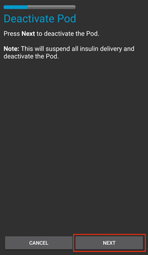

3. The **Deactivating Pod** screen appears, and you will receive a confirmation beep from the pod that deactivation was successful.

   > 
   > 
   > **IF deactivation fails** and you do not receive a confirmation beep, you may receive a **No response from RileyLink** or **No response from Pod** message. Press **Retry** to attempt deactivation again. If deactivation keeps failing, press **Discard Pod** and confirm. **AAPS** then forgets the pod. Insulin delivery has **not** been suspended, so remove the pod from your body. If your pod has a screaming alarm, you may need to silence it manually (using a pin or a paperclip), because **Discard Pod** does not silence it.
   > 
   > >   

4. A green checkmark appears when deactivation is successful. Press **Next** to display the **Pod Deactivated** screen. Vous pouvez maintenant supprimer votre pod car la session active a été désactivée.

   > 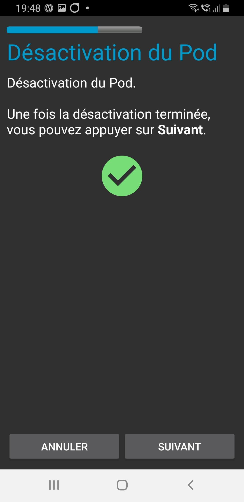

5. Press **Finish** to return to the Omnipod pump screen.

   >  
   > 
   > ```{admonition} Older screenshot
   >    :class: note
   >    The screenshots in steps 2 to 5 are from an earlier **AAPS** version and may look different in **AAPS** 4.
   > ```

6. On the Omnipod pump screen, check that **RileyLink Status** shows **Connected** and **Pod Status** shows **No Active Pod**.

   >    
   > 
   > ```{admonition} Older screenshot
   >    :class: note
   >    The screenshots above are from an earlier **AAPS** version. In **AAPS** 4 **Finish** returns you directly to the Omnipod pump screen; there is no Pod Management menu or **Omnipod (POD)** tab.
   > ```

### Suspendre et reprendre l'injection d'Insuline

The process below shows you how to suspend and resume insulin delivery.

*NOTE - if you do not see a **Suspend** button*, it is hidden by default. Enable **Show Suspend Delivery button in Omnipod tab** in the [Omnipod settings](#OmnipodEros-omnipod-settings) under **Other**.

#### Suspendre l'injection d’Insuline

Utilisez cette commande pour placer le pod actif dans un état suspendu. Dans cet état suspendu, la pod n'injectera plus aucune insuline. Cette commande imite la fonction de suspension que le PDM Omnipod d'origine envoie à un pod actif.

1. Open the Omnipod pump screen (**Manage** > **Pump**) and press **Suspend**. The suspend command is sent through the RileyLink to the active pod.

2. When the pod has suspended all insulin delivery, **Pod Status** shows **Suspended** and the **Suspend** button is replaced by **Resume Delivery**.

   >  
   > 
   > 
   > 
   >  
   > 
   > ```{admonition} Older screenshot
   >    :class: note
   >    The screenshots above are from an earlier **AAPS** version. In **AAPS** 4 these steps take place on the Omnipod pump screen instead of the **Omnipod (POD)** tab, and the result is shown in **Pod Status**.
   > ```

If the command fails, a **Warning** dialog shows "Failed to suspend delivery" with the reason. Check the RileyLink connection and try again.

#### Resuming Insulin Delivery

Use this command to instruct the active, currently suspended pod to resume insulin delivery. After the command is successfully processed, insulin will resume normal delivery using the current basal rate based on the current time from the active basal profile. The pod will again accept commands for bolus, TBR, and SMB.

1. Open the Omnipod pump screen and check that **Pod Status** shows **Suspended**. Press **Resume Delivery**.

2. When the command succeeds, **Pod Status** shows **Running** again and the **Resume Delivery** button disappears (the **Suspend** button is shown again if you have enabled it).

   > 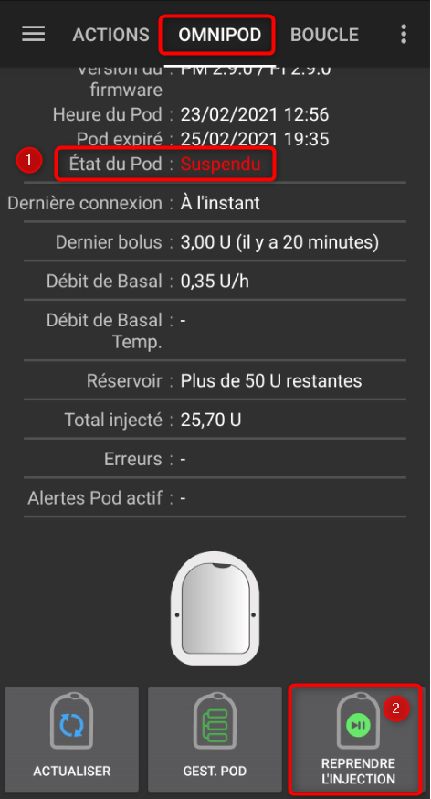 
   > 
   > 
   > 
   >  
   > 
   > ```{admonition} Older screenshot
   >    :class: note
   >    The screenshots above are from an earlier **AAPS** version. In **AAPS** 4 these steps take place on the Omnipod pump screen instead of the **Omnipod (POD)** tab, and the result is shown in **Pod Status**.
   > ```

If the command fails, a **Warning** dialog shows "Failed to resume delivery" with the reason. Check the RileyLink connection and try again.

### Silencing Pod Alerts

*NOTE - The **Silence Alerts** button is only shown on the Omnipod pump screen while the pod has an active alert (for example the pod expiration or low reservoir alert), and only if **Automatically silence Pod alerts** is disabled.*

The process below shows you how to silence pod beeps that start when the pod reaches the warning time before it expires. This warning time is set with **Alert at hours before shutdown (80 Hours)** in the Omnipod **Alerts** settings. La durée de vie maximale d'un pod est de 80 heures (3 jours 8 heures), cependant Insulet recommande de ne pas dépasser la limite de 72 heures (3 jours).

*NOTE - If you have enabled **Automatically silence Pod alerts** in the Omnipod **Alerts** settings, **AAPS** silences the alert automatically at the next communication with the pod, and you do NOT need to do it manually.*

1. When the warning time is reached, the pod beeps to tell you that it will soon expire and needs to be changed. On the Omnipod pump screen, **Pod Expires** shows the exact time the pod expires (72 hours after activation); it turns **yellow** 4 hours before. **Pod Hard End** shows when the pod stops delivering insulin. **Active Pod Alerts** shows **Pod will expire soon**, and the **Silence Alerts** button appears. **AAPS** also shows a notification about the upcoming pod expiration.

   >   
   > 
   > ```{admonition} Older screenshot
   >    :class: note
   >    The screenshots above are from an earlier **AAPS** version. In **AAPS** 4 the **ACK ALERTS** button is called **Silence Alerts** and is on the Omnipod pump screen.
   > ```

2. Press **Silence Alerts**. The RileyLink sends the command to the pod to stop the expiration warning beeps.

   >  
   > 
   > ```{admonition} Older screenshot
   >    :class: note
   >    The screenshot above is from an earlier **AAPS** version. In **AAPS** 4 the button is called **Silence Alerts**.
   > ```

3. When the alerts are silenced, the pod beeps twice. **Active Pod Alerts** no longer shows the warning, the **Silence Alerts** button disappears and the pod stops its expiration warning beeps.

   >  
   > 
   > ```{admonition} Older screenshot
   >    :class: note
   >    The screenshot above is from an earlier **AAPS** version. In **AAPS** 4 the result is shown on the Omnipod pump screen: the warning disappears from **Active Pod Alerts**.
   > ```

If the command fails (for example the RileyLink is out of range of the pod), a **Warning** dialog shows "Failed to silence alerts" with the reason. Move the RileyLink closer to the pod and try again.


```{admonition} Older screenshot
:class: note
The screenshot above is from an earlier **AAPS** version. In **AAPS** 4 the **Warning** dialog shows "Failed to silence alerts" with the reason.
```

(OmnipodEros-view-pod-history)=

### View Pod History

This section shows you how to review your active pod history and filter by different action categories. L'outil historique du pod vous permet de visualiser les actions et résultats effectués dans votre pod actuellement actif pendant sa durée de vie de trois jours (72 à 80 heures).

Cette fonction est utile pour vérifier les bolus, les DBT, les changements de basal qui ont été donnés, mais vous pouvez ne pas être sûr qu'ils soient terminés. Les catégories restantes sont utiles en général pour résoudre les problèmes et déterminer l'ordre des événements qui ont conduit à un échec.

*REMARQUE :* Les commandes **incertaines** apparaîtront dans l'historique du pod, cependant en raison de leur nature, vous ne pouvez pas être sûr de leur exactitude.

1. Open the Omnipod pump screen (**Manage** > **Pump**) and press **Pod History**.

   > 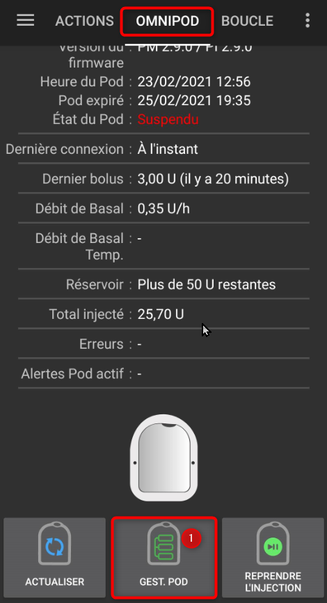 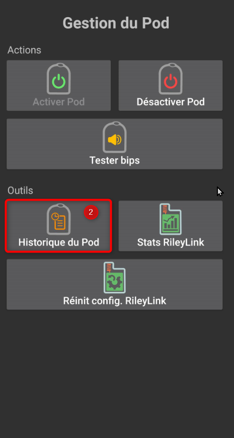 
   > 
   > ```{admonition} Older screenshot
   >    :class: note
   >    The screenshots above are from an earlier **AAPS** version. In **AAPS** 4 **Pod History** is a button on the Omnipod pump screen instead of in the **POD MGMT** menu.
   > ```

2. The **Pod History** screen lists all pod actions and their results, newest first, grouped by day. By default **All** is selected. Tap one of the filter buttons at the top to show only one category. Use the back arrow at the top left to return to the Omnipod pump screen.

   > 

   >  
   > 
   > ```{admonition} Older screenshot
   >    :class: note
   >    The second screenshot is from an earlier **AAPS** version and may look different in **AAPS** 4.
   > ```

### Voir les paramètres et l'historique du RileyLink

The **RileyLink Stats** screen shows the settings of your RileyLink and active pod, and the communication history of both. It has two tabs: **Settings** and **History**.

The **RileyLink Stats** button is hidden by default. To show it on the Omnipod pump screen, enable **Show RileyLink Stats button in Pod Management menu** in the [Omnipod settings](#OmnipodEros-omnipod-settings) under **Other**.

#### Réétablir manuellement la communication Bluetooth du périphérique de communication Pod

If your pod communication device was out of Bluetooth range of your phone for a while, **RileyLink Status** may report **RileyLink unreachable** on the Omnipod pump screen. **AAPS** normally reconnects by itself when the device is back in range. If it does not:

1. Make sure the RileyLink is powered on, charged and close to your phone.

2. On the Omnipod pump screen, press **Reset RileyLink**. A message confirms **RileyLink configuration reset**. See the [Reset RileyLink notes](#OmnipodEros-reset-rileylink-config-notes) below.

3. Si la **Connexion Bluetooth** ne se rétablit pas, essayez de **désactiver** manuellement le Bluetooth de votre téléphone, puis de le **réactiver**.

4. If it still does not reconnect, press **Pair RileyLink** and select your RileyLink again.

5. After a successful reconnection, **RileyLink Status** shows **Connected**. You can also check **Connection Status** on the **Settings** tab of the **RileyLink Stats** screen. Félicitations, vous avez maintenant reconnecté votre périphérique de communication pod à AAPS !

 


```{admonition} Older screenshot
:class: note
The screenshots above are from an earlier **AAPS** version. In **AAPS** 4 you reconnect with **Reset RileyLink** or **Pair RileyLink** on the Omnipod pump screen instead of the refresh button on the RileyLink Settings screen.
```

#### Paramètres du périphérique de communication pod et du Pod Actif

This screen shows information and status for both the currently paired pod communication device and the currently active Omnipod Eros pod. The information refreshes automatically.

1. Open the Omnipod pump screen (**Manage** > **Pump**) and press **RileyLink Stats**. The **Settings** tab shows your currently paired **RileyLink** and the active pod (**Device**).

   >   
   > 
   > ```{admonition} Older screenshot
   >    :class: note
   >    The screenshots above are from an earlier **AAPS** version. In **AAPS** 4 **RileyLink Stats** is a button on the Omnipod pump screen instead of in the **POD MGMT** menu.
   > ```

   > 

##### RileyLink fields

> - **Address:** MAC address of the paired pod communication device.
> - **Name:** Bluetooth name of the paired pod communication device.
> - **Battery Level:** The current battery level of the connected pod communication device. Only shown when **Show battery level reported by OrangeLink/EmaLink/DiaLink** is enabled.
> - **État de la connexion :** l'état actuel de la connexion Bluetooth entre le périphérique de communication pod et le téléphone qui exécute AAPS.
> - **Connection Error:** If there is an error with the pod communication device Bluetooth connection, details are displayed here.
> - **Version du firmware :** Version actuelle du firmware installée sur le périphérique de communication pod connecté.

##### Device fields - With an Active Pod

> - **Device Type:** The type of device communicating with the pod communication device (Omnipod (Eros)).
> - **Configured Device Model:** The model of the device configured to communicate with the pod communication device.
> - **Connected Device Model:** The model of the device currently communicating with the pod communication device.
> - **Pump Serial Number:** Serial number of the currently activated pod.
> - **Pump Frequency:** Radio frequency used to communicate with the pod.
> - **Last Used Frequency:** Last known radio frequency the pod used to communicate with the pod communication device.
> - **Dernier contact appareil :** Date et heure du dernier contact que le périphérique de communication pod a eu avec le pod.

(omnipod-eros-rileylink-and-active-pod-history)=
#### RileyLink et historique du Pod Actif

This tab lists, newest first, each state or action of the RileyLink or the currently connected pod. The history is only available for the currently active pod. After a pod change, this history is erased and only events from the newly activated pod are recorded and shown.

1. Open the Omnipod pump screen (**Manage** > **Pump**), press **RileyLink Stats** and then tap the **History** tab.

   >   
   > 
   > ```{admonition} Older screenshot
   >    :class: note
   >    The screenshots above are from an earlier **AAPS** version. In **AAPS** 4 **RileyLink Stats** is a button on the Omnipod pump screen instead of in the **POD MGMT** menu.
   > ```

   > 

##### Fields

Each entry shows:

> - **Device:** The device to which the action or state refers.
> - **Time:** The time of the event.
> - **State or Action:** The state of the device or the action it performed.

(OmnipodEros-omnipod-pod-tab)=

## Omnipod pump screen

Below is an explanation of the status fields and buttons on the **Omnipod pump screen** (**Manage** > **Pump**, or **Configuration** > **Pump** > **Open plugin**).

The gear icon at the top right opens the [Omnipod settings](#OmnipodEros-omnipod-settings).

*NOTE: If any status field shows (uncertain), press **Refresh** to refresh the pod status and clear it.*


```{admonition} Older screenshot
:class: note
The screenshot above is from an earlier **AAPS** version, where this screen was the **Omnipod (POD)** tab. In **AAPS** 4 it is the Omnipod pump screen, and some field names and buttons differ.
```

### Fields

- **RileyLink Status:** Displays the current connection status of the RileyLink. Errors are shown in red.

- *Not Started* - no RileyLink is paired yet, or the connection has not started.
- *RileyLink unreachable* - pod communication device is either not within Bluetooth range of the phone, powered off or has a failure preventing Bluetooth communication.
- *RileyLink ready* - pod communication device is powered on and actively initializing the Bluetooth connection.
- *Connecté* - Le périphérique de communication pod est allumé, connecté et capable de communiquer via Bluetooth.

- **Unique ID:** Displays the address of the active pod.

- **LOT Number:** Displays the LOT number of the active pod.

- **Sequence Number:** Displays the serial number (TID) of the pod.

- **Version du firmware :** Affiche la version du firmware du pod actif.

- **Heure du Pod :** Affiche l'heure actuelle sur le pod actif. It is highlighted when it differs from the phone time by more than 5 minutes.

- **Pod Expires:** Displays the date and time when the active pod will expire. The text turns yellow in the last 4 hours before this time. It never turns red, because the pod keeps delivering insulin after it.

- **Pod Hard End:** Displays the end of the pod's grace period (8 hours after **Pod Expires**, for a maximum pod life of 80 hours). The text turns yellow when the grace period starts (at **Pod Expires**) and red in the last 4 hours before the hard end. During the grace period it also shows the time left, for example *(17m remaining)*. The pod stops delivering insulin at the hard end and must be changed.

- **Pod Status:** Displays the status of the active pod (for example **No Active Pod**, **Running** or **Suspended**).

- **Last Connection:** Displays the last time communication with the active pod was achieved. The text turns red when the [pump unreachable threshold](#OmnipodEros-troubleshooting) is exceeded.

- *À l'instant* - il y a moins de 20 secondes.
- *Il y a moins d'une minute* - plus de 20 secondes mais moins de 60 secondes.
- *il y a 1 minute* - plus de 60 secondes mais moins de 120 secondes (2 min)
- *il y a XX minutes* - il y a plus de 2 minutes comme défini par la valeur de XX

- **Last Bolus:** Displays the dosage of the last bolus sent to the active pod and how long ago it was issued in parenthesis.

- **Base Basal Rate:** Displays the basal rate programmed for the current time from the basal rate profile.

- **Temp Basal Rate:** Only shown while a Temporary Basal Rate is running. Displays it in the following format:

- Unités/heure @ heure du DBT (minutes exécutées/minutes totales prévues du DBT)
- *Exemple :* 0.00U/h @18:25 (90/120 minutes)

- **Reservoir:** Displays **Over 50 U left** when more than 50 units are left in the reservoir. Below this value the approximate number of units is displayed. The text turns red below the low reservoir threshold set in the [Alerts settings](#OmnipodEros-omnipod-settings).

- **Total Delivered:** Displays the total number of units of insulin delivered from the reservoir. *Notez que c'est une approximation comme amorçage et le remplissage du pod n'est pas un processus exact.*

- **Active Pod Alerts:** Reserved for currently running alerts on the active pod. Normalement utilisé lorsque la date d'expiration du pod est au delà de 72 heures et que des alertes sonores natives sont en cours d'exécution.

- **Errors:** Displays the last error encountered (shown in red). Review the [Pod history](#OmnipodEros-view-pod-history), [RileyLink history](#omnipod-eros-rileylink-and-active-pod-history) and log files for past errors and more detailed information.

### Buttons

The buttons at the bottom of the pump screen change depending on the situation. Buttons that cannot be used right now are greyed out, for example while the RileyLink is not connected.

**Pod status buttons** (shown when a pod is active):

- **Refresh:** Sends a refresh command to the active pod to update its status. Use it to refresh the pod status and clear status fields that contain the text (uncertain). See the [Troubleshooting section](#OmnipodEros-troubleshooting) below for additional information.

  

  ```{admonition} Older screenshot
  :class: note
  The screenshot above is from an earlier **AAPS** version. In **AAPS** 4 this is a text button named **Refresh** on the Omnipod pump screen.
  ```

- **Silence Alerts:** Silences the pod expiration and low reservoir beeps and notifications. Only shown when the pod has an active alert and **Automatically silence Pod alerts** is disabled. After the alerts are silenced, the button disappears.

  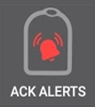

  ```{admonition} Older screenshot
  :class: note
  The screenshot above is from an earlier **AAPS** version. In **AAPS** 4 this button is called **Silence Alerts**.
  ```

- **Set time:** Updates the time on the pod with the current time on your phone. Only shown when the time on the pod differs from the phone time by more than 5 minutes.

  

  ```{admonition} Older screenshot
  :class: note
  The screenshot above is from an earlier **AAPS** version. In **AAPS** 4 this is a text button named **Set time** on the Omnipod pump screen.
  ```

- **Suspend:** Suspends insulin delivery on the active pod. Only shown if enabled in the settings (**Show Suspend Delivery button in Omnipod tab**).

  

  ```{admonition} Older screenshot
  :class: note
  The screenshot above is from an earlier **AAPS** version. In **AAPS** 4 this is a text button named **Suspend** on the Omnipod pump screen.
  ```

- **Resume Delivery:** Resumes insulin delivery on the currently suspended, active pod. Only shown while the pod is suspended.

  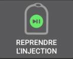

  ```{admonition} Older screenshot
  :class: note
  The screenshot above is from an earlier **AAPS** version. In **AAPS** 4 this is a text button named **Resume Delivery** on the Omnipod pump screen.
  ```

**Pod and RileyLink management buttons:**


```{admonition} Older screenshot
:class: note
The screenshot above is from an earlier **AAPS** version. In **AAPS** 4 there is no Pod Management menu: these actions are buttons directly on the Omnipod pump screen.
```

- **Activate Pod:** Primes and activates a new pod. Shown when no pod is active. It is enabled only when the RileyLink is connected.

  

  ```{admonition} Older screenshot
  :class: note
  The screenshot above is from an earlier **AAPS** version. In **AAPS** 4 **Activate Pod** is a button on the Omnipod pump screen instead of in the Pod Management menu.
  ```

- **Deactivate Pod:** Deactivates the currently active pod. Shown as soon as a pod is paired, also when an activation stopped part-way (for example because the pod failed during activation). It is enabled only when the RileyLink is connected. **AAPS** asks you to confirm before it deactivates the pod.

- Utilisez cette commande pour désactiver un pod urlant (erreur 49).
- If deactivation fails, the deactivation wizard offers a **Discard Pod** option.

  

  ```{admonition} Older screenshot
  :class: note
  The screenshot above is from an earlier **AAPS** version. In **AAPS** 4 **Deactivate Pod** is a button on the Omnipod pump screen instead of in the Pod Management menu.
  ```

- **Play Test Beep:** Plays a single test beep on the pod when pressed. Shown when a pod is paired.

  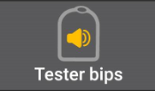

  ```{admonition} Older screenshot
  :class: note
  The screenshot above is from an earlier **AAPS** version. In **AAPS** 4 **Play Test Beep** is a button on the Omnipod pump screen instead of in the Pod Management menu.
  ```

- **Pod History:** Displays the active pod activity history. See [View Pod History](#OmnipodEros-view-pod-history).

  

  ```{admonition} Older screenshot
  :class: note
  The screenshot above is from an earlier **AAPS** version. In **AAPS** 4 **Pod History** is a button on the Omnipod pump screen instead of in the Pod Management menu.
  ```

- **Pair RileyLink:** Scans for your pod communication device and pairs it. See [RileyLink Setup](#OmnipodEros-rileylink-setup).

- **RileyLink Stats:** Opens the RileyLink Stats screen with two tabs. Only shown if enabled in the settings (**Show RileyLink Stats button in Pod Management menu**).

- **Paramètres** - affiche les paramètres du RileyLink et du pod actif
- **Historique** - affiche l'historique de communication du RileyLink et du Pod

  

  ```{admonition} Older screenshot
  :class: note
  The screenshot above is from an earlier **AAPS** version. In **AAPS** 4 **RileyLink Stats** is a button on the Omnipod pump screen instead of in the Pod Management menu.
  ```

- **Reset RileyLink:** Resets the configuration of the currently connected pod communication device. When communication is started, specific data is sent to and set in the RileyLink:

- Memory Registers are set
- Communication Protocols are set
- Tuned Radio Frequency is set
  > 
  > See [additional notes](#OmnipodEros-reset-rileylink-config-notes) below.

  

  ```{admonition} Older screenshot
  :class: note
  The screenshot above is from an earlier **AAPS** version. In **AAPS** 4 this button is called **Reset RileyLink** and is on the Omnipod pump screen.
  ```

- **Discard Pod:** Discards the pod state of an unresponsive pod, after a confirmation. Only shown when a pod has been started but not fully paired, as proper deactivation is no longer possible:

- Un **pod n'est pas complètement appairé** et ignore donc les commandes de désactivation.
- A **pod is stuck** during the pairing process between steps.
- Un **pod ne s'appaire tout simplement pas.**
  > 
  > After you discard a pod, **AAPS** can no longer communicate with it. Remove the pod from your body.

  

  ```{admonition} Older screenshot
  :class: note
  The screenshot above is from an earlier **AAPS** version. In **AAPS** 4 **Discard Pod** is a button on the Omnipod pump screen instead of in the Pod Management menu.
  ```

(OmnipodEros-reset-rileylink-config-notes)=

#### *Reset RileyLink Notes*

- L'utilisation principale de cette fonction est lorsque le dispositif de communication de pod actuellement actif ne répond pas et que la communication est dans un état bloqué.
- If the pod communication device is turned off and then back on, press **Reset RileyLink** so that these communication parameters are set again in the pod communication device.
- Si cela n'est PAS fait, AAPS devra être redémarré après la mise sous tension du périphérique de communication pod.
- This button **DOES NOT** need to be pressed when switching between different pod communication devices.

(OmnipodEros-omnipod-settings)=

## Paramètres Omnipod

To open the Omnipod driver settings, either:

- press the gear icon at the top right of the Omnipod pump screen (**Manage** > **Pump**), or
- open the top-left **menu** (☰) > **Configuration** > **Pump** and press **Settings** on the **Omnipod Eros** card.


```{admonition} Older screenshot
:class: note
The screenshot above is from an earlier **AAPS** version. In **AAPS** 4 you open the settings with **Settings** on the **Omnipod Eros** card or the gear icon on the Omnipod pump screen, instead of the settings gear in **Configuration** or the 3-dot menu.
```

The settings are grouped as listed below. Tap a group to expand it. Most entries are switches you can enable or disable:


*REMARQUE : Un astérisque (\*) indique que le paramètre par défaut est activé.*

### RileyLink

Settings for the pod communication device. You pair the device itself with the **Pair RileyLink** button on the pump screen (see [RileyLink Setup](#OmnipodEros-rileylink-setup)).

- **Use Scanning:** Scans before connecting to the OrangeLink. This can improve connections. It can also be used with other RileyLink clones if needed.

- **Show battery level reported by OrangeLink/EmaLink/DiaLink:** Reports the actual battery level of the OrangeLink/EmaLink/DiaLink. Il est **fortement recommandé** à tous les utilisateurs d'OrangeLink/EmaLink/Dialink d'activer ce paramètre.

- NE FONCTIONNE PAS avec le RileyLink original.
- Peut ne pas marcher avec des alternatives au RileyLink.
- Activé - Indique le niveau de batterie actuel des périphériques de communication de pod.
- Désactivé - Indique n/a.

- **Enable battery change logging in Actions:** Only available when the battery reporting setting above is enabled. Some pod communication devices can use regular batteries that you can change. With this setting enabled, you can record a **Pump Battery Change** [careportal entry](#aaps-screens-careportal) to note the change and reset the battery age.

### Confirmation Beeps

Provides confirmation beeps from the pod for bolus, basal, SMB, and TBR delivery and changes.

- **Bips bolus activés :** Active ou désactive les bips de confirmation lorsqu'un bolus est injecté.
- **Basal beeps enabled:** Enable or disable confirmation beeps when a new basal rate is set, active basal rate is canceled or current basal rate is changed.
- **Bips SMB activés :** Active ou désactive les bips de confirmation lorsqu'un SMB est injecté.
- **Bips DBT activés :** Active ou désactive les bips de confirmation lorsqu'un DBT est défini ou annulé.

### Alerts

Fournit des alertes AAPS et des notifications Nightscout pour l'arrêt, l'expiration des pod, le niveau de réservoir bas, en fonction des seuils définis.

*Note an AAPS notification will ALWAYS be issued for any alert after the initial communication with the pod since the alert was triggered. Dismissing the notification will NOT silence the alert UNLESS **Automatically silence Pod alerts** is enabled. To silence the alert MANUALLY, open the Omnipod pump screen and press **Silence Alerts**.*

- **\*Expiration reminder enabled:** When enabled, the pod beeps when the time set below is reached.
- **Alert at hours before shutdown (80 Hours):** The number of hours before the pod shuts down (80 hours after activation) at which the expiration reminder is triggered (1 to 8 hours, default 8).
- **Alerte Réservoir bas activée :** Activer ou désactiver une alerte lorsque le nombre d'unités restantes dans le réservoir atteint la limite définie dans le champ "Nombre d'unités".
- **Number of units:** The number of units at which to trigger the pod low reservoir alert (5 to 50, default 20).
- **Automatically silence Pod alerts:** When enabled, a notification is still issued, but the alert is silenced automatically at the next communication with the pod after the alert started.

### Notifications

Fournit des notifications AAPS et des alertes audibles sur le téléphone lorsqu'il n'est pas certain que les événements DBT, SMB ou bolus aient réussi.

*NOTE: These are notifications only, no audible beep alerts are made.*

- **\*Sound for uncertain TBR notifications enabled:** Enable or disable this setting to trigger an audible alert and visual notification when AAPS is uncertain if a TBR was successfully set.
- **Son pour les notifications SMB incertains activé :** Activer ou désactiver ce paramètre pour déclencher une alerte audible et une notification visuelle lorsque AAPS n’est pas certain si un SMB a été correctement délivré.
- **Son pour les notifications bolus incertains activé :** Activer ou désactiver ce paramètre pour déclencher une alerte audible et une notification visuelle lorsque AAPS n’est pas certain si un bolus a été correctement délivré.

### Autres

Fournit des paramètres avancés pour aider au débogage.

- **Show Suspend Delivery button in Omnipod tab:** Hide or display the **Suspend** button on the Omnipod pump screen.
- **Show Pulse Log button in Pod Management menu:** This setting is still listed, but the current version of the pump screen has no **Pulse Log** button.

- **Show RileyLink Stats button in Pod Management menu:** Hide or display the **RileyLink Stats** button on the Omnipod pump screen.
- **\*DST/Time zone detection enabled:** Allows time zone changes to be automatically detected if the phone is used in an area where DST is observed.

### Changement ou suppression d'un périphérique de communication pod actif (RileyLink)

With many alternative models to the original RileyLink available (such as OrangeLink or EmaLink), or the need to have multiple or backup versions of the same pod communication device, you may need to switch to another device.

To switch, open the Omnipod pump screen (**Manage** > **Pump**), press **Pair RileyLink** and select the new device, as described in [RileyLink Setup](#OmnipodEros-rileylink-setup). The new device replaces the previously paired one.

 


 

```{admonition} Older screenshot
:class: note
The screenshots above are from an earlier **AAPS** version. In **AAPS** 4 you add a device with **Pair RileyLink** on the Omnipod pump screen instead of **RileyLink Configuration** in the Omnipod settings, and scanning starts automatically.
```

There is no separate button to remove a paired device. If you stop using a RileyLink, simply pair the new one when you need it.

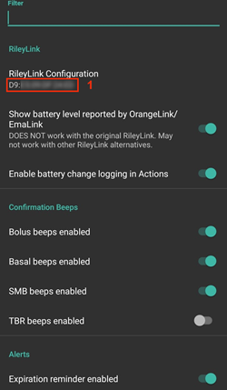


```{admonition} Older screenshot
:class: note
The screenshots above are from an earlier **AAPS** version. In **AAPS** 4 there is no **Remove** button: pairing a new RileyLink replaces the previous one.
```

## Status row and careportal

There are a few items that are specific to how the Omnipod pod differs from tube based pumps, especially after applying a new pod.

The **insulin** and **cannula** ages in the [status row](#screens-sensor-level-battery) of the main screen are **reset** to 0 days and 0 hours **after each pod change**. C'est dû à la façon dont la pompe Omnipod est construite et opérationnelle. La **pile de la pompe** et le **réservoir d'insuline** sont intégrés à l'intérieur de chaque pod. Puisque le pod insère la canule directement dans la peau au niveau du site d'application pod, il n'y a pas de tubulure traditionnelle dans les pompes Omnipod. *Par conséquent, après un changement de pod, l'âge de chacune de ces valeurs sera automatiquement réinitialisé à zéro.* **L'âge de la pile pompe** n'est pas indiqué car la durée de vie de la pile du pod sera toujours plus grande que celle du pod (maximum 80 heures).


```{admonition} Older screenshot
:class: note
The screenshot above is from an earlier **AAPS** version, where these ages were shown in the **Careportal** section of the **Actions (ACT)** tab. In **AAPS** 4 they are shown in the status row of the main screen.
```

### Niveaux

**Insulin Level**

L'affichage de la quantité d'insuline dans le Pod Omnipod Eros n'est pas exact. This is because it is not known exactly how much insulin was put in the pod, only that when the 2 beeps are triggered while filling the pod at least 80 units have been filled. Un Pod peut contenir au maximum 200 unités. Priming can also introduce variance as it is not an exact process. Avec ces deux facteurs, le pilote Omnipod a été écrit pour donner la meilleure estimation de l'insuline restant dans le réservoir.

> - **Au-delà de 50 unités** - Affiche la valeur de 50+U lorsque plus de 50 unités sont actuellement dans le réservoir.
> - **En dessous de 50 unités** - Affiche la quantité approximative d'insuline restante dans le réservoir.
> - **SMS** - Renvoie la valeur ou 50+U pour les réponses SMS
> - **Nightscout** - Envoie la valeur 50 vers Nightscout s'il y a plus de 50 unités (version 14,07 et plus).  Les nouvelles versions afficheront la valeur de plus de 50+ si au-dessus de 50 unités.

**Niveau pile**

L'affichage du niveau de la batterie est un paramètre qui peut être activé pour afficherer le niveau de batterie actuel des périphériques de communication pod comme l'OrangeLink, EmaLink ou Dialink.  Le hardware RileyLink n'est PAS compatible de l'affichage du niveau batterie.  Le niveau batterie est actualisé après chaque communication avec le pod, donc lors de la charge on peut ne pas avoir une augmentation linéaire.  Une mise à jour manuelle actualisera le niveau de batterie.  Lorsqu'un périphérique de communication Pod est déconnecté, la valeur 0% sera indiquée.

> - **Le hardware RileyLink n'est PAS compatible de l'affichage du niveau batterie**
> - **Le paramètre "Afficher le niveau batterie remonté par OrangeLink/EmaLink/Dialink" DOIT être activé dans les paramètres Omnipod**
> - **Le niveau batterie ne fonctionne que pour les périphériques OrangeLink, EmaLink et Dialink**
> - **L'affichage du niveau de batterie PEUT fonctionner pour d'autres appareils (en dehors du RileyLink)**
> - **SMS** - Renvoie en retour le niveau de batterie actuel quand une valeur existe, la valeur n/a ne sera pas renvoyée
> - **Nightscout** - Renvoie en retour le niveau de batterie actuel quand une valeur existe, la valeur n/a ne sera pas envoyée

(OmnipodEros-troubleshooting)=

## Troubleshooting

### Pod Failures

Pods fail occasionally due to a variety of issues, including hardware issues with the Pod itself. It is best practice not to call these into Insulet, since AAPS is not an approved use case. Une liste de codes défaut peut être trouvée [ici](https://github.com/openaps/openomni/wiki/Fault-event-codes) pour aider à trouver les causes.

### Preventing error 49 pod failures

This failure is related to an incorrect pod state for a command or an error during an insulin delivery command. We recommend that you set Nightscout synchronization to *upload only*: keep all the "Receive ... from NS" options disabled in the synchronization settings of the Nightscout client (see [Nightscout](../SettingUpAaps/Nightscout.md)) to prevent possible failures.

### Pump Unreachable Alerts

We recommend setting pump unreachable alerts to **120 minutes**. Press the **Settings** (gear) icon at the top right of the main screen, select **Local alerts** > **Pump unreachable threshold** and set it to **120**.

(OmnipodEros-import-settings-from-previous-aaps)=
### Importer les paramètres AAPS de versions précédentes

```{admonition} Importing settings can end your active Pod
:class: warning
On the phone that is already running the Pod, leave **Also replace pump settings** unticked: the Pod session is kept and only the other settings are imported. Tick it only with a file exported during the Pod you are wearing now. See [Tubeless pumps](#ExportImportSettings-tubeless-pumps).
```

The safest way to reinstall **AAPS** is between two Pods:

1. Désactiver votre session pod. Vérifiez que vous n'avez pas de session de pod actif.
2. Exportez vos paramètres et stockez en une copie dans un endroit sûr.
3. Désinstallez la version précédente d'AAPS et redémarrez votre téléphone.
4. Installez la nouvelle version d'AAPS et vérifiez que vous n'avez pas de session pod actif.
5. Importez vos paramètres et activez votre nouveau pod.

### Omnipod driver alerts

Please note that the Omnipod driver presents a variety of unique alerts on the **main screen**, most of them are informational and can be dismissed while some provide the user with an action to take to resolve the cause of the triggered alert. A summary of the main alerts that you may encounter is listed below:

#### Pas de Pod actif

Aucune session de Pod actif détectée. Cette alerte peut être temporairement rejetée en appuyant sur **REPORT ALARME** mais elle se déclenchera tant qu'un nouveau pod n'a pas été activé. Une fois activé, cette alerte disparait automatiquement.

#### Pod suspendu

Alerte informative que le Pod a été suspendu.

#### Echec Paramétrage Profil Basal. La livraison peut être suspendue ! Please manually refresh the Pod status from the Omnipod tab and resume delivery if needed.

Informational alert that the Pod basal profile setting has failed. Open the Omnipod pump screen and press **Refresh**, then **Resume Delivery** if needed.

#### Impossible de vérifier si le bolus SMB a réussi. Si vous êtes sûr que le Bolus n'a pas réussi, vous devez supprimer manuellement l'entrée SMB dans les traitements.

Alert that the SMB bolus success could not be verified. Check the **Last Bolus** field on the Omnipod pump screen to see if the SMB succeeded. If it did not, remove the entry from the treatments.

#### Incertain si l'action "Bolus/DBT/SMB" est terminée, merci de vérifier manuellement s'il a réussi.

En raison de la façon dont le RileyLink et l'Omnipod communiquent, des situations peuvent se produire où le fait qu'une commande ait été traitée avec succès est *incertain*. La nécessité d'informer l'utilisateur de cette incertitude était nécessaire.

Voici quelques exemples de cas où une notification incertaine peut se produire.

- **Bolus** - Les bolus incertains ne peuvent pas être vérifiés automatiquement. La notification restera jusqu'au prochain bolus mais un rafraîchissement manuel du pod effacera le message. *Par défaut, les bips d'alertes sont activés pour ce type de notification car l'utilisateur devra les vérifier manuellement.*
- **DBT, états du Pod, changements de profil, changements d'heure** - un rafraîchissement manuel du pod effacera le message.
- **Pod Time Deviation -** When the time on the pod and the time on your phone differ too much, it is difficult for the AAPS loop to function and make accurate predictions and dosage recommendations. If the time difference between the pod and the phone is more than 5 minutes, a **Set time** button appears on the Omnipod pump screen. Press **Set time** to synchronize the time on the pod with the time on the phone. If **Pod Status** shows **Suspended** afterwards, press **Resume Delivery** to continue normal pod operations.

## Bonnes pratiques

(OmnipodEros-optimal-omnipod-and-rileylink-positioning)=

### Positionnement optimal Omnipod et RileyLink

L'antenne utilisée sur le RileyLink pour communiquer avec un pod Omnipod est une antenne spirale hélicoïdale à 433 MHz. En raison de ses propriétés de construction, il émet un signal omnidirectionnel comme un donuts à trois dimensions avec l'axe z représentant l'antenne verticale. Cela signifie qu'il y a des positions optimales pour le positionnement du RileyLink, en particulier lors des séquences d'activation et de désactivation.


> *(Fig 1. Tracé graphique de l'antenne hélicoïdale en spirale dans un diagramme omnidirectionnel*)

Pour des raisons de sécurité, l'*activation* d'un pod doit être faite à une distance *plus proche (~30 cm ou moins)* que les autres opérations telles que donner un bolus paramétrer un DBT ou simplement rafraîchir l'état du pod. En raison de la nature de la transmission du signal à partir de l'antenne RileyLink, il n'est PAS recommandé de placer le pod au dessus du RileyLink ou juste à côté de celui-ci.

L'image ci-dessous montre le positionnement optimal du RileyLink lors des procédures d'activation et de désactivation du pod. Le pod peut être activé dans d'autres positions mais vous aurez le plus de chance de réussir en utilisant la même position que dans l'image ci-dessous.

*Remarque : Si après avoir positionné le pod de manière optimale, la communication RileyLink échoue, cela peut être dû à une batterie faible qui réduit la portée de transmission de l'antenne du RileyLink. Pour éviter ce problème, assurez-vous que le RileyLink est correctement chargé ou connecté directement à un câble de charge durant ce processus.*


## Where to get help

Tout le travail de développement du pilote Omnipod est fait par la communauté par des bénévoles; nous vous demandons donc d'être attentif et d'utiliser les directives suivantes lorsque vous demandez de l'aide :

- **Niveau 0 :** Lisez la section correspondante de cette documentation pour vous assurer que vous comprenez comment la fonctionnalité avec laquelle vous avez des difficultés est censée fonctionner.
- **Niveau 1 :** Si vous rencontrez toujours des problèmes que vous n'arrivez pas à résoudre en utilisant ce document, alors veuillez aller sur la chaine *#androidaps* sur **Discord** avec [ce lien d'invitation](https://discord.gg/4fQUWHZ4Mw).
- **Level 2:** Search existing issues to see if your issue has already been reported; if not, please create a new [issue](https://github.com/nightscout/AndroidAPS/issues) and attach your [log files](../GettingHelp/AccessingLogFiles.md).
- **Soyez patient - la plupart des membres de notre communauté sont des bénévoles de bonne nature, et résoudre les problèmes nécessite souvent du temps et de la patience de la part des utilisateurs et des développeurs.**
