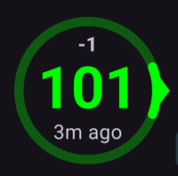
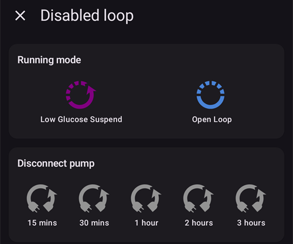
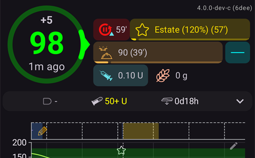
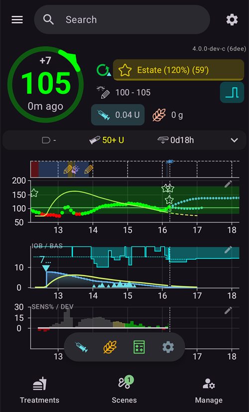
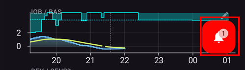
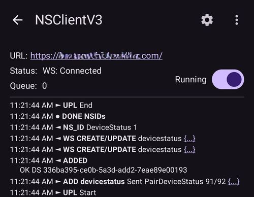

# Les écrans d'AAPS

```{contents}
:backlinks: entry
:depth: 2
```

(the-homescreen)= (AapsScreens-the-homescreen)=

## L'écran principal


Ceci est le premier écran que vous verrez quand vous ouvrirez **AAPS**, il contient la plupart des informations dont vous aurez besoin au jour le jour.

### Section A - Barre du haut

* Le **menu** (☰) à gauche ouvre le menu de navigation avec **Historique Traitements**, **Historique**, **Statistiques**, **Assistant Profil**, **Maintenance**, **Assistant de configuration**, **Configuration** et plus encore.
* La **barre de recherche** trouve les paramètres, les boîtes de dialogue et la documentation. Commencez simplement à taper (voir [Recherche globale](../DailyLifeWithAaps/GlobalSearch.md)).
* L'icône **Paramètres** (roue dentée) à droite ouvre tous les [paramètres](../SettingUpAaps/Preferences.md).

(aaps-screens-profile--target)=

### Section B - Bloc d'état

#### Glycémie actuelle

La dernière glycémie lue par votre MGC est affichée dans le grand cercle à gauche, avec la différence par rapport à la valeur précédente (delta) et l'âge de la valeur.

La couleur de la glycémie reflète sa position par rapport à la [fourchette](#Preferences-range-for-visualization) définie.

* vert = dans la fourchette
* rouge = en dessous de la fourchette
* jaune = au-dessus de la fourchette

  

(loop-status)= (AapsScreens-loop-status)=

#### État de la boucle


À côté du cercle de glycémie, une icône montre le mode de fonctionnement de la boucle (de haut en bas sur l'image) :

1. Cercle vert = [boucle fermée](#KeyAapsFeatures-ClosedLoop), la boucle fonctionne
2. Cercle violet avec ligne pointillée = [arrêt glycémie basse (AGB)](#KeyAapsFeatures-LGS)
3. Cercle bleu avec ligne pointillée = [boucle ouverte](#KeyAapsFeatures-OpenLoop)
4. Cercle rouge avec une croix = boucle désactivée (arrêtée de façon permanente)
5. Icône pause rouge = boucle suspendue (arrêtée temporairement, mais l'insuline basale est injectée) - le temps restant est affiché à côté de l'icône
6. Cercle gris avec une prise = pompe déconnectée (temporairement aucune insuline injectée) - le temps restant est affiché à côté de l'icône

Appuyez sur l'icône pour ouvrir la boîte de dialogue Boucle. Le contenu de la boîte de dialogue dépend de l'état actuel :

* Quand la boucle est **en cours d'exécution** (fermée, ouverte ou AGB), vous pouvez changer le mode de fonctionnement (Boucle Fermée, Arrêt Glycémie Basse, Boucle Ouverte ou Désactiver la Boucle), **suspendre** la boucle ou **déconnecter** la pompe pour une durée choisie.
* Quand la boucle est **désactivée**, vous pouvez la réactiver en choisissant un mode de fonctionnement, ou déconnecter la pompe.
* Quand la boucle est **suspendue**, vous pouvez la **reprendre**, déconnecter la pompe, ou choisir une nouvelle durée sous **Suspendre la boucle** pour prolonger la suspension.
* Quand la pompe est **déconnectée**, vous pouvez **reconnecter** la pompe, ou choisir une nouvelle durée sous **Déconnecter la pompe** pour prolonger la déconnexion.

Quand vous prolongez une suspension ou une déconnexion, la nouvelle durée **commence maintenant** : elle remplace le temps restant, elle ne s'y ajoute pas. Vous n'avez pas besoin de reprendre ou de reconnecter d'abord.

La boîte de dialogue quand la boucle fonctionne en boucle fermée :


La boîte de dialogue quand la boucle est suspendue, avec **Reprendre** et les durées pour prolonger la suspension :


La boîte de dialogue quand la pompe est déconnectée, avec **Reconnecter la pompe** et les durées pour prolonger la déconnexion :


En Arrêt Glycémie Basse, en boucle ouverte et quand la boucle est désactivée, la boîte de dialogue change seulement par les modes de fonctionnement proposés :




Voici l'écran principal dans chaque mode. La bande de couleur en haut du graphique change au moment du changement de mode.

Arrêt Glycémie Basse :


Boucle Ouverte :


Boucle Désactivée :


Boucle suspendue (le temps restant est affiché à côté de l'icône) :



Pompe déconnectée (le temps restant est affiché à côté de l'icône). Les boutons de traitement restent dans la barre QuickLaunch, vous pouvez donc toujours enregistrer de l'insuline injectée avec un stylo ou des glucides :


Une confirmation est demandée après chaque choix.

```{admonition} Alarme : la pompe n'a pas accepté la basale temporaire à zéro :class: warning Quand la pompe est déconnectée, **AAPS** garde une basale temporaire à zéro sur la pompe et la renvoie si elle manque. Si cela échoue encore après 10 minutes, **AAPS** déclenche une alarme urgente : *« La pompe n'a pas accepté la basale temporaire à zéro. Elle peut toujours donner de l'insuline basale. Vérifiez la pompe. »* L'alarme se répète toutes les 15 minutes jusqu'à ce que la basale temporaire à zéro soit en place ou que la déconnexion se termine. Si vous la voyez, vérifiez votre pompe : elle injecte peut-être de l'insuline basale, alors qu'**AAPS** l'affiche comme déconnectée.

    <br />Remarque : les modes proposés dépendent de votre progression dans les [Objectifs](../SettingUpAaps/CompletingTheObjectives.md). Boucle Fermée et AGB deviennent disponibles seulement quand vous les terminez.
    
    (aaps-screens-bg-warning-sign)=
    #### Signe d'avertissement glycémie
    
    Si **AAPS** détecte un problème avec les glycémies qu'il reçoit, un raccourci vers votre source de glycémie (avec son nom, par exemple **xDrip+ Glycémie**) apparaît dans la barre du bas de l'écran principal, avec un badge d'avertissement rouge. Appuyez dessus pour ouvrir l'[écran Source GLY](#aaps-screens-bg-source).
    
    ##### Données de glycémie en double
    
    Le signe d'avertissement rouge vous demande d'agir tout de suite : vous recevez des **données de glycémie en double**, ce qui empêche la boucle de bien faire son travail. **AAPS** ne peut pas calculer la tendance de votre glycémie de façon fiable avec des valeurs en double, il arrête donc les corrections.
    
    Si votre boucle était fermée, **AAPS** la passe en mode [Arrêt Glycémie Basse (AGB)](#KeyAapsFeatures-LGS) : l'icône de la boucle devient violette.
    
      
    
    Appuyez sur l'icône de la boucle : la carte **Restrictions** en haut vous en donne la raison : « BgQualityCheck : Mode AGB en raison des valeurs en double dans la source de glycémie ».
    
      
    
    ```{admonition} Votre boucle fonctionne en Arrêt Glycémie Basse
    :class: note
    Votre boucle continue de fonctionner, mais seulement pour vous protéger des hypoglycémies : **AAPS** peut encore réduire ou suspendre votre basale, mais il ne donnera aucune insuline de correction tant que vous n'aurez pas résolu ce problème !
    

Vous devez savoir pourquoi vous avez des Gly dupliquées :

* Est-ce que la connexion avec Dexcom (Dexcom Bridge) est activée sur votre instance Nightscout ? Désactivez cette connexion en allant dans l'interface d'administration de votre instance Nightscout, éditez la variable "ENABLED" et retirez la partie "bridge" à cet endroit. (Pour heroku, [vous trouverez les détails ici](https://nightscout.github.io/troubleshoot/troubleshoot/#heroku).)
* Y a-t-il plusieurs sources qui envoient votre glycémie vers Nightscout ? Si vous utilisez l'application BYODA, activez l'envoi dans **AAPS**, mais ne l'activez pas dans xDrip, si vous l'utilisez.
* Avez-vous des suiveurs qui pourraient recevoir votre glycémie mais aussi la renvoyer vers votre site Nightscout ?
* En dernier recours : dans les [paramètres NSClient](#Preferences-nsclient), choisissez les paramètres de synchronisation et désactivez l'option « Recevoir les données MGC depuis NS ».

Pour supprimer l'avertissement tout de suite et que la boucle corrige à nouveau, supprimez les valeurs en double depuis l'écran Source GLY : appuyez sur le raccourci dans la barre du bas. La valeur en double est surlignée en rouge. Faites un appui long sur une valeur pour commencer la sélection, cochez les doublons et appuyez sur l'icône de la corbeille en haut à droite.


Cependant, quand il y a beaucoup de doublons, il peut être plus facile de

* [sauvegarder vos paramètres](../Maintenance/ExportImportSettings.md),
* réinitialiser votre base de données dans le menu de maintenance et
* [réimporter vos paramètres](../Maintenance/ExportImportSettings.md)

    {admonition} Repassez vous-même en Boucle Fermée
    :class: important
    **AAPS** ne revient pas tout seul en **Boucle Fermée** une fois les doublons supprimés. Appuyez sur l'icône de la boucle sur l'écran principal et choisissez à nouveau **Boucle Fermée**.

##### Données de glycémie plates

Avec certaines sources de glycémie (Libre 1, AiDEX, Glutec, Medtronic et les sources qui n'indiquent pas leur type de capteur), **AAPS** vérifie aussi les valeurs qui ne changent pas : si votre glycémie a changé de moins de 2 mg/dl (0,1 mmol/l) pendant 45 minutes, les données sont considérées comme fausses. Le raccourci de la source de glycémie affiche alors un badge rouge de tendance plate, et la boucle arrête toute basale temporaire haute et ne donne pas d'insuline de correction jusqu'à ce que les valeurs changent à nouveau. Vérifiez votre capteur et l'application qui envoie les valeurs.

##### Données de glycémie irrégulières

Quand les valeurs arrivent à des intervalles irréguliers ou que certaines manquent, **AAPS** recalcule des valeurs toutes les 5 minutes à partir des valeurs qu'il a. Cela arrive par exemple après un changement de capteur, ou avec les capteurs Libre, dont l'horaire se décale d'une ou deux minutes toutes les quelques heures. La boucle continue de fonctionner et vous n'avez rien à faire. **AAPS** 4 n'affiche plus de signe d'avertissement jaune pour cela.

#### Profil actuel

Le profil actuel est affiché à côté de l'icône en forme d'étoile.

Appuyez sur le nom du profil pour ouvrir l'[écran Profil](#aaps-screens-profile), où vous pouvez voir les détails du profil et [passer d'un profil à un autre](../DailyLifeWithAaps/ProfileSwitch-ProfilePercentage.md).

Pour **changer le pourcentage du profil** (et sa durée), appuyez sur le nom du profil, puis sur le bouton rond **▶** (Activer) en bas à droite de l'écran Profil. Dans **AAPS** 3.x, cet écran s'ouvrait avec un appui long sur le nom du profil ; dans **AAPS** 4, un appui long ne fait rien. Étape par étape : [Changer le pourcentage du profil](#ProfileSwitch-change-percentage).


1. Affichage classique avec activation standard du profil.
2. Changement de profil avec un pourcentage de 90 % et une durée restante de 9 minutes. Le nom du profil devient jaune pendant un changement de profil temporaire.
3. Changement de profil avec un décalage horaire de 1 heure et une durée restante de 9 minutes.

#### Cible


La glycémie cible actuelle est affichée sous le nom du profil.

Un appui court sur la cible ouvre l'écran **[Cible temporaire](../DailyLifeWithAaps/TempTargets.md)**.

1. Affichage normal : la plage cible définie dans votre profil.
2. Si une cible temporaire est en cours, la cible devient jaune/orange avec l'icône du préréglage utilisé, et le temps restant en minutes est affiché entre parenthèses.

(AapsScreens-visualization-of-dynamic-target-adjustment)=

#### Visualisation de l'ajustement dynamique de la cible

Lorsque vous utilisez l'algorithme [SMB](#Config-Builder-aps) et [Autosens](#Open-APS-features-autosens) , **AAPS** peut ajuster dynamiquement votre cible en fonction de la sensibilité.

Activez une des options suivantes, ou les deux, dans les [paramètres OpenAPS SMB](#Preferences-openaps-smb-settings) :

* « Sensibilité augmente la Cible » et/ou
* « Résistance diminue la cible »

Si **AAPS** détecte une résistance ou une sensibilité, la cible change par rapport à celle du profil, et la cible affichée change de couleur pour montrer l'ajustement.

(aaps-screens-iob-cob-basal-sens)=

#### IA, GA, basal et sensibilité


1. **Seringue**: insuline active (IA) - quantité d'insuline active dans votre corps  
    L'insuline active serait à zéro si seule votre basale standard était en cours et qu'il ne restait pas d'insuline des bolus précédents. 
    * L'IA peut être négative s’il y a eu récemment des périodes de basal réduit.
    * Appuyez sur la puce pour voir la répartition entre l'insuline des bolus et l'insuline basale (première boîte de dialogue sur l'image, ici avec une IA négative après une période de basale réduite)
2. **Épi** : [glucides actifs (GA)](../DailyLifeWithAaps/CobCalculation.md) - glucides que vous avez mangés et qui ne sont pas encore absorbés
3. Le bouton bleu-vert à droite montre le **débit basal actuel** : une ligne plate quand la basale du profil est en cours, une icône différente quand un débit basal temporaire est actif
4. La **ligne du pourcentage** montre la sensibilité actuelle ([Autosens](#Open-APS-features-autosens) / [DynamicISF](../DailyLifeWithAaps/DynamicISF.md)). Quand la boucle change votre SI, la ligne montre aussi la SI du profil, une flèche et la SI que la boucle utilise maintenant, par exemple « 80% 2.0 ↗ 2.5 ». Appuyez dessus pour voir la valeur Autosens et la SI effective (deuxième boîte de dialogue sur l'image). Si la boucle utilise une autre valeur que le dernier résultat d'Autosens (par exemple parce qu'une cible temporaire change votre sensibilité), la boîte de dialogue affiche aussi cette valeur comme **Autosens dans l'algorithme**. Quand Autosens est désactivé, la boucle garde la SI de votre profil et aucune SI effective n'est affichée.

La boîte de dialogue IA, ouverte en appuyant sur la puce IA :


Appuyez sur le bouton bleu-vert pour voir le débit basal temporaire en cours, quand il a commencé et depuis combien de temps il est en cours :


(aaps-screens-carbs-required)=

#### Glucides requis


Des suggestions de glucides sont données lorsque l'algorithme détecte que des glucides supplémentaires sont nécessaires.

Cela se produit quand l'algorithme oref pense qu'il ne suffira pas de mettre la basale à zéro et que vous aurez besoin de vous resucrer.

Les notifications de glucides sont beaucoup plus sophistiquées que celles de l'Assistant bolus. Il est possible que vous voyiez une suggestion de glucides alors que l'assistant bolus n'affiche pas de glucides manquants.

Les notifications Glucides requis peuvent être envoyées sur Nightscout si vous le souhaitez, dans ce cas une annonce sera affichée et diffusée.

### Section C - Ligne d'état


La ligne d'état donne un avertissement visuel pour

* Âge de la canule
* Âge de l'insuline (jours d'utilisation du réservoir) et niveau du réservoir (unités)
* Âge du capteur
* Âge et niveau de la pile de la pompe (%)

Si le seuil d'alerte est dépassé, les valeurs seront affichées en jaune.

Si le seuil critique est dépassé, les valeurs seront affichées en rouge.

Les seuils peuvent être changés avec la petite icône **Paramètres**, visible quand la ligne d'état est **étendue** (chevron à droite). Voir [Voyants d'état](#Preferences-status-lights).

Le panneau d'état étendu a aussi un bouton au bout de certaines lignes pour enregistrer un changement, ce qui remet l'âge correspondant à zéro : **Ajouter** sur la ligne **Capteur** enregistre une insertion de capteur. Si votre pompe le permet, **Amorcer/Remplir** apparaît sur les lignes **Canule** (ou **Pompe Patch**) et **Insuline**, et **Ajouter** sur la ligne **Pile pompe**.


Selon la pompe que vous utilisez, il se peut que vous n'ayez pas toutes ces icônes.

(screens-sensor-level-battery)=

#### Niveau du capteur (batterie)

Fonctionne pour les MGC avec un transmetteur supplémentaire, comme le MiaoMiao 2. (Techniquement, le capteur doit envoyer l'information sur le niveau de la batterie à xDrip.)

Les seuils peuvent être réglés dans [Voyants d'état](#Preferences-status-lights).

(aaps-screens-main-graph)=

### Section D - Graphique principal


Le graphique montre votre glycémie telle qu'elle est lue par votre capteur de glycémie (MGC).

Faites glisser et pincez le graphique pour zoomer, afin de changer la période visible.

La zone verte reflète votre fourchette cible.

Ces informations sont aussi affichées sur ce graphique :

* Bolus manuels : triangle bleu juste au-dessus de la courbe de glycémie, pointé vers le bas sur la valeur de ce moment, avec la quantité d'insuline
* Saisies de glucides : triangle orange juste sous la courbe de glycémie, pointé vers le haut sur la valeur, avec la quantité de glucides. Un repas saisi avec son bolus ressemble à un seul repère, coupé en deux par la valeur.
* Les triangles ont trois tailles (petit, moyen, grand), selon la quantité comparée à la plus grande de la journée. S'il n'y a pas de valeur de glycémie à ce moment (trou du capteur), le triangle est dessiné en bas du graphique.
* Contrôles de glycémie et calibrations : dessinés à leur propre valeur mesurée, pour que vous puissiez les comparer avec la courbe du capteur
* Cible définie dans le profil ou modifiée par une cible temporaire : ligne verte
* Changements de profil : icônes en forme d'étoile en haut du graphique
* État de la boucle : bande de couleur en haut du graphique quand le [mode de fonctionnement](#AapsScreens-loop-status) n'est pas la boucle fermée : bleu = boucle ouverte, violet = AGB, rouge = boucle désactivée, jaune = boucle suspendue, gris = pompe déconnectée, orange = superbolus (sur la capture d'écran : violet, puis jaune). L'historique de ces changements est listé dans [Mode de fonctionnement](#AapsScreens-running-mode)
* Les [SMB](#Open-APS-features-super-micro-bolus-smb) ne sont pas dessinés sur le graphique de glycémie (il y en aurait un toutes les quelques minutes) : ils sont affichés sur le [graphique IA](#aaps-screens-iob).

Appuyez sur un **contrôle de glycémie** dans le graphique pour voir sa valeur, et sa remarque si vous en avez écrit une.

(aaps-screens-graph-press-and-hold)=

#### Voir les valeurs à un moment donné

**Appuyez longuement** sur le graphique de glycémie pour voir les valeurs à une lecture. Un point marque la valeur la plus proche, une ligne en tirets est dessinée à ce moment dans tous les graphiques, et une fenêtre en haut du graphique affiche :

* l'heure et la valeur de glycémie
* l'IA, les GA (seulement s'ils sont au-dessus de 0 g) et le débit basal à ce moment. L'icône de la basale montre si un débit basal temporaire était en cours, comme sur l'écran principal
* tout bolus, SMB ou glucides à ce moment, avec les mêmes triangles que dans les graphiques

Gardez votre doigt sur l'écran et déplacez-le à gauche ou à droite pour passer d'une valeur à la suivante. Vous sentez une légère vibration à chaque valeur, et le graphique ne défile pas pendant ce temps. La fenêtre reste affichée 2 secondes après que vous avez levé le doigt.

Cela fonctionne de la même façon sur les [graphiques supplémentaires](#aaps-screens-additional-graphs) sous le graphique de glycémie (IA, GA...) : faites un appui long sur n'importe lequel.


(AapsScreens-activate-optional-information)=

#### Activation des informations optionnelles

Appuyez sur l'icône **crayon** en haut à droite du graphique pour ouvrir les paramètres du graphique :


* **Hauteur du graphique** règle la hauteur du graphique.
* **ACT** ajoute la courbe d'activité de l'insuline : une ligne continue jaune-vert <span style="background:#141218;color:#D3F166;padding:0 0.3em;border:1px solid #141218;border-radius:4px">━━━━</span> (à ne pas confondre avec la prédiction RNS jaune en pointillés)
* **PRÉD** ajoute les [lignes de prédiction](#aaps-screens-prediction-lines) (voir ci-dessous)

(aaps-screens-prediction-lines)=

#### Lignes de prédiction

Quand **PRÉD** est activé, AAPS dessine ses prédictions en **lignes pointillées** à droite de la ligne « maintenant ». Chaque prédiction a sa propre couleur. Le thème sombre utilise des teintes plus claires des mêmes couleurs, et une ligne dans la plage cible verte peut paraître un peu plus verte.

| Ligne                  | Thème clair                                                                                                                       | Thème sombre                                                                                                                       | Ce qu'elle prédit                |
| ---------------------- | --------------------------------------------------------------------------------------------------------------------------------- | ---------------------------------------------------------------------------------------------------------------------------------- | -------------------------------- |
| **IA** (bleu)          | <span style="background:#FFFFFF;color:#1E88E5;padding:0 0.3em;border:1px solid #CCCCCC;border-radius:4px">●●●●</span>             | <span style="background:#141218;color:#64B5F6;padding:0 0.3em;border:1px solid #141218;border-radius:4px">●●●●</span>              | insuline seule                   |
| **GA** (orange)        | <span style="background:#FFFFFF;color:#FB8C00;padding:0 0.3em;border:1px solid #CCCCCC;border-radius:4px">●●●●</span>             | <span style="background:#141218;color:#FFB74D;padding:0 0.3em;border:1px solid #141218;border-radius:4px">●●●●</span>              | glucides actifs                  |
| **RNS** (jaune)        | <span style="background:#FFFFFF;color:#C9BD60;padding:0 0.3em;border:1px solid #CCCCCC;border-radius:4px">●●●●</span>             | <span style="background:#141218;color:#E6D39A;padding:0 0.3em;border:1px solid #141218;border-radius:4px">●●●●</span>              | repas non signalé                |
| **ZT** (cyan)          | <span style="background:#FFFFFF;color:#00D2D2;padding:0 0.3em;border:1px solid #CCCCCC;border-radius:4px">●●●●</span>             | <span style="background:#141218;color:#4DD4D4;padding:0 0.3em;border:1px solid #141218;border-radius:4px">●●●●</span>              | basale à zéro (insuline arrêtée) |
| **aCOB** (orange pâle) | <span style="background:#FFFFFF;color:rgba(251,140,0,0.5);padding:0 0.3em;border:1px solid #CCCCCC;border-radius:4px">●●●●</span> | <span style="background:#141218;color:rgba(255,183,77,0.5);padding:0 0.3em;border:1px solid #141218;border-radius:4px">●●●●</span> | ancien algorithme AMA seulement  |

Quand deux prédictions donnent les mêmes valeurs, leurs points se superposent et vous ne voyez qu'une des couleurs (par exemple, RNS par-dessus IA quand la glycémie est stable).

* Ligne **GA** (orange) : [glucides actifs](CobCalculation) (l'orange est utilisé partout dans AAPS pour les GA et les glucides)
    
    Cette ligne de prédiction montre comment votre glycémie (et pas les GA eux-mêmes) devrait évoluer sur la base de votre **Profil** actuel, en supposant que les déviations liées à l'absorption des glucides restent constantes. Cette ligne n'apparaît que s'il y a des GA connus.

* Ligne **IA** (bleue) : insuline active (le bleu est utilisé partout dans AAPS pour l'IA et l'insuline)
    
    Cette ligne de prédiction montre ce qui pourrait arriver avec uniquement l'action de l'Insuline. Par exemple si vous avez injecté de l'insuline mais que vous n'avez pas mangé de glucides.

* Ligne **ZT** (cyan) : basale à zéro (glycémie prédite si un débit basal temporaire de 0 % était mis en place)
    
    Cette ligne de prédiction montre comment la glycémie évoluerait si la pompe arrêtait toute injection d'insuline (DBT 0%). La ligne s'arrête dès qu'elle passe au-dessus de votre cible.
    
    *Cette ligne n'apparaît que lorsque l'algorithme [SMB](#Config-Builder-aps) est utilisé.*

* Ligne **RNS** (jaune) : [repas non signalés](#SensitivityDetectionAndCob-sensitivity-oref1)
    
    Les Repas Non Signalés signifient qu'une augmentation significative de la glycémie liée aux repas, à l'adrénaline ou à d'autres facteurs est détectée. Cette ligne de prédiction est similaire à la ligne **orange des GA**, mais elle suppose que les déviations diminueront de façon constante (en extrapolant le taux de diminution actuel).
    
    *Cette ligne apparaît seulement si l'algorithme [SMB](#Config-Builder-aps) est utilisé, si **Activer RNS** est activé dans les paramètres OpenAPS SMB, et si la glycémie monte plus que ce que l'insuline seule explique.*

* Ligne **aCOB** (orange pâle et transparent) : absorption accélérée des glucides
    
    Comme GA, mais avec une vitesse d'absorption des glucides fixe de 10 mg/dl/5m (-0,555 mmol/l/5m). Obsolète et d'une utilité limitée.
    
    *Cette ligne n'apparaît que lorsque l'ancien algorithme [AMA](#Config-Builder-aps) est utilisé.*

Généralement votre courbe de glycémie réelle finira au milieu de ces lignes, ou proche de la ligne qui représente le mieux votre situation réelle.

(aaps-screens-how-predictions-become-a-dosing-decision)=

#### Comment AAPS transforme les prédictions en décision de dosage

AAPS ne dose pas l'insuline seulement selon votre glycémie actuelle. À chaque cycle de la boucle (environ toutes les 5 minutes), il regarde toutes les lignes de prédiction ci-dessus ensemble et choisit l'action la plus sûre.

La règle de base est **la sécurité d'abord** : si *une seule* ligne de prédiction, à n'importe quel moment, passe sous votre seuil de sécurité bas, AAPS met une basale à zéro (débit basal temporaire de 0 %) et ne donne plus d'insuline, même si votre glycémie actuelle est haute. AAPS envisage de donner plus d'insuline seulement quand toutes les lignes de prédiction restent au-dessus de ce seuil.

Quand il est sûr de donner plus d'insuline, AAPS regarde où la glycémie devrait finalement arriver (la **glycémie finale**) d'après l'ensemble des prédictions, et calcule la correction nécessaire pour ramener cette glycémie finale à la cible. Cette correction est donnée soit par un débit basal temporaire plus élevé, soit (si l'algorithme oref1/[SMB](#Open-APS-features-super-micro-bolus-smb) est activé) par un petit bolus immédiat. Si la glycémie est haute maintenant mais baisse déjà assez toute seule, AAPS attend, ou peut même réduire le débit basal, au lieu d'ajouter de l'insuline qui ne ferait qu'aggraver une hypoglycémie plus tard.

Pour des exemples concrets de cette logique de décision avec de vraies captures d'écran, voir les [scénarios de dosage du guide pour les médecins](#clinicianguide-dosing-scenarios). Ils ont été écrits pour des médecins, mais ils sont valables pour tous les utilisateurs d'AAPS.

*Pour une explication technique complète du calcul de ces prédictions et de la décision de dosage, voir la [documentation determine-basal d'OpenAPS](https://openaps.readthedocs.io/en/latest/docs/While%20You%20Wait%20For%20Gear/Understand-determine-basal.html).*

#### Basales

Une ligne **bleue continue** indique le débit de basal de votre pompe et reflète l'injection réelle au fil du temps.

La ligne **bleue pointillée** est ce qu'aurait dû être le débit de basal s'il n'y avait pas d'ajustements de débit de basal temporaire (DBT).

Quand le débit de basal standard est donné, la zone sous la courbe est affichée en bleu foncé. Quand le débit de basal est temporairement ajusté (augmenté ou diminué), la zone sous la courbe est affichée en bleu clair.

#### Activité

La ligne **jaune fine** montre l'activité de l'insuline.

Elle indique la capacité de l'insuline présente dans votre corps à faire baisser la glycémie, si aucun autre facteur (comme les glucides) n'était présent.

(AapsScreens-section-g-additional-graphs)= (aaps-screens-additional-graphs)=

### Section E - Graphiques supplémentaires

Vous pouvez activer des graphiques supplémentaires sous le graphique principal. En [Mode simple](#preferences-simple-mode), les graphiques supplémentaires sont prédéfinis et ne peuvent pas être changés. Désactivez le **Mode simple** si vous voulez choisir vous-même la configuration des graphiques supplémentaires.

Les graphiques supplémentaires suivent le graphique principal : quand vous faites défiler ou zoomez le graphique de glycémie, ils bougent avec lui. Un glissement latéral sur un graphique supplémentaire fait aussi défiler tous les graphiques. Ils n'ont pas leurs propres indications d'heure : lisez l'heure sur le graphique de glycémie.

Pour configurer un graphique supplémentaire, appuyez sur l'icône **crayon** en haut à droite de celui-ci :


Choisissez les puces des données que vous voulez voir sur ce graphique ; le bouton **Supprimer** supprime le graphique.

Pour créer un graphique de plus, appuyez sur **Ajouter graphique** sous le dernier graphique et choisissez ses puces de la même façon :


Le nouveau graphique est ajouté sous les autres. Ici, un deuxième graphique supplémentaire avec **SENS%** et **DEV** :



La plupart des utilisateurs apprécient la configuration suivante pour les graphiques supplémentaires :

* Graphique 1 avec IA, GA, changement de sensibilité
* Graphique 2 avec Déviations et Impact glycémique.

#### Insuline absolue (ABS)

Insuline Active incluant les bolus **et la basal**.

(aaps-screens-iob)=

#### Insuline Active (IA)

Affiche la quantité d'insuline que vous avez à chaque instant (= insuline active dans votre corps). Elle inclut l'insuline des bolus et des débits de basal temporaires (**mais exclut les débits de basal définis dans votre profil**).

Dans l'hypothèse où il n'y aurait eu aucun [SMB](#Open-APS-features-super-micro-bolus-smb), bolus ni débit basal temporaire pendant toute la durée d'action de l'insuline (DAI), l'Insuline Active serait à zéro.

Les SMB sont affichés sur ce graphique sous forme de triangles bleus, en trois tailles selon la quantité comparée au plus grand SMB de la journée.

L'IA peut être négative si vous n'avez plus de bolus actif et que vous avez eu une basale temporaire nulle ou faible pendant longtemps.

La diminution dépend de vos [paramètres de DAI et de type d'insuline](#Config-Builder-insulin-dia).

#### Glucides actifs (GA)

Affiche la quantité de glucides que vous avez à chaque instant (= glucides actifs dans votre corps, non encore assimilés).

La diminution dépend des [écarts que l'algorithme détecte](../DailyLifeWithAaps/CobCalculation.md).

S'il détecte une absorption plus élevée de glucides que prévu, de l'insuline sera injectée, ce qui augmentera l'IA (plus ou moins, selon vos paramètres de sécurité).

#### Changement de sensibilité (SENS%)

Affiche la sensibilité détectée par [Autosens](#Open-APS-features-autosens).

C'est le résultat d'un calcul de la sensibilité à l'insuline suite à de l'exercice, aux hormones, etc.

Remarque : vous devez être à l'[Objectif 8](#objectives-objective8) pour que le calcul de sensibilité/[Autosens](#Open-APS-features-autosens) puisse ajuster automatiquement la quantité d'insuline délivrée. Avant d'atteindre cet objectif, la ligne sur le graphique est affichée pour information seulement.

### Sensibilité variable (V_SI)

Affiche la sensibilité calculée par [DynamicISF](../DailyLifeWithAaps/DynamicISF.md). Rempli seulement si vous utilisez cette fonction.

(screen-heart-rate-steps)=

#### Fréquence cardiaque (FC) & pas

Ces données peuvent être disponibles si vous utilisez une [montre connectée Wear OS](../WearOS/WearOsSmartwatch.md). Activez-les dans l'application **AAPS** Wear et donnez l'autorisation d'accès aux données de santé.

#### Déviations (DEV)

* Les barres **grises** montrent une déviation due aux glucides.
* Les barres **vertes** montrent que la glycémie est supérieure à ce qu'attendait l'algorithme. Les barres vertes sont utilisées par [Autosens](#Open-APS-features-autosens) pour augmenter la résistance.
* Les barres **rouges** montrent que la glycémie est inférieure à ce qu'attendait l'algorithme. Les barres rouges sont utilisées par [Autosens](#Open-APS-features-autosens) pour augmenter la sensibilité.
* Les barres **jaunes** montrent une déviation due aux RNS.
* Les barres **noires** montrent de petites déviations non prises en compte pour la sensibilité.

#### Impact glycémique (-IGly)

Cette ligne montre à quel point la glycémie devrait augmenter ou diminuer en prenant seulement en compte l’activité de l’insuline.


Cette ligne forme une bonne combinaison à afficher avec les barres de déviation. Elles partagent la même échelle, mais c'est une échelle différente de celle des autres données additionnelles, c'est donc une bonne idée de les afficher sur un graphique séparé, comme montré ci-dessus. Comparer la ligne d'IG et les barres de déviation est une autre façon de comprendre comment la **glycémie** fluctue. Ici, au moment marqué **1**, les barres de déviation sont bien au-dessus de la ligne d'impact glycémique : la glycémie monte plus que ce que l'activité de l'insuline seule explique (par exemple après des glucides). Au moment marqué **2**, les barres de déviation sont sous zéro (rouges) : la glycémie est plus basse que ce qu'attendait l'algorithme.

### Section F - Barre QuickLaunch


La barre flottante en bas de l'écran contient vos actions **[QuickLaunch](../DailyLifeWithAaps/QuickLaunch.md)**. La petite **roue dentée** ouvre la configuration de QuickLaunch, où vous choisissez les boutons affichés (traitements, saisies Careportal, actions MGC, les écrans de la feuille **Gestion**, les boutons [Assistant Rapide](../DailyLifeWithAaps/QuickWizards.md), les [Scénarii](../DailyLifeWithAaps/Scenes.md) et plus encore).

Une configuration typique est montrée ci-dessus : **Insuline**, **Glucides** et l'**Assistant Bolus**.

Quand la pompe est **déconnectée**, les boutons de traitement restent dans la barre, par exemple pour enregistrer de l'insuline injectée avec un stylo (voir [Insuline](#aaps-screens-buttons-insulin) ci-dessous). Les mêmes actions sont aussi disponibles dans la [feuille Traitements](#aaps-screens-treatments-sheet) de la barre de navigation du bas.

(aaps-screens-buttons-insulin)=

#### Insuline


Pour injecter une quantité d'insuline donnée sans utiliser l'[assistant bolus](#aaps-screens-bolus-wizard).

En activant **Début Repas Imminent**, vous pouvez démarrer automatiquement votre [cible temporaire Repas imminent](#TempTargets-eating-soon-temp-target).

Si vous ne voulez pas faire le bolus avec la pompe, mais enregistrer une quantité d'insuline (par exemple de l'insuline injectée avec un stylo), activez « **Les bolus seront seulement enregistrés** ». Une ligne **Heure** en plus, réglée sur **Maintenant**, vous permet d'enregistrer une injection d'insuline faite dans le passé : utilisez **-** / **+** pour la changer, ou appuyez sur le chevron pour taper les minutes ou choisir une date et une heure.

 

Vous pouvez utiliser les boutons **+0.5 / +1.0 / +2.0** pour augmenter rapidement la quantité d'insuline. Les valeurs d'incrément peuvent être changées dans les [paramètres de l'assistant bolus](#Preferences-deliver-this-part-of-bolus-wizard-result).

La boîte de dialogue Insuline peut aussi être utilisée quand la pompe est suspendue ou déconnectée, par exemple pour enregistrer de l'insuline injectée avec un stylo. Dans ce cas, « **Les bolus seront seulement enregistrés** » est forcé (affiché en rouge) et des champs en plus apparaissent pour choisir le type d'insuline et un décalage d'**Heure** pour une injection faite dans le passé :


#### Glucides


Permet d'enregistrer les glucides sans faire de bolus.

Certaines [cibles temporaires prédéfinies](#TempTargets-hypo-temp-target) (Hypo, Repas imminent, Activité) peuvent être démarrées directement avec les interrupteurs en haut.

**Heure des glucides** : quand allez-vous manger / avez-vous mangé les glucides.

**Durée** : à utiliser pour les [« glucides étendus »](ExtendedCarbs). Cette ligne est repliée, pour que vous n'y tapiez pas les grammes par erreur : utilisez **-** / **+** pour la changer, ou appuyez sur le chevron pour l'ouvrir et taper une valeur.

Vous pouvez utiliser les boutons **+5 / +10 / +20** pour augmenter rapidement la quantité de glucides.

#### Assistant Rapide

Saisissez facilement la quantité de glucides et réglez les bases du calcul avec un seul bouton préconfiguré.

Les détails sont réglés dans [Assistant Rapide](../DailyLifeWithAaps/QuickWizards.md).

(aaps-screens-treatments-sheet)=

### Section G - Navigation du bas

La barre de navigation du bas donne accès à :

* **Traitements** : une feuille d'actions rapides avec vos actions de traitement :
    
    

* **Scénarii** : affiché seulement si vous avez au moins un [scénario](../DailyLifeWithAaps/Scenes.md) ou une règle d'**Automatisation** marquée comme **Actions utilisateur**. Il ouvre une feuille d'où vous pouvez les démarrer ; un badge montre combien vous pouvez en démarrer maintenant. Le **crayon** en haut de la feuille ouvre **Gestion → Scénarii**.

* **Gestion** : le centre de tout ce que vous gérez dans **AAPS** : Profil, Paramètres Insuline, Cible Temp, Assistant Rapide, Scénarii, Automatisation, Aliments, Rotation du site, Pompe et Clients autorisés. En dessous se trouvent les actions sur les appareils et la basale, comme Insertion Capteur et Basal Temp. Certains éléments apparaissent seulement s'ils concernent votre configuration. Par exemple, Amorcer/Remplir et le changement de pile dépendent de votre pompe, et Basal Temp, Bolus Étendu et les saisies Careportal sont masqués en [Mode simple](#preferences-simple-mode) :
    
    

* **Objectifs** : votre progression dans les [Objectifs](../SettingUpAaps/CompletingTheObjectives.md) ; un badge montre combien sont terminés. Cet élément disparaît quand tous les objectifs sont terminés, et il n'existe pas dans **AAPSClient**.

(aaps-screens-notifications)=

#### Notifications

Une **bulle de notification** peut apparaître au-dessus de la barre du bas, à droite. Elle regroupe les notifications actives d'**AAPS** ; le petit nombre montre combien il y en a. Sa couleur suit la plus importante : rouge pour un message urgent, vert pour une simple information.



Appuyez sur la bulle pour ouvrir le panneau **Notification**. Chaque message affiche l'heure à laquelle il est apparu. Appuyez sur **Fermer** sous un message pour le supprimer ; certains messages ont un autre bouton à la place, qui vous amène au paramètre qui demande votre attention.


(bolus-wizard)= (aaps-screens-bolus-wizard)=

## Assistant bolus


Quand vous voulez faire un bolus de repas, c'est normalement ici que vous le faites.

### Section I

L'en-tête **Calcul** affiche le bolus calculé. Si la quantité d'insuline active dépasse déjà le bolus calculé, elle affichera simplement la quantité de glucides encore nécessaire.

L'assistant bolus peut être utilisé quelle que soit votre **glycémie** actuelle, même si elle est trop haute ou trop basse. Si la **glycémie** est au-dessus de la cible, une correction est ajoutée au bolus de repas. Si la **glycémie** est sous la cible, le bolus est réduit et, si l'insuline active est déjà plus élevée que nécessaire, l'assistant vous indique combien de glucides sont encore nécessaires au lieu de proposer de l'insuline.

La ligne d'icônes sous l'en-tête montre quelles entrées sont prises dans le calcul (glycémie, tendance, IA, cible temporaire, GA). Appuyer sur une icône active / désactive cette entrée dans le calcul ; l'icône **(i)** affiche le détail des nombres du calcul.

#### Combinaisons de GA (glucides actifs) et d'IA (insuline active) et leur signification

* Pour des raisons de sécurité, l'entrée IA ne peut pas être désactivée quand les GA sont activés, car vous risqueriez de recevoir trop d'insuline : **AAPS** ne tiendrait pas compte de ce qui a déjà été injecté.
* Si vous activez GA et IA, les glucides non absorbés qui ne sont pas déjà couverts par de l'insuline + toute l'insuline injectée en DBT ou en SMB seront pris en compte.
* Si vous activez IA sans GA, **AAPS** tient compte de l'insuline déjà injectée, mais ne la compense pas avec les glucides encore à absorber. Cela conduit à un avis de « manque de glucides ».
* Si vous faites un bolus pour de la **nourriture supplémentaire** peu après un bolus de repas (par ex. un dessert en plus), il peut être utile de **désactiver toutes les entrées**. De cette façon, seuls les nouveaux glucides sont ajoutés, car le repas principal n'est pas forcément absorbé. Peu après un bolus de repas, l'IA ne correspond donc pas exactement aux GA.
* Pour des raisons de sécurité, une **cible temporaire** est prise dans le calcul seulement si vous activez son entrée à la main.

(AapsScreens-section-j)=

### Section J - Champs de saisie

Dans le champ **Glucides**, vous saisissez votre estimation de la quantité de glucides, **en grammes**, pour laquelle vous voulez faire le bolus ; les boutons **+** en dessous ajoutent rapidement des glucides. **AAPS** fonctionne seulement en grammes : si vous comptez en unités pain ou en équivalences (*par exemple* les équivalences « CHO » de DAFNE), convertissez-les en grammes avant de les saisir. Voir la [remarque sur les unités pain](#your-aaps-profile-insulin-to-carbs-ratio) sur la page du profil.

#### Type de glucides : pain, gâteau ou pizza

Sous le champ **Glucides**, les boutons **Pain**, **Gâteau** et **Pizza** indiquent à **AAPS** à quelle vitesse le repas est absorbé. Avec **Gâteau** et **Pizza**, le bolus couvre seulement une partie des glucides maintenant, et le reste est ajouté plus tard sous forme d'eGlucides. Voir [Type de glucides : pain, gâteau ou pizza](#AapsScreens-carbs-type) sur la page Glucides étendus pour les pourcentages et le moment.

La ligne **Correction** sert si vous voulez modifier la dose finale pour une raison quelconque.

Seul le champ **Glucides** est toujours ouvert. Les autres lignes (**Correction**, **Heure des glucides**, **Gly** et **Utiliser pourcentage**) sont repliées : elles affichent leur valeur avec des boutons **-** / **+**, pour que vous puissiez la changer par petits pas. Appuyez sur le chevron pour ouvrir une ligne et taper une valeur, et appuyez à nouveau dessus pour fermer la ligne. Cela évite de taper des grammes par erreur dans le champ **Correction**.


Appuyez n'importe où sur la ligne **Profil** pour ouvrir la liste de vos profils, puis appuyez sur un nom pour utiliser ce profil pour ce calcul.


Le champ **Heure des glucides** sert au pré-bolus : vous indiquez au système qu'il y aura un délai avant que les glucides arrivent. Vous pouvez mettre une valeur négative dans ce champ si vous faites un bolus pour des glucides déjà consommés.

**Régler l'alarme** (rappel de repas) : quand une heure de glucides dans le futur est saisie, un interrupteur « **Régler l'alarme** » apparaît pour que vous receviez un rappel à l'heure donnée, quand il faut manger les glucides que vous avez saisis dans **AAPS** :


Le rappel sonne comme une alarme **AAPS**. Il ne crée pas de minuteur dans l'application Horloge de votre téléphone, et il fonctionne aussi quand le bolus a été saisi depuis **AAPSClient** alors qu'**AAPS** fonctionnait en arrière-plan.

Le champ **Gly** est normalement déjà rempli avec la dernière valeur de votre MGC. Si vous n'avez pas de MGC en cours, il sera vide. Quand la valeur est récente, la ligne **Gly** reste repliée.

Le bouton de résultat en bas affiche le bolus proposé ; quand vous appuyez dessus, une confirmation est demandée avant toute injection d'insuline.

Bon à savoir :

* Si le bolus calculé est plus élevé que votre **[Bolus maximum](#Preferences-maximum-bolus)**, il est réduit au bolus maximum, et la confirmation affiche l'avertissement « Contrainte de Bolus appliquée ». Un [Assistant Rapide](../DailyLifeWithAaps/QuickWizards.md) est refusé à la place.
* Quand le bolus est seulement enregistré (par exemple quand la pompe est déconnectée), l'avertissement « **Les bolus seront seulement enregistrés** » reste en haut de la boîte de dialogue, même quand vous faites défiler.
* Un bolus que vous donnez vous-même est prioritaire sur un [SMB](#Open-APS-features-super-micro-bolus-smb) qui attend d'être injecté : le SMB est annulé et la boucle refait le calcul. Si un SMB est en cours d'injection à ce moment, votre bolus est refusé avec le message « Un SMB est actuellement en cours d'injection. Réessayez quand il sera terminé. » Aucune insuline n'est injectée, et les glucides saisis avec ce bolus ne sont pas enregistrés : attendez un moment et saisissez-les à nouveau.

(AapsScreens-wrong-cob-detection)=

#### Détection incorrecte des GA


Si vous voyez l'avertissement ci-dessus après avoir utilisé l'assistant bolus, **AAPS** a détecté que la valeur de GA calculée est peut-être fausse. Donc, si vous voulez refaire un bolus après un repas précédent avec des GA, faites attention au surdosage !

Pour plus de détails, voir les conseils de la [page Calcul GA](#CobCalculation-detection-of-wrong-cob-values).

Vous cherchez l'onglet **Actions** d'**AAPS** 3.x ? Ses fonctions ont été déplacées vers l'écran principal, la feuille **Gestion** et la barre QuickLaunch : voir [Où est passé l'onglet Actions ?](#screens-action-tab).

(aaps-screens-careportal)=

## Saisies Careportal

Les âges et niveaux affichés dans la [ligne d'état](#screens-sensor-level-battery) (capteur, insuline, canule, pile de la pompe) se basent sur les saisies Careportal : **Amorcer/Remplir** (enregistre les changements de site de la pompe et de cartouche d'insuline), **Insertion Capteur** et **Changement pile pompe**.

Vous pouvez les enregistrer depuis le panneau d'état étendu de l'écran principal, depuis la feuille **Gestion**, ou avec les boutons [QuickLaunch](../DailyLifeWithAaps/QuickLaunch.md).

**Amorcer/Remplir** enregistre un changement de site de la pompe et/ou un changement de cartouche d'insuline, et peut injecter une quantité d'amorçage :


**Insertion Capteur** et **Changement pile pompe** demandent seulement l'heure de l'événement :


 Les saisies Activité Physique, Notification, Question et Remarque reprennent le Careportal de Nightscout et sont des formes spéciales de remarques.

Dans la feuille **Gestion**, faites défiler vers le bas et appuyez sur **Careportal** pour afficher ces saisies : **Contrôle Glycémie**, **Remarque**, **Activité Physique**, **Question** et **Notification**.


**Contrôle Glycémie**, **Question** et **Notification** vous permettent de saisir une valeur de glycémie (d'un lecteur, du capteur ou d'une autre source), une remarque et l'heure de l'événement. Dans **Question** et **Notification**, la ligne de glycémie est repliée et affiche le type de mesure à côté de la valeur : si vous changez la valeur, le type passe de **Capteur** à **Lecteur**.


**Remarque** et **Activité Physique** vous permettent de saisir une durée (une ligne repliée : utilisez **-** / **+**, ou appuyez sur le chevron pour la taper), une remarque et l'heure de l'événement :


Dans toutes ces boîtes de dialogue (**Amorcer/Remplir**, **Insertion Capteur**, **Changement pile pompe** et les saisies Careportal), l'heure de l'événement utilise la même ligne **Heure** que la [boîte de dialogue Insuline](#aaps-screens-buttons-insulin) et l'assistant bolus : utilisez **-** / **+** pour déplacer l'heure par pas de 5 minutes (jusqu'à une semaine en arrière et 12 heures en avant), ou appuyez sur le chevron pour choisir n'importe quelle date et heure.

## Rotation du site

**Gestion → Rotation du site** enregistre l'endroit où chaque canule et chaque capteur a été posé sur un schéma du corps, pour que vous puissiez alterner vos sites : voir [Rotation du site](#Aapsscreens-site-rotation) sur la page Pompes et canules.

La **DTQ** (dose totale quotidienne) et la règle simple du rapport basal/bolus sont expliquées avec l'[onglet Insuline des Statistiques](#reviewing-tdd).

(AapsScreens-insulin-profile)=

## Insuline


**Gestion → Paramètres Insuline** affiche et gère vos configurations d'insuline. Chaque configuration est affichée sur une carte avec son **heure du pic** et sa **[DAI](#Config-Builder-insulin-dia)** ; celle qui est utilisée est marquée **ACTIF**. Sous la carte, vous voyez la courbe d'activité. Vous pouvez modifier le nom, le pic et la DAI de toute configuration, sauf celle qui est active : pour changer l'insuline que vous utilisez, [ajoutez une nouvelle configuration et activez-la](#Config-Builder-insulin-change-active).

Voir [Durée d'action de l'insuline](#Config-Builder-insulin-dia) pour en savoir plus sur ce que c'est et comment la régler.

## État de la pompe


**Gestion → Pompe** (ou **Configuration → Pompe → Ouvrir le plugin**) affiche l'état de votre pompe : dernière connexion, débit basal de base, pile, réservoir...

* Les informations affichées dépendent du modèle de votre pompe.
* Voir la page [Pompes compatibles](../Getting-Started/CompatiblePumps.md) pour plus de détails.

## Boucle / AMA / SMB

**Configuration → Boucle → Ouvrir le plugin** (et **Configuration → APS → Ouvrir le plugin**) affichent les détails des calculs de l'algorithme et pourquoi **AAPS** agit comme il le fait : dernière exécution, la demande qui en résulte et les restrictions. L'écran **Boucle** liste seulement les restrictions qui ont vraiment limité le débit basal temporaire ou le SMB injecté (et pourquoi la boucle fermée n'est pas permise, si c'est le cas) ; l'écran **APS** liste toutes les restrictions utilisées dans le calcul.

Les calculs sont faits à chaque fois que le système reçoit une nouvelle valeur de la MGC.

Pour plus de détails, voir la [section APS de la page Configuration](#Config-Builder-aps).

(aaps-screens-profile)=

## Profil


**Gestion → Profil** (ou un appui sur le nom du profil sur l'écran principal) ouvre l'écran Profil : vos profils sous forme de cartes que vous faites défiler, avec des boutons pour ajouter, modifier, cloner, supprimer et **activer** un profil.

Le profil contient les informations sur vos réglages personnels du diabète. Pour plus d'informations, voir la page détaillée **[Profil](../SettingUpAaps/YourAapsProfile.md)**.

## Automatisation


**Gestion → Automatisation** liste vos règles d'automatisation. Voir la page dédiée [ici](../DailyLifeWithAaps/Automations.md).

## NSClient



**Configuration → Communication → NSClientV3 → Ouvrir le plugin** affiche l'état de la connexion avec votre site Nightscout : URL, état du websocket, file d'attente et un journal de l'activité de synchronisation.

Les paramètres peuvent être changés dans les [paramètres NSClient](#Preferences-nsclient).

Pour le dépannage, voir cette [page](../GettingHelp/TroubleshootingNsClient.md).

(aaps-screens-bg-source)=

## Source GLY - xDrip, BYODA...


**Configuration → Source GLY → Ouvrir le plugin** affiche l'historique des valeurs de la MGC et permet de supprimer des valeurs en cas de problème (par exemple une fausse hypo due à une compression) ou de valeurs en double.

## Historique Traitements

Ouvrez le **menu** (☰) et choisissez **Historique Traitements** pour voir, vérifier et corriger tout ce qu'**AAPS** a enregistré : glucides et bolus, basales temporaires, cibles temporaires, changements de profil, saisies Careportal, changements de mode de la boucle et actions de l'utilisateur. Voir [Historique Traitements](#aaps-screens-treatments) sur la page Examiner vos données.

## Historique


Ouvrez le **menu** (☰) et choisissez **Historique**.

Permet de revenir en arrière dans l'historique d'**AAPS**. Voir la page dédiée [Examiner vos données > Historique](../Maintenance/Reviewing.md).

(aaps-screens-statistics)=

## Statistiques


Ouvrez le **menu** (☰) et choisissez **Statistiques**.

Vous donne des statistiques sur votre dose totale quotidienne, le temps dans la cible, votre profil glycémique sur la journée (AGP) et le schéma de votre cycle d'insuline, sur quatre onglets. Voir la page dédiée [Examiner vos données > Statistiques](#reviewing-statistics).

(aaps-screens-profile-helper)=

## Assistant Profil

Ouvrez le **menu** (☰) et choisissez **Assistant Profil**.


L'Assistant Profil vous permet de comparer des profils et de créer des profils de départ pour les enfants. Voir [Votre profil AAPS](../SettingUpAaps/YourAapsProfile.md), sections [Créer un profil à partir de zéro pour un enfant](#your-aaps-profile-profile-from-scratch-for-a-kid) et [Comparer deux profils](#your-aaps-profile-compare-profiles).

(aaps-screens-widgets)=

## Widgets de l'écran d'accueil

**AAPS** propose cinq widgets que vous pouvez ajouter à l'écran d'accueil de votre téléphone, pour voir vos données sans ouvrir l'application. Voir la page dédiée [Widgets de l'écran d'accueil](../DailyLifeWithAaps/Widgets.md).

