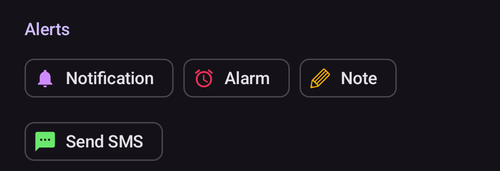

# Automatisation

```{contents} In this page
:backlinks: entry
:depth: 2
```

## Qu'est-ce que l'Automatisation ?

L'« **Automatisation** » est une fonction qui peut automatiser des tâches dans AAPS.

L'Automatisation exécute des actions précises en fonction d'une ou plusieurs conditions ou déclencheurs. Les déclencheurs peuvent être des événements irréguliers, comme une glycémie basse ou haute, ou une quantité définie d'insuline active (IA) négative. Les Automatisations peuvent aussi gérer des événements répétitifs, comme des repas ou du sport à certaines heures de la journée, ou quand l'utilisateur se trouve à une certaine distance d'une position GPS ou dans la zone d'un SSID WiFi. L'Automatisation peut faire des sauvegardes des paramètres d'AAPS selon un horaire ou à chaque changement de Pod.

Les règles d'Automatisation se créent et se modifient dans l'écran **Automatisation** (**Gestion → Automatisation**). Chaque règle est définie par deux éléments :

- Une ou plusieurs conditions ou « déclencheurs » qui lancent une action.

    Par exemple un horaire, un événement ou la valeur d'une donnée dans AAPS

- Une ou plusieurs actions à exécuter.

    Par exemple une alarme, le réglage d'un pourcentage de profil ou l'export des paramètres d'AAPS au changement de Pod.


Il existe beaucoup d'options d'Automatisation. Nous conseillons aux utilisateurs de les étudier dans l'application AAPS, dans la section Automatisation. Vous pouvez aussi chercher des exemples d'Automatisations d'autres utilisateurs dans les groupes d'utilisateurs AAPS sur [**Facebook**](https://www.facebook.com/groups/AndroidAPSUsers) et [**Discord**](https://discord.gg/4fQUWHZ4Mw).

## Ce que l'Automatisation peut apporter

1. **Automatiser les tâches répétitives :** exécuter automatiquement des actions programmées, sans intervention de l'utilisateur.

1. **Moins de fatigue liée aux décisions :** le principal avantage des **Automatisations** est de libérer l'utilisateur des interventions manuelles dans **AAPS**. Des [études](https://www.ncbi.nlm.nih.gov/pmc/articles/PMC6286423/#ref4) estiment qu'une personne vivant avec un diabète de type 1 doit prendre en moyenne 180 décisions de plus chaque jour. Les **automatisations** peuvent réduire la charge mentale, libérant ainsi l'énergie mentale de l'utilisateur pour d'autres aspects de la vie.

1. **Un meilleur contrôle glycémique possible :** par exemple, les **Automatisations** peuvent garantir que les **Cibles Temp** sont toujours activées quand il le faut, même pendant les journées chargées ou les moments d'oubli. Par exemple, si un enfant diabétique a du sport à l'école le mardi à 10 h et le jeudi à 14 h, et qu'il a besoin d'une Cible Temp haute (« CT ») 30 minutes avant le sport, la **Cible Temp** peut être activée par une **Automatisation**.

1. **Permettre de personnaliser AAPS en détail**, pour qu'il soit plus ou moins agressif dans certaines situations, selon les préférences de l'utilisateur. Par exemple, lancer temporairement un **Profil** réduit (en %) pendant une durée définie si une **IA** négative apparaît au milieu de la nuit, ce qui montre que le **Profil** actuel est peut-être trop fort.

L'exemple ci-dessous montre comment une **Automatisation** peut diminuer le nombre d'étapes nécessaires.

Un utilisateur fait du sport chaque matin à 6 h : il doit penser à régler manuellement une « Cible Temp Activité » dans AAPS à 5 h, avant le sport.


L'utilisateur a créé une **Automatisation** qui déclenche à 5 h une « Cible Temp Activité », pour que sa **glycémie** et son **IA** soient optimales avant son sport de 6 h :


## Considérations importantes avant de commencer avec les Automatisations

1. Avant de créer certaines Automatisations, vous devez avoir un contrôle raisonnable de votre **glycémie** avec **AAPS**. Les Automatisations ne doivent pas servir à compenser des réglages de basal, de **SI** ou de **G/I** mal ajustés (voir plus bas). Évitez de régler un **Changement de profil** automatique pour compenser des hausses de **glycémie** dues _par ex._ aux repas : il vaut mieux les gérer avec d'autres stratégies (SMB, etc.).

1. Comme toute technologie, les **MGC**, les **Pompes** et les téléphones peuvent tomber en panne : des problèmes techniques ou des erreurs de capteur peuvent perturber les actions des **Automatisations**, et une intervention manuelle peut être nécessaire.

1. **Les besoins en automatisations vont probablement changer quand vos habitudes changent**. Quand vous passez d'une période de travail, d'école ou de vacances à une autre, mettez un rappel dans votre agenda pour vérifier quelles **Automatisations** sont actives (elles sont faciles à activer et à désactiver). Par exemple, si vous partez en vacances et que vous n'avez plus besoin d'une Automatisation pour le sport à l'école ou le sport quotidien, ou si vous devez changer les horaires.

1. Les **Automatisations** peuvent entrer en conflit entre elles. Il est bon de vérifier avec soin toute nouvelle **Automatisation** dans un environnement sûr, et de comprendre pourquoi une **Automatisation** s'est déclenchée ou non comme vous l'attendiez.

1. Si vous utilisez Autosens, essayez d'utiliser des **Cibles Temp** plutôt que des **Changements de profil**. Les **Cibles Temp** ne remettent pas Autosens à 0. Les **Changements de profil** remettent Autosens à zéro.

1. La plupart des **Automatisations** devraient être réglées seulement pour une **durée limitée**. Ensuite, **AAPS** peut réévaluer la situation et répéter l'**Automatisation** si nécessaire et si la condition est toujours remplie. Par exemple, « démarrer une cible temporaire de 7,0 mmol/l pendant 30 min » ou « démarrer le **Profil** à 110 % pendant 10 min » _et_ « démarrer une cible temporaire de 5,0 mmol/l pendant 10 min ». Utiliser des **Automatisations** pour faire des changements permanents (par ex. un % de profil plus fort) comporte un risque d'hypoglycémie.

## Quand puis-je commencer à utiliser l'Automatisation ?

Les **Automatisations** peuvent être utilisées à partir de l'**objectif 10**.

## Où se trouvent les Automatisations dans AAPS ?

Ouvrez **Gestion** dans la barre de navigation en bas de l'écran principal et choisissez **Automatisation**.

## Comment créer une Automatisation ?

Pour créer une **Automatisation**, appuyez sur le bouton **+** de l'écran Automatisation pour créer une « règle » :


* donnez un titre à votre « règle » (Nom de tâche) ;
* appuyez sur « **ÉDITER** » sous **Condition**. Dans l'écran **Condition**, choisissez comment les déclencheurs sont combinés (**Et**, **Ou**, **Exclusif ou**) et appuyez sur « **Ajouter un déclencheur** » :


* ajoutez au moins un déclencheur :


* appuyez sur « **AJOUT** » sous **Action** et choisissez une action :


* enregistrez la règle avec le bouton **Enregistrer**, et vérifiez que la case à gauche du nom de la règle est « cochée » pour activer l'**Automatisation** :


Pour désactiver une règle d'**Automatisation**, décochez la case à gauche du nom de l'**Automatisation**. L'exemple ci-dessous montre une **Automatisation** activée (« cochée ») ou désactivée (« décochée ») :


Quand vous créez une **Automatisation**, vous pouvez d'abord la tester en choisissant l'option « notification » dans « Actions ». Ainsi, **AAPS** affiche d'abord une notification au lieu d'exécuter vraiment une action. Quand vous êtes sûr que la notification se déclenche au bon moment et dans les bonnes conditions, vous pouvez modifier la règle d'**Automatisation** et remplacer la « Notification » par une « Action ».



```{admonition} Important note
:class: note

Les **Automatisations** restent actives quand la Boucle est désactivée !
```


## Quand les règles sont vérifiées

**AAPS** vérifie toutes les règles d'**Automatisation** chaque fois qu'une nouvelle glycémie a été traitée. Les règles sont donc évaluées au rythme de votre MGC, même quand l'écran du téléphone est éteint. Les règles sont aussi vérifiées quand le téléphone commence à charger, quand le réseau ou la localisation change, et quand un appareil Bluetooth se connecte. Une seule vérification a lieu à la fois : une règle dont les actions prennent du temps (par exemple une commande à la pompe) ne peut donc pas être exécutée deux fois.

## Limites de sécurité

Les **Automatisations** ont des limites de sécurité :

* Une **Cible Temp** réglée par une **Automatisation** doit être entre 72 et 180 mg/dl (ou 4 et 10 mmol/l).
* Le **Pourcentage du profil** doit être entre 50 % et 130 %.
* Il y a un délai de 5 minutes entre deux exécutions d'une **Automatisation** (et avant la première exécution).

## Bonne utilisation des valeurs négatives

```{admonition} Warning
:class: warning

Soyez prudent quand vous choisissez une valeur négative dans une **Automatisation**
```

Soyez prudent quand vous choisissez une « valeur négative » dans une « Condition » comme « inférieur à » dans les **Automatisations**. Par exemple :


**Exemple 1 :** créer une condition **« est inférieur à »** « -0,1 mmol/l » (ou « -2 mg/dl ») va :

Déclenche une **Automatisation** pour tout nombre **strictement inférieur** à -0,1 (-2). Cela comprend des nombres comme -0,2, -0,3, -0,4 (-4, -6, -8), etc. Attention : -0,1 (-2) lui-même **n'est pas** compris dans cette condition. (La condition « est inférieur ou égal à -0,1 mmol/l (-2 mg/dl) » _comprendrait_ -0,1 mmol/l ou -2 mg/dl.)

**Exemple 2 :** créer une condition « est supérieur à » -0,1 mmol/l (-2 mg/dl) va :

Déclencher une **Automatisation** pour tout nombre **supérieur** à -0,1 mmol/l (-2 mg/dl). Cela comprend des nombres comme 0, 0,2, 0,4 mmol/l (0, 4, 8 mg/dl) et tout autre nombre positif.

Il est important de bien réfléchir au but exact de votre **Automatisation** quand vous choisissez ces conditions et ces valeurs.

(automations-automation-triggers)=
## Déclencheurs d'Automatisation


Faites défiler vers le bas pour voir le reste de la liste :


L'utilisateur peut choisir différents « Déclencheurs ». Les déclencheurs sont les conditions qui doivent être remplies pour que l'automatisation s'exécute. La liste ci-dessous n'est pas complète :

**Déclencheur :** relier des conditions

**Options :**

Plusieurs conditions peuvent être reliées par
* « Et »
* « Ou »
* « Exclusif ou » (cela veut dire que si une condition, et une seule, est vraie, la ou les actions sont exécutées)

**Déclencheur :** heure ou période répétitive

**Options :**

* heure = événement unique
* Période répétitive = quelque chose qui arrive régulièrement (par ex. une fois par semaine, chaque jour ouvrable, etc)

**Déclencheur :** localisation

**Options :**

* dans [Paramètres > Automatisation](#preferences-maintenance-settings), l'utilisateur peut choisir le service de localisation voulu.

**Déclencheur :** service de localisation

**Options :**

* Utiliser la localisation passive : **AAPS** prend la localisation seulement quand d'autres applications la demandent.
* Utiliser la localisation par le réseau : localisation de votre WiFi.
* Utiliser la localisation GPS (Attention ! Cela peut vider fortement la batterie !)

**Déclencheurs** : données de la pompe et du capteur

* Déclencheur Âge canule : disponible pour toutes les pompes
* Déclencheur Âge de l'insuline : disponible pour les pompes compatibles
* Déclencheur Âge de la pile : disponible pour les pompes compatibles
* Déclencheur Âge capteur : toujours disponible
* Déclencheur Activation du pod : disponible pour les pompes patch

Pour tous les déclencheurs d'âge, la comparaison « égal » ne se déclenche presque jamais. Dans ce cas, il faut deux déclencheurs pour créer une plage

* Déclencheur Niveau du réservoir : disponible pour toutes les pompes. La comparaison "NOT\_AVAILABLE" ne fonctionne pas pour ce déclencheur, car la valeur est toujours remplie dans **AAPS**
* Déclencheur Niveau de la pile pompe : disponible pour les pompes compatibles. La comparaison "NOT\_AVAILABLE" ne fonctionne pas pour ce déclencheur, car la valeur est toujours remplie dans **AAPS**

(automations-automation-action)=
## Action


Faites défiler vers le bas pour voir le reste de la liste :


**Actions :** démarrer une **Cible Temp**

**Options :**

* La **glycémie** doit être entre 72 mg/dl et 180 mg/dl (4 mmol/l et 10 mmol/l)
* La **CT** fonctionne seulement s'il n'y a pas de Cible Temp en cours. **AAPS** ajoute automatiquement à la règle la ligne « **Conditions préalables : Cible Temp n'existe pas** »

**Actions :** arrêter la **Cible Temp**

**Options :**

aucun

**Actions :** **Pourcentage du profil**

**Options :**

* Le **Profil** doit être entre 50 % et 130 %
* fonctionne seulement si le pourcentage précédent est de 100 %

**Actions :** **Changer le lissage**

**Options :**

* choisissez la [méthode de lissage](../CompatibleCgms/SmoothingBloodGlucoseData.md) à activer
* s'exécute seulement si cette méthode de lissage n'est pas déjà active. **AAPS** ajoute automatiquement à la règle la ligne « **Conditions préalables : Lissage … n'est pas actif** ». Une fois le lissage choisi actif, la règle est ignorée sans message.
* Exemple : avec le déclencheur **Âge capteur**, passez au **Lissage moyen** pendant le premier jour d'un nouveau capteur, puis revenez à **Pas de lissage** ensuite.

**Actions :** **Remarque** (dans le groupe **Alertes** de la liste)

**Options :**

* choisissez l'événement à enregistrer : **Remarque**, **Activité Physique**, **Question**, **Notification** ou **Changement de site**, et une remarque facultative. Le nom de l'action change selon l'événement choisi.
* **Durée** : utilisée pour **Remarque**, **Activité Physique** et **Changement de site**. **Question** et **Notification** n'ont pas de durée : elles enregistrent votre glycémie actuelle à la place.
* **Changement de site** remet à zéro l'âge de la canule, comme si vous aviez enregistré un changement de site à la main. Exemple : certaines pompes (comme la Combo) enregistrent elles-mêmes un changement de réservoir, mais pas le changement de site. Si vous changez toujours les deux en même temps, une règle avec **Âge de l'insuline** inférieur à 1 heure et **Âge canule** supérieur à 24 heures peut enregistrer le changement de site pour vous.

 

**Actions :** **Envoyer SMS** (dans le groupe **Alertes**)

**Options :**

* saisissez le texte du message. Il est envoyé à tous les numéros de téléphone autorisés dans les paramètres du [Communicateur SMS](../RemoteFeatures/SMSCommands.md). Le plugin Communicateur SMS doit être activé.

**Actions :** **Remplacer le profil par** (dans le groupe **Profil**)

**Options :**

* choisissez le **Profil** à activer. Il est activé à 100 %, sans décalage horaire. Si ce profil est déjà actif, l'action ne fait rien.

**Actions :** **Activer/désactiver SMB** (dans le groupe **Boucle & insuline**)

**Options :**

* choisissez **ACTIVÉ** ou **DÉSACTIVÉ**. Cela change le paramètre **Activer SMB** d'OpenAPS SMB, exactement comme si vous l'aviez changé dans les **Paramètres**, et le changement reste jusqu'à ce que vous ou une autre règle le changiez à nouveau.

**Actions :** **Profil Autotune** (dans le groupe **Boucle & insuline**)

**Options :**

* choisissez le profil à optimiser et le nombre de jours : voir [Lancer Autotune avec une règle d'automatisation](#autotune-run-autotune-with-an-automation-rule).

**Actions :** **Arrêter le traitement** (dans le groupe **Boucle & insuline**)

**Options :**

* aucun. Quand une règle avec cette action s'exécute, **AAPS** ne vérifie pas les règles situées en dessous dans la liste pendant ce passage. Ajoutez-la à une règle qui doit être prioritaire sur les règles situées en dessous (voir [l'ordre des Automatisations](#Automations-the-order-of-the-automations-in-the-list-matters)).

**Actions :** **Exécuter le scénario**, **Activer le scénario**, **Désactiver le scénario** (dans le groupe **Scénarii**)

**Options :**

* choisissez le [scénario](Scenes.md) à exécuter, activer ou désactiver.

Une fois l'« Action » ajoutée, vous devez remplacer les valeurs par défaut par les valeurs voulues : touchez les valeurs par défaut et ajustez-les.


(Automations-the-order-of-the-automations-in-the-list-matters)=
## L'ordre des **Automatisations** dans la liste est important
 **AAPS** exécute les règles dans leur ordre de priorité, en commençant par le haut de la liste des **Automatisations**. Par exemple, si l'**Automatisation** « Basse » est l'**Automatisation** la plus importante, avant toutes les autres règles, cette **Automatisation** doit se trouver en haut de la liste des **Automatisations** de l'utilisateur, comme ci-dessous :


Pour changer la priorité des règles d'**Automatisation**, maintenez le doigt sur la poignée **=** à droite de la règle. Réordonnez les **Automatisations** en déplaçant les règles vers le haut ou vers le bas.


## Comment supprimer des règles d'Automatisation

Pour supprimer une règle d'**Automatisation**, touchez l'icône de la corbeille.


## Exemples d'Automatisations

Voici des exemples d'**Automatisations**. Vous trouverez d'autres discussions sur les **Automatisations**, et sur la façon dont les utilisateurs ont personnalisé leur **Automatisation**, dans les groupes de discussion Facebook ou sur Discord. Ne copiez pas les exemples ci-dessous sans bien comprendre comment l'**Automatisation** va fonctionner.

(automations-low-glucose-temp-target)=
### Cible temp. Glycémie basse

Cette **Automatisation** déclenche automatiquement une **Cible Temp** quand la **glycémie** passe sous un certain seuil. Ici, quand la glycémie est inférieure à 70 mg/dl, une cible de 110 mg/dl est démarrée pendant 30 minutes :


### Cible Temp à l'heure du déjeuner (avec « Localisation »)


Cette **Automatisation** a été créée pour un utilisateur qui déjeune au travail à peu près à la même heure chaque jour de semaine. Elle se déclenche seulement si l'utilisateur se trouve dans une « localisation » définie.  Donc, si l'utilisateur n'est pas au travail un jour, cette **Automatisation** ne s'active pas.

Cette **Automatisation** règle une **Cible Temp** basse (Repas imminent) à 13:00 pour amener la glycémie à 90 mg/dl (ou 5 mmol/l) avant le déjeuner.

Le « Déclencheur » localisation a un nom, une position (appuyez sur **Choisir depuis la carte** ou utilisez votre position actuelle) et un rayon en mètres. Il se déclenche quand vous êtes dans la zone (ou en dehors) :


Grâce à la liaison « Et », l'**Automatisation** s'exécute seulement pendant l'« heure choisie » et si l'utilisateur est à la localisation choisie.

L'**Automatisation** ne se déclenche pas à un autre moment à cet endroit, ni à cette heure en dehors du rayon de 50 mètres autour de la position choisie.

### Automatisation avec localisation par SSID WiFi

Un SSID WiFi est une bonne option pour déclencher une **Automatisation** quand vous êtes à portée d'un réseau WiFi précis (comparé au GPS) : il est assez précis, utilise moins de batterie et fonctionne dans les lieux fermés où le GPS et les autres services de localisation ne sont pas toujours disponibles.

Voici un autre exemple : une **Cible Temp** pour les jours de travail seulement, avant le petit-déjeuner (1).


L'**Automatisation** se déclenche à 05:30 du lundi au vendredi seulement (2)  
et quand le téléphone est connecté au réseau WiFi de la maison (3).


Elle règle alors une **Cible Temp** de 75 mg/dl pendant 30 minutes (4). Un des avantages d'ajouter la localisation est que la règle ne se déclenche pas, par exemple, si l'utilisateur est en vacances.


Faites défiler vers le bas pour voir l'action : une **Cible Temp** de 75 mg/dl pendant 30 minutes (4).


Voici la capture d'écran qui détaille les déclencheurs de l'**Automatisation** :

1) Sous le « ET » principal (les deux conditions doivent être remplies pour déclencher) 1) Période répétitive = L,M,M,J,V à 5:30  
1) SSID WiFi = My_Home_WiFi_Name


(automating-preference-settings-export)=

## Automatiser l'export des paramètres

### Exports automatiques : programmés (chaque jour)

Captures d'écran qui détaillent les déclencheurs de l'Automatisation :

1) Condition : Période répétitive = L,M,M,J,V à 8:00 1) Action : Export des paramètres (pour « Text in treatments » [texte dans les traitements], saisissez « Daily » [quotidien])


Remarque : l'exécution de l'export est enregistrée dans le Careportal

### Exports automatiques : Activation du pod (pompe patch seulement)

Captures d'écran qui détaillent les déclencheurs de l'Automatisation :

1) Condition : Activation du pod 1) Action : Export des paramètres (pour « Text in treatments » [texte dans les traitements], saisissez « Pod Activation: settings export »)


Remarque : l'exécution de l'export est enregistrée dans le Careportal. Remarque : l'Automatisation ne se déclenche **pas du tout** si vous n'avez jamais fait d'export manuel des paramètres avant. Voir [Paramètres → Maintenance](#preferences-maintenance-settings) pour bien activer l'export automatique des paramètres.


## Journal des Automatisations

**AAPS** affiche un journal des derniers événements d'**Automatisation** en bas de l'écran **Automatisation**, sous les règles. Utilisez-le pour vérifier que vos règles se sont déclenchées au moment attendu.

Dans l'exemple ci-dessous, la règle **Cible temp. Glycémie basse** (1) (voir [Cible temp. Glycémie basse](#automations-low-glucose-temp-target) ci-dessus) est activée. Le journal (2) montre qu'à 15:09, la glycémie est passée sous 70 mg/dl et que la règle s'est déclenchée :
* l'action était « Démarrer la cible temp : 110mg/dL@30 min » : une **Cible Temp** de 110 mg/dl pendant 30 minutes ;
* **OK** à la fin signifie que l'action a été exécutée avec succès.


(automations-troubleshooting)=

## Dépannage

* Problème : __Mes automatisations ne sont pas déclenchées par AAPS ?__

Vérifiez que la case à gauche du nom de l'**Automatisation** est « cochée » pour que la règle soit active :


* Problème : __Mes automatisations sont déclenchées dans le mauvais ordre.__

Vérifiez l'ordre de priorité de vos règles, comme expliqué plus haut.

* Problème : __Une condition affiche « Déclencheur … inconnu - jamais vrai ».__

La règle contient un déclencheur que cette version d'**AAPS** ne peut pas lire, par exemple après un retour à une version plus ancienne ou après l'import de paramètres d'une version plus récente. Un tel déclencheur n'est jamais vrai, donc la règle ne s'exécute pas. Il est gardé sans changement, pour qu'une version plus récente puisse encore l'utiliser. Modifiez la règle et remplacez le déclencheur, ou mettez à jour **AAPS**.

## Alternatives aux Automatisations

Pour les utilisateurs avancés, il existe d'autres moyens d'automatiser des tâches, avec IFTTT ou avec une application Android tierce appelée Automate. 
