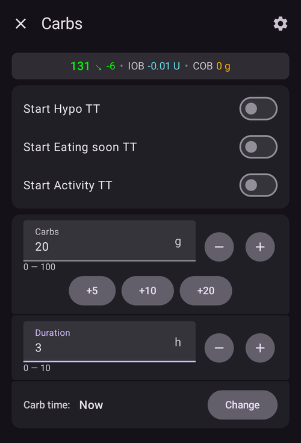

(Extended-Carbs-extended-carbs-ecarbs)=
# Glucides étendus / "eGlucides"

## Que sont les eGlucides et quand sont-ils utiles?

Avec une thérapie par pompe régulière, Les bolus étendus sont un bon moyen de traiter les repas gras ou absorbés lentement et dont l'impact sur l'augmentation de la glycémie est plus long que la durée d'action de l'insuline. Cependant dans un contexte de boucle, les bolus étendus n'ont pas autant d'intérêt (et posent des difficultés techniques) car il s'agit d'un débit de basal fixe élevé, qui va à l'encontre du fonctionnement de la boucle, qui ajuste dynamiquement le débit de basal. For details see [extended bolus](#extended-bolus-and-why-they-wont-work-in-closed-loop-environment) below.

Mais le besoin de prendre en charge de tels repas existe toujours. Which is why AAPS supports so called extended carbs or eCarbs.

eCarbs are carbs that are split up over several hours. Pour les repas standard avec plus de glucides que de graisse/protéines, entrer les glucides à l'avance (et réduire le bolus initial si nécessaire) est généralement suffisant pour éviter d'injecter trop tôt de l'insuline.  Mais pour les repas à absorption plus lente où l'entrée de la totalité des glucides au début entraîne trop d'IA injectée par les SMB, les eGlucides peuvent être utilisés pour simuler plus précisément comment les glucides (et tous les équivalents de glucides que vous entrez pour les autres macronutriments) sont absorbés et influencent la glycémie. Grâce à cette information, la boucle peut gérer les glucides en administrant les SMB de façon plus progressive, ce qui peut être assimilé à un bolus prolongé dynamique (cela devrait également fonctionner sans les SMB, mais probablement moins efficacement).

**Remarque :** Les eGlucides ne sont pas limités aux repas lourds en graisses/protéines : ils peuvent également être utilisés pour aider dans toutes les situations où il y a des influences qui augmentent les glycémies, par ex.

## Mécanique d'utilisation d'eGlucides

To enter eCarbs, open the **Carbs** dialog (**Treatments** → **Carbs**), enter the total carbs, set a **Duration**, and optionally shift the start with **Carb time** (*numbers below are just examples, you will need to try your own values to arrive at satisfactory glucose response for your use-cases*):

The eCarbs on the main screen: the number in brackets in the **COB** field shows the carbs still to come, and the **COB** graph shows each future eCarbs entry as an orange marker. If you don't see a **COB** graph, add one with **Add graph** below the graphs (see [AAPS screens](../DailyLifeWithAaps/AapsScreens.md)).

(AapsScreens-carbs-type)=
## Carbs type in the Bolus wizard: bread, cake or pizza

In the [Bolus wizard](#aaps-screens-bolus-wizard), three buttons below the **Carbs** field let you choose how fast your meal is absorbed. Pick one before you confirm. Depending on the type, **AAPS** takes a part of the carbs you typed as normal carbs, and adds [extended carbs ("eCarbs")](#Extended-Carbs-extended-carbs-ecarbs) later for slow, rich meals. Press the **(i)** icon next to the buttons to see the typical foods for the selected type and what it does to your carbs.

| Type                | Typical foods (as listed in the app)                                                                 | Carbs now, used for the bolus | eCarbs added                                         |
| ------------------- | ---------------------------------------------------------------------------------------------------- | ----------------------------- | ---------------------------------------------------- |
| **Bread** (default) | Bread, savory pastries, yogurt, fruit, potatoes, rice, oatmeal, vegetables                           | 100 %                         | None                                                 |
| **Cake**            | Dumplings, pasta, Asian dishes rich in carbs and fats, sweet and yeast pastries, cereals, honey, jam | 90 %                          | 20 %, starting 60 minutes later, spread over 2 hours |
| **Pizza**           | Lasagna, pizza, hamburgers, fries, baked potatoes, chips                                             | 80 %                          | 35 %, starting 60 minutes later, spread over 3 hours |

**Example**: you type 100 g and choose **Pizza**. The bolus is calculated for 80 g, recorded now. 35 g of eCarbs start 1 hour later and are spread over 3 hours.

Good to know:
* This is not a simple split: with **Cake** and **Pizza**, the carbs recorded add up to **more than you typed** (110 % and 115 %). The extra is only in the eCarbs.
* The bolus only covers the carbs taken now. **AAPS** does not bolus up front for the eCarbs: the loop takes them into account once they start, like any other [eCarbs](#Extended-Carbs-extended-carbs-ecarbs).
* If you set a **Carb time**, the eCarbs start 60 minutes after that time.
* The confirmation dialog shows the eCarbs on their own line, _e.g._ "eCarbs 35g / 3h (+60min)".
* Grams are rounded down to whole numbers.
* The percentages, delays and durations are fixed; they can't be changed in the settings.
* The choice is not remembered: the wizard opens on **Bread** every time.

______________________________________________________________________

Une façon de gérer les graisses et les protéines avec cette fonctionnalité est décrite ici: [https://adriansloop.blogspot.com/2018/04/page-margin-0.html](https://adriansloop.blogspot.com/2018/04/page-margin-0.html)

______________________________________________________________________

## Configuration recommandée, exemple de scénario, et notes importantes

La configuration recommandée est d'utiliser le plug-in OpenAPS SMB, avec les SMB activés ainsi que le paramètre *Activer SMB avec les glucides* activé.

A scenario e.g. for a Pizza might be to give a (partial) bolus up front via the *Bolus wizard* and then use the *Carbs* dialog to enter the remaining carbs for a duration of 4-6 hours, starting after 1 or 2 hours.

For a quicker start, the *Bolus wizard* can add eCarbs for you: choose the [carbs type](#AapsScreens-carbs-type) **Cake** or **Pizza** below the **Carbs** field (see above). The amounts and timing are fixed, so use the *Carbs* dialog instead if you want other values.

**Remarques importantes :** Vous devrez essayer et voir quelles sont les valeurs qui marchent pour vous bien sûr. Vous pouvez également ajuster soigneusement le paramètre *Max minutes de basal pour limiter SMB* pour rendre l'algorithme plus ou moins agressif. Avec des repas faibles en glucides et riches en graisses/protéines, il peut être suffisant d'utiliser uniquement des eGlucides sans bolus manuels (voir le blog ci-dessus). Lorsque des eGlucides sont générés, une note Careportal est également créée pour pouvoir documenter toutes les entrées, et faciliter les itérations et l'amélioration des entrées.

(extended-bolus-and-why-they-wont-work-in-closed-loop-environment)=
## Bolus étendu et pourquoi ils ne fonctionneront pas dans une boucle fermée ?

Comme mentionné ci-dessus, les bolus étendus ou mixtes ne fonctionnent pas vraiment dans un environnement en boucle fermée. [See below](#why-extended-boluses-wont-work-in-a-closed-loop-environment) for details

(Extended-Carbs-extended-bolus-and-switch-to-open-loop-dana-and-insight-pump-only)=
### Bolus étendus et passage en boucle ouverte - uniquement pour les pompesDana et Insight

Certaines personnes ont demandé une option pour utiliser des bolus étendus dans AAPS, car ils voulaient traiter les aliments spéciaux comme ils avaient l'habitude de le faire.

That's why **AAPS** offers an extended bolus for users of Dana and Insight pumps: open **Manage** and select **Extended Bolus**.

**AAPS** first warns you that the closed loop will be stopped while the extended bolus runs. Tap **OK** to continue:

Enter the **Insulin** amount and the **Duration**, then tap the confirm button at the bottom and **OK**:

On the Insight pump, the extended bolus is *not available* if [TBR emulation](#Accu-Chek-Insight-Pump-settings-in-aaps) is used.

While the extended bolus is running, the loop runs in **Open Loop** mode (the loop icon on the main screen changes), and closed loop is switched on again automatically when the extended bolus ends:

The **Manage** menu shows a **Cancel** button with the rate and the elapsed / total time (for example **Cancel 2.00 U/h 1/60'**). Tap it to stop the extended bolus early:

(why-extended-boluses-won-t-work-in-a-closed-loop-environment)=
### Pourquoi les bolus étendus ne marchent pas avec une boucle fermée

1. La boucle détermine que maintenant 1,55 U / h doit être délivré. Que ce soit administré sous forme de bolus étendu ou de DBT n'a pas d'importance pour l'algorithme. En fait, certaines des pompes utilisent le bolus étendu. Que devrait-il arriver alors ? La plupart des pilotes de pompe arrêtent alors le bolus prolongé -> Vous n’avez même pas eu besoin de le démarrer.

2. Si vous aviez le bolus étendu en entrée, que devrait-il se passer dans le modèle?

   1. Doit-il être considéré comme neutre avec le débit de Basal et faire la boucle dessus ? Ensuite, la boucle devrait également être en mesure de réduire le bolus si, par exemple, vous devenez trop bas et que toute l'insuline "neutre" est éliminée ?
   2. Faut-il simplement ajouter le bolus étendus ? Donc, la boucle devrait simplement être autorisée à continuer ? Même dans la pire des hypo ? Je ne pense pas que ce soit si bon : une hypo est prévue, mais il ne faut pas l'empêcher ?

3. L'IA que le bolus étendu accumule est prise en compte après 5 minutes lors du prochain calcul. En conséquence, la boucle donnerait moins de basal. Donc pas beaucoup de changements... exepté la possibilité d'éviter une hypo.
