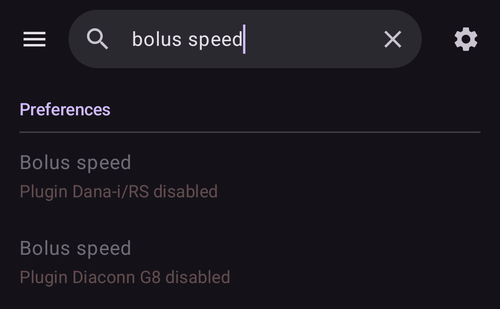

(global-search)=
# Recherche globale

**AAPS** v4 a un champ de **recherche globale** en haut de l'écran principal. Tapez un mot et la recherche parcourt toute l'application en une fois — plugins, boîtes de dialogue, écrans de paramètres, préférences individuelles — et aussi, si vous êtes en ligne, la **documentation AndroidAPS**. C'est le moyen le plus rapide d'aller à un paramètre ou à un écran sans vous rappeler où il se trouve.

```{contents} Table of contents
:depth: 2
:local: true
```

---

## Ouvrir la recherche

Appuyez sur le champ **🔍 Recherche** en haut de la **Vue d'ensemble** (à côté du menu ☰). Commencez à taper : les résultats apparaissent pendant la saisie (après une courte pause), groupés par catégorie :


Effacez le champ avec le **✕**, ou fermez la recherche avec le bouton **Retour** de l'appareil.

---

## Rechercher en anglais *ou* dans votre langue

Ceci est important à savoir : la recherche compare **à la fois** le texte dans votre **langue choisie** **et** le texte original en **anglais**.

- Si votre application est, par exemple, en allemand ou en tchèque, vous pouvez taper le mot **traduit** **ou** le mot **anglais** — les deux trouvent le paramètre.
- Une correspondance sur le titre **traduit** est classée en premier, puis le titre **anglais**, puis les **descriptions** traduites et anglaises.
- La recherche ignore les **accents/signes diacritiques** (ainsi *ů* correspond à *u*, *é* correspond à *e*) et ne tient **pas compte des majuscules/minuscules**.

Ainsi, un guide ou un message de forum écrit en anglais vous mène quand même au bon paramètre, même si votre téléphone affiche tout en traduction.

---

## Ce que couvre la recherche

Les résultats sont groupés dans ces catégories :

- **Plugins** — chaque plugin visible dans votre version (les mêmes que ceux listés dans [Configuration](../SettingUpAaps/ConfigBuilder.md)). Chaque ligne de plugin a son **interrupteur d'activation**, vous pouvez donc activer ou désactiver un plugin directement depuis les résultats — appuyer sur la ligne d'un plugin désactivé (activable) l'active.
- **Dialogues** — les écrans de traitement/action et de gestion (Assistant Bolus, Insuline, Bolus étendu, Étalonnage, Cible Temp, Profil, …). Les écrans qui ne s'appliquent pas à votre version sont exclus (par exemple *Associer au maître* sur un maître, *Clients autorisés* sur un client).
- **Catégories de préférence** — les **écrans** et sous-écrans de paramètres, intégrés (Général, Apparence, Protection, Alertes, Maintenance, …) ou venant des plugins, plus les petits groupes de paramètres ouverts depuis les boîtes de dialogue (boutons Remplir, pas des boutons Insuline/Glucides, seuils des voyants d'état, paramètres de l'assistant, …).
- **Préférences** — chaque **paramètre individuel** qui a un titre. Ils sont filtrés selon votre version/mode, vous ne voyez donc que les paramètres qui s'appliquent vraiment (APS / NSClient / contrôle de la pompe).
- **Documentation** — des pages de la **documentation AndroidAPS** en ligne (voir ci-dessous).

```{admonition} Settings that belong to a disabled plugin
:class: note
Une préférence dont le plugin est actuellement **désactivé** apparaît quand même — **grisée** et non cliquable — avec une remarque *« Plugin … désactivé »*, pour que vous sachiez que le paramètre existe et quel plugin activer pour y accéder.


```

---

## Résultats de la documentation (en ligne)

Pendant la recherche locale, **AAPS** interroge aussi en parallèle la **documentation AndroidAPS** officielle (hébergée sur ReadTheDocs). Les pages trouvées apparaissent dans un groupe **Documentation** en bas, chacune avec une icône 📖, le titre de la section et un court extrait :


- Si la documentation est traduite dans la langue de votre application, **AAPS** recherche en même temps dans les pages traduites et dans les pages en anglais. Les pages dans votre langue viennent en premier, puis les pages en anglais qui n'ont pas déjà été trouvées.
- Appuyer sur un résultat de la documentation ouvre cette page dans votre **navigateur**.
- La recherche dans la documentation nécessite **internet** — hors ligne, vous voyez à la place la remarque *« La recherche dans la documentation nécessite une connexion internet »*, et les résultats locaux (dans l'application) fonctionnent toujours normalement.

---

## Ouvrir un résultat

Appuyez sur un résultat pour y aller directement :

- **Plugin** → ouvre ce plugin.
- **Dialogue** → ouvre cet écran ou cette boîte de dialogue.
- **Catégorie de préférence** → ouvre cet écran de paramètres.
- **Préférence** → ouvre le paramètre **à sa place** (va directement à lui dans son écran).
- **Documentation** → ouvre la page dans votre navigateur.

L'ouverture des paramètres et des actions protégées respecte toujours votre **[protection](../SettingUpAaps/ConfigBuilder.md)** (PIN/mot de passe), exactement comme si vous y étiez allé à la main. Après avoir agi sur un résultat, vous pouvez appuyer sur **Retour** pour revenir à vos résultats de recherche.

---

## Raccourcis pour utilisateurs avancés

Deux recherches spéciales listent toute une catégorie en une fois :

- `%PLUGINS%` — liste **tous** les plugins.
- `%DIALOGS%` — liste **toutes** les boîtes de dialogue/écrans d'action.

---

```{admonition} The index stays current
:class: note
L'index de recherche est créé la première fois que vous faites une recherche, puis il reste prêt. Il est recréé automatiquement quand vous **activez/désactivez un plugin** ou **changez la langue de l'application**, donc les résultats correspondent toujours à votre configuration actuelle.
```

---


<!-- =====================================================================
     Screenshots captured from a real master device (query "bolus"):
       - search_results.png        (categorized local results: Dialogs / Preference categories / Preferences)
       - search_disabled_plugin.png (greyed-out preference from a disabled plugin)
       - search_documentation.png   (online ReadTheDocs results with 📖 icon + snippets)
     Maintainers: relocate page + images and fix cross-links as needed.
     ===================================================================== -->
