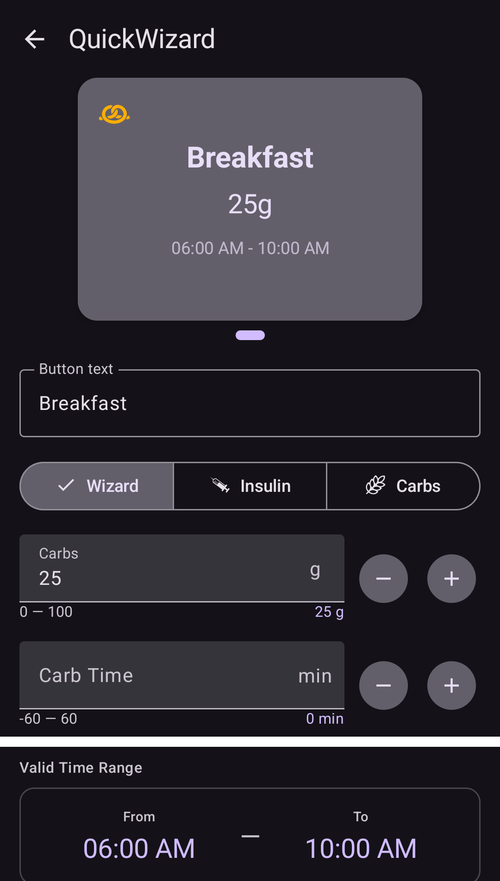

(quickwizards)=
# Assistants rapides (bolus en un seul appui)

Un **Assistant Rapide** est un bouton enregistré, utilisable en un seul appui, pour un repas ou une situation qui revient souvent. Il contient une quantité fixe de **glucides** (et la façon de les doser). Vous pouvez ainsi faire un bolus — ou seulement enregistrer des glucides — avec un seul appui et une confirmation, sans ouvrir à chaque fois l'assistant bolus complet.

```{contents} Table of contents
:depth: 2
:local: true
```

---

## Ouvrir les assistants rapides

Ouvrez l'écran **Gestion** (barre de navigation en bas) et choisissez **Assistant Rapide** (*« Gérer les préréglages de l'assistant rapide »*).

---

## Gérer les assistants rapides

Vos assistants rapides sont affichés sous forme de **carrousel de cartes que vous faites glisser** (chaque carte montre le texte du bouton, les glucides et la période valide). L'éditeur en dessous configure l'assistant rapide **sélectionné**. La barre d'actions en bas contient **➕ ajouter**, **⧉ dupliquer**, **🗑️ supprimer** et un bouton **▶** pour exécuter l'assistant rapide sélectionné.



Les principaux champs de l'éditeur sont :

- **Texte du bouton** — le nom affiché sur le bouton.
- **Glucides** et **Heure des glucides** — la quantité de glucides et son décalage dans le temps.
- **Période valide** — voir [Validité](#quickwizard_validity).
- **Options de Calculateur** et **Sélection du périphérique** — voir plus bas.

---

## Les trois modes

Le sélecteur en haut de l'éditeur — **Assistant / Insuline / Glucides** — décide **ce que fait le bouton** quand vous appuyez dessus :

- **Assistant** — exécute l'**assistant bolus** complet pour les glucides configurés, avec vos valeurs actuelles de **glycémie, IA, GA et tendance** (selon les *Options de Calculateur* ci-dessous). Il injecte le bolus *calculé* et enregistre les glucides. C'est l'assistant rapide classique.
- **Insuline** — injecte une **quantité d'insuline fixe, définie à l'avance** par vous — sans calcul.
- **Glucides** — enregistre **seulement les glucides** configurés, **sans bolus**.

---

## Options de Calculateur (mode Assistant)

Pour un bouton en mode **Assistant**, vous choisissez les données utilisées par le calcul :

- **Utiliser Gly**, **Utiliser GA**, **Utiliser IA** (avec *IA positive uniquement*), **Utiliser Tendance** (*Tous / Positif uniquement / Négatif uniquement*), **Utiliser Cible Temp**, **Utiliser Alarme**.
- **Pourcentage de Bolus** — ajuste le bolus calculé.
- **Ajouter eGlucides** — planifie aussi des glucides étendus.


---

## Validité — quand le bouton apparaît

(quickwizard_validity)= La **Période valide** (*De / À*) contrôle **quand** un assistant rapide est affiché et utilisable. Un bouton réglé par exemple sur **06:00–10:00** n'apparaît que le matin. Ainsi, un assistant rapide *Petit-déjeuner* n'encombre pas votre écran au dîner (et vous ne l'utilisez pas par erreur). En dehors de sa période, le bouton est masqué dans le panneau **Traitements** et dans la [barre QuickLaunch](QuickLaunch.md). Un bouton de la barre n'est pas supprimé : il revient quand la période recommence.

Quand la période valide dure moins de 4 heures, le bouton est aussi masqué pendant 30 minutes après son utilisation. Ainsi, le même repas n'est pas saisi deux fois par erreur.

---

## Points d'appel — où vous l'utilisez

Les options de **Sélection du périphérique** décident où chaque assistant rapide apparaît :

- **Afficher sur le téléphone** — il apparaît dans le **panneau [Traitements](../Maintenance/V4Changes.md)** (la dose calculée est affichée directement sur le bouton). Un assistant rapide affiché sur le téléphone peut aussi être **épinglé comme bouton d'action rapide sur l'écran principal** : ouvrez *Configurer le lancement rapide* (le ⚙ de la barre [QuickLaunch](QuickLaunch.md)) et ajoutez-le depuis la catégorie **Assistant rapide**.
- **Afficher sur la montre** — il apparaît sur la **tuile Assistant Rapide de Wear OS** (faites glisser jusqu'à elle dans le carrousel de tuiles de la montre, puis appuyez sur un bouton pour l'exécuter — comme la [tuile Scénario](#scenes-from-watch)).

```{admonition} Don't see Device Selection?
:class: note
La section **Sélection du périphérique** n'apparaît dans l'éditeur que si le plugin **Montre** est activé et si son option **Contrôle Montre** est activée. Sinon, chaque assistant rapide s'affiche simplement sur le téléphone.
```

Sur le téléphone, les assistants rapides apparaissent en haut du panneau **Traitements** :


…et comme bouton d'action rapide sur l'écran principal :


Un **client** associé (**AAPSClient**) peut aussi lancer un assistant rapide — le **maître** le calcule et l'injecte (voir [Contrôle maître ↔ client](../RemoteFeatures/ClientMasterControl.md)).

Quel que soit l'endroit d'où il est lancé, un appui sur un assistant rapide affiche toujours une **confirmation** avant toute injection (la confirmation créée par le maître, quand il est lancé depuis un client ou une montre).

Un assistant rapide est refusé quand sa dose dépasse votre bolus max, ou quand ses glucides ou eGlucides dépassent votre maximum de glucides (par exemple après que vous avez baissé la limite). Quand les glucides dépassent la limite, le bouton du panneau **Traitements** est désactivé. Modifiez l'assistant rapide ou la limite.

---

## Ajouter et supprimer

- **➕ Ajouter** — crée un nouvel assistant rapide.
- **⧉ Dupliquer** — copie un assistant rapide comme point de départ.
- **🗑️ Supprimer** — supprime un assistant rapide.

Avec deux assistants rapides ou plus, vous pouvez aussi changer leur ordre dans le carrousel : appuyez sur l'icône **Réordonner** (⇅) dans la barre du haut, déplacez la carte du centre avec les **boutons de déplacement ◀ / ▶**, puis confirmez avec **✓**. (Les commandes sont les mêmes que pour [réordonner les profils](ProfileSwitch-ProfilePercentage.md).)

Les assistants rapides font partie de la configuration synchronisée. Ils sont donc partagés entre votre maître et les clients associés.

---


<!-- =====================================================================
     Screenshots captured from a real master device:
       - quickwizard_editor.png   (Manage → QuickWizard: carousel, mode, carbs, carb time, valid time range)
       - quickwizard_options.png  (Calculator Options, Bolus percentage, Device Selection)
       - quickwizard_overview.png (the QuickWizard quick-action button on the overview)
       - quickwizard_watch_tile.png (the Wear OS QuickWizard tile)
     No QuickWizard was actually run (no bolus delivered).
     Maintainers: relocate page + images and fix cross-links as needed.
     ===================================================================== -->
