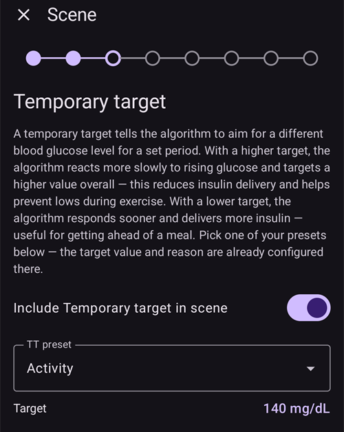
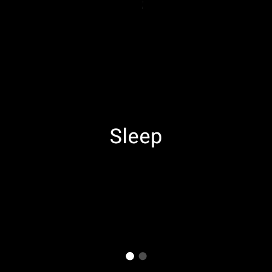

(scenes)=
# Scénarios (préréglages de situation)

Un **scénario** est un préréglage avec un nom qui applique un **ensemble d'actions en une seule fois**. Par exemple, un préréglage *Sommeil*, *Exercice* ou *Journée de maladie* change votre profil, définit une cible temporaire, active ou désactive les SMB et ajoute une note Careportal en un seul appui, si vous le voulez pour une durée fixée.

```{contents} Table of contents
:depth: 2
:local: true
```

---

## Qu'est-ce qu'un scénario

Au lieu de changer plusieurs réglages à la main chaque fois qu'une situation revient, vous les configurez une seule fois dans un scénario et vous l'activez en un seul appui. Un scénario peut regrouper n'importe laquelle de ces actions :

- **Changement de profil** — change de profil et/ou l'ajuste en pourcentage (par ex. 70 %).
- **Cible Temp** — définit une cible temporaire (par ex. *Activité*, *Repas imminent* ou une valeur personnalisée).
- **SMB activé/désactivé** — active ou désactive les super micro bolus pendant que le scénario est actif.
- **Mode de la boucle** — change le mode de fonctionnement (par ex. vers un mode plus prudent).
- **Note Careportal** — enregistre un événement (par ex. *Exercice*, *Maladie*) pour qu'il apparaisse sur le graphique et dans Nightscout.

Un scénario a aussi une **durée** — un temps fixe (minutes/heures/jours) ou *Indéfini (fin manuelle)* — et une **action de fin** qui s'exécute quand il se termine : soit une **notification**, soit un **enchaînement** vers un autre scénario (par exemple *Journée de maladie → Exercice*).

---

## Gérer les scénarios

Ouvrez **Gestion → Scénarii** pour voir, créer, modifier, activer/désactiver et réordonner vos scénarios.


Chaque carte de scénario affiche :

- une **case à cocher** pour activer/désactiver le scénario,
- une **icône** et un **nom**,
- un résumé — *« N actions, durée »*, et le **→ scénario enchaîné** s'il s'enchaîne avec un autre scénario,
- et trois boutons : **▶ activer**, **✏️ modifier**, **🗑️ supprimer**.

Appuyez sur le bouton **+** pour créer un nouveau scénario.

---

## Créer ou modifier un scénario

### Créer à partir d'un modèle

Pour **créer** un scénario, appuyez sur le bouton **+** de l'écran Scénarii. La première étape est **Créer à partir d'un modèle** : choisissez un scénario prêt à l'emploi pour une situation courante — *Exercice*, *Journée de maladie*, *Journée de maladie avec vomissements*, *Sommeil*, *Nuit après exercice*, *Pré-repas*, *Alcool*, *Conduite*, *Baignade*, *Phase lutéale*, *Météo chaude*, *Acte médical* — ou partez d'un scénario *Vide*. Chaque modèle **pré-remplit les actions recommandées** et vous pouvez tout ajuster dans les étapes suivantes.


Après le choix d'un modèle, son but est expliqué — *quand* et *pourquoi* l'utiliser — avant que vous continuiez :


### Parcourir les actions étape par étape

Le reste de l'éditeur est un court assistant **étape par étape**. Chaque étape correspond à un type d'action avec un interrupteur *« Inclure … dans le scénario »*. Activez-le seulement pour les actions que ce scénario doit faire, et laissez les autres désactivées.


Passez d'une étape à l'autre avec **Suivant**/**Précédent** : *Changement de profil*, *Cible Temp*, *SMB*, *Mode de la boucle*, *Note Careportal*, puis la **durée**, l'**action de fin** (notifier ou enchaîner un autre scénario), et enfin le **nom et l'icône** du scénario. Enregistrez quand vous avez fini. (Pour **modifier** un scénario existant, appuyez sur son bouton **✏️** — vous arrivez directement dans ces étapes.)

Chaque étape commence par une courte explication de ce que fait l'action. Les étapes ressemblent à ceci, ici avec le modèle *Exercice* :

**Cible Temp** — choisissez un de vos préréglages de cible temporaire :



**SMB** — active ou désactive les SMB pendant que le scénario est actif :


**Mode** — change le mode de la boucle, si vous le voulez :


**Careportal** — le type d'événement et la note à enregistrer :


**Durée** — combien de temps le scénario reste actif ; 0 veut dire jusqu'à ce que vous le terminiez vous-même :


**Scénario suivant** — si vous le voulez, le scénario qui démarre quand celui-ci se termine :


**Scénario** — le nom et l'icône. Appuyez sur **Terminer** pour enregistrer :


---

## Activer un scénario

Activez un scénario depuis la liste **Scénarii** (le bouton **▶**) ou depuis l'entrée **Scénarii** de la barre de navigation en bas. Dans le panneau **Scénarii** de la barre de navigation en bas, chaque scénario affiche le même résumé que dans la liste des scénarios, et le **crayon** en haut du panneau ouvre **Gestion → Scénarii** pour créer ou modifier vos scénarios.


Avant que quoi que ce soit soit appliqué, vous recevez une **confirmation** qui liste exactement ce que le scénario va faire. Vous pouvez ainsi la vérifier :


Si le scénario s'enchaîne avec un autre, la confirmation se termine par **→** et le nom de ce scénario suivant, comme dans la liste des scénarios.

Quand vous démarrez le scénario depuis l'entrée **Scénarii** de la barre de navigation en bas, la confirmation est une boîte de dialogue plus simple avec la même liste d'actions. Appuyez sur **OK** pour activer :


Après votre confirmation, les actions sont appliquées et le **scénario actif** est affiché en haut de l'écran principal avec un bouton **Terminer le scénario**. Si le scénario s'enchaîne avec un autre, la bannière indique aussi le nom de ce scénario suivant :


Les actions du scénario restent actives jusqu'à ce que :

- sa **durée** se termine (l'**action de fin** s'exécute — une notification, ou l'enchaînement vers le scénario suivant), ou
- vous appuyiez sur **Terminer le scénario** pour le terminer à la main. Si le scénario s'enchaîne avec un autre, vous avez deux choix : **Aller à** (passer au scénario suivant : le scénario actif se termine et le suivant démarre tout de suite), ou **Terminer le scénario** (le scénario actif se termine et le suivant ne démarre pas).

Un scénario sans scénario suivant vous demande seulement de confirmer :


Terminer un scénario **annule** les changements qu'il a faits (par exemple le changement de profil et la cible temporaire qu'il a lancés).

Pendant qu'un scénario est actif, le profil et la cible sur l'écran principal portent une petite icône de scénario quand c'est le scénario qui les a définis. Le panneau **Scénarii** de la barre de navigation en bas reste disponible pour démarrer un autre scénario :


Quand la durée se termine d'elle-même, les changements sont annulés tout de suite et la bannière devient **Scénario terminé** avec un bouton **Fermer**. Fermer enlève seulement la bannière de l'écran — le scénario lui-même est déjà terminé. Les règles d'automatisation et un scénario enchaîné continuent donc sans attendre.

---

## Lancer des scénarios depuis l'automatisation

Un scénario ne doit pas forcément être démarré à la main — l'**Automatisation** peut le lancer pour vous. Quand vous ajoutez une action à une règle d'automatisation (**Gestion → Automatisation**), le choix des actions contient une catégorie **Scénarii** :

- **Exécuter le scénario** — active un scénario quand les déclencheurs de la règle se déclenchent (par exemple à une heure fixée, quand vous arrivez quelque part, ou quand la glycémie passe un seuil).
- **Activer le scénario** / **Désactiver le scénario** — rend un scénario disponible (ou indisponible) sans l'activer.


L'automatisation peut aussi **réagir à** un scénario : la liste des déclencheurs contient un déclencheur **Scénario**. Une règle peut ainsi s'exécuter seulement pendant qu'un scénario précis est actif. Avec l'**action de fin** d'un scénario (annuler, notifier ou enchaîner un autre scénario), cela permet aux scénarios de démarrer, de s'enchaîner et de se terminer automatiquement.

---

## Scénarios avec maître/client et une montre

Le **scénario actif est synchronisé** sur tous vos appareils associés — activez-le sur un téléphone et les autres l'affichent aussi.

Un **client** associé (**AAPSClient**) peut aussi activer ou terminer un scénario : la demande est envoyée au **maître**, qui crée la confirmation et applique le scénario sur son propre état. Voir [Contrôle maître ↔ client](../RemoteFeatures/ClientMasterControl.md) pour savoir comment cela fonctionne.

(scenes-from-watch)=
### Depuis une montre Wear OS

Les scénarios sont disponibles sur une **montre Wear OS** sous forme de **tuile Scénario**. Faites glisser jusqu'à la tuile **Scénario** dans le carrousel de tuiles de la montre (ajoutez-la d'abord depuis la liste des tuiles du carrousel si elle n'y est pas encore) et appuyez sur le scénario que vous voulez démarrer :


La tuile a quatre emplacements. Par défaut, chaque emplacement se remplit **automatiquement** avec le suivant de vos scénarios activés, dans l'ordre qu'ils ont sur le téléphone. Pour choisir vous-même, **faites un appui long sur la tuile** et ouvrez ses réglages : pour chacun des quatre emplacements, vous pouvez garder **Automatique**, épingler un **scénario précis**, ou choisir **Aucun** pour laisser l'emplacement vide. Un emplacement épinglé à un scénario qui a été supprimé ou désactivé depuis affiche **Indisponible** — choisissez un autre scénario pour cet emplacement.

La montre affiche ensuite une confirmation — appuyez sur **✓** pour activer, ou faites glisser vers l'arrière pour annuler :



Comme sur un client, **c'est le maître qui crée la confirmation et exécute le scénario** ; la montre transmet seulement la demande (via le téléphone client, si la montre est associée à un client).

Pendant qu'un scénario est en cours — ou que sa bannière **Scénario terminé** est encore affichée sur le téléphone — la tuile affiche un bouton **Fin** avec le nom du scénario en dessous. Appuyez dessus pour terminer le scénario actif, ou pour effacer la bannière restante, depuis votre poignet.

Si le scénario en cours s'enchaîne avec un autre, la tuile affiche aussi un bouton **Ignorer** avec le nom du scénario suivant en dessous. Ce sont les deux mêmes choix que sur le téléphone :

- **Fin** — le scénario actif se termine. La confirmation vous indique que le scénario suivant ne démarrera pas.
- **Ignorer** — le scénario actif se termine et le scénario suivant démarre tout de suite. La confirmation indique le nom des deux scénarios.

L'[écran Statut de la boucle](#WearOsSmartwatch-loop-status) de la montre affiche aussi le scénario actif, le temps restant et son scénario suivant.

---


<!-- =====================================================================
     Screenshots captured from a real master device:
       - scenes_list.png        (Manage → Scenes management list)
       - templates_picker.png   (create: "Start from template" picker)
       - template_explanation.png (create: chosen template's explanation)
       - scene_editor.png       (scene editor, Profile switch step)
       - scene_confirmation.png (scene activation confirmation — also used on the Client/Master page)
       - scene_active_banner.png (overview active-scene banner with the End Scene button)
       - automation_scene_action.png (Automation action picker — Scenes category)
       - scene_watch_tile.png    (Wear OS Scene tile)
       - scene_watch_confirm.png (Wear OS scene confirmation)
     Maintainers: relocate page + images and fix cross-links as needed.
     ===================================================================== -->
