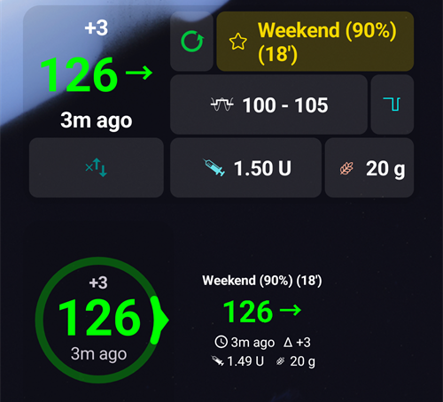

(widgets)=
# Widgets de l'écran d'accueil

**AAPS** propose des widgets que vous pouvez ajouter à l'écran d'accueil de votre téléphone. Un widget affiche vos données actuelles sans ouvrir l'application. Appuyez sur un widget pour ouvrir **AAPS**.

```{contents} Table of contents
:depth: 2
:local: true
```

---

## Widgets disponibles

Cinq widgets sont disponibles. Ils se trouvent sous **AAPS** dans le sélecteur de widgets d'Android :


| Widget                           | Taille par défaut | Ce qu'il affiche                                                                                                                                                                                                                                           |
| -------------------------------- | ----------------- | ---------------------------------------------------------------------------------------------------------------------------------------------------------------------------------------------------------------------------------------------------------- |
| **Widget AAPS**                  | 5 × 2             | The status block of the main screen: BG with trend and delta, the loop mode as an icon beside the profile name, target, sensitivity (shown as on the main screen), IOB and COB. The texts shrink to fit the size you give the widget instead of being cut. |
| **Cercle de glycémie AAPS**      | 2 × 2             | Le cercle de glycémie de l'écran principal : un anneau de la couleur de la glycémie, l'arc de tendance, le delta, la valeur de la glycémie et le temps depuis la dernière mesure.                                                                          |
| **AAPS petit**                   | 2 × 2             | Nom du profil, glycémie avec flèche de tendance, temps depuis la dernière mesure, delta, IA et GA.                                                                                                                                                         |
| **AAPS Gly + IA + GA (compact)** | 4 × 1             | Une ligne avec la glycémie et la flèche de tendance, l'IA et les GA.                                                                                                                                                                                       |
| **Graphique Gly. AAPS**          | 3 × 1             | La valeur de la glycémie avec un petit graphique des dernières mesures.                                                                                                                                                                                    |

Le **Widget AAPS**, le **Cercle de glycémie** et le widget **petit** sur un écran d'accueil :



Le widget **compact** et le widget **Graphique Gly.** :


Les valeurs de glycémie ont les mêmes couleurs que dans **AAPS** : vert dans la cible, jaune au-dessus de la cible, rouge en dessous de la cible.

---

## Ajouter un widget

Les étapes exactes dépendent de votre téléphone et de son lanceur d'applications. Sur la plupart des téléphones :

1. Faites un appui long sur une zone vide de l'écran d'accueil et choisissez **Widgets**.

   

2. Ouvrez **AAPS** dans la liste et appuyez sur le widget souhaité.
3. Appuyez sur **Ajouter** (ou faites glisser le widget à l'endroit souhaité).

   

Le widget est placé sur l'écran d'accueil. Juste après l'ajout, il est affiché avec des poignées : faites glisser une poignée pour **redimensionner** le widget, ou faites glisser le widget pour le déplacer. Le cercle de glycémie peut prendre n'importe quelle taille.


Si la page de l'écran d'accueil est pleine, le téléphone place le widget sur une nouvelle page.

---

## Configuration du widget

Appuyez sur le bouton **crayon** affiché sur le widget juste après l'avoir ajouté. Plus tard, faites un appui long sur le widget pour retrouver les poignées et le crayon.

La boîte de dialogue **Configuration du widget** a deux réglages :

- **Configurer l’opacité** — l'opacité du fond du widget. Une valeur faible laisse voir le fond d'écran à travers.
- **Utiliser la couleur noire** — utilise un fond noir à la place du fond par défaut.


Chaque widget a sa propre configuration.

---

## Bon à savoir

- Un widget **affiche** seulement des données. Vous ne pouvez pas faire de bolus ni rien modifier depuis un widget.
- Le widget est mis à jour par **AAPS**. Si **AAPS** ne fonctionne pas, ou si Android le limite en arrière-plan, le widget peut afficher des données anciennes. Vérifiez le temps depuis la dernière mesure, et assurez-vous qu'**AAPS** est exclu de l'[optimisation de la batterie](#SetupWizard-StoragePermission).
- Avec **AAPSClient**, **AAPSClient2** et **AAPSClient3**, le fond du widget est jaune, bleu ou vert, pour que vous puissiez distinguer les applications. Augmentez l'opacité dans la configuration du widget si la couleur est difficile à voir. Voir [À propos d'AAPSClient, AAPSClient2 et AAPSClient3](#remotecontrol-aapsclient-versions).
