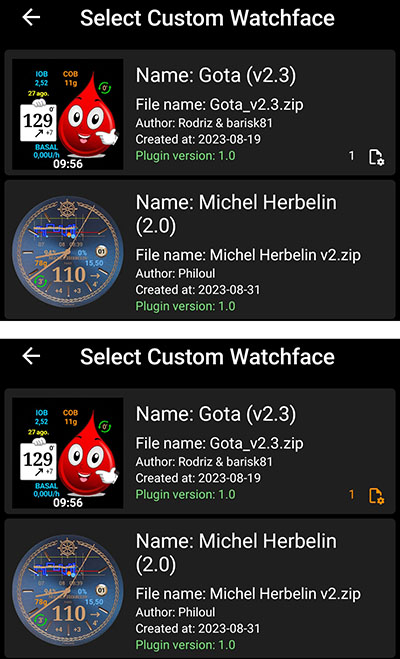
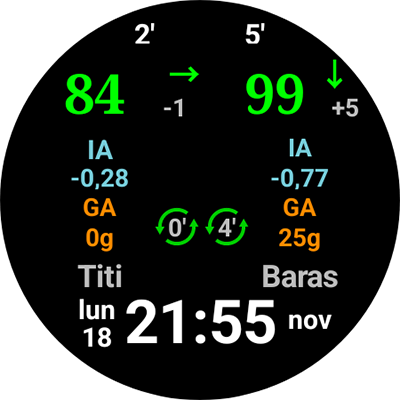

# Document de référence des Cadrans Personnalisés

Cette page est destinée aux concepteurs de nouveaux Cadrans. Il répertorie tous les mots-clés et fonctionnalités disponibles lorsque vous voulez créer ou animer un nouveau cadran.

- Les nouvelles fonctionnalités intégrées dans la V2 des Cadrans Personnalisés (Wear apk 3.3.0 ou plus) sont disponibles [ici](#cwf-reference-new-v2-features)

## Format des Cadrans Personnalisés

Le format des cadrans personnalisés est un format ouvert, conçu spécialement pour AAPS. Il est associé au nouveau cadran "AAPS (Custom)" disponible sur la montre.

Le fichier Cadran est un fichier zip simple, mais pour être reconnu comme Cadran AAPS, le fichier zip doit contenir :

- Un fichier image nommé CustomWatchface (cela peut être un fichier bitmap `CustomWatchface.jpg`, `CustomWatchface.png` ou un fichier vecteur `CustomWatchface.svg`). Ce fichier contient la petite icône utilisée pour sélectionner le cadran lorsque vous cliquez sur le bouton "Charger le cadran", et aussi l'image visible dans le plugin Montre d'AAPS.
- Un fichier nommé `CustomWatchface.json` (voir [Structure JSON](#cwf-reference-json-structure) ci-dessous). Ce deuxième fichier est le fichier principal qui contient toutes les informations nécessaires pour le cadran. Ce fichier json doit être valide (c'est probablement le point le plus délicat lorsque vous éditez manuellement ce fichier dans un éditeur de texte, parce qu'une simple virgule manquante ou additionnelle est suffisante pour casser le format json). Ce fichier JSON doit aussi contenir un bloc `"metadata"` avec une clé `"name"` dont la valeur n'est pas vide. Ce sera le nom de votre cadran personnalisé (voir [Paramètres metadata](#cwf-reference-metadata-settings) ci-dessous)
- la taille de ce zip devrait être aussi petite que possible (moins de 500 ko). Si ce fichier est trop volumineux, il sera juste bloqué et ne sera pas transmis à la montre.

Le fichier zip peut également contenir des fichiers de ressources supplémentaires :

- Des noms de fichiers codés en dur pour les images qui seront utilisées dans les vues standards incluses dans le cadran (comme `Background`, `CoverChart`... voir [Liste des fichiers de ressources codés en dur](#cwf-reference-list-of-hardcoded-resource-files) ci-dessous). Tous ces fichiers peuvent être au format `jpg`, `png` ou `svg`. mais pour la plupart d'entre elles, vous devrez utiliser les formats `png` ou `svg` qui gèrent la transparence (le format jpg est plus compact que le png, mais sans aucune transparence). Notez que la meilleure qualité associée à la plus petite taille sera généralement obtenue avec les fichiers svg (format vectoriel).
- Des fichiers de ressources supplémentaires, avec des noms libres. Ces fichiers supplémentaires peuvent être soit des fichiers image, soit des fichiers de polices de caractères (les formats `ttf` et `otf` sont acceptés pour les polices). Notez que pour ces fichiers supplémentaires, le `filename` (nom du fichier, sans extension) sera utilisé comme valeur de clé dans le fichier JSON, pour indiquer où et quand ces fichiers doivent être utilisés.
  - les fichiers image sont souvent utilisés comme arrière plan de vue texte ou pour une animation dynamique (comme le niveau de la batterie de 0% à 100%)
  - les fichiers de police de caractères vous permettent d'utiliser des polices spécifiques dans votre cadran

(cwf-reference-json-structure)=

## Structure JSON

Les fichiers JSON peuvent être modifiés dans l'éditeur de texte Notepad (ou notepad++) (préférez notepad++, qui reconnaît le JSON et utilise des couleurs)

- il contient les clés de type chaîne de caractère `"string_key":` et les valeurs clés qui peuvent être des chaînes comme `"key value"`, entier, booléen comme `true` ou `false` ou encore un bloc de données.
- chaque valeur est séparée par une virgule `,`
- Un bloc de données commence par `{`  et se termine par `}`
- le fichier json est un seul bloc : il commence donc par `{` et se termine par `}`. Dans ce fichier, tous les blocs inclus sont associés à une `"key"` qui doit être unique dans le bloc
- Pour une meilleure lisibilité, le fichier json est en général indenté (chaque nouvelle clé est sur une nouvelle ligne, chaque nouveau bloc est décalé de 4 espaces vers la droite)

(cwf-reference-metadata-settings)=

### Paramètres metadata

Ce bloc est le premier bloc inclus dans le fichier JSON et est obligatoire. Il contient toutes les informations associées à ce cadran, comme le nom, l'auteur, la date de création ou de mise à jour, la version de l'auteur ou la version du plugin.

Voir ci-dessous un exemple de bloc metadata :

```text
"metadata": {
    "name": "Default Watchface",
    "author": "myName",
    "created_at": "07\/10\/2023",
    "author_version": "1.0",
    "cwf_version": "1.0",
    "comment": "Default watchface, you can click on EXPORT WATCHFACE button to generate a template"
},
```

Notez que `/` utilisé pour la date est un caractère spécial, pour être reconnu correctement dans le fichier json, vous devez mettre avant un caractère "d'échappement" `\`

Vous pouvez voir dans un fichier JSON une clé supplémentaire `"filename"`, cette clé sera automatiquement créée ou mise à jour lorsque le cadran personnalisé sera chargé dans AAPS (elle sera utilisée pour afficher à l'utilisateur le nom du fichier zip dans le dossier d'exportation), donc vous pouvez supprimer cette clé dans le bloc de métadonnées.

(cwf-reference-general-parameter-settings)=

### Paramètres généraux

Après le premier bloc avec les métadonnées, vous allez définir quelques paramètres généraux (voir [Liste des paramètres généraux](#cwf-reference-list-of-general-parameters) ci-dessous), ceci vous permet de définir les couleurs du graphique (Glucides, Bolus, Glycémies...), et aussi les couleurs par défaut pour les valeurs dans la plage cible, hyper ou hypo (couleurs par défaut de la valeur de glycémie et des flèches)

Voir ci-dessous un exemple de paramètres généraux

```text
"highColor": "#FFFF00",
"midColor": "#00FF00",
"lowColor": "#FF0000",
"lowBatColor": "#E53935",
"carbColor": "#FB8C00",
"basalBackgroundColor": "#0000FF",
"basalCenterColor": "#64B5F6",
"gridColor": "#FFFFFF",
"pointSize": 2,
"enableSecond": true,
```
(cwf-reference-imageview-settings)=

### Paramètres ImageView

Une image personnalisée peut être utilisée en utilisant le nom de fichier correct associé à chaque ImageView inclus dans le "Layout" personnalisé du cadran, alors le bloc JSON est uniquement là pour définir la position, la taille, si la vue est visible ou non, et éventuellement ajuster la couleur :

Voir ci-dessous un exemple de bloc Image pour l'aiguille des secondes, (dans ce cas, il n'y a pas d'image incluse dans le fichier zip, donc l'image de l'aiguille des secondes par défaut sera utilisée, mais réglée avec une couleur personnalisée.

```text
"second_hand": {
    "width": 400,
    "height": 400,
    "topmargin": 0,
    "leftmargin": 0,
    "visibility": "visible",
    "color": "#BC906A"
}
```
Pour colorer second_hand avec la couleur de glycémie par défaut (lowRange, midRange ou highRange), il suffit de modifier la dernière ligne avec la valeur de clé `bgColor`

```json
    "color": "bgColor"
```

(cwf-reference-textview-settings)=

### Paramètres TextView

TextView have more available parameters compare to ImageView: you can tune rotation (integer value in degrees), textsize (integer value in pixel), gravity (to define if text value will be centered (default value), or aligned left or right), set the font, fontStyle and fontColor, and also background color of the TextView

```text
"basalRate": {
    "width": 91,
    "height": 32,
    "topmargin": 133,
    "leftmargin": 249,
    "rotation": 0,
    "visibility": "visible",
    "textsize": 23,
    "gravity": "center",
    "font": "default",
    "fontStyle": "bold",
    "fontColor": "#BDBDBD"
},
```
Notez que si vous ne voulez pas gérer une vue dans votre cadran, mettez la clé `"visibility"` à `"gone"`, mais placez aussi sa taille et sa position en dehors de la zone visible, comme ceci :

```text
"second": {
    "width": 0,
    "height": 0,
    "topmargin": 0,
    "leftmargin": 0,
    "rotation": 0,
    "visibility": "gone",
    "textsize": 46,
    "gravity": "center",
    "font": "default",
    "fontStyle": "bold",
    "fontColor": "#BDBDBD"
},
```
Si la taille et la position sont dans la zone visible, vous pouvez obtenir un petit "flash" de la valeur cachée pendant la mise à jour du cadran.

Si vous voulez personnaliser l'image d'arrière-plan d'une vue texte, alors vous pouvez utiliser la clé `"background":` et mettre le nom du fichier image inclus dans le fichier zip comme keyValue, vous pouvez également simplement changer la couleur d'arrière-plan en utilisant la clé `"color:"`.

```json
"background": "fileName"
```

Vous avez aussi 4 vues texte spécifiques (nommées freetext1 à freetext4) qui ont un paramètre spécifique `"textvalue":` qui peut être utilisé pour définir par exemple une étiquette

(cwf-reference-chartview-settings)=

### Paramètres ChartView

La vue graphique est une vue très spécifique qui peut partager certains paramètres avec ImageView ou TextView...

Les paramètres standards pour cette vue sont très simples :

```text
"chart": {
    "width": 400,
    "height": 170,
    "topmargin": 230,
    "leftmargin": 0,
    "visibility": "visible"
},
```
Les 2 paramètres supplémentaires que vous pouvez inclure pour la vue graphique sont une couleur de fond (par défaut c'est transparent), en utilisant la clé `"color"` ou une image d'arrière-plan en utilisant la clé `"background"`.

(cwf-reference-how-to-build-watchface)=

## Comment construire/concevoir votre premier cadran

### Outils nécessaires

- Éditeur de texte : je vous conseille NotePad++ (ou équivalent). C'est un simple éditeur de texte, mais il affiche le texte formaté avec des couleurs, ce qui permet de trouver plus facilement les erreurs. n'importe quel éditeur de texte simple fera l'affaire. Car le but est de régler les informations json.
- Éditeur d'images (bitmap et/ou vecteur)
  - Si vous utilisez des images bitmap
    - L'éditeur d'image doit gérer la transparence (nécessaire pour toutes les images au-dessus de l'arrière-plan) et le format png (si vous avez utilisé des images bitmap)
    - L'image d'arrière-plan (Background) peut être au format jpg (plus petit que png)
    - L'éditeur d'images doit vous permettre de mesurer en pixels les objets graphiques (cela peut être un simple carré) (haut, gauche, largeur, hauteur)
    - L'éditeur d'images doit pouvoir afficher les couleurs avec leur code RRGGBB en hexadécimal
    - L'éditeur d'image devrait être en mesure de redimensionner l'image à 400px x 400px (il est très important de travailler le cadran avec cette résolution)
  - Si vous utilisez des images vectorielles
    - L'image vectorielle doit être exportée au format svg

### Obtenir le modèle pour ne pas partir de zéro

Quand vous voulez concevoir votre premier cadran, le mieux est de commencer par le cadran par défaut (ceci vous assurera d'avoir la dernière version avec toutes les vues disponibles correctement triées)

- Vous pouvez obtenir le fichier zip en cliquant sur le bouton "Exporter le modèle" dans le plugin Montre et récupérer le fichier zip correspondant dans le dossier AAPS/exports
- Notez que vous devrez avoir une montre connectée à AAPS pour voir les boutons des cadrans personnalisés (mais la montre est également nécessaire pour vérifier, tester et mettre au point votre cadran personnalisé)

Le cadran par défaut est très simple et le fichier zip ne contient que 2 fichiers :

- CustomWatchface.png (image du cadran par défaut pour la sélection du cadran)
- CustomWatchface.json

### Organiser vos fichiers sur votre ordinateur

The easiest way to work is to have phone connected to the computer, and work with two specific folders:

- un explorateur ouvert sur un dossier spécifique qui contient tous les fichiers (json, images bitmap, images vectorielles, polices), ainsi que le fichier CustomWatchface.zip
- un autre explorateur (ou une arborescence réglée) ouvert sur le dossier Phone/AAPS/exports

Ainsi, le travail est très simple : chaque fois que vous modifiez le fichier json avec un éditeur de texte, ou une image avec un éditeur d'images (bitmap ou vectoriel), il vous suffit de :

1. enregistrer vos modifications dans chaque application
2. glisser-déposer tous les fichiers dans le fichier CustomWatchface.zip
3. glisser-déposer CustomWatchface.zip dans le dossier AAPS/exports du téléphone
4. envoyer CustomWatchface à la montre pour vérifier le résultat

### Initialiser la personnalisation du cadran

Première étape : vous devez définir un nom de cadran (nécessaire pour le sélectionner facilement pendant les tests), et commencer à régler les clés metadata au début du fichier json

Ensuite, vous devez définir les informations que vous voulez afficher, donc quelles vues doivent être visibles ou masquées.

- allez-vous gérer les secondes ou non ?
- voulez-vous concevoir une montre analogique ou une montre numérique (ou les deux...)

Vous pouvez maintenant commencer à modifier le fichier json, en mettant la clé `"visibility":` de chaque vue à `"visible"` ou `"gone"` (selon que vous voulez garder la vue ou non)

You can also start to tune approximately top, left margin and width height values to start organizing the watchface (these values will be tuned later using image editor)

Remarque : tout est conçu dans un **rectangle de 400px x 400px**. Tout sera donc positionné en coordonnées absolues dans cette taille.

Quand vous concevez votre premier cadran, vous devez savoir que tout est organisé en couches, de l'arrière vers l'avant. Chaque vue (ImageView ou TextView) peut donc masquer ce qui se trouve derrière elle...


Dans le fichier json, toutes les vues sont ensuite triées de l'arrière vers l'avant (cela vous aidera à vous rappeler ce qui est derrière quoi...)

Si vous concevez ou personnalisez votre premier cadran, commencez par des choses simples : changez la visibilité de quelques vues, ajoutez une image d'arrière-plan dédiée sans changer le fichier json...

### Gérer les couleurs

Dans le fichier json, plusieurs clés servent à définir les couleurs : `"color"`, `"fontColor"` pour les vues, mais aussi `"highColor"`, `"midColor"`, `"lowColor"`, ... (voir [Liste des paramètres généraux](#cwf-reference-list-of-general-parameters))

Les couleurs sont définies par un champ texte qui commence par `#`, suivi des valeurs RRGGBB (rouge, vert, bleu) en format hexadécimal :

- `"#FFFFFF"` est le blanc, `"#000000"` est le noir, `"#FF0000"` est le rouge...

Vous pouvez aussi ajouter 2 valeurs supplémentaires pour la couche alpha et définir un niveau de transparence (AARRGGBB) :

- `"#00000000"` est complètement transparent, et `"#FF000000"` est complètement opaque (donc `"#FF000000"` est équivalent à `"#000000"`)

Vous pouvez aussi utiliser la valeur de clé spécifique `"bgColor"` pour utiliser automatiquement `"highColor"`, `"midColor"` ou `"lowColor"`, définis dans les paramètres généraux, selon la valeur de glycémie :

- `"fontColor": "bgColor",` règle automatiquement la couleur de la police de la vue selon la valeur de glycémie
- Notez que les vues `sgv` (pour la valeur de glycémie) et `direction` (pour la flèche de tendance) appliquent automatiquement les couleurs de glycémie définies dans les paramètres généraux (pour ces 2 vues, si vous voulez d'autres couleurs, vous devez utiliser la fonction avancée [dynData](#cwf-reference-dyndata-feature) avec une couleur à une seule étape...)

Pour plus d'informations sur les ImageViews et la clé `"color":`, voir le chapitre dédié [Régler la couleur de l'image](#cwf-reference-tune-image-color) ci-dessous.

### Inclure des images codées en dur

le plus simple pour commencer à personnaliser votre cadran est d'inclure dans le fichier zip quelques images avec des noms précis (voir [Liste des fichiers de ressources codés en dur](#cwf-reference-list-of-hardcoded-resource-files))

- L'image doit être au format `.jpg`, `.png` ou `.svg`. mais attention : le jpg ne gère pas la transparence, il ne doit donc être utilisé que pour la couche d'arrière-plan. Pour toutes les couches intermédiaires (cover_chart, cover_plate, aiguilles), utilisez une image `.png` ou `.svg`

- Si vous avez un éditeur d'images vectorielles (par exemple Illustrator), préférez ce format : il produit de petits fichiers texte avec l'extension `.svg`, avec la meilleure qualité.
- Faites attention à utiliser le nom de fichier exact (y compris les majuscules et minuscules)

Maintenant, si vous voulez une image d'arrière-plan dédiée, il suffit d'inclure dans le fichier zip un fichier nommé `Background.jpg` (sans rien changer d'autre). Envoyez le fichier zip à la montre et vérifiez le résultat !

Si vous voulez personnaliser hour_hand, minute_hand ou second_hand pour une montre analogique, incluez simplement `HourHand.png` (ou `HourHand.svg`), `MinuteHand.png` et `SecondHand.png`.

- ces images tournent automatiquement autour du centre de l'image : elles doivent donc être réglées sur 00:00:00 (et pour une montre analogique « plein cadre », utilisez une taille de 400 x 400 px, placée en haut 0, à gauche 0)

Vous pouvez aussi remarquer dans la [Liste des fichiers de ressources codés en dur](#cwf-reference-list-of-hardcoded-resource-files) que pour chaque vue image, il existe deux noms de fichiers supplémentaires codés en dur, avec `High` et `Low` (par exemple, vous pouvez inclure d'autres images nommées `BackgroundHigh.jpg` et `BackgroundLow.jpg` dans le fichier zip). l'image change alors automatiquement selon votre niveau de glycémie (dans la plage, hyper ou hypo). Voir le cadran AIMICO comme exemple.

(cwf-reference-tune-image-color)=

### Régler la couleur de l'image

La clé `"color"` peut servir à régler la couleur de l'image par défaut :

- appliquée à la vue background, elle définit la couleur d'arrière-plan (noir par défaut)
- appliquée à cover_plate (cadran simple) ou aux aiguilles, elle remplace l'image par défaut (blanche) par la couleur indiquée (y compris `"bgColor"`)

Quand vous appliquez la clé `"color"` sur une image bitmap (`.jpg` ou `.png`), la couleur applique un effet intéressant sur la saturation des couleurs. Vous reconnaîtrez donc toujours votre image bitmap.

Enfin, sur un fichier image `.svg`, la clé `"color"` n'a aucun effet : considérez la couleur des fichiers vectoriels comme codée en dur dans l'image. Si vous voulez changer les couleurs, vous devez inclure plusieurs fichiers `svg` et utiliser la fonction avancée [dynData](#cwf-reference-dyndata-feature) pour les changer

### Utiliser des polices supplémentaires pour les TextViews

Plusieurs polices par défaut sont déjà disponibles dans l'apk Wear (voir les clés de police dans le chapitre [Clés Valeur](#cwf-reference-key-values)). Mais si vous voulez utiliser d'autres polices, non disponibles par défaut, vous pouvez inclure des polices supplémentaires dans le fichier zip :

- les 2 formats de police acceptés sont les fichiers `.ttf` et `.otf`
- si vous incluez une police personnalisée dans le fichier zip, par exemple un fichier nommé `myCustomFont.ttf`, vous devez utiliser ce nom de fichier dans le fichier json pour l'utiliser dans une TextView :

```
"font": "myCustomFont",
```

Gardez à l'esprit que certaines polices sont dans de gros fichiers (et la taille du fichier zip est limitée). Si vous n'utilisez que très peu de caractères (chiffres, `.`, `,`), vous pouvez donc utiliser des outils gratuits pour supprimer les caractères inutilisés (par exemple [ici](https://products.aspose.app/font/generator/ttf-to-ttf)) et ainsi réduire la taille de la police.

(cwf-reference-advanced-features)=

## Fonctions avancées

(cwf-reference-preference-feature)=

### Fonction Préférences

CustomWatchface peut régler automatiquement certaines préférences de la montre pour afficher correctement le cadran (si l'utilisateur en donne l'autorisation dans les préférences Montre).

Mais cette fonction doit être utilisée avec prudence. Les préférences sont communes à tous les autres cadrans. Il faut donc respecter plusieurs règles avec cette fonction :

- ne jamais définir de préférences pour des vues masquées
- essayer d'avoir le plus possible de vues visibles
- n'hésitez pas à prévoir une largeur plus grande pour certaines vues :
  - Le DBT peut être affiché en pourcentage (faible largeur), mais aussi en valeur absolue (beaucoup plus large)
  - delta ou delta moyen avec informations détaillées peuvent être larges
  - de même pour iob2 : cette vue peut afficher l'IA totale, mais si l'IA détaillée est sélectionnée, le texte peut être très long

Si vous avez quand même besoin de paramètres très spécifiques pour un affichage correct (dans l'exemple ci-dessous, s'il n'y a pas assez de place pour l'IA détaillée, vous pouvez « forcer » ce paramètre de votre montre à `false`), vous pouvez inclure dans le bloc metadata des contraintes de paramètres comme ceci

```text
"metadata": {
    "name": "Default Watchface",
    "author": "myName",
    "created_at": "07\/10\/2023",
    "author_version": "1.0",
    "cwf_version": "1.0",
    "comment": "Default watchface, you can click on EXPORT WATCHFACE button to generate a template",
    "key_show_detailed_iob": false
},
```

Si l'utilisateur autorise le cadran personnalisé à modifier les paramètres de la montre (réglage dans le plugin Montre), alors « Afficher IA détaillée » sera mis sur « désactivé » et verrouillé sur désactivé (aucune modification de ce paramètre n'est possible tant que l'autorisation n'est pas désactivée dans les paramètres du plugin Montre, ou qu'un autre cadran n'est pas sélectionné)

- Notez que lorsqu'un utilisateur sélectionne un cadran, il peut voir le nombre de « paramètres requis » pendant la sélection du cadran

Dans l'exemple ci-dessous, le cadran Gota a un paramètre requis. Si l'autorisation n'est pas donnée, ce nombre est affiché en blanc. Si l'autorisation est donnée, ce paramètre est défini et verrouillé sur la montre (dans ce cas, le nombre est affiché en orange)




(cwf-reference-twinview-feature)=

### Fonction TwinView

Les vues jumelles (twin views) permettent d'ajuster facilement la position d'une vue selon les vues visibles. Cela n'a pas la puissance d'une mise en page entièrement faite de LinearLayout, mais cela peut gérer de nombreux cas courants.

Dans l'exemple ci-dessous, vous pouvez voir le cadran AAPS (Cockpit) avec toutes les vues visibles dans les paramètres, et le même cadran avec « Afficher la batterie de la plateforme » et « Afficher le delta moyen » désactivés


Vous pouvez voir que lorsque l'une des vues jumelles est masquée, l'autre est décalée pour être centrée

dans cet exemple, vous pouvez voir que dans le bloc `"uploader_battery"`, la clé `"twinView":` est ajoutée pour définir la vue `"rig_battery"`, et dans le bloc `"rig_battery"`, la clé `"twinView":` définit `"uploader_battery"` comme vue jumelle. Ensuite, la clé supplémentaire `"leftOffsetTwinHidden":` définit le nombre de pixels de décalage de la vue quand la vue jumelle est masquée.

Pour calculer ce nombre, vous pouvez voir que la différence entre les leftMargin des deux vues jumelles est de 50 pixels : le décalage pour rester centré est donc la moitié, dans un sens ou dans l'autre.

Si les vues jumelles sont placées verticalement, vous devez utiliser la clé `"topOffsetTwinHidden":`

```text
"uploader_battery": {
    "width": 49,
    "height": 30,
    "topmargin": 354,
    "leftmargin": 150,
    "rotation": 0,
    "visibility": "visible",
    "textsize": 23,
    "gravity": "center",
    "font": "roboto_condensed_bold",
    "fontStyle": "bold",
    "fontColor": "#FFFFFF",
    "twinView": "rig_battery",
    "leftOffsetTwinHidden": 25
},
"rig_battery": {
    "width": 49,
    "height": 30,
    "topmargin": 354,
    "leftmargin": 200,
    "rotation": 0,
    "visibility": "visible",
    "textsize": 23,
    "gravity": "center",
    "font": "roboto_condensed_bold",
    "fontStyle": "bold",
    "fontColor": "#FFFFFF",
    "twinView": "uploader_battery",
    "leftOffsetTwinHidden": -25
},
```
(cwf-reference-dyndata-feature)=

### Fonction DynData

DynData est la fonction la plus puissante si vous voulez inclure des animations dans votre cadran, selon certaines valeurs internes (comme la valeur de glycémie, le niveau de glycémie, le delta, le % de batterie... voir la liste des données disponibles [ici](#cwf-reference-dyndata-key-values))

Pour illustrer cette fonction, je vais prendre l'exemple du cadran AAPS (SteamPunk) :


Dans ce cadran, nous devons gérer la [rotation de la valeur de glycémie](#cwf-reference-background-management) (de 30 degrés à 330 degrés) à droite, la [plage dynamique de avg_delta](#cwf-reference-avg-delta-management) (échelle jusqu'à 5 mg/dl, 10 mg/dl ou 20 mg/dl selon la valeur), la [rotation de l'aiguille](#cwf-reference-dynamic-rotation-management), qui doit être synchronisée avec l'échelle, et aussi les différentes couches des vues...

Pour gérer ce cadran, voici ci-dessous toutes les images incluses dans le fichier zip :

Remarque : pour voir la transparence, toutes ces images sont sur un fond jaune et entourées d'un carré rouge


- Sur la première ligne, Background.jpg et CoverPlate.png seront automatiquement associés à leur vue (noms de fichiers par défaut des vues), et steampunk_pointer.png sera géré par dynData
- Sur la deuxième ligne, vous voyez les 3 échelles de plage dynamique pour avg_delta, qui seront aussi gérées par dynData
- Sur la troisième ligne, chartBackground.jpg sera lié manuellement dans la vue chart, et les fichiers HourHand.png et MinuteHand.png seront automatiquement associés à leur vue

(cwf-reference-background-management)=

#### Gestion de l'arrière-plan

D'abord, pour l'image de la valeur de glycémie, il n'y a pas le choix : elle ne peut être que dans la couche d'arrière-plan (sinon elle sera devant la vue du graphique, et le graphique ne sera pas visible !). Nous devons donc associer la valeur de glycémie à l'arrière-plan, puis faire tourner l'image d'arrière-plan selon la valeur de glycémie.

Dans le bloc `"background"`, nous allons inclure 2 clés dédiées pour faire cette rotation :

```text
"background": {
    "width": 400,
    "height": 400,
    "topmargin": 0,
    "leftmargin": 0,
    "dynData": "rotateSgv",
    "rotationOffset": true,
    "visibility": "visible"
},
```
La clé `"dynData":` définit quel bloc doit être utilisé pour définir l'animation (valeur, plage, conversion...). Ici, ce bloc a été nommé "rotateSgv" (choisissez un nom clair quand vous utilisez cette fonction),

`"rotationOffset": true,` indique que l'animation attendue selon la valeur doit être une rotation. (les autres clés disponibles sont `"leftOffset"` et `"topOffset"` si vous voulez créer un curseur)

Allons maintenant à la fin du fichier, après la dernière vue :

```text
"second_hand": {
    "width": 120,
    "height": 120,
    "topmargin": 140,
    "leftmargin": 140,
    "visibility": "gone"
},
"dynData": {
    "rotateSgv": {
        "valueKey": "sgv",
        "minData": 30,
        "maxData": 330
    },
```
Vous pouvez voir qu'après la dernière vue (`"second_hand"`), nous avons ajouté un nouveau bloc `"dynData": { ... }` qui contient toutes les animations :

Le bloc défini dans la vue `"background"` a été nommé `"rotateSgv"` : c'est le premier bloc que vous trouverez dans `"dynData"` !

Ce bloc est simple : une première clé nommée `"valueKey":` sert à définir la valeur à utiliser. dans ce cas, `"sgv"` est une « keyValue » qui définit la valeur de glycémie (notez que dans la plupart des cas, la keyValue a le même nom que la vue qui affiche cette information).

Pour la valeur de glycémie, minData par défaut est 39 mg/dl et maxData par défaut est 400 mg/dl (voir ci-dessous [Valeurs des clés DynData](#cwf-reference-dyndata-key-values) pour toutes les keyValues disponibles et les valeurs min/max associées).

Dans le bloc `"rotateSgv"`, les deux clés supplémentaires (`"minData":` et `"maxData":`) servent à fixer les données min et max à 30 et 330. Avec ces valeurs min et max, nous pourrons utiliser directement la valeur de la donnée (sans aucune conversion) pour faire tourner l'arrière-plan en degrés. Dans ce cas, toutes les valeurs de glycémie au-dessus de 330 mg/dl seront limitées à 330, la limite haute de l'image.

#### Gestion du graphique

Par défaut, le fond du graphique est transparent. Pour masquer l'échelle de glycémie incluse dans l'image d'arrière-plan, nous devons donc inclure une image d'arrière-plan dédiée (cette image contient les ombres générales du cadran Steampunk). Le lien vers le fichier chartBackground.jpg se fait avec la clé `"background":`

Bien sûr, la taille et la position de la vue doivent être réglées au pixel près !

```text
"chart": {
    "width": 216,
    "height": 107,
    "topmargin": 280,
    "leftmargin": 80,
    "visibility": "visible",
    "background": "chartBackground"
},
```
(cwf-reference-avg-delta-management)=

#### Gestion du delta moyen

Pour gérer la plage dynamique du delta moyen, nous allons utiliser les quatre vues freetext. freetext1 servira à gérer l'image de l'échelle, et freetext2 à freetext4 serviront à gérer la rotation de l'aiguille selon l'échelle.

**freetext1**

Comme expliqué plus haut, les vues freetext sont devant le graphique et devant l'arrière-plan : c'est pourquoi nous avons inclus une zone transparente pour voir ces images (côté droit et côté bas de l'image)

Notez que la partie basse retirée de ces images a été utilisée comme fond du graphique, pour une intégration parfaite.

```text
"freetext1": {
    "width": 400,
    "height": 400,
    "topmargin": 0,
    "leftmargin": 0,
    "rotation": 0,
    "visibility": "visible",
    "dynData": "avgDeltaBackground"
},
```
Pour cette vue, nous incluons le lien vers un autre bloc `"dynData"` nommé `avgDeltaBackground`. Ce bloc gère l'échelle avgDelta selon la valeur avgDelta.

```text
"avgDeltaBackground": {
    "valueKey": "avg_delta",
    "minData": -20,
    "maxData": 20,
    "invalidImage": "steampunk_gauge_mgdl_5",
    "image1": "steampunk_gauge_mgdl_20",
    "image2": "steampunk_gauge_mgdl_20",
    "image3": "steampunk_gauge_mgdl_10",
    "image4": "steampunk_gauge_mgdl_5",
    "image5": "steampunk_gauge_mgdl_5",
    "image6": "steampunk_gauge_mgdl_10",
    "image7": "steampunk_gauge_mgdl_20",
    "image8": "steampunk_gauge_mgdl_20"
},
```
- `"valueKey":` fait le lien avec la valeur `"avg_delta"`
- minData et maxData limitent aussi la plage à la valeur maximale disponible dans ce cadran (de -20 mg/dl à 20 mg/dl). Pour les utilisateurs en mmol, gardez à l'esprit que toutes les valeurs internes d'AAPS sont toujours en mg/dl.

Nous allons voir ici comment gérer une image d'arrière-plan dynamique selon la valeur.

`"invalidImage":` est la clé qui définit l'image à afficher quand les données ne sont pas valides (ou manquantes). Ici, nous faisons le lien avec une image de ressource supplémentaire incluse dans le fichier zip, avec l'échelle de 5 mg/dl

Ensuite, nous allons utiliser une série d'images, de `"image1":` à `"image8":`. Le nombre d'images fournies définit le nombre d'étapes entre `minData` et `maxData`.

- `image1` définit l'image à afficher quand avg_delta est égal ou proche de `minData`, et l'image avec le numéro le plus haut (ici `image8`) définit l'image à afficher quand avg_delta est égal ou proche de `maxData`
- entre -20 mg/dl et 20 mg/dl, la plage totale est de 40 mg/dl. Divisée par 8 (le nombre d'images fournies), nous avons 8 étapes de 5 mg/dl
- Nous pouvons maintenant associer les images d'arrière-plan à la valeur avg_delta, en partant des valeurs les plus basses : entre -20 et -15, et aussi entre -15 et -10, nous utilisons `steampunk_gauge_mgdl_20` pour l'échelle, puis entre -10 et -5 `steampunk_gauge_mgdl_10`, et ainsi de suite jusqu'à +15 et +20, où nous utilisons de nouveau l'image d'arrière-plan `steampunk_gauge_mgdl_20`

(cwf-reference-dynamic-rotation-management)=

**freetext2 à freetext4**

For these views we will combine dynamic images and rotation feature explained before:

```text
"freetext2": {
    "width": 276,
    "height": 276,
    "topmargin": 64,
    "leftmargin": 64,
    "rotation": 0,
    "visibility": "visible",
    "dynData": "avgDelta5",
    "rotationOffset": true
},
"freetext3": {
    "width": 276,
    "height": 276,
    "topmargin": 64,
    "leftmargin": 64,
    "rotation": 0,
    "visibility": "visible",
    "dynData": "avgDelta10",
    "rotationOffset": true
},
"freetext4": {
    "width": 276,
    "height": 276,
    "topmargin": 64,
    "leftmargin": 64,
    "rotation": 0,
    "visibility": "visible",
    "dynData": "avgDelta20",
    "rotationOffset": true
},
```
Ici, chaque vue est dédiée à une échelle précise (elle est donc liée à un bloc dynData dédié). Vous pouvez aussi remarquer que la clé `"rotationOffset":` est activée pour ces 3 vues. Regardons maintenant le premier bloc dynData :

```text
"avgDelta5": {
    "valueKey": "avg_delta",
    "minData": -20,
    "maxData": 20,
    "rotationOffset": {
        "minValue": -120,
        "maxValue": 120
    },
    "invalidImage": "null",
    "image1": "null",
    "image2": "null",
    "image3": "null",
    "image4": "steampunk_pointer",
    "image5": "steampunk_pointer",
    "image6": "null",
    "image7": "null",
    "image8": "null"
},
```
Ici, même si la plage dynamique n'est utilisée qu'entre -5 et +5 pour avg_delta, il est important de garder la plage totale de -20 à +20 mg/dl, pour que l'aiguille reste synchronisée avec l'arrière-plan lors des changements d'échelle. C'est pourquoi nous gardons la même plage totale que pour `avgDeltaBackground` et le même nombre d'étapes (8 images).

Vous pouvez noter que `"invalidImage"` et plusieurs `"imagexx"` ont la valeur `"null"` (cela pourrait être n'importe quelle chaîne qui n'existe pas comme nom de fichier dans le fichier zip). Quand un nom de fichier n'est pas trouvé, l'image d'arrière-plan de la vue est transparente. Ce réglage fait donc que l'aiguille n'est visible que pour les étapes 4 et 5 (delta moyen entre -5 mg/dl et +5 mg/dl), et qu'elle n'est pas visible en dehors de cette plage.

Nous voyons maintenant un nouveau bloc `"rotationOffset":` qui contient deux clés `"minValue":` et `"maxValue":`. Ces valeurs servent à faire la conversion entre les données internes (en mg/dl) et l'angle de rotation que nous voulons.

- Le cadran Steampunk est conçu pour une rotation maximale de l'aiguille de -30 degrés à 30 degrés. Selon l'échelle (ici de -5 mg/dl à 5 mg/dl), nous voulons donc 30 degrés pour ces valeurs. Comme `minData` et `maxData` sont 4 fois plus grands, les minValues et maxValues correspondantes sont 4 * 30 degrés, donc -120 et +120 degrés. Mais pour toute rotation au-delà de +-30 degrés, l'aiguille sera masquée (aucune image visible), et l'aiguille ne sera visible que pour les valeurs entre -5 et +5 mg/dl... C'est exactement ce que nous voulons ici.

Les autres blocs dynData sont définis de la même façon pour régler `"avgDelta10"` et `"avgDelta20"`

#### vue loop

dans le cadran Steampunk, les flèches verte et rouge de la boucle (pour l'état) sont désactivées. Cela est aussi géré avec un bloc dynData dédié, associé à la vue loop.

```text
    "loopArrows": {
        "invalidImage": "greyArrows",
        "image1": "greenArrows",
        "image2": "redArrows"
    }
```
Comme ce bloc n'est appelé que par la vue loop, et que les données gérées par défaut par cette vue sont les informations de la boucle, la clé `"valueKey":` est facultative.

Les valeurs par défaut `minData` et `maxData` pour loop sont 0 min et 28 min. Avec deux images, toutes les valeurs en dessous de 14 min seront donc affichées avec l'arrière-plan `image1`, et toutes les valeurs au-dessus de 14 min avec `image2`. 14 min est exactement le seuil de passage de la flèche verte à la flèche rouge.

Dans cet exemple, les fichiers `greyArrows`, `greenArrows` et `redArrows` ne sont pas inclus dans le fichier zip : ces flèches sont donc simplement supprimées (invisibles). Mais vous pouvez utiliser ce bloc « tel quel » si vous voulez personnaliser les flèches d'état avec des images d'arrière-plan personnalisées.

#### vues rig_battery et uploader_battery

Pour terminer la présentation de la fonction dynData, regardons la gestion de la batterie. L'idée ici est de personnaliser la couleur du texte selon le niveau de batterie (de 0 à 100 %)

```text
"uploader_battery": {
    "width": 60,
    "height": 28,
    "topmargin": 100,
    "leftmargin": 170,
    "rotation": 0,
    "visibility": "visible",
    "textsize": 20,
    "gravity": "center",
    "font": "default",
    "fontStyle": "bold",
    "fontColor": "#00000000",
    "dynData": "batteryIcons",
    "twinView": "rig_battery",
    "topOffsetTwinHidden": -13
},
"rig_battery": {
    "width": 60,
    "height": 28,
    "topmargin": 74,
    "leftmargin": 170,
    "rotation": 0,
    "visibility": "visible",
    "textsize": 20,
    "gravity": "center",
    "font": "default",
    "fontStyle": "bold",
    "fontColor": "#00000000",
    "dynData": "batteryIcons",
    "twinView": "uploader_battery",
    "topOffsetTwinHidden": 13
},
```
Vous pouvez voir ici que ces deux vues partagent le même bloc `dynData` nommé `batteryIcons`. C'est possible car, par défaut, les données associées sont celles de la vue (donc, sans clé `"valueKey":` dans le bloc `batteryIcons`, il sera appliqué aux données `uploader_battery` ou `rig_battery` selon la vue).

Notez que ces deux vues utilisent aussi la fonction TwinView expliquée [ici](#cwf-reference-twinview-feature).

Regardons maintenant le bloc dynData :

```text
"batteryIcons": {
    "invalidFontColor": "#00000000",
    "fontColor1": "#A00000",
    "fontColor2": "#000000",
    "fontColor3": "#000000",
    "fontColor4": "#000000",
    "fontColor5": "#000000"        
},
```
Ici, nous utilisons exactement la même logique que pour l'image d'arrière-plan dynamique, mais avec des clés dédiées (`"invalidFontColor"` et `"fontColor1"` à `"fontColor5"` pour définir 5 étapes de 20 % chacune).

- `"fontColor1"` (rouge foncé) sera utilisé pour toutes les valeurs en dessous de 20 %, et le blanc pour toutes les valeurs au-dessus de ce seuil.
- Si vous voulez baisser le seuil à « en dessous de 10 % », il suffit d'ajouter 5 clés supplémentaires, de `"fontColor6"` à `"fontColor10"`. Vous pouvez aussi ajuster chaque couleur si vous voulez une variation progressive du vert au jaune, à l'orange et au rouge...

(cwf-reference-dynpref-feature)=

### Fonction DynPref

Avant de lire ce chapitre, vous devez comprendre comment fonctionne [dynData](#cwf-reference-dyndata-feature), car DynPref est un usage avancé de DynData : vous pourrez maintenant ajuster chaque bloc DynData selon les préférences choisies par l'utilisateur :

Pour illustrer la fonction DynPref, nous allons utiliser deux exemples :

- Le cadran Steampunk (usage simple : inclure dans le même cadran une version mg/dl et une version mmol ; le cadran change automatiquement selon l'unité choisie dans AAPS).
- Le cadran AAPS V2 combine différentes préférences pour gérer la couleur du texte et l'arrière-plan selon les préférences « Sombre » et « Séparateur Invisible ».

#### Usage simple de dynPref dans le cadran Steampunk

Within Steampunk, we have two sets of images according to units: `background` image that will have BG scale and will turn according to BG value. et `freeText1`, qui contient l'échelle dynamique selon la valeur avgDelta. Pour avoir un seul cadran qui affiche automatiquement les bonnes unités, nous devons choisir l'image selon l'unité sélectionnée.

Pour cela, nous remplaçons la clé `dynData` par une clé `dynPref` dans le bloc de la vue :

```text
 "background": {
    "width": 400,
    "height": 400,
    "topmargin": 0,
    "leftmargin": 0,
    "dynPref": "rotateSgv",
    "rotationOffset": true,
    "visibility": "visible"
},
```
L'utilisation des clés `dynPref` est très proche de celle des clés `dynData` expliquées dans le chapitre précédent

Regardons maintenant la fin du fichier json, après le bloc `dynData` :

```text
"dynData": {
    ...
},
"dynPref": {
    "rotateSgv": {
        "prefKey": "key_units",
        "true": {
            "valueKey": "sgv",
            "minData": 30,
            "maxData": 330,
            "invalidImage": "Background_mgdl",
            "image1": "Background_mgdl"
        },
        "false": {
            "valueKey": "sgv",
            "minData": 30,
            "maxData": 330,
            "invalidImage": "Background_mmol",
            "image1": "Background_mmol"
        }
    },
    ...
}
```
Vous pouvez voir que la clé dynPref définie dans le bloc de la vue `background` (`"dynPref": "rotateSgv"`) existe dans le bloc json `dynPref` inclus à la fin du fichier json :

Ce bloc doit contenir une clé `"prefKey"` qui définit la préférence à utiliser. Dans cet exemple, la clé `"key_units"` est liée aux unités choisies dans AAPS sur le téléphone. Sa valeur est `"true"` si l'unité choisie est mgdl, et `"false"` si l'unité choisie est mmol.

Ensuite, vous trouverez deux blocs json au format « dynData », qui seront utilisés selon la préférence choisie

Notez que le nom de fichier « codé en dur » de l'image d'arrière-plan est maintenant remplacé par une image dynamique, qui sera la même quelle que soit la valeur de glycémie (fichier `Background_mgdl.png` si key_units est "true", `Background_mmol.png` si key_units est false). Nous incluons aussi une clé `"invalidImage"` pour toujours avoir une image d'arrière-plan, même si aucune donnée n'a été reçue du téléphone.

#### Combiner différentes préférences dans dynPref avec AAPS V2

La plupart du temps, quand vous définissez une préférence, ce n'est pas pour obtenir un « comportement dynamique », mais seulement le résultat de ce que vous avez choisi. Pourtant, dans dynPref, c'est considéré comme une fonction dynamique...

- alors que dans `dynData` vous définissez un bloc complet de paramètres (avec images, fontColor, Color, ...), avec `dynPref` vous pourrez combiner chaque paramètre selon une préférence précise.
- Nous allons voir ici comment la préférence Séparateur Invisible est associée à la préférence Sombre pour afficher, quand elle est activée (true), un texte blanc sur fond noir sur un cadran sombre (paramètre Sombre à true), ou un texte noir sur fond blanc sur un cadran clair (Sombre à false)...

Regardons d'abord le début du fichier json :

```text
"dynPrefColor": "prefColorDark",
"pointSize": 2,
"enableSecond": false,
"background": {
    "width": 400,
    "height": 400,
    "topmargin": 0,
    "leftmargin": 0,
    "visibility": "visible",
    "dynPref": "dark"
},
```
`"dynPrefColor": "prefColorDark"` définit le bloc dynPref de toutes les couleurs par défaut en dehors des vues. Ces couleurs seront réglées selon le paramètre Sombre dans `"prefColorDark"` :

Et à la fin, dans le bloc `dynPref`, vous aurez un bloc dynPref spécifique pour les couleurs par défaut :

```text
"prefColorDark": {
    "prefKey": "key_dark",
    "true": {
        "highColor": "#FFFF00",
        "midColor": "#00FF00",
        "lowColor": "#FF0000",
        "lowBatColor": "#E53935",
        "carbColor": "#FB8C00",
        "basalBackgroundColor": "#0000FF",
        "basalCenterColor": "#64B5F6",
        "gridColor": "#FFFFFF"
    },
    "false": {
        "highColor": "#A0A000",
        "midColor": "#00A000",
        "lowColor": "#A00000",
        "lowBatColor": "#E53935",
        "carbColor": "#D07C00",
        "basalBackgroundColor": "#0000A0",
        "basalCenterColor": "#64B5F6",
        "gridColor": "#303030"
    }
}
```
La différence entre ce bloc dynPref et les autres blocs dynPref standard utilisés pour les vues est qu'ici, vous n'avez pas un bloc dynData pour chaque valeur du paramètre `"key_dark"`, mais seulement la liste des couleurs principales (`highColor`, `midColor` , ...)

Regardons maintenant les éléments inclus dans le « bandeau séparateur » (dans l'exemple ci-dessous, la vue `"basalRate"` liée à la vue dynPref `"matchDivider"`) :

```text
"basalRate": {
    "width": 90,
    "height": 32,
    "topmargin": 127,
    "leftmargin": 242,
    "rotation": 0,
    ...
    "leftOffsetTwinHidden": 33,
    "dynPref": "matchDivider"
},
```
Ensuite, dans le bloc dynPref, vous pouvez voir que le paramètre Séparateur Invisible (clé `key_match_divider`) contient les 2 blocs "true" et "false". Mais ces deux blocs servent seulement à définir que la vue utilisera soit le dynBlock "dark" (donc exactement la même couleur d'arrière-plan et de texte que les autres vues en dehors du bandeau), soit le dynBlock "white", qui définit des couleurs opposées pour l'arrière-plan et le texte...

```text
"matchDivider": {
    "prefKey": "key_match_divider",
    "true": {
        "dynPref": "dark"
    },
    "false": {
        "dynPref": "white"
    }
},
"dark": {
    "prefKey": "key_dark",
    "true": {
        "color1": "#000000",
        "fontColor1": "#FFFFFF"
    },
    "false": {
        "color1": "#FFFFFF",
        "fontColor1": "#000000"
    }
},
```
Notez qu'ici, vous êtes dans un bloc « dynData » : pour définir une couleur ou une fontColor, vous utilisez donc un dynData (non précisé ici) avec une seule étape (`"color1"` et `'fontColor1'` sont utilisés)

- pour tous les paramètres autres que `image`, la « valeur invalide » par défaut (si elle n'est pas définie par la clé `"invalidColor"` ou `"invalidFontColor"`) sera `"color1"` et `"fontColor1"`.


Nous verrons ensuite un troisième exemple avec les vues iob (`iob1` et `iob2`), où nous utiliserons un texte plus petit pour l'IA détaillée et un texte plus grand pour l'IA totale :

```text
"iob1": {
    "width": 125,
    "height": 33,
    "topmargin": 168,
    "leftmargin": 275,
    "rotation": 0,
    "visibility": "visible",
    "textsize": 19,
    ...
    "dynPref": "prefIob1"
},
"iob2": {
    "width": 125,
    "height": 33,
    "topmargin": 196,
    "leftmargin": 275,
    "rotation": 0,
    "visibility": "visible",
    "textsize": 24,
    ...
    "leftOffsetTwinHidden": -10,
    "dynPref": "prefIob2"
},
```
Vous verrez dans les réglages par défaut des vues la taille du texte (19 sur `iob1` et 24 sur `iob2`) et les deux blocs `dynPref` différents qui doivent régler textsize (selon le paramètre IA détaillée) et les couleurs (selon le paramètre Sombre)

```text
"prefIob1": {
    "prefKey": "key_show_detailed_iob",
    "true": {
        "dynPref": "dark",
        "textsize1": 24
    },
    "false": {
        "dynPref": "dark"
    }
},
"prefIob2": {
    "prefKey": "key_show_detailed_iob",
    "true": {
        "dynPref": "dark",
        "textsize1": 19
    },
    "false": {
        "dynPref": "dark"
    }
},
```
Vous pouvez voir ici que selon le paramètre IA détaillée (clé `"key_show_detailed_iob"`), quand il est « true », textsize est fixé à une valeur plus grande que la valeur par défaut (24 au lieu de 19) : cela se fait avec la fonction « étape » de textsize, avec une seule valeur, donc une seule étape... (notez que pour tous les paramètres autres que les images, si invalidTextSize n'est pas défini, textsize1 sera utilisé pour les données invalides)

Then "dark" dynPref block will be used to set color and fontColor

Dans cet exemple, le bloc dynData utilisé pour la vue iob1 si l'IA détaillée est activée et si Sombre est activé sera :

```text
{
    "color1": "#000000",
    "fontColor1": "#FFFFFF",
    "textsize1": 24
},
```

So the text will be in white on black background and the size 24 will replace default size of 19 set into the view

Le bloc dynData utilisé pour la même vue iob1 si l'IA détaillée est désactivée et si Sombre est désactivé sera :

```text
{
    "color1": "#FFFFFF",
    "fontColor1": "#000000"
},
```

Le texte sera maintenant noir sur fond blanc, avec une taille de 19

#### Trucs et astuces pour dynPref

- Vous pouvez combiner autant de préférences que vous voulez, mais attention : le nombre de blocs à décrire peut augmenter très vite (de façon exponentielle). Si vous enchaînez 3 paramètres et que vous voulez définir toutes les situations, vous aurez 8 blocs à décrire, même si chaque paramètre n'a que 2 valeurs...
- Attention à ne pas créer de « boucle infinie » (par exemple si le bloc dynpref1 doit être complété par le bloc dynpref2, qui doit être complété par le bloc dynpref1...). Dans ce cas, les blocs dynPref seront considérés comme invalides...
- Do not forget to include the numeric index after the key (when you use for example `"textsize"`key within a view, you will have to use `"textsize1"`within the dynPref  value block, because it's a "dynData" format, so linked to value with a single step in this case)
- Une seule clé `"valueKey"` doit être définie pour une vue. Si le bloc `dynData` final est construit à partir de plusieurs blocs `dynPref`, n'incluez donc pas plusieurs `"valueKey"` (ni les `"minData"`, `"maxData"`, ... associés)

(cwf-reference-new-v2-features)=

### Nouvelles fonctions de CustomWatchface V2 (AAPS V3.3.0 ou plus)

Notez que les cadrans qui utilisent ces nouvelles fonctions ou vues ont besoin de la dernière apk Wear, compilée à partir de la version 3.3.0 d'AAPS.

If you use a zip "v2" with a watch that includes CustomWatchface V1, you will have missing information or wrong content into the watchface.

CustomWatchface V2 contient ces nouvelles fonctions :

- [Nouvelle vue Status](#cwf-reference-new-status-feature)
- [Nouvelle vue TempTarget](#cwf-reference-new-temp-target-feature)
- [Nouvelle vue Niveau du réservoir](#cwf-reference-new-reservoir-level-feature)
- [Nouvelle fonction de formatage](#cwf-reference-new-formating-feature)
- [Afficher des données externes pour un suiveur](#cwf-reference-show-external-datas) (jusqu'à 3 jeux de données dans un seul cadran, pour AAPS, AAPSCLIENT et AAPSCLIENT2)

(cwf-reference-new-status-feature)=

#### Nouvelle vue Status

La clé de cette vue est `"status"`, et le bloc associé est automatiquement inclus dans le modèle exporté depuis l'apk Wear « Custom Watchface V2 » (compilée à partir de la version 3.3.0 d'AAPS ou plus)

Cette vue était incluse dans les anciens cadrans AAPS (NoChart), AAPS (BigChart) et AAPS (Large), et contient une valeur texte (construite dans l'apk Wear).

These previous watchfaces have been removed and replaced by 3 new custom watchfaces in AAPS 3.3.0.

- l'information minimale est la valeur IA (toujours visible, quel que soit le paramètre IA de la montre)
- ensuite, vous avez les valeurs IA détaillées (BolusIOB|BasalIOB) si elles sont activées dans les préférences
- et la valeur IGly (là aussi, si elle est activée dans les préférences)

Cette vue `"status"` est associée à la clé `"key_show_loop_status"` (dans dynPref) pour gérer sa visibilité.

Dans la V1, cette vue pouvait être gérée avec les vues existantes `"iob1"`, `"iob2"` et `"bgi"`, mais il fallait des réglages dynPref complexes pour gérer l'espace entre chaque information selon les différents paramètres choisis sur la montre.

(cwf-reference-new-temp-target-feature)=

#### Nouvelle vue TempTarget

La clé de cette vue est `"tempTarget"`, et le bloc associé est automatiquement inclus dans le modèle exporté depuis l'apk Wear « Custom Watchface V2 » (compilée à partir de la version 3.3.0 d'AAPS ou plus).

Elle affiche dans le cadran :

- La cible du profil (valeur unique ou valeurs de cible min-max) (couleur par défaut : blanc)
- La cible ajustée par la boucle (couleur par défaut : vert)
- La cible temporaire définie par l'utilisateur (couleur par défaut : jaune)

Cette vue `"tempTarget"` est associée à la clé `"key_show_temp_target"` (dans dynPref) pour gérer sa visibilité.

La clé DynData (associée à l'information de couleur) est `"tempTarget"` (clé DynData par défaut associée à la vue TempTarget)

La valeur DynData est égale à :

- 0 (cible du profil),
- 1 (cible de la boucle) ou
- 2 (cible temporaire de l'utilisateur)

Notez que cette vue est aussi disponible pour les données externes (voir [ci-dessous](#cwf-reference-show-external-datas)) avec les clés `"tempTarget_Ext1"` et `"tempTarget_Ext2"` (vue et DynData)

(cwf-reference-new-reservoir-level-feature)=

#### Nouvelle vue Niveau du réservoir

La clé de cette vue est `"reservoir"`, et le bloc associé est automatiquement inclus dans le modèle exporté depuis l'apk Wear « Custom Watchface V2 » (compilée à partir de la version 3.3.0 d'AAPS ou plus).

Cette vue affiche le niveau du réservoir (en `U`), en blanc par défaut, en jaune au niveau d'avertissement, en rouge au niveau urgent

Cette vue `"reservoir"` est associée à la clé `"key_show_reservoir_level"` (dans dynPref) pour gérer sa visibilité.

Les clés DynData associées au niveau du réservoir sont :

-  `"reservoir"` (clé DynData par défaut associée à la vue Niveau du réservoir), associée au niveau d'insuline en `U`
  - La valeur min est 0,0 U
  - La valeur max est 500,0 U
-  `"reservoirLevel"`
  - 0 (niveau standard, blanc par défaut)
  - 1 (niveau d'avertissement, jaune par défaut)
  - 2 (niveau urgent, rouge par défaut)

Notez que cette vue est aussi disponible pour les données externes (voir [ci-dessous](#cwf-reference-show-external-datas)) avec les clés `"reservoir_Ext1"`, `"reservoir_Ext2"`, `"reservoirLevel_Ext1"` et `"reservoirLevel_Ext2"` (vue et DynData).

(cwf-reference-new-formating-feature)=

#### Nouvelle fonction de formatage pour DynData ou DynPref

Vous pouvez maintenant gérer un formatage personnalisé des valeurs brutes reçues par la montre et listées dans le [tableau des valeurs de clés dyndata](#cwf-reference-dyndata-key-values) ci-dessous.

Pour illustrer le fonctionnement de cette fonction, prenons comme exemple le cadran AAPS (Large) et regardons le résultat selon la valeur « il y a ... » et selon que la nouvelle vue « status » est visible ou non :


- Sur la première capture d'écran, à gauche, la vue status est visible (avec IA, IA détaillée et IGly) : seul 1/3 de la ligne est donc disponible pour afficher timestamp (information très compacte avec `1'`, et pour la batterie du téléphone `U: 55%`)
- Sur la deuxième capture d'écran, la vue `status` a été masquée dans les paramètres de la montre : il y a donc beaucoup de place pour afficher le libellé complet de timestamp et de la batterie du téléphone (`1 minute ago` et `Uploader : 55%`)
- Sur la troisième capture d'écran, à droite, vous avez exactement le même réglage sur la montre, mais timestamp a changé et est au-dessus de « 1 ». le cadran personnalisé peut maintenant afficher le libellé mis à jour avec la gestion du pluriel (`2 minutes ago`)

Je n'expliquerai pas ci-dessous comment toutes les vues sont gérées dans le fichier zip (position de chaque vue selon les différents réglages). Je vais seulement me concentrer sur la façon de gérer la fonction de formatage et la valeur dynamique associée dans le cadran AAPS (Large).


**Cette fonction a besoin d'un « bloc dynamique »** (cela peut être un bloc `dynData` ou un bloc `dynPref`)

- Pour le cadran AAPS (Large), nous voulions un format réglé selon les paramètres (format court ou long selon la visibilité de la vue `status`) : nous avons donc utilisé un bloc `dynPref` pour cela.

Commençons d'abord par les vues :

```text
"uploader_battery": {
    "width": 200,
    "height": 50,
    "topmargin": 175,
    "leftmargin": 0,
    "rotation": 0,
    "visibility": "visible",
    "textsize": 25,
    "gravity": "center",
    "font": "roboto_condensed_light",
    "fontStyle": "normal",
    "dynPref": "uploader",
    "dynValue": false,
    "fontColor": "#BDBDBD"
},

"timestamp": {
    "width": 200,
    "height": 50,
    "topmargin": 175,
    "leftmargin": 0,
    "rotation": 0,
    "visibility": "visible",
    "textsize": 25,
    "gravity": "center",
    "font": "roboto_condensed_light",
    "fontStyle": "normal",
    "dynPref": "timestamp",
    "dynValue": false,
    "fontColor": "#FFFFFF"
},
```
ici, la clé la plus importante est `"dynValue"` : cette clé active la gestion dynamique de la valeur brute. le booléen qui suit (true ou false) définit si la valeur doit être « convertie ou non »

- `false` : la valeur brute sera utilisée telle quelle, sans limite ni conversion
- `true` : la valeur brute sera convertie (avec les clés `minData` et `maxData` du bloc dynData, et avec les `minValue` et `maxValue` définies dans dynData)

Pour ce cadran, les valeurs brutes sont utilisées sans aucune conversion : pour les deux vues, la clé `"dynValue"` a donc été mise à `false`.


Regardons maintenant le bloc `"uploader"` défini dans `"dynPref"` :

```text
"uploader": {
    "prefKey": "key_show_loop_status",
    "true": {
        "dynPref": "uploader_true_ago",
        "invalidTextvalue": "U: --",
        "textvalue1": "U: %.0f%%"
    },
    "false": {
        "dynPref": "uploader_false_ago",
        "invalidTextvalue": "Uploader: --",
        "textvalue1": "Uploader: %.0f%%"
    }
},
```
Par défaut, la vue `"uploader_battery"` est liée à `"uploader_battery"`, il n'est donc pas nécessaire d'ajouter une ligne explicite avec

`"valueKey": "uploader_battery"` (valeur min 0, valeur max 100, et la valeur brute est le pourcentage de batterie du téléphone)

La chaîne de format est incluse dans la clé `"textvalue1"` (les clés `"textvalue1"`, `"textvalue2"`, etc. sont liées à la clé `"textvalue"`, qui peut être incluse dans le bloc `view`)

- La clé `"textvalue"` peut être utilisée avec des informations de formatage dans le bloc de la vue (dans ce cas, le format sera statique, quels que soient la valeur ou les réglages)
- If you want to modify formatting information according to settings or values, then all dynData feature can be applied, and the dedicated keys are `"invalidTextValue"` key (without "formatting information" because value is not valid) and `"textvalue1"`, `"textvalue2"`... (and as many values that you want to manage steps between minData and maxData)
- les clés `"dynPref"` supplémentaires servent à définir d'autres blocs pour la variation de position et la variation de couleur selon les vues visibles et les réglages dark et matchDivider

Pour la chaîne de format, la syntaxe est la suivante : `%[flags][width][.precision]f`

- `%` marque le début d'un formatage, `f` la fin, et doit être utilisé pour la conversion d'une valeur Double.
  - Notez que si vous voulez utiliser le caractère `%` dans votre chaîne, vous devez écrire `%%` pour indiquer que ce n'est pas une chaîne de format mais le caractère pourcentage.
- `[flag]` est facultatif : ce peut être surtout `+` si vous voulez toujours un signe devant le nombre, ou `(` si vous voulez les valeurs négatives entre parenthèses
- `[width]` est facultatif : il définit le nombre minimum de caractères à écrire en sortie
- `[.precision]` sert à définir le nombre de chiffres après la virgule.
  - Notez que les valeurs sont de type Double : il est donc sage de toujours définir une précision (pour éviter beaucoup de chiffres après la virgule, à cause de la précision de Kotlin)

Dans l'exemple ci-dessus, `%.0f` affiche donc la valeur Double comme un nombre entier


Regardons maintenant le bloc dynPref timestamp pour gérer le pluriel :

```text
"timestamp": {
    "prefKey": "key_show_loop_status",
    "true": {
        "dynPref": "timestamp_true_uploader",
        "invalidTextvalue": "U: --",
        "textvalue1": "%.0f'"
    },
    "false": {
        "dynPref": "timestamp_false_uploader",
        "minData": 0,
        "maxData": 3,
        "invalidTextvalue": "-- minute ago",
        "textvalue1": "%.0f minute ago",
        "textvalue2": "%.0f minutes ago"
    }
},
```
- ici, si la vue `status` est visible (donc si la clé `"key_show_loop_status"` est `true`), un seul format est utilisé (`"textvalue1"`), avec `'` comme « unité »
- si la vue `status` est masquée, 2 formats différents sont utilisés : un pour 0 ou 1, au singulier, et un autre pour les valeurs à partir de 2, au pluriel
  - `"minData"` et `"maxData"` servent à définir la plage et à garantir que le passage du singulier au pluriel se fait entre les valeurs 1 et 2
  - Notez que `"maxData"` (entier) a été mis à 3 et non à 2, simplement parce que les données Double gérées par le système ne sont pas des entiers : une valeur un peu au-dessus ou un peu en dessous de 1 peut donc avoir le format singulier ou pluriel, même si, après arrondi à l'entier, la valeur est égale à 1.

- Pour la vue `timestamp`, il est important de mettre la clé `"dynValue"` à `false`. Sinon, à cause du formatage (singulier/pluriel), toutes les valeurs au-dessus de 3 seront limitées à `3 minutes ago` par la conversion avec `maxData`...


**Commentaire supplémentaire sur la fonction de formatage**

- gardez à l'esprit que les seules valeurs dynamiques disponibles sont celles listées [ici](#cwf-reference-dyndata-key-values)
- Toutes les valeurs `BG` sont en mg/dl. Si vous voulez utiliser la fonction de formatage pour afficher des valeurs en mmol, vous devez gérer la conversion de mg/dl en mmol. Dans un bloc `dynData` ou `dynPref`, la clé qui sert à nommer le bloc qui contient `"minValue"` et `"maxValue"` pour la conversion de valeur doit être nommée `"dynValue": { ...  }`. (voir [Clés DynData](#cwf-reference-dyndata-keys))
- Si, dans une vue, vous voulez utiliser une chaîne de format statique, avec la clé `"textvalue"` pour définir le format et la clé `"dynValue"` pour utiliser la valeur dynamique, vous devez aussi utiliser un bloc `"dynData"` ou `"dynPref"` (même vide) pour pouvoir utiliser la fonction de formatage.
- `"textvalue1"`, `"textvalue2"` à textvalue*n* peuvent être utilisées sans la fonction de formatage, pour remplacer l'étape de la valeur double par un libellé texte dédié (par exemple avec la valeur de clé `"day_name"` et sept étapes pour définir un nom personnalisé pour chaque jour de la semaine, ... )

- Pour la documentation complète, vous pouvez consulter [Class Formatter](https://docs.oracle.com/javase/8/docs/api/java/util/Formatter.html)

(cwf-reference-show-external-datas)=

#### Afficher des données externes pour un suiveur

Custom Watchface peut maintenant afficher sur le même cadran jusqu'à 3 jeux de données : AAPS, AAPSCLIENT et AAPSCLIENT2

Pour utiliser cette fonction, vous devez :

- avoir au moins 2 des 3 applications suivantes installées sur le téléphone (AAPS, AAPSCLIENT, AAPSCLIENT2)
- activer la diffusion des données (Broadcast data) dans AAPSCLIENT et/ou AAPSCLIENT2, pour envoyer les données à l'application principale qui se synchronise avec CustomWatchface (AAPS ou AAPSCLIENT)
- Utiliser un cadran personnalisé qui contient des vues avec une clé contenant `_Ext1` ou `_Ext2` (voir [Référence des clés et des valeurs de clés](#cwf-reference-key-and-keyvalue-reference) ci-dessous)

Notez que si l'application principale du téléphone est AAPSCLIENT et que l'application secondaire qui diffuse les données est AAPSCLIENT2, vous devez activer le paramètre `Switch external data in watchface` (Intervertir les données externes sur le cadran) dans les paramètres dédiés à Custom Watchface, si vous utilisez un cadran qui utilise les vues standard et les vues supplémentaires Ext1 (Ext1 est lié à AAPSCLIENT et Ext2 est lié à AAPSCLIENT2)

Additionally three new views (`"patient_name"` , `"patient_name_Ext1"`  and `"patient_name_Ext2"` *) have been added to be able to automatically include patient name (set within AAPS preferences) within watchface (see example below)



(cwf-reference-key-and-keyvalue-reference)=

## Référence des clés et des valeurs de clés

(cwf-reference-list-of-metadata-keys)=

### Liste des clés des métadonnées

(cwf-reference-list-of-standard-metadata-keys)=

#### Liste des clés de métadonnées d'information standard

| Clé                | Commentaire                                                                                                                         |
| ------------------ | ----------------------------------------------------------------------------------------------------------------------------------- |
| `"name"`           | Nom du cadran personnalisé                                                                                                          |
| `"author"`         | Nom ou pseudo du ou des auteur(s)                                                                                                   |
| `"created_at"`     | Date de création (ou de mise à jour). Attention, `/` est un caractère spécial : si vous l'utilisez pour la date, mettez `\` devant |
| `"cwf_version"`    | Plugin de cadran compatible avec la conception de votre cadran                                                                      |
| `"author_version"` | L'auteur peut spécifier ici la version de son cadran                                                                                |
| `"comment"`        | Texte libre qui peut être utilisé pour donner des informations complémentaires ou des limitations du cadran actuel                  |

(cwf-reference-preference-keys)=

#### Clés de préférences

| Clé                           | Valeur par défaut et commentaire                                                                                                                                                                                                                                                                       |
| ----------------------------- | ------------------------------------------------------------------------------------------------------------------------------------------------------------------------------------------------------------------------------------------------------------------------------------------------------ |
| `"key_show_detailed_iob"`     | true verrouille l'IA détaillée sur la vue `iob2`, puis `iob1` (si elle est visible et non remplacée par une icône) affiche l'IA totale.<br />false verrouille l'IA totale sur la vue `iob2`. peut être utilisé si la largeur de `iob2` est trop petite pour afficher correctement l'IA détaillée |
| `"key_show_detailed_delta"`   | false (seulement si le design n'est pas compatible avec la largeur du delta détaillé pour les vues `delta` et `avg_delta`)                                                                                                                                                                             |
| `"key_show_bgi"`              | true si votre design a besoin de l'information `bgi`                                                                                                                                                                                                                                                   |
| `"key_show_iob"`              | true si votre design a besoin des vues `iob1` ou `iob2`                                                                                                                                                                                                                                                |
| `"key_show_cob"`              | true si votre design a besoin des vues `cob1` ou `cob2`                                                                                                                                                                                                                                                |
| `"key_show_delta"`            | true si votre design a besoin de l'information `delta`                                                                                                                                                                                                                                                 |
| `"key_show_avg_delta"`        | true si votre design a besoin de l'information `avg_delta`                                                                                                                                                                                                                                             |
| `"key_show_temp_target"`      | true si votre design a besoin de l'information `tempTarget`                                                                                                                                                                                                                                            |
| `"key_show_reservoir_level"`  | true si votre design a besoin de l'information `reservoir`                                                                                                                                                                                                                                             |
| `"key_show_uploader_battery"` | true si votre design a besoin de l'information `uploader_battery` (batterie du téléphone)                                                                                                                                                                                                              |
| `"key_show_rig_battery"`      | true si votre design a besoin de l'information `rig_battery`                                                                                                                                                                                                                                           |
| `"key_show_temp_basal"`       | true si votre design a besoin de l'information `basalRate`                                                                                                                                                                                                                                             |
| `"key_show_direction"`        | true si votre design a besoin de l'information `direction` (flèches de variation de la glycémie)                                                                                                                                                                                                       |
| `"key_show_ago"`              | true si votre design a besoin de l'information `timestamp` (minutes écoulées depuis la dernière glycémie reçue)                                                                                                                                                                                        |
| `"key_show_bg"`               | true si votre design a besoin de l'information `sgv` (valeur de glycémie)                                                                                                                                                                                                                              |
| `"key_show_loop_status"`      | true si votre design a besoin de l'information `loop` (état de la boucle et temps écoulé)                                                                                                                                                                                                              |
| `"key_show_week_number"`      | true si votre design a besoin de l'information `week_number`                                                                                                                                                                                                                                           |
| `"key_show_date"`             | true si votre design a besoin des informations `Date`, `Month` ou `Day of the week`                                                                                                                                                                                                                    |

#### Clés internes

| Clé                   | Commentaire                                                                                                                                                                                            |
| --------------------- | ------------------------------------------------------------------------------------------------------------------------------------------------------------------------------------------------------ |
| `"filename"`          | Cette clé est créée (ou mise à jour) automatiquement quand le cadran est chargé. Elle contient le nom du fichier zip local dans le dossier exports                                                     |
| `"cwf_authorization"` | cette clé est créée (quand le cadran est chargé) et mise à jour à chaque changement de la préférence d'autorisation dans les paramètres Montre. Elle sert à synchroniser l'autorisation avec la montre |

(cwf-reference-list-of-general-parameters)=

### Liste des paramètres généraux

| Clé                      | Commentaire                                                                                                                                                                                                                                                 |
| ------------------------ | ----------------------------------------------------------------------------------------------------------------------------------------------------------------------------------------------------------------------------------------------------------- |
| `"highColor"`            | `"#FFFF00"`(jaune par défaut) : couleur de la valeur de glycémie, des flèches de tendance et de la glycémie dans le graphique si la glycémie est au-dessus de la limite haute (hyper)                                                                       |
| `"midColor"`             | `"#00FF00"`(vert par défaut) : couleur de la valeur de glycémie, des flèches de tendance et de la glycémie dans le graphique si la glycémie est dans la plage                                                                                               |
| `"lowColor"`             | `"#FF0000"`(rouge par défaut) : couleur de la valeur de glycémie, des flèches de tendance et de la glycémie dans le graphique si la glycémie est en dessous de la limite basse (hypo)                                                                       |
| `"lowBatColor"`          | `"#E53935"`(default Dark Red): Color of `uploader_battery` when value is low (below 30%)                                                                                                                                                                    |
| `"carbColor"`            | `"#FB8C00"`(orange par défaut) : couleur des points de glucides dans le graphique                                                                                                                                                                           |
| `"basalBackgroundColor"` | `"#0000FF"`(bleu foncé par défaut) : couleur de la courbe des débits basaux temporaires (DBT) dans le graphique                                                                                                                                             |
| `"basalCenterColor"`     | `"#64B5F6"`(bleu clair par défaut) : couleur des points de bolus ou de SMB dans le graphique                                                                                                                                                                |
| `"gridColor"`            | `"#FFFFFF"`(blanc par défaut) : couleur des lignes et du texte de l'échelle dans le graphique                                                                                                                                                               |
| `"pointSize"`            | 2 (par défaut) : taille des points du graphique (1 pour de petits points, 2 pour de gros points)                                                                                                                                                            |
| `"enableSecond"`         | false (par défaut) : indique si le cadran gère les secondes ou non dans les vues `time`, `second` ou `second_hand`. il est important d'être cohérent entre la visibilité des vues et ce réglage général, qui permet de mettre à jour l'heure chaque seconde |
| `"dayNameFormat"`        | "E" (default): from "E" to "EEEE" specify dayname format (number, short name, full name)                                                                                                                                                                    |
| `"monthFormat"`          | "MMM" (par défaut) : de "M" à "MMMM", définit le format du mois (nombre, nom court, nom complet)                                                                                                                                                            |

(cwf-reference-list-of-hardcoded-resource-files)=

### Liste des fichiers de ressources codés en dur

Pour la plupart des images, le suffixe "High" et "Low" permet de régler l'image selon le niveau de glycémie (dans la plage, hyper ou hypo)

| Noms des fichiers                                               | Commentaire                                                                                                                                                                                                           |
| --------------------------------------------------------------- | --------------------------------------------------------------------------------------------------------------------------------------------------------------------------------------------------------------------- |
| CustomWatchface                                                 | Image affichée pour la sélection du cadran et dans le plugin Montre                                                                                                                                                   |
| Background,<br />BackgroundHigh,<br />BackgroundLow | aucun (noir par défaut) : image d'arrière-plan. background est toujours visible, et la couleur par défaut est le noir si aucune image n'est fournie. La couleur peut être modifiée pour s'adapter au design du cadran |
| CoverChart,<br />CoverChartHigh,<br />CoverChartLow | aucun (par défaut) : image devant le graphique (la transparence doit être possible pour voir le graphique derrière). Peut servir à limiter les bords du graphique                                                     |
| CoverPlate,<br />CoverPlateHigh,<br />CoverPlateLow | cadran simple (par défaut) : image devant toutes les valeurs de texte. transparence obligatoire pour voir toutes les valeurs qui sont derrière                                                                        |
| HourHand,<br />HourHandHigh,<br />HourHandLow       | hour_hand (par défaut) : image de l'aiguille des heures. une image par défaut est fournie et peut être colorée pour s'adapter au design analogique. Notez que l'axe de rotation sera le centre de l'image             |
| MinuteHand,<br />MinuteHandHigh,<br />MinuteHandLow | minute_hand (par défaut) : image de l'aiguille des minutes. une image par défaut est fournie et peut être colorée pour s'adapter au design analogique. Notez que l'axe de rotation sera le centre de l'image          |
| SecondHand,<br />SecondHandHigh,<br />SecondHandLow | second_hand (par défaut) : image de l'aiguille des secondes. une image par défaut est fournie et peut être colorée pour s'adapter au design analogique. Notez que l'axe de rotation sera le centre de l'image         |
| ArrowNone                                                       | ?? (par défaut) : image affichée quand aucune flèche valide n'est disponible.                                                                                                                                         |
| ArrowDoubleUp                                                   | ↑↑ (par défaut) : image de double flèche vers le haut                                                                                                                                                                 |
| ArrowSingleUp                                                   | ↑ (par défaut) : image de simple flèche vers le haut                                                                                                                                                                  |
| Arrow45Up                                                       | ↗ (par défaut) : image de la flèche à 45° vers le haut                                                                                                                                                                |
| ArrowFlat                                                       | → (par défaut) : image de la flèche horizontale                                                                                                                                                                       |
| Arrow45Down                                                     | ↘ (par défaut) : image de la flèche à 45° vers le bas                                                                                                                                                                 |
| ArrowSingleDown                                                 | ↓ (par défaut) : image de simple flèche vers le bas                                                                                                                                                                   |
| ArrowDoubleDown                                                 | ↓↓ (par défaut) : image de double flèche vers le bas                                                                                                                                                                  |

Pour chacun des noms de fichiers ci-dessus, l'extension peut être `.jpg`, `.png` ou `.svg`. Mais attention, le `.jpg` ne gère pas la transparence (la plupart des fichiers doivent donc être en .png ou .svg pour ne pas masquer les vues qui sont derrière...)

(cwf-reference-list-of-view-keys)=

### Liste des clés pour les vues

Cette liste est triée de l'arrière-plan vers l'avant-plan. Il est très important de connaître cet ordre quand vous organisez votre cadran, car certaines images ou certains textes peuvent être cachés par d'autres images.

Remarque : toutes les clés qui se terminent par `_Ext1` ou `_Ext2` sont nouvelles et dédiées aux cadrans multi-utilisateurs.

| Clé                                                                                    | Type de vue              | Données associées                                                                                                                                           | Clé DynData                                                                                                                                      |
| -------------------------------------------------------------------------------------- | ------------------------ | ----------------------------------------------------------------------------------------------------------------------------------------------------------- | ------------------------------------------------------------------------------------------------------------------------------------------------ |
| `"background"`                                                                         | Image View               |                                                                                                                                                             |                                                                                                                                                  |
| `"chart"`                                                                              | Vue graphique spécifique | Courbes graphiques                                                                                                                                          |                                                                                                                                                  |
| `"cover_chart"`                                                                        | Image View               |                                                                                                                                                             |                                                                                                                                                  |
| `"freetext1"`                                                                          | Text View                |                                                                                                                                                             |                                                                                                                                                  |
| `"freetext2"`                                                                          | Text View                |                                                                                                                                                             |                                                                                                                                                  |
| `"freetext3"`                                                                          | Text View                |                                                                                                                                                             |                                                                                                                                                  |
| `"freetext4"`                                                                          | Text View                |                                                                                                                                                             |                                                                                                                                                  |
| `"patient_name"` *<br/>`"patient_name_Ext1"` *<br/>`"patient_name_Ext2"` * | Text View                | Nom du patient                                                                                                                                              |                                                                                                                                                  |
| `"iob1"`<br/>`"iob1_Ext1"` *<br/>`"iob1_Ext2"` *                           | Text View                | Étiquette IA ou IA totale                                                                                                                                   |                                                                                                                                                  |
| `"iob2"`<br/>`"iob2_Ext1"` *<br/>`"iob2_Ext2"` *                           | Text View                | IA totale ou IA détaillée                                                                                                                                   |                                                                                                                                                  |
| `"cob1"`<br/>`"cob1_Ext1"` *<br/>`"cob1_Ext2"` *                           | Text View                | Étiquette glucides                                                                                                                                          |                                                                                                                                                  |
| `"cob2"`<br/>`"cob2_Ext1"` *<br/>`"cob2_Ext2"` *                           | Text View                | Valeur GA                                                                                                                                                   |                                                                                                                                                  |
| `"delta"`<br/>`"delta_Ext1"` *<br/>`"delta_Ext2"` *                        | Text View                | Delta court (5 min)                                                                                                                                         | delta<br/>delta_Ext1<br/>delta_Ext2                                                                                                  |
| `"avg_delta"`<br/>`"avg_delta_Ext1"` *<br/>`"avg_delta_Ext2"` *            | Text View                | Delta moyen (15 min)                                                                                                                                        | avg_delta<br/>avg_delta_Ext1<br/>avg_delta_Ext2                                                                                  |
| `"tempTarget"`*<br/>`"tempTarget_Ext1"` *<br/>`"tempTarget_Ext2"` *        | Text View                | Cible de glycémie (valeur unique ou valeurs de cible min - max)                                                                                             | tempTarget<br/>tempTarget_Ext1<br/>tempTarget_Ext2                                                                                   |
| `"reservoir"`*<br/>`"reservoir_Ext1"` *<br/>`"reservoir_Ext2"` *           | Text View                | Niveau du réservoir                                                                                                                                         | reservoir<br/>reservoirLevel<br/>reservoir_Ext1<br/>reservoirLevel_Ext1<br/>reservoir_Ext2<br/>reservoirLevel_Ext2 |
| `"uploader_battery"`                                                                   | Text View                | niveau de batterie du téléphone (%)                                                                                                                         | uploader_battery                                                                                                                                 |
| `"rig_battery"`<br/>`"rig_battery_Ext1"` *<br/>`"rig_battery_Ext2"` *      | Text View                | niveau de batterie de la plateforme (%)                                                                                                                     | rig_battery<br/>rig_battery_Ext1<br/>rig_battery_Ext2                                                                            |
| `"basalRate"`<br/>`"basalRate_Ext1"` *<br/>`"basalRate_Ext2"` *            | Text View                | % ou valeur absolue                                                                                                                                         |                                                                                                                                                  |
| `"bgi"`<br/>`"bgi_Ext1"` *<br/>`"bgi_Ext2"` *                              | Text View                | mgdl/(5 min) ou mmol/(5 min)                                                                                                                                |                                                                                                                                                  |
| `"status"` *<br/>`"status_Ext1"` *<br/>`"status_Ext2"` *                   | Text View                | Synthèse de l'IA (quel que soit le réglage IA de la montre), de l'IA détaillée (selon le réglage de la montre) et de l'IGly (selon le réglage de la montre) |                                                                                                                                                  |
| `"time"`                                                                               | Text View                | HH:MM ou HH:MM:SS                                                                                                                                           |                                                                                                                                                  |
| `"hour"`                                                                               | Text View                | HH                                                                                                                                                          |                                                                                                                                                  |
| `"minute"`                                                                             | Text View                | MM                                                                                                                                                          |                                                                                                                                                  |
| `"second"`                                                                             | Text View                | SS                                                                                                                                                          |                                                                                                                                                  |
| `"timePeriod"`                                                                         | Text View                | AM ou PM                                                                                                                                                    |                                                                                                                                                  |
| `"day_name"`                                                                           | Text View                | nom du jour (cf. dayNameFormat)                                                                                                                             | day_name                                                                                                                                         |
| `"day"`                                                                                | Text View                | date DD                                                                                                                                                     | day                                                                                                                                              |
| `"week_number"`                                                                        | Text View                | (WW) numéro de la semaine                                                                                                                                   | week_number                                                                                                                                      |
| `"month"`                                                                              | Text View                | nom du mois (cf. monthFormat)                                                                                                                               |                                                                                                                                                  |
| `"loop"`<br/>`"loop_Ext1"` *<br/>`"loop_Ext2"` *                           | Text View                | minutes écoulées depuis la dernière exécution et état (flèches de couleur en arrière-plan). Les flèches de couleur peuvent être personnalisées avec DynData | loop                                                                                                                                             |
| `"direction"`<br/>`"direction_Ext1"` *<br/>`"direction_Ext2"` *            | Image View               | Flèches de tendance                                                                                                                                         | direction                                                                                                                                        |
| `"timestamp"`<br/>`"timestamp_Ext1"` *<br/>`"timestamp_Ext2"` *            | Text View                | entier (il y a xx minutes)                                                                                                                                  | timestamp                                                                                                                                        |
| `"sgv"`<br/>`"sgv_Ext1"` *<br/>`"sgv_Ext2"` *                              | Text View                | glycémie (mgdl ou mmol)                                                                                                                                     | sgv<br />sgvLevel<br/>sgv_Ext1<br />sgvLevel_Ext1<br/>sgv_Ext2<br />sgvLevel_Ext2                                  |
| `"cover_plate"`                                                                        | Image View               |                                                                                                                                                             |                                                                                                                                                  |
| `"hour_hand"`                                                                          | Image View               |                                                                                                                                                             |                                                                                                                                                  |
| `"minute_hand"`                                                                        | Image View               |                                                                                                                                                             |                                                                                                                                                  |
| `"second_hand"`                                                                        | Image View               |                                                                                                                                                             |                                                                                                                                                  |

**Vue ajoutée dans Custom Watchface V2.0 ou plus (disponible avec l'apk Wear d'AAPS 3.3.0 ou plus)*

(cwf-reference-list-of-json-keys)=

### Liste des clés Json

(cwf-reference-common-keys)=

#### Clés communes

 elles peuvent être utilisées sur tous les types de vue (vue texte, vue image, vue graphique)

| Clé                      | Type    | Commentaire / valeur                                                                                                                                                                         |
| ------------------------ | ------- | -------------------------------------------------------------------------------------------------------------------------------------------------------------------------------------------- |
| `"width"`                | entier  | largeur de vue en pixel                                                                                                                                                                      |
| `"height"`               | entier  | hauteur de la vue en pixels                                                                                                                                                                  |
| `"topmargin"`            | entier  | marge supérieure en pixel                                                                                                                                                                    |
| `"leftmargin"`           | entier  | marge gauche en pixel                                                                                                                                                                        |
| `"rotation"`             | entier  | angle de rotation en degrés                                                                                                                                                                  |
| `"visibility"`           | chaîne  | voir la table des Clés Valeur                                                                                                                                                                |
| `"dynData"`              | chaîne  | nom du bloc qui définit les données dynamiques à lier et l'animation associée (couleurs, image, décalage, rotation)<br />`"dynData": "customName",` (voir ci-dessous)                  |
| `"leftOffset"`           | booléen | incluez cette clé avec la valeur true pour activer le décalage horizontal (valeur positive ou négative) selon la valeur dynData                                                              |
| `"topOffset"`            | booléen | incluez cette clé avec la valeur true pour activer le décalage vertical (valeur positive ou négative) selon la valeur dynData                                                                |
| `"rotationOffset"`       | booléen | incluez cette clé avec la valeur true pour activer la rotation (valeur positive ou négative) selon la valeur dynData                                                                         |
| `"twinView"`             | chaîne  | clé de l'autre vue (en général, l'autre vue contient aussi le paramètre twinView avec la clé de cette vue)                                                                                   |
| `"topOffsetTwinHidden"`  | entier  | nombre de pixels de décalage vertical de la vue si la vue jumelle est masquée (valeur positive ou négative)<br />topOffsetTwinHidden = (topOffset twinView - topOffset thisView)/2     |
| `"leftOffsetTwinHidden"` | entier  | nombre de pixels de décalage horizontal de la vue si la vue jumelle est masquée (valeur positive ou négative)<br />leftOffsetTwinHidden= (leftOffset twinView - leftOffset thisView)/2 |
| `"dynPref"`              | chaîne  | nom du bloc qui définit les préférences dynamiques à lier et l'animation associée (couleurs, image, décalage, rotation)<br />`"dynPref": "customName",` (voir ci-dessous)              |

(cwf-reference-textview-keys)=

#### Clés des vues texte

| Clé            | Type    | comment                                                                                                                                                                                                                                                                                                                                                                                                                                                                                                                                                                                                                                                                                                                                                                                                                                                                                                                                                       |
| -------------- | ------- | ------------------------------------------------------------------------------------------------------------------------------------------------------------------------------------------------------------------------------------------------------------------------------------------------------------------------------------------------------------------------------------------------------------------------------------------------------------------------------------------------------------------------------------------------------------------------------------------------------------------------------------------------------------------------------------------------------------------------------------------------------------------------------------------------------------------------------------------------------------------------------------------------------------------------------------------------------------- |
| `"textsize"`   | entier  | taille de la police en pixels (gardez à l'esprit qu'une police peut inclure une marge en haut et en bas, donc la taille réelle du texte sera en général plus petite que le nombre de pixels défini). Notez que la taille doit être plus petite que la hauteur de la vue pour ne pas être coupée                                                                                                                                                                                                                                                                                                                                                                                                                                                                                                                                                                                                                                                               |
| `"gravity"`    | chaîne  | voir la table des Clés Valeur                                                                                                                                                                                                                                                                                                                                                                                                                                                                                                                                                                                                                                                                                                                                                                                                                                                                                                                                 |
| `"font"`       | chaîne  | voir le tableau des valeurs de clés pour les polices disponibles.<br />Peut aussi être le nom de fichier (sans extension) d'une police incluse dans le fichier zip                                                                                                                                                                                                                                                                                                                                                                                                                                                                                                                                                                                                                                                                                                                                                                                      |
| `"fontStyle"`  | chaîne  | voir la table des Clés Valeur                                                                                                                                                                                                                                                                                                                                                                                                                                                                                                                                                                                                                                                                                                                                                                                                                                                                                                                                 |
| `"fontColor"`  | chaîne  | Gère la couleur de la police<br />`"#RRGGBB"` : code couleur au format RGB, valeurs hexadécimales, #FF0000 est le rouge<br />`"#AARRGGBB"` : AA contient l'information alpha (transparence), 00 est transparent, FF est opaque<br />`"bgColor"` : la valeur de clé bgColor est un moyen simple d'utiliser highColor, midColor ou lowColor selon la valeur de glycémie                                                                                                                                                                                                                                                                                                                                                                                                                                                                                                                                                                       |
| `"allCaps"`    | booléen | true si vous voulez le texte en majuscules (surtout pour le nom du jour ou du mois)                                                                                                                                                                                                                                                                                                                                                                                                                                                                                                                                                                                                                                                                                                                                                                                                                                                                           |
| `"background"` | chaîne  | `resource_filename` : vous pouvez inclure une image de ressource comme arrière-plan de la vue texte (le fichier de ressource sera redimensionné à la hauteur et à la largeur de la vue texte, en gardant les proportions de l'image). la valeur du texte sera devant l'image d'arrière-plan.<br />- Notez que cette clé peut aussi être utilisée pour la vue `chart`, pour définir un arrière-plan personnalisé du graphique, devant l'image d'arrière-plan                                                                                                                                                                                                                                                                                                                                                                                                                                                                                             |
| `"color"`      | chaîne  | Gère la couleur de l'arrière-plan de la vue ou règle la couleur de l'image (bitmap uniquement)<br />`"#RRGGBB"` : code couleur au format RGB, valeurs hexadécimales, #FF0000 est le rouge<br />`"#AARRGGBB"` : AA contient l'information alpha (transparence), 00 est transparent, FF est opaque<br />`"bgColor"` : la valeur de clé bgColor est un moyen simple d'utiliser highColor, midColor ou lowColor selon la valeur de glycémie<br />- Pour les images intégrées par défaut (aiguilles, cadran), la couleur est appliquée directement. Pour les images bitmap (jpg ou png), cela applique un filtre de dégradé de saturation sur l'image<br />- Pour les svg, ce paramètre n'a aucun effet (la couleur des fichiers svg ne peut pas être modifiée)<br />- Notez que cette clé peut aussi être utilisée pour la vue `chart`, pour définir un arrière-plan personnalisé du graphique, devant l'image d'arrière-plan |
| `"textvalue"`  | chaîne  | Clé spécifique aux 4 vues de texte libre incluses dans la mise en page (de freetext1 à freetext4). Elle vous permet de définir le texte à afficher (cela peut être une étiquette, ou simplement `:` si vous voulez ajouter un séparateur entre la vue des heures et la vue des minutes...)  
Depuis le plugin Custom Watchface v2 (AAPS 3.3), textvalue peut servir à inclure une chaîne de format pour les autres TextViews (à utiliser avec la clé `dynValue` et `dynData` ou `dynPref`). par exemple                                                                                                                                                                                                                                                                                                                                                                                                                                                       |
| `"dynValue"`*  | booléen | true si vous voulez inclure la valeur brute (double). Utile avec la clé `textvalue` si vous voulez un format dédié pour afficher la valeur                                                                                                                                                                                                                                                                                                                                                                                                                                                                                                                                                                                                                                                                                                                                                                                                                    |

**Clé ajoutée dans Custom Watchface V2.0 ou plus (disponible avec l'apk Wear d'AAPS 3.3.0 ou plus)*

(cwf-reference-imageview-keys)=

#### Clés ImageView

| Clé       | Type   | comment                                                                                                                                                                                                                                                                                                                                                                                                                                                                                                                                                                                                                                                                                                                                                                                                                                                                                                                                                       |
| --------- | ------ | ------------------------------------------------------------------------------------------------------------------------------------------------------------------------------------------------------------------------------------------------------------------------------------------------------------------------------------------------------------------------------------------------------------------------------------------------------------------------------------------------------------------------------------------------------------------------------------------------------------------------------------------------------------------------------------------------------------------------------------------------------------------------------------------------------------------------------------------------------------------------------------------------------------------------------------------------------------- |
| `"color"` | chaîne | Gère la couleur de l'arrière-plan de la vue ou règle la couleur de l'image (bitmap uniquement)<br />`"#RRGGBB"` : code couleur au format RGB, valeurs hexadécimales, #FF0000 est le rouge<br />`"#AARRGGBB"` : AA contient l'information alpha (transparence), 00 est transparent, FF est opaque<br />`"bgColor"` : la valeur de clé bgColor est un moyen simple d'utiliser highColor, midColor ou lowColor selon la valeur de glycémie<br />- Pour les images intégrées par défaut (aiguilles, cadran), la couleur est appliquée directement. Pour les images bitmap (jpg ou png), cela applique un filtre de dégradé de saturation sur l'image<br />- Pour les svg, ce paramètre n'a aucun effet (la couleur des fichiers svg ne peut pas être modifiée)<br />- Notez que cette clé peut aussi être utilisée pour la vue `chart`, pour définir un arrière-plan personnalisé du graphique, devant l'image d'arrière-plan |

(cwf-reference-chartview-keys)=

#### Clés ChartView

| Clé            | Type   | comment                                                                                                                                                                                                                                                                                                                                                                                                                                                                                                                                                                                                                                                                                                                                                                                                                                                                                                                                                       |
| -------------- | ------ | ------------------------------------------------------------------------------------------------------------------------------------------------------------------------------------------------------------------------------------------------------------------------------------------------------------------------------------------------------------------------------------------------------------------------------------------------------------------------------------------------------------------------------------------------------------------------------------------------------------------------------------------------------------------------------------------------------------------------------------------------------------------------------------------------------------------------------------------------------------------------------------------------------------------------------------------------------------- |
| `"color"`      | chaîne | Gère la couleur de l'arrière-plan de la vue ou règle la couleur de l'image (bitmap uniquement)<br />`"#RRGGBB"` : code couleur au format RGB, valeurs hexadécimales, #FF0000 est le rouge<br />`"#AARRGGBB"` : AA contient l'information alpha (transparence), 00 est transparent, FF est opaque<br />`"bgColor"` : la valeur de clé bgColor est un moyen simple d'utiliser highColor, midColor ou lowColor selon la valeur de glycémie<br />- Pour les images intégrées par défaut (aiguilles, cadran), la couleur est appliquée directement. Pour les images bitmap (jpg ou png), cela applique un filtre de dégradé de saturation sur l'image<br />- Pour les svg, ce paramètre n'a aucun effet (la couleur des fichiers svg ne peut pas être modifiée)<br />- Notez que cette clé peut aussi être utilisée pour la vue `chart`, pour définir un arrière-plan personnalisé du graphique, devant l'image d'arrière-plan |
| `"background"` | chaîne | `resource_filename` : vous pouvez inclure une image de ressource comme arrière-plan de la vue texte (le fichier de ressource sera redimensionné à la hauteur et à la largeur de la vue texte, en gardant les proportions de l'image). la valeur du texte sera devant l'image d'arrière-plan.<br />- Notez que cette clé peut aussi être utilisée pour la vue `chart`, pour définir un arrière-plan personnalisé du graphique, devant l'image d'arrière-plan                                                                                                                                                                                                                                                                                                                                                                                                                                                                                             |

(cwf-reference-key-values)=

### Clés Valeur

| Valeur de clé                | clé        | comment                                                                                             |
| ---------------------------- | ---------- | --------------------------------------------------------------------------------------------------- |
| `"gone"`                     | visibility | vue masquée                                                                                         |
| `"visible"`                  | visibility | vue visible dans le cadran (mais la visibilité peut être activée ou désactivée dans les paramètres) |
| `"center"`                   | gravity    | le texte est centré verticalement et horizontalement dans la vue                                    |
| `"left"`                     | gravity    | le texte est centré verticalement mais aligné à gauche dans la vue                                  |
| `"right"`                    | gravity    | le texte est centré verticalement mais aligné à droite dans la vue                                  |
| `"sans_serif"`               | font       |                                                                                                     |
| `"default"`                  | font       |                                                                                                     |
| `"default_bold"`             | font       |                                                                                                     |
| `"monospace"`                | font       |                                                                                                     |
| `"serif"`                    | font       |                                                                                                     |
| `"roboto_condensed_bold"`    | font       |                                                                                                     |
| `"roboto_condensed_light"`   | font       |                                                                                                     |
| `"roboto_condensed_regular"` | font       |                                                                                                     |
| `"roboto_slab_light"`        | font       |                                                                                                     |
| `"normal"`                   | fontStyle  |                                                                                                     |
| `"bold"`                     | fontStyle  |                                                                                                     |
| `"bold_italic"`              | fontStyle  |                                                                                                     |
| `"italic"`                   | fontStyle  |                                                                                                     |

(cwf-reference-dyndata-keys)=

### Clés DynData

| Clé                       | Type   | comment                                                                                                                                                                                                                                                                                                                                                                                                                                                                                                       |
| ------------------------- | ------ | ------------------------------------------------------------------------------------------------------------------------------------------------------------------------------------------------------------------------------------------------------------------------------------------------------------------------------------------------------------------------------------------------------------------------------------------------------------------------------------------------------------- |
| `"dynData"`               | bloc   | définit le bloc de tous les blocs de données dynamiques qui seront utilisés pour les vues. en général après la dernière vue.<br />Toutes les clés définies dans ce bloc seront utilisées comme valeur de clé dans le bloc de la vue :<br />`"dynData": { dynData blocks }`<br />et chaque bloc est défini par un nom personnalisé et plusieurs clés à l'intérieur :<br />`"customName": { one dynData block }`                                                                        |
| `"valueKey"`              | chaîne | nom de la donnée dynamique à utiliser (en général le même que la clé de la vue associée).<br />Si elle n'existe pas, les valeurs par défaut seront celles de la vue qui utilise ce bloc. <br />par exemple, vous pouvez définir un bloc pour personnaliser le pourcentage du niveau de batterie sans définir valueKey, puis utiliser ce même bloc pour personnaliser uploader_battery et rig_battery                                                                                            |
| `"minData"`               | entier | définit la valeur minimale à prendre en compte pour les données AAPS : par exemple, si la valeur est sgv (unité interne mg/dl) et si minData est à 50, toutes les glycémies en dessous de 50 mg/dl seront mises à 50.<br />- Notez que minData et maxData servent à calculer les valeurs dynamiques (en pixels ou en degrés).                                                                                                                                                                           |
| `"maxData"`               | entier | définit la valeur maximale à prendre en compte pour les données AAPS : par exemple, si la valeur est sgv (unité interne mg/dl) et si maxData est à 330, toutes les glycémies au-dessus de 330 mg/dl seront mises à 330.                                                                                                                                                                                                                                                                                       |
| `"leftOffset"`            | bloc   | Specify the horizontal shift of the view according to min and max values in pixels.<br />- It includes `minValue` key, `maxValue` key and `invalidValue` key (optional)<br />- If data is below or equal minData, then the view will be shifted to minValue pixels, and if data is above or equal to maxData, then the view will be shifted to maxValue pixels<br />Note that to apply this shift, `leftOffset` should be set to true within the view                                       |
| `"topOffset"`             | bloc   | Specify the vertical shift of the view according to min and max values in pixels.<br />- It includes `minValue` key, `maxValue` key and `invalidValue` key (optional)<br />- If data is below or equal minData, then the view will be shifted to minValue pixels, and if data is above or equal to maxData, then the view will be shifted to maxValue pixels<br />Note that to apply this shift topOffset should be set to true within the view                                             |
| `"rotationOffset"`        | bloc   | Specify the rotation angle in degrees of the view according to min and max values.<br />- It includes `minValue` key, `maxValue` Key and `invalidValue` key (optional)<br />- If data is below or equal `minData`, then the view will rotate by `minValue` degrees, and if data is above or equal to `maxData`, then the view will rotate by `maxValue` degrees<br />Note that to apply this rotation, `rotationOffset` should be set to true within the view                               |
| `"dynValue"`*             | bloc   | Specify the dynValue conversion from min and max range to min and max values.<br />- It includes `minValue` key, `maxValue` Key and `invalidValue` key (optional)<br />- If data is below or equal `minData`, then the dynValue sent will be minValue (converted to double) , and if data is above or equal to `maxData`, then the dynValue calculated will be maxValue (converted to double)<br />Note that to apply this conversion, `dynValue` key should be set to true within the view |
| `"minValue"`              | entier | valeur résultante à appliquer à la vue (clé valable uniquement dans un bloc leftOffset, topOffset ou rotationOffset)                                                                                                                                                                                                                                                                                                                                                                                          |
| `"maxValue"`              | entier | valeur résultante à appliquer à la vue (clé valable uniquement dans un bloc leftOffset, topOffset ou rotationOffset)                                                                                                                                                                                                                                                                                                                                                                                          |
| `"invalidValue"`          | entier | valeur résultante à appliquer à la vue si la donnée n'est pas valide (clé valable uniquement dans un bloc leftOffset, topOffset ou rotationOffset)                                                                                                                                                                                                                                                                                                                                                            |
| `"invalidImage"`          | chaîne | `resource_filename` à utiliser pour l'ImageView ou pour l'arrière-plan de la TextView si la donnée n'est pas valide                                                                                                                                                                                                                                                                                                                                                                                           |
| image*1_to_n*           | chaîne | image `resource_filename` à utiliser pour chaque étape, entre minData (ou proche de minData) avec `"image1"` et maxData (ou proche de maxData) avec image*n*<br />Par exemple, si vous mettez 5 images (de image1 à image5), la plage entre minData et maxData sera divisée en 5 étapes, et l'image correspondante sera affichée selon la valeur de la donnée                                                                                                                                           |
| `"invalidFontColor"`      | chaîne | Gère les étapes fontColor si la donnée n'est pas valide<br />`"#RRGGBB"` ou `"#AARRGGBB"` : couleur à utiliser si une donnée invalide est reçue (peut être transparente si AA=00)                                                                                                                                                                                                                                                                                                                       |
| fontColor*1_to_n*       | chaîne | Gère les étapes fontColor<br />`"#RRGGBB"` ou `"#AARRGGBB"` : couleur à utiliser pour chaque étape, entre minData (ou proche de minData) avec `"fontColor1"` et maxData (ou proche de maxData) avec fontColor*n*                                                                                                                                                                                                                                                                                        |
| `"invalidColor"`          | chaîne | Gère les étapes de couleur d'arrière-plan ou de couleur d'image si la donnée n'est pas valide<br />`"#RRGGBB"` ou `"#AARRGGBB"` : couleur à utiliser si une donnée invalide est reçue (peut être transparente si AA=00)                                                                                                                                                                                                                                                                                 |
| color*1_to_n*           | chaîne | Gère les étapes de couleur d'arrière-plan ou de couleur d'image<br />`"#RRGGBB"` ou `"#AARRGGBB"` : couleur à utiliser pour chaque étape, entre minData (ou proche de minData) avec `"color1"` et maxData (ou proche de maxData) avec color*n*                                                                                                                                                                                                                                                          |
| `"invalidTextSize"`       | entier | Gère les étapes de taille du texte si la donnée n'est pas valide                                                                                                                                                                                                                                                                                                                                                                                                                                              |
| textsize*1_to_n*        | entier | Gère la taille du texte à utiliser pour chaque étape, entre minData (ou proche de minData) avec `"textsize1"` et maxData (ou proche de maxData) avec textsize*n*                                                                                                                                                                                                                                                                                                                                              |
| `"invalidLeftOffset"`     | entier | Gère les étapes leftOffset si la donnée n'est pas valide                                                                                                                                                                                                                                                                                                                                                                                                                                                      |
| leftOffset*1_to_n*      | entier | Gère le leftOffset à utiliser pour chaque étape, entre minData (ou proche de minData) avec `"leftOffset1"` et maxData (ou proche de maxData) avec leftOffset*n*<br />Remarque : peut être utilisé avec dynPref pour décaler une vue quand une autre est masquée...                                                                                                                                                                                                                                      |
| `"invalidTopOffset"`      | entier | Gère les étapes topOffset si la donnée n'est pas valide                                                                                                                                                                                                                                                                                                                                                                                                                                                       |
| topOffset*1_to_n*       | entier | Gère le topOffset à utiliser pour chaque étape, entre minData (ou proche de minData) avec topOffset1 et maxData (ou proche de maxData) avec topOffset*n*<br />Remarque : peut être utilisé avec dynPref pour décaler une vue quand une autre est masquée...                                                                                                                                                                                                                                             |
| `"invalidRotationOffset"` | entier | Gère les étapes rotationOffset si la donnée n'est pas valide                                                                                                                                                                                                                                                                                                                                                                                                                                                  |
| rotationOffset*1_to_n*  | entier | Gère le rotationOffset à utiliser pour chaque étape, entre minData (ou proche de minData) avec rotationOffset1 et maxData (ou proche de maxData) avec rotationOffset*n*                                                                                                                                                                                                                                                                                                                                       |
| `"invalidTextvalue"`*     | chaîne | Gère textvalue si la donnée n'est pas valide                                                                                                                                                                                                                                                                                                                                                                                                                                                                  |
| textvalue*1_to_n* *     | chaîne | Gère le textvalue à utiliser pour chaque étape, entre minData (ou proche de minData) avec textvalue1 et maxData (ou proche de maxData) avec textvalue*n*<br />Remarque : peut contenir une chaîne de format si `"dynValue"` est mis à true dans la vue                                                                                                                                                                                                                                                  |

**Clé ajoutée dans Custom Watchface V2.0 ou plus (disponible avec l'apk Wear d'AAPS 3.3.0 ou plus)*

(cwf-reference-dyndata-key-values)=

### Valeurs des clés DynData

| Valeur de clé                                                                               | clé      | comment                                                                                                                                                                                                                                                                                                                    |
| ------------------------------------------------------------------------------------------- | -------- | -------------------------------------------------------------------------------------------------------------------------------------------------------------------------------------------------------------------------------------------------------------------------------------------------------------------------- |
| `"sgv"`<br/>`"sgv_Ext1"` *<br>`"sgv_Ext2"` *                                    | valueKey | minData par défaut = 39 mg/dl<br />maxData par défaut = 400 mg/dl<br />- Notez que le maxData réel dépend de votre capteur et que les valeurs internes sont toujours en mg/dl                                                                                                                                  |
| `"sgvLevel"`<br/>`"sgvLevel_Ext1"` *<br/>`"sgvLevel_Ext2"` *                    | valueKey | minData par défaut = -1 (hypo)<br />maxData par défaut = 1 (hyper)<br />si la glycémie est dans la plage = 0                                                                                                                                                                                                   |
| `"direction"`<br/>`"direction_Ext1"` *<br/>`"direction_Ext2"` *                 | valueKey | default minData = 1 (double Down)<br />default maxData = 7 (double Up)<br />flat arrow data = 4<br />Error or missing data = 0                                                                                                                                                                           |
| `"delta"`<br/>`"delta_Ext1"` *<br/>`"delta_Ext2"` *                             | valueKey | minData par défaut = -25 mg/dl<br />maxData par défaut = 25 mg/dl<br />- Notez que les valeurs min et max réelles peuvent être au-delà, et que les valeurs internes sont toujours en mg/dl                                                                                                                     |
| `"avg_delta"`<br/>`"avg_delta_Ext1"` *<br/>`"avg_delta_Ext2"` *                 | valueKey | minData par défaut = -25 mg/dl<br />maxData par défaut = 25 mg/dl<br />- Notez que les valeurs min et max réelles peuvent être au-delà, et que les valeurs internes sont toujours en mg/dl                                                                                                                     |
| `"tempTarget"`*<br/>`"tempTarget_Ext1"` *<br/>`"tempTarget_Ext2"` *             | valueKey | default minData = 0 (Profile Target)<br />default maxData = 2 (Temp Target)<br />Target is adjusted by the loop = 1<br/>Default or missing information = 0                                                                                                                                               |
| `"reservoir"`*<br/>`"reservoir_Ext1"` *<br/>`"reservoir_Ext2"` *                | valueKey | minData par défaut = 0 U<br />maxData par défaut = 500 U                                                                                                                                                                                                                                                             |
| `"reservoirLevel"`*<br/>`"reservoirLevel_Ext1"` *<br/>`"reservoirLevel_Ext2"` * | valueKey | minData par défaut = 0 (couleur standard)<br/>maxData par défaut = 2 (couleur urgente)<br/>Couleur d'avertissement = 1                                                                                                                                                                                         |
| `"uploader_battery"`                                                                        | valueKey | minData par défaut = 0 %<br />maxData par défaut = 100 %                                                                                                                                                                                                                                                             |
| `"rig_battery"`<br/>`"rig_battery_Ext1"` *<br/>`"rig_battery_Ext2"` *           | valueKey | minData par défaut = 0 %<br />maxData par défaut = 100 %                                                                                                                                                                                                                                                             |
| `"timestamp"`<br/>`"timestamp_Ext1"` *<br/>`"timestamp_Ext2"` *                 | valueKey | minData par défaut = 0 min<br />maxData par défaut = 60 min                                                                                                                                                                                                                                                          |
| `"loop"`<br/>`"loop_Ext1"` *<br/>`"loop_Ext2"` *                                | valueKey | minData par défaut = 0 min<br />maxData par défaut = 28 min<br />- Notez que les flèches d'état sont vertes en dessous de 14 min et rouges au-dessus de 14 min. Si vous mettez 2 images, vous pouvez donc remplacer l'arrière-plan d'état par vos images personnalisées avec les minData et maxData par défaut |
| `"day"`                                                                                     | valueKey | minData par défaut = 1<br />maxData par défaut = 31                                                                                                                                                                                                                                                                  |
| `"day_name"`                                                                                | valueKey | minData par défaut = 1<br />maxData par défaut = 7                                                                                                                                                                                                                                                                   |
| `"month"`                                                                                   | valueKey | minData par défaut = 1<br />maxData par défaut = 12                                                                                                                                                                                                                                                                  |
| `"week_number"`                                                                             | valueKey | minData par défaut = 1<br />maxData par défaut = 53                                                                                                                                                                                                                                                                  |

**Clé ajoutée dans Custom Watchface V2.0 ou plus (disponible avec l'apk Wear d'AAPS 3.3.0 ou plus)*

(cwf-reference-dynpref-keys)=

### Clés DynPref

| Clé              | Type   | comment                                                                                                                                                                                                                                                                                                                                                                                                                                                                                                                                                                                        |
| ---------------- | ------ | ---------------------------------------------------------------------------------------------------------------------------------------------------------------------------------------------------------------------------------------------------------------------------------------------------------------------------------------------------------------------------------------------------------------------------------------------------------------------------------------------------------------------------------------------------------------------------------------------- |
| `"dynPref"`      | bloc   | définit le bloc de tous les blocs de préférences dynamiques qui seront utilisés pour les vues. En général après la dernière vue ou après le bloc dynData.<br />Toutes les clés définies dans ce bloc seront utilisées comme valeur de clé dans le bloc de la vue :<br />`"dynPref": { dynPref blocks }`<br />et chaque bloc est défini par un nom personnalisé et plusieurs clés à l'intérieur :<br />`"customName": { one dynPref block }`                                                                                                                            |
| `"dynPref"`      | chaîne | *Dans un bloc de vue*<br />nom du bloc dynPref à utiliser (en général le même que la clé de la vue associée ou de la préférence associée).                                                                                                                                                                                                                                                                                                                                                                                                                                               |
| `"dynPref"`      | chaîne | *Dans un bloc dynData partiel inclus dans un bloc dynPref*<br />nom du bloc dynPref à utiliser pour compléter le bloc dynData. Cela vous permet de régler un bloc dynData selon plusieurs préférences                                                                                                                                                                                                                                                                                                                                                                                    |
| `"dynPrefColor"` | chaîne | cette clé est spécifique au bloc principal qui contient toutes les couleurs principales (highColor, midColor, lowColor, couleurs du graphique...). vous l'utiliserez si vous voulez régler les couleurs principales selon les préférences                                                                                                                                                                                                                                                                                                                                                      |
| `"prefKey"`      | chaîne | définit la valeur de clé de préférence qui sera utilisée pour lire les préférences de l'utilisateur (voir [Valeurs PrefKey](#cwf-reference-prefkey-values) ci-dessous). Cette clé doit être utilisée dans un bloc `dynPref`.<br />Ensuite, selon la clé de préférence, le bloc `dynPref` doit contenir autant de clés que prefKey a de valeurs.<br />Notez que la plupart du temps, les préférences sont « booléennes » : vous devriez donc trouver dans le bloc dynPref ces deux blocs dynData : <br />`"true": { dynData Block },`<br />`"false": { dynData Block }` |
| `"true"`         | bloc   | la plupart des préférences définissent un booléen `"true"` ou `"false"`. Vous indiquez le bloc dynData à utiliser si la préférence choisie par l'utilisateur est true.<br />Notez que si le bloc contient aussi une clé `"dynPref":`, le bloc dynData sera fusionné avec l'autre bloc. Cela vous permet par exemple de régler la couleur selon une préférence, et textsize selon une autre préférence                                                                                                                                                                                    |
| `"false"`        | bloc   | la plupart des préférences définissent un booléen `"true"` ou `"false"`. Vous indiquez le bloc dynData à utiliser si la préférence choisie par l'utilisateur est false.<br />Notez que si le bloc contient aussi une clé `"dynPref":`, le bloc dynData sera fusionné avec l'autre bloc. Cela vous permet par exemple de régler la couleur selon une préférence, et textsize selon une autre préférence                                                                                                                                                                                   |

(cwf-reference-prefkey-values)=

### Valeurs PrefKey

Toutes les clés listées dans le chapitre [Clés de préférences](#cwf-reference-preference-keys) ci-dessus peuvent être utilisées pour régler les paramètres des vues

Vous pouvez aussi utiliser les clés supplémentaires ci-dessous, incluses dans les paramètres spécifiques à AAPS (Custom) :

| Clé                   | Type    | comment                                                                                                                                                                                                                                                                                                                                                                                                                               |
| --------------------- | ------- | ------------------------------------------------------------------------------------------------------------------------------------------------------------------------------------------------------------------------------------------------------------------------------------------------------------------------------------------------------------------------------------------------------------------------------------- |
| `"key_units"`         | booléen | *true* : si l'unité choisie dans AAPS est mgdl<br />*false* : si l'unité choisie dans AAPS est mmol                                                                                                                                                                                                                                                                                                                             |
| `"key_dark"`          | booléen | *true* : pour utiliser un arrière-plan sombre<br />*false* : pour utiliser un arrière-plan clair<br />Remarque : ce paramètre est souvent utilisé dans les anciens cadrans AAPS (AAPS, AAPS V2...)                                                                                                                                                                                                                        |
| `"key_match_divider"` | booléen | *true* : séparateur inclus dans AAPS, les cadrans AAPS v2 ne seront pas visibles<br />*false* : séparateur inclus dans AAPS, les cadrans AAPS v2 seront visibles<br />Remarque : ce réglage est souvent combiné avec la préférence Sombre (avec la clé `dynPref` dans le bloc `dynData`) pour mettre la couleur du texte (et de l'arrière-plan) sur la même couleur que le paramètre Sombre, ou sur la couleur opposée... |
