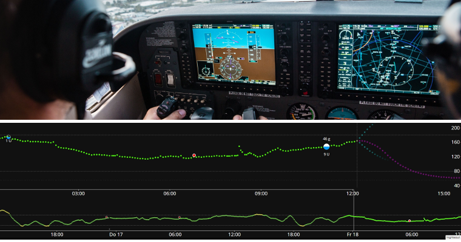

# Introduction aux APS et à AAPS

```{contents} In this page
:backlinks: entry
:depth: 2
```

## Qu'est ce qu'un "Système de Pancréas Artificiel” (APS)?

Un pancréas humain fait beaucoup de choses en plus de réguler la glycémie. Cependant, le terme **« Système de pancréas artificiel » (APS)** fait généralement référence à un système qui agit pour maintenir automatiquement les niveaux de glycémie dans les limites de la santé.

La façon basique de faire cela est de détecter les **niveaux de glycémies**, utiliser ces valeurs pour faire des **calculs**, puis d'injecter le montant correct (estimé) d'**insuline** dans le corps. Il répète le calcul régulièrement (quelques minutes), 24h/24, 7j/7. Il utilise des **alarmes** et des **alertes** pour informer l'utilisateur si une intervention ou une attention est nécessaire. This system is typically made up of a **glucose sensor**, an **insulin pump** and a **controller** which runs the calculations. In **AAPS** and other open-source systems the controller is an app on a phone. In most commercial systems it is software built into the pump itself, with a phone app used mainly for display and control.

For background on how closed-loop systems developed and how they work, this 2022 review article is a good starting point. Bear in mind it predates most of the systems available today, so it is not a guide to what is currently on the market:

 [Closed-Loop Insulin Delivery Systems: Past, Present, and Future Directions](https://www.frontiersin.org/journals/endocrinology/articles/10.3389/fendo.2022.919942/full) (Templer, _Frontiers in Endocrinology_, 2022).

So-called “dual-hormone” systems infuse glucagon alongside insulin, with the aim of preventing severe hypos and allowing even tighter blood glucose control. A first system of this kind has been approved in Europe, but it is supplied only through studies and projects, and others are still in development. None is on general sale yet.

Un pancréas artificiel peut être considéré comme un ["pilote automatique pour votre diabète"](https://www.artificialpancreasbook.com/). En d'autres termes :

Dans un avion, un pilote automatique ne fait pas tout le travail du pilote humain, ainsi le pilote ne peut pas dormir pendant la totalité du vol. Le pilote automatique facilite le travail du pilote. It relieves them of the burden of constantly having to manage the aircraft, allowing the pilot to concentrate on wider monitoring. The autopilot receives signals from various sensors, a computer evaluates the data together with the pilot’s specifications and then makes the necessary adjustments, alerting the pilot to any concerns. The pilot no longer has to worry about continually making decisions and this analogy can be applied to **AAPS**.



(Introduction-what-does-hybrid-closed-loop-mean)=
## Que signifie "boucle fermée hybride" ?

La meilleure solution pour le diabète de type 1 serait un « traitement fonctionnel » (probablement un implant de cellules pancréatiques protégées du système immunitaire). While the type 1 diabetic (T1D) community waits for that, a “full closed loop” artificial pancreas is probably the next best thing. Il s'agit d'un système technologique qui n'a besoin d'aucune entrée utilisateur (comme les bolus d'insuline pour les repas, ou l'annonce d'une activité physique), avec une bonne régulation des taux de glycémie. Nearly every system in everyday use is a “hybrid” closed loop, because it uses a combination of automated technology and user input. The first full closed loop systems were approved in Europe in 2026, but none is widely available yet.

## Comment et pourquoi la boucle a-t-elle commencé ?

Le développement de technologies commerciales pour les personnes atteintes de diabète de type 1 (DT1) est très lent. En 2013, la communauté TD1 a fondé le mouvement #WeAreNotWaiting (#nous n'attendronspas). Ses membres ont mis au point eux-mêmes des systèmes utilisant des technologies déjà approuvées (pompes à insuline et capteurs de glycémie) pour améliorer le contrôle du taux de glycémie, la sécurité et la qualité de vie. These are known as OS-AID (Open-Source Automated Insulin Delivery) systems (formerly DIY systems), because they are not formally approved by health bodies (FDA, NHS etc). There are four main OS-AID systems available: [OpenAPS](https://openaps.org/what-is-openaps/), **AAPS**, [Loop](https://loopkit.github.io/loopdocs/#what-is-loop) and [Trio](https://triodocs.org).

A great way to understand the fundamentals of OS-AID looping is to read Dana Lewis’s book “Automated Insulin Delivery”. Vous pouvez y accéder [ici](https://www.artificialpancreasbook.com/) gratuitement (ou acheter une copie papier du livre). Si vous voulez en savoir plus sur [OpenAPS](https://openaps.org/what-is-openaps/), qui est le fondement d'**AAPS**, le site [OpenAPS](https://openaps.org/what-is-openaps/) est la référence.

Several commercial hybrid closed loop systems have also been launched. These are very different to OS-AID systems, mainly because many of them include a “learning algorithm” which adjusts how much insulin is delivered according to your insulin needs from previous days. Many people in the OS-AID community have already tried out commercial systems and compared them with their OS-AID system. You can find out more about how the different systems compare by asking on the dedicated Facebook groups for those systems, on the [AAPS Facebook group](https://www.facebook.com/groups/AndroidAPSUsers/) or on [Discord](https://discord.com/invite/4fQUWHZ4Mw).

## Qu'est-ce que Android APS (AAPS) ?


**Figure 1**. Description succinte du système APS d'Android (Artificial Pancréas System), AAPS.

Android APS (**AAPS**) est un système hybride en boucle fermée, ou système Artificiel de pancréas (APS). It makes its insulin dosing calculations using established [OpenAPS](https://openaps.org/) algorithms (a set of rules) developed by the #WeAreNotWaiting T1D community.

Since OpenAPS is only compatible with certain older insulin pumps, **AAPS** (which can be used with a wider range of insulin pumps) was first developed in 2016 for a family member with type 1 diabetes. Depuis ses débuts, **AAPS** a été sans cesse développé et amélioré par une équipe de développeurs informatiques bénévoles et d'autres passionnés qui ont une connexion avec le monde du diabète de type 1. Today, **AAPS** is used by many thousands of people worldwide. It is a highly customisable and versatile system, and because it is open-source, it is also readily compatible with many other open-source diabetes software and platforms. Les composants fondamentaux du système **AAPS** actuel sont décrits dans **la figure 1** ci-dessus.


## Quels sont les composants de base d'AAPS ?

Le « cerveau » d'AAPS est une **application** que vous construisez vous-même. Des instructions détaillées sont fournies pour la construire. You then install the **AAPS  app** on a [compatible](../Getting-Started/Phones.md) **Android smartphone** (**1**). Un certain nombre d'utilisateurs préfèrent conserver leur boucle sur un téléphone distinct de leur téléphone principal. Vous pouvez donc par exemple utiliser un téléphone Android juste pour faire fonctionner votre boucle AAPS et utiliser votre téléphone habituel pour toutes vos autres activités.

Vous aurez besoin d'une application supplémentaire sur votre **smartphone Android**, en plus d'**AAPS**. This [additional app](../Getting-Started/CompatiblesCgms.md) receives glucose data from a sensor (**2**) by Bluetooth, and then sends the data internally on the phone to the **AAPS app**.

L'application **AAPS** utilise le processus de prise de décision (**algorithme**) d'OpenAPS. Les débutants commencent à utiliser l'algorithme de base **oref0** , mais il est possible de passer à l'utilisation de l'algorithme **oref1** plus récent au fur et à mesure que vous progressez avec AAPS. Le choix de l'algorithme (oref0 ou oref1) sera à effectuer en fonction de celui qui correspondra le mieux à votre situation.  Dans les deux cas, l'algorithme prend en compte plusieurs facteurs, et effectue des calculs rapides chaque fois qu'une nouvelle lecture provient du capteur de glycémie. The algorithm then sends instructions to the insulin pump (**3**) on how much insulin to deliver by Bluetooth. All the information can be sent by mobile data or Wi-Fi to the internet (**4**). Ces données peuvent également être partagées avec des abonnés, si souhaité, et/ou collectées pour analyse. Optionally, you can also pair a [smartwatch](../Getting-Started/Watches.md) (**5**) with the phone to see your data at a glance and, with some watches, send basic commands to **AAPS**.

## Quels sont les avantages du système AAPS ?

L'algorithme OpenAPS utilisé par **AAPS** contrôle les glycémies en l'absence de saisie de l'utilisateur, selon les paramètres qu'il a définis (les plus importants étant les débits de basale, les facteurs de sensibilité à l'insuline, les ratios Glucides/Insuline, la durée d'activité de l'insuline, etc.) , en réagissant toutes les 5 minutes aux nouvelles données transmises par le capteur. de glycémie.

Some of the reported advantages of using **AAPS** are extensive fine-tunable options, **Automations** and increased transparency of the system for the patient/caregiver. This can result in better control over your diabetes (or that of someone you are caring for), which in turn may give improved quality of life and increased peace of mind.

Si vous y investissez du temps, **AAPS** peut potentiellement conduire à :

- soulager le stress et la charge mentale de la gestion du diabète de type 1;

- réduire la multitude de décisions banales de la gestion au quotidien du diabète de type 1;

- fournir un débit adapté et personnalisé d'insuline basé sur des données en temps réel qui peuvent réduire le besoin de traitements d'hypoglycémie et réduire les épisodes d'hyperglycémie;

- avoir une meilleure connaissance de la gestion de l'insuline et de la confiance en soi pour mieux affiner vos paramètres;

- la possibilité de créer des paramètres automatiques (**automatisations**) adaptés à votre style de vie;

- améliorer la qualité de votre sommeil et de la réduction globale de la fréquence des interventions nocturnes;

- surveiller et administrer à distance la distribution d'insuline pour les accompagnants des diabétiques de type 1; et

- le remplacement de tous vos équipements mobiles pour la gestion du diabète (récepteur du lecteur de glucose en continu du récepteur et PDM de pompe) par un seul téléphone Android contrôlé par **AAPS**.


Au final, **AAPS** peut permettre aux individus de reprendre le contrôle et mieux gérer leur diabète, ce qui entraîne des taux de glycémie stables et de meilleurs résultats à long terme en matière de santé.

### Parmi les avantages spécifiques :

#### 1) La sûreté d'abord
Pour en savoir plus sur les caractéristiques de sécurité des algorithmes, appelés oref0 et oref1, [cliquez ici](https://openaps.org/reference-design/). L'utilisateur a la responsabilité de définir ses propres limites de sécurité.

#### 2) Hardware flexibility

**AAPS** works with a wide range of insulin pumps and sensors and offers flexibility as life changes. Ainsi, par exemple, si vous développez une allergie à la colle du capteur Dexcom, vous pourrez à la place, basculer vers un capteur Freestyle libre. Users don't have to rebuild or reinstall the **AAPS** app, just select a different pump or BG source in **Configuration** to change your hardware. **AAPS** is independent of particular pump drivers and also contains a "virtual pump" so users can safely experiment before using it on themselves.

#### 3) Highly customisable, with wide parameters

Les utilisateurs peuvent facilement ajouter ou supprimer des modules ou des fonctionnalités, et **AAPS** peut être utilisé en mode boucle ouverte ou fermée. Voici quelques exemples des possibilités offertes par le système **AAPS** :

 a) The ability to set a lower **BG** target 30 min before eating; you can set the target as low as 72 mg/dL (4.0 mmol/L).

 b) Si votre résistance à l'insuline a pour conséquence des glycémies élevées, **AAPS** vous permettra de mettre en place une règle d'**automatisation** qui se déclenchera quand la glycémie dépasse 144 mg/dL (8 mmol/L), changeant (par exemple) le profil à 120% (entrainant une augmentation de 20% des débits de basale et également un renforcement des autres variables, par rapport à votre **profil** habituel). L'automatisation prendra fin après la durée que vous aurez vous-même programmé. Une automatisation pourrait par exemple être configurée pour être active seulement certains jours de la semaine, ou certaines heures de la journée, ou même en certains lieux.

 c) Si votre enfant se retrouve sans prévenir sur un trampoline, **AAPS** permettra de suspendre l'injection d'insuline pour une période déterminée, directement via le téléphone.

 d) Après avoir déconnecté puis rebranché une pompe tubulaire pour aller nager, **AAPS** calculera l'insuline basale que vous avez manquée pendant votre période de déconnexion et vous l'injectera prudemment, en fonction votre glycémie. Toute insuline non requise peut être remplacée par une simple « annulation » de l'insuline basale correspondante.

 f) **AAPS** offre la possibilité de définir des profils spécifiques pour différentes situations et de basculer facilement entre eux. Par exemple, les fonctionnalités qui rendent l'algorithme plus rapide pour faire descendre une glycémie élevée, telles que les super-micro-bolus (« **SMB** ») ou les Repas Non Signalés, (“**RNS**”), peuvent être configurées pour agir uniquement pendant la journée, si vous vous inquiétez des hypos nocturnes.

Il s'agit là de quelques exemples, l'éventail complet des fonctionnalités offrant une grande flexibilité dans la vie quotidienne, y compris l'activité sportive, les maladies, les cycles hormonaux, _etc_. En résumé, c'est à l'utilisateur de décider comment utiliser cette flexibilité, et il n'y a pas une automatisation unique pour tout le monde.

#### 4) Remote monitoring
There are multiple possible monitoring channels (Sugarmate, Dexcom Follow, xDrip, Android Auto _etc._) which are useful for parents/carers and adults in certain scenarios (sleeping/driving) who need customisable alerts. In some apps (xDrip) you can also turn alarms off totally, which is great if you have a new sensor “soaking” or settling down that you don’t want to loop with yet.

#### 5) Remote control
A significant advantage of **AAPS** over commercial systems is that it is possible for followers, using authenticated text (SMS) commands or a paired **AAPSClient** app to send a wide range of commands back to the **AAPS** system. This feature is used extensively by parents of kids with type 1 diabetes who use **AAPS**.

The remote control features can be very useful: for example, in the playground, if you want to pre-bolus for a snack from your own phone, and your child is busy playing. It is also possible to monitor the system from a smartwatch (_e.g._ Garmin) or send basic commands from it (_e.g._ a Wear OS watch such as the Samsung Galaxy Watch).

#### 6) No commercial constraints, due to open application interfaces
Au-delà de l'utilisation d'une approche open source, qui permet de voir à tout moment le code source de **AAPS**, le principe général est de fournir des interfaces de programmation ouvertes donnant aux autres développeurs l'opportunité de contribuer et d'apporter de nouvelles idées qui permettent aux utilisateurs de vivre plus facilement avec leur diabète. **AAPS** est étroitement lié à Nightscout. Cela accélère le développement et permet aux utilisateurs d'ajouter des fonctionnalités pour rendre la vie avec le diabète encore plus facile. Good examples for such integrations are [Nightscout](https://nightscout.github.io/), [Nightscout Reporter](https://nightscout-reporter.zreptil.de/), xDrip, [M5 stack](https://github.com/mlukasek/M5_NightscoutMon/wiki) etc. La discussion est ouverte entre les développeurs de logiciels open-source et ceux qui développent des systèmes commerciaux. Many of the OS-AID innovations are gradually adopted by commercial systems, where developments are understandably slower, partly because interfaces between systems from different companies (pumps, apps, sensors _etc_) need to be carefully negotiated and licenced. Cela peut également ralentir les innovations qui sont utiles pour les patients (ou un sous-groupe de patients avec un besoin très spécifique) mais ne génèrent aucun profit important.

#### 7) Detailed app interface
Avec **AAPS**, il est facile de suivre des choses telles que : la quantité d'insuline dans la pompe, l'âge de la canule, l'âge du capteur, l'âge de la batterie de la pompe, l'insuline active _etc_. Many actions can be done through the **AAPS** app (priming the pump, disconnecting the pump _etc_.), instead of on the pump itself, which means the pump can stay in your pocket or belt (or that of someone you are caring for).

#### 8) Accessibility and affordability
**AAPS** gives people who currently can’t afford to self-fund, or don’t have funding/insurance, access to a hybrid closed looping system which is conceptually years ahead, in terms of development, of the commercial systems. You currently need a reporting server (Nightscout or Tidepool) to set up **AAPS**, although it is not required for day-to-day running of the **AAPS** loop. Many people continue to use Nightscout for collecting their data, and for remote monitoring. Bien que **AAPS** soit gratuit, mettre en place Nightscout sur une des nombreuses plateformes disponibles peut avoir un coût (0€ - 12€). Ce coût sera fonction du niveau de support dont vous avez besoin (voir table de comparaison) et de si vous voulez conserver Nightscout après l'installation ou non. **AAPS** works with a wide range of affordable (starting from approx €150) [Android phones](https://docs.google.com/spreadsheets/u/1/d/e/2PACX-1vScCNaIguEZVTVFAgpv1kXHdsHl3fs6xT6RB2Z1CeVJ561AvvqGwxMhlmSHk4J056gMCAQE02sAWJvT/pubhtml?gid=683363241&single=true). Différentes versions sont disponibles en fonction de votre pays et votre langue, et AAPS peut également être utilisé par des personnes [aveugles ou malvoyantes](#accessibility-for-users-aaps-who-are-partially-or-completely-blind).

#### 9) Support
Aucun système d'administration d'insuline automatique n'est parfait. Les systèmes commerciaux et les systèmes open-source partagent de nombreux problèmes communs en matière de communications et de défaillances matérielles temporaires. La communauté AAPS, constituée de personnes qui ont conçu, développé et qui utilisent actuellement **AAPS**, peut apporter du soutien et du support sur Facebook, Discord ou encore GitHub, partout dans le monde. Il y a aussi du support surt des groupes Facebook et de l'aide provenant d'établissement de santé et d'entreprises commerciales pour les systèmes de boucles fermées commerciaux. Cela vaut la peine de parler aux utilisateurs, ou aux anciens utilisateurs de ces systèmes afin d'obtenir des retours d'expérience sur les bugs courants, la qualité du programme éducatif et le niveau de support continu fourni.

#### 10) Predictability, transparency and safety
**AAPS** is transparent, logical and predictable, which may make it easier to know when a setting is wrong, and to adjust it accordingly. Vous pouvez voir exactement ce que fait le système, pourquoi il le fait, et définissez ses limites opérationnelles, ce qui met le contrôle (et la responsabilité) entre vos mains. L'utilisateur peut gagner en assurance et bénéficier d'un sommeil plus tranquille.

#### 11) Access to advanced features through development (dev) modes including full closed loop
Cette documentation **AAPS** se concentre sur la branche principale **“master”** de **AAPS**. Cependant, la recherche et le développement n'arrêtent jamais. Les utilisateurs plus expérimentés peuvent souhaiter explorer les fonctionnalités expérimentales dans la branche de **développement**. Les innovations en matière de développement se concentrent sur des stratégies de boucle fermée totale (sans avoir à saisir de bolus pour les repas _etc._), et essayent de manière générale de rendre la vie avec le diabète de type 1 aussi facile que possible.

#### 12) Ability to contribute yourself to further improvements
Le diabète de type 1 peut être très frustrant et isole les personnes. Avoir le contrôle de votre propre système technologique pour votr diabète, avec la possibilité de contribuer à votre tour dès que vous faites des progrès en aidant les autres dans leur cheminement peut être vraiment gratifiant. Vous pouvez vous former, mettre au jour des obstacles, faire des recherches et même contribuer à de nouveaux développements et à la documentation. Vous trouverez d'autres personnes dans la communauté avec qui partager la même envie de progresser, avec qui réfléchir et travailler. C'est l'essence même du mouvement #WeAreNotWaiting.

## Comment marche AAPS en comparaison aux Multiples Injections Quotidiennes (MDI) et à la boucle ouverte ?

Les injections quotidiennes multiples (MDI, (a) dans le **Schéma 2** ci-dessous) impliquent généralement de faire une injection d'insuline lente / à action longue (_par exemple_ Lantus, Tresiba) une fois par jour, avec des injections d'insuline à action rapide ou ultrarapide (_par exemple_ Novorapid ou Fiasp) à l'heure des repas, ou pour des corrections. L'utilisation classique d'une pompe à insuline (boucle ouverte) (b) implique l'utilisation d'une pompe pour délivrer le basal à des taux pré-programmés d'insuline à action rapide, puis à effectuer un bolus via la pompe lors des repas ou pour des corrections. Le principe de base d'un système de boucle est que l'application utilise les données de glycémie pour envoyer à la pompe l'instruction d'arrêter l'injection d'insuline lorsqu'elle prévoit que vous allez bientôt être en hypoglycémie, et pour vous donner plus d'insuline si votre glycémie augmente et que vous allez être en hyperglycémie (c). Bien que ce schéma soit simplifié par rapport à la réalité, il vise à démontrer les principales différences entre ces approches. Il est possible d'arriver à un contrôle extrêmement bon de la glycémie avec n'importe laquelle de trois approches.


**Figure 2**. Aperçu simplifié de (a) Injections multiples quotidiennes ou MDI, (b) boucle ouverte et (c) boucle fermée hybride.

## Comment marche AAPS en comparaison aux autres systèmes de boucle?

As of June 25 2023, there are four major open source closed loop systems available: [OpenAPS](https://openaps.readthedocs.io/), **AAPS**, [Loop](https://loopkit.github.io/loopdocs/#what-is-loop) and [Trio](https://triodocs.org), (formerly FreeAPS X). Les caractéristiques des différents systèmes sont affichées dans le tableau ci-dessous :


| Device type     | Nom                                                                             | [AAPS](https://wiki.aaps.app)              | [Boucle](https://loopkit.github.io/loopdocs/) | [Open APS](https://openaps.readthedocs.io/en/latest/) | [Trio](https://triodocs.org)               |
| --------------- | ------------------------------------------------------------------------------- | ------------------------------------------ | --------------------------------------------- | ----------------------------------------------------- | ------------------------------------------ |
| Téléphone       | Android                                                                         |      |     |             |  |
| Téléphone       | iPhone                                                                          |  |         |             |      |
| Nano-ordinateur | tout petit ordinateur (1)                                                       |  |     |                 |  |
| POMPE           | [Dana I](../CompatiblePumps/DanaRS-Insulin-Pump.md)                             |      |         |             |      |
| POMPE           | [Dana RS](../CompatiblePumps/DanaRS-Insulin-Pump.md)                            |      |         |             |      |
| POMPE           | [Dana R](../CompatiblePumps/DanaR-Insulin-Pump.md)                              |      |     |             |  |
| POMPE           | [Omnipod (Dash)](../CompatiblePumps/OmnipodDASH.md)                             |      |         |             |      |
| POMPE           | [Omnipod (Eros)](../CompatiblePumps/OmnipodEros.md)                             |      |         |             |      |
| POMPE           | [Diaconn G8](../CompatiblePumps/DiaconnG8.md)                                   |      |     |             |  |
| POMPE           | [EOPatch 2](../CompatiblePumps/EOPatch2.md)                                     |      |     |             |  |
| POMPE           | [Medtrum TouchCare Nano 200U](../CompatiblePumps/MedtrumNano.md)                |      |         |             |      |
| POMPE           | [Medtrum TouchCare 300U](../CompatiblePumps/MedtrumNano.md)                     |      |         |             |      |
| POMPE           | [Roche Combo](../CompatiblePumps/Accu-Chek-Combo-Pump-v2.md)                    |      |     |             |  |
| POMPE           | [Roche Insight](../CompatiblePumps/Accu-Chek-Insight-Pump.md)                   |      |     |             |  |
| POMPE           | [Anciennes Medtronic](../CompatiblePumps/MedtronicPump.md)                      |      |         |                 |      |
| POMPE           | [Equil 5.3](../CompatiblePumps/Equil5.3.md)                                     |      |     |             |  |
| POMPE           | [CareLevo](../CompatiblePumps/CareLevo.md)                                      |      |     |             |  |
| MGC             | [Dexcom G7/One+/Stelo](../CompatibleCgms/DexcomG7.md)                           |      |         |             |      |
| MGC             | [Dexcom One](../CompatibleCgms/DexcomG6.md)                                     |      |         |             |      |
| MGC             | [Dexcom G6](../CompatibleCgms/DexcomG6.md)                                      |      |         |                 |      |
| MGC             | [Libre 3/3+](../CompatibleCgms/Libre3.md)                                       |      |         |             |      |
| MGC             | [Libre 2/2+](../CompatibleCgms/Libre2.md)                                       |      |         |             |      |
| MGC             | [Libre 1](../CompatibleCgms/Libre1.md)                                          |      |         |             |      |
| MGC             | [Eversense](../CompatibleCgms/Eversense.md)                                     |      |         |             |      |
| MGC             | [MM640g/MM630g](../CompatibleCgms/MM640g.md)                                    |      |     |             |  |
| MGC             | [PocTech](../CompatibleCgms/PocTech.md)                                         |      |     |             |  |
| MGC             | [Ottai](../CompatibleCgms/OttaiM8.md)                                           |      |     |             |  |
| MGC             | [Syai Tag](../CompatibleCgms/SyaiTagX1.md)                                      |      |     |             |  |
| MGC             | [Nightscout comme source de glycémie](../CompatibleCgms/CgmNightscoutUpload.md) |      |         |                 |      |

_Notes de tableau :_
1. Un **nano-ordinateur** est un petit ordinateur que vous transportez avec vous, sans moniteur. Un type d'appareil pris en charge est Intel Edison + Explorer Board et l'autre Raspberry Pi + Explorer HAT ou Adafruit RFM69HCW Bonnet. The first APS systems were based on this setup, as mobile phones were not capable of running the required algorithms. L'utilisation de ces systèmes a régressé, car l'installation sur les téléphones mobiles est devenue plus facile et les téléphones ont un écran inclus. Intel a également arrêté de vendre l'Intel Edison. The excellent OpenAPS algorithms **oref0** and **oref1** are now incorporated in AAPS and Trio.


Une déclaration de consensus international, revue par les pairs, contenant des directives pratiques sur la boucle open-source a été rédigée par et pour les professionnels de la santé, et publiée dans une revue médicale respectée en 2022 : [_Lancet Diabetes Endocrinol_, 2022; 10: 58–74](https://www.ncbi.nlm.nih.gov/pmc/articles/PMC8720075/)(_1_). It is well worth a read (including for your diabetes clinic) and summarizes the main technical differences between the different open-source hybrid closed loop systems.

Il est difficile d'avoir un "ressenti" quel que soit le système sans l'utiliser soi-même, ou sans en parler à d'autres qui l'utilisent, alors n'hésitez pas à contacter et à demander des retours d'expériences à des utilisateurs sur Facebook/Discord. Most people find that **AAPS** is incredibly sophisticated in comparison to other hybrid closed loop systems (particularly the commercial systems), with a huge number of potentially customizable settings and features, discussed above. Some people can find this a little overwhelming at the beginning, but there is no rush to investigate all the possibilities at once. You can progress as slowly or as fast as you would like, and there is help available at every step of the way.


## AAPS utilise-t-il une intelligence artificielle ou un algorithme d’apprentissage ?

The current version of **AAPS** (4.0) does not have any machine learning algorithms, multiple-parameter insulin response models, or artificial intelligence. En tant que tel, le système est ouvert et transparent dans son fonctionnement, et a la capacité d'être compris non seulement par les experts, mais aussi par les médecins et les patients. It also means that if you have a sharply varying schedule (maybe switching from a stressful week at work to a relaxing holiday) and are likely to need a significantly different amount of insulin, you can immediately switch **AAPS** to run a weaker/stronger customized profile. Un « système d'apprentissage » fera cet ajustement pour vous automatiquement, mais il est probable qu'il lui faille plus de temps pour ajuster la distribution d'insuline.

(which-system-is-right-for-me-or-my-dependent)=
## Which system is right for me or someone I am caring for?

En pratique, votre choix de système est souvent restreint par la pompe que vous possédez déjà ou que vous pouvez obtenir auprès de votre médecin diabétologue et de votre choix de téléphone (Apple ou Android). Si vous n’avez pas encore de pompe, vous avez le plus grand choix de systèmes. La technologie est en constante évolution, la production ou vente de certaines pompes s'arréte et de nouvelles pompes et capteurs apparaissent. La plupart des systèmes open-source fonctionnent avec les capteurs principaux (Freestyle Libre et Dexcom) ou sont rapidement mis à jour pour utiliser de nouveaux capteurs environ un an après leur sortie (avec un peu de retard pour les tests de sécurité et de stabilité).

La plupart des utilisateurs d'**AAPS** rapportent une amélioration du temps passé dans la cible, une réduction de l'HbA1c ainsi qu'une amélioration de la qualité de vie. Ces effets découlent du fait que le système qui peut ajuster automatiquement le débit d'insuline basale la nuit pendant le sommeil. Ceci est vrai pour la plupart des systèmes d'administration automatiques (APS) en boucle fermée hybride. Some people have a preference for a very simple system which is not very customizable (which means you may prefer a commercial system), and others find this lack of control very frustrating (you may prefer an open-source system). If you (or someone you are caring for) are newly diagnosed, a common route is to get used to using MDI plus a glucose sensor first, then progress to a pump which has the potential for looping, then progress to **AAPS**, but some people (especially small kids) may go straight to a pump.

Il est important de noter que les utilisateurs **AAPS** doivent être proactifs en cas de problème et les résoudre par eux-même avec l'aide de la communauté d'utilisateurs. C'est un état d'esprit très différent de celui correspondant à l'utilisation d'un système commercial. Avec **AAPS** un utilisateur a plus de contrôle, mais aussi plus de responsabilité, et doit être à l'aise avec cela.

## Peut-on utiliser des systèmes open-source comme AAPS en toute sécurité ?

### Sûreté du système AAPS
La question devrait plutôt être, plus précisément : « Est-ce sans danger **par rapport** à mon système actuel d'administration d'insuline ? » puisqu'aucune méthode d'administration d'insuline n'est sans risque. Il y a beaucoup de contrôles et régulations en place avec **AAPS**. A recent [paper](https://www.liebertpub.com/doi/epub/10.1089/dia.2019.0375) looked at the use of **AAPS** in a computer-simulated setup, which was an effective way to objectively trial how safe and effective the system is. More generally, many thousands of individuals worldwide are using open-source automated-insulin delivery systems, and uptake continues to increase globally.

N'importe quel périphérique qui utilise des communications radio peut être piraté, et c'est vrai aussi pour une pompe à insuline (sans boucle). À l'heure actuelle, nous ne connaissons personne qui tente de nuire aux personnes en piratant leur équipement médical lié au diabète. Cependant, il existe de multiples moyens de se protéger contre de tels risques :

1.  Dans les paramètres de la pompe, limitez à la fois le bolus max autorisé et le réglage de base temporaire max à des quantités qui, selon vous, sont les plus sûres. Ce sont des limites fortes que nous pensons non contournables par un pirate malveillant.

2.  Laissez actives vos alarmes de capteurs de glycémies MGC pour les hypos et les hypers.

3.  Surveillez votre injection d'insuline en ligne. Les utilisateurs Nightscout peuvent définir des alarmes supplémentaires pour les alerter pour une grande variété de conditions, y compris les celles qui sont beaucoup plus susceptibles de se produire qu'une attaque malveillante. En plus des hypos et hypers, Nightscout peut afficher des données de diagnostic utiles pour vérifier que la pompe fonctionne comme vous le souhaitez, incluant l'Insuline Active (IA) courante, l'historique des basales temporaires de la pompe, l'historique des bolus de la pompe. Il peut également être configuré pour avertir proactivement les utilisateurs de conditions indésirables, telles que : prévisions d'hypos et d'hypers, réservoir d'insuline faible et batterie faible de la pompe.

Si une attaque malveillante était effectuée contre votre pompe à insuline, ces stratégies atténueraient considérablement le risque. Chaque utilisateur potentiel d'**AAPS** doit évaluer les risques associés à l'utilisation d'**AAPS**, par rapport aux risques d'utilisation d'un système différent.

#### Considérations de sécurité en lien avec l'amélioration trop rapide du contrôle de la glycémie

Une baisse rapide de l'HbA1c et un meilleur contrôle de la glycémie paraissent attirants. Cependant, faire baisser les niveaux moyens de glucose sanguin _trop rapidement_ en démarrant un système de boucle fermée quel qu'il soit, peut causer des dommages permanents, y compris aux yeux, et une neuropathie douloureuse qui ne disparaîtra jamais. Ces atteintes peuvent être évitées simplement en baissant plus lentement les niveaux. If you currently have an elevated HbA1c and are moving to AAPS (or any other closed loop system), please discuss this potential risk with your clinical team before starting, and agree a time plan with them. More general information on how to reduce your glucose levels safely, including links to medical literature is given in the safety section [here](#preparing-safety-first).

#### Sûreté médicale autour des dispositifs, consommables et autres médicaments

Utilisez une pompe à insuline et un capteur de glycémie approuvés par la FDA ou la CE, testés et entièrement fonctionnels, pour une boucle de pancréas artificiel. Les modifications matérielles ou logicielles de ces composants peuvent entraîner un dosage incorrect de l'insuline, causant un risque significatif pour l'utilisateur. Si vous trouvez ou recevez des pompes à insuline ou des capteurs de glycémie cassés, modifiés ou fabriqués maison, ne les utilisez pas pour mettre en place un système AAPS.

Utilisez du matériel d'origine pour les applicateurs, cathéters et réservoirs d'insuline, approuvés par le fabricant de votre pompe et de votre MGC. L'utilisation de consommables non testés ou modifiés peut entraîner une imprécision du MGC et des erreurs de dosage de l'insuline. L'insuline peut s'avérer très dangereuse lorsqu'elle est mal dosée - ne jouez pas avec votre vie en bricolant votre matériel.

Ne prenez pas d'inhibiteurs de SGLT-2 (gliflozines) lorsque vous utilisez **AAPS** car il est impossible de calculer la manière dont ils font baisser la glycémie. Combining this effect with a system that lowers basal rates in order to increase BG is dangerous, there is more detail about this in the main [safety section](#preparing-safety-first).

(introduction-how-can-i-approach-discussing-aaps-with-my-clinical-team)=
## Comment puis-je aborder AAPS avec mon équipe médicale ?

Les utilisateurs sont encouragés à parler avec leur équipe médicale de leur intention d'utiliser **AAPS**. Please do not be afraid to have an honest conversation with your diabetes team if you intend to use **AAPS** (or any other OS-AID loop, for that matter). La transparence et la confiance entre le patient et le médecin sont primordiales.

### Approche suggérée :
Commencez par discuter avec votre docteur afin d'en savoir plus sur ses connaissances et son attitude vis-à-vis de la technologie utile aux diabétiques telle que les MGC, les pompes, les boucles hybrides et les boucles commerciales. Votre docteur/endocrinologue devrait être au fait des moyens techniques de base et être prêt à discuter avec vous des récentes avancées apportées par les produits de boucle commerciaux disponibles dans votre pays.

#### Antécédents locaux

Obtain your clinicians/endocrinologists’ views on OS-AID loop _vs_ commercial looping, and gauge their knowledge in this area. Are they familiar with **AAPS** and can they share with you any helpful experience of working with patients with OS-AID looping?

Ask if your team has any patients under their care who already use OS-AID looping. En raison du secret médical, les médecins ne peuvent pas transmettre les informations d'autres patients sans obtenir le consentement de la personne. However, if you want to, you **can** ask them to pass **your** contact details to an existing OS-AID looping patient if there is one the clinician feels you might "click” with, suggesting that you would be happy for the patient to contact you to discuss OS-AID looping. Les docteurs n'ont aucune obligation de le faire, mais certains le feront avec plaisir, car ils ont conscience de l'importance du soutien entre pairs dans la gestion du diabète de type 1. You may also find it useful to meet local friendly OS-AID loopers. Cela dépend bien sûr de vous, et n'est pas indispensable.

#### Antécédents nationaux et internationaux

Si vous vous sentez peu soutenu par votre équipe pour boucler avec **AAPS**, les points de discussion suivants peuvent vous aider :

a) Le système **AAPS** a été conçu PAR des patients et leurs aidants. Il a été conçu avant tout pour la sûreté, mais aussi en s'inspirant de l'expérience "dans la vie réelle" des patients. There are many thousands of **AAPS** users worldwide. There is therefore likely to be other patients using OS-AID looping in your clinic's patient population (whether they know about it or not).

b) Recent peer-reviewed published guidance in the internationally leading medical journal [The Lancet](https://www.ncbi.nlm.nih.gov/pmc/articles/PMC8720075/pdf/nihms-1765784.pdf)_(1)_ has confirmed that OS-AID loops are **safe** and **effective at improving diabetic control**, including time in range. There are regular articles in leading journals like [Nature](https://doi.org/10.1038/d41586-023-02648-9)_(3)_ which highlight the progress of the OS-AID looping community.

c) La mise en place d'**AAPS** se fait par étapes _progressives_ : partant d'une pompe en boucle "ouverte", en passant par l'arrêt avant hypo, jusqu'à la boucle "fermée" hybride. Cette évolution se fait en atteignant successivement un certain nombre d'objectifs. Il existe donc un programme structuré, exigeant de l'utilisateur qu'il démontre un niveau de compétence à chaque étape et qu'il ajuste ses paramètres de base (basal, SI et G/I) avant de pouvoir fermer la boucle.

d) Technical support is available to you from the OS-AID community through GitHub, Discord and Facebook closed groups.

e) Vous serez en mesure de fournir **aussi bien des informations sur votre glycémie que sur votre boucle/administration d'insuline par la pompe** sous forme de rapports synthétiques lors de vos RDV médicaux (grâce à Nightscout ou Tidepool), soit imprimés soit sous format numérique (si vous apportez un ordinateur portable/tablette). La mise en parallèle des données de glycémie et d'insuline permettra une utilisation plus efficace du temps de votre docteur lors de l'examen vos rapports et des discussions pour évaluer vos progrès.

f) If there is still strong objection from your team, hand your clinician printouts of the reference articles linked here in the text, and give them the link to the **AAPS** clinicians section: [For Clinicians – A General Introduction and Guide to **AAPS**](../UsefulLinks/ClinicianGuideToAaps.md)

#### Support for OS-AID looping by other clinicians

L'article publié dans le [Lancet Diabetes Endocrinology](https://www.ncbi.nlm.nih.gov/pmc/articles/PMC8720075/)(_1_)[ (co-dirigé par Kings’ et Guy’s et St Thomas’ NHS Foundation Trust, et co-dirigé par le Dr Sufyan Hussain, un diabétologue consultant et maître de conférences honoraire de King’s à Londres) fournit :

a) **Assurance** for professionals that OS-AID artificial pancreas systems/ open source as a “safe and effective treatment” option for type 1 diabetes and provides guidance on recommendations, discussions, supports, documentation;

b) La **reconnaissance** que les systèmes de distribution d'insuline automatisés en open source (AID) peuvent augmenter le temps passé dans la cible (TIR) tout en diminuant la variation des glycémies et le nombre d'épisodes hypoglycémiques et hyperglycémiques, pour divers groupes d'âge, sexe et origine;

c) La **recommandation** selon laquelle les professionnels de la santé devraient **soutenir** les patients de type 1 ou leurs aidants qui choisissent de gérer leur diabète avec un système de boucle open source;

d) La recommandation selon laquelle les professionnels de santé devraient essayer de se documenter sur toutes les possibilités de traitement qui pourraient bénéficier aux patients, y compris les systèmes de boucle open source disponibles.  Si les professionnels de santé ne trouvent pas les ressources pour se documenter, ou ont des interrogations légales ou réglementaires, ils devraient envisager de **coopérer ou de s'associer avec d'autres professionnels de santé** qui peuvent les aider;

e) Insiste sur le fait que tous les utilisateurs de MGC devraient avoir un accès en temps réel à **leurs propres données de santé** à tout instant

f) Souligne que ces systèmes open source n'ont pas subi les mêmes évaluations réglementaires que les technologies médicales disponibles commercialement, et qu'il n'y a pas de support technique commercial. Cependant, **un soutien à tous niveaux est disponible** via la communauté d'utilisateurs; et

g) La recommandation selon laquelle les **cadres réglementaires et juridiques** devraient être mis à jour pour garantir la clarté sur l'autorisation du traitement éthique et efficace de ces systèmes open source.

Un autre article dans [Medical Law International, 2021](http://pure-oai.bham.ac.uk/ws/files/120241375/0968533221997510.pdf)(_4_) insiste également sur le fait que le « guide sur le consentement » du Conseil Général de Médecine du Royaume-Uni accorde une grande importance au fait que le médecin et le patient prennent les décisions d'un commun accord. The doctor should explain the potential benefits, risks, burdens and side-effects on OS-AID APS and may recommend a particular option without pressuring the patient.

En fin de compte, il revient au patient de considérer ces facteurs, ainsi que tout problème non clinique pertinent pour lui, et de décider quelle option de traitement, le cas échéant, accepter.

If a doctor discovers in a clinic that their patient is looping with an OS-AID system, they are not exempted from their obligations to monitor the patient, simply because they did not prescribe the particular piece of technology the patient is using; clinicians must continue to monitor patients.

Les médecins (du moins au Royaume-Uni) n'ont pas l'interdiction de prescrire des médicaments non reconnus et peuvent utiliser leur discernement médical. They should therefore use their clinical judgement to decide if an OS-AID APS is suitable for a specific patient, and discuss what they consider to be the pros and cons with the patient.

#### Les articles référencés ci-dessus, ainsi que d'autres liens utiles et déclarations de position sont listés ci-dessous :

1. Administration automatisée d'insuline open-source : déclaration de consensus international et directives pratiques pour les professionnels de la santé [_Lancet Diabetes Endocrinol_, (2022) _10_, 58–74](https://www.ncbi.nlm.nih.gov/pmc/articles/PMC8720075/)
2. [In Silico Trials of an Open-Source Android-Based Artificial Pancreas: A New Paradigm to Test Safety and Efficacy of Do-It-Yourself Systems, 2020](https://www.liebertpub.com/doi/epub/10.1089/dia.2019.0375)
3. Un ‘pancréas bionique’ révolutionne les soins du diabète — quelle est la prochaine étape ? [_Nature_ (2023), _620_, 940-941](https://doi.org/10.1038/d41586-023-02648-9)
4. Prescrire des dispositifs médicaux non approuvés ? Le cas des systèmes de pancréas artificiels DIY [_Medical law international_, (2021), _21_, 42-68](http://pure-oai.bham.ac.uk/ws/files/120241375/0968533221997510.pdf)
5. [Déclaration de position de l'Institut de santé de Berlin, 2022](https://www.bihealth.org/en/notices/do-it-yourself-solutions-for-people-with-diabetes-are-safe-and-recommended)
6. Administration d'insuline automatisée open-source : Guide d'utilisation pour le professionnel de santé (position et guide de Diabetes Canada) [_Canadian Journal of Diabetes_, (2023)_47_, E8, 389-397](https://www.canadianjournalofdiabetes.com/article/S1499-2671(23)00138-7/fulltext)
7.  Pays-Bas (EN/NL) - pour les professionnels de santé- [comment aider les personnes avec les systèmes automatisés d'administration d'insuline en open source](https://www.diabetotech.com/blog/how-to-help-people-on-open-source-automated-insulin-delivery-systems)
8. Première utilisation du système d'admnistration automatisé de l'insuline open-source AndroidAPS dans un scénario de boucle fermée totale : étude pilote randomisée Pancreas4ALL [_Diabetes Technol. Ther._, 25, _5_, 2023](https://www.liebertpub.com/doi/pdf/10.1089/dia.2022.0562?casa_token=D13eFx5vCwwAAAAA:MYvO8hChbViXVJFgov1T11RXBPx2N_wOMThLHwl3TVUxbCuANegPrIFRC5R5VXx_S71FoQYW-qg)
9. Les enfants d'âge préscolaire et scolaire bénéficient du passage d'une pompe associée à un capteur de glycémie à une boucle fermée hybride AndroidAPS : Une analyse rétrospective [_Pediatr. Diabetes_ 2021, _22_, 594-604. 2021](https://onlinelibrary.wiley.com/doi/epdf/10.1111/pedi.13190)
10. Publications du projet OPEN, un projet financé par l'UE étudiant la "preuve par le patient" avec une technologie de pancréas artificiel novatrice et open-source (https://www.open-diabetes.eu/publications)


## Pourquoi je ne peux pas simplement télécharger AAPS et l’utiliser immédiatement ?

L'application n'est pas fournie dans Google Play - vous devez la compiler vous même à partir du code source pour des raisons juridiques. **AAPS** n'est pas autorisé, ce qui signifie qu'il n'a pas reçu d'approbation par une autorité réglementaire quelque soit le pays. Utiliser **AAPS** revient à mener une expérience médicale sur vous-même, et se fait à vos risques et périls.

La mise en place du système nécessite de la patience, de la détermination et l'apprentissage progressif des connaissances techniques. Toutes les informations et le support peuvent être trouvés dans ces documents, ailleurs en ligne, ou auprès d'autres personnes qui l'ont déjà mis en place. Many thousands of people have successfully built and are currently using **AAPS** worldwide.

Les développeurs de **AAPS** prennent très au sérieux la sûreté, et font tout pour que la communauté des utilisateurs ait la meilleure expérience possible de **AAPS**. C'est pourquoi il est essentiel que chaque utilisateur (ou chaque parent si l'utilisateur est un enfant) :

- compile le système AAPS lui-même et passe successivement les **objectifs** afin que les paramètres à personnaliser soient raisonnablement bons, et comprenne les bases de la façon dont **AAPS** fonctionne avant de « fermer la boucle »;

- backs up their system by exporting and saving important files (like keystore and settings .json file) somewhere safe, so you can set up again quickly if needed;

- mette à jour les nouvelles versions master d'AAPS dès qu'elles sont disponibles; et

- gère et surveille le système pour s’assurer qu’il fonctionne correctement.

## Comment le système AAPS est-il interconnecté ?

**Figure 3 (below)** shows one example of the **AAPS** system for a user who does not require any followers interacting with the system. D'autres applications et plates-formes open-source, non illustrés ici, peuvent également être intégrés.


**Figure 4 (below)** shows the full potential of the **AAPS** system for a user who has followers and needs to monitor and adjust the system remotely (like a child with type 1 diabetes). D'autres applications et plates-formes open-source, non illustrés ici, peuvent également être intégrés.


## Comment AAPS est-il développé et continuellement amélioré ?

La plupart des utilisateurs d'**AAPS** utilisent la version d'AAPS entièrement testée **master**, testée pour les bugs et autres problèmes, avant d'être livrée à la communauté. En coulisse, les développeurs essaient de nouvelles améliorations, et les testent dans des versions d'**AAPS** appelées « développeur » (**dev**) avec une communauté d'utilisateurs qui sont heureux de faire des mises à jour des corrections à court terme. Si les améliorations fonctionnent bien, elles sont ensuite publiées en tant que nouvelle version « maître » d'**AAPS**. Toute nouvelle version master est annoncée sur le groupe Facebook "AAPS users", afin que les utilisateurs d'**AAPS** puissent en savoir plus et mettre à jour leur système avec la nouvelle version master.

Certains utilisateurs d'**AAPS** expérimentés et sûr d'eux font des tests avec les technologies émergentes et avec les versions de développement de l'application **AAPS**. Il peut être intéressant pour les utilisateurs moins aventureux de lire sur ces sujets, sans avoir à le faire eux-mêmes ! Les gens ont tendance à partager ces expériences sur le groupe Facebook.

Vous pouvez en savoir plus sur certaines de ces expériences et discussions sur les technologies émergentes ici :

Tim Street [https://www.diabettech.com/](https://www.diabettech.com/)

David Burren [https://bionicwookie.com/](https://bionicwookie.com/)

## A qui AAPS peut-il être utile ?

| Type d'utilisateur                              |
| ----------------------------------------------- |
| ✔️ diabétique de type 1                         |
| ✔️ soignant ou parent d'un diabétique de type 1 |
| ✔️ utilisateurs aveugles diabétiques de type 1  |
| ✔️ *clinicians and healthcare professionals     |

The above table assumes that the user has access to both a continuous glucose monitor and an insulin pump.

* Toutes les données d'**AAPS** peuvent être mises à la disposition des professionnels de santé par le biais de plates-formes de partage de données. Par exemple NightScout, qui permet la surveillance en temps réel et le stockage dans le durée des données du capteur de glycémie, de l'administration d'insuline, des entrées de glucides, des prévisions et des paramètres. Nightscout records include daily and weekly reports which can aid healthcare professionals' discussions with type 1 patients with more accurate data on glycemic control and any behavioral considerations.

(accessibility-for-users-aaps-who-are-partially-or-completely-blind)=

### Accessibility for AAPS users who are partially or completely blind

#### Utilisation quotidienne de AAPS :
AAPS peut également être utilisé par les personnes aveugles ou malvoyantes. Sur les appareils Android, le système d'exploitation propose une application appelée TalkBack. Cela permet de contrôler l'écran par la voix, directement via le système d'exploitation. En utilisant TalkBack, vous pouvez utiliser à la fois votre smartphone et AAPS sans avoir besoin de voir.

#### Compilation de l'application AAPS :
En tant qu'utilisateur, vous compilerez l'application AAPS dans Android Studio. Many people use Microsoft Windows for this purpose, where there is the screen reader analogous to TalkBack. Comme Android Studio est une application Java, le composant "Java Access Bridge" doit être activé dans le Panneau de configuration. Dans le cas contraire, le lecteur d'écran du PC ne pourra pas fonctionner dans Android Studio.

Comment faire ? Cela dépend de votre système d'exploitation, deux méthodes sont décrites ci-dessous :

1) Dans le menu Démarrer de Windows, tapez "Panneau de configuration" dans le champ de recherche, validez avec Entrée. Cela ouvre : "Tous les éléments du panneau de configuration”.

Ouvrez les « Options d'ergonomie ».

Puis ouvrez "Utiliser l'ordinateur sans écran" en appuyant sur "Entrée".

Under **Hear text read aloud**, select **turn on narrator** and **turn on audio display**, then click **apply**.

ou :

2) Dans le menu Démarrer de Windows, tapez "Panneau de configuration" dans le champ de recherche, validez avec Entrée. Cela ouvre : "Tous les éléments du panneau de configuration”.

Commencez à taper "non-voyants" dans la barre de recherche, cliquez sur "Optimiser pour les non-voyants".

Vous arrivez dans la section "Utiliser l'ordinateur sans écran".

En bas de cette page, vous trouverez la case à cocher "Activer Java Access Bridge", cochez-la.

Et voilà, vous pouvez fermer la fenêtre ! Le lecteur d'écran devrait fonctionner maintenant.


Vous voulez en savoir plus sur comment démarrer l'installation d'AAPS ? Take a look at the [preparing](../Getting-Started/PreparingForAaps.md) section.
