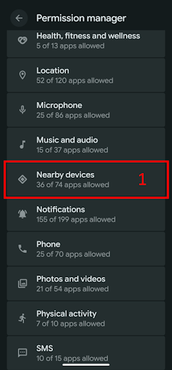

(bluetoothtroubleshooting-bluetooth-related-issues)=

# Problèmes liés au Bluetooth

Certains utilisateurs ont rencontré des échecs d'activation de l'Omnipod DASH, des problèmes de connexion du Medtrum Nano et d'autres erreurs de pod liées au Bluetooth. Beaucoup de ces problèmes viennent de l'une des causes suivantes.

Certaines de ces causes concernent probablement aussi d'autres pompes à insuline Bluetooth : le Medtrum Nano a des problèmes connus avec l'autorisation « Appareils à proximité », comme l'Omnipod DASH.

---

(bluetoothtroubleshooting-cannot-start-omnipod-with-android-16)=

## Impossible de démarrer l'Omnipod avec Android 16
- Android 16 nécessite au minimum la version 3.3.2.1 d'**AAPS** pour que l'Omnipod DASH fonctionne correctement, car cette version contient des corrections pour les problèmes connus causés par Android 16 avec l'Omnipod.

---

(bluetoothtroubleshooting-bluetooth-battery-optimisation)=

## Optimisation de la batterie du Bluetooth

Les versions récentes d'Android activent l'optimisation de la batterie pour l'application système Bluetooth. Cela est connu pour causer des problèmes avec les pompes et MGC Bluetooth.

Si vous avez suivi l'[Assistant de configuration](../SettingUpAaps/SetupWizard.md) et les réglages de la section [Optimisation de la batterie du Bluetooth](#setup-wizard-bluetooth-battery-optimisation), ce paramètre devrait être correct. Mais si vous avez suivi une ancienne version de ce guide, il est possible que vous n'ayez pas modifié ce paramètre.

Vérifiez que ce paramètre est correct si vous avez des déconnexions de la pompe et du MGC.

---

(bluetoothtroubleshooting-apps-using-nearby-device-permission)=

## Les applications qui utilisent l'autorisation Android « Appareils à proximité » peuvent causer des pertes de connexion et des problèmes d'activation du pod

Android vous permet de contrôler ce que chaque application peut faire ou utiliser sur votre téléphone, grâce à un système d'autorisations. Pour chaque application installée, vous pouvez autoriser ou refuser des autorisations précises, par ex. accéder aux fichiers de l'appareil, au Bluetooth, rechercher les appareils à proximité, etc.

**AAPS** a besoin de plusieurs autorisations précises pour fonctionner. L'une d'elles, nécessaire pour que les pods fonctionnent, est l'autorisation « Appareils à proximité ». Beaucoup d'autres applications demandent aussi cette autorisation. La communauté constate que plusieurs applications, quand elles ont cette autorisation, peuvent causer des problèmes d'activation de nouveaux pods sur certains appareils.

(bluetoothtroubleshooting-apps-using-nearby-device-permission-known-apps)=

### Applications qui utilisent l'autorisation « Appareils à proximité » et qui ont déjà causé des problèmes :

Les applications de cette liste ont été citées dans un ou plusieurs endroits de la communauté comme causant des problèmes avec l'Omnipod DASH, et dans certains cas aussi avec le Medtrum Nano.

```{admonition} Updating the list
:class: note
Contactez @XiTatiON sur le canal Discord #omnipod-dash pour proposer des applications à ajouter à cette liste.
```

- **myBMW** MyBMW a perturbé le Medtrum Nano et l'Omnipod DASH. L'application MyBMW demande l'autorisation « Rechercher les appareils à proximité » une seule fois. Si vous ne l'accordez pas, l'application fonctionne quand même tout à fait normalement.

- **Amazon Alexa**  Retirer l'autorisation « Appareils à proximité » à l'application Alexa a résolu le problème pour certaines personnes, mais empêche d'associer des appareils connectés Matter (IoT)

- **MINI app**  Cette application semble basée sur l'application myBMW et pourrait donc avoir le même comportement

- **BM2** Application de surveillance de batterie solaire, utilisée dans certains camping-cars et installations solaires de camping : quand l'application était en cours d'exécution, elle empêchait l'activation d'un nouveau pod. Forcer l'arrêt de l'application pendant l'activation d'un nouveau pod permet de contourner le problème. Utiliser l'application ensuite n'a pas semblé gêner le fonctionnement du Dash (sur un Pixel 8 Pro sous Android 16).

(bluetoothtroubleshooting-revoke-nearby-device-permission)=

### Comment retirer l'autorisation « Appareils à proximité » aux autres applications :
Si vous avez des problèmes pour activer un nouveau pod alors que vous utilisez la bonne version d'**AAPS** pour votre version d'Android, il peut être nécessaire de retirer l'autorisation aux autres applications pendant l'activation d'un nouveau pod.

Suivez cette procédure pour retirer l'autorisation « Appareils à proximité » à toutes les applications sauf **AAPS** :

```{admonition} Menus and settings
:class: note
Les captures d'écran et instructions de ce guide viennent d'une installation Android 16 standard sur un Google Pixel 8 Pro. Sur d'autres fabricants et appareils, les menus et paramètres ne seront probablement pas exactement les mêmes. Adaptez les étapes à votre appareil. Si vous êtes bloqué, consultez la section [Où obtenir de l'aide pour le Dash](#omnipod-dash-where-to-get-help-for-dash) pour savoir comment demander de l'aide à la communauté.
```

1. Ouvrez les paramètres Android de votre téléphone, faites défiler vers le bas et appuyez sur **Sécurité et confidentialité (1)** (Security and privacy).

    

2. Faites défiler vers le bas et appuyez sur **Paramètres de confidentialité (1)** (Privacy controls).

   

3. Appuyez sur **Gestionnaire d'autorisations (1)** (Permission manager).

   

3. Faites défiler vers le bas et appuyez sur **Appareils à proximité (1)** (Nearby devices).

   

4. Parcourez la liste des applications et appuyez sur l'application pour laquelle vous voulez retirer l'autorisation **Appareils à proximité**.

   Dans ce guide, nous retirons l'autorisation à l'application **Android Auto (1)**.

   Pour éviter de perdre d'autres pods, nous conseillons à tous de retirer d'abord l'autorisation à toutes les applications sauf **AAPS**.

```{admonition} Which app to select?
:class: tip
Si vous ne savez pas quelle application cause le problème, désactivez l'autorisation pour toutes (pensez à vérifier aussi la liste des applications à problème connues et commencez par celles-ci). Si vous pouvez vous permettre de perdre quelques pods, réactivez l'autorisation pour une seule application avant chaque nouvelle activation de pod, jusqu'à trouver quelle application cause vos problèmes de pod. Si vous trouvez de nouvelles applications à problème, dites-le-nous sur le canal Discord #omnipod-dash.
```

   

5. Pour retirer l'autorisation, appuyez sur **Ne pas autoriser (1)** (Don't allow), puis sur **Refuser quand même (2)** (Don't allow anyway). Si c'est bien fait, l'option **Ne pas autoriser (3)** doit être sélectionnée. Vous pouvez maintenant revenir au menu **Appareils à proximité** avec la **flèche Retour (4)** et modifier ce paramètre pour d'autres applications si nécessaire.

      

(bluetoothtroubleshooting-re-enable-nearby-device-permission)=

### Comment réactiver l'autorisation « Appareils à proximité » pour les applications système et les autres applications :

1. Si nécessaire, consultez la section **« Comment retirer l'autorisation "Appareils à proximité" aux autres applications »** pour savoir comment ouvrir les paramètres de confidentialité des applications. Une fois dans la configuration **Appareils à proximité**, passez à l'étape 2.

2. Parcourez la liste des applications et appuyez sur l'application à laquelle vous voulez accorder l'autorisation **Appareils à proximité**.

   Dans ce guide, nous accordons l'autorisation à l'application **Android Auto (1)**.

   Vous remarquerez qu'**Android Auto (1)** n'apparaît plus dans la liste des applications après le retrait de l'autorisation. C'est parce que l'application **Android Auto** est une **application système**, et que les applications système sont masquées par défaut.

   

3. Pour afficher les applications système masquées, appuyez sur le **menu à trois points (⋮) (1)** en haut à droite, puis sur **« Afficher le système » (2)** (Show system). Vous devriez maintenant voir l'application système masquée **Android Auto (3)** dans la liste.

```{admonition} Find your app
:class: tip
Si l'autorisation d'une application a été retirée, faites défiler vers le bas jusqu'à la liste des applications refusées, plus bas dans la liste.
```

     

5. Suivez les instructions de **« Comment retirer l'autorisation "Appareils à proximité" aux autres applications »** dans le sens inverse pour réactiver l'autorisation pour chaque application.

---

(bluetoothtroubleshooting-android-15-bluetooth-connection-problems)=

## Android 15 : problèmes fréquents de connexion Bluetooth

Après une mise à jour d'Android ou le passage à un téléphone récent, **AAPS** perd souvent la connexion Bluetooth avec la pompe. Le problème disparaît temporairement quand on redémarre le téléphone. Si vous utilisez un **Omnipod DASH** et que votre téléphone est sous Android 15, activer le paramètre **Appairage Bluetooth** peut améliorer la stabilité de la connexion Bluetooth. Pour l'activer :

```{admonition} Android 16
:class: warning
N'activez **Appairage Bluetooth** que sur Android 15, et seulement si vous avez des problèmes de connexion. N'activez PAS l'appairage sur Android 16.
```

1. Ouvrez les [paramètres Dash](#omnipod-dash-settings) : ouvrez l'écran de la pompe DASH avec **Gestion** > **Pompe** et appuyez sur l'icône **Paramètres** (roue dentée) en haut à droite.

   

2. Ouvrez la section **Paramètres Avancés** et activez **Appairage Bluetooth**.

   

3. Si le téléphone affiche une demande d'association, acceptez-la.

4. Redémarrez votre téléphone.
