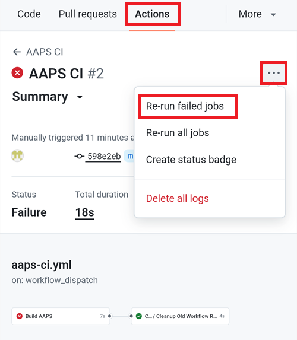
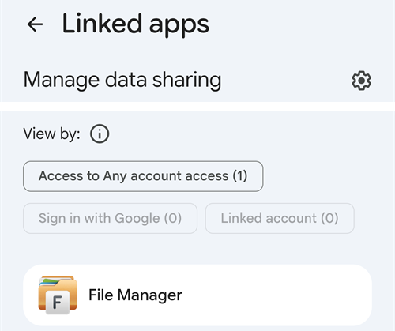

(aaps-ci-troubleshooting)=

# Dépannage de la compilation dans le navigateur

```{note}
Cette page rassemble des conseils de dépannage pour la [Compilation dans le navigateur](../SettingUpAaps/BrowserBuild.md).

Vous utilisez **AAPS Builder** ? Commencez par sa propre [section de dépannage](#aaps-builder-troubleshooting). Les sections sur Google Drive ci-dessous s'appliquent aussi à lui.
```

## Dépannage d'AAPS-CI

(aaps-ci-read-the-logs)=
### D'abord : trouver ce qui ne va pas

Quand une compilation échoue, GitHub garde un log de chaque étape. Le log vous indique quelle étape a échoué et pourquoi. Lisez-le avant d'essayer autre chose : le message d'erreur est ce que vous cherchez sur cette page, et ce que les personnes qui vous aident vous demanderont.

1. Dans votre copie GitHub d'AndroidAPS, ouvrez **Actions**. Une compilation échouée a une croix rouge. Appuyez sur son nom.

   

2. Le résumé de l'exécution affiche **Failure** et, en dessous, le job qui a échoué (**Build AAPS**, avec une croix rouge).

   

3. Faites défiler jusqu'à **Annotations** et appuyez sur la ligne rouge **Build AAPS**.

   

4. Le job s'ouvre. Les étapes avec une coche grise ont fonctionné. L'étape avec la croix rouge est celle qui a échoué : GitHub l'ouvre pour vous. Les étapes suivantes ont été ignorées (cercle gris).

   

5. Lisez les lignes juste au-dessus de `Error: Process completed with exit code 1.` : elles expliquent le problème. Dans cet exemple, l'étape **Retrieving Google Drive access token** a échoué avec `invalid_grant` et `Token has been expired or revoked.`, voir [Jeton d'actualisation Google expiré](#aaps-ci-google-token-expired).

   

```{tip}
Vous demandez de l'aide ? Partagez le nom de l'étape échouée et les lignes d'erreur (une capture d'écran comme celle ci-dessus convient). Ne partagez jamais le contenu de vos secrets.
```

(aaps-ci-update-secret)=
#### Mettre à jour un secret

Beaucoup de corrections consistent à remplacer la valeur d'un secret. Dans votre copie GitHub d'AndroidAPS, allez dans **Settings** → **Secrets and variables** → **Actions** et appuyez sur le crayon à côté du secret.


Saisissez ou collez la nouvelle valeur et appuyez sur **Update secret**. GitHub n'affiche jamais l'ancienne valeur : le champ est toujours vide.


(aaps-ci-rerun)=
#### Relancer la compilation après une correction

Une fois la cause corrigée, vous n'avez pas besoin de tout recommencer : ouvrez l'exécution échouée, appuyez sur **...** (en haut à droite), puis sur **Re-run failed jobs**.



Appuyez sur **Re-run jobs**. Vous pouvez aussi lancer une nouvelle compilation avec **Run workflow**, comme d'habitude.


(aaps-ci-preparation-web)=
### Page web aaps-ci-preparation
  - La page de préparation est affichée par un serveur local temporaire (par exemple Simple Web Server sur un ordinateur), qui reçoit aussi le jeton d'actualisation Google.
  - Si vous voyez l'écran ci-dessous, le serveur local s'est arrêté ou n'est pas joignable.
  - Fermez la page de préparation, vérifiez que le serveur local fonctionne, puis rouvrez aaps-ci-preparation.html de la même façon qu'à l'étape 2 et terminez les étapes restantes. C'est nécessaire en particulier lors de la création de la première connexion Google pendant la configuration.

  

(aaps-ci-google-token-expired)=
### Jeton d'actualisation Google expiré
  - Les jetons d'actualisation Google OAuth2 expirent s'ils ne sont pas utilisés pendant 6 mois, et peuvent aussi devenir invalides dans d'autres cas (par ex. si vous avez changé le mot de passe de votre compte Google, ou retiré l'accès manuellement). Pour plus de détails, consultez la [documentation Google OAuth2](https://developers.google.com/identity/protocols/oauth2).
  - Dans le [log de compilation](#aaps-ci-read-the-logs), l'étape **Retrieving Google Drive access token** échoue avec `invalid_grant` et `Token has been expired or revoked.` :

  

  - Si votre compilation échoue à cause d'un jeton d'actualisation Google expiré ou retiré, vous devez refaire les étapes [Google Drive Auth](#aaps-ci-google-drive-auth) pour obtenir un nouveau jeton `GDRIVE_OAUTH2`, [mettre à jour le secret](#aaps-ci-update-secret) dans votre dépôt GitHub, puis [relancer la compilation](#aaps-ci-rerun).
  - Si l'autorisation échoue encore, ou si Google ne vous demande plus votre accord, retirez d'abord l'accès AAPS existant de votre compte Google, voir [ci-dessous](#aaps-ci-google-remove-access).

(aaps-ci-google-remove-access)=
### Retirer l'accès d'AAPS à votre compte Google et recommencer l'autorisation
  - Si l'autorisation Google Drive échoue toujours, ou si vous voulez repartir de zéro, retirez d'abord l'accès que vous avez donné à AAPS, puis refaites l'autorisation.
  - Sur votre téléphone, ouvrez [https://myaccount.google.com](https://myaccount.google.com), appuyez sur **Sécurité** (Security), faites défiler jusqu'à **Vos connexions à des applications et services tiers** (Your connections to third-party apps & services) et ouvrez la liste des applications associées. Vous pouvez aussi aller directement sur [https://myaccount.google.com/connections](https://myaccount.google.com/connections).
  - Appuyez sur **AAPS** dans la liste.

  

  - La page affiche l'accès que vous avez donné à AAPS (les fichiers Google Drive utilisés avec l'application). Appuyez sur **Tout supprimer** (Delete all) pour supprimer la connexion, ou sur **Voir les détails** (See details) pour la vérifier d'abord.

  

  - Sur la page des détails, appuyez sur **Supprimer tous les accès** (Remove all access).

  

  - Appuyez sur **Confirmer** (Confirm).

  

  - Google confirme qu'AAPS n'a plus accès. AAPS n'apparaît plus dans la liste des applications associées.

  

  - Recommencez maintenant l'autorisation proprement : fermez **à la fois** la page de préparation et l'application de gestion de fichiers, rouvrez aaps-ci-preparation.html depuis le gestionnaire de fichiers et refaites les étapes [Google Drive Auth](#aaps-ci-google-drive-auth). Google vous demandera de nouveau d'accorder l'accès et la page fournira un nouveau jeton `GDRIVE_OAUTH2`.
  - [Mettez à jour le secret `GDRIVE_OAUTH2`](#aaps-ci-update-secret) dans votre dépôt GitHub avec le nouveau jeton, puis [relancez la compilation](#aaps-ci-rerun).

(aaps-ci-disable-software)=
### Désactiver les logiciels qui peuvent gêner la vérification OAUTH
  - Désactivez tout VPN ou application de sécurité (pare-feu, antimalware, ...) sur le téléphone avant d'essayer d'obtenir la clé OAUTH.

(aaps-ci-actions-permission)=
### Vérifier les paramètres d'autorisation de GitHub Actions
  - Vérifiez que les règles de GitHub Actions sont réglées sur “Allow all actions and reusable workflows” (Settings → Actions → General). Si vous le modifiez, appuyez sur **Save** sous les options.

  

`actions/checkout@v4` and `actions/setup-java@v4` are not allowed to be used in `xxxxx/AndroidAPS`. Actions in this workflow must be: within a repository owned by `xxxxx`

(aaps-ci-workflow-permissions)=
### Vérifier les paramètres Workflow permissions de GitHub
  - Si la compilation échoue tout de suite avec une erreur "Invalid workflow file" semblable à celle ci-dessous, les autorisations par défaut des workflows de votre dépôt sont trop restrictives :

```
Invalid workflow file
The workflow is not valid. .github/workflows/aaps-ci.yml (Line: 361, Col: 3):
Error calling workflow 'xxxxx/AndroidAPS/.github/workflows/cleanup-workflow-runs.yml@...'.
The nested job 'cleanup' is requesting 'actions: write', but is only allowed 'actions: none'.
```

  - Vérifiez que Workflow permissions est réglé sur “Read and write permissions” (Settings → Actions → General → Workflow permissions), puis enregistrez et relancez le workflow de compilation.

  

(aaps-ci-password-special-characters)=
### La compilation échoue à la vérification du mot de passe du keystore
  - Dans le [log de compilation](#aaps-ci-read-the-logs), l'étape **Validating keystore, alias and password** échoue avec `Either KEYSTORE_BASE64, KEYSTORE_PASSWORD, KEY_PASSWORD, or KEY_ALIAS is incorrect`, suivi de `Keystore was tampered with, or password was incorrect`. La compilation s'arrête là : le keystore et les mots de passe sont vérifiés avant la compilation d'AAPS.

  

  - Le workflow de compilation garde chaque caractère de vos mots de passe intact. Saisissez `KEYSTORE_PASSWORD` et `KEY_PASSWORD` exactement tels quels, sans ajouter de barre oblique inverse (backslash) ni aucun autre caractère d'échappement. Si vous avez ajouté des barres obliques inverses, [mettez à jour les secrets](#aaps-ci-update-secret) avec le mot de passe exactement tel quel. L'exemple ci-dessous est faux : le mot de passe est `Example2026`, la barre oblique inverse a été ajoutée.

  

  - Si la compilation échoue encore à la signature de l'APK alors que votre mot de passe est correct, et que le mot de passe contient `$`, un accent grave (backtick), `"` ou `\`, le fichier workflow de votre fork date d'avant septembre 2026 et interprète encore ces caractères. [Synchronisez votre fork](#Update-to-new-version-update-your-repo) avec la dernière version dev, puis relancez le workflow de compilation.
  - La barre verticale `|` est un cas particulier. La page de préparation de l'[Option 1](#aaps-ci-option1) regroupe le keystore, les mots de passe et l'alias dans un seul secret `KEYSTORE_SET`, séparés par `|`, et le workflow les sépare sur ce caractère. Le mot de passe créé par la page de préparation ne contient que des lettres et des chiffres, donc cela ne peut pas arriver avec l'Option 1. Cela ne peut arriver que si vous avez assemblé vous-même un secret `KEYSTORE_SET` avec un mot de passe contenant `|`. Dans ce cas, supprimez `KEYSTORE_SET` et saisissez plutôt les secrets séparés de l'[Option 2](#aaps-ci-option2).
