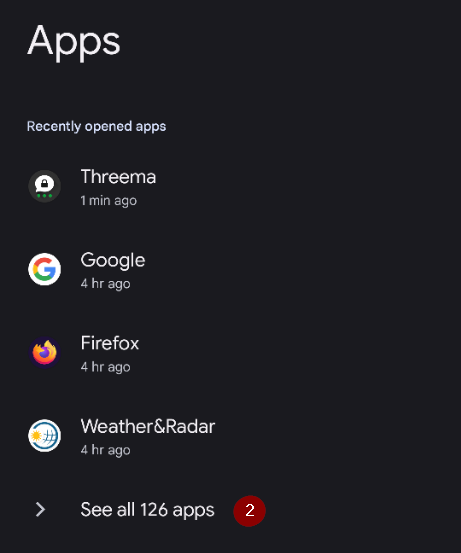

(generaltroubleshooting)=

# Dépannage

**Commencez ici quand quelque chose ne fonctionne pas.** Les informations de dépannage se trouvent sur de nombreuses pages de la documentation. Cette page les rassemble : c'est une liste de liens, triés par sujet, pour vous aider à résoudre les problèmes les plus fréquents.

Si vous ne trouvez pas votre réponse ci-dessous, consultez aussi :

* la [Foire Aux Questions (FAQ)](../UsefulLinks/FAQ.md) pour les réponses aux questions fréquentes, et
* la page [Ajuster le profil AAPS](ProfileTuning.md) si votre boucle fonctionne mais que votre contrôle de la glycémie doit être amélioré.

```{admonition} Still stuck?
:class: tip
Si aucun lien ne résout votre problème, consultez [Où puis-je obtenir de l'aide ?](WhereCanIGetHelp.md) pour poser la question à la communauté (Facebook, Discord), ou envoyez vos [fichiers log](AccessingLogFiles.md) aux développeurs.
```

---

(generaltroubleshooting-aaps-app)=

## Application AAPS

### Compilation et mise à jour

* Si la compilation échoue, consultez [Si la compilation échoue](#building-aaps-troubleshooting) : vous y trouverez la section de dépannage de chaque méthode de compilation :
  * [AAPS Builder](#aaps-builder-troubleshooting)
  * [Compilation dans le navigateur](#aaps-ci-troubleshooting)
  * [Android Studio](TroubleshootingAndroidStudio.md)
* Keystore perdu ou nouveau keystore : [Réinstaller AAPS](#reinstall-aaps)
* Mettre à jour **AAPS** : [avec AAPS Builder](#aaps-builder-updates), [avec une compilation dans le navigateur (fork)](#update-browser-build-troubleshooting), [avec Android Studio](#update-computer-build-troubleshooting)

### Installation

* [Avertissement Google Play Protect](#transferring-installing-play-protect-warning) : l'application est signalée comme dangereuse.
* Installation **bloquée** avec un message sur un développeur non vérifié : consultez [Vérification des développeurs Android](#android-developer-verification) pour les méthodes d'installation gratuites.

### Paramètres

* [Profil : « Basal rate is not compatible with the current pump » (le débit de basal n'est pas compatible avec la pompe actuelle)](#your-aaps-profile-basal-not-compatible)
* [Pompe : « Data is coming from different pump » (les données viennent d'une autre pompe)](#config-builder-wrong-pump-data)
* [Client Nightscout](TroubleshootingNsClient.md)
* **"AAPS settings cannot be read"** at start: the settings are encrypted with a key that Android keeps for **AAPS**, and that key does not open them any more, for example after the key store of the phone was reset. While this screen is shown, **AAPS** is not running and does not control the pump. Tap **Retry**: it closes and restarts **AAPS**. If that does not help, restart the phone. Use **Start fresh** only when nothing else helps: it sets the unreadable settings file aside (it is renamed and kept) and starts **AAPS** with empty settings. Then import your last [settings export](../Maintenance/ExportImportSettings.md).

### Utilisation

* [Valeurs de glucides fausses (absorption lente des glucides)](#CobCalculation-detection-of-wrong-cob-values)
* [Automatisation](#automations-troubleshooting)
* [Boucle fermée complète](#full-closed-loop-troubleshooting)

---

(generaltroubleshooting-bluetooth-related-issues)=


## Problèmes liés au Bluetooth

Pour les problèmes connus de connexion Bluetooth, de pertes de connexion avec la pompe/les pods, ou d'activation et de connexion, voir [Dépannage Bluetooth](../GettingHelp/BluetoothTroubleshooting.md)

---

(generaltroubleshooting-android-related-issues)=

## Problèmes liés à Android

### Optimisation de la batterie

**AAPS** peut vous aider à trouver les bons paramètres pour votre téléphone : ouvrez le **menu** (☰) > **À propos** et appuyez sur **Garder l'appli en arrière plan ?**. Cela ouvre les instructions pour la marque de votre téléphone sur [Don't kill my app](https://dontkillmyapp.com/). L'[assistant de configuration](#setup-wizard-bluetooth-battery-optimisation) vous demande aussi de désactiver l'optimisation de la batterie pour **AAPS** et le Bluetooth.

Android a des paramètres d'économie de batterie qui sont activés par défaut. Ces paramètres suspendent ou mettent en pause automatiquement les applications qui ne sont pas nécessaires au fonctionnement du système. Le but est d'économiser l'énergie de la batterie utilisée par les applis qui n'ont pas besoin de tourner tout le temps.

Quand elle est activée, elle cause très probablement des problèmes à **AAPS** et aux autres applis utiles comme **xDrip**.

Il est important de désactiver l'optimisation de la batterie pour que **AAPS** et les autres applis utiles restent actifs en permanence.

Selon la marque et le modèle de votre téléphone, il peut y avoir plusieurs endroits et paramètres où il faut la désactiver.

***REMARQUE :** Suivez les étapes ci-dessous pour désactiver l'optimisation de la batterie pour le service Bluetooth si votre téléphone a cette option. Les mêmes étapes servent pour **AAPS** et les autres applis, mais les captures d'écran montrent seulement le service Bluetooth.*

#### Téléphones Pixel (Android d'origine)

* Allez dans les paramètres Android, sélectionnez « Applications ».

  

* Sélectionnez "Voir toutes les applications"

  

* Dans le menu à droite, sélectionnez "Afficher les applications système".

  

* Maintenant, recherchez et sélectionnez l'application "Bluetooth".

  

* Appuyez sur « Utilisation de la batterie par l'appli » (App battery usage) et sélectionnez « Non limitée » (Unrestricted ; appelé « Non optimisée » sur certaines anciennes versions d'Android).

  


#### Téléphone Samsung

* Allez dans les paramètres d'Android, sélectionnez "Applications"

* Sur l'icône qui modifie soi-disant l'algorithme de tri (1), sélectionnez "Afficher les applications système" (2).

  

  

* Recherchez maintenant l'application Bluetooth et sélectionnez-la pour voir ses paramètres.

  

* Sélectionnez "batterie".

  

* Réglez-la sur « Non limitée » (Unrestricted ; appelé « Non optimisée » sur certaines anciennes versions d'Android).

  

#### Téléphones Huawei

Consultez ce guide pour [l'optimisation Bluetooth et batterie sur Huawei](../CompatiblePhones/Huawei.md)

---

(generaltroubleshooting-cgm)=

## Moniteur Glycémie continue (MGC)

Liens utiles vers les problèmes connus des MGC et les étapes pour les résoudre.

* [Généralités](#general-cgm-troubleshooting)
* [Dexcom G6](#DexcomG6-troubleshooting-g6)
* [Libre 2 avec Minimal Looper](#minimallooper-troubleshooting)
* [Libre 3](#libre3-experiences-and-troubleshooting)
* [xDrip - pas de données MGC](#xdrip-identify-receiver)
* [Dépannage xDrip - Dexcom](#xdrip-troubleshooting-dexcom-g5-g6-and-xdrip)

---

(generaltroubleshooting-pumps)=

## Pompes

Liens utiles vers les problèmes connus des pompes et les étapes pour les résoudre

* [Accu-Chek Combo](#combov2-tips-for-basic-usage)
* [Accu-Chek Insight](#Accu-Chek-Insight-Pump-insight-specific-errors)
* [CareLevo](#carelevo-alarms-and-notifications)
* [DanaRS](#DanaRS-Insulin-Pump-dana-rs-specific-errors)
* [Diaconn G8](#diaconn-g8-bluetooth-troubleshooting)
* [EOPatch2](#eopatch2-alarms-and-warnings)
* [Medtronic + RileyLink](#MedtronicPump-what-to-do-if-i-loose-connection-to-rileylink-and-or-pump)
* [Medtrum Nano](#medtrum-nano-troubleshooting)
* [Omnipod Dash](#omnipod-dash-troubleshooting)
* [Omnipod Eros](#OmnipodEros-troubleshooting)

---

(generaltroubleshooting-phones)=

## Téléphones

Liens utiles vers les problèmes connus des téléphones et les étapes pour les résoudre

* [Liste des téléphones et appareils testés](https://docs.google.com/spreadsheets/u/1/d/e/2PACX-1vScCNaIguEZVTVFAgpv1kXHdsHl3fs6xT6RB2Z1CeVJ561AvvqGwxMhlmSHk4J056gMCAQE02sAWJvT/pubhtml?gid=683363241&single=true)
* [Jelly](../CompatiblePhones/Jelly.md)
* [Optimisation Bluetooth et batterie sur Huawei](../CompatiblePhones/Huawei.md)

---

(generaltroubleshooting-remote-control)=

## Contrôle à distance

* [AAPSClient et contrôle à distance (association, commandes non reçues)](#client-master-control-troubleshooting)
* [Problèmes de « Jeton d'accès Nightscout »](#remotecontrol-nightscout-access-token)
* [Commandes SMS](#SMSCommands-troubleshooting)
* [Android Auto](#android-auto-troubleshooting)

---

(generaltroubleshooting-smartwatches)=

## Montres connectées

Liens utiles vers les problèmes connus des montres connectées et les étapes pour les résoudre

* [Dépannage de l'application Wear](#Watchfaces-troubleshooting-the-wear-app)
* [La montre et le téléphone ne communiquent pas](#wear-os-watch-phone-communication)
* [Wear OS 5](#wear-os-5-troubleshooting)
* [Compiler l'application Wear](#building-aaps-wear-os-troubleshooting)
