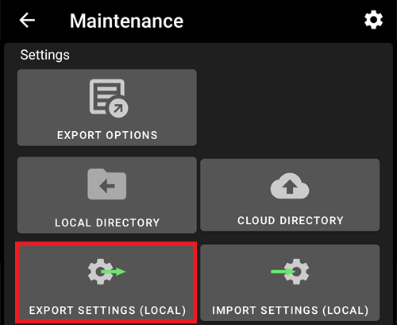
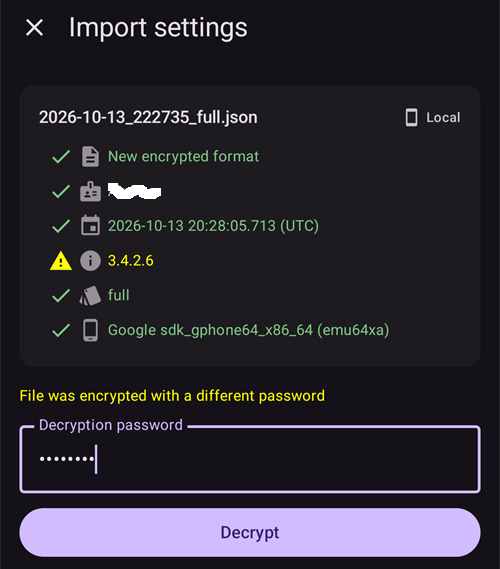
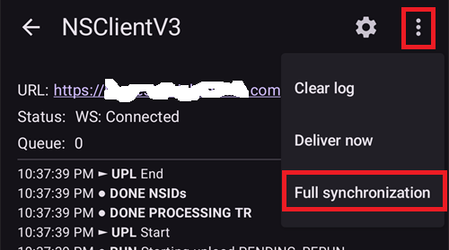

(reinstall-aaps)=
# Réinstaller AAPS avec un nouveau keystore

Chaque apk d'**AAPS** est signé avec un **keystore** (magasin de clés). Une mise à jour s'installe sur votre **AAPS** actuel seulement si elle est signée avec le **même keystore** : tous vos paramètres et vos données sont alors conservés. C'est pourquoi il est recommandé de garder le keystore et son mot de passe dans un endroit sûr.

Si vous essayez d'installer un apk signé avec un autre keystore qu'avant, vous aurez un message d'erreur qui indique que l'installation a échoué !

(reinstall-aaps-when)=
## Quand faut-il réinstaller ?

Vous devez désinstaller puis réinstaller **AAPS** quand votre nouvel apk est signé avec un autre keystore, par exemple :

- Vous ne trouvez plus votre ancien keystore ou son mot de passe.
- Vous avez créé un nouveau keystore, par exemple avec l'[option 1 de la compilation dans le navigateur](../SettingUpAaps/BrowserBuildKeystore.md) ou avec **Create a new key** (créer une nouvelle clé) dans [AAPS Builder](../SettingUpAaps/BrowserBuildAapsBuilder.md).
- Vous compilez sur un nouvel ordinateur et vous n'y avez pas copié votre keystore.

Si vous avez encore votre keystore, vous n'avez pas besoin de cette page : réutilisez-le et [mettez à jour **AAPS**](../Maintenance/UpdateToNewVersion.md) directement.

(reinstall-aaps-before)=
## Avant de commencer

- Désinstaller **AAPS** supprime tous ses paramètres, vos [objectifs](../SettingUpAaps/CompletingTheObjectives.md) et la connexion actuelle à la pompe. Vous les récupérez en important votre **fichier de paramètres** : assurez-vous donc d'en avoir un récent.
- Le fichier de paramètres ne contient pas votre historique des traitements et de glycémie. Si vous envoyez vos données à [Nightscout](../SettingUpAaps/SettingUpTheReportingServer.md), vous pouvez les recharger après la réinstallation (étape 8).
- Vous avez besoin de votre [**mot de passe principal**](#Preferences-master-password) : le fichier de paramètres est chiffré avec lui.
- **Utilisateurs d'Omnipod et de Medtrum :** lisez d'abord [Pompes sans tubulure](#ExportImportSettings-tubeless-pumps). Votre fichier de paramètres doit avoir été exporté pendant le pod ou le patch que vous portez maintenant.
- Si nécessaire, [configurez le récepteur de votre MGC / source de glycémie](../Getting-Started/CompatiblesCgms.md) avant de commencer.

(reinstall-aaps-steps)=
## Étapes

Les images montrent un passage d'**AAPS** 3.4 (étapes 1 à 3) à **AAPS** 4 (étapes 6 à 8). Les autres versions sont un peu différentes.

(reinstall-aaps-export)=
### 1. Exporter les paramètres

Exportez vos paramètres avec l'**AAPS** installé actuellement sur votre téléphone. Pour plus de détails, voir [Export des paramètres](#ExportImportSettings-Settings-Export).

Dans **AAPS** 3.4 : ouvrez **Maintenance** et appuyez sur **Options d'exportation**. Sous **Paramètres utilisateur**, cochez **Stockage local** et appuyez sur **OK**.

*Remarque : vous pouvez aussi utiliser le [stockage cloud](#preferences-maintenance-cloud) pour avoir une copie de sécurité : c'est une bonne idée, mais gardez le stockage local pour récupérer vite les paramètres.*

Le bouton affiche maintenant **Exporter les paramètres (local)**. Appuyez dessus.

**AAPS** affiche le nom du fichier qu'il va créer. Appuyez sur **OK**, tapez votre mot de passe principal et appuyez sur **OK**.

Dans **AAPS** 4 : ouvrez **Maintenance**, sélectionnez la puce **Local** à côté de **Exporter les paramètres** et appuyez sur **Exporter les paramètres**.

(reinstall-aaps-copy)=
### 2. Copier le fichier de paramètres hors de votre téléphone

Le fichier se trouve dans le dossier **preferences** de votre [répertoire **AAPS**](#SetupWizard-StoragePermission), avec un nom comme `2026-10-13_222735_full.json`. Copiez-le ou envoyez-le vers un autre endroit (par ex. votre ordinateur, un service de stockage cloud...). Normalement, le fichier reste sur votre téléphone après la désinstallation, mais gardez une copie ailleurs au cas où.

(reinstall-aaps-nightscout-before)=
### 3. Synchroniser avec Nightscout

Cette étape n'est pas obligatoire, mais elle est recommandée si vous utilisez [DynISF](#Open-APS-features-DynamicISF) : elle vous permet de reprendre directement avec les paramètres actuels au lieu d'attendre 5 jours que le plugin ait les données nécessaires. NSClient V3 doit être [activé et configuré](../SettingUpAaps/SettingUpTheReportingServer.md).

Assurez-vous que Nightscout a toutes vos données avant de désinstaller.

Ouvrez **NSClient**, appuyez sur le bouton **Synchronisation complète** en bas de l'écran, puis sur **OK**.

*Remarque : le temps nécessaire dépend de votre service d'hébergement Nightscout.*

**AAPS** propose ensuite de nettoyer sa base de données. **OK** supprime du téléphone les données de plus de 3 mois, ce qui rend la synchronisation beaucoup plus rapide. **Annuler** synchronise sans nettoyer. La base de données du téléphone est de toute façon supprimée quand vous désinstallez : les deux choix conviennent.

Laissez **AAPS** fonctionner jusqu'à la fin de la synchronisation.

(reinstall-aaps-build)=
### 4. Compiler le nouvel apk

[Compilez](../SettingUpAaps/BuildingAaps.md) un nouvel apk signé avec votre nouveau keystore et transférez-le sur votre téléphone.

(reinstall-aaps-uninstall)=
### 5. Désinstaller AAPS

Dans les **Paramètres** de votre téléphone > **Applications** > **AAPS**, appuyez sur **Désinstaller** et confirmez avec **OK**.

(reinstall-aaps-install)=
### 6. Installer et démarrer le nouvel AAPS

[Installez](../SettingUpAaps/TransferringAndInstallingAaps.md) le nouvel apk et démarrez **AAPS**. L'[assistant de configuration](../SettingUpAaps/SetupWizard.md) demande les autorisations dont **AAPS** a besoin : appuyez sur **Autoriser** pour chacune. Cela désactive aussi à nouveau l'[optimisation de la batterie](#setup-wizard-bluetooth-battery-optimisation).

Pour **Répertoire AAPS**, sélectionnez le même dossier **AAPS** qu'avant (celui qui contient le dossier **preferences**), appuyez sur **Utiliser ce dossier** et **Autoriser**.

Quand **AAPS** trouve vos paramètres exportés, l'assistant de configuration affiche un écran [Paramètres sauvegardés trouvés](#setup-wizard-import-settings) où vous pouvez les importer. Vous pouvez aussi fermer l'assistant et importer depuis **Maintenance**, comme décrit ci-dessous.

(reinstall-aaps-import)=
### 7. Importer vos paramètres

Si le fichier de paramètres n'est plus sur votre téléphone, copiez-le à nouveau dans le dossier **preferences** de votre répertoire **AAPS**.

Ouvrez le menu (☰) > **Maintenance**, sélectionnez la puce **Local** à côté de **Importer les paramètres** et appuyez sur **Importer les paramètres**.

La liste montre chaque fichier avec sa version d'**AAPS** et son âge. Choisissez le fichier que vous avez exporté à l'étape 1.

Vous n'avez pas besoin de définir d'abord un mot de passe principal dans le nouvel **AAPS**. Tapez le mot de passe principal utilisé pour l'export dans **Mot de passe de décryptage** et appuyez sur **Décrypter**. Le message **Le fichier a été crypté avec un mot de passe différent** est normal : le nouvel **AAPS** ne connaît pas encore votre mot de passe. L'import le restaure avec vos autres paramètres.

Cochez **Remplacer aussi les paramètres de pompe** : sinon, votre pompe et ses paramètres ne sont pas restaurés. Utilisateurs d'Omnipod et de Medtrum : cochez-la seulement si le fichier a été exporté pendant votre pod ou patch actuel (voir [Pompes sans tubulure](#ExportImportSettings-tubeless-pumps)).

Appuyez sur **Import**, puis sur **OK** pour appliquer les paramètres, et encore sur **OK** dans **Paramètres appliqués**.

(reinstall-aaps-nightscout-after)=
### 8. Récupérer votre historique depuis Nightscout

Ouvrez le menu (☰) > [**Configuration**](../SettingUpAaps/ChangeAapsConfiguration.md) > **Communication** et appuyez sur **Ouvrir le plugin** sous **NSClientV3**. Vérifiez que l'état affiche **Connectée**. Sinon, voir [Dépannage NSClient](TroubleshootingNsClient.md).

Appuyez sur le bouton **Synchronisation complète** en bas de l'écran, puis sur **OK**. La base de données est nouvelle : vous pouvez répondre à la question sur le nettoyage comme vous voulez.

**AAPS** charge vos données depuis Nightscout. Le journal affiche **Full sync finished** (synchronisation complète terminée) quand c'est fini.

(reinstall-aaps-check)=
### 9. Vérifier et continuer à boucler

Vérifiez que votre pompe est connectée et que les valeurs de votre MGC arrivent, puis continuez à boucler.

(reinstall-aaps-afterwards)=
## Ensuite

À partir de maintenant, utilisez toujours votre nouveau keystore, et gardez-le avec son mot de passe dans un endroit sûr, hors de votre téléphone. Voir [Créer et restaurer des sauvegardes](../Maintenance/ExportImportSettings.md).
