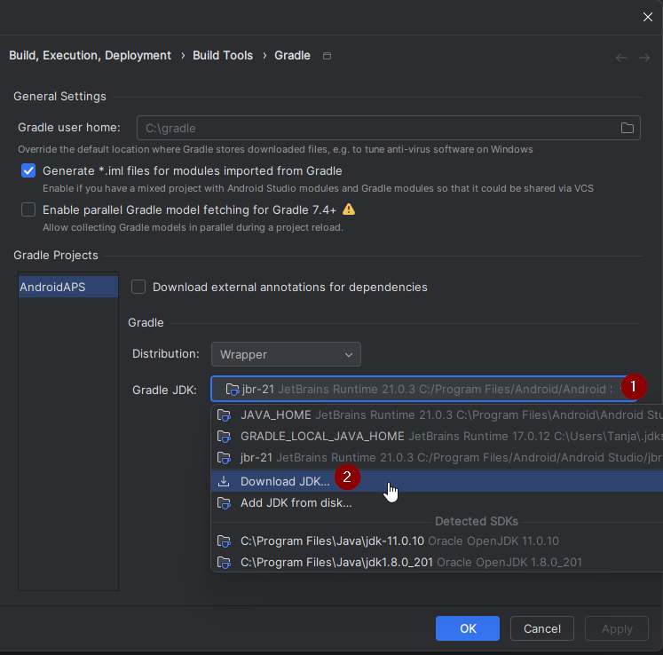
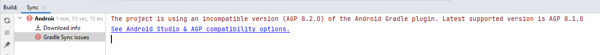

(troubleshooting_androidstudio-troubleshooting-android-studio)=

# Dépannage d'Android Studio

```{contents} List of common issues
:depth: 2
:local: true
```

(troubleshooting_androidstudio-lost-keystore)=
## Keystore perdu
Si vous avez perdu votre keystore ou son mot de passe, un apk signé avec un nouveau keystore ne peut pas mettre à jour votre **AAPS** actuel : vous devez le désinstaller puis le réinstaller. Voir [Réinstaller AAPS avec un nouveau keystore](#reinstall-aaps).

## Gradle Sync en échec
Gradle Sync peut échouer pour différentes raisons. Quand vous recevez un message qui dit « gradle sync failed », ouvrez l'onglet « Build » (1) en bas d'Android Studio et regardez quel message d'erreur (2) est affiché.


```{contents} Likely reasons for gradle sync failures are:
:depth: 1
:local: true
```

*Important* : Après avoir suivi les instructions pour votre problème spécifique, vous devez déclencher la [synchronisation gradle](#gradle-resync) à nouveau.

(troubleshooting_androidstudio-uncommitted-changes)=
### Uncommitted changes

Si vous recevez un message d'échec comme celui-ci :


```
Build file 'C:\Data\50-Android\AndroidAPS\app\build.gradle.kts' line: 243

There are uncommitted changes.
Clone sources again as described in wiki and do not allow gradle update
```

#### Étape 1 - Vérifiez l'installation de git
  * Ouvrez l'onglet Terminal (1) en bas d'Android Studio, puis copiez le texte suivant et collez-le ou tapez-le dans le terminal (2).
    ```
    git --version
    ```

    

    Remarque : il y a un espace et deux tirets entre git et version !

  * Vous devez recevoir un message qui indique la version de Git installée, comme dans la capture d'écran ci-dessus. Dans ce cas, allez à l'[étape 2](#troubleshooting-android-studio-check-for-uncommitted-changes).

  * Dans le cas où vous recevez un message disant
    ```
    Git: command not found
    ```
    votre installation Git n'est pas correcte.

  * [Vérifiez l'installation de git](#BuildingAaps-steps-for-installing-git)

  * Si vous êtes sous Windows et que Git vient d'être installé, redémarrez votre ordinateur pour que Git soit disponible partout après l'installation

  * Si Git est installé, que vous avez redémarré (sous Windows) et que Git est toujours introuvable :

  * Cherchez dans votre ordinateur un fichier "git.exe".

    Notez pour vous-même dans quel répertoire il est enregistré.

  * Allez dans les variables d'environnement de Windows, sélectionnez la variable "PATH" et cliquez sur Modifier. Ajoutez le répertoire où vous avez trouvé votre installation Git.

  * Sauver et fermer.

  * Redémarrer Android Studio.

(troubleshooting-android-studio-check-for-uncommitted-changes)=
#### Étape 2 : Vérifier les modifications non commitées.

  * Dans Android Studio, ouvrez l'onglet « Commit » (1) sur le côté gauche. 
  * Vous pouvez voir soit « Changes » (appelé « Default changeset » dans les anciennes versions d'Android Studio) (2), soit « Unversioned Files » (3) :

    * Pour « Changes », vous avez probablement mis à jour « Gradle » ou modifié par erreur le contenu de certains fichiers.

    * Faites un clic droit sur « Changes » et sélectionnez « Rollback… » (1)

      

    * Les fichiers sont récupérés à nouveau depuis le serveur Git. S'il n'y a pas d'autres changements dans l'onglet commit, allez à l'[étape 3](#gradle-resync).

  * Si vous voyez « Unversioned Files », vous avez peut-être enregistré par erreur des fichiers dans le répertoire de votre code source. Ce sont peut-être des fichiers importants, comme votre fichier keystore, qu'il faut déplacer ailleurs. Si vous ne savez pas ce que sont ces fichiers et que vous ne les avez pas créés vous-même, vous pouvez les supprimer.

    * Utilisez l'explorateur de fichiers normal de votre ordinateur pour déplacer (ou couper et coller) ce fichier dans un endroit sûr.

    * Revenez dans Android Studio et cliquez sur le bouton Refresh (4) dans l'onglet Commit pour vérifier que le fichier n'est plus dans le répertoire **AAPS**.

      S'il n'y a pas d'autres changements dans l'onglet Commit, allez à l'[étape 3](#gradle-resync).


#### Étape 3 : Resynchroniser Gradle (encore)

Suivez les instructions de [Resynchronisation Gradle](#gradle-resync).

### Git Pull Failed - Please tell me who you are

Si vous voyez ce message, Git a besoin que vous vous identifiiez.


Ouvrez le terminal et tapez les deux commandes suivantes, l'une après l'autre.

```
git config --global user.name "Your name here"
git config --global user.email your.email@here.com
```

Votre nom doit être écrit entre guillemets.


(troubleshooting_androidstudio-android-gradle-plugin-requires-java-11-to-run)=

(incompatible-gradle-jvm)=
### Incompatible Gradle JVM


```
Your build is currently configured to use incompatible Java 21.0.3 and Gradle 8.2.
Cannot sync the project.

We recommend upgrading to Gradle version 8.9.

The minimum compatible Gradle version is 8.5.

The maximum compatible Gradle JVM version is 19.
```

Ou :

```
Cause: error: invalid source release: 21
```

Si vous avez le message d'erreur ci-dessus, vous devez télécharger une version de JVM correcte avant d'essayer de compiler à nouveau :

1.  Regardez dans le [tableau des exigences](#Building-APK-recommended-specification-of-computer-for-building-apk-file) quelle version de JVM il vous faut pour la version d'**AAPS** que vous compilez, et notez-la.

2. Ouvrez la vue Gradle en cliquant sur l'éléphant (1) sur le côté droit d'Android Studio, ouvrez les paramètres (2) et sélectionnez **Gradle Settings** (3) :


3.  Dans le champ **Gradle JDK**, vérifiez si la bonne version est sélectionnée (1). Sinon, cliquez sur le champ et regardez si elle est déjà disponible dans la liste. L'exemple ci-dessous montre que JVM 21 est appelé « jbr-21 ». Si vous le trouvez, sélectionnez-le simplement, et c'est fini. Si elle n'est pas disponible, sélectionnez **Download JDK** (2).




4. Dans Version (1), sélectionnez le JDK nécessaire pour votre version d'**AAPS** (celui que vous avez noté en regardant le tableau des exigences). Dans Vendor (2), sélectionnez n'importe quel fournisseur. Location (3) : ne changez rien. Cliquez sur **Download** (4).


5.  Fermez la fenêtre **Settings** avec **OK**.
6. Vous devez maintenant relancer la synchronisation Gradle (Gradle Sync). Suivez les instructions de [Resynchronisation Gradle](#gradle-resync).

(incompatible-version-of-android-gradle-plugin)=
### Version incompatible du plugin Android Gradle

  Si vous avez le message d'erreur suivant

`The project is using an incompatible version (AGP x.x.x) of the Android Gradle plugin. Latest supported version is AGP x.x.x`

  

  Vous utilisez une version obsolète d'Android Studio. Dans le menu, allez dans Help > Check for updates et installez toutes les mises à jour trouvées pour Android Studio et ses plugins.

(troubleshooting_androidstudio-could-not-resolve-no-cached-version)=
### Could not resolve/No cached version

  Vous pouvez recevoir ce message d'erreur :


  * Sur la droite, ouvrez l'onglet Gradle (1).

    Assurez-vous que le bouton affiché (2) n'est *PAS* sélectionné.

    

  * Vous devez maintenant lancer une [resynchronisation Gradle](#gradle-resync)

(troubleshooting_androidstudio-unable-to-start-daemon-process)=
### Unable to start daemon process

  Si vous voyez un message d'erreur comme celui ci-dessous, vous utilisez probablement un système Windows 10 32 bits. Ce n'est pas pris en charge par Android Studio 3.5.1 et plus, et malheureusement les développeurs d'**AAPS** ne peuvent rien y faire !

  Vous trouverez sur Internet des informations pour savoir si vous avez un système 32 bits ou 64 bits, par ex. [celle-ci](https://support.microsoft.com/en-us/windows/32-bit-and-64-bit-windows-frequently-asked-questions-c6ca9541-8dce-4d48-0415-94a3faa2e13d).

  

(gradle-resync)=
### Resynchronisation Gradle

  Si vous voyez encore le message indiquant que la synchronisation Gradle a échoué, sélectionnez maintenant le lien **Try again** (1). 


  Si vous ne voyez plus le message, vous pouvez quand même le lancer manuellement :

  * Ouvrez l'onglet Gradle (1) sur le côté droit de Android Studio.

    

  * Clic droit sur AAPS (2)

  * Cliquez sur "Reload Gradle Project" (3)

## Générer l'APK signé avec succès mais avec 0 variantes de compilation

Quand vous générez l'apk signé, vous pouvez recevoir une notification indiquant que la génération a réussi, mais que « 0 build variants » ont été générées :


C'est un faux avertissement. Regardez dans le répertoire choisi comme « Destination folder » pour la génération (étape [Generate Signed APK](#Building-APK-generate-signed-apk)) : vous y trouverez l'apk généré !


## L'application a été créée avec les avertissements du compilateur/kotlin

Si votre compilation est terminée avec succès mais que vous obtenez des avertissements du compilateur ou de kotlin (indiqués par un point d'exclamation jaune ou bleu), alors vous pouvez ignorer ces avertissements.

 

Votre apk a été compilé avec succès et peut être transféré sur votre téléphone !


## AAPS ne reçoit pas de données MGC

* Si vous utilisez l'application Dexcom G6 patchée : cette application est obsolète. Utilisez plutôt l'application [BYODA](#DexcomG6-if-using-g6-with-build-your-own-dexcom-app).

* Si vous utilisez xDrip : identifiez le récepteur comme décrit sur la [page des paramètres xDrip](#xdrip-identify-receiver).


## Apk non installé


* Assurez-vous d'avoir transféré le fichier “app-full-release.apk” sur votre téléphone.
* Cette erreur veut généralement dire que le nouvel apk est signé avec un autre keystore que votre **AAPS** installé. Si vous avez encore votre ancien keystore, sélectionnez-le et compilez à nouveau. Sinon, voir [Réinstaller AAPS avec un nouveau keystore](#reinstall-aaps).
* Si vous avez le message "App non installé" sur votre téléphone, suivez ces étapes :

1. [Exportez les paramètres](../Maintenance/ExportImportSettings.md) (dans la version d'AAPS déjà installée sur votre téléphone)
2. Désinstallez **AAPS** sur votre téléphone.
3. Activez le mode avion et désactivez le Bluetooth.
4. Installer la nouvelle version (« app-full-release.apk »)
5. [Importer les paramètres](../Maintenance/ExportImportSettings.md)
6. Réactivez le Bluetooth et désactivez le mode avion

## Apk installé mais ancienne version

Si vous avez compilé l'application, l'avez transférée sur votre téléphone et l'avez installée sans erreur, mais que le numéro de version ne change pas, vous avez peut-être oublié de [mettre à jour votre copie locale](#Update-to-new-version-update-your-local-copy)

## Rien ci-dessus n'a marché

Si aucun des conseils ci-dessus ne vous a aidé, vous pouvez envisager de compiler l'apk à partir de zéro :

1. [Exportez les paramètres](../Maintenance/ExportImportSettings.md) (dans la version d'AAPS déjà installée sur votre téléphone)

2. Préparez le mot de passe de la clé et le mot de passe du keystore.

    Ou utilisez simplement un nouveau keystore.

3. Compilez l'apk à partir de zéro comme décrit [ici](#Building-APK-download-AAPS-code).

4. Quand vous avez compilé l'apk avec succès, supprimez l'apk existant sur votre téléphone, transférez le nouvel apk sur votre téléphone et installez-le.
5. [Importez à nouveau les paramètres](../Maintenance/ExportImportSettings.md) pour restaurer vos objectifs et vos paramètres.
6. Vous devez vérifier vos options d'optimisation de la batterie et les désactiver à nouveau.

## Pire scénario

Si ce qui précède ne résout pas votre problème de compilation, vous pouvez essayer de désinstaller complètement Android Studio et de tout recompiler à partir de zéro.  Certains utilisateurs trouvent que cela peut résoudre leur problème de compilation.  Quand vous supprimez Android Studio, ne supprimez pas les paramètres utilisateur d'Android, et **assurez-vous de désinstaller tous les fichiers liés à Android Studio.** Si vous ne supprimez pas complètement Android Studio avec tous les fichiers cachés, la désinstallation peut créer de nouveaux problèmes au lieu de résoudre le(s) problème(s) existant(s). Les manuels pour une désinstallation complète peuvent être trouvés en ligne, par ex.

[https://stackoverflow.com/questions/39953495/how-to-completely-uninstall-android-studio-from-windowsv10](https://stackoverflow.com/questions/39953495/how-to-completely-uninstall-android-studio-from-windowsv10).

Installez Android Studio à partir de zéro comme c'est décrit [ici](#Building-APK-install-android-studio).
