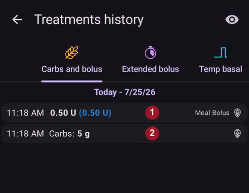
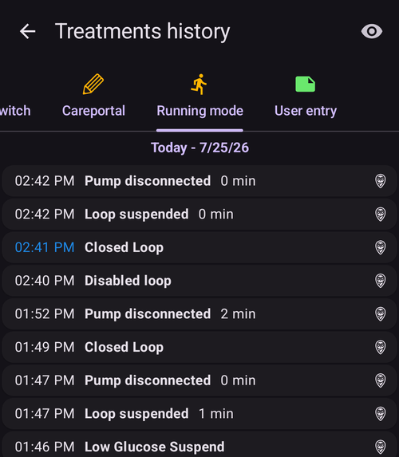

# Examiner vos données

## Historique AAPS

**AAPS** garde tout votre historique (**glycémie**, traitements, basal, cibles, **Changement de profil**, …) dans une base de données locale sur le téléphone. Cette base de données ne fait pas partie de l'[export des paramètres](../Maintenance/ExportImportSettings.md). Vous pouvez l'examiner dans **AAPS** lui-même avec l'**Historique** et l'écran **Statistiques** décrits ci-dessous. Pour des examens et des rapports sur une longue période, envoyez vos données vers [Nightscout](../SettingUpAaps/Nightscout.md) ou [Tidepool](../SettingUpAaps/Tidepool.md).

L'historique d'**AAPS** peut être examiné dans l'**Historique** : ouvrez le **menu** (☰) et choisissez **Historique**.

- Appuyez sur la **carte de date** pour choisir le jour que vous voulez examiner.
- Les graphiques s'ouvrent en vue large pour montrer **toute la journée choisie**. Écartez deux doigts pour zoomer sur une partie.
- Utilisez les flèches **<** et **>** pour reculer ou avancer d'un jour, et **Maintenant** pour revenir au jour actuel.
- Les graphiques montrent les mêmes données que les graphiques de l'écran principal (glycémie, traitements, basal, IA, GA, activité, déviations...).

(reviewing-statistics)=
## Statistiques AAPS

**AAPS** fournit des statistiques de suivi de base.

La plupart des valeurs se basent sur les [recommandations](https://diabetesjournals.org/care/article/46/Supplement_1/S97/148053/6-Glycemic-Targets-Standards-of-Care-in-Diabetes) ADA 2023.

Pour les ouvrir, ouvrez le **menu** (☰) et choisissez **Statistiques**.

L'écran **Statistiques** a quatre onglets : **Insuline**, **TIR**, **Glycémie** et **Cycle**. Appuyez sur un onglet, ou glissez vers la gauche ou la droite pour passer de l'un à l'autre.

(reviewing-tdd)=
### Onglet Insuline : Dose Totale Quotidienne

La carte **Dose Totale Quotidienne** montre une ligne par jour pour les jours précédents (jusqu'à une semaine) pour lesquels **AAPS** a des données d'insuline, puis leur **Moyenne**, puis **Aujourd’hui** jusqu'à maintenant. Juste après l'installation d'**AAPS**, seul **Aujourd’hui** est affiché. Les colonnes sont :

- **Basal** : seulement le basal.
- **Bolus** : la somme des bolus et des SMB.
- **DTQ Total** : la Dose Totale Quotidienne d'insuline (**DTQ**), la somme de l'insuline de bolus et de basal délivrée pendant la journée.
- **Glucides** : les glucides et eGlucides saisis.

La section **DTQ** est calculée quand vous ouvrez la page, et le calcul prend quelques secondes. Appuyez sur **Recalculer** pour la calculer à nouveau.

La **DTQ** est votre insuline de bolus plus de basal par jour. Certains médecins utilisent - surtout pour les nouveaux utilisateurs de pompe - un rapport basal-bolus de 50:50 : le total du débit basal (**TBB**, la somme de vos débits basaux sur 24 heures) doit alors être environ la moitié de la DTQ. D'autres préfèrent un TBB de 32 % à 37 % de la DTQ.

Comme la plupart des règles empiriques, sa validité réelle est limitée. Votre diabète peut être différent !

### Onglet TIR

Temps dans la plage (**TIR**) : 70–180 mg/dl ou 3,9–10 mmol/l.

Les informations **TIR** sont disponibles sur 7 et 30 jours, selon la quantité de données disponibles dans la base de données d'**AAPS**.

Les statistiques de temps dans la plage étroite (TITR) 70–140 mg/dl ou 3,9–7,8 mmol/l sont disponibles ci-dessous (l'écran affiche cette plage comme 70–141).

**Discutez des cibles avec votre endocrinologue**

Votre diabète peut être différent. Toute cible proposée doit être discutée avec votre endocrinologue ou votre équipe médicale. Bien utilisées, les statistiques d'AAPS peuvent être un outil efficace pour suivre les tendances de la __glycémie (BG)__ et vos progrès.

En dessous, la carte **Dexcom TIR** montre des statistiques **TIR** détaillées sur 14 jours.

**SD** : écart type, un [indicateur](https://www.ncbi.nlm.nih.gov/pmc/articles/PMC3125941/) de la variabilité de la glycémie (le plus haut = le pire).

HbA1c : l'estimation de l'hémoglobine glyquée, calculée à partir de la moyenne des mesures du MGC. C'est une valeur indicative, qui peut ne pas correspondre aux analyses de sang de l'HbA1c.

(reviewing-statistics-agp)=
### Onglet Glycémie : profil glycémique ambulatoire (AGP)

Le **profil glycémique ambulatoire** (**AGP**) montre comment votre glycémie évolue en général au cours de la journée. Choisissez la période avec les boutons en haut : **Aujourd’hui**, **24h**, **7d**, **30d** ou **90d**.

- **Le graphique** : une journée, de minuit à minuit. La ligne est la **Médiane** (la moitié de vos mesures à cette heure étaient plus basses, l'autre moitié plus hautes). Autour d'elle, une bande contient la moitié centrale de vos mesures (**25–75%**) et une bande plus large la plupart d'entre elles (**10–90%**). Une bande étroite signifie que votre glycémie est semblable d'un jour à l'autre à cette heure. Des lignes pointillées marquent votre **Ligne BASSE**, 140 mg/dl (7,8 mmol/l) et votre **Ligne HAUTE**.
- **Aperçu glycémique** : le temps passé dans votre plage, dans la plage étroite (70–140 mg/dl ou 3,9–7,8 mmol/l), au-dessus de votre plage et en dessous, puis votre glycémie **Moyenne** et **Médiane**. Votre plage est définie par la **Ligne BASSE** et la **Ligne HAUTE** réglées dans [Fourchette de visualisation](#Preferences-range-for-visualization).
- **eA1c** et **GMI** : deux estimations de l'HbA1c calculées à partir de vos mesures du MGC. Comme l'HbA1c ci-dessus, elles peuvent ne pas correspondre à vos analyses de sang de l'HbA1c.
- **SD** (écart type) et **CV** (coefficient de variation) : combien votre glycémie varie. Une valeur plus basse signifie une glycémie plus stable.
- **Jours** : le nombre de jours de données MGC utilisés.

 

Sous l'AGP, la carte **Pentagone glucose (CGP)** dessine cinq mesures de vos 14 derniers jours de glycémie sous forme de pentagone. Un pentagone plus petit signifie un meilleur contrôle de la glycémie.

### Onglet Cycle : Cycle DTQ

**Cycle DTQ** superpose vos totaux quotidiens d'insuline sur des cycles de 28 jours, pour vous aider à repérer des schémas qui se répètent. Chaque cycle est dessiné comme une ligne (**Cycles individuels**), avec leur moyenne.

- **DTQ brute** / **DTQ nettoyée** : choisissez la dose totale quotidienne telle qu'elle a été délivrée, ou la DTQ sans l'insuline des glucides.
- **Décalage du cycle** : déplace le début du cycle (0 à 27 jours).

Il faut au moins 56 jours de données (2 cycles). Avec moins de données, la carte affiche **Pas assez de données (nécessite au moins 56 jours pour 2 cycles)**. Le schéma est calculé seulement quand vous ouvrez l'onglet **Cycle**, car il lit 168 jours de données.

(aaps-screens-treatments)=
## Historique Traitements

Ouvrez le **menu** (☰) en haut à gauche de l'écran principal et choisissez **Historique Traitements**. Dans cette vue, vous pouvez voir et modifier l'historique des traitements suivants, chacun dans son propre onglet (glissez la ligne des onglets pour tous les voir) :

* Glucides et bolus
* [Bolus étendu](#Extended-Carbs-extended-bolus-and-switch-to-open-loop-dana-and-insight-pump-only)
* Basale Temp
* [Cible Temp](../DailyLifeWithAaps/TempTargets.md)
* [Changement de profil](../DailyLifeWithAaps/ProfileSwitch-ProfilePercentage.md)
* Careportal : notes et saisies du careportal
* Mode : historique de l'état de la boucle
* Entrées utilisateur : autres notes qui ne sont pas envoyées à Nightscout

À la fin de chaque ligne, de petites icônes montrent d'où viennent les données ou où elles ont été envoyées :
* Icône **Nightscout** (le logo Nightscout) : les données viennent de Nightscout ou y ont été enregistrées
* Icône **Pompe** : les données viennent de l'historique de la pompe (elles ont été traitées par la pompe)
* Icône **Corbeille** : l'entrée a été supprimée (elle n'est affichée que si vous affichez les entrées supprimées avec l'icône **œil** en haut à droite)

(screens-bolus-carbs)=
### Glucides et bolus

Dans cet onglet, vous pouvez voir le journal des bolus et des glucides. Chaque bolus (ligne **1**) affiche l'IA restante associée à côté de la quantité d'insuline. L'origine du bolus peut être :
* Repas (saisi à la main avec les boutons Insuline, Assistant rapide ou Assistant Bolus)
* SMB, quand vous utilisez la fonction SMB

Les saisies de glucides (ligne **2**) sont affichées avec leur quantité en grammes.

Si vous avez utilisé l'[Assistant Bolus](#aaps-screens-bolus-wizard) pour calculer la dose d'insuline, vous pouvez appuyer sur le texte « Assist. » de la ligne du bolus pour voir le détail du calcul du bolus.

Selon la pompe utilisée, l'insuline et les glucides peuvent être affichés sur une seule ligne, ou sur plusieurs lignes : une pour le détail du calcul, une pour les glucides, une pour le bolus lui-même.

L'historique des traitements peut servir à corriger des saisies de glucides fausses (_c.-à-d._ vous avez surestimé ou sous-estimé les glucides). Notez qu'il n'est pas possible de modifier une entrée existante, vous devez suivre la procédure suivante :

1. Vérifiez et notez les GA et l'IA actuels sur l'écran principal.
2. Selon la pompe, les glucides peuvent être affichés avec l'insuline sur une seule ligne ou comme une entrée séparée (c.-à-d. avec la Dana RS).
3. Supprimez l'entrée avec la mauvaise quantité de glucides : appuyez sur l'icône corbeille, choisissez les lignes à supprimer, puis appuyez de nouveau sur l'icône corbeille pour terminer.
4. Vérifiez que les glucides ont bien été supprimés en regardant de nouveau les GA sur l'écran principal.
5. Faites de même pour l'IA s'il n'y a qu'une seule ligne avec les glucides et l'insuline.

   → Si les glucides ne sont pas supprimés comme prévu et que vous ajoutez des glucides comme expliqué ici (6.), les GA seront trop élevés, ce qui peut conduire à une délivrance d'insuline trop élevée.

6. Saisissez de nouveau la bonne quantité de glucides (**Traitements → Glucides** dans la barre de navigation en bas, ou un bouton **Glucides** de [QuickLaunch](#quicklaunch)) et veillez à régler la bonne heure de l'événement.
7. S'il n'y a qu'une seule ligne avec les glucides et l'insuline, vous devez aussi ajouter la quantité d'insuline. Veillez à régler la bonne heure de l'événement et vérifiez l'IA sur l'écran principal après avoir confirmé la nouvelle entrée.

### Basale Temp

Les **débits basaux temporaires** appliqués par la boucle sont affichés ici. Quand une entrée a encore un effet sur l'IA, l'information est affichée à côté du débit (ligne **1**). Il peut s'agir de :
* IA positive si le débit basal temporaire était plus élevé que celui défini dans le profil
* IA négative pour un basal temporaire à zéro (comme sur la ligne **1**) ou si le débit basal temporaire était plus bas que celui défini dans le profil

Supprimer les entrées ne change que vos rapports dans Nightscout et faussera probablement votre IA réelle - ce n'est pas recommandé.

À gauche d'une ligne, un S rouge signifie « Suspendre » : cela arrive quand le basal n'est pas délivré en ce moment. C'est une situation normale pendant un changement de pod, par exemple.

### Cible Temp

L'historique des cibles temporaires est visible ici.

### Changement de profil

L'historique des changements de profil est visible ici. Vous pouvez voir plusieurs entrées à chaque changement de profil : la ligne **1**, enregistrée à la fois dans NS et dans l'historique de la pompe, correspond au changement réel. La ligne **2**, enregistrée dans Nightscout mais pas dans l'historique de la pompe, correspond à la demande de changement de profil faite par l'utilisateur.

Supprimer les entrées ne change que vos rapports dans Nightscout et ne change jamais le profil actuel.

Vous pouvez utiliser le bouton **Dupliquer** affiché sur la ligne **2** pour faire une copie d'un **Changement de profil**. Voir [Votre profil AAPS > Gérer vos profils](#your-aaps-profile-clone-profile-switch) pour plus d'informations.

### Careportal

Cet onglet montre toutes les notes et saisies du careportal enregistrées dans Nightscout.

(AapsScreens-running-mode)= (aaps-screens-running-mode)=
### Mode de fonctionnement

Cet onglet montre l'historique des changements d'[état de la boucle](#AapsScreens-loop-status) : ouverte, fermée, AGB, suspendue, déconnectée.

### Entrées utilisateur

Cet onglet liste les actions faites dans **AAPS** par l'utilisateur ou par une **Automatisation** (changements du mode de la boucle, changements de profil, traitements, exports des paramètres...). Ces entrées ne sont pas envoyées à Nightscout.

------

## Quelle est la différence entre Nightscout et Tidepool ?

Nightscout permet à l'utilisateur de stocker les données d'**AAPS** et offre de nombreux [outils de rapport](https://nightscout.github.io/nightscout/reports/).

Tidepool, lui, permet à l'utilisateur d'[examiner ses données](https://www.tidepool.org/viewing-your-data) et offre un [partage simple avec votre équipe médicale](https://www.tidepool.org/providers/how-it-works#tidepool-data-platform).