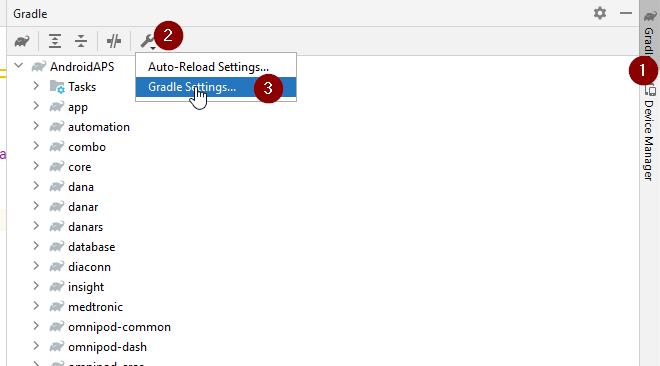
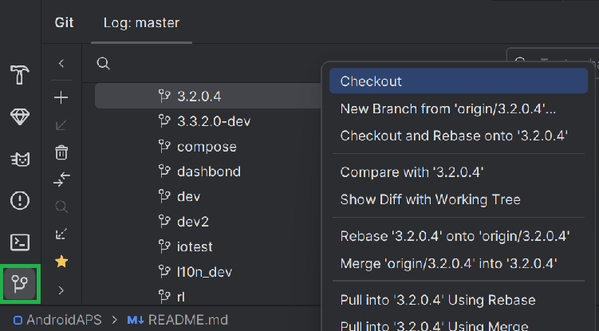
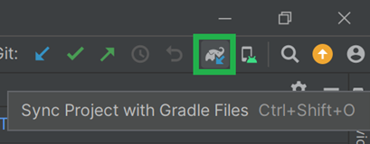

# Mise à jour vers AAPS 3.2.0.4

(update-aaps-3204)=

## Compiler vous-même au lieu de télécharger

**L'application AAPS (le fichier apk) n'est pas disponible en téléchargement, en raison de la réglementation concernant les dispositifs médicaux. Il est légal de compiler l'application pour votre usage personnel, mais vous ne devez en aucun cas en donner une copie à d'autres personnes !**

Consultez la [Foire Aux Questions (FAQ)](../UsefulLinks/FAQ.md) pour plus de détails.

## Ordinateur et logiciels nécessaires pour compiler AAPS 3.2.0.4

* Une version précise d'**[Android Studio](https://developer.android.com/studio/)** peut être nécessaire pour compiler l'apk.

| Version AAPS            | Version<br/>Android Studio<br/>préférée | Version<br/>Android Studio<br/>alternative | Gradle | JVM |
| ----------------------- | --------------------------------------------------- | ------------------------------------------------------ | ------ |:--- |
| [3.2.0.4](#version3200) | Hedgehog (2023.1.1)                                 | jusqu'à Meerkat                                        | 8.2    | 17  |

La « version préférée » est fournie avec la bonne version de JVM. La version préférée est aussi la version minimale que vous pouvez utiliser pour compiler **AAPS**. Vous ne pourrez **PAS** compiler avec une version plus ancienne que la version « préférée ». Si vous utilisez une autre version, vous pouvez rencontrer des problèmes liés à la version de JVM. Consultez la page [Dépannage d'Android Studio](#incompatible-gradle-jvm) pour vous aider à résoudre ces problèmes. Si votre version actuelle d'Android Studio n'est pas dans le tableau, vous devez d'abord la mettre à jour.

La version de Gradle est liée au code source. Vous aurez toujours la bonne version de Gradle quand vous téléchargez ou mettez à jour le code source. Elle est indiquée ici seulement pour information. Vous n'avez rien à faire.

* [Les systèmes Windows 32 bits](#troubleshooting_androidstudio-unable-to-start-daemon-process) ne sont pas compatibles avec Android Studio. Notez bien qu'**un CPU 64 bits et un système d'exploitation 64 bits sont tous les deux obligatoires.** Si votre système NE remplit PAS cette condition, vous devez changer le matériel ou le logiciel concerné, ou tout le système.

<table class="tg">
<tbody>
  <tr>
    <th class="tg-baqh">OS (seulement 64 bits)</th>
    <td class="tg-baqh">Windows 8 ou supérieur</td>
    <td class="tg-baqh">Mac OS 10.14 ou supérieur</td>
    <td class="tg-baqh">Tout Linux avec Gnome, KDE ou Unity DE ;&nbsp;&nbsp;GNU C Library 2.31 ou plus récente</td>
  </tr>
  <tr>
    <th class="tg-baqh"><p align="center">CPU (seulement 64 bits)</th>
    <td class="tg-baqh">Architecture CPU x86_64 ; Intel Core de 2e génération ou plus récent, ou CPU AMD compatible avec <br><a href="https://developer.android.com/studio/run/emulator-acceleration#vm-windows" target="_blank" rel="noopener noreferrer"><span style="text-decoration:var(--devsite-link-text-decoration,none)">Windows Hypervisor</span></a></td>
    <td class="tg-baqh">Puces ARM, ou Intel Core de 2e génération ou plus récent compatible avec <br><a href="https://developer.android.com/studio/run/emulator-acceleration#vm-mac" target="_blank" rel="noopener noreferrer"><span style="text-decoration:var(--devsite-link-text-decoration,none)">Hypervisor.Framework</span></a></td>
    <td class="tg-baqh">Architecture CPU x86_64 ; Intel Core de 2e génération ou plus récent, ou processeur AMD compatible avec la virtualisation AMD (AMD-V) et SSSE3</td>
  </tr>
  <tr>
    <th class="tg-baqh"><p align="center">RAM</th>
    <td class="tg-baqh" colspan="3"><p align="center">8 Go ou plus</td>
  </tr>
  <tr>
    <th class="tg-baqh"><p align="center">Disque</th>
    <td class="tg-baqh" colspan="3"><p align="center">Au moins 30 Go d'espace libre. Un SSD est recommandé.</td>
  </tr>
  <tr>
    <th class="tg-baqh"><p align="center">Résolution</th>
    <td class="tg-baqh" colspan="3"><p align="center">Minimum 1280 x 800 <br></td>
  </tr>
  <tr>
    <th class="tg-baqh"><p align="center">Internet</th>
    <td class="tg-baqh" colspan="3"><p align="center">Haut débit</td>
  </tr>
</tbody>
</table>

**Il est fortement recommandé (non obligatoire) d'utiliser un disque dur SSD et non un HDD car cela sera plus rapide pour compiler le fichier apk d'AAPS.** Il est malgré tout possible d'utiliser un disque HDD pour compiler le fichier apk d'**AAPS**. Si vous le faites, le processus de compilation peut prendre beaucoup de temps avant de se terminer, mais une fois lancé, vous pouvez le laisser tourner sans surveillance.

## Aide et assistance pendant la compilation de 3.2.0.4

Si vous rencontrez des difficultés pendant la compilation de l'application **AAPS**, consultez d'abord la section dédiée au [**dépannage d'Android Studio**](https://androidaps.readthedocs.io/en/3.2/GettingHelp/TroubleshootingAndroidStudio.html).

Si vous pensez que quelque chose dans les instructions de compilation est incorrect, pas assez documenté ou confus, ou si vous avez encore des difficultés, n'hésitez pas à contacter d'autres utilisateurs d'**AAPS** sur [Facebook](https://www.facebook.com/groups/AndroidAPSUsers) ou [Discord](https://discord.gg/4fQUWHZ4Mw). Si vous voulez mettre à jour quelque chose vous-même (mettre à jour les captures d'écran _etc_), veuillez soumettre une [pull request (PR)](../SupportingAaps/HowToEditTheDocs.md).

```{note}
Cette page montre des images d'exemple pour la **nouvelle** interface d'Android Studio et pour l'ancienne (**Classic**).
```

## Vue d'ensemble de la mise à jour de 3.2.0.x vers 3.2.0.4

```{contents} Steps for updating to 3.2.0.4
:depth: 1
:local: true
```

### Exporter vos paramètres actuels

Exportez vos paramètres depuis la version d'**AAPS** installée sur votre téléphone. Vous n'en aurez peut-être pas besoin, mais mieux vaut être prudent.

Consultez la page [Créer et restaurer des sauvegardes](ExportImportSettings.md) si vous ne savez plus comment faire.

### Mettre à jour votre copie locale d'AAPS

* Ouvrez votre projet AAPS existant avec Android Studio. Vous devrez peut-être sélectionner votre projet. Cliquez (double-clic) sur le projet AAPS.


<br>


* Dans la barre de menus d'Android Studio, sélectionnez Git -> Fetch


<br>


* Vous verrez un message dans le coin inférieur droit indiquant que Fetch a réussi.


<br>


* Dans la barre de menus, sélectionnez maintenant Git -> Pull


<br>


* Laissez toutes les options telles qu'elles sont (origin/master) et sélectionnez Pull


<br>


* Attendez pendant le téléchargement. Vous voyez l'avancement dans la barre du bas. Une fois terminé, vous verrez un message de réussite.

  ```{note}
  Les fichiers mis à jour peuvent être différents ! Ce n'est pas le signe d'un problème.
  ```


<br>


* Gradle Sync va se lancer pour télécharger quelques dépendances. Patientez jusqu'à ce que ce soit fini.


<br>


### Sélectionner la version 17 de JVM

- Ouvrez la vue Gradle en cliquant sur l'éléphant (1) sur le côté droit d'Android Studio, ouvrez les paramètres (2) et sélectionnez **Gradle Settings** (3) :


<br>



- Dans le champ **Gradle JDK** (1), vérifiez que la bonne version est sélectionnée : **jbr-17**. Sinon, cliquez sur le champ et regardez si elle est déjà disponible dans la liste. Si elle n'est pas dans la liste (la capture d'écran ci-dessous montre un ordinateur où seule **jbr-21** est disponible), sélectionnez **Download JDK...** (2).


- Dans Version (1), sélectionnez **17**. Dans Vendor (2), sélectionnez JetBrains Runtime ou n'importe quel fournisseur. Location (3) : ne changez rien.


- Fermez la fenêtre **Settings** avec **OK**.

### Sélectionner la branche AAPS 3.2.0.4

- En bas à gauche, sélectionnez le symbole Git, faites un clic droit sur 3.2.0.4 puis Checkout.



<br>


### Synchroniser le projet avec Gradle

```{admonition} WARNING!
:class: warning
**Ne mettez jamais Gradle à jour.** Synchronisez-le toujours avec le projet.
```

Pour la nouvelle interface, utilisez l'icône en forme d'éléphant et Sync Project with Gradle Files (ou suivez [ceci](#gradle-resync)).


Ou ([ceci](https://androidaps.readthedocs.io/en/3.2/GettingHelp/TroubleshootingAndroidStudio.html#gradle-resync)) pour l'interface classique.



### Compiler l'APK signé 3.2.0.4

Votre code source est maintenant la version publiée actuelle, et tous les prérequis ont été vérifiés. Il est temps de compiler l'apk signé comme décrit dans la [section Compiler l'apk signé](#Building-APK-generate-signed-apk).

### Transférer et installer l'APK 3.2.0.4

Vous devez transférer l'apk sur votre téléphone pour pouvoir l'installer.

```{note}
Si vous avez compilé avec le même keystore existant dans Android Studio, vous n'avez pas besoin de supprimer l'application existante sur votre téléphone. Lorsque vous installez l'apk, suivez les instructions pour installer les mises à jour.
Pour d'autres cas, comme la création d'un nouveau keystore dans Android Studio pour votre apk signé, vous devrez supprimer l'ancienne application avant d'installer l'apk. **N'oubliez pas d'exporter vos paramètres !**
```

Consultez les instructions de [Transfert et installation de AAPS sur votre smartphone](../SettingUpAaps/TransferringAndInstallingAaps.md)

### Vérifier la version 3.2.0.4 d'AAPS sur le téléphone

Après avoir installé le nouvel apk, vous pouvez vérifier la version d'AAPS sur votre téléphone : appuyez sur le menu à trois points en haut à droite, puis sur À propos. Vous devriez voir la version actuelle en résultat.

