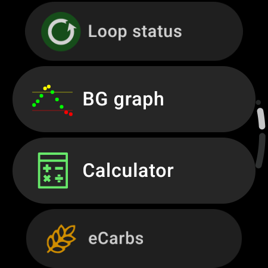

(v4-changes)=
# Ce qui a changé dans AAPS v4

Cette page réunit les **changements de comportement** importants entre **AAPS** v3 et v4 : ce qui fonctionne autrement, ce qui a été déplacé ou supprimé. Ainsi, les utilisateurs actuels savent à quoi s'attendre lors de la mise à jour. Voir aussi les [notes de version](ReleaseNotes.md) et le [guide de mise à jour](UpdateToNewVersion.md).

```{contents} Table of contents
:depth: 2
:local: true
```

---

## NSClient v1 a été supprimé

**AAPS** v3 contenait **deux** plugins de synchronisation Nightscout :

- **NSClient** : l'ancien client (l'ancienne API Nightscout REST / socket.io, aussi appelée *« v1 »*), et
- **NSClientV3** : le client pour la nouvelle **API v3** de Nightscout.

Dans **AAPS** v4, l'ancien plugin **NSClient (v1)** a été **supprimé**. Seul **NSClientV3** reste pour la synchronisation avec Nightscout.

```{admonition} What you need to do
:class: important
Si vous (ou votre suiveur **AAPSClient**) synchronisiez encore avec l'ancien plugin **NSClient (v1)**, passez à **NSClientV3** avant ou après la mise à jour :

- Ouvrez **[Configuration](../SettingUpAaps/ConfigBuilder.md) → Communication → NSClientV3**.
- Saisissez votre **URL Nightscout** et un **jeton d'accès** (NSClientV3 utilise un jeton d'accès, *pas* l'ancien API secret ; voir [créer un jeton](https://nightscout.github.io/nightscout/security/#create-a-token)).
- Votre site Nightscout doit prendre en charge l'**API v3** (Nightscout 15 ou plus récent).
- Si vous utilisez les **websockets**, activez-les ou désactivez-les sur **les deux** téléphones, le maître et le suiveur, jamais sur un seul.
```

Cela change seulement la façon dont l'application communique avec Nightscout. Vos données sur Nightscout ne changent pas.

---

## La barre de navigation du bas : Traitements, Scénarii et Gestion

Dans **AAPS** v3, vous vous déplaciez dans l'application avec une rangée d'**onglets** (Vue d'ensemble, Actions, Traitements, …). Plusieurs fonctions étaient des **plugins** que vous activiez dans le Générateur de configuration (Config Builder) (**Actions**, **Automatisation**, **Aliments**, …).

Dans **AAPS** v4, les onglets ont disparu, tout comme la case à cocher en forme d'œil du Générateur de configuration, qui affichait un plugin comme onglet. L'écran principal est la **Vue d'ensemble**. Une **barre de navigation en bas** vous donne accès à trois panneaux. **Actions, Automatisation et Aliments ne sont plus des plugins** : il n'y a rien à activer dans [Configuration](../SettingUpAaps/ConfigBuilder.md) (le nouveau nom du Générateur de configuration). Leurs fonctions se trouvent maintenant dans ces panneaux.

(v4changes-treatments)=
### Traitements : saisir et administrer

Le panneau **Traitements** sert à enregistrer ou à administrer un traitement : **Assistant Bolus**, **Insuline** (bolus manuel), **Glucides**, **Traitement** (insuline + glucides ensemble), **Étalonnage**, **MGC** (ouvre votre application MGC, si une est configurée), et vos **[Assistants rapides](../DailyLifeWithAaps/QuickWizards.md)**.


Sur une **montre Wear OS**, les mêmes traitements se saisissent depuis le **menu AAPS** de la montre (Assistant Bolus / Assistant, eGlucides, Traitement, …) :



### Scénarii

Vos préréglages de situation : voir [Scénarios](../DailyLifeWithAaps/Scenes.md).

(v4changes-manage)=
### Gestion : gérer et activer

Le panneau **Gestion** sert à gérer et activer tout le reste : **[Profil](../DailyLifeWithAaps/ProfileSwitch-ProfilePercentage.md)**, **Paramètres Insuline** (vos configurations d'insuline), **[Cible Temp](../DailyLifeWithAaps/TempTargets.md)**, préréglages **[Assistant Rapide](../DailyLifeWithAaps/QuickWizards.md)**, **[Scénarii](../DailyLifeWithAaps/Scenes.md)**, **Automatisation**, **Aliments**, **Rotation du site**, **Pompe**, **[Clients autorisés](../RemoteFeatures/ClientMasterControl.md)**. Il contient aussi les actions de la pompe qui étaient dans l'onglet *Actions* (**Bolus Étendu**, **Annuler Basal Temp**, **Amorcer/Remplir**, **Insertion Capteur**, **Changement pile pompe**).


Toutes vos règles d'automatisation et tous vos aliments enregistrés sont conservés. Seul le chemin pour accéder à ces fonctions a changé.

(screens-action-tab)=
#### Où est passé l'onglet Actions ?

**AAPS** 3.x avait un onglet « Actions ». Dans **AAPS** 4, ses fonctions se trouvent à d'autres endroits :

* **Changement de profil** et **Pourcentage** du profil : appuyez sur le [nom du profil](#aaps-screens-profile--target) sur l'écran principal, ou **Gestion → Profil**. Voir [Modifier le pourcentage du profil](#ProfileSwitch-change-percentage).
* **Cible Temp** : appuyez sur la [cible](#aaps-screens-profile--target) sur l'écran principal, ou **Gestion → Cible Temp**.
* **Amorcer/Remplir**, **Insertion Capteur**, **Contrôle Glycémie** et les autres saisies du careportal : dans le [panneau d'état](#aaps-screens-careportal) déplié, dans **Gestion**, ou comme boutons [QuickLaunch](../DailyLifeWithAaps/QuickLaunch.md).
* **Historique**, **Statistiques** (DTQ) : dans le **menu** (☰).

```{admonition} Profile switch and profile percentage
:class: note
Dans **AAPS** v3, un appui long sur le nom du profil ouvrait la fenêtre de changement de profil (pourcentage, durée, cible temporaire Activité). Dans **AAPS** v4, **appuyez** sur le nom du profil (ou **Gestion → Profil**), puis appuyez sur le bouton rond **▶** en bas à droite pour ouvrir les mêmes réglages. Voir [Changer le pourcentage du profil](#ProfileSwitch-change-percentage).
```

---

(v4changes-read-only-management)=
## La protection des paramètres verrouille maintenant aussi les écrans de gestion

Dans **AAPS** v3, la [Protection des paramètres](#Preferences-settings-protection) demandait votre mot de passe seulement à l'ouverture des paramètres. Vous pouviez quand même ajouter ou modifier des profils dans l'onglet **Profil local** sans mot de passe.

Dans **AAPS** v4, la Protection des paramètres couvre aussi les modifications sur les écrans de gestion : **Profil**, **Paramètres Insuline**, **Cible Temp** et **Assistant Rapide**. Si vos paramètres sont verrouillés, ces écrans s'ouvrent en **lecture seule** :

- Vous pouvez parcourir les entrées et les **▶ Activer** ou les utiliser.
- Les boutons **Ajouter / Modifier / Dupliquer / Supprimer** sont **masqués**. Seul le **✏️ crayon** dans la barre du haut indique que vous pouvez déverrouiller la modification.


```{admonition} What you need to do
:class: important
Pour ajouter, modifier, dupliquer ou supprimer une entrée, appuyez sur le **✏️ crayon** dans la barre du haut et saisissez le mot de passe des paramètres (ou utilisez la biométrie). Les boutons apparaissent.

Si vous n'avez pas besoin de protéger vos paramètres, vous pouvez désactiver la Protection des paramètres dans **Paramètres → Protection**.
```

---

(v4changes-active-insulin)=
## L'insuline utilisée ne peut pas être modifiée

Dans **AAPS** v3, vous pouviez changer à tout moment la DAI de l'insuline utilisée.

Dans **AAPS** v4, l'insuline marquée **ACTIF** dans **Gestion → Paramètres Insuline** est grisée : vous ne pouvez ni la modifier ni la supprimer.

Lors de la mise à jour, **AAPS** garde l'insuline et la DAI déjà enregistrées par vos changements de profil de la v3. S'il trouve des enregistrements plus anciens dont l'insuline est connue mais pas la DAI, il utilise pour eux une DAI par défaut et affiche un message une seule fois, par exemple *Les enregistrements plus anciens n'avaient pas de durée d'insuline, donc 9,0 heures a été utilisé pour Lyumjev. Vérifiez vos paramètres d'insuline — les enregistrements déjà migrés ne sont pas mis à jour par la suite.* Si vous voyez ce message, vérifiez vos paramètres d'insuline.

```{admonition} What you need to do
:class: important
Pour changer la DAI ou le pic, ajoutez une nouvelle insuline avec **+**, ajustez-la, enregistrez-la, puis activez-la avec **▶ Activer**. Voir [Changer l'insuline utilisée](#Config-Builder-insulin-change-active).
```

---

(v4changes-remote-control)=
## Le contrôle à distance par AAPSClient demande un appairage

Dans **AAPS** v3, **AAPSClient** contrôlait **AAPS** en écrivant des traitements careportal dans Nightscout, et ne pouvait pas administrer de bolus.

Dans **AAPS** v4, le client et le téléphone principal sont **appairés** une seule fois, et chaque commande est signée. Le téléphone principal vérifie et confirme chaque commande, et un client peut maintenant aussi administrer un bolus.

- Chaque client a un **[rôle](#client-master-control-roles)** qui limite ce qu'il peut faire.
- Tant que le contrôle par le client est actif, le téléphone principal est en **[mode renforcé](#client-master-control-hardened-mode)** : les traitements et changements saisis directement dans Nightscout (le site web, d'autres applications) ne sont plus appliqués.
- Chaque client reçoit son **[propre jeton Nightscout](#client-master-control-own-token)**, avec seulement les droits dont il a besoin.

```{admonition} What you need to do
:class: important
Appairez chaque **AAPSClient** avec le téléphone principal : voir [Contrôle maître ↔ client](#client-master-control). Avec un jeton admin sur le téléphone principal, celui-ci affiche un QR code qui configure et appaire le client en un seul scan. Si vous saisissiez des traitements sur le site web de Nightscout, saisissez-les maintenant sur un client appairé.
```

---

## Des données de glycémie en double font maintenant passer la boucle en Arrêt Glycémie Basse

Quand **AAPS** reçoit deux fois la même valeur de glycémie (un badge d'alerte rouge sur le raccourci de la source de glycémie dans la barre du bas), il ne peut pas calculer votre tendance de façon fiable. Il arrête donc de donner de l'insuline de correction.

Dans **AAPS** v3, cela se passait sans bruit en arrière-plan : votre boucle restait affichée en **Boucle Fermée**, même si elle ne pouvait plus corriger.

Dans **AAPS** v4, ce changement est visible. Une boucle fermée passe en mode **Arrêt Glycémie Basse**, et la fenêtre de la boucle vous dit pourquoi : *« Mode AGB en raison des valeurs en double dans la source de glycémie »*. **AAPS** peut toujours réduire ou arrêter votre basal pour vous protéger des hypoglycémies.

```{admonition} What you need to do
:class: important
Trouvez et supprimez les valeurs en double : voir [Signe d'alerte de glycémie](#aaps-screens-bg-warning-sign).

Une fois qu'elles ont disparu, **AAPS** reste en **Arrêt Glycémie Basse**. Il ne revient pas seul en **Boucle Fermée** : faites un appui long sur l'icône de la boucle et choisissez à nouveau **Boucle Fermée**.
```

---

(v4changes-tidepool)=
## Tidepool : les données apparaissent maintenant sous le nom d'appareil AAPS

Dans **AAPS** v3, les données envoyées à [Tidepool](../SettingUpAaps/Tidepool.md) apparaissaient dans Tidepool sous un autre nom d'appareil.

Dans **AAPS** v4, les données apparaissent sous le nom d'appareil **AAPS**. Après la mise à jour, **AAPS** commence un nouveau jeu de données dans Tidepool. Vos anciennes données restent dans Tidepool sous l'ancien nom d'appareil.

```{admonition} What you need to do
:class: important
En général, rien : les nouvelles données apparaissent simplement sous **AAPS**.

N'utilisez **pas** « **Synchronisation complète** » tant que les anciennes données sont encore dans Tidepool : les mêmes données y seraient alors en double. Si vous voulez toutes vos données sous le nouveau nom, utilisez d'abord le bouton « **Purger toutes les données** » de l'[écran Tidepool](#tidepool-menu) (il supprime aussi les anciennes données envoyées par **AAPS**), puis lancez « **Synchronisation complète** ». Seules les données encore enregistrées dans **AAPS** sur votre téléphone peuvent être envoyées à nouveau.
```

---


<!-- =====================================================================
     This page is a growing list of v4 behavioral changes.
     Add new changes as their own "## " section, newest grouping as agreed.
     Maintainers: relocate page + images and fix cross-links as needed.
     ===================================================================== -->
