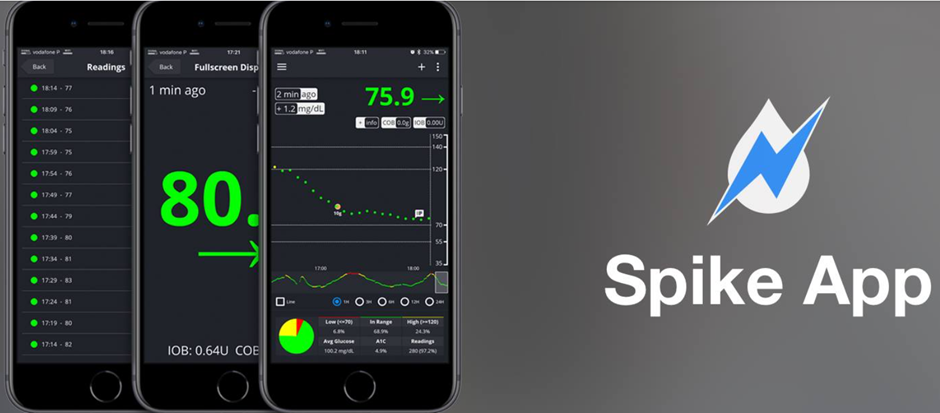

# Suivre AAPS (pas d'interaction avec le système AAPS)

En plus des nombreuses possibilités pour contrôler _et_ suivre **AAPS** à distance, décrites dans [Contrôle à distance d'AAPS](../RemoteFeatures/RemoteControl.md), la communauté a développé plusieurs autres applications et appareils pour simplement suivre les valeurs (glycémie et autres informations), sans interagir avec **AAPS**.

Vous trouverez un bon aperçu des nombreuses options pour suivre **AAPS** sur la page web [Nightscout follower](https://nightscout.github.io/nightscout/downloaders/#).

```{contents} Table of contents
:depth: 1
:local: true
```

Les stratégies les plus courantes utilisées avec **AAPS** sont expliquées plus en détail ci-dessous.

## Applications pour smartphone

```{contents} These are some of the main “follower” apps used by **AAPS** users. All of these apps are “free”: 
:depth: 1
:local: true
```

### Dexcom Follow ([Android](https://play.google.com/store/apps/details?id=com.dexcom.follow.region2.mgdl) et [iOS](https://apps.apple.com/fr/app/dexcom-follow-mg-dl-dxcm2/id1032203080))


* Dexcom Follow est compatible avec de nombreux téléphones (Android et iPhone). Dexcom Follow peut être utilisé même si vous n'utilisez pas l'application officielle Dexcom pour recevoir les données du capteur.

* Beaucoup d'aidants connaissent Dexcom Follow et préfèrent son interface claire à quelque chose de plus compliqué.

* Dexcom Follow convient très bien aux enseignants, aux grands-parents et aux personnes qui connaissent peu le diabète et la glycémie. Il a des alertes personnalisables (niveau de glycémie, son à jouer, etc.). Les alarmes peuvent être complètement désactivées si besoin. C'est très utile si vous avez un capteur qui se stabilise encore et crée plusieurs fausses hypoglycémies.

#### Configurer Dexcom Follow : guide pratique

Si vous utilisez l'application Dexcom non officielle BYODA pour recevoir les données du capteur, vous pourrez peut-être envoyer des invitations aux suiveurs depuis l'application BYODA.

Vous ne pouvez plus envoyer d'e-mails d'invitation aux suiveurs Dexcom depuis des applications tierces. Dans xDrip, la demande d'invitation donne seulement le message « invite not sent » (invitation non envoyée).

Vous devez installer l'application officielle Dexcom, envoyer l'invitation, puis désinstaller l'application officielle.

Voici les étapes à suivre :

1)  Installez l'application officielle « Dexcom » sur _n'importe quel_ smartphone (Android/iPhone). Cela peut être le téléphone du suiveur, si c'est plus pratique. 2)  Connectez-vous avec votre nom d'utilisateur et votre mot de passe Dexcom. Ce sont les mêmes identifiants que pour Dexcom Clarity, si vous êtes déjà client Dexcom/Clarity. Si vous n'avez pas de compte Dexcom, vous pouvez en créer un à cette étape.   
3)  Faites défiler les menus d'introduction. 4)  Choisissez « pas de code » pour le code du capteur. 5)  Sous Transmitter SN (n° de série de l'émetteur), choisissez « saisir manuellement » et saisissez un code d'émetteur valide quelconque. Utilisez si possible le code d'un de vos émetteurs expirés, pour ne pas gêner le fonctionnement de votre émetteur actuel. Ces codes suivent un format précis de chiffres et de lettres : « NLNNNL », et seules certaines combinaisons sont valides. Le plus simple est donc d'utiliser un code que vous savez valide. 6)  Quand l'application cherche l'émetteur et le capteur, vous pouvez inviter des suiveurs : touchez les trois petits points en haut à gauche de l'application, puis ajoutez un nouveau suiveur. Vous pouvez aussi utiliser cette fonction si un de vos suiveurs a changé de téléphone et a besoin d'une nouvelle invitation : supprimez-le de la liste des suiveurs et renvoyez-lui un nouvel e-mail d'invitation à utiliser sur son nouveau téléphone. 7)  Sur le téléphone du suiveur, installez Dexcom Follow depuis l'App Store (iPhone) ou Google Play (Android). Configurez l'application Dexcom Follow. Elle vous demandera d'ouvrir vos e-mails pour trouver l'invitation à devenir suiveur.    
8)  Vous pouvez maintenant supprimer l'application officielle Dexcom G6.

Pour Dexcom Follow, les données du capteur sont ensuite exportées depuis le téléphone **AAPS**, soit directement depuis BYODA, soit depuis xDrip, selon l'application que vous utilisez.


### [Nightguard](https://apps.apple.com/fr/app/nightguard/id1116430352) (iOS)


Avantages (selon les utilisateurs) :

* Disponible sur l'[App Store](https://apps.apple.com/us/app/nightguard/id1116430352), avec une interface simple et facile à utiliser.

* Glissez le bouton ou secouez le téléphone pour mettre les alarmes en pause pour différentes durées, de 5 min à 24 heures

* Alarmes personnalisables (glycémie haute, basse, mesures manquantes quand il n'y a pas de données pendant 15 à 45 minutes).

* Montée ou baisse rapide sur 2 à 5 mesures de suite (au choix). Possibilité de choisir aussi le delta entre deux mesures

* Pause intelligente : pas d'alerte si la glycémie évolue dans la bonne direction

* Il y a un onglet Care (soins) qui semble permettre de définir une nouvelle cible temporaire pour une durée donnée, de supprimer la cible temporaire ou de saisir des glucides.

Inconvénients (selon les utilisateurs)

* Disponible uniquement pour iOS

* La CT s'affiche toujours à 5 mmol, quelle que soit la valeur de CT définie

* N'affiche jamais le débit basal temporaire, même s'il affiche TB

### [Nightwatch](https://play.google.com/store/apps/details?id=se.cornixit.nightwatch) (Android)


* Nightwatch se présente comme un client Nightscout. Il surveille la glycémie Nightscout de l'utilisateur sur un téléphone ou une tablette Android.

* L'application peut être téléchargée sur [Google Play](https://play.google.com/store/apps/details?id=se.cornixit.nightwatch) et affiche la glycémie en temps réel.

* L'utilisateur peut être alerté par des alarmes sonores personnalisées de glycémie basse et haute.

* La glycémie peut être affichée en mmol/l ou en mg/dl.

* Elle nécessite Android 5.0 ou plus récent.

* Il a une interface sombre, de grandes valeurs et de grands boutons, conçus pour une utilisation la nuit.

### xDrip (Android)

Vous pouvez utiliser xDrip comme suiveur.

#### Avec Nightscout

Configurez xDrip comme suiveur Nightscout. Vous recevez la glycémie et les traitements, mais pas le débit basal.


#### Sans Nightscout - source de glycémie xDrip

Si la source de données d'**AAPS** est xDrip (ou si xDrip peut aussi recevoir la glycémie d'une autre application comme BYODA, Juggluco, ...), vous pouvez l'utiliser depuis le téléphone maître pour partager les données avec des suiveurs xDrip. Ils voient la glycémie, les traitements et les débits basaux.


#### Sans Nightscout - application compagnon de glycémie dans xDrip

Si la source de données d'**AAPS** n'est pas xDrip, mais que vous pouvez afficher la glycémie avec la source de données Companion App (application compagnon), vous pouvez l'utiliser depuis le téléphone maître pour partager les données avec des suiveurs xDrip. Ils voient la glycémie, les traitements et les débits basaux.


### xDrip4iOS (iOS)


xDripSwift est né du portage de l'application xDrip d'origine vers iOS, puis il a évolué en « xDrip for iOS », écrit **xDrip4iOS**.

```{admonition} Further detail about how to attempt to obtain the original **xDrip4iOS** app
:class: dropdown
Le [groupe Facebook xDrip4iOS](https://www.facebook.com/groups/853994615056838/announcements) est le principal lieu d'entraide de la communauté pour xDrip4iOS et Shuggah. **xDrip4iOS** peut se connecter à de nombreux systèmes MGC et émetteurs, et afficher la glycémie, des graphiques et des statistiques. Il peut aussi émettre des alarmes. Il peut aussi envoyer les données à Nightscout ou servir d'[application de suivi pour Nightscout](https://xdrip4ios.readthedocs.io/en/latest/connect/follower/). 

« Comment obtenir **xDrip4iOS** sur mon iPhone ? »
Il y a deux possibilités :

1. Si vous avez un Mac et un compte Apple Developer (99 EUR/USD par an), vous pouvez compiler votre propre xDrip4iOS en [suivant les instructions](https://xdrip4ios.readthedocs.io/en/latest/install/build/).

Si vous le souhaitez, vous pouvez ensuite devenir « releaser » (diffuseur) et [partager une version Personal Testflight de xDrip4iOS](https://xdrip4ios.readthedocs.io/en/latest/install/personal_testflight/) avec jusqu'à 100 autres personnes pour les aider.

2. Rejoignez le [groupe Facebook xDrip4iOS](https://www.facebook.com/groups/853994615056838/announcements) et lisez les messages épinglés pour connaître les méthodes actuelles pour obtenir l'application. **Ne demandez pas d'invitation à l'application** (lisez les règles du groupe).
```


« Qu'est-ce que **Shuggah** ? » Un groupe de développeurs ukrainiens a copié le code du projet xDrip4iOS (qui est public sur GitHub) et l'a publié sur l'App Store avec un compte professionnel. La version Shuggah n'est en aucun cas gérée par les développeurs de xDrip4iOS.

Le [groupe Facebook xDrip4iOS](https://www.facebook.com/groups/853994615056838/announcements) aide pour xDrip4iOS et les applications Apple Watch correspondantes.

### [Sugarmate](https://apps.apple.com/fr/app/sugarmate/id1111093108) (iOS)


[Sugarmate](https://sugarmate.io/) peut être téléchargé sur iPhone depuis l'App Store. Sugarmate est compatible avec :
* Apple iPhone (nécessite la version 13.0 du système ou plus récente)
* Apple iPad (nécessite la version 13.0 du système ou plus récente)
* Google Android (enregistrez l'application web sur votre écran d'accueil)

Des utilisateurs de Sugarmate indiquent qu'il peut être utilisé avec Apple CarPlay aux États-Unis pour afficher la glycémie en conduisant. On ne sait pas encore si cela est possible dans d'autres pays que les États-Unis. Si vous en savez plus, ajoutez les détails ici dans la documentation en faisant une pull request (lien). C'est simple et rapide.


### [Spike](https://spike-app.com/) (iOS)



Spike peut être utilisé comme récepteur principal ou comme application de suivi. Il fournit la glycémie, des alarmes, l'IA et plus encore.

Le site web et l'application ne sont plus développés. Vous trouverez de l'aide sur [Facebook](https://www.facebook.com/groups/1973791946274873) et [Gitter](https://gitter.im/SpikeiOS/Lobby).

## Montres connectées pour la **surveillance d'AAPS** (données complètes du profil ou glycémie seule) quand **AAPS** fonctionne sur un téléphone.

Voir [ici](../Getting-Started/Watches.md).


## Appareils pour suivre AAPS

```{contents} Devices include:
:depth: 1
:local: true
```

### M5 stack


Le M5Stack est un petit boîtier qui peut être programmé pour de nombreuses applications. Le projet de Martin, [M5Stack NightscoutMon](https://github.com/mlukasek/M5_NightscoutMon/wiki), affiche la glycémie du capteur et sa tendance, l'IA et les GA. Il est dans un boîtier en plastique, avec un écran couleur, un emplacement pour carte micro SD, 3 boutons, un haut-parleur et une batterie interne. C'est un très bon moniteur de glycémie, assez facile à configurer si vous avez un compte Nightscout. Les utilisateurs l'utilisent en général sur le Wi-Fi de leur domicile. Certains disent aussi l'utiliser comme écran à moto, en le connectant au point d'accès Wi-Fi d'un téléphone.

### Sugarpixel

SugarPixel est un appareil d'affichage et d'alerte secondaire de la glycémie pour la mesure du glucose en continu. Il se connecte à l'application Dexcom ou à l'application Nightscout sur le smartphone de l'utilisateur. L'appareil affiche la glycémie en temps réel. Ce moniteur matériel de MGC a des alertes sonores avec des tons aléatoires (qui sont très forts), des alertes par vibration pour les personnes malentendantes, des options d'affichage personnalisables et un suivi multi-utilisateur intégré.


* SugarPixel a plusieurs options d'affichage en mg/dl et en mmol/l pour répondre aux besoins de l'utilisateur, avec des couleurs selon la valeur de glycémie.
* L'écran standard affiche la glycémie, la flèche de tendance et le delta. Le delta est la variation (+ ou -) par rapport à la dernière mesure.
* SugarPixel peut être réglé pour une faible luminosité avec l'écran BG and Time (glycémie et heure), pour voir la glycémie et l'heure actuelle sur la table de nuit.
* L'écran couleur de SugarPixel utilise tout l'écran pour afficher une seule couleur qui représente la valeur de glycémie. L'utilisateur peut ainsi voir la glycémie à distance à travers la fenêtre, quand il joue dehors dans le jardin, sur la terrasse ou à la piscine.
* L'écran Big BG (grande glycémie) est utile sur une table de nuit pour les personnes qui portent des lunettes ou des lentilles de contact.

### Nightscout Clock sur Ulanzi TC001

**Nightscout Clock** est un logiciel open source qui fonctionne sur l'appareil **Ulanzi TC001**. Il se connecte aux serveurs Dexcom ou à Nightscout et affiche la glycémie en temps réel.


* L'horloge accepte les unités mmol/l et mg/dl, et possède des alarmes sonores.
* Plusieurs écrans sont disponibles, voir [Github nightscout-clock](https://github.com/ktomy/nightscout-clock?tab=readme-ov-file#more-information-for-people-who-needs-it) pour un aperçu.
* L'installation et la configuration de l'appareil se font en quelques étapes simples. Une fois configuré, il a seulement besoin d'électricité et du Wi-Fi pour fonctionner.
* L'appareil Ulanzi TC001 coûte nettement moins cher que le SugarPixel.
* Le logiciel et les instructions d'installation se trouvent sur [Github nightscout-clock](https://github.com/ktomy/nightscout-clock?tab=readme-ov-file).
* Il est développé et maintenu par Artiom Kenibasov, qui offre de l'aide dans le [groupe Facebook AAPS Users](https://www.facebook.com/groups/cgminthecloud/posts/8776932509094594/).

### PC (TeamViewer)
Certains utilisateurs trouvent qu'un outil complet d'accès à distance comme [TeamViewer](https://www.teamviewer.com/) est utile pour un dépannage avancé à distance.
