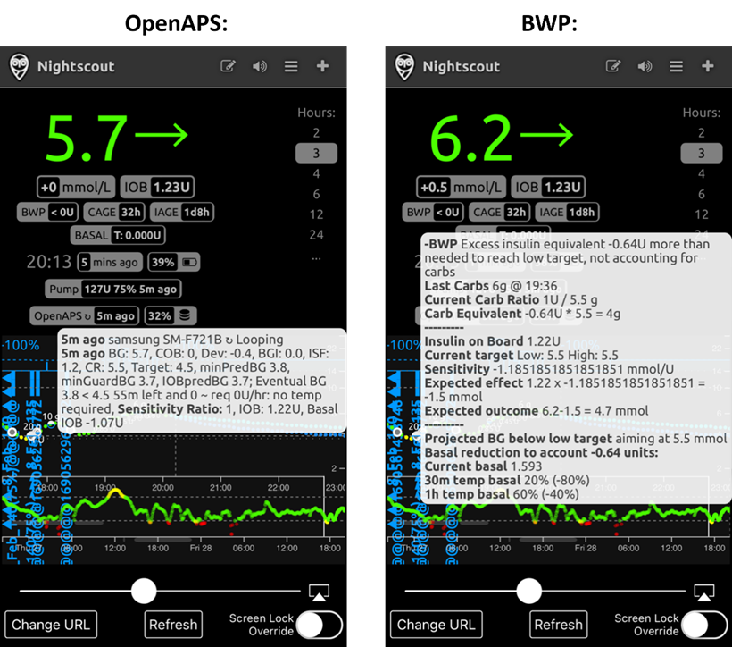
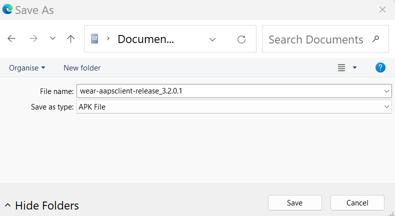

# Contrôle à distance d'AAPS

```{contents} In this page
:backlinks: entry
:depth: 2
```

Il existe quatre outils très efficaces pour gérer **AAPS** à distance :

1) [Commandes SMS](#RemoteControl_SMS-Commands) (le téléphone suiveur peut être Android ou iOS), 2) [AAPSClient](#RemoteControl_aapsclient) (le téléphone suiveur est Android ; une version iPhone est en cours de développement) 3) [Nightscout](#RemoteControl_nightscout) (Android, iOS ou autre ordinateur/appareil), surtout pour suivre : voir la remarque sur le [contrôle par le client](#client-master-control) dans cette section.  
4) [Montres connectées](#RemoteControl_smartwatches) (Android)

Les trois premiers conviennent surtout aux aidants/parents, mais les montres connectées sont très utiles pour les aidants/parents **et** pour les adultes diabétiques eux-mêmes.


(RemoteControl_SMS-Commands)=

## 1) Commandes SMS

Voir la page dédiée [Commandes SMS](../RemoteFeatures/SMSCommands.md).

(RemoteControl_aapsclient)=
## 2) AAPSClient

**AAPSClient** ressemble beaucoup à **AAPS**. Il offre à l'aidant les mêmes écrans et les mêmes boutons pour envoyer des commandes à distance à **AAPS** :


(remotecontrol-aapsclient-versions)=
### À propos d'AAPSClient, AAPSClient2 et AAPSClient3

Il existe 3 versions de l'application client : **AAPSClient**, **AAPSClient2** et **AAPSClient3**. Elles fonctionnent de la même façon. La seule différence est qu'elles peuvent être installées côte à côte sur le même téléphone suiveur.

Un aidant qui suit une seule personne a seulement besoin d'**AAPSClient**. Pour suivre et contrôler à distance une deuxième personne (avec son propre site **Nightscout** et son propre téléphone **AAPS**), installez aussi **AAPSClient2**, et **AAPSClient3** pour une troisième personne. Chaque application est configurée et [appairée](#aapsclient-pairing-with-the-master) séparément, avec le site **Nightscout** et le téléphone **AAPS** de la personne qu'elle suit.

Pour distinguer les applications, certains éléments ont une couleur différente : jaune pour **AAPSClient**, bleu pour **AAPSClient2** et vert pour **AAPSClient3**. Ces éléments sont l'icône de l'application, le fond du widget et la section d'état **AAPS** sur l'écran d'accueil de l'application. <br/> Remarque : l'opacité du fond du widget peut être réglée dans la configuration du widget. Avec une faible opacité, la couleur est difficile à voir.


### Téléchargement et installation

**AAPSClient** peut être installé sur un seul téléphone ou sur plusieurs téléphones suiveurs (par ex. le téléphone suiveur du parent 1 et celui du parent 2), pour que les deux aidants aient accès au téléphone **AAPS** du patient et puissent le contrôler à distance.

Pour télécharger **AAPSClient**, allez dans le [dépôt Github](https://github.com/nightscout/AndroidAPS/releases/) et cliquez sur le fichier **« app-AAPSClient-release_x.x.x.x »** (il peut s'agir d'une version plus récente que celle de la capture d'écran ci-dessous) :


Allez ensuite dans _téléchargements_ sur votre ordinateur. Sous Windows, les _téléchargements_ s'affichent dans le bandeau de droite :


Une fois le téléchargement terminé, cliquez sur _afficher dans le dossier_ pour trouver le fichier.

L'apk **AAPSClient** peut maintenant être :

Transféré par un câble USB sur le téléphone suiveur ; ou Déplacé dans un dossier Google Drive, puis installé sur le téléphone suiveur en touchant le fichier « app-AAPSClient-release ».

Si vous avez besoin d'**AAPS** pour vous-même et d'**AAPSClient** pour suivre quelqu'un d'autre, vous devez compiler **AAPSClient** vous-même, au lieu de le télécharger depuis le dépôt Github comme décrit ci-dessus. En effet, vous ne pouvez pas installer **AAPS** et **AAPSClient** sur le même téléphone s'ils sont signés avec des clés différentes. <br/> Pour compiler **AAPSClient** vous-même, suivez la même procédure que pour la [compilation normale d'AAPS](../SettingUpAaps/BuildingAaps.md). Sur la page **Generate signed App Bundle or APK**, choisissez **aapsclientRelease** au lieu de **fullRelease**.

La même règle s'applique si vous installez plusieurs applications client (**AAPSClient**, **AAPSClient2**, **AAPSClient3**) sur un même téléphone suiveur : elles doivent toutes être signées avec la **même clé**. Sinon, Android refuse d'installer la deuxième (erreur `INSTALL_FAILED_DUPLICATE_PERMISSION`).

### Synchronisation : configuration d'AAPSClient et d'AAPS

Une fois l'apk __AAPSClient__ installé sur le téléphone suiveur, vérifiez que **NSClientV3** est configuré de la même façon sur les deux téléphones pour Nightscout 15 (voir les [notes de mise à jour](../Maintenance/UpdateToNewVersion.md)). L'exemple ci-dessous montre la configuration de la synchronisation avec NSClientV3 et Nightscout 15 ; d'autres sources de données sont disponibles dans __AAPS__ (par ex. xDrip).

Dans **Configuration** > **Communication**, l'utilisateur synchronise ses données avec Nightscout via __NSClientV3__ (avec l'API v3), configuré de la même façon dans __AAPS__ et sur le téléphone suiveur.


L'utilisateur doit s'assurer que les téléphones AAPS et AAPS Client sont __tous les deux__ synchronisés, en configurant NSClientV3 sur chacun. Sur le téléphone suiveur, vous pouvez aussi le faire en scannant un QR code affiché par **AAPS**, voir [Appairer AAPSClient avec AAPS](#remotecontrol-pairing) ci-dessous :

- Saisissez votre **URL Nightscout** dans les **Paramètres** de NSClientV3

- Saisissez votre **Jeton d'accès Nightscout** dans les mêmes paramètres. Suivez les notes [ici](https://nightscout.github.io/nightscout/security/#create-a-token). Sur le téléphone **AAPS**, utilisez un **jeton admin** : avec lui, **AAPS** crée son propre jeton pour chaque téléphone suiveur.

- Activez **Utiliser les websockets** sur les **deux** téléphones. Sur le téléphone **AAPS**, les websockets sont **obligatoires** pour le contrôle à distance : sans eux, **AAPS** ne peut pas recevoir de commandes d'**AAPSClient**. Sur les deux téléphones, ils rendent aussi la synchronisation plus rapide, mais consomment un peu plus de batterie.


L'utilisateur doit vérifier que __AAPSClient__ et __AAPS__ affichent tous les deux « connecté » sur l'écran **NSClientV3** de chaque téléphone. À ce stade, **AAPSClient** suit **AAPS** (glycémie, traitements, profil), mais ne peut pas encore le contrôler : appairez les deux téléphones comme décrit ci-dessous.

(remotecontrol-pairing)=
### Appairer AAPSClient avec AAPS (contrôle à distance)

Depuis la version 4 d'**AAPS**, **AAPSClient** contrôle **AAPS** par une connexion sécurisée et **appairée**. La synchronisation seule ne suffit pas : tant que les téléphones ne sont pas appairés, **AAPSClient** affiche seulement **Gestion**, avec un **Profil** en lecture seule et **Associer au maître**.

1. Sur le téléphone **AAPS**, ouvrez **Gestion → Clients autorisés** et activez **Autoriser le contrôle client** (désactivé par défaut, toujours activé en mode simple).
2. Touchez **+**, saisissez un nom pour le téléphone suiveur, choisissez comment il est configuré et choisissez son **rôle** :
   - **QR code : Nightscout et appairage** — **AAPS** affiche un QR code qui configure Nightscout sur le téléphone suiveur et l'appaire, en un seul scan. Il faut pour cela un jeton admin dans les paramètres NSClientV3 du téléphone **AAPS**.
   - **PIN** — pour un téléphone suiveur sans caméra, déjà connecté à Nightscout : notez le **PIN** à usage unique (valable environ deux minutes).
3. Sur le téléphone **AAPSClient**, scannez le code (dans l'Assistant de configuration, ou **Gestion → Associer au maître → Scanner le QR code**), ou ouvrez **Gestion → Associer au maître** et saisissez le PIN. Confirmer.

Le téléphone suiveur apparaît alors comme **Actif** dans la liste **Clients autorisés**, et **AAPSClient** affiche **Traitements**, **Scénarii** et **Gestion**. Le téléphone suiveur reçoit son propre jeton Nightscout, avec seulement les droits dont il a besoin. La procédure complète, avec des captures d'écran et le dépannage, se trouve dans [Contrôle maître ↔ client](#client_master_master_setup).

Vérifiez que la configuration fonctionne : saisissez des glucides dans **AAPSClient**, confirmez la quantité affichée et vérifiez que la saisie apparaît dans **Traitements** sur les deux téléphones.

(remotecontrol-nightscout-access-token)=

### Résoudre les problèmes de configuration du « Jeton d'accès Nightscout »

La configuration exacte du « Jeton d'accès Nightscout » peut varier selon que votre Nightscout est un site hébergé payant ou non.

Si vous avez du mal à faire accepter le « Jeton d'accès Nightscout » par **AAPS** et que vous utilisez un site Nightscout hébergé payant, contactez d'abord votre fournisseur Nightscout pour savoir comment résoudre ce problème. Sinon, contactez le groupe **AAPS**, mais vérifiez d'abord que vous avez bien suivi les notes [ici](https://nightscout.github.io/nightscout/security/#create-a-token).

### Ce qu'offre AAPSClient

Une fois appairé, **AAPSClient** offre à l'aidant presque les mêmes écrans qu'**AAPS** :

- **Traitements** : bolus d'insuline, glucides et assistant bolus.
- **Scénarii** : démarrer et arrêter des [scénarios](../DailyLifeWithAaps/Scenes.md).
- **Gestion** : profils, paramètres d'insuline, cibles temporaires, Assistant Rapide, automatisation, aliments, rotation des sites, appairage et débit basal temporaire en cours.
- **Menu principal** : historique des traitements, navigateur d'historique, statistiques, maintenance, configuration.

Il n'y a ni pompe ni objectifs dans **AAPSClient**. Voir [L'application AAPSClient](AapsClient.md) pour une description détaillée.

**AAPSClient** permet à l'aidant de faire à distance la plupart des réglages possibles directement dans **AAPS**, **y compris des bolus d'insuline**, par le réseau mobile ou internet. Chaque commande est signée et envoyée via Nightscout au téléphone **AAPS**. Celui-ci la vérifie par rapport à ses propres données, la limite, vous montre sa propre confirmation, et seulement ensuite l'exécute. **AAPSClient** _peut_ être beaucoup plus rapide que les [Commandes SMS](../RemoteFeatures/SMSCommands.md), surtout pour les commandes qui demandent une authentification.

Les traitements saisis dans Nightscout par d'autres moyens (par exemple le site web Nightscout) ne sont pas appliqués quand le contrôle client est activé : **AAPS** est alors en [mode renforcé](#client-master-control-hardened-mode) et accepte les changements uniquement des clients appairés. Quand le contrôle client est désactivé, ils sont appliqués seulement si les options **Recevoir** correspondantes sont activées dans la [section Synchronisation des préférences NSClient](#Preferences-nsclient-synchronization).

Le contrôle à distance avec **AAPSClient** est recommandé seulement si votre synchronisation fonctionne bien (_c.-à-d._ si vous ne voyez pas de changements de données non voulus, comme une CT ou un DBT qui se modifie tout seul, etc.).

### AAPSClient avec les options de montre connectée

Une montre connectée peut être un outil très utile pour aider à gérer **AAPS** avec des enfants. Plusieurs configurations différentes sont possibles. Si **AAPSClient** est installé sur le téléphone de l'aidant, l'[application **AAPSClient WearOS**](https://github.com/nightscout/AndroidAPS/releases/) peut être téléchargée et installée sur une montre connectée compatible, reliée au téléphone du parent. Elle affiche la glycémie actuelle et l'état de la boucle. Une fois **AAPSClient** appairé avec **AAPS**, les actions de la montre (y compris bolus, glucides, cibles temporaires et changements de profil) sont transmises par **AAPSClient** à **AAPS**, qui les confirme et les exécute : voir [Wear OS sur un client](#clientmastercontrol-wear-os-on-a-client). Vous pouvez en savoir plus sur les montres connectées [ici](#remotecontrol-smartwatches).

(RemoteControl_nightscout)=
## 3) Nightscout

En plus du serveur Nightscout dans « le Cloud », il existe aussi une application **Nightscout** dédiée, que vous pouvez télécharger directement depuis l'App Store sur votre iPhone. Si vous avez un téléphone suiveur Android, il n'y a pas d'application Nightscout dédiée. Il vaut mieux utiliser [**AAPSClient**](#2-aapsclient). Si vous voulez seulement suivre, sans envoyer de traitements, vous pouvez télécharger et installer l'application [Nightwatch](https://play.google.com/store/apps/details?id=se.cornixit.nightwatch) depuis le Play Store.

Une fois l'application **Nightscout** installée sur votre iPhone, ouvrez-la et suivez les instructions de configuration. Saisissez l'adresse de votre Nightscout (voir ci-dessous, à gauche). Sa forme peut varier selon l'hébergement de votre Nightscout. (_par ex._ http://youraddresshere.herokuapp.com). Saisissez ensuite l'API secret de votre Nightscout (voir ci-dessous, à droite). Si l'application ne vous demande pas votre mot de passe API, vous devez le saisir en touchant le cadenas en haut de l'application :


Plus d'informations sur la configuration sont disponibles directement sur [Nightscout](https://nightscout.github.io/nightscout/discover/)

À la première connexion, l'affichage est très simple. Personnalisez les options d'affichage en touchant le menu « hamburger » en haut à droite, puis en faisant défiler vers le bas :


Faites défiler vers le bas jusqu'à « Settings » (paramètres). Vous pouvez changer « scale » (échelle) en « linear » (linéaire), car l'affichage de la glycémie est logarithmique par défaut. Sous « render basal » (affichage du basal), choisissez « default » (par défaut) pour que le débit basal de la pompe s'affiche.


Choisissez les options souhaitées. Décochez les alarmes si vous utilisez une autre application pour les alarmes.


Continuez à faire défiler vers le bas jusqu'à « show plugins » (afficher les plugins).

Vérifiez que « careportal » est coché. Vous pouvez aussi choisir d'autres valeurs (les plus utiles sont : IOB, care portal, pump, cannula age, insulin age, basal profile et OpenAPS).

Important : vous devez maintenant toucher « save » (enregistrer) en bas pour que ces changements prennent effet.


Après avoir touché « save », l'application revient à l'écran principal de Nightscout, qui ressemble à peu près à ceci :

1. Glycémie actuelle
2. Informations sur l'état du système AAPS - touchez chaque onglet de l'écran pour afficher plus de détails. Ajoutez ou retirez ces options d'affichage avec le menu hamburger.
3. Courbe de glycémie récente avec les traitements (glucides, bolus)
4. Courbe de glycémie à plus long terme
5. Menu « hamburger » pour régler les options d'affichage, créer des rapports, modifier les profils et accéder aux outils d'administration de Nightscout
6. Menu « **+** » pour saisir des traitements (voir [ci-dessous](#RemoteControl_nightscout-treatments) pour savoir quand **AAPS** les applique).
7. Choisir une autre période à afficher
8. Profil d'insuline basale
9. Ligne verte = glycémie passée Lignes bleues = glycémie prévue


Regardons plus en détail le menu en haut à gauche de l'application Nightscout :

1. Modification rétrospective Careportal
2. Activer/désactiver les alarmes
3. Hamburger - pour régler les préférences
4. Careportal - Enregistrer un traitement (voir [ci-dessous](#RemoteControl_nightscout-treatments) pour savoir quand **AAPS** les applique)


Les onglets gris de cet écran donnent beaucoup d'informations sur l'état du système **AAPS** (et encore plus si vous touchez l'onglet) :

1. Tendance de la glycémie sur 5 min
2. Aperçu de l'assistant bolus
3. Touchez Basal pour voir votre profil actuel et les informations sur le débit basal
4. Temps écoulé depuis la dernière mesure MGC dans AAPS
5. **Pompe** : insuline, batterie en % et dernière connexion d'AAPS à la pompe
6. Dernière actualisation d'AAPS - si elle date de plus de 5 min, il peut y avoir un problème de connexion entre le téléphone AAPS et la pompe/le MGC
7. Touchez l'IA pour voir la répartition entre insuline basale et insuline de bolus
8. Âge de l'insuline dans le réservoir
9. Âge de la canule
10. État de la batterie du téléphone AAPS
11. Taille de votre base de données. Si elle devient trop pleine (uniquement pour un Nightscout DIY, les services hébergés ne sont pas concernés), vous pouvez avoir des problèmes de connexion. Vous pouvez supprimer des données pour réduire cette taille dans le menu Admin tools (outils d'administration, via le menu hamburger).




Touchez « refresh » (actualiser) en bas de la page pour fermer la fenêtre.

(RemoteControl_nightscout-treatments)=
### Envoyer des traitements à AAPS avec l'application Nightscout

Dans **AAPS** 4, la façon prise en charge de contrôler **AAPS** à distance est un **AAPSClient appairé**, voir [Contrôle maître ↔ client](#client-master-control) : chaque client a un [rôle](#client-master-control-roles) qui limite ce qu'il peut faire, et chaque commande est signée, vérifiée et confirmée par le téléphone **AAPS**. Quand le contrôle client est activé, le téléphone **AAPS** est en [mode renforcé](#client-master-control-hardened-mode) : les traitements, cibles temporaires et changements de profil saisis sur le site web Nightscout ou dans l'application Nightscout ne sont **pas** appliqués. L'application Nightscout sert alors uniquement à suivre.

```{admonition} Only when client control is off
:class: warning
Si **Autoriser le contrôle client** est désactivé dans **Gestion → Clients autorisés** (et si le mode simple est désactivé), **AAPS** applique les saisies careportal venant de Nightscout uniquement pour les types de données que vous avez activés sous **Recevoir** dans la [section Synchronisation des paramètres NSClientV3](#Preferences-nsclient-synchronization) : glucides, cibles temporaires, changements de profil et autres saisies careportal. L'insuline n'est jamais délivrée de cette façon : un « Correction bolus » saisi dans Nightscout est seulement *annoncé*, et **AAPS** le compte dans l'insuline active sans le délivrer. Cette configuration n'est pas recommandée pour le contrôle à distance ; utilisez plutôt un **AAPSClient** appairé.
```

En savoir plus sur les options de **Nightscout** [ici](https://nightscout.github.io/)

### Conseils pour profiter au mieux de l'application Nightscout

1). Si vous êtes « bloqué » sur une page et voulez revoir l'écran principal, touchez simplement « refresh » (actualiser, en bas au milieu). Vous reviendrez à la page d'accueil de **Nightscout** avec le graphique de glycémie.

Pour voir le profil actuel utilisé sur le téléphone, touchez les différentes icônes au-dessus du graphique. Plus d'informations (ratio G/I actuel, sensibilité, fuseau horaire, etc.) s'affichent en touchant « basal ». « OpenAPS » donne des informations sur le profil, la cible actuelle, etc. Le niveau de batterie (%) du téléphone et celui de la pompe peuvent aussi être surveillés. BWP donne des informations sur ce que l'algorithme prévoit pour la suite, en fonction de l'IA et des GA.

#### Autres icônes du menu : que signifie le crayon (modifier) ?

Vous pouvez (techniquement) utiliser le crayon pour déplacer ou supprimer des bolus ou des corrections des dernières 48 h.

Plus d'informations à ce sujet [ici](https://nightscout.github.io/nightscout/discover/#edit-mode-edit)

Cela pourrait être utile pour supprimer des glucides annoncés (mais sans bolus). En pratique, cela ne fonctionne pas bien avec **AAPS** pour le moment, et nous recommandons de faire ce type de modification directement dans l'application **AAPS**.

(RemoteControl_smartwatches)= (remotecontrol-smartwatches)=

## 4) Montres connectées

### Option 1) Contrôler AAPS depuis une montre Wear OS


Une fois que vous avez [installé **AAPS** sur votre montre](../WearOS/BuildingAapsWearOS.md), vous trouverez tous les détails sur les cadrans de la montre connectée et leurs fonctions dans [Montre connectée Wear OS](../WearOS/WearOsSmartwatch.md).

En bref, les fonctions suivantes peuvent être lancées depuis la montre connectée :

* définir une cible temporaire

* utiliser le calculateur de bolus (les variables de calcul peuvent être définies dans les paramètres du téléphone)

* administrer des eGlucides

* administrer un bolus (insuline + glucides)

* paramètres de la montre

* état

* vérifier l'état de la pompe

* vérifier l'état de la boucle

* vérifier et modifier le profil, CPP (Circadian Percentage Profile, profil circadien en pourcentage = décalage horaire + pourcentage)

* afficher la DTQ (Dose Totale Quotidienne = bolus + basal par jour)

* Bolus à distance quand l'aidant et l'enfant DT1 sont à des endroits différents (c'est possible avec la montre **AAPS** et le téléphone **AAPS** si les deux appareils sont connectés au réseau)

#### Communication des aidants vers la montre avec d'autres applications (comme WhatsApp)

Il est possible d'ajouter d'autres applications sur la montre, comme WhatsApp, par exemple pour échanger des messages entre les aidants et les enfants. Il est important d'avoir UN SEUL compte Google associé au téléphone, sinon la montre ne récupère pas ces données. Vous devez avoir 13 ans ou plus pour avoir un compte Samsung, et il doit être créé avec la même adresse e-mail que celle utilisée sur le téléphone Android.

Une vidéo qui explique comment configurer WhatsApp pour les messages sur la montre Galaxy 4 (toutes les fonctions de WhatsApp ne sont pas disponibles) est disponible [ici](https://gorilla-fitnesswatches.com/how-to-get-whatsapp-on-galaxy-watch-4/)

Avec quelques réglages dans l'application **Galaxy wearable** sur le téléphone **AAPS** et sur la montre, les messages WhatsApp peuvent être annoncés par une légère vibration et s'afficher par-dessus le cadran actuel.

### Option 2) **AAPS** sur la montre, pour contrôler à distance **AAPS** sur un téléphone

Comme avec un téléphone suiveur utilisant **AAPSClient** ou les commandes SMS (voir les sections ci-dessus), une montre connectée peut servir à contrôler **AAPS** à distance et à afficher toutes les données du profil. Une différence importante avec un téléphone suiveur : la montre connectée est reliée au téléphone **AAPS** par Bluetooth, et n'a besoin ni de Nightscout ni d'un code d'authentification. À noter : si la montre connectée et le téléphone **AAPS** reliés par Bluetooth sont aussi sur un réseau Wi-Fi ou de données mobiles, la montre communique aussi avec le téléphone **AAPS** par ce réseau, ce qui donne une plus grande portée. Cela permet notamment de délivrer un bolus à distance quand l'aidant avec la montre **AAPS** et l'enfant DT1 (avec le téléphone **AAPS**) sont à des endroits différents. C'est utile par exemple quand l'enfant DT1 est à l'école.

Une montre connectée de contrôle à distance est donc souvent utile dans toutes les situations où :

a)  les commandes **AAPSClient** ou **SMS** ne peuvent pas fonctionner ; ou

b)  l'utilisateur veut éviter de saisir un code d'authentification (nécessaire pour les commandes SMS).

Une montre connectée doit avoir **Wear OS 3 ou plus récent** pour pouvoir contrôler **AAPS**. Vérifiez les caractéristiques techniques de la montre et consultez la page [Montres connectées et AAPS](../Getting-Started/Watches.md). Faites une recherche, ou demandez dans les groupes Facebook/Discord d'**AAPS** en cas de doute.

Des guides pratiques pour configurer **AAPS** sur la Samsung Galaxy Watch 4 (40 mm), une montre populaire, sont donnés ci-dessous. La montre [Garmin](https://apps.garmin.com/en-US/apps/a2eebcac-d18a-4227-a143-cd333cf89b55?fbclid=IwAR0k3w3oes-OHgFdPO-cGCuTSIpqFJejHG-klBTm_rmyEJo6gdArw8Nl4Zc#0) est aussi un choix populaire. Si vous avez déjà configuré une autre montre connectée et pensez que cela peut être utile à d'autres, ajoutez-la dans ces pages ([modifier la documentation](../SupportingAaps/HowToEditTheDocs.md)) pour partager votre expérience avec toute la communauté **AAPS**.

### Option 3) AAPSClient sur une montre pour contrôler à distance **AAPS** sur un téléphone


Le logiciel pour la montre, l'apk Wear **AAPSClient**, peut être téléchargé directement depuis [Github](https://github.com/nightscout/AndroidAPS/releases/).

Pour télécharger le logiciel, cliquez sur l'application de montre qui correspond à l'application client du téléphone : **wear-aapsclient-release_**_version_ va avec **AAPSClient**, **wear-aapsclient2-release_**_version_ va avec **AAPSClient2** (voir [À propos d'AAPSClient, AAPSClient2 et AAPSClient3](#remotecontrol-aapsclient-versions)) :


Choisissez ensuite « enregistrer sous » et enregistrez le fichier à un endroit pratique sur votre ordinateur :





L'apk Wear **AAPSClient** peut être transféré sur votre téléphone puis installé manuellement (side-load) sur la montre, de la même façon que l'application Wear **AAPS**, comme décrit dans [Transférer l'application Wear sur votre téléphone AAPS](#remote-control-transferring-the-aaps-wear-app-onto-your-aaps-phone)  


