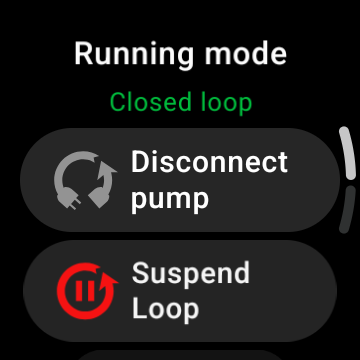
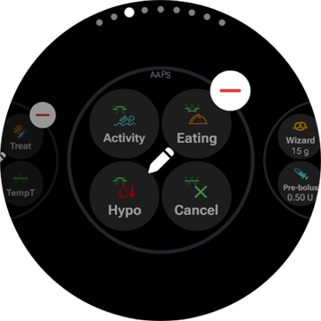
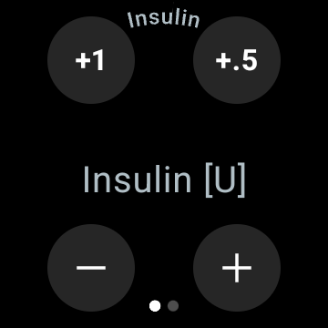
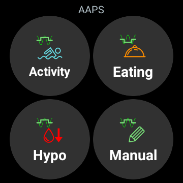
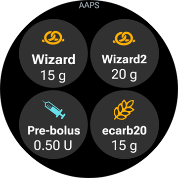

# Fonctionnement de AAPS via votre montre connectée Wear OS

(Watchfaces-aaps-watchfaces)=

## Cadrans AAPS

```{warning}
The classic **AAPS** watchfaces run on Wear OS 5 and older only, and Wear OS 5 already limits them. On **Wear OS 6 and newer** the watch app installs one watchface in Google's Watch Face Format instead: your custom watchface as a picture, or the **Complications watchface**. See [Wear OS watch face changes](#wearos-watchface-changes) for what breaks on each Wear OS version, and [the watchface AAPS installs](#wearos-aaps-v4-watchface) for Wear OS 6.
```

On Wear OS 5 and older, several classic watchfaces are built into the **AAPS** watch app. They show the glucose value with delta, IOB, the active basal rate and a graph of the readings. Two taps work on them:

* Double-tap the glucose value to open the **AAPS** main menu
* Double-tap the graph to change its time range

On every Wear OS version, the [complications](#Watchfaces-complications) and the [tiles](#WearOsSmartwatch-wear-os-tiles) described on this page work with any watchface that has room for them.

## Configuration

Enable **Wear** in [**Configuration** > **Communication**](#Config-Builder-wear).

To bolus or take other actions from the watch, turn on **Wear control**. The bolus wizard options for the watch are set in the same place: see [Settings > Wear](#preferences-wear). While **Wear control** is off, the phone refuses every treatment or mode change sent from the watch, and the watch shows *"Wear control is turned off in the Wear settings on the phone."*

With **Open plugin** on the **Wear** card you open the Wear screen:


The top line shows the name of the connected watch, or **(No Watch Connected)**. From this screen you can

* Resend all data. Might be helpful if watch was not connected for some time, and you want to push the information to the watch.
* Open settings on your watch directly from your phone.
* Choose which watchface **AAPS** installs on the watch (**Watchface installed on watch**: your custom watchface, or the complications watchface). This card is only shown while a **Wear OS 6** or newer watch is connected. See [the watchface AAPS installs](#wearos-aaps-v4-watchface).
* Manage the **Custom Watchface** (the card is shown while a watch is connected): **Load Watchface** sends a custom watchface to the watch, **Infos Watchface** lists the details of the loaded watchface and the fields it contains, **More watchfaces** opens the [exchange site](../ExchangeSiteCustomWatchfaces/index.md) in your browser, and **Export template** saves a template you can edit. A preview of the loaded watchface is shown below the buttons. See [Changing to an AAPS Watchface](#WearOS_changing-to-AAPS-watchface).

Vérifiez que les notifications d'AAPS ne sont pas bloquées sur la montre. La confirmation de l'action (par ex. bolus, cible temporaire) est envoyée par une notification que vous devrez glisser et cocher.

## Accès menu principal de AAPS


To open the main menu of **AAPS**, use one of these:

* open **AAPS** from the watch's app list
* tap an **AAPS** complication that opens the menu, see [Complication related settings](#WearOsSmartwatch-complication-settings)
* tap the **BG Graph** tile with its **Tap action** set to **Main Menu**, see [Tile settings](#WearOsSmartwatch-wear-os-tiles)
* on a classic **AAPS** watchface, double-tap the glucose value

(WearOsSmartwatch-loop-status)=

## Loop Status screen

The **Loop Status** screen gives a summary of what the loop is doing, without taking out your phone. Open it from the AAPS main menu (**Loop status**, or **Status → Loop**), or by tapping the **Blood Glucose** complication. The **Status** menu also has a **Pump** page and a **TDD** page with the total daily doses.


The screen is a list of cards. Scroll down to see them all:

* **Running mode** — the current mode (closed loop, open loop, LGS, suspended, disconnected…) and, for a temporary mode, how long it still runs.
* **Loop result** — when the loop last ran, and the temporary basal or SMB it requested.
* **Scene** — only while a [scene](#scenes-from-watch) is active: its name, the time left (or **Until ended** for a scene without end time) and the **Follow-up** scene that starts when it ends.
* **Targets** — your target, and the temporary target if one is running.
* **Profile** — the name of the active profile, with its **Percentage** and **Timeshift** when they are not the default values. A temporary profile switch is highlighted and shows how long it still runs and the profile it **Returns to** when it ends.
* **Sensitivity** — the same lines as the sensitivity chip on the phone's main screen: the autosens value and the profile, variable and effective ISF.

A small scene icon next to a running mode, a temporary target or a profile switch means it was **set by the active scene**. The same icon is shown in the **Running mode** picker.


(WearOsSmartwatch-bolus-calculator)=

## The bolus calculator on the watch

Open **Calculator** from the **AAPS** main menu, from the [Actions tile](#WearOsSmartwatch-wear-os-tiles) or from a complication set to open the wizard. It walks through a few pages, swipe from right to left to go on:

| Glucides                                                        | Request                                                             | Result                                                            | Calculation                                                                       | Confirm                                                             |
| --------------------------------------------------------------- | ------------------------------------------------------------------- | ----------------------------------------------------------------- | --------------------------------------------------------------------------------- | ------------------------------------------------------------------- |
|  |  |  |  |  |

1. **Carbs**: enter the carbs with the **+10**, **+5**, **−** and **+** buttons.
2. **Request**: the last page before the phone takes over. It shows what you entered: the carbs, and the meal type, carb time and percentage when you use them, see [Optional pages](#WearOsSmartwatch-calculator-optional-pages). Tap the check mark to send it to the phone, which runs the calculation.
3. **Result**: the bolus **AAPS** proposes, with the carbs under it: the carbs now and the eCarbs later, the carb time and the bell of the eat reminder. Adjust the dose with **−** and **+**, see below. Scroll down for the **Calculation** card: tap it to see every line of the calculation, the same as on the phone.
4. **Confirm**: swipe to the second page and tap the check mark. The phone delivers the bolus and records the carbs.

(WearOsSmartwatch-calculator-optional-pages)=

### Optional pages

Three watch settings each add a page after **Carbs**. They are off by default. Open the **AAPS** main menu, then **Settings** > **Interface**, and turn on the ones you want; when more than one is on, the pages come in the order **Meal type**, **Carb time**, **Percentage**. The dots at the bottom of the calculator show how many pages it has.

| Paramètres                                                                               | Meal type                                                               | Carb time                                                               | Percentage                                                                |
| ---------------------------------------------------------------------------------------- | ----------------------------------------------------------------------- | ----------------------------------------------------------------------- | ------------------------------------------------------------------------- |
|  |  |  |  |

* **Calculator Meal Type**: **Bread**, **Cake** or **Pizza**, which splits the carbs of a slow meal into carbs now and eCarbs later, see [Choosing the meal type](#WearOsSmartwatch-wizard-meal-type).
* **Calculator Carb Time**: the minutes until you eat, with a **Set alarm** bell for the eat reminder, see [Carb time and the eat reminder](#WearOsSmartwatch-wizard-carb-time).
* **Calculator Percentage**: a percentage of the calculated bolus, for example 70 % when you want a smaller dose. It starts at the **Bolus percentage** of the phone's [Bolus wizard settings](#Preferences-deliver-this-part-of-bolus-wizard-result), 100 % unless you changed it. See also the note under [Adjusting the bolus on the result page](#WearOsSmartwatch-wizard-result).

(WearOsSmartwatch-wizard-result)=

### Adjusting the bolus on the result page

The result page shows the bolus **AAPS** proposes, together with a **−** and a **+** button. Use them to adjust the dose before you confirm it, without going back to the phone.

| Proposed                                                                          | More                                                                                | Less                                                                                   |
| --------------------------------------------------------------------------------- | ----------------------------------------------------------------------------------- | -------------------------------------------------------------------------------------- |
|  |  |  |

* Each press changes the bolus by **one step of your pump**, so the amounts offered always match what your pump can actually deliver.
* **Press and hold** a button to keep changing the value. The longer you hold, the faster it goes.
* You cannot go below **0 U**, nor above your **max bolus** setting.

The running total is shown on the result page, so you always see the amount you are about to confirm. The change is shown after the carbs, for example *(+0.20 U)*, and the button you used turns green for more or red for less.

If **AAPS** had to limit the dose, for example because the calculated bolus is above your **max bolus** setting, a warning line in amber below the total says so (for example *"Bolus constraint applied"*). The same applies to a limited carbs amount.

```{admonition} This is not the same as Calculator Percentage :class: note The **Calculator Percentage** setting lets you enter a *percentage* of the calculated bolus **before** the result page appears. The **−** and **+** buttons adjust the *final amount* **on** the result page. You can use both.

    <br />(WearOsSmartwatch-wizard-meal-type)=
    
    ### Choosing the meal type
    
    The watch calculator can split the carbs of a slow meal into carbs now and eCarbs later, like the [carbs type](#AapsScreens-carbs-type) of the phone wizard. Turn on **Calculator Meal Type** in the watch's **Settings** > **Interface**. The setting is off by default, and then the **Meal type** page is skipped.
    
    * After you enter the carbs, a **Meal type** page shows three icons: **Bread**, **Cake** and **Pizza**. Tap an icon: its name and the carbs it gives show below the icons, for example *65 g* for bread, or *52+22 g* for pizza (52 g now and 22 g of eCarbs later). **Bread** is the default and keeps all the carbs now.
    * The request and confirm pages show the carbs in the same way (*52+22 g*). The result page also shows when the eCarbs start and how long they last.
    * The bolus is calculated only for the carbs eaten now. The split uses the same numbers as the phone wizard.
    
    (WearOsSmartwatch-wizard-carb-time)=
    
    ### Carb time and the eat reminder
    
    With **Calculator Carb Time** turned on in the watch's **Settings** > **Interface**, a **Carb time** page follows the carbs: the minutes until you eat, like the [carb time](#aaps-screens-bolus-wizard) of the phone wizard. **Now** is the default. **−** and **+** move it in steps of 5 minutes, up to an hour before or after now. A time in the past is for carbs you have eaten already.
    
    With a time in the future, a **Set alarm** bell appears under the value. It is on by default, tap it to turn it off. The request and result pages show the carb time, for example *+30 min*, and the bell. The phone records the carbs at that time, moves the eCarbs of the meal type with it, and starts its **time to eat** reminder.
    
    | Result | BG graph | Running | Time to eat |
    | --- | --- | --- | --- |
    |  |  |  |  |
    
    The reminder also lives on the watch, so it rings when the phone is out of reach too:
    
    * The **BG Graph** screen, the **BG Graph** tile and the graph of the **Complications watchface** draw a dashed orange line where the reminder rings, with the minutes left next to it.
    * While it runs, a silent **Time to eat** notification with **Stop** and **+5 min** sits in the notification stream. It comes back when you swipe it away, until the reminder is over.
    * When the time has come, the watch vibrates, and again every half minute for five minutes until you answer. The notification offers **Silence** and **+5 min**, and swiping it away silences it too.
    
    **Stop**, **Silence** and **+5 min** do the same on the watch, on the phone and on an **AAPSClient**, and all of them show the same reminder.
    
    (Watchfaces-complications)=
    
    ## Complications
    
    _Complication_ is a term from traditional watchmaking, where it describes addition to the main watchface - as another small window or sub-dial (with date, day of the week, moon phase, etc.). Wear OS 2.0 apporte cette métaphore pour permettre aux fournisseurs de données personnalisés, comme la météo, les notifications, compteurs de fitness et plus encore, d'ajouter ces informations à tous les cadrans qui supportent les complications.
    
    AAPS Wear OS app supports complications since build `2.6`, and allow any third party watchface that supports complications to be configured to display AAPS related data (BG with the trend, IOB, COB, etc.).
    
    Complications also serve as **shortcut** to AAPS functions. En appuyant dessus, vous pouvez ouvrir les menus et dialogues de AAPS (selon la complication et la configuration).
    
    
    
    ### Complication Types
    
    AAPS Wear OS app provides only raw data, according to predefined formats. Il revient au cadran récepteur de décider où et comment mettre en forme les complications, y compris sa mise en page, sa bordure, sa couleur et sa police. From many Wear OS complication types available, AAPS uses:
    
    * `SHORT TEXT` - Contains two lines of text, 7 characters each, sometimes referred to as value and label. Il est généralement affiché à l'intérieur d'un cercle ou d'une petite pilule - l'un au-dessous de l'autre, ou côte à côte. C'est une complication très compacte. AAPS essaye de supprimer les caractères inutiles pour l'ajuster : en arrondissant les valeurs, en supprimant les zéros de début et de fin des valeurs, etc.
    * `LONG TEXT` - Contains two lines of text, about 20 characters each. Il est généralement affiché à l'intérieur d'un rectangle ou d'une longue pilule - l'une en dessous d'un autre. Il est utilisé pour plus de détails et des statuts textuels.
    * `RANGED VALUE` - Used for values from predefined range, like a percentage. Il contient une icône, une étiquette et est généralement rendu en tant que cadran de progression circulaire.
    * `LARGE IMAGE` - Custom background image that can be used (when supported by watchface) as background.
    * `SMALL IMAGE` / `MONOCHROMATIC IMAGE` - A small icon. In a `SMALL IMAGE` slot AAPS draws it in its own colour; in a `MONOCHROMATIC IMAGE` slot the watchface tints it.
    
    ### Complication Setup
    
    To add complication to watchface, configure it by long press and clicking the gear icon below. Selon la façon dont s'effectue le paramétrage du cadran - soit cliquez sur les espaces réservés, soit entrez dans le menu de paramétrage des complications du cadran. Les complications de AAPS sont regroupées dans le sous-menu AAPS.
    
    Quand vous configurez les complications dans un cadran, Wear OS présente et filtre la liste des complications qui sont adaptées à la zone sélectionnée dans le cadran. Si certaines complications ne sont pas dans la liste, c'est probablement parce qu'elle ne peut pas être utilisée à cet endroit.
    
    ### Complications provided by AAPS
    
    AAPS provides the complications below. "Opens" is what a tap does with **Complication Tap Action** left at **Default**, see [Complication related settings](#WearOsSmartwatch-complication-settings).
    
    **Glucose**
    
    * **Blood Glucose** (`SHORT TEXT`, opens _Loop Status_): the glucose value with the trend arrow on the first line, the age of the reading and the delta on the second.
    * **Blood Glucose (large)** (`SHORT TEXT`, opens _BG Graph_): the glucose value alone on the first line, so the watchface can draw it big. The age and the trend arrow are on the second line.
    * **BG Graph** (`SMALL IMAGE` / `LARGE IMAGE`, opens _BG Graph_): the BG graph as a picture, for watchfaces with an image slot. This is the graph on the **Complications watchface**.
    * **Full Status** (`LONG TEXT`, opens _Menu_): most of the data in one line: the glucose value with the trend arrow, the delta and the age of the reading, then carbs on board, insulin on board and the basal rate.
    * **Full Status (flipped)** (`LONG TEXT`, opens _Menu_): the same, with the two lines swapped, for watchfaces that show only one of the two lines of a `LONG TEXT` slot.
    
    **Insulin and carbs**
    
    * **IoB Icon** (`SHORT TEXT`, opens _Bolus_): insulin on board with a syringe icon.
    * **IoB Detailed** (`SHORT TEXT`, opens _Bolus_): total insulin on board on the first line, the bolus and basal parts on the second.
    * **CoB Icon** (`SHORT TEXT`, opens _Wizard_): carbs on board with a carbs icon.
    * **CoB Detailed** (`SHORT TEXT`, opens _Wizard_): the carbs on board now on the first line, the carbs still to come (eCarbs) on the second.
    * **CoB & IoB** (`SHORT TEXT`, opens _Wizard_): insulin on board on the first line, carbs on board on the second.
    
    **Basal and target**
    
    * **Basal rate** (`SHORT TEXT`, opens _Menu_): the current basal rate.
    * **BR & IoB** (`SHORT TEXT`, opens _Menu_): insulin on board on the first line, the basal rate on the second.
    * **BR & Target** (`SHORT TEXT`, opens _Temp Target_): the target on the first line, with the time left when a temporary target runs, and the basal rate on the second.
    * **Target** (`SHORT TEXT`, opens _Temp Target_): the target on the first line and, while a temporary target runs, its time left on the second.
    * **BR, CoB & IoB** (`SHORT TEXT`, opens _Menu_): the basal rate on the first line, carbs on board and insulin on board on the second.
    
    **Loop and phone**
    
    * **Running mode** (`SMALL IMAGE` / `ICON`, opens _Running mode picker_): the current loop mode as an icon: closed loop, open loop, low glucose suspend, suspended, disconnected or disabled. A tap opens a picker with the mode changes allowed right now, for example **Suspend loop**, **Disconnect pump**, **Resume loop** or **Reconnect pump**. The same picker is in the **AAPS** main menu under **Running mode**.
    * **Uploader/Phone Battery** (`RANGED VALUE` / `SHORT TEXT` / `ICON`, opens _Status_): the battery of the **AAPS** phone, as a gauge with a battery icon, as a number, or as the icon alone. It updates together with the other **AAPS** data, usually every 5 minutes with a new reading.
    
    The **Running mode** picker, as opened from the complication, the main menu or the Running mode tile:
    
    
    
    (WearOsSmartwatch-complication-settings)=
    
    ### Complication related settings
    
    In the **AAPS** main menu on the watch, open **Settings** > **Complication**:
    
    
    
    * **Complication Tap Action** (default `Default`): what a tap on an **AAPS** complication opens, for all complications at once:
      * _Default_: what the complication itself opens, see the list above
      * _Menu_: the **AAPS** main menu
      * _Calculator_: the bolus calculator
      * _Treatment_: the treatment dialog, insulin and carbs
      * _eCarbs_: the eCarbs dialog
      * _Status_: the status menu
      * _Running mode_: the running mode picker. Needs **Wear control** turned on in the phone's Wear settings, otherwise the main menu opens instead.
      * _None_: a tap does nothing
    * **BG graph time range** (default `3 hours`): how many hours the **BG Graph** complication shows, 1, 3 or 6. The BG Graph tile has its own setting.
    * **Unicode in Complications** (default `On`): the complications use Unicode symbols like `Δ` for the delta, `⁞` as separator and `⎍` for the basal rate. How they look depends on the font of the watchface. Turn this `Off` when a watchface draws them as boxes or blanks.
    
    (WearOsSmartwatch-wear-os-tiles)=
    
    ## Wear OS Tiles
    
    Tiles are the pages you reach by swiping from the watchface. **AAPS** brings seven of them, each a set of up to four buttons. A tap on a button opens the matching dialog on the watch, or asks you to confirm, and the phone then does the work. A tile is a shortcut, not a status display: it does not hold the state of the phone app.
    
    Before using the tiles, turn on **Wear control** in [Settings > Wear](#preferences-wear).
    
    ### Adding a tile
    
    There are two ways, depending on your watch and phone:
    
    1. On the watch: swipe from the watchface past the last tile to **Add tile** and pick an **AAPS** tile. On most watches a long-press on a tile also opens the add and remove view.
    2. On the phone, in the companion app for your watch (**Galaxy Wearable** for Samsung, **Wear OS** for other brands): open **Tiles**, tap **Add** and pick the **AAPS** tiles you want. The order of the tiles can be changed by dragging.
    
    
    
    ### Tile settings
    
    The **Actions**, **Temp Target**, **BG Graph** and **Scene** tiles have settings on the watch. Open the **AAPS** main menu, then **Settings** > **Tiles**, and pick the tile. A long-press on the tile also opens its settings, except on Pixel watches. The other three tiles are filled from the phone and have nothing to set on the watch.
    
    | Main menu | Settings | Tiles |
    | --- | --- | --- |
    |  |  |  |
    
    The settings of a tile are a list of its four places. Tap a place to pick what it shows, or **None** to leave it empty.
    
    | Long-press on the tile | Settings of the Temp Target tile |
    | --- | --- |
    |  |  |
    
    Every tile has four places. A tile with more entries than that shows the first four.
    
    ### Actions tile
    
    
    
    Shortcuts to the dialogs of the **AAPS** watch app. Pick up to four of these in the tile settings:
    
    * **Calc**: the bolus calculator, with a carbs input, an optional percentage [1] and an optional meal type [2]
    * **Treat**: insulin and carbs in one go
    * **Insulin**: a bolus, entered in units
    * **Carbs**: carbs, also extended carbs. A **negative** amount is accepted, down to your current COB, to correct carbs you entered earlier. Carb removals are shown on the watch's BG graph.
    * **eCarbs**: extended carbs
    * **TempT**: a temporary target with a custom target and duration
    * **Profile switch**: a profile switch with percentage, time shift and duration
    
    
    
    The dialogs the buttons open. Swipe from right to left to reach the next page of a dialog, and tap the check mark on the last page to send the request to the phone:
    
    | Treat | Insulin | Carbs | eCarbs | TempT | Profile switch |
    | --- | --- | --- | --- | --- | --- |
    |  |  |  |  |  |  |
    
    [1] In the watch's **Settings** > **Interface**, turn on **Calculator Percentage** to show the percentage input in the bolus calculator. The default percentage comes from the phone's ["Deliver this part of the bolus wizard result %"](#Preferences-deliver-this-part-of-bolus-wizard-result). The other calculator settings are those of the phone under **Settings** > **Bolus wizard settings**.
    
    [2] In the watch's **Settings** > **Interface**, turn on **Calculator Meal Type** to show the **Meal type** page, where you pick **Bread**, **Cake** or **Pizza** to split the carbs of a slow meal into carbs now and eCarbs later. See [Choosing the meal type](#WearOsSmartwatch-wizard-meal-type).
    
    ### Temp Target tile
    
    
    
    Temporary targets from the phone's presets. Set the duration and the target of each preset on the phone under **Settings** > [Default temp targets](#Preferences-default-temp-targets). Pick up to four of these in the tile settings:
    
    * **Activity**: for sport
    * **Eating**: eating soon, a lower target so there is more insulin on board at the meal
    * **Hypo**: a higher target during a hypo treatment
    * **Manual**: a custom target and duration
    * **Cancel**: stops the running temporary target. The button is shown only while a temporary target is running.
    
    ### Quick Wizard tile
    
    
    
    The [QuickWizard](#quickwizards) entries of the phone that have **Show on Watch** turned on, within their valid hours. A carbs entry shows its carbs in g, an insulin entry its fixed dose in U. A tap runs the entry after a confirmation on the watch. There is nothing to set on the watch: edit the entries on the phone, and turn on **Show on Watch** under **Device Selection** for each entry you want on the tile. Outside the valid hours of all your entries, the tile shows **No config available**.
    
    
    
    ### Scene tile
    
    
    
    The [Scenes](#scenes-from-watch) of the phone. Each of the four places is set to **Automatic**, **None** or one scene in the tile settings. An **Automatic** place takes the next scene from the phone's list that no other place has claimed. A place set to a scene that no longer exists on the phone shows **Unavailable**.
    
    
    
    ### Running mode tile
    
    
    
    The [running modes](#aaps-screens-running-mode) you can switch to from the current one, with the same icons as on the phone: closed loop, low glucose suspend, open loop, disable loop, suspend loop and disconnect pump, or resume and reconnect while one of those runs. **Suspend loop** and **Disconnect pump** ask for a duration first. The phone decides which modes are offered, the watch shows the first four and leaves out **Disable loop** when **Suspend loop** is on the list.
    
    ### User Action tile
    
    
    
    One button for each [automation](#automations-automation-triggers) on the phone whose trigger is **User action**. A tap asks you to confirm, then the phone runs the automation's actions. The buttons are named after the automations, so give them short names. There is nothing to set on the watch.
    
    ### BG Graph tile
    
    
    
    The glucose value with arrow, delta and age, below it IOB, COB, basal rate and target, and the BG graph with predictions, boluses, carbs and SMBs. Two settings on the watch: **Time range** (1, 3 or 6 hours) and **Tap action**, which opens the full **BG Graph**, the **Main Menu** or the **Loop Status** screen.
    
    
    
    
    
    ## Always on
    
    This section and the next apply to the classic **AAPS** watchfaces on Wear OS 5 and older. On Wear OS 6 the **Complications watchface** has an always-on display of its own, see [the watchface AAPS installs](#wearos-aaps-v4-watchface).
    
    Long battery life for Android Wear OS smartwatches is a challenge. Some smartwatches get as much as 30 hours before recharging. The display should be switched off for optimal power saving when not in use. Most watches support the “Always on” display.
    
    Since AAPS version 3, we can use a “Simplify UI” during always-on-mode. This UI only contains the blood glucose, direction, and time. This UI is power-optimized with less frequent updates, showing less information and lighting up fewer pixels to save power on OLED displays.
    
    The simplified UI mode is available for the Digital Style and Custom watchfaces. The simplified UI is optional and is configured through the watch face settings (long press the watch face and click “edit” or the gear icon). Select the configuration “Simplify UI" and set it to “Always On Mode” or “Always On and Charging”.
    
    ### Night-time mode
    
    While charging, it would be helpful if the display could stay “always-on” and show your blood glucose during the night. However, the standard watch-faces are too bright and have too much information, and the details are hard to read with sleepy eyes. Therefore, we added an option for the watch-face to simplify the UI only during charging when set in the configuration.
    
    The simplified UI mode is available for the Digital Style and Custom watchfaces. The simplified UI is optional and is configured through the watch face settings (long press the watch face and click “edit” or the gear icon). Select the configuration “Simplify UI" and set it to “During Charging” or “Always On and Charging”.
    
    The Android developer options enable your watch to stay awake during charging. To make the developer options available, see the [official documentation](https://developer.android.com/training/wearables/get-started/debugging). Set the “Stay awake when charging” to “on” in the developer options”.
    
    Note: not all displays can handle always-on very well. It can cause screen burn-in, especially on the older OLED displays. The watches will generally dim the display to prevent burn-in; please check your owner’s manual, the manufacturing, or the internet for advice.
    
    
    
    
    
    (WearOsSmartwatch-phone-alarms)=
    
    ## Phone alarms on the watch
    
    
    
    The watch shows the alarms of the phone, so you see why the phone makes a sound and can answer from the wrist. The watch vibrates, and again every half minute for five minutes until you answer. A notification shows the title and the text of the alarm, with the same answers as the [time to eat](#WearOsSmartwatch-wizard-carb-time) reminder:
    
    * **Silence**, or a swipe: the alarm stops, and the alarm screen on the phone closes.
    * **Mute 5 min**: the alarm stops and rings again after five minutes, on the phone and on the watch.
    
    Two kinds of alarm reach the watch:
    
    * The alarm screen of the phone (pump errors, automation alarms, BG alarms): **Silence** and **Mute 5 min**.
    * Urgent notifications with a sound, like *Pump unreachable* or a Nightscout alarm: **Silence** only. The phone has only **Dismiss** for those, and they come back by themselves while their cause lasts.
    
    The *time to eat* reminder is not sent this way: the watch rings that one by itself.
    
    ## Snooze Alert shortcut
    
    The watch [shows the alarm](#WearOsSmartwatch-phone-alarms) itself; the shortcut is a second way to silence it, with one press. It is possible to create a shortcut to snooze the alerts/alarm of AAPS. Muting the sound via your watch is convenient and faster without reaching for your phone. Note; you still have to check your alarm message on your phone and handle it accordingly,  but you can check that later. When your watch has two buttons, you can assign a key to the `AAPS Snooze Alert` program.
    
    To link the button on the Samsung Watch 4 go to `Settings > Advanced Features > Customize Buttons > Double press > AAPS Snooze Alert`
    
    On a watchface with complications, an **App shortcut** complication set to **AAPS Snooze Alert** does the same with a tap. The [alternative setup of the Complications watchface](#wearos-complications-watchface-setup) uses its top-right slot for it.
    
    ### Snooze xDrip
    
    When you use xDrip and have xDrip installed on the watch, the 'AAPS Snooze Alert' shortcut will also Snooze any xDrip alarm. 
    
    
    ## Performance and battery life tips
    
    Wear OS watches are very power-constrained devices. The size of the watch case limits the capacity of the included battery. Even with recent advancements both on hardware and software side, Wear OS watches still require daily charging.
    
    If an experienced battery span is shorter than a day (from dusk to dawn), here are some tips to troubleshoot the issues.
    
    Main battery-demanding areas are:
    
    * Active display with a backlight on (for LED) or in full intensity mode (for OLED)
    * Rendering on screen
    * Radio communication over Bluetooth
    
    Since we cannot compromise on communication (we need up-to-date data) and want to have the most recent data rendered, most of the optimizations can be done in _display time_ area:
    
    * Stock watchfaces are usually better optimized than custom one, downloaded from the store.
    * It is better to use watchfaces that limit the amount of rendered data in inactive / dimmed mode.
    * Be aware when mixing other Complications, like third party weather widgets, or other - utilizing data from external sources.
    * Start with simpler watchfaces. Add one complication at the time and observe how they affect battery life.
    * Use a dark theme on the watchface. On OLED displays fewer lit pixels mean less power and less burn-in.
    * Check what performs better on your watch: AAPS stock watchfaces or other watchfaces with AAPS Complications.
    * Observe over a few days, with different activity profiles. Most watches activate the display on glancing, movement and other usage-related triggers.
    * Check your global system settings that affect performance: notifications, backlight/active display timeout, when GPS is activated.
    * Check [list of tested phones and watches](#Phones-list-of-tested-phones) and [ask community](../GettingHelp/WhereCanIGetHelp.md) for other users experiences and reported battery lifetime.
    * **We cannot guarantee that data displayed on watchface or complication is up-to-date**. In the end, it is up to Wear OS to decide when to update a watchface or a complication. Even when the AAPS app requests update, the System may decide to postpone or ignore updates to conserve battery. When in doubt and low on battery on watch - always double-check with main AAPS app on phone.
    
    (Watchfaces-troubleshooting-the-wear-app)=
    
    ## Troubleshooting the wear app
    
    If the watch shows no data or old data, first check the connection between the watch and the phone, see [Troubleshooting the AAPS watch - AAPS phone communication](#wear-os-watch-phone-communication). For a watch on Wear OS 5, see also the [general troubleshooting recommendations for Wear OS 5](#wear-os-5-troubleshooting). A complication that does not update has the same causes as a tile or watchface that does not update, so check those first.
    
    ## Additional AAPS custom watchfaces are also available
    
    [Here](../ExchangeSiteCustomWatchfaces/index.md) you can download Zip-Files with custom watchfaces made by other users.
    
    ## Build your own watchface
    
    If you want to build your own watchface, follow the [guide here](../ExchangeSiteCustomWatchfaces/CustomWatchfaceReference.md).
    
    Once you have built a custom watchface, you can share your own **AAPS** custom watchface with others, the zip-file can be uploaded in the folder  "ExchangeSiteCustomWatchfaces" via a Pull Request into Github. Lors de la fusion du "Pull Request", l'équipe de documentation extraira le fichier image et le nom du cadran du fichier Zip, et ajoutera le lien de téléchargement à la liste ci-dessous.
    
    (WearOsSmartwatch-complications-watchface-download)=
    
    ## Make your own version of the Complications watchface
    
    The **Complications watchface** that **AAPS** installs on Wear OS 6 (see [the watchface AAPS installs](#wearos-aaps-v4-watchface)) is made with Samsung's **Watch Face Studio**. Its project file is free to download, so you can change it to your taste, or use it on a watch with Wear OS 5 or older where **AAPS** does not install it:
    
    [Complications watchface (AAPS V4), zip](https://github.com/openaps/AndroidAPSdocs/raw/refs/heads/master/docs/_static/wearos/Complications_watchface_AAPS_V4.zip)
    
    The zip holds four files:
    
    * `AAPS V4_0_2.wfs`: the project. Open it in [Watch Face Studio](https://developer.samsung.com/watch-face-studio/download.html), change what you like, and install it on the watch from there.
    * `com.watchfacestudio.aapsv4.apk`: the watchface as it is, ready to install with [adb](https://developer.android.com/tools/releases/platform-tools): `adb install com.watchfacestudio.aapsv4.apk` with the watch connected over ADB debugging.
    * `README.txt`: the two recommended complication setups, the same as on the [Wear OS page](#wearos-complications-watchface-setup).
    * `AAPS V4.png`: a preview.
    
    ```{admonition} This is not a custom watchface
    :class: note
    The zip is not a custom watchface for **Load Watchface** in the **Wear** plugin, and the phone cannot install it. It must be unzipped and installed on the watch with Watch Face Studio or adb, as above.