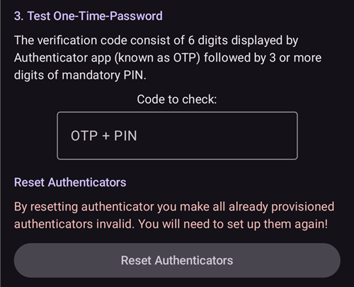

# Commandes SMS

```{contents} Table of contents
:depth: 2
```

La plupart des réglages à distance (cibles temporaires, glucides, changements de profil et, une fois le client associé, bolus) peuvent se faire avec l'[application **AAPSClient**](../RemoteFeatures/RemoteMonitoring.md) sur un téléphone Android avec une connexion internet, voir [Contrôle maître ↔ client](#client-master-control) (une version iPhone d'**AAPSClient** est en développement, voir [AAPSClient](AapsClient.md)). Les commandes SMS restent une solution qui fonctionne sans internet. C'est aussi la seule option à distance si vous utilisez un iPhone comme suiveur et que vous n'avez pas encore **AAPSClient**.

**Les commandes SMS sont vraiment utiles :**
1. Pour le contrôle à distance quotidien

2. Si vous voulez faire un bolus d'insuline à distance sans **AAPSClient** associé

3. Dans une région où la réception internet est mauvaise : les SMS passent, mais la connexion données/internet du téléphone est limitée. Ceci est très utile lorsque vous allez dans des régions isolées (par exemple : camping, sports d'hiver).

4. Si votre autre méthode de contrôle à distance (**AAPSClient**) ne fonctionne pas pour le moment

## La sécurité avant tout

Si vous activez le **Communicateur SMS** dans **AAPS**, réfléchissez au fait que le téléphone qui est configuré pour envoyer des commandes distantes peut être volé et/ou utilisé par quelqu'un d'autre. Verrouillez toujours votre téléphone, au moins avec un code PIN. Un mot de passe fort et/ou un verrouillage biométrique sont fortement recommandés. Ils doivent être différents de votre mot de passe principal de l'APK (le mot de passe demandé pour exporter les paramètres d'**AAPS**).

De plus, il est recommandé d'autoriser un [deuxième numéro de téléphone](#SMSCommands-authorized-phone-numbers) pour les commandes SMS. Ainsi, vous pouvez utiliser le deuxième numéro pour [désactiver](#SMSCommands-other) le communicateur SMS si votre téléphone principal de contrôle à distance n'est plus sûr.

Par défaut, le délai minimal entre deux commandes de bolus est de 15 minutes. Pour des raisons de sécurité, vous devez ajouter au moins deux numéros de téléphone autorisés pour raccourcir ce délai. Si vous essayez de refaire un bolus à distance moins de 15 minutes après le bolus précédent, vous recevrez la réponse « Bolus à distance non disponible. Réessayez plus tard. »

AAPS vous informera également par SMS si vos commandes à distance, comme un bolus ou un changement de profil, ont été effectuées. Il est conseillé de le configurer de sorte que les SMS de confirmation soient envoyés à au moins deux numéros de téléphone différents au cas où l'un des téléphones destinataires serait volé.

**Si vous faites un bolus par commande SMS, vous devez saisir les glucides séparément (deuxième SMS, AAPSClient...) !** Sinon, l'IA sera correcte mais les GA seront trop bas. Un bolus de correction pourrait alors ne pas être fait, car **AAPS** pense que vous avez trop d'insuline active.

Pour les commandes sensibles, une application d'authentification avec un mot de passe à usage unique basé sur le temps doit être utilisée, pour plus de sécurité.

Si vous voulez retirer à un téléphone d'aidant la possibilité d'envoyer des commandes SMS, utilisez le bouton d'urgence « [Réinitialiser les authentificateurs](#sms-commands-authenticator-setup) » dans **AAPS**, ou envoyez la commande SMS « [SMS stop](#SMSCommands-other) ». En réinitialisant les authentificateurs, vous rendez TOUS les téléphones des aidants non valides. Vous devrez les configurer à nouveau.

## Paramétrer les commandes SMS

```{contents} The overall process is as follows
:depth: 1
:local: true
```

(sms-commands-authenticator-setup)=
### Configuration de l'Authentificateur

L'authentification à deux facteurs est utilisée pour améliorer la sécurité.

Sur le téléphone de l'aidant, téléchargez (depuis l'App Store ou Google Play) et installez une application d'authentification. Les applications gratuites populaires sont :
  - [Authy](https://authy.com/download/)
  - Google Authenticator - [Android](https://play.google.com/store/apps/details?id=com.google.android.apps.authenticator2) / [iOS](https://apps.apple.com/de/app/google-authenticator/id388497605)
  - [LastPass Authenticator](https://lastpass.com/auth/)
  - [FreeOTP Authenticator](https://freeotp.github.io/)

Ces applications d'authentification créent un mot de passe à usage unique de 6 chiffres, valable peu de temps, comme pour la banque en ligne ou les achats en ligne. Vous pouvez utiliser une autre application d'authentification, si elle prend en charge les jetons TOTP RFC 6238. Microsoft Authenticator ne fonctionne pas.

### Vérifier les paramètres du téléphone

Sur votre téléphone, allez dans **Applications > AAPS > Autorisations**. Vérifiez que **SMS** et **Téléphone** sont autorisés.


```{admonition} "App was denied access to SMS"
:class: tip
Android peut bloquer l'autorisation **SMS** pour les applications qui n'ont pas été installées depuis un magasin d'applications, comme **AAPS**. Si vous voyez ce message quand vous accordez l'autorisation **SMS**, ouvrez **Paramètres > Applications > AAPS** sur le téléphone, appuyez sur le menu **⋮** (en haut à droite) et choisissez **Autoriser les paramètres restreints**. Puis accordez à nouveau l'autorisation **SMS**.
```


### Synchronisation de la date et de l'heure

L'heure des deux téléphones doit être synchronisée. Le mieux est de régler l'heure automatiquement depuis le réseau. Les différences d'heures peuvent entraîner des problèmes d'authentification.

Sur le téléphone **AAPS** et sur le téléphone de l'aidant, vérifiez que la date et l'heure sont synchronisées. La méthode exacte dépend de votre appareil. Vous devrez peut-être essayer différents paramètres.

Exemple (pour Samsung S23) : **Paramètres > Gestion globale > Date et heure** : vérifiez que **Date et heure automatiques** est coché.

Certaines options peuvent être grisées, car il faut un administrateur du compte famille si le téléphone a été configuré comme compte enfant. Sur l'iPhone d'un aidant/parent, ce réglage de date et d'heure s'appelle « Réglage automatique ». Si vous n'êtes pas sûr que les téléphones sont synchronisés, pas d'inquiétude : vous pouvez configurer les commandes SMS, puis chercher le problème ensuite si cela semble causer des problèmes (demandez de l'aide si besoin).

### Paramètres AAPS

Une fois les paramètres du téléphone vérifiés, dans l'application **AAPS** elle-même, allez dans [**Configuration** → **Communication**](../SettingUpAaps/ConfigBuilder.md) et activez le plugin **Communicateur SMS**.

Ouvrez les paramètres du **Communicateur SMS**.

Activez **Autoriser les commandes à distance par SMS**. Les options **Code PIN obligatoire à la fin de l'OTP** et **Configuration de l'Authentificateur** n'apparaissent qu'une fois cette option activée :


(SMSCommands-authorized-phone-numbers)=
#### Numéros de tél autorisés

Saisissez le ou les numéros de téléphone des aidants. Ajoutez l'indicatif du pays et enlevez le premier « 0 » du numéro de téléphone, comme dans ces exemples :
* Numéro de téléphone au Royaume-Uni : +447976304596
* Numéro de téléphone aux États-Unis : +11234567890
* Numéro de téléphone en France :  +33612344567
* _etc._

Notez que le « + » devant le numéro peut être nécessaire ou non, selon votre pays. Pour le savoir, envoyez un SMS de test : le format reçu s'affiche sur l'écran du plugin **Communicateur SMS** (**Configuration** → **Communication** → **Communicateur SMS** → **Ouvrir le plugin**).

Si vous avez plusieurs numéros de téléphone à ajouter, séparez-les par des points-virgules, **SANS espace entre les numéros** (c'est très important !). Choisissez **OK** :


#### Espacement minimal des bolus distants

- Vous pouvez définir le délai minimal (en minutes) entre deux bolus envoyés par SMS.
- Pour des raisons de sécurité, vous devez ajouter au moins deux numéros de téléphone autorisés pour modifier cette valeur.

#### Code PIN obligatoire à la fin de l'OTP

Pour des raisons de sécurité, le code de réponse doit être suivi d'un code PIN. Choisissez un code PIN que vous (et les autres aidants) utiliserez à la fin du code de l'authentificateur quand la commande SMS est envoyée.

Le code PIN doit avoir :

* au moins 6 chiffres
* seulement des chiffres

Pour un code PIN plus sûr, n'utilisez pas plusieurs fois le même chiffre (_par ex._ 111111) ni une suite (_par ex._ 123456).


#### Configuration de l'Authentificateur

* Appuyez sur **Configuration de l'Authentificateur** et suivez les instructions à l'écran, étape par étape.
* Ouvrez l'application d'authentification installée sur le _téléphone de l'aidant_, créez une nouvelle connexion et
* Avec le téléphone de l'aidant, scannez le QR code affiché sous **Scannez le code pour configurer les codes OTP AAPS**.


* Sous **Test Mot-de-Passe-Unique (OTP)**, saisissez dans **Code à vérifier** le mot de passe à usage unique de l'application d'authentification du téléphone de l'aidant, suivi de votre code PIN :

Par exemple :
* Le jeton de l'application d'authentification est 457051
* Votre code PIN obligatoire est 2401
* Code à vérifier : 4570512401

Si la saisie est correcte, le texte rouge « MAUVAIS CODE PIN » se change automatiquement en « OK » vert. **Il n'y a pas de bouton à appuyer !** La procédure est maintenant terminée. Il n'y a pas de bouton « OK » à appuyer après avoir saisi le code :



Les commandes SMS devraient maintenant être configurées.

Utilisez le bouton **Réinitialiser les authentificateurs** en bas de l'écran **Configuration de l'Authentificateur** si vous voulez supprimer les authentificateurs configurés. (En réinitialisant l'authentificateur, vous rendez TOUS les authentificateurs déjà configurés non valides. Vous devrez les configurer à nouveau.)

## Utiliser les commandes SMS

### Premiers pas avec les commandes SMS

1)  Pour vérifier que tout est bien configuré, testez la connexion en envoyant le SMS « bg » depuis le téléphone de l'aidant vers le téléphone **AAPS**. Vous devriez recevoir une réponse comme celle-ci :


Si vous ne recevez pas de réponse, voir la section [Dépannage](#SMSCommands-troubleshooting) ci-dessous.

2)  Essayez maintenant une commande SMS qui demande l'authentificateur, _par ex._ « target hypo ». Le téléphone de l'aidant reçoit un SMS en retour, qui vous demande de saisir le **mot de passe à six chiffres** de l'application d'authentification, suivi du **code PIN** secret, connu seulement des aidants/suiveurs (en tout, une suite de douze chiffres si votre code PIN a 6 chiffres).

Quand vous envoyez une commande SMS pour la première fois, faites-le près du téléphone **AAPS**, pour voir comment cela fonctionne :


Le téléphone de l'aidant reçoit un SMS de réponse d'**AAPS**, qui confirme si la commande SMS à distance a bien été exécutée.

Si votre commande a réussi, vous recevez une réponse qui le confirme. En cas de problème, vous recevez un message d'erreur. Voir [Dépannage](#SMSCommands-troubleshooting) ci-dessous pour les erreurs courantes.

**Astuce** : Il peut être utile d'avoir un forfait SMS illimité (pour chaque téléphone utilisé) si beaucoup de SMS sont envoyés.

### Faire les bolus de repas avec les commandes SMS

Un bolus d'insuline à distance peut se faire avec les **Commandes SMS** ou avec un **AAPSClient** associé (voir [Contrôle maître ↔ client](#client-master-control)) ; il ne peut pas se faire par le site Nightscout. Les glucides peuvent aussi être annoncés par SMS ou par **AAPSClient**. Par SMS, il n'est pas possible d'envoyer les commandes de glucides et d'insuline dans un seul message. Ces commandes doivent être envoyées séparément, comme suit :

1)  Envoyer le bolus d'insuline (_par ex._ « bolus 2 » demande un bolus de 2 unités) par commande SMS revient à utiliser **Traitements** → **Insuline** dans **AAPS**. 2)  Envoyez les glucides (_par ex._ « carbs 20 » annonce 20 g de glucides). Cela revient à utiliser **Traitements** → **Glucides** dans **AAPS**.

Pour éviter les hypoglycémies, il vaut mieux commencer prudemment, avec un bolus de **moins d'insuline** que ce que demanderait votre ratio de glucides, car vous ne tenez pas compte de la glycémie actuelle ni de sa tendance.

**L'ordre dans lequel vous envoyez ces commandes est important**. Si vous annoncez une grande quantité de glucides, quelle que soit la méthode, et que les SMB sont activés, **AAPS** peut répondre tout de suite en donnant une partie du bolus d'insuline. Donc, si vous essayez ensuite d'envoyer un bolus d'insuline _après_ avoir annoncé les glucides, vous pouvez avoir un délai frustrant et un message « bolus en cours ». Vous devez alors vérifier ce qui a été donné en SMB. Ou, si vous ne voyez pas qu'un SMB est en cours et que votre propre bolus suivant réussit aussi, trop d'insuline peut être administrée pour l'ensemble du repas. Donc, si vous faites des bolus de repas à distance, envoyez toujours le bolus d'insuline _avant_ l'annonce des glucides. Si vous préférez, vous pouvez combiner **AAPSClient** et les commandes SMS : les glucides saisis sur un **AAPSClient** associé n'ont pas besoin de code d'authentification et sont donc plus rapides que les commandes SMS. Les glucides ou autres traitements saisis sur le site Nightscout ne sont **pas** appliqués tant que le contrôle par le client est actif ; **AAPS** est alors en [mode renforcé](#client-master-control-hardened-mode).

(SMSCommands-commands)=
## Commandes

```{contents} List of command groups
:depth: 1
:local: true
```

Les commandes doivent être envoyées en anglais. La réponse sera dans votre langue si le texte de la réponse est déjà [traduit](#translations-translate-strings-for-AAPS-app). Les commandes ne tiennent pas compte des majuscules : vous pouvez écrire en minuscules ou en majuscules.


Les **tableaux des commandes SMS** ci-dessous montrent toutes les commandes SMS possibles. Des _valeurs d'exemple_ sont données pour aider à comprendre. Les commandes acceptent les mêmes plages de valeurs (cibles, pourcentage de profil, etc.) que l'application **AAPS** elle-même.

(authentication-or-not)=
### Authentification ou non ?

Certaines commandes SMS donnent une réponse immédiate, d'autres demandent une **authentification** forte avec l'application d'authentification. Une simple demande comme « **BG** » (qui demande la glycémie actuelle) est rapide à taper, ne demande pas d'authentification, et renvoie les informations d'état d'**AAPS** montrées ci-dessous :


Les commandes qui demandent plus de sécurité exigent la saisie d'un code, par exemple :


La colonne *Auth* des tableaux ci-dessous indique si une telle authentification forte est nécessaire pour chaque commande.

### Données MGC

| Commande   | Auth | Fonction et *Réponse*                                                                                                                                                                                             |
| ---------- | ---- | ----------------------------------------------------------------------------------------------------------------------------------------------------------------------------------------------------------------- |
| BG         | Non  | Renvoie : dernière glycémie, delta, IA (bolus et basal), GA<br/>*Dernière Gly : 5.6 il y a 4min, Delta : -0,2 mmol, IA : 0.20U (Bolus : 0.10U Basal : 0.10U)*                                               |
| CAL 5.6/90 | Oui  | Étalonne le MGC avec la valeur 5.6/90<br/>(utilisez la valeur qui correspond à votre unité de glycémie)<br/>Fonctionne seulement si c'est bien configuré dans **AAPS**.<br/>*Étalonnage envoyé* |

### Pompe

| Commande             | Auth | Fonction et *Réponse*                                                                                 |
| -------------------- | ---- | ----------------------------------------------------------------------------------------------------- |
| POMPE                | Non  | Last conn: 1 min ago<br/>Temp: 0.00U/h @11:38 5/30min<br/>IOB: 0.5U Reserv: 34U Batt: 100 |
| PUMP DISCONNECT *30* | Oui  | Pour déconnecter la pompe pendant *30* minutes                                                        |
| PUMP CONNECT         | Oui  | Pompe reconnectée                                                                                     |

### Basal

| Commande          | Auth | Fonction et *Réponse*                                 |
| ----------------- | ---- | ----------------------------------------------------- |
| BASAL 0.3         | Oui  | Pour démarrer un débit basal de 0.3U/h pendant 30 min |
| BASAL 0.3 20      | Oui  | Pour démarrer un débit basal de 0.3U/h pendant 20 min |
| BASAL 30%         | Oui  | Pour démarrer un débit basal de 30 % pendant 30 min   |
| BASAL 30% 50      | Oui  | Pour démarrer un débit basal de 30 % pendant 50 min   |
| BASAL STOP/CANCEL | Oui  | Pour arrêter le débit basal temporaire                |

Certaines pompes acceptent un débit basal temporaire seulement en pourcentage, d'autres seulement en U/h. Si vous utilisez l'autre forme, **AAPS** répond *« Cette pompe accepte une basale temporaire seulement en pourcentage, pas en U/h. »* (ou l'inverse) et ne règle rien. La durée doit être un multiple du pas de durée du débit basal temporaire de votre pompe.


### Boucle

| Commande          | Auth | Fonction et *Réponse*                                                                                                                                                                                                                                               |
| ----------------- | ---- | ------------------------------------------------------------------------------------------------------------------------------------------------------------------------------------------------------------------------------------------------------------------- |
| LOOP STATUS       | Non  | La réponse dépend de l'état actuel :<br/> - *La Boucle est désactivée* si la boucle est désactivée ou en AGB<br/> - *La Boucle est activée* si la boucle est fermée ou ouverte<br/> - *Suspendu (10 m)* si la boucle est déconnectée ou suspendue |
| LOOP STOP/DISABLE | Oui  | La pompe revient au débit basal programmé.<br/>*La Boucle a été désactivée*                                                                                                                                                                                   |
| LOOP SUSPEND 20   | Oui  | *Boucle suspendue pendant 20 minutes*                                                                                                                                                                                                                               |
| LOOP RESUME       | Oui  | *Boucle relancée*                                                                                                                                                                                                                                                   |
| LOOP CLOSED       | Oui  | *Mode actif : Boucle Fermée*                                                                                                                                                                                                                                        |
| LOOP LGS          | Oui  | *Mode actif : Arrêt Glycémie Basse*                                                                                                                                                                                                                                 |

### Bolus

Un bolus à distance n'est pas autorisé dans les 15 min (cette valeur ne peut être modifiée que si 2 numéros de téléphone sont ajoutés) qui suivent la dernière commande de bolus ou les dernières commandes à distance ! Dans ce cas, la réponse est *Bolus à distance non disponible. Réessayez plus tard.* Cette réponse est aussi envoyée quand la pompe est en train d'administrer un bolus.

| Commande             | Auth | Fonction et *Réponse*                                                                                                                                                                      |
| -------------------- | ---- | ------------------------------------------------------------------------------------------------------------------------------------------------------------------------------------------ |
| BOLUS 1.2            | Oui  |                                                                                                                                                                                            |
| BOLUS 0.60 MEAL      | Oui  | Administre le bolus indiqué de 0.60U<br/>**et** règle la [cible temporaire Repas imminent](#TempTargets-eating-soon-temp-target)                                                     |
| CARBS 5              | Oui  | Pour saisir 5 g, sans bolus                                                                                                                                                                |
| CARBS 5 17:35/5:35PM | Oui  | Pour saisir 5 g à 17:35.<br/>Le format d'heure accepté dépend<br/> du réglage de l'heure (12h/24h) du téléphone.                                                               |
| EXTENDED 2 120       | Oui  | Pour démarrer un bolus étendu de 2U pendant 120 min.<br/>Seulement pour les [pompes compatibles](#Extended-Carbs-extended-bolus-and-switch-to-open-loop-dana-and-insight-pump-only). |
| EXTENDED STOP/CANCEL | Oui  | Pour arrêter le bolus étendu                                                                                                                                                               |

### Profil

| Commande       | Auth | Fonction et *Réponse*                                                                                                                                            |
| -------------- | ---- | ---------------------------------------------------------------------------------------------------------------------------------------------------------------- |
| PROFILE STATUS | Non  | Profil actuel et pourcentage                                                                                                                                     |
| PROFILE LIST   | Non  | La liste actuelle des profils dans **AAPS**, par ex. :<br/>1. Profile1<br/> 2. Profile2                                                              |
| PROFILE 1      | Oui  | Pour passer au profil 1 de la liste.<br/>Utilisez les numéros renvoyés par **PROFILE LIST**,<br/>et non les noms de profil que vous avez enregistrés |
| PROFILE 2 30   | Oui  | Pour passer au profil Profile2 à 30 %                                                                                                                            |

Le pourcentage doit être entre 30 et 250 %, comme dans l'application. Une valeur hors de cette plage est refusée avant que le code d'authentification vous soit demandé.

### Cibles temporaires

| Commande                  | Auth | Fonction et *Réponse*                              |
| ------------------------- | ---- | -------------------------------------------------- |
| TARGET MEAL/ACTIVITY/HYPO | Oui  | Pour régler la cible temporaire MEAL/ACTIVITY/HYPO |
| TARGET STOP/CANCEL        | Oui  | Pour annuler la cible temporaire                   |


(SMSCommands-other)=
### Autres

| Commande         | Auth | Fonction et *Réponse*                                                                                                                                                                                                                                                     |
| ---------------- | ---- | ------------------------------------------------------------------------------------------------------------------------------------------------------------------------------------------------------------------------------------------------------------------------- |
| RESTART          | Oui  | Redémarre AAPS. Utile si vous avez des problèmes qui se règlent normalement par un redémarrage.                                                                                                                                                                           |
| SMS DISABLE/STOP | Oui  | Pour désactiver le service SMS à distance, répondez avec le code.<br/>N'oubliez pas que vous ne pourrez le réactiver<br/>que directement depuis le smartphone **AAPS** maître.                                                                                |
| HELP             | Non  | Renvoie toutes les fonctions disponibles :<br/>BG, LOOP, PUMP, BASAL, BOLUS, EXTENDED, CAL, PROFILE, TARGET, SMS, CARBS, HELP, RESTART<br/>Envoyez ensuite la commande ***HELP ***FUNCTION****** pour afficher<br/>toutes les options de cette section. |
| HELP BOLUS       |      | *BOLUS 1.2<br/>BOLUS 1.2 MEAL*                                                                                                                                                                                                                                      |

(SMSCommands-troubleshooting)=
## Dépannage et FAQ

```{contents} List of questions and issues
:depth: 1
:local: true
```

### Que _ne peut-on pas_ faire avec les commandes SMS ?

1)  **Vous ne pouvez pas faire de changement de profil _temporaire_** (par exemple, régler « profile exercise » pendant 60 minutes), mais vous pouvez passer de façon permanente au profil « profile exercise ». Les changements de profil temporaires peuvent être faits avec **AAPSClient**.

2)  **Vous ne pouvez pas annuler des automatisations** ni **régler des cibles personnalisées**, mais il existe des solutions approchées : Par exemple, imaginez que la cible normale du profil est 5,5. Vous avez réglé une automatisation dans AAPS qui règle toujours une cible haute de 7,0 entre 14h30 et 15h30, à cause d'un cours de sport à l'école. Une condition de l'automatisation est « aucune cible temporaire n'existe ». Cette semaine, on vous dit au dernier moment que le cours de sport est annulé et remplacé par un repas pizza, mais votre enfant est déjà à l'école avec le téléphone **AAPS**. Si la cible temporaire haute de 7,0 est lancée par l'automatisation et que vous l'annulez (sur le téléphone **AAPS** ou à distance), les conditions de l'automatisation sont toujours remplies et **AAPS** règle simplement à nouveau la cible haute, une minute plus tard.

**Si vous aviez accès au téléphone AAPS**, vous pourriez décocher/modifier l'automatisation ou, si vous ne voulez pas le faire, simplement régler une nouvelle cible temporaire de 5,6 pendant 60 min en appuyant sur la cible de l'écran principal, ou par **Gestion** → **Cible Temp**. Cela empêcherait l'automatisation de régler la cible haute de 7,0.

**Si vous n'avez pas accès au téléphone AAPS**, les commandes SMS permettent une solution approchée : par exemple, la commande « target meal » règle une cible de 5,0 pendant 45 min (les autres cibles par défaut sont 8,0 pour activité ou hypo, voir le tableau). Mais avec les commandes SMS, vous ne pouvez pas indiquer une valeur de cible _précise_ (5,6 pendant 60 minutes, par exemple) ; pour cela, il faut utiliser **AAPSClient**.

### Que se passe-t-il si je change d'avis après avoir envoyé une commande ?

**AAPS** n'exécute que la commande la plus récente. Donc, si vous tapez « bolus 1.5 », puis, sans vous authentifier, vous envoyez une nouvelle commande « bolus 1 », la commande 1.5 précédente sera ignorée. **AAPS** envoie toujours au téléphone de l'aidant une réponse qui confirme la commande SMS avant de vous demander le code d'authentification, et aussi une réponse après l'action.

### Pourquoi n'ai-je pas reçu de réponse à une commande SMS ?

Plusieurs raisons sont possibles :

1)  Le message n'est pas arrivé jusqu'au téléphone (problèmes de réseau). 2)  **AAPS** est encore en train de traiter la demande (_par ex._ un bolus, qui peut prendre du temps selon votre vitesse de bolus). 3)  Le téléphone **AAPS** n'a pas une bonne connexion Bluetooth avec la pompe quand la commande arrive, et la commande a échoué (cela crée en général une alarme sur le téléphone **AAPS**).

### Aucune réponse aux commandes SMS

Sur le téléphone de l'aidant et/ou le téléphone **AAPS**, essayez de désactiver les options suivantes :
* **Send as chat message** (envoyer comme message de chat) 
* Si vous utilisez l'application Android Messages ou Google Messages, désactivez la messagerie RCS :
  - ouvrir la conversation SMS spécifique dans les Messages
  - Choisissez le menu d'options (trois points) en haut à droite
  - sélectionnez "Détails"
  - Activez « Only send SMS and MMS messages » (envoyer uniquement des SMS et des MMS) 

### Erreurs lors de l'exécution des commandes

La commande peut échouer pour plusieurs raisons :

* La configuration des commandes SMS n'est pas complète ou pas correcte
* Vous avez envoyé une commande dans un format incorrect (comme « disconnect pump 45 » au lieu de « pump disconnect 45 »)
* Vous avez utilisé un code d'authentification incorrect ou expiré (il vaut souvent mieux attendre quelques secondes un nouveau code, si le code actuel va bientôt expirer)
* Le code + PIN était correct, mais l'envoi ou la réception du SMS a pris du retard. **AAPS** a donc calculé que le code d'authentification avait expiré
* Le téléphone **AAPS** est hors de portée de la pompe ou n'a pas de contact avec elle
* Le système est déjà en train d'administrer un bolus

Les erreurs courantes sont montrées dans les exemples ci-dessous :


### Comment arrêter une commande une fois qu'elle a été authentifiée ?

Vous ne pouvez pas. Mais vous pouvez annuler un bolus envoyé par SMS sur le téléphone **AAPS** lui-même, simplement en l'annulant dans la fenêtre du bolus, si vous êtes rapide. Beaucoup de commandes SMS (sauf les bolus et les annonces de glucides) peuvent facilement être annulées, ou vous pouvez agir pour limiter les effets d'une erreur.

Pour les erreurs de bolus et d'annonce de glucides, vous pouvez quand même agir. Par exemple, si vous avez annoncé 20 g de glucides mais que votre enfant n'en mange que 10 g, et que vous (ou un aidant sur place) ne pouvez pas supprimer le traitement directement sur le téléphone **AAPS**, vous pouvez régler une cible temporaire haute, ou un profil réduit, pour qu'**AAPS** soit moins agressif.

### SMS multiples

Si vous recevez le même message plusieurs fois (_par ex._ un changement de profil), vous avez peut-être créé par erreur une boucle avec d'autres applications. Par exemple xDrip. Si c'est le cas, vérifiez que xDrip (ou toute autre application) n'envoie pas de traitements à NightScout.

Si l'autre application est installée sur plusieurs téléphones, désactivez l'envoi sur chacun d'eux.

(sms-commands-too-many-messages)=
### Je reçois beaucoup trop de SMS des commandes SMS. Puis-je réduire leur fréquence, ou les arrêter ?

Les commandes SMS peuvent créer beaucoup de messages automatiques du téléphone **AAPS** vers le téléphone de l'aidant. Vous recevrez aussi des messages, par exemple « basal profile in pump updated » (profil basal de la pompe mis à jour), si vous avez configuré des automatisations dans **AAPS**. Il peut être utile d'avoir des SMS illimités dans le forfait de votre téléphone **AAPS** (et de chaque téléphone d'aidant utilisé) si beaucoup de SMS sont envoyés, et de désactiver les notifications, alarmes ou vibrations des SMS sur tous les téléphones. Il n'est pas possible d'utiliser les commandes SMS sans recevoir ces messages. Pour cette raison, vous voudrez peut-être un autre moyen de communiquer directement avec votre enfant (s'il est assez grand), à la place des SMS. Les applications de communication souvent utilisées par les aidants **AAPS** sont WhatsApp, Lime, Telegram et Facebook Messenger.

Il est possible de désactiver le SMS « Profile changed » (profil modifié) quand le changement de profil vient de Nightscout. Pour cela, créez un fichier nommé **exactement**  `do_not_send_sms_on_profile_change` dans le dossier `extra` de votre répertoire AAPS.
