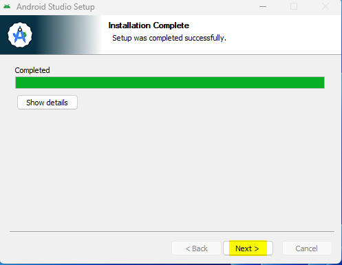
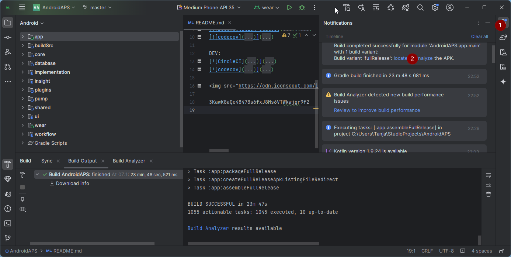

<!-- Android Studio Build, FKA Computer Build. Preserve filenames to avoid breaking URLs. -->

# Compilation avec Android Studio

C'est la méthode classique pour compiler votre application AAPS.

Vous pouvez compiler l'application sans ordinateur avec la méthode [Compilation dans le navigateur](./BrowserBuild.md).

## Compiler vous-même au lieu de télécharger

**L'application AAPS (le fichier apk) n'est pas disponible en téléchargement, en raison de la réglementation concernant les dispositifs médicaux. Il est légal de compiler l'application pour votre usage personnel, mais vous ne devez en aucun cas en donner une copie à d'autres personnes !**

Consultez la [Foire Aux Questions (FAQ)](../UsefulLinks/FAQ.md) pour plus de détails.

---

(Building-APK-recommended-specification-of-computer-for-building-apk-file)=
## Prérequis matériels et logiciels pour la compilation de AAPS

* Une version précise d'**[Android Studio](https://developer.android.com/studio/)** peut être nécessaire pour compiler l'apk. Voir le tableau ci-dessous :

| Version AAPS                | Version<br/>Android Studio<br/>préférée | Version<br/>Android Studio<br/>alternative | Gradle | JVM |
| --------------------------- | --------------------------------------------------- | ------------------------------------------------------ | ------ |:--- |
| 2.6.2                       | 3.6.1                                               |                                                        | 5.6.4  | 11  |
| 2.8.2.1                     | 4.1.1                                               |                                                        | 6.1.1  | 13  |
| [3.1.0.3](#version3100)     | 2020.3.1                                            | testé jusqu'à Quail 4                                  | 7.3.3  | 17  |
| [3.2.0.4](#version3204)     | Hedgehog (2023.1.1)                                 | testé jusqu'à Quail 4                                  | 8.2    | 17  |
| [3.3.1.3](#version3300)     | Ladybug Feature Drop (2024.2.2)                     | testé jusqu'à Quail 4                                  | 8.10   | 21  |
| [3.3.2](#version3300)       | Meerkat (2024.3.1)                                  | testé jusqu'à Quail 4                                  | 8.11.1 | 21  |
| [3.3.2.1](#version3321)     | Narwhal (2025.1.2)                                  | testé jusqu'à Quail 4                                  | 8.13   | 21  |
| [3.4.2.6](#version3426)     | Panda 2 (2025.3.2)                                  | testé jusqu'à Quail 4                                  | 9      | 21  |
| [4.0.0-beta1](#version4000) | Rabbit 1                                            | jusqu'à la dernière Rabbit 1                           | 9.8    | 21  |

La « version préférée » est fournie avec la bonne version de JVM. La version préférée est aussi la version minimale que vous pouvez utiliser pour compiler **AAPS**. Vous ne pourrez **PAS** compiler avec une version plus ancienne que la version « préférée ». Si vous utilisez une autre version, vous pouvez rencontrer des problèmes liés à la version de JVM. Voir la page [Dépannage d'Android Studio](#troubleshooting_androidstudio-uncommitted-changes) pour vous aider à résoudre ces problèmes. Si votre version actuelle d'Android Studio n'est pas dans le tableau, vous devez d'abord la mettre à jour.

La version de Gradle est liée au code source. Vous aurez toujours la bonne version de Gradle quand vous téléchargez ou mettez à jour le code source. Elle est indiquée ici seulement pour information. Vous n'avez rien à faire.

* [Les systèmes Windows 32 bits](#troubleshooting_androidstudio-unable-to-start-daemon-process) ne sont pas compatibles avec Android Studio. Notez bien qu'**un CPU 64 bits et un système d'exploitation 64 bits sont tous les deux obligatoires.** Si votre système NE remplit PAS cette condition, vous devez changer le matériel ou le logiciel concerné, ou tout le système.

<table class="tg">
<tbody>
  <tr>
    <th class="tg-baqh">OS (seulement 64 bits)</th>
    <td class="tg-baqh">Windows 8 ou supérieur</td>
    <td class="tg-baqh">Mac OS 10.14 ou supérieur</td>
    <td class="tg-baqh">Tout Linux avec Gnome, KDE ou Unity DE ;&nbsp;&nbsp;GNU C Library 2.31 ou plus récente</td>
  </tr>
  <tr>
    <th class="tg-baqh"><p align="center">CPU (seulement 64 bits)</th>
    <td class="tg-baqh">Architecture CPU x86_64 ; Intel Core de 2e génération ou plus récent, ou CPU AMD compatible avec <br><a href="https://developer.android.com/studio/run/emulator-acceleration#vm-windows" target="_blank" rel="noopener noreferrer"><span style="text-decoration:var(--devsite-link-text-decoration,none)">Windows Hypervisor</span></a></td>
    <td class="tg-baqh">Puces ARM, ou Intel Core de 2e génération ou plus récent compatible avec <br><a href="https://developer.android.com/studio/run/emulator-acceleration#vm-mac" target="_blank" rel="noopener noreferrer"><span style="text-decoration:var(--devsite-link-text-decoration,none)">Hypervisor.Framework</span></a></td>
    <td class="tg-baqh">Architecture CPU x86_64 ; Intel Core de 2e génération ou plus récent, ou processeur AMD compatible avec la virtualisation AMD (AMD-V) et SSSE3</td>
  </tr>
  <tr>
    <th class="tg-baqh"><p align="center">RAM</th>
    <td class="tg-baqh" colspan="3"><p align="center">16 Go ou plus</td>
  </tr>
  <tr>
    <th class="tg-baqh"><p align="center">Disque</th>
    <td class="tg-baqh" colspan="3"><p align="center">Au moins 30 Go d'espace libre. Un SSD est recommandé.</td>
  </tr>
  <tr>
    <th class="tg-baqh"><p align="center">Résolution</th>
    <td class="tg-baqh" colspan="3"><p align="center">Minimum 1280 x 800 <br></td>
  </tr>
  <tr>
    <th class="tg-baqh"><p align="center">Internet</th>
    <td class="tg-baqh" colspan="3"><p align="center">Haut débit</td>
  </tr>
</tbody>
</table>

**Il est fortement recommandé (non obligatoire) d'utiliser un disque dur SSD et non un HDD car cela sera plus rapide pour compiler le fichier apk d'AAPS.** Il est malgré tout possible d'utiliser un disque HDD pour compiler le fichier apk d'**AAPS**. Si vous le faites, le processus de compilation peut prendre beaucoup de temps avant de se terminer, mais une fois lancé, vous pouvez le laisser tourner sans surveillance.

## Aide et support pour le processus de compilation

Si vous avez des difficultés pendant la compilation de l'application **AAPS**, il existe une section dédiée [**Dépannage d'Android Studio**](../GettingHelp/TroubleshootingAndroidStudio.md). Consultez-la d'abord.

Si vous pensez que quelque chose dans les instructions de compilation est incorrect, pas assez documenté ou confus, ou si vous avez encore des difficultés, n'hésitez pas à contacter d'autres utilisateurs d'**AAPS** sur [Facebook](https://www.facebook.com/groups/AndroidAPSUsers) ou [Discord](https://discord.gg/4fQUWHZ4Mw). Si vous voulez mettre à jour quelque chose vous-même (mettre à jour les captures d'écran _etc_), veuillez soumettre une [pull request (PR)](../SupportingAaps/HowToEditTheDocs.md).

## Guide pas à pas pour compiler l'application AAPS

```{admonition} WARNING
:class: warning
Si vous avez déjà compilé AAPS auparavant, vous n'avez pas besoin de refaire toutes les étapes suivantes.
Rendez-vous directement au [guide de mise à jour](../Maintenance/UpdateToNewVersion.md) !
```

```{contents} The overall steps for building the **AAPS** apk file
:depth: 1
:local: true
```

Dans ce guide, vous trouverez des captures d'écran _d'exemple_ de la compilation du fichier apk d'**AAPS**. Étant donné qu'**Android Studio** (le logiciel que nous utilisons pour compiler l'apk **AAPS**) est régulièrement mis à jour, ces captures d'écran peuvent ne pas être identiques à votre installation, mais vous devriez toujours pouvoir les suivre.

Comme **Android Studio** fonctionne sous Windows, Mac OS X et Linux, il peut aussi y avoir de petites différences dans les étapes selon la plateforme.

(install-git-if-you-dont-have-it)=
### Installer Git

```{admonition} Why Git? 
:class: dropdown

Git est un « _système de contrôle de version_ » (VCS, Versioning Control System).\
Git est un programme qui permet de suivre les changements dans le code et de collaborer avec d'autres personnes. Vous utiliserez Git pour faire une copie du code source **AAPS** depuis le site web GitHub sur votre ordinateur local. Ensuite, vous utiliserez Android Studio sur votre ordinateur pour compiler l'application **AAPS** (apk). 
```

(BuildingAaps-steps-for-installing-git)=
#### Étapes pour l'installation de Git

1.  Vérifiez que vous n'avez pas déjà installé **Git**. Pour cela, tapez « git » dans la barre de recherche de Windows : si vous voyez **« Git bash »** ou une autre forme de Git, il est déjà installé et vous pouvez passer directement à [l'installation d'Android Studio](#install-android-studio) :


2. Si vous n'avez pas encore Git, téléchargez et installez la dernière version correspondant à votre système, dans la section "Téléchargement" [**ici**](https://git-scm.com/downloads). N'importe quelle version récente de Git devrait fonctionner, sélectionnez la version correspondant à votre système d'exploitation : Mac, Windows ou Linux.

**Note pour les utilisateurs de Mac :** la page Web de Git vous proposera également d'installer un programme supplémentaire appelé "homebrew" pour faciliter l'installation. Si vous installez Git via homebrew, vous n'avez pas besoin de modifier la configuration.

(Make_a_note_of_Git_path)=

* Pendant l'installation, quand on vous demande de « select destination location » (choisir l'emplacement de destination), notez _où_ Git est installé (le « **chemin d'installation** »). Vous devrez le vérifier à l'étape suivante. Ca devrait ressembler à "C:\Program Files\Git\cmd\git.exe"

*  Au fur et à mesure que vous avancez sur les différentes étapes de l'installation de Git, validez simplement en gardant les options par défaut.

*  Après l'installation, si vous avez oublié de noter l'endroit où Git a été installé, vous pouvez le trouver comme suit : tapez "git" dans la barre de recherche du PC, cliquez avec le bouton droit sur "Git bash", sélectionnez "Ouvrir l'emplacement du fichier", survolez l'icône "Git bash" avec votre souris, ce qui vous indiquera alors où il est installé.

* Redémarrez votre ordinateur avant de continuer.

(Building-APK-install-android-studio)=
### Installer Android Studio

- **Vous devez rester connecté à internet pour les prochaines étapes : Android Studio va en effet télécharger différentes mises à jour**

```{admonition} What is Android Studio?
:class: dropdown
Android Studio est un logiciel qui s'exécute sur votre ordinateur. Il vous permet de télécharger le code source depuis internet (en utilisant Git) et de compiler des applications pour smartphone (et montre connectée). Si vous avez déjà une version d'**AAPS**, utilisée pour boucler, en cours d'exécution sur un smartphone, vous ne pouvez pas la "casser" en compilant une nouvelle application ou une mise à jour sur votre PC avec Android Studio, ce sont des processus totalement séparés. 
```

Une des choses les plus importantes lors de l'installation d'Android Studio : **Soyez patient(e)** ! Lors du processus d'installation et de configuration, Android Studio télécharge beaucoup de choses, ce qui prend du temps.

```{admonition} Different UI
:class: warning
Remarque importante : l'interface d'Android Studio a changé lors des dernières versions. Ce guide montre les étapes avec la *nouvelle interface*. Les captures d'écran ont été faites avec « Ladybug », donc les versions plus récentes peuvent être un peu différentes. Si vous utilisez toujours l'ancienne interface utilisateur, vous pouvez basculer sur la nouvelle interface utilisateur en suivant [ces instructions](#computerbuild-NewUI).
```

La version d'Android Studio est très importante. Voir les [instructions ci-dessus](#Building-APK-recommended-specification-of-computer-for-building-apk-file) pour choisir la bonne version d'Android Studio.

Téléchargez la version [actuelle d'Android Studio](https://developer.android.com/studio) ou une version plus ancienne dans les [**Archives**](https://developer.android.com/studio/archive) et approuvez les conditions générales.


Une fois le téléchargement terminé, lancez l'application téléchargée pour l'installer sur votre ordinateur. Windows peut afficher des avertissements sur les applications téléchargées : vous devrez peut-être les accepter ou les confirmer !

Installez Android Studio en cliquant sur « Next » (suivant), comme le montrent les captures d'écran suivantes. Vous n'avez besoin de modifier **aucun** paramètre !


Si vous voulez économiser de l'espace disque, vous pouvez décocher Android Virtual Device : il ne sert pas à compiler **AAPS**.


Cliquez maintenant sur « Install » (installer) :


Une fois terminé, appuyez sur « Next »



À la dernière étape, cliquez sur « Finish » (terminer) pour démarrer Android Studio pour la première fois.


Android Studio vous demande si vous voulez aider à améliorer Android Studio. Choisissez l'option que vous voulez, cela ne change rien pour les étapes suivantes.


L'écran d'accueil vous présente l'installation d'Android Studio. Appuyez sur « Next ».


Choisissez « Standard » comme type d'installation.


Vérifiez les paramètres en cliquant à nouveau sur « Next ».


Vous devez maintenant accepter les contrats de licence. À gauche, il y a deux sections (1 + 3) : sélectionnez-les l'une après l'autre et, pour chacune, choisissez « Accept » (2 + 4) à droite.

Vous pouvez ensuite cliquer sur le bouton « Finish » (5).


Des paquets Android vont maintenant être téléchargés et installés. Soyez patient et attendez.

Quand c'est terminé, l'écran suivant s'affiche et vous pouvez de nouveau choisir « Finish ».


Vous voyez maintenant l'écran d'accueil (Welcome) d'Android Studio.


(Building-APK-download-AAPS-code)=
### Télécharger le code source AAPS

```{admonition} Why can it take a long time to download the AAPS code?
:class: dropdown

La première fois que **AAPS** est téléchargé, Android Studio se connecte par internet au site web de Github pour télécharger le code source d'**AAPS**. Cela devrait prendre environ une minute. 

Android Studio utilise ensuite **Gradle** (un outil de développement pour les applications Android) pour trouver les autres composants nécessaires à la compilation de ces éléments sur votre ordinateur. 
```

Sur l'écran d'accueil (Welcome) d'Android Studio, vérifiez que « **Projects** » (Projets) (1) est en surbrillance à gauche.

Cliquez ensuite sur « **Clone Repository** » (cloner le dépôt) (2) à droite :


Nous allons maintenant indiquer à Android Studio où aller chercher le code :


* "Repository URL/URL du dépôt" devrait être sélectionné (par défaut) à gauche (1).
* "Git" devrait être sélectionné (par défaut) comme système de contrôle de version (2).
* Copiez maintenant cette URL :
    ```
    https://github.com/nightscout/AndroidAPS.git
    ```
    et collez-la dans la zone de texte de l'URL (3).

* Vérifiez que le dossier (par défaut) pour enregistrer le code cloné n'existe pas déjà sur votre ordinateur (4). Vous pouvez choisir un autre dossier, mais n'oubliez pas où vous l'avez enregistré !
* Cliquez sur le bouton "Clone" (5).

```{admonition} INFORMATION
:class: note
Notez le dossier. C'est là que votre code source est stocké !
```

Vous allez alors voir un écran vous indiquant que le dépôt est en train d'être cloné (cloning repository) :


À un moment, Android Studio va se fermer puis redémarrer. Android Studio peut vous demander si vous faites confiance au projet. Cliquez sur "Trust project/Faire confiance au projet" :

  


Pour les utilisateurs de Windows : Si votre pare-feu demande la permission, autorisez l'accès :

 

Une fois le dépôt cloné avec succès, Android Studio ouvrira le projet en question.

(computerbuild-NewUI)=
```{admonition} New UI
:class: note
Android Studio a changé son interface récemment. Les nouvelles installations d'Android Studio utilisent la nouvelle interface utilisateur par défaut !

Seulement si votre Android Studio a une apparence différente, vous devrez peut-être passer à la nouvelle interface :
Cliquez sur le menu hamburger en haut à gauche, puis choisissez **Settings** (Paramètres) (ou **Preferences** (Préférences) sur les ordinateurs Apple).
Dans **Appearance & Behavior** (Apparence et comportement), allez dans **New UI** et cochez **Enable new UI** (activer la nouvelle interface). Redémarrez ensuite Android Studio pour appliquer la modification.

Si vous ne trouvez pas l'option **New UI** ne vous inquiétez pas : vous l'utilisez déjà !
```


Lorsque Android Studio démarre, attendez patiemment (cela peut prendre quelques minutes), et surtout, **ne mettez pas** à jour le projet comme proposé dans la notification.

Android Studio va lancer automatiquement une synchronisation Gradle (« Gradle project sync »), qui prend quelques minutes. Vous pouvez la voir (encore) en cours :


```{admonition} NEVER UPDATE GRADLE!
:class: warning

Android Studio peut vous recommander de mettre à jour le système "Gradle". **Ne jamais mettre à jour gradle !** Cela pourrait causer des problèmes.
```

Seulement sur les ordinateurs Windows : vous pouvez recevoir une notification indiquant que Windows Defender est en cours d'exécution. Cliquez sur **Automatically** (Automatiquement) et confirmez, la compilation sera plus rapide !


Vous pouvez laisser la synchronisation Gradle tourner et déjà suivre les étapes suivantes.

(Building-APK-set-git-path-in-preferences)=
### Définir le chemin de Git dans les préférences d'Android Studio

Maintenant, nous allons indiquer à Android Studio où trouver Git, que vous avez installé [juste avant](#install-git-if-you-dont-have-it).

* Pour les utilisateurs de Windows : Assurez-vous que vous avez redémarré votre ordinateur après [avoir installé Git](#install-git-if-you-dont-have-it). Sinon, redémarrez maintenant et rouvrez Android Studio

En haut à gauche d'**Android Studio**, ouvrez le menu hamburger et allez dans **File** > **Settings** (Fichier → Paramètres, sous Windows) ou **Android Studio** > **Preferences** (Préférences, sur Mac). Cela ouvre la fenêtre suivante. Cliquez pour déplier la liste appelée **Version Control** (1) et choisissez **Git** (2)


Vérifiez si **Android Studio** trouve automatiquement le bon **Path to Git executable** (chemin vers l'exécutable Git) en cliquant sur le bouton « Test » (1) :


Si le réglage automatique réussit, votre version actuelle de **Git** s'affiche à côté du chemin.

   


Si **git.exe** n'est pas trouvé automatiquement, ou si un clic sur « Test » donne une erreur, vous pouvez soit
* saisir à la main le chemin que vous avez noté [plus tôt](#BuildingAaps-steps-for-installing-git), ou
* cliquez sur l'icône de dossier (1) et allez manuellement dans le dossier où **git.exe** a été installé [plus tôt](#BuildingAaps-steps-for-installing-git)
* Vérifiez vos réglages avec le bouton **Test** !

  

(Building-APK-generate-signed-apk)=
### Compilez l'APK AAPS signé

```{admonition} Why does the AAPS app need to be "signed"?
:class: dropdown

Android exige que chaque application soit _signée_, pour garantir qu'elle ne puisse être mise à jour plus tard que depuis la même source de confiance qui a publié l'application d'origine. Pour plus d'informations à ce sujet, suivez [ce lien](https://developer.android.com/studio/publish/app-signing.html#generate-key). 

Dans notre cas, cela signifie simplement que nous générons un fichier de clés ou "keystore" et nous l'utilisons lorsque nous compilons l'application **AAPS**.
```


**Important : vérifiez que la synchronisation gradle (gradle sync) s'est terminée avec succès avant de continuer !**


Cliquez sur le menu hamburger en haut à gauche pour ouvrir la barre de menus. Choisissez **Build** (1), puis choisissez **Generate Signed App Bundle / APK** (2)


Choisissez « APK » (1) au lieu de « Android App Bundle » et cliquez sur « Next » (Suivant) (2) :


Sur l'écran suivant, vérifiez que « Module » est réglé sur « AndroidAPS.app » (1). La partie avant « .app » est le nom du dossier dans lequel vous avez cloné le code.

(Building-APK-wearapk)=
```{admonition} INFORMATION!
:class: note
Si vous voulez créer l'apk pour votre montre, vous devez maintenant choisir AndroidAPS.wear !
```


Cliquez sur "Create new.../Créer nouveau..." (2) pour commencer la création de votre fichier de clés.

```{admonition} INFORMATION!
:class: note
Vous n'aurez besoin de créer le keystore qu'une seule fois.
Si vous avez déjà compilé AAPS, NE créez PAS de nouveau keystore : sélectionnez votre keystore existant et saisissez ses mots de passe !
```

**_Remarque :_** le keystore (magasin de clés) est un fichier qui contient les informations pour signer l'application. Il est crypté et les informations sont sécurisées avec un mot de passe.


* Cliquez sur le symbole « dossier » (1) pour choisir un emplacement sur votre ordinateur pour votre keystore.

  N'utilisez **pas** le dossier où vous avez enregistré votre code source, mais un dossier que vous transféreriez aussi sur un nouvel ordinateur.

```{admonition} WARNING!
:class: warning
Notez bien pour vous-même l'endroit où votre keystore est enregistré. Vous en aurez besoin lorsque vous compilerez la prochaine mise à jour d'AAPS !
```

* Choisissez maintenant un mot de passe simple (et notez-le), saisissez-le dans le champ du mot de passe (2) et confirmez-le (2).

  Les mots de passe du fichier de clés et de la clé n'ont pas besoin d'être très complexes. Si vous perdez votre mot de passe à l'avenir, voir [Réinstaller AAPS avec un nouveau keystore](#reinstall-aaps).

```{warning}
**Évitez les caractères spéciaux dans vos mots de passe.** Utilisez seulement des lettres et des chiffres pour les mots de passe du keystore et de la clé. En particulier, n'utilisez pas `$`, un accent grave (backtick), `"` ni `\`. Si vous passez plus tard à la [Compilation dans le navigateur](#aaps-ci-option2) et réutilisez ce keystore, ces caractères peuvent faire échouer l'étape de signature, voir [Dépannage de la compilation dans le navigateur](#aaps-ci-password-special-characters).
```

* L'alias par défaut (3) de votre clé est "key0", laissez-le tel quel.

* Il vous faut maintenant un mot de passe pour la clé. Pour simplifier, vous pouvez si vous le souhaitez, utiliser le même mot de passe que pour le fichier de clés au-dessus. Saisissez un mot de passe (4) et confirmez-le.

```{admonition} WARNING!
:class: warning
Notez ces mots de passe ! Vous en aurez besoin lorsque vous compilerez la prochaine version d'AAPS !
```

* La validité est de 25 ans par défaut, ne la changez pas.

* Saisissez votre prénom et votre nom (5). Aucune autre information n'est nécessaire, mais vous pouvez en ajouter si vous le voulez (6-7).

* Cliquez sur "OK" (8) pour continuer :


Sur la page **Generate signed App Bundle or APK**, le chemin vers votre keystore s'affiche maintenant. Saisissez à nouveau le mot de passe du keystore (Key Store password) (1) et le mot de passe de la clé (Key password) (2), puis cochez la case (3) pour mémoriser les mots de passe. Ainsi, vous n'aurez pas à les saisir de nouveau la prochaine fois que vous compilerez l'apk (par ex. lors de la mise à jour vers une nouvelle version d'AAPS). Cliquez sur "Next/Suivant" (4) :


Sur l'écran suivant, choisissez la variante de build « fullRelease » (1) et cliquez sur « Create » (Créer) (3). Notez bien le dossier de destination affiché en (2), car c'est là que vous trouverez plus tard votre fichier apk compilé !

   

Android Studio va maintenant compiler l'apk **AAPS**. Le message « Gradle Build running » (2) s'affiche en bas à droite. Le processus prend du temps, selon votre ordinateur et votre connexion internet, donc **soyez patient !** Si vous voulez suivre l'avancement de la compilation, cliquez sur le petit marteau « build » (1) en bas d'Android Studio :


Vous pouvez maintenant voir la compilation en cours :


Le message "BUILD SUCCESSFUL / COMPILATION RÉUSSIE" s'affiche quand la génération est terminée. Vous verrez peut-être une notification sur laquelle vous pouvez cliquer "locate/localiser". Si vous l'avez manqué, cliquez sur l'icône de notification (1) pour afficher les notifications, puis sur **locate** (localiser) (2) :



**_Si la compilation n'a pas réussi, consultez la section [Dépannage d'Android Studio](../GettingHelp/TroubleshootingAndroidStudio.md)._**

Dans la fenêtre des notifications, cliquez sur le lien bleu "locate/trouver" :

 Votre gestionnaire de fichiers s'ouvre et vous montre le fichier apk que vous venez de compiler.

   

Félicitations ! Maintenant que vous avez compilé le fichier apk d'**AAPS**, vous allez transférer ce fichier sur votre smartphone dans la partie suivante de la documentation.

```{tip}
Si vous pensez utiliser une montre connectée Android Wear à l'avenir, c'est le meilleur moment pour compiler l'apk AAPS Wear, pour être sûr qu'il sera synchronisé avec votre apk AAPS.
```

Passez à l'étape suivante : [Transfert et installation d'**AAPS**](../SettingUpAaps/TransferringAndInstallingAaps.md).


