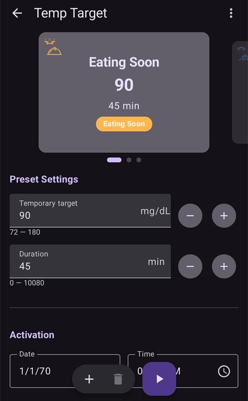
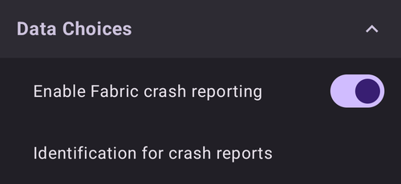

# Paramètres

Dans **AAPS** v4, les préférences se trouvent sur l'écran **Paramètres**. Il y a trois façons d'y accéder. Pour plus de détails, voir [Modifier la configuration d'AAPS](../SettingUpAaps/ChangeAapsConfiguration.md) :

1. Appuyez sur l'icône **Paramètres** (roue dentée) en haut à droite de l'écran principal : tous les paramètres, regroupés en sections dépliables.
2. Dans **Configuration**, appuyez sur « **Paramètres** » sous un plugin actif : seulement les paramètres de ce plugin.
3. Utilisez la **barre de recherche** en haut de l'écran principal : commencez simplement à taper une partie du texte que vous cherchez. Elle trouve les paramètres individuels (même ceux qui ne sont pas visibles sur l'écran Paramètres), les boîtes de dialogue et la documentation.


- Les **sections** s'ouvrent et se ferment quand vous appuyez dessus. Les sections que vous voyez dépendent des plugins activés et du [mode simple](#preferences-simple-mode).


```{contents}
:backlinks: entry
:depth: 2
```

(Preferences-general)=
## Généralités


**Unités**

- Choisissez les unités mmol/l ou mg/dl selon vos préférences.

**Langue**

- By default **AAPS** follows the language of the phone (recommended).

- If you want **AAPS** in another language than the phone, choose it here. On Android 13 and newer, **AAPS** registers it as its own app language in Android, so all its screens, the main screen, the widgets and the way numbers are written follow it.

- Quand vous changez la langue, les textes d'**AAPS** passent tout de suite à la nouvelle langue. Si certains textes restent dans l'ancienne langue, redémarrez **AAPS**.
- On Android 12 this setting is not shown: **AAPS** always uses the language of the phone.
- Paramètre masqué en [mode simple](#preferences-simple-mode).

(preferences-simple-mode)= **Mode simple**

Le **mode simple** est activé par défaut quand vous installez **AAPS** pour la première fois. En **mode simple**, beaucoup de paramètres sont masqués et les préférences sont remplacées par des valeurs prédéfinies. Vous devriez désactiver le mode simple quand vous connaissez bien l'interface et les paramètres d'**AAPS**.

**Support de concentration d'insuline**

- Active la prise en charge de différentes concentrations d'insuline (U50, U200, ...). Activez cette option seulement si vous utilisez vraiment une concentration autre que U100, et lisez bien les avertissements.
- Paramètre masqué en [mode simple](#preferences-simple-mode).

**Garder l'écran allumé**

- Force Android à garder l'écran allumé en permanence. C'est utile par ex. pour des présentations, etc. Mais cela consomme beaucoup de batterie. Par conséquent, il est recommandé dans ce cas de connecter le smartphone à un chargeur.

**Nom de l'instance**

- Le nom de la personne qui utilise ce téléphone. Il permet de distinguer cette instance d'**AAPS** dans les rapports et la synchronisation, par exemple si deux enfants diabétiques de type 1 de votre famille utilisent **AAPS**.
- Utilisé dans le nom des fichiers de paramètres exportés.
- Affiché dans le [cadran Dual](../WearOS/WearOsSmartwatch.md).

(Preferences-skin)=
### Thème

Le choix du thème d'**AAPS** 3.x (Original, Basse résolution, Grand écran...) n'existe plus dans **AAPS** 4. La nouvelle interface s'adapte automatiquement à votre écran, et le thème de couleurs peut être changé dans [Apparence](#preferences-appearance).

(preferences-appearance)=
## Apparence


(Preferences-range-for-visualization)=
### Fourchette de visualisation

Choisissez les limites haute et basse du graphique de glycémie sur l'écran principal d'**AAPS** et sur la montre. Il ne s'agit que de la visualisation, pas de la plage cible de votre glycémie. Exemple : 70 – 180 mg/dl ou 3,9 – 10 mmol/l

(Preferences-show-notes-field-in-treatments-dialogs)=
### Afficher les notes dans les boîtes de dialogue

Vous permet d'ajouter des textes courts de notes à vos traitements (assistant bolus, glucides, insuline...)

Paramètre masqué en [mode simple](#preferences-simple-mode).

### Thèmes de couleurs de l'appli

Choisissez entre le thème clair, le thème sombre, ou le réglage système du téléphone.

(Preferences-protection)=
## Protection


(Preferences-master-password)=
### Mot de passe principal

Obligatoire pour pouvoir [exporter les paramètres](../Maintenance/ExportImportSettings.md), car ils sont chiffrés depuis la version 2.7.

**La protection biométrique peut ne pas fonctionner sur les téléphones OnePlus. Ceci est un problème connu de OnePlus sur certains téléphones.**


(Preferences-settings-protection)=
### Protection des paramètres

- Protégez vos paramètres avec un mot de passe ou avec l'authentification biométrique du téléphone (par ex. si un [enfant utilise **AAPS**](../RemoteFeatures/RemoteMonitoring.md)). Si vous activez cette fonction, une authentification vous sera demandée chaque fois que vous voulez ouvrir un écran lié aux paramètres.

- Les écrans de gestion (**Profil**, **Paramètres Insuline**, **Cible Temp**, **Assistant Rapide**) s'ouvrent alors en **lecture seule**. Vous pouvez toujours activer ou utiliser une entrée, mais l'ajout, la modification, le clonage et la suppression sont masqués tant que vous n'avez pas déverrouillé vos paramètres. Voir [La protection des paramètres verrouille maintenant aussi les écrans de gestion](#v4changes-read-only-management).

- Utilisez un mot de passe personnalisé si vous voulez utiliser le mot de passe principal seulement pour protéger les [paramètres exportés](../Maintenance/ExportImportSettings.md), et un autre mot de passe pour modifier les paramètres.

- Si vous utilisez un mot de passe personnalisé, cliquez sur la ligne "Mot de passe des paramètres" pour définir le mot de passe comme décrit [ci-dessus](#Preferences-master-password).

### Protection de l'Application

Si l'application est protégée, vous devez saisir le mot de passe ou utiliser l'authentification biométrique du téléphone pour ouvrir **AAPS**, et de nouveau quand vous y revenez après le [délai d'attente de la protection](#Preferences-password-and-pin-retention).

**AAPS** se ferme immédiatement si un mauvais mot de passe est saisi, mais il continue de fonctionner en arrière-plan s'il a déjà été ouvert avec succès avant.

### Protection des bolus

- La protection des bolus peut être utile si **AAPS** est utilisé par un jeune enfant et que vous faites des [bolus par SMS](../RemoteFeatures/SMSCommands.md).

- La **Protection des bolus** ne peut être choisie que si la **Protection des paramètres** (niveau 2) est définie.

- Dans l'exemple ci-dessous, la protection des bolus utilise le **Mot de passe principal** : **AAPS** le demande avant d'ouvrir une boîte de dialogue de traitement comme **Insuline**. Avec **Biométrique**, si l'authentification biométrique ne fonctionne pas, vous pouvez saisir le mot de passe principal à la place.


(Preferences-password-and-pin-retention)=
### Conservation du mot de passe et du code PIN

Le **Délai d'attente de la protection** définit combien de temps (en secondes) les paramètres ou les fonctions de bolus restent déverrouillés après la saisie du bon mot de passe.

## Sécurité des traitements


(preferences-patient-type)=
### Âge du patient

- Les limites de sécurité sont établies en fonction de l'âge sélectionné dans ce paramètre.
- Si vous commencez à atteindre ces limites restrictives (comme le Maximum Bolus), il est temps de changer d’un cran.
- It's a bad idea to select higher than real age because it can lead to overdosing by entering the wrong value in the insulin dialog (by skipping the decimal separator, for example).
- Si vous voulez connaître les valeurs exactes de ces limites de sécurité fixes, allez à la fonction de l'algorithme que vous utilisez sur [cette page](../DailyLifeWithAaps/KeyAapsFeatures.md).

(Preferences-maximum-bolus)=
### Bolus maximum

- Définit la quantité maximale d'insuline de bolus, en unités d'insuline, qu'**AAPS** a le droit d'injecter en une fois.
- Ce paramètre existe comme une limite de sécurité pour empêcher l'injection d’un bolus trop important dû à une saisie accidentelle ou une erreur de l’utilisateur.
- Il est recommandé de définir cette valeur à un montant raisonnable qui correspond approximativement à la quantité maximale d’insuline de bolus que vous êtes susceptible d’avoir besoin pour un repas ou pour une dose de correction.
- Cette restriction s’applique également aux résultats de l'assistant bolus.

### Glucides maximum autorisés

- Définit la quantité maximale de glucides, en grammes, pour laquelle l'assistant bolus d'**AAPS** a le droit de calculer une dose.
- Ce paramètre existe comme une limite de sécurité pour empêcher l'injection d’un bolus trop important dû à une saisie accidentelle ou une erreur de l’utilisateur.
- Il est recommandé de définir cette valeur à un montant raisonnable qui correspond approximativement à la quantité maximale de glucides dont vous êtes susceptible d'avoir besoin pour un repas.

## Source des glycémies

Les paramètres de la [source des glycémies](#Config-Builder-bg-source) choisie apparaissent dans leur propre section. Par exemple avec **xDrip+ Glycémie** :


- **Envoyer des Gly vers NS** : **AAPS** envoie vers Nightscout les valeurs de glycémie reçues. Activez cette option seulement si l'application du MGC ne les envoie pas déjà elle-même.
- **Enregistrer le changement de capteur** : crée automatiquement un événement de changement de capteur quand le capteur est inséré.

## L'écran principal

Dans **AAPS** 3.x, ces paramètres étaient regroupés dans une section « Vue d'ensemble ». Dans **AAPS** 4, ils se configurent directement depuis les éléments de l'écran principal auxquels ils appartiennent.

(Preferences-buttons)=
### Boutons de lancement rapide

Choisissez les boutons d'action visibles sur l'écran principal : appuyez sur la petite **roue dentée** en bas au centre de l'écran principal (« Configurer le lancement rapide ») et **ajoutez** les actions auxquelles vous voulez accéder vite (traitements, actions MGC, entrées careportal...).


(Preferences-quick-wizard)=
### Assistant Rapide

Créez des boutons personnalisés pour certains repas ou collations standards. Ils seront affichés sur l'écran principal. Utile pour les repas standards que vous mangez souvent.

Pour chaque bouton, vous définissez les glucides et la méthode de calcul du bolus. Ensuite, vous définissez pendant quelle période le bouton est visible sur l'écran principal : un seul bouton par période. Le bouton n'est pas visible en dehors de la plage horaire définie, ou si vous avez assez d'IA pour couvrir les glucides définis dans le bouton Assistant Rapide. Si vous définissez des horaires différents pour les différents repas, vous aurez toujours le bon bouton de repas standard sur l'écran principal, selon l'heure de la journée.

Pour gérer vos préréglages de l'Assistant Rapide, tapez « QuickWizard » dans la barre de recherche de l'écran principal et ouvrez **Assistant Rapide - Gérer les préréglages de l'assistant rapide**.

Si vous appuyez sur le bouton Assistant Rapide, **AAPS** calcule et propose un bolus pour ces glucides selon vos ratios actuels (en tenant compte de la glycémie ou de l'insuline active si c'est configuré).

La proposition doit être confirmée avant l'injection de l'insuline.

(Preferences-default-temp-targets)=
### Cibles Temporaires par défaut

Les [cibles temporaires (CT)](../DailyLifeWithAaps/TempTargets.md) vous permettent de changer votre cible de glycémie pour une certaine durée. Avec des CT par défaut, vous pouvez facilement changer votre cible pour une activité, un repas imminent, etc.

Appuyez sur la **plage cible** sur l'écran principal pour ouvrir l'écran **Cible Temp**. Faites défiler les cartes des préréglages (Repas imminent, Activité, Hypo) et changez la cible et la durée de chaque préréglage sous **Paramètres Prédéfinis**. Les valeurs prédéfinies sont :

* Repas imminent : cible 90 mg/dl / 5,0 mmol/l, durée 45 min
* Activité : cible 140 mg/dl / 7,8 mmol/l, durée 90 min
* Hypo : cible 160 mg/dl / 8,9 mmol/l, durée 60 min



Voyez comment [activer les cibles temporaires ici](#TempTargets-where-can-i-select-a-temp-target).

### Insuline par défaut pour Amorcer/Remplir

Si vous voulez remplir la tubulure ou amorcer la canule depuis **AAPS**, utilisez les boutons **Amorcer/Remplir** dans le panneau d'état déplié de l'écran principal.

Les quantités par défaut des trois boutons de remplissage peuvent être définies dans les paramètres **Amorcer/Remplir**, selon la longueur de votre cathéter. Tapez « prime » dans la barre de recherche de l'écran principal pour les ouvrir.


(Preferences-status-lights)=
### Voyants d'état

Les voyants d'état donnent une alerte visuelle pour :

- Âge du capteur
- Âge de l'insuline (jours d'utilisation du réservoir)
- Niveau du réservoir (unités)
- Âge de la canule
- Âge de la pile pompe
- Niveau de la pile pompe (%)

Si le seuil d'avertissement est dépassé, les valeurs sont affichées en jaune. Si le seuil critique est dépassé, les valeurs sont affichées en rouge.

Pour changer les seuils, dépliez le panneau d'état sur l'écran principal (chevron à droite de la ligne d'état) et appuyez sur la petite icône **Paramètres** à côté de « État » :


Appuyez sur un élément (**Canule**, **Insuline**, **Capteur** ou **Pile pompe**) pour ouvrir ses seuils d'avertissement et critique :


La dernière option vous permet d'importer ces paramètres depuis Nightscout, s'ils y sont définis. Voir la [documentation Nightscout](https://nightscout.github.io/nightscout/setup_variables/#age-pills) pour plus d'informations.

(Preferences-deliver-this-part-of-bolus-wizard-result)=
### Paramètres de l'assistant bolus

Tapez « bolus » dans la barre de recherche de l'écran principal pour ouvrir les paramètres de l'**Assistant Bolus** :


Le **Pourcentage de Bolus** définit le [pourcentage par défaut](#AapsScreens-section-j) du bolus calculé par l'assistant bolus.

La valeur par défaut est 100 % : pas de correction. Même si vous mettez une autre valeur ici, vous pouvez toujours la changer à chaque fois que vous utilisez l'assistant bolus. Si ce paramètre est à 75 % et que vous deviez faire un bolus de 10 U, l'assistant bolus proposera un bolus repas de seulement 7,5 unités.

Avec les [SMB](#objectives-objective9), beaucoup de personnes ne font pas un bolus repas de 100 % de l'insuline nécessaire, mais seulement d'une partie (par ex. 75 %), et laissent les SMB avec les RNS (repas non signalés) faire le reste. Une valeur inférieure à 100 % ici peut être utile :
* pour les personnes avec une digestion lente : envoyer tout le bolus au début peut causer une hypoglycémie, car l'insuline agit plus vite que la digestion.
* pour laisser plus de place à **AAPS** pour gérer lui-même la **hausse de la glycémie**. Dans les deux cas, **AAPS** compensera la partie manquante du bolus avec des SMB, si et quand il le juge adapté.

**Utiliser l'assistant bolus**

Si cette option est activée et que vous utilisez l'assistant bolus en hyperglycémie, vous recevez un avertissement qui vous demande si vous voulez faire un pré-bolus et manger plus tard, quand votre **glycémie** sera revenue dans la cible.

(Preferences-advanced-settings-overview)=
### Superbolus

L'option Superbolus d'**AAPS** 3.x n'est plus disponible comme paramètre dans **AAPS** 4.

## Boucle

Voir [Écrans d'AAPS > L'écran principal > État de la boucle](#AapsScreens-loop-status) pour changer le mode de la boucle maintenant.

(Preferences-minimal-request-change)=
### Mode boucle ouverte, changement minimum

En **Boucle Ouverte**, vous recevez une notification chaque fois qu'**AAPS** recommande de modifier le débit basal. Pour réduire le nombre de notifications, vous pouvez soit utiliser une [plage cible de glycémie plus large](#profile-glucose-targets), soit augmenter le pourcentage du paramètre « **Mode boucle ouverte, changement minimum** ». Ce paramètre définit le changement relatif minimum qui déclenchera une notification.


## Assistance Améliorée Repas (AAR ou AMA) ou Super Micro Bolus (SMB)

Selon vos paramètres dans [Configuration > APS](../SettingUpAaps/ConfigBuilder.md), vous pouvez choisir entre deux algorithmes :

- [Assistance Améliorée Repas (OpenAPS AMA)](#Open-APS-features-advanced-meal-assist-ama) - état de l'algorithme en 2017
- [Super Micro Bolus (OpenAPS SMB)](#Open-APS-features-super-micro-bolus-smb) - algorithme le plus récent recommandé pour les débutants

As of [**AAPS** version 3.3](#version3300), the [Dynamic ISF](../DailyLifeWithAaps/DynamicISF.md) feature has been moved into OpenAPS SMB.

### OpenAPS AMA

Tous les paramètres d'OpenAPS AMA sont décrits dans la section dédiée de [Fonctions clés d'AAPS > Assistance Améliorée Repas (AMA)](#Open-APS-features-advanced-meal-assist-ama).

(Preferences-openaps-smb-settings)=
### OpenAPS SMB

Tous les paramètres d'OpenAPS SMB sont décrits dans la section dédiée de [Fonctions clés d'AAPS > Super Micro Bolus (SMB)](#Open-APS-features-super-micro-bolus-smb).

La liste des paramètres que vous voyez dépend de votre progression dans les [Objectifs](../SettingUpAaps/CompletingTheObjectives.md) et du [mode simple](#preferences-simple-mode). Sur une nouvelle installation, seul **Activer la sensibilité dynamique** est affiché. Quand les objectifs sont terminés, la section ressemble à ceci :


Les **Paramètres Avancés**, en bas de la section, contiennent des valeurs que vous n'avez normalement pas besoin de changer :


## Paramètres d’absorption


(Preferences-min_5m_carbimpact)=
### SMB min 5m carbs impact (min_5m_carbimpact)

Paramètre masqué en [mode simple](#preferences-simple-mode).

L'algorithme utilise le BGI (impact sur la glycémie) pour déterminer quand [les glucides sont absorbés](../DailyLifeWithAaps/CobCalculation.md).

Quand l'absorption des glucides ne peut pas être calculée de façon dynamique à partir des réactions de votre glycémie, **AAPS** applique une décroissance par défaut à vos glucides. En résumé, c'est une sécurité. Cette valeur est utilisée seulement pendant les trous dans les données du **MGC**, ou quand l'activité physique « consomme » toute la hausse de glycémie qui ferait sinon diminuer les GA dans **AAPS**.

Pour le dire simplement : L'algorithme "sait" comment vos glycémies *devraient* se comporter quand elles sont affectées par la dose actuelle d'insuline, etc. Chaque fois qu'il y a un écart positif par rapport au comportement attendu, une partie des glucides est considérée comme absorbée. Gros changement = beaucoup de glucides, etc.

Le min_5m_carbimpact définit l'impact par défaut de l'absorption des glucides par 5 minutes. Pour la description complète du paramètre, voir la [documentation OpenAPS sur les préférences et les paramètres de sécurité](https://openaps.readthedocs.io/en/latest/docs/While%20You%20Wait%20For%20Gear/preferences-and-safety-settings.html?highlight=carbimpact#min-5m-carbimpact).

La valeur standard pour AMA est de 3, pour SMB c'est 8.

Le graphique GA sur l'écran principal montre quand min_5m_carbimpact est utilisé : des points orange apparaissent en haut de la courbe des GA.


### Coupure d'absorption

Durée après laquelle un repas est considéré comme absorbé ; les glucides restants sont supprimés. Si vous mangez souvent des repas riches en matières grasses ou en protéines, vous devrez augmenter votre temps d'absorption des repas.

### Paramètres avancés - Ratio autosens


- Définit les ratios minimum et maximum pour [Autosens](#Open-APS-features-autosens).
- Normalement, les valeurs standards (max. 1,2 et min. 0,7) ne devraient pas être modifiées.

## Pompe


### BT Watchdog

Activez le chien de garde BT (BT watchdog) si nécessaire (par ex. pour les pompes Dana). Il désactive le Bluetooth pendant une seconde si la connexion à la pompe n'est pas possible. Cela peut aider sur certains téléphones où la pile Bluetooth se bloque.

## Paramètres de la pompe

Les options ici varient selon le pilote de pompe choisi dans [Configuration > Pompe](#Config-Builder-pump). Appairez et configurez votre pompe selon les [instructions de votre pompe](../Getting-Started/CompatiblePumps.md).

Par exemple avec la **Pompe virtuelle**, la section s'appelle **Paramètres pompe virtuelle**. Vous choisissez le **Type de pompe** que la pompe virtuelle imite, et si son état est envoyé vers Nightscout :


## Tidepool

Plus d'informations sur la page dédiée [Tidepool](../SettingUpAaps/Tidepool.md).

(Preferences-nsclient)=
## NSClientV3


Le plugin NSClient (affiché comme **NSClientV3** dans le menu de configuration) synchronise vos données avec Nightscout. Il utilise l'API v3 de Nightscout.

```{admonition} Data uploaders
:class: warning

Avec NSClientV3, tous les outils qui envoient des données (uploaders) doivent utiliser l'API v3 de Nightscout. Si un autre outil d'envoi (par exemple votre application MGC) n'est pas compatible avec l'API v3, **laissez AAPS envoyer toutes les données** (glycémie, traitements, ...) à Nightscout et désactivez cet outil d'envoi.
```

- Saisissez votre *URL Nightscout* (de type <https://yoursitename.yourplatform.dom>).
- **Vérifiez bien que l'URL est SANS /api/v1/ à la fin.**
- Dans Nightscout, créez un *[jeton Admin](https://nightscout.github.io/nightscout/security/#create-a-token)* (il faut [Nightscout 15](https://nightscout.github.io/update/update/) pour utiliser l'API V3) et saisissez-le dans **Jeton d'accès Nightscout** (pas votre API Secret !). Sur **AAPSClient**, vous pouvez à la place scanner le QR code du téléphone principal, ce qui configure un jeton propre au client. Un client appairé avec le code PIN reçoit son propre jeton du téléphone principal après l'appairage. Voir [Le jeton Nightscout propre au client](#client-master-control-own-token).
- Cela permet de lire et d'écrire des données entre le site web Nightscout et **AAPS**.
- Vérifiez deux fois les fautes de frappe ici si vous êtes coincé dans l'objectif 1.
- Laissez « Utiliser les websockets » activé (recommandé).

(Preferences-nsclient-synchronization)=
### Synchronisation


Les choix de synchronisation dépendent de la façon dont vous voulez utiliser **AAPS**.

Vous pouvez choisir les données que vous voulez [envoyer vers Nightscout ou télécharger depuis Nightscout](#Nightscout-aaps-settings).

Quand le contrôle client est activé (toujours en mode simple), ces paramètres sont masqués : **AAPS** est alors en [mode renforcé](#client-master-control-hardened-mode), n'accepte aucune modification faite directement dans Nightscout et envoie toutes ses données.

### Options d'alarme


- Les options d'alarme vous permettent de sélectionner les alarmes Nightscout que vous voulez recevoir dans l'application. **AAPS** déclenche une alarme quand une alarme Nightscout se déclenche.
- Pour que les alarmes sonnent, vous devez définir les seuils des alarmes Urgent High, High, Low et Urgent Low dans vos [variables Nightscout](https://nightscout.github.io/nightscout/setup_variables/#alarms).
- Elles ne fonctionnent que si vous avez une connexion à Nightscout, et elles sont prévues pour les parents/aidants.
- Si la source **MGC** est sur votre téléphone (par ex. xDrip ou BYODA), utilisez plutôt ses alarmes que les alarmes Nightscout.
- Les annonces de NS reprennent les [annonces](https://nightscout.github.io/nightscout/discover/#announcement) de Nightscout dans les notifications d'**AAPS**.
- Vous pouvez modifier les seuils des alarmes de données anciennes et de données anciennes urgentes, quand aucune donnée n'est reçue de Nightscout après un certain temps.

### Contrôle à distance

L'interrupteur « **Autoriser le contrôle par un client** » n'est plus dans ces paramètres : il se trouve en haut de **Gestion → Clients autorisés**, où les clients appairés sont gérés. Voir la page dédiée [Contrôle maître ↔ client](../RemoteFeatures/ClientMasterControl.md), avec le [mode renforcé](#client-master-control-hardened-mode), que cet interrupteur active.

### Paramètres de connexion


- Les paramètres de connexion définissent quand la communication avec Nightscout sera activée.
- Limitez l'envoi vers Nightscout au Wi-Fi seulement, ou même à certains SSID Wi-Fi.
- Si vous voulez utiliser seulement un réseau Wi-Fi précis, vous pouvez saisir son SSID Wi-Fi.
- Plusieurs SSID peuvent être séparés par un point-virgule.
- Pour supprimer tous les SSID, entrez un espace dans la zone.

(Preferences-advanced-settings-nsclient)=
### Advanced settings (NSClientV3)


Les options dans les paramètres avancés sont explicites.

## Communicateur SMS

Plus d'informations sur la page dédiée [Commandes SMS](../RemoteFeatures/SMSCommands.md).

(preferences-wear)=
## Montre

Cette section est affichée quand le plugin **Montre** est activé dans [Configuration > Communication](#Config-Builder-wear). Plus d'informations sur les pages dédiées [Montre connectée Wear OS](../WearOS/WearOsSmartwatch.md) et [Fonctionnement de AAPS via votre montre connectée Wear OS](../RemoteFeatures/RemoteControlWearOS.md).


- **Contrôle Montre** : permet d'envoyer des traitements et d'autres actions depuis la montre. Sans cette option, la montre affiche seulement les données : le téléphone refuse toute commande de la montre, et une complication qui ouvrirait un écran de commande ouvre à la place le menu **AAPS** sur la montre.

Les **Paramètres Assistant sur la Montre** définissent quels calculs sont inclus dans le résultat de l'assistant bolus sur la montre. Sur la montre, vous saisissez seulement les glucides ; ces interrupteurs remplacent les choix que vous feriez dans l'assistant bolus sur le téléphone :

- **Inclure Gly dans l'assistant** : ajoute une correction pour l'écart entre votre glycémie actuelle et votre cible.
- **Inclure Cible Temp dans l'assistant** : utilise la cible temporaire en cours au lieu de la cible du profil pour cette correction.
- **Inclure Tendance dans l'assistant** : tient compte de la tendance actuelle de la glycémie.
- **Inclure GA dans l'assistant** : ajoute de l'insuline pour les glucides encore actifs.
- **Inclure IA dans l'assistant** : soustrait l'insuline encore active.


Les **Paramètres du Cadran Personnalisé** contiennent **Autoriser les cadrans personnalisés à modifier les paramètres AAPS de la montre**. Un fichier de cadran personnalisé peut contenir des valeurs pour certains paramètres de la montre. Quand cet interrupteur est activé, le chargement d'un tel cadran peut changer ces paramètres sur la montre ; quand il est désactivé, le cadran est chargé mais les paramètres restent inchangés :


Les **Paramètres généraux** contiennent **Notifier en cas de SMB**, pour recevoir une notification sur la montre à chaque SMB injecté :


## Autotune

Cette section est affichée quand le plugin **Autotune** est activé dans [Configuration > Général](#Config-Builder-autotune). Les paramètres sont décrits sur la page dédiée [Autotune](../AdvancedOptions/Autotune.md).


## Automatisation


Sélectionnez le service de localisation à utiliser :

- Utiliser la localisation passive : **AAPS** prend la localisation seulement quand d'autres applis la demandent
- Utiliser la localisation par le réseau : Localisation de votre Wifi
- Utiliser la localisation GPS (Attention ! Peut entrainer une consommation excessive de la batterie !)

## Alertes locales


Les paramètres sont faciles à comprendre.

**Override Do Not Disturb mode** (on by default): the **AAPS** alarms ring even when the phone is silent or in Do Not Disturb. Turn it off if **AAPS** should respect those modes: the alarms do not ring then, and in Do Not Disturb they only vibrate, on the phone and on the watch. Loop suggestions that arrive during Do Not Disturb are shown without a sound.

When an alarm rings, the alarm screen offers **Silence alarm** (the screen stays open, so you can read the message) and **Silence and close**. Swiping the alarm notification away in the notification tray mutes the alarm. When you open **AAPS** later, an alarm you did not answer is shown again.

(preferences-maintenance-settings)=
## Paramètres de maintenance


**Destinataire de l'e-mail** : le destinataire standard des journaux est <logs@aaps.app>.

**Nombre de journaux à envoyer** : combien des fichiers journaux les plus récents sont joints quand vous envoyez les journaux.

**Choix de données**



Vous pouvez aider à améliorer **AAPS** en envoyant des rapports de plantage aux développeurs.

**Export des paramètres sans surveillance**<br/> Si vous activez cette fonction, vous autorisez **AAPS** à exporter les paramètres sans action de l'utilisateur. For this the master password is securely stored on your phone (only) at the next manual export. Le mot de passe enregistré est utilisé pendant 4 semaines au maximum. Après 4 semaines, vous recevez une notification qui indique que le mot de passe va bientôt expirer. Pendant un délai de grâce d'1 semaine, vous pouvez alors renouveler le mot de passe en exportant manuellement les paramètres depuis le menu Maintenance.

Après ce délai de grâce d'1 semaine, le mot de passe enregistré expire et tout export automatique des paramètres est annulé, avec une notification qui demande de saisir à nouveau le mot de passe. [(**Exports automatiques des paramètres**)](../DailyLifeWithAaps/Automations.md#automating-preference-settings-export) seront enregistrés dans les listes 'Careportal' et 'Entrées utilisateur' d'**AAPS**, sous Traitements.

Après avoir activé cette option, faites un export manuel des paramètres. Le mot de passe vous sera demandé et **AAPS** pourra l'enregistrer.

### Fichiers journaux

AAPS enregistre des journaux pour le dépannage.

Ne désactivez pas cette fonction : elle aide à comprendre les causes si quelque chose ne va pas.

Si vous devez envoyer les journaux aux développeurs, décrivez précisément le problème dans l'e-mail. Il est préférable d'envoyer les journaux seulement quand on vous le demande, suite à un [rapport de problème sur GitHub](https://github.com/nightscout/AndroidAPS/issues).

Vous trouverez les journaux d'AAPS dans la mémoire de votre téléphone -> Android -> data -> info.nightscout.androidaps -> files.

La gestion des journaux (paramètres des journaux, envoi et suppression des journaux) et la gestion des fichiers se trouvent sur l'écran **Maintenance**, ouvert depuis le **menu** (☰) en haut à gauche de l'écran principal :


(preferences-maintenance-logdirectory)=

### Choisir le répertoire AAPS local

L'écran **Maintenance** contient aussi le **Répertoire AAPS**. Ce paramètre permet de choisir un répertoire sur le téléphone, où **AAPS** enregistre les préférences, les journaux et d'autres fichiers. Quand un répertoire est choisi, son chemin (par exemple `Documents/AAPS`) est affiché sous **Répertoire AAPS**, pour que vous voyiez toujours où vos fichiers sont enregistrés.

Il est fortement recommandé d'utiliser un répertoire placé directement à la racine de la mémoire de votre téléphone. La valeur par défaut est AAPS.


Si vous choisissez un sous-répertoire d'AAPS, vous verrez un message d'erreur. Appuyez sur « OK » et réessayez, en choisissant le bon répertoire (celui du dessus). Ne choisissez pas « FERMER », sauf si vous savez exactement ce que vous faites.


Android peut retirer l'autorisation du répertoire sans prévenir, par exemple après une réinstallation d'**AAPS** ou l'effacement de son stockage. Dans ce cas, **AAPS** affiche une notification permanente **Accès au répertoire AAPS perdu** et l'export local des paramètres ne fonctionne plus, jusqu'à ce que vous reveniez ici pour choisir à nouveau le répertoire. Faites-le rapidement, sinon vos sauvegardes sur le téléphone ne sont plus mises à jour.

(preferences-maintenance-cloud)=

### Choisir un répertoire cloud

Vous pouvez exporter vos paramètres, vos journaux et vos données CSV vers un service cloud.

1. Ouvrez le **menu** (☰), choisissez **Maintenance** et appuyez sur **Répertoire Cloud** (sous **Gestion de fichiers**).

   

2. Dans **Sélectionnez le type de stockage**, choisissez **Google Drive**.

   

3. Une page de connexion Google s'ouvre. Choisissez le compte Google qui contiendra vos sauvegardes (vous pouvez utiliser un [compte Google dédié](../UsefulLinks/DedicatedGoogleAccountForAaps.md)).

   

4. Vérifiez que c'est le bon compte et appuyez sur **Continuer** pour donner accès à **AAPS**. Si vous avez déjà configuré le répertoire cloud avant, la page indique qu'**AAPS** a déjà certains accès.

   

5. De retour dans **AAPS**, le message **Authentification du stockage cloud réussie** apparaît en bas de l'écran principal :

   

   Dans le menu **Maintenance**, **Répertoire Cloud** a maintenant un point vert, et les boutons **Cloud** à côté de **Envoyer les journaux**, **Exporter les paramètres**, **Importer les paramètres** et **Exporter vers Excel (csv)** sont disponibles.

   

Pour arrêter l'export vers le cloud, appuyez sur l'icône **✕** (**Effacer les paramètres**) au bout de la ligne **Répertoire Cloud** dans le menu **Maintenance** (elle est affichée quand un service cloud est configuré) et confirmez **Effacer les paramètres du Cloud**. Cela revient au stockage local et supprime l'autorisation.

## Open Humans

Vous pouvez aider la communauté en faisant don de vos données à des projets de recherche ! Les détails sont décrits sur la [page Open Humans](../SupportingAaps/OpenHumans.md).

Dans **Paramètres → Open Humans**, vous pouvez définir quand les données doivent être envoyées
- uniquement si connecté au Wi-Fi
- uniquement si en charge
