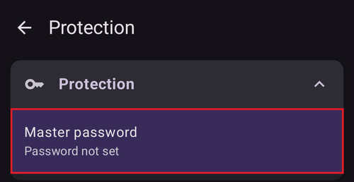
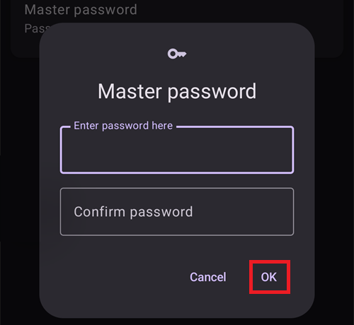
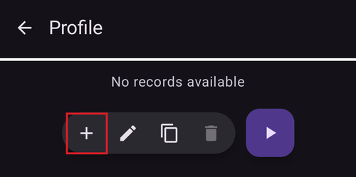
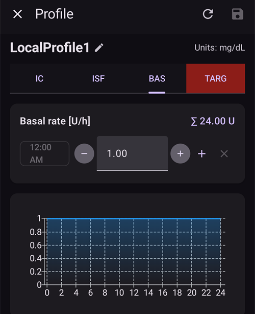
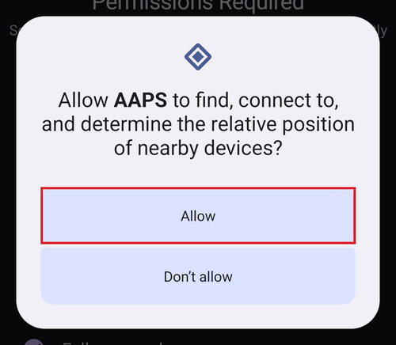

# Assistant de configuration

```{contents} In this page
:backlinks: entry
:depth: 2
```

Au premier démarrage d'**AAPS**, l'« **Assistant de configuration** » vous guide pour faire rapidement, en une seule fois, toute la configuration de base de l'application. L'**Assistant de configuration** vous guide pour que vous n'oubliiez rien d'important. Par exemple, les **autorisations** sont essentielles pour bien configurer **AAPS**.

Cependant, il n'est pas obligatoire de tout configurer dès la première utilisation de l'**Assistant de configuration**. Vous pouvez facilement quitter l'assistant et y revenir plus tard. Après l'**Assistant de configuration**, il existe trois façons d'optimiser ou de modifier la configuration. Ces options seront détaillées dans la prochaine section. Vous pouvez donc tout à fait sauter quelques points de l'Assistant de Configuration, vous pourrez facilement y revenir plus tard.

Pendant et juste après l'utilisation de l'**Assistant de configuration**, vous ne verrez peut-être pas de grand changement dans **AAPS**. Pour activer votre boucle **AAPS**, vous devez suivre les **Objectifs**, qui activent les fonctions une par une. Vous commencerez l'**Objectif 1** à la fin de l'Assistant de configuration. C'est vous qui commandez **AAPS**, et non l'inverse.

```{admonition} Preview Objectives
:class: note
Si vous voulez connaître la structure des objectifs, lisez [Compléter les objectifs](../SettingUpAaps/CompletingTheObjectives.md), mais revenez ensuite ici pour faire d'abord l'Assistant de configuration.

```

L'expérience montre que les nouveaux utilisateurs se mettent souvent la pression pour configurer **AAPS** le plus vite possible. Cela peut être frustrant, car il y a beaucoup de choses à apprendre.

Alors prenez votre temps pour configurer votre boucle : une boucle **AAPS** qui fonctionne bien apporte de très grands bénéfices.

```{admonition} Ask for Help
:class: note
Si vous trouvez une erreur dans la documentation ou si vous avez une meilleure idée pour expliquer quelque chose, vous pouvez demander de l'aide à la communauté, comme expliqué dans [Échanger avec d'autres utilisateurs](../GettingHelp/WhereCanIGetHelp.md).
```
## Message de bienvenue

À l'ouverture, l'Assistant de configuration affiche un court message de bienvenue et montre tout de suite un panneau « **Autorisations requises** » en bas de l'écran (voir la section suivante).

Une fois les autorisations accordées, le panneau se ferme et l'écran de bienvenue affiche un bouton « **Suivant** ». Appuyez sur « **SUIVANT** » pour continuer :


## Autorisations requises

**AAPS** a besoin de quelques autorisations pour bien fonctionner. L'assistant les regroupe dans un seul panneau « **Autorisations requises** », chacune avec son propre bouton « **Autoriser** ». Accordez-les une par une : l'icône à côté de chaque élément devient une coche quand c'est fait.


### Optimisation de la batterie

La consommation de la batterie est un point important sur les smartphones, car les performances des batteries restent assez limitées. C'est pourquoi le système Android de votre smartphone limite le droit des applications à fonctionner et à utiliser le processeur, et donc la batterie.

Cependant, **AAPS** doit fonctionner régulièrement, _p. ex._ pour recevoir les valeurs de glycémie toutes les quelques minutes, puis appliquer l'algorithme pour décider comment agir sur votre glycémie, selon vos réglages. Il faut donc l'exclure de l'optimisation de la batterie.

Appuyez sur « **Autoriser** » à côté de « **Optimisation de la batterie** », puis choisissez « **Autoriser** » dans la fenêtre « Autoriser l'application à toujours s'exécuter en arrière-plan ? » :


(SetupWizard-StoragePermission)=

### Répertoire AAPS

**AAPS** doit enregistrer ses paramètres et ses journaux dans la mémoire permanente de votre smartphone. Ce stockage permanent sur la mémoire interne signifie que les fichiers seront toujours disponibles, même après le redémarrage de votre smartphone. D'autres données sont simplement perdues, car elles ne sont pas enregistrées sur la mémoire interne.

Appuyez sur « **Autoriser** » à côté de « **Répertoire AAPS** ». Le système de fichiers de votre téléphone s'ouvre et vous pouvez choisir où **AAPS** enregistre ses informations.

```{tip}
Il est recommandé de choisir le répertoire AAPS par défaut.</br>
Ne choisissez **pas** un sous-répertoire d'AAPS.
```

Le répertoire par défaut est **AAPS**, mais vous pouvez utiliser n'importe quel répertoire dédié de votre choix. Créez le répertoire si besoin, ouvrez-le et choisissez « **UTILISER CE DOSSIER** » :


Confirmez avec « **AUTORISER** » que vous donnez à **AAPS** l'accès au répertoire choisi :


### Notifications

Android définit une autorisation spéciale pour les applications qui souhaitent vous envoyer des notifications.

Il est utile de désactiver les notifications, _p. ex._ des réseaux sociaux, mais il est essentiel d'autoriser **AAPS** à vous envoyer des notifications.

Appuyez sur « **Autoriser** » à côté de « **Notifications** » et choisissez « **Autoriser** » dans la demande du système :


### Alarmes et rappels

Sur **Android 14 et plus récent**, **AAPS** a besoin de l'autorisation « **Alarmes et rappels** » pour que les alarmes puissent allumer l'écran quand **AAPS** est en arrière-plan, et pour que les rappels (par exemple d'une **Automatisation**) sonnent à l'heure.

Cet élément n'est affiché que s'il est nécessaire. Une fois **AAPS** exclu de l'optimisation de la batterie (voir plus haut), Android accorde automatiquement les alarmes exactes et l'élément disparaît. S'il est toujours affiché, appuyez sur « **Autoriser** » à côté de « **Alarmes et rappels** ». Un écran des paramètres système pour **AAPS** s'ouvre ; activez l'interrupteur et revenez dans **AAPS**. Sur Android 13 et plus ancien, cet élément n'apparaît pas et vous n'avez rien à faire.

Quand toutes les autorisations ont une coche (trois, ou quatre sur Android 14 et plus récent), le panneau « **Autorisations requises** » se ferme tout seul et vous pouvez appuyer sur « **SUIVANT** » sur l'écran de bienvenue pour continuer.

(setup-wizard-bluetooth-battery-optimisation)=
### Optimisation de la batterie pour le Bluetooth

```{admonition} Extra Android setting, not part of the Wizard
:class: note
La suite est une configuration Android supplémentaire, faite en dehors de l'Assistant de configuration. Elle ne fait pas partie des boutons « Autoriser » ci-dessus, mais elle est importante pour une connexion fiable à la pompe.
```

Les versions récentes d'Android appliquent aussi l'optimisation de la batterie à l'application système Bluetooth.

En plus de désactiver l'optimisation de la batterie pour **AAPS**, vous devrez probablement la désactiver aussi pour l'application système Bluetooth. Si vous ne le faites pas, la connexion à la pompe peut se couper et poser des problèmes.

***REMARQUE : la documentation de xDrip explique comment faire ici : [documentation xDrip](https://navid200.github.io/xDrip/docs/BluetoothBatteryOpt.html)***

Suivez ces étapes sur Android 16 ; sur les autres versions, les écrans sont un peu différents des captures d'écran :

1. Ouvrez les paramètres Android, cherchez **Applications** et ouvrez les paramètres des applications.

   

2. Vous voyez les paramètres des applications. Il faut afficher toutes les applications : appuyez sur **Voir toutes les applications**.

   

3. L'application Bluetooth est une application système, elle est donc cachée par défaut. Il faut afficher les applications système. Appuyez sur les **trois points** (⋮) en haut à droite (1). Puis appuyez sur **Afficher les applications système** (2).

   

4. Cherchez l'application `Bluetooth` et appuyez sur `Bluetooth` et/ou `Legacy Bluetooth`. Si les deux sont présentes, suivez la procédure pour les deux.

   ***REMARQUE : vous pouvez ignorer `Bluetooth MIDI Service` sans risque, AAPS ne l'utilise pas.***

           

   1. Sur Android 12, appuyez sur `Battery` (Batterie), sur Android 13 et plus, appuyez sur `App battery usage` (Utilisation de la batterie par l'appli),

   )

5. Sur Android 12 et plus, choisissez l'option `Unrestricted` (Non restreinte). Sur Android 15 et plus, vous devez d'abord ouvrir le réglage `Allow background usage` (Autoriser l'utilisation en arrière-plan) : appuyez sur la zone entourée en rouge, puis suivez l'étape 6 pour terminer.

       

6. Sur Android 16, choisissez `Unrestricted` (Non restreinte)

   

## Contrat de licence

Le contrat de licence utilisateur final contient des informations importantes sur les aspects juridiques de l'utilisation d'**AAPS**. Veuillez le lire attentivement.

Si vous ne comprenez pas le contrat de licence utilisateur final, ou si vous ne pouvez pas l'accepter, n'utilisez pas **AAPS** du tout !

Si vous comprenez et acceptez, appuyez sur le bouton « **JE COMPRENDS ET J'ACCEPTE LES CONDITIONS DU CONTRAT** » et suivez l'Assistant de configuration :


Un bouton « **Suivant** » apparaît une fois que vous avez accepté. Appuyez sur « **SUIVANT** ».

L'écran suivant, « **Autorisations** », affiche à nouveau la liste des autorisations. Elles doivent toutes avoir une coche, car vous les avez accordées au début. S'il en manque une, appuyez sur « **Autoriser** » à côté. Appuyez sur « **SUIVANT** » pour continuer :


## Mot de passe principal

La configuration d'**AAPS** contient des données sensibles (_p. ex._ le jeton d'accès à votre serveur Nightscout). Elle est donc chiffrée avec un mot de passe que vous définissez ici.

L'assistant affiche « **Mot de passe non défini** ». Appuyez sur « **Appliquer** » :


L'écran « **Protection** » s'ouvre. Appuyez sur « **Mot de passe principal** » (affiché comme « Mot de passe non défini ») :



Saisissez le même mot de passe dans les deux champs et appuyez sur « **OK** » :



Revenez en arrière avec la flèche en haut à gauche. L'assistant affiche maintenant « **Mot de passe défini !** » :


```{admonition} Do not lose your Master Password
:class: danger
**NE PERDEZ PAS VOTRE MOT DE PASSE PRINCIPAL**. Notez-le, _p. ex._ sur Google Drive : c'est un bon endroit, car Google en fait une sauvegarde pour vous. Votre smartphone ou PC peuvent vous lâcher et vous pourriez ne pas avoir de sauvegarde locale. Si vous oubliez votre mot de passe principal, il peut être difficile de récupérer la configuration de votre profil et de progresser dans les **Objectifs** par la suite.
```

Quand vous avez terminé, appuyez sur « **SUIVANT** » pour passer à l'écran suivant.

(setup-wizard-import-settings)=
## Importer les paramètres

Cet écran n'est affiché que si **AAPS** trouve des paramètres exportés auparavant dans le répertoire **AAPS** (« Paramètres sauvegardés trouvés »), par exemple quand vous réinstallez l'application ou passez à un nouveau téléphone.

- Pour restaurer votre configuration précédente, appuyez sur « **Importer les paramètres** » : voir [Exporter et importer les paramètres](../Maintenance/ExportImportSettings.md).
- Pour commencer avec une nouvelle configuration, appuyez sur « **SUIVANT** » et continuez avec l'assistant.


## Unités (mg/dl <-> mmol/l)

Choisissez si vos valeurs de glycémie sont en mg/dl ou en mmol/l, puis appuyez sur le bouton « **SUIVANT** » :


## Paramètres d'affichage

Ici, vous définissez la « **Ligne BASSE** » et la « **Ligne HAUTE** » pour l'affichage de la glycémie du capteur. Les valeurs de glycémie entre ces deux lignes sont affichées comme « dans la cible ». Vous pouvez garder pour l'instant les valeurs par défaut (72 et 180 mg/dl) et les modifier plus tard.

Les valeurs que vous choisissez n'affectent que l'affichage du graphique, et rien d'autre.

Votre cible de glycémie, _p. ex._, se configure séparément dans votre profil.

Votre plage cible pour l'analyse du TIR (temps dans la plage cible) est configurée séparément dans votre serveur de rapports.

Si besoin, ajustez les lignes avec les boutons « − » / « + », puis appuyez sur le bouton « **SUIVANT** » :


(SetupWizard-synchronization-with-the-reporting-server-and-more)=
## Communication

L'écran « **Communication** » affiche les plugins qui servent à envoyer, synchroniser et diffuser vos données :

- **Communicateur SMS** : contrôle à distance d'**AAPS** avec des commandes SMS
- **NSClientV3** : synchronise vos données avec Nightscout par l'API v3
- **Tidepool** : envoie les données vers Tidepool
- **xDrip** : envoie les données vers xDrip
- **Open Humans** : envoyer vos données de diabète et en faire don à des projets scientifiques
- **Montre** : surveiller et contrôler **AAPS** depuis une montre WearOS
- **Applications compagnon externes** : diffusion des données vers diverses applications externes
- **Garmin** : connexion à un appareil Garmin


Faites défiler vers le bas pour voir le reste de la liste :


Vous pourriez en configurer plusieurs maintenant, mais pour la première utilisation, nous nous concentrons sur le serveur de rapports. Si vous ne pouvez pas le configurer pour le moment, passez cette étape : vous pourrez le configurer plus tard.

Dans cet exemple, nous utilisons Nightscout comme serveur de rapports. Cochez la case à droite de « **NSClientV3** » pour l'activer. Pour Tidepool, c'est encore plus simple, car vous n'avez besoin que de vos informations de connexion personnelles.

Une fois activé, appuyez sur « **Paramètres** » sous NSClientV3 pour le configurer :


Ici, vous configurez le serveur de rapports Nightscout. Les paramètres de NSClientV3 sont affichés sur une seule page que vous pouvez faire défiler :


Appuyez sur « **URL Nightscout** » et saisissez l'adresse de votre serveur Nightscout personnel (l'URL que vous avez créée vous-même, ou que votre fournisseur de service vous a donnée). Confirmez avec « **OK** ».

Appuyez sur « **Jeton d'accès Nightscout** » et saisissez le jeton d'accès de votre serveur Nightscout. Sans ce jeton, l'accès ne fonctionnera pas. Si vous ne l'avez pas encore, consultez la documentation sur la mise en place du serveur de rapports.

Laissez « **Utiliser les websockets** » activé pour une communication en temps réel avec Nightscout.

Les autres sections peuvent garder leurs valeurs par défaut pour l'instant. Elles sont décrites ici pour que vous sachiez où les trouver plus tard :

**Options d'alarme** : alarmes Nightscout, annonces et seuils de données périmées. Laissez les interrupteurs désactivés pour l'instant ; nous les ouvrons seulement pour que vous connaissiez ces options.

**Paramètres de connexion** : choisissez comment les données sont transférées. Les aidants doivent activer « **Utiliser les données mobiles** ». Sinon, le téléphone de la personne dont ils s'occupent (_p. ex._ un enfant) ne peut pas envoyer de données hors de portée du Wi-Fi, _p. ex._ sur le chemin de l'école. Les autres utilisateurs peuvent désactiver le transfert par réseau mobile pour économiser des données ou de la batterie. En cas de doute, laissez tout activé.


**Paramètres Avancés** : activez « **Enregistrer les démarrages AAPS dans NS** » si vous voulez voir dans Nightscout quand l'application redémarre (utile pour les aidants). Laissez activés « **Créer des annonces à partir d'erreurs** » et « **Créer des annonces à partir des glucides requis** ». Laissez « **Utiliser la synchro lente** » désactivé ; vous ne l'utiliserez que si le serveur Nightscout est lent à traiter une grande quantité de données.


Revenez à la liste des plugins et appuyez sur « **SUIVANT** » pour passer à l'écran suivant.

## Contrôle par le client

Depuis la version 4 d'**AAPS**, les appareils clients qui utilisent **AAPSClient** peuvent être **associés** à ce téléphone (le **maître**) et le contrôler avec des commandes signées envoyées par Nightscout. C'est le nouveau moyen recommandé pour contrôler **AAPS** à distance : voir [Contrôle maître ↔ client](../RemoteFeatures/ClientMasterControl.md) pour l'explication complète et la configuration.

Vous n'avez rien à configurer sur cet écran maintenant ; vous pourrez associer des clients à tout moment plus tard depuis **Gestion → Clients autorisés**. Là, vous ajoutez un client avec un **QR code** (il configure aussi Nightscout sur le client) ou avec un **PIN**, et vous lui donnez un **rôle**.

- « **Clients autorisés** » : gérer les appareils clients associés qui ont le droit de contrôler ce maître.
- « **Acceptation des données Nightscout** » : l'acceptation des traitements et des données saisis directement dans Nightscout (l'ancienne méthode, moins sécurisée) est maintenant désactivée par défaut. N'ouvrez ces paramètres que si vous en avez encore besoin, _p. ex._ pour saisir des données via Nightscout ou des applications tierces.

Quand le contrôle par le client est déjà activé (toujours le cas en [mode simple](#preferences-simple-mode)), ce téléphone est en [mode renforcé](#client-master-control-hardened-mode) : il n'accepte des modifications que des clients associés. L'écran explique donc le mode renforcé au lieu de proposer les paramètres « **Acceptation des données Nightscout** ».


« **Acceptation des données Nightscout** » ouvre les paramètres « **Synchronisation** », où chaque type de données reçues de Nightscout a son propre interrupteur :


Appuyez sur « **SUIVANT** » pour passer à l'écran suivant.

(setup-wizard-instance-name)=
## Qui utilise ce téléphone ?

Ici, vous saisissez le nom de la personne qui utilise ce téléphone. Il permet de distinguer cette instance d'**AAPS** des autres dans les rapports et lors de la synchronisation, par exemple si deux enfants de votre famille utilisent **AAPS**. Il est aussi utilisé dans le nom des fichiers de paramètres exportés et affiché sur la montre.

Vous pouvez mettre ce que vous voulez. Vous pouvez le modifier plus tard dans **Paramètres → Général → Nom de l'instance**.

Appuyez sur « **SUIVANT** » pour passer à l'écran suivant.


## Type de patient

Ici, vous choisissez votre « Type de patient ». C'est important, car le logiciel **AAPS** a des limites différentes selon l'âge du patient. C'est important pour des raisons de sécurité et de sûreté.

C'est aussi ici que vous configurez le **bolus maximum autorisé** pour un repas. C'est-à-dire, le plus gros bolus dont vous avez besoin pour couvrir un repas standard. C'est une fonction de sécurité qui aide à éviter un surdosage accidentel quand vous faites un bolus pour un repas.

Dans la même idée, la deuxième limite concerne cette fois l'apport maximum en glucides permis.

Après avoir réglé ces valeurs, appuyez sur « **SUIVANT** » pour passer à l'écran suivant :


## Insuline

Ici, vous configurez l'insuline utilisée dans votre pompe. Les nouveaux profils d'insuline demandent une **DAI d'au moins 5 h**.

Appuyez sur le bouton « **Insuline** » pour ouvrir l'éditeur d'insuline :


Dans l'éditeur, vous pouvez donner un **nom** à l'insuline et régler son **Pic** (en minutes) et sa **DAI** (en heures). Le plus rapide est de charger un préréglage avec « **Charger le pic depuis** » : choisissez **Novorapid**, **Fiasp** ou **Lyumjev**, et le pic est rempli pour vous. Le graphique en bas montre un aperçu de la courbe d'activité de l'insuline obtenue.


Choisissez le préréglage qui correspond à votre insuline, par exemple **Fiasp** :


```{admonition} Use your insulin brand's preset peak
:class: danger
Ne modifiez pas le pic sauf si vous êtes expert : en général, les valeurs préréglées conviennent bien à chaque marque d'insuline.
```

Si vous êtes un nouvel utilisateur d'**AAPS**, réglez la **DAI** sur 9 heures. Voir [Durée d'action de l'insuline (DAI) et pic](#Config-Builder-insulin-dia) pour comprendre pourquoi.

```{admonition} "Insulin configuration changed" dialog
:class: note
Si un client associé (_p. ex._ un autre téléphone) a modifié la configuration de l'insuline, une fenêtre apparaît. Appuyez sur **OK** pour charger ses modifications, ou sur **Annuler** pour continuer à modifier (votre prochain enregistrement écrasera les siennes).
```


Appuyez sur l'icône d'enregistrement (en haut à droite), puis appuyez sur « **SUIVANT** » pour passer à l'écran suivant.

## Source des glycémies

Ici, vous choisissez d'où **AAPS** reçoit ses données de glycémie. Lisez la documentation de votre [source de glycémie](../Getting-Started/CompatiblesCgms.md).

De nombreuses sources sont disponibles : faites défiler la liste et choisissez celle que vous utilisez :


Quand vous choisissez une source, sa carte s'agrandit et affiche deux boutons : « **Paramètres** » pour régler la réception des données, et « **Ouvrir le plugin** » pour ouvrir l'écran de la source. Dans l'exemple ci-dessous, **BYODA** est choisi. Certaines sources n'ont rien à configurer à cette étape. Vous pouvez donc en général passer directement à l'écran suivant :


Après votre choix, appuyez sur « **SUIVANT** » pour passer à l'écran suivant.

(setup-wizard-profile)=
## Profil

Nous arrivons maintenant à une partie très importante de l'Assistant de configuration.

Lisez la documentation sur les [profils](../SettingUpAaps/YourAapsProfile.md) avant d'essayer de saisir les données de votre profil sur l'écran suivant.

```{admonition} Working profile required - no exceptions here !
:class: danger
Un profil exact est nécessaire pour que **AAPS** agisse de façon sûre.

Votre profil doit avoir été déterminé et discuté avec votre médecin, et son bon fonctionnement doit avoir été prouvé par des tests réussis du débit basal, de la SI et du G/I !

Si on donne à un robot des paramètres incorrects, il échouera - systématiquement. **AAPS** ne fonctionne qu'avec les informations qui lui sont fournies. Si votre profil est trop fort, vous risquez l'hypoglycémie, et s'il est trop faible, vous risquez l'hyperglycémie. 
```

Appuyez sur le bouton « **Profil** » pour ouvrir l'éditeur de profil :


L'éditeur s'ouvre vide (« Aucun enregistrement disponible »). Appuyez sur le bouton « **+** » en bas pour créer un nouveau profil :



Par la suite, vous pourrez avoir plusieurs profils si nécessaire. Nous n'en créons qu'un ici.

```{admonition} Profile only for tutorial - not for your usage
:class: note
Le profil d'exemple ci-dessous sert seulement à montrer comment saisir les données.

Ce n'est pas un profil exact ni bien optimisé, car les besoins de chaque personne sont très différents.

Ne l'utilisez pas pour une vraie boucle !
```

Le nouveau profil (par exemple « **LocalProfile1** ») a quatre onglets : **G/I**, **SI**, **BAS** et **CIBLE**. Appuyez sur le crayon à côté du nom du profil pour le renommer. Remplissez chaque onglet : un onglet reste rouge et affiche un message d'erreur tant qu'il ne contient pas de valeurs valides :


Appuyez sur « **G/I** » et saisissez vos valeurs de [G/I](#your-aaps-profile-insulin-to-carbs-ratio). Utilisez le bouton « **+** » pour ajouter d'autres plages horaires :


Appuyez sur « **SI** » et saisissez vos [valeurs de SI](#your-aaps-profile-insulin-sensitivity-factor) :


Appuyez sur « **BAS** » et saisissez vos [valeurs de basal](#your-aaps-profile-basal-rates) :



Appuyez sur « **CIBLE** » et saisissez vos valeurs cibles de glycémie.

En boucle ouverte, cette cible peut être une plage plus large. Sinon, **AAPS** vous demande sans arrêt de changer le débit basal temporaire ou un autre réglage, ce qui peut être épuisant.

Plus tard, pour la boucle fermée, vous n'aurez généralement qu'une valeur unique en maximum et minimum. Cela aide **AAPS** à atteindre la cible et vous donne un meilleur contrôle global du diabète.


Quand les quatre onglets sont valides, l'**icône d'enregistrement** (en haut à droite) devient active. Appuyez dessus pour enregistrer le profil :


Fermez l'éditeur avec le « **X** » en haut à gauche. Le résumé du profil affiche alors son nom, son total de basal journalier (∑), les unités, ainsi que les valeurs de G/I et de SI avec leurs graphiques :


```{admonition} Several defined but only one active profile
:class: note
Vous pouvez définir plusieurs profils, mais un seul profil est actif à un moment donné.
```

Appuyez sur le bouton « **▶** » (activer) en bas à droite. L'écran « **Activer** » s'ouvre. Comme aucune insuline n'est encore utilisée, il vous demande d'abord de choisir l'insuline que vous utilisez, pour que le changement de profil puisse l'enregistrer. Le bouton « **Activer** » reste grisé tant que vous ne l'avez pas fait :


Appuyez sur « **Sélectionner l'insuline** » et choisissez l'insuline que vous avez configurée plus tôt. Laissez le pourcentage à 100 % et appuyez sur « **Activer** » :


Une fenêtre de changement de profil apparaît. Ici, laissez les valeurs proposées et confirmez avec « **OK** » :

```{admonition} Profile switch dialog
:class: note
Vous apprendrez plus tard à utiliser cette fenêtre générale pour gérer des situations comme la maladie ou le sport, où vous devez adapter votre profil aux circonstances.
```


Votre profil est maintenant actif. Appuyez sur « **SUIVANT** » pour passer à l'écran suivant.

## Pompe à insuline

Maintenant, vous choisissez votre pompe à insuline. Lisez la documentation de votre [pompe à insuline](../Getting-Started/CompatiblePumps.md).

Faites défiler la liste et choisissez votre pompe. Dans cet exemple, nous utilisons la « **Pompe virtuelle** ». Elle est utile tant que vous apprenez et que vous n'avez pas encore connecté de vraie pompe :


De nombreuses pompes sont prises en charge : faites défiler vers le bas pour trouver la vôtre :


Quand vous choisissez une vraie pompe, **AAPS** demande une confirmation, car il va copier les débits de basal de votre profil dans la pompe et écraser les débits de basal enregistrés dans la pompe. Appuyez sur « **OK** » seulement si les débits de basal de votre profil **AAPS** sont corrects ; sinon, appuyez sur « **Annuler** » et changez de pompe plus tard :


Si la pompe choisie communique par Bluetooth, **AAPS** demande l'autorisation de se connecter aux appareils à proximité une fois l'assistant terminé (voir [Autorisation Bluetooth](#bluetooth-permission)).

Si vous avez déjà configuré votre profil et savez comment connecter votre pompe, vous pouvez la connecter maintenant. Sinon, laissez la **Pompe virtuelle** pour le moment. Vous pouvez la changer à tout moment, ou quitter l'Assistant de configuration avec la flèche en haut à gauche et laisser d'abord **AAPS** vous montrer quelques valeurs de glycémie.

Appuyez sur « **SUIVANT** » pour passer à l'écran suivant.

## Algorithme APS

Choisissez l'algorithme SMB OpenAPS comme algorithme APS. Malgré son nom, la fonction SMB de l'algorithme est désactivée tant que vous ne connaissez pas bien AAPS et que vous n'avez pas fait les premiers objectifs. De toute façon, OpenAPS SMB est plus récent et en général meilleur qu'OpenAPS AMA.

SMB est désactivé au début, car la fonction SMB réagit plus vite à une hausse de la glycémie : elle utilise un Super Micro Bolus au lieu d'augmenter le pourcentage du débit basal. Au début, votre profil n'est en général pas aussi bon qu'après un peu d'expérience. C'est pourquoi la fonction est d'abord désactivée.

```{admonition} Only use the older algorithm **OpenAPS AMA** if you know what you are doing
:class: note
OpenAPS AMA est l'algorithme le plus simple. Il ne prend pas en charge les micro-bolus pour corriger les valeurs hautes. Il y a peut-être des cas où il est préférable d'utiliser cet algorithme mais ce n'est pas la recommandation.
```

Choisissez « **OpenAPS SMB** », puis appuyez sur « **Paramètres** » pour voir les détails :


La seule option ici est « **Activer la sensibilité dynamique** ». Laissez-la désactivée et ne changez rien pour l'instant : lisez seulement le texte.

À cause des limites imposées par les **Objectifs**, vous ne pouvez de toute façon pas utiliser pour l'instant la « boucle fermée » ni les « fonctions SMB ».

Revenez en arrière et appuyez sur « **SUIVANT** » pour passer à l'écran suivant :


## Calcul de Sensibilité

Laissez « **Sensibilité Oref1** » sélectionné comme plugin de sensibilité standard :


Si vous appuyez sur « **Paramètres** », vous pouvez vérifier les paramètres d'absorption ; les valeurs par défaut (_p. ex._ une limite d'absorption de 6 h) conviennent pour l'instant.


Appuyez sur « **SUIVANT** » pour passer à l'écran suivant.

## Commencer l'objectif 1

Vous entrez maintenant dans les Objectifs : ils vous qualifient pour accéder aux autres fonctions d'**AAPS**.

Appuyez sur « **Ouvrir les objectifs** » :


Ici, nous commençons l'objectif 1, même si pour le moment notre configuration n'est pas complètement terminée et ne permet pas de valider cet objectif. Nous n'en sommes qu'au début.

Appuyez sur le bouton « **Départ** » à côté de « **1. Objectif** » :


L'objectif s'ouvre et affiche ses différentes vérifications. Vous voyez que vous avez déjà un peu progressé, et que d'autres éléments restent à faire :


Revenez en arrière, puis appuyez sur « **TERMINER** » pour terminer l'Assistant de configuration :


Après avoir appuyé sur « **TERMINER** », vous arrivez sur l'écran principal d'**AAPS**. Un panneau « **Notification** » peut s'ouvrir avec des messages d'information, par exemple sur le changement de profil que vous venez de faire. Appuyez sur « **Fermer** » sous chaque message pour l'effacer.

Si vous quittez l'Assistant de configuration par erreur, vous pouvez simplement le relancer, ou modifier la [configuration de la boucle AAPS](../SettingUpAaps/ChangeAapsConfiguration.md) à la main.

## Autorisation Bluetooth

Si vous choisissez une pompe qui se connecte par Bluetooth (par exemple **Omnipod Dash**), une bannière vous rappelle qu'**AAPS** a besoin de l'autorisation Bluetooth. Vous pouvez appuyer sur « **Fermer** » pour l'instant : l'autorisation est accordée après la fin de l'assistant :


Une fois l'Assistant de configuration terminé, l'écran principal d'**AAPS** affiche un panneau « **Autorisations requises** ». Les autres autorisations sont déjà accordées ; appuyez sur « **Autoriser** » à côté de « **Bluetooth** » :


Choisissez « **Autoriser** » pour qu'**AAPS** puisse trouver votre pompe et s'y connecter :



Si votre boucle **AAPS** est maintenant entièrement configurée, passez à la section suivante [« Compléter les objectifs »](../SettingUpAaps/CompletingTheObjectives.md).
