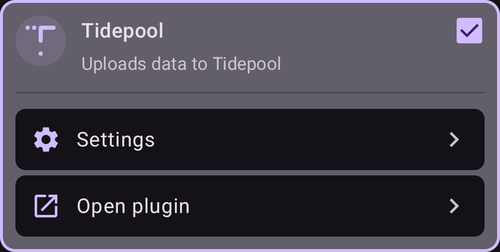

# Tidepool

Tidepool est un outil tiers qui collecte les données de glycémie, d'insuline et de glucides (et les notes que vous ajoutez à vos traitements). Il permet d'analyser ces données et de les partager avec votre équipe médicale. Depuis la version 3.2 d'AAPS, Tidepool peut remplacer Nightscout pour une partie de l'Objectif 1. Il peut aussi être utilisé avec Nightscout, comme autre plateforme de rapports, qui s'intègre bien dans le cadre du suivi médical. C'est peut-être la meilleure option pour les enfants qui utilisent AAPS : ils gardent la surveillance et le contrôle à distance de Nightscout, avec une plateforme de rapports avec laquelle leur équipe médicale est plus à l'aise.

Il est important de comprendre que Tidepool sert uniquement aux rapports. Ce n'est PAS une application de suivi en temps réel. Si vous avez besoin de suiveurs en plus du téléphone AAPS principal, vous devez aussi mettre en place Nightscout.

Remarque : l'organisation Tidepool a mis sur le marché le produit iOS Loop, avec l'approbation de la FDA. Ce travail n'a rien à voir avec leur plateforme de rapports ni avec AAPS.

## Étape 1 - Créer un compte Tidepool

- Allez sur [tidepool.org](https://www.tidepool.org/)

- Choisissez « Personal Sign Up » ou « Sign Up » (inscription)

- Créez une adresse e-mail et un mot de passe, et notez-les

- Choisissez « Personal Account » (compte personnel) et cliquez sur « Continue »

- Remplissez la section des informations du patient et acceptez les conditions d'utilisation

- Vérifiez votre adresse e-mail en suivant les instructions reçues par e-mail

## Étape 2 - Connecter AAPS à Tidepool

- Ouvrez le **menu** (☰) en haut à gauche de l'écran principal et choisissez « **Configuration** »

- Ouvrez la catégorie « **Communication** » et activez « **Tidepool** » :

- Appuyez sur « **Ouvrir le plugin** » sous Tidepool, puis appuyez sur l'icône **Connexion** (une flèche qui entre dans une porte) en haut à droite

- Une fenêtre du navigateur s'ouvre sur la page de connexion de Tidepool. Connectez-vous avec l'adresse e-mail et le mot de passe créés à l'étape 1 ci-dessus :

- Après une connexion réussie, le navigateur se ferme et l'écran Tidepool affiche l'état « **Connectée** » ; le journal en dessous montre les envois de données. Si la connexion échoue, vérifiez que vos identifiants sont corrects et que vous avez bien vérifié votre adresse e-mail auprès de Tidepool.

- Dans les « **Paramètres** » du plugin Tidepool, ouvrez « **Paramètres de connexion** ». Par défaut, « **Utiliser les paramètres de connexion de Nightscout** » est activé. Tidepool envoie donc les données dans les mêmes conditions que celles définies pour Nightscout. Désactivez cette option si vous voulez des conditions différentes pour Tidepool, par exemple pour envoyer vers Tidepool uniquement en Wi-Fi et pendant la charge, alors que Nightscout utilise aussi les données mobiles.

 

Pour savoir comment utiliser vos données une fois qu'elles sont envoyées sur Tidepool, consultez : [https://www.tidepool.org/viewing-your-data](https://www.tidepool.org/viewing-your-data)

(tidepool-menu)=
## Les boutons de Tidepool

En haut à droite de l'écran Tidepool :

- L'icône **Connexion** ou **Déconnexion** : se connecter à votre compte Tidepool ou s'en déconnecter. Une seule des deux est affichée : **Connexion** quand vous êtes déconnecté, **Déconnexion** quand vous êtes connecté. **AAPS** vous demande de confirmer avant de vous déconnecter.
- L'icône d'engrenage : les paramètres de Tidepool.

Les boutons en bas de l'écran Tidepool :

- « **Envoyer maintenant** » : envoie tout de suite les nouvelles données, sans attendre le prochain envoi automatique.
- « **Synchronisation complète** » : envoie à nouveau toutes les données stockées dans **AAPS**.
- « **Purger toutes les données** » : supprime **toutes** les données qu'**AAPS** a envoyées sur votre compte Tidepool. Cette action est irréversible. Utilisez-la uniquement pour supprimer des données fausses ou en double, puis lancez « **Synchronisation complète** » pour envoyer à nouveau vos données.
- « **Effacer le journal** » : vide le journal affiché sur l'écran Tidepool.

Dans Tidepool, les données envoyées par **AAPS** 4 apparaissent sous le nom d'appareil **AAPS**. Consultez [Ce qui a changé dans AAPS v4](#v4changes-tidepool) si vous utilisiez Tidepool avec une version plus ancienne. 
