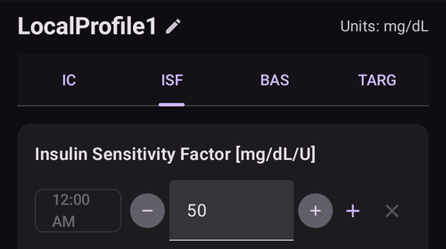

# Votre profil AAPS

Votre **Profil AAPS** est un ensemble de quatre paramètres clés. Ils définissent comment **AAPS** doit délivrer l'insuline en fonction de la glycémie de votre capteur. Ce sont les paramètres principaux sur lesquels **AAPS** est construit. En avançant dans les **Objectifs**, vous débloquerez d'autres paramètres modifiables (comme les réglages SMB). Mais ces fonctions ne marchent bien que si votre **Profil** de base est correct. Le **Profil** comprend :
* [cibles de glycémie](#profile-glucose-targets),
* [débits de basal](#your-aaps-profile-basal-rates) (BR),
* [facteurs de sensibilité à l'insuline](#your-aaps-profile-insulin-sensitivity-factor) (SI) et
* [ratios glucides/insuline](#your-aaps-profile-insulin-to-carbs-ratio) (G/I).

```{admonition} Where did DIA go?
:class: note
La **durée d'action de l'insuline (DAI)** ne fait plus partie de votre **Profil**. Elle est réglée pour chaque insuline à la place : voir [Gestion → Paramètres Insuline](#Config-Builder-insulin-dia).
```

Dans le cadre de la gestion d'**AAPS**, vérifiez en continu et avec attention l'exactitude des réglages de votre **Profil**. Il est conseillé de régler les paramètres dans l'ordre où ils sont présentés ici. Essayez de valider un seul paramètre avant d'en changer un autre. Travaillez avec de petites étapes plutôt que de faire de grands changements à la fois. N'oubliez pas d'activer le nouveau profil après chaque modification. [Sauvegardez régulièrement les réglages de votre **Profil**](#YourAapsProfile_Profile-backup) en exportant vos paramètres.

Les paramètres de votre **Profil** agissent les uns sur les autres. Vous pouvez avoir des réglages « faux » qui fonctionnent bien ensemble dans certaines situations, mais pas dans d'autres. Par exemple, si un débit de basal trop élevé tombe en même temps qu'un **G/I** trop élevé. Vous devez donc examiner chaque paramètre séparément et vérifier qu'ils fonctionnent bien ensemble dans des situations variées.

Vous pouvez utiliser [Autotune](https://autotuneweb.azurewebsites.net/) pour guider votre réflexion, mais il ne doit pas être suivi aveuglément : il peut ne pas bien fonctionner pour vous ou dans toutes les situations.

```{admonition} Your diabetes may vary
:class: note
Les **Profils** varient beaucoup d'une personne à l'autre.

Pour les débits de basal, les facteurs de sensibilité à l'insuline (SI) et les ratios glucides/insuline (G/I), les valeurs absolues et l'évolution des besoins en insuline varient beaucoup d'une personne à l'autre. Ils dépendent de votre biologie, de votre sexe, de votre âge, de votre condition physique, etc., ainsi que de facteurs à court terme comme une maladie ou un sport récent. Pour plus de conseils à ce sujet, le livre [“Bright Spots and Landmines”](https://diatribe.org/bright-spots-and-landmines/) d'Adam Brown est un excellent livre à lire.

```

Les quatre derniers paramètres (cibles de glycémie, débits de basal, facteurs de sensibilité à l'insuline et ratios glucides/insuline) peuvent avoir des valeurs différentes sur 24 heures, et changer chaque heure si besoin.


Des captures d'écran d'un profil _d'exemple_ dans **AAPS** sont montrées ci-dessous. Remarque : l'exemple de profil ci-dessous montre un grand nombre de plages horaires. Quand vous débutez avec **AAPS**, votre profil sera sans doute beaucoup plus simple.


(profile-glucose-targets)=
## Cibles de glycémie

### Description

Votre **cible de glycémie** est une valeur centrale : tous les calculs d'**AAPS** se basent sur elle. Elle est différente de la plage cible dans laquelle vous essayez en général de garder votre glycémie. La cible est utilisée dans les calculs d'**AAPS** : si **AAPS** prévoit que votre **glycémie** sortira de la plage cible, il agit pour vous y ramener.

Les cibles peuvent être définies dans ces limites :

|         | Cible _basse_          | Cible _haute_            |
| ------- | ---------------------- | ------------------------ |
| Minimum | 4,4 mmol/l ou 80 mg/dl | 5 mmol/l ou 90 mg/dl     |
| Maximum | 10 mmol/l ou 180 mg/dl | 11,1 mmol/l ou 200 mg/dl |

### Impact

Si la cible de votre **Profil** est très large (par exemple 3 mmol/l ou plus [50 mg/dl ou plus]), vous verrez souvent peu d'actions d'**AAPS**. En effet, la **glycémie** prévue se trouve souvent quelque part dans cette large plage, et **AAPS** lancera donc rarement un débit de basal temporaire.

### Comment le régler

La **figure ci-dessous** montre un exemple de réglage de la cible dans un profil **AAPS**.


Les cibles de **glycémie** sont réglées selon vos préférences et vos besoins personnels. Par exemple, si vous craignez les hypoglycémies la nuit, vous pouvez mettre une cible un peu plus haute, à 117 mg/dl (6,5 mmol/l), de 21 h à 7 h. Si vous voulez être sûr d'avoir assez d'insuline active (IA) le matin avant le bolus du petit-déjeuner, vous pouvez régler une cible plus basse de 81 mg/dl (4,5 mmol/l) de 7 h à 8 h.

En [Boucle Ouverte](#KeyAapsFeatures-OpenLoop), surtout pendant [les premiers objectifs](../SettingUpAaps/CompletingTheObjectives.md), une cible avec une large plage peut être un bon choix pendant que vous apprenez comment **AAPS** se comporte et que vous ajustez votre **Profil**.<br/> En [Boucle Fermée](#KeyAapsFeatures-ClosedLoop) (à partir de l'**[Objectif 6](#objectives-objective6)**), il est conseillé de réduire la plage jusqu'à avoir une seule cible pour chaque moment de la journée (cible _basse_ = cible _haute_), pour qu'**AAPS** réagisse vite aux variations de **glycémie**.

(your-aaps-profile-basal-rates)=

## Débits de basal

### Description

Votre débit de basal (en unités/heure) apporte l'insuline de fond. Il garde votre glycémie stable quand vous ne mangez pas et ne faites pas d'activité physique.

La pompe à insuline délivre de petites quantités d'insuline rapide toutes les quelques minutes, pour empêcher le foie de libérer trop de glucose et pour faire entrer le glucose dans les cellules du corps. L'insuline basale représente en général 40–50 % de votre dose totale quotidienne (DTQ), selon votre alimentation. Elle suit souvent un rythme circadien, avec un pic et un creux des besoins en insuline sur 24 heures. Pour en savoir plus, le chapitre 6 de [« Think like a Pancreas »](https://amzn.eu/d/iVU0RGe) de Gary Scheiner est très utile.

La plupart des éducateurs en diabète de type 1 (et des personnes avec un diabète de type 1 !) sont d'accord : il faut d'abord régler correctement vos débits de basal, avant d'essayer d'optimiser votre SI et votre G/I.

### Impact

Des débits de basal justes vous permettent de vous réveiller dans la plage cible, et de sauter un repas ou de manger plus tôt ou plus tard dans la journée, sans glycémie trop haute ni trop basse.

Un débit de basal trop élevé peut conduire à des hypoglycémies. Et inversement.

**AAPS** prend le débit de basal par défaut comme référence. Si le débit de basal est trop élevé, un « zéro-temp » comptabilisera une IA négative plus importante qu’il ne le devrait. **AAPS** donnera alors ensuite plus de corrections que nécessaire pour ramener finalement l'IA à zéro.

Donc un débit de basal trop élevé provoque des **glycémies** basses avec le débit par défaut, mais aussi quelques heures plus tard, quand **AAPS** corrige vers la cible.

À l'inverse, un débit de basal trop faible peut provoquer des glycémies hautes et empêcher de redescendre jusqu'à la cible.

### Comment le régler

La **figure ci-dessous** montre un exemple de réglage des débits de basal dans un profil **AAPS**.


Bien régler vos débits de basal se fait par essais successifs, et doit se faire avec votre équipe diabète.

Il existe des méthodes de test du basal. En général, on observe ses débits de basal et ses besoins en insuline pendant un jeûne <u>intermittent</u> sur 24 heures. Vous devez tester vos débits de basal sur toute la journée, mais il n'est pas conseillé de jeûner 24 h d'affilée. En effet, le corps déclenche alors des mécanismes de compensation, par exemple des hormones. Une méthode conseillée est de jeûner pendant 8 heures, sur 3 jours différents.

La méthode conseillée est de suspendre la boucle (par sécurité, vous pouvez mettre AAPS en [**AGB**](#KeyAapsFeatures-LGS) pour éviter les hypoglycémies, comme pour valider l'[objectif 6](#objectives-objective6)). La pompe revient alors à votre débit de basal par défaut. Observez comment votre **glycémie** évolue : si elle baisse, le débit de basal est trop élevé. Et inversement.<br/> Une autre méthode (parfois plus délicate) consiste à laisser la boucle tourner et à observer comment l'**IA** évolue. Si l'**IA** est négative, votre débit de basal est trop élevé. Et inversement. Attention : cette méthode compte sur le **SI** pour corriger la **glycémie**. Pour qu'elle marche, les autres paramètres doivent donc être assez bien réglés.<br/> Une autre façon d'ajuster vos débits de basal est d'observer l'action de la boucle pendant la nuit, quand tous les GA ont disparu. Cette méthode est très utile pour les enfants, quand le jeûne est difficile ou que les besoins en insuline changent souvent. [Le Dr Saleh Adi de Tidepool](https://www.youtube.com/watch?v=-fpWnGRhLSo) donne des méthodes utiles pour analyser les courbes de glycémie de la nuit afin d'optimiser vos débits de basal.

Voir [ici](../GettingHelp/ProfileTuning.md) comment ajuster votre profil de basal en analysant les tendances en boucle fermée.

Quand vous agissez selon le résultat de votre test de basal, faites les changements dans le **Profil** 1 à 2 heures (selon votre type d'insuline) avant la montée ou la baisse. Répétez le test autant que nécessaire, jusqu'à ce que vos réglages de **débits de basal** vous conviennent.

(your-aaps-profile-basal-not-compatible)=
#### Message : « Le débit de base n'est pas compatible avec la pompe actuelle »

Chaque pompe a des limites : un débit de basal minimum et maximum qu'elle peut délivrer et, pour certaines pompes (par exemple Dana, Accu-Chek Combo, Medtronic et Diaconn G8), des débits de basal qui ne peuvent changer qu'à l'heure pile. **AAPS** vérifie votre profil par rapport à la pompe que vous utilisez, **après** avoir appliqué le pourcentage que vous choisissez.

Si un débit de basal sort de ces limites, l'écran **Activer** affiche ce message et le bouton **Activer** reste gris :


Par exemple, avec un débit de basal de 0,10 U/h la nuit et un pourcentage de profil de 35 %, **AAPS** devrait délivrer 0,035 U/h. C'est moins que ce qu'une pompe Dana peut délivrer (0,04 U/h).

Pour résoudre le problème, au choix :

* choisissez un autre pourcentage : un pourcentage **plus haut** si un débit de basal devient trop bas, un pourcentage **plus bas** si un débit de basal devient trop haut, ou
* [modifiez le profil](#your-aaps-profile-create-and-edit-profiles) et changez le débit de basal.

L'éditeur de profil vous permet seulement de commencer les débits de basal à l'heure pile. Un débit de basal qui commence par ex. à 06:30 ne peut venir que d'un ancien profil, par exemple après un passage à une pompe qui ne le prend pas en charge.

(your-aaps-profile-insulin-sensitivity-factor)=

## Facteur de sensibilité à l'insuline (SI)

### Description

Le facteur de sensibilité à l'insuline (parfois appelé facteur de correction) indique de combien votre glycémie baisse avec 1 unité d'insuline.

**En mg/dl :** Si vous avez un **SI** de 40, chaque unité d'insuline fera baisser votre glycémie d'environ 40 mg/dl (par exemple, votre glycémie passera de 140 mg/dl à 100 mg/dl).

**En mmol/l :** Si vous avez un **SI** de 1,5, chaque unité d'insuline fera baisser votre glycémie d'environ 1,5 mmol/l (par exemple de 8 mmol/l à 6,5 mmol/l).

Ces exemples montrent que plus la valeur du **SI** est _petite_, moins vous êtes sensible à l'insuline. Donc si vous baissez votre SI de 40 à 35 (mg/dl) ou de 1,5 à 1,3 (mmol/l), on dit souvent que vous renforcez votre **SI**. À l'inverse, augmenter la valeur de **SI** de 40 à 45 (mg/dl) ou de 1,5 à 1,8 (mmol/l) affaiblit votre **SI**.

### Impact

Un **SI plus bas / plus fort** (par ex. 40 au lieu de 50) signifie que l'insuline fait moins baisser votre **glycémie** par unité. Ceci conduit à une correction plus agressive / plus forte de la boucle avec **plus d'insuline**. Si votre **SI** est trop fort (petite valeur), cela peut provoquer une **glycémie** basse.

Un **SI plus haut / plus faible** (par ex. 45 au lieu de 35) signifie que l'insuline fait plus baisser votre **glycémie** par unité. Ceci conduit à une correction moins agressive / plus faible de la boucle avec **moins d'insuline**. Si votre **SI** est trop faible (grande valeur), cela peut provoquer une **glycémie** haute.

**Par exemple :**
* La **glycémie** est à 190 mg/dl (10,5 mmol/l) et la cible à 100 mg/dl (5,6 mmol/l).
* Vous voulez donc une correction de `190 - 100 = 90 mg/dL` ou `10,5 - 5,6 = 4,9 mmol/l`
* Si `SI = 30` -> `90 / 30 = 3` ou `SI = 1,63` -> `4,9 / 1,63 = 3` : 3 unités d'insuline
* Si `SI = 45` -> `90 / 45 = 2` ou `SI = 2,45` -> `4,9 / 2,45 = 2` : 2 unités d'insuline

Un **SI** trop bas (et donc plus agressif, ce qui est assez fréquent) peut provoquer des « surcorrections ». En effet, **AAPS** calcule qu'il faut plus d'insuline que nécessaire pour corriger une **glycémie** haute. Cela peut donner une glycémie en « montagnes russes » (surtout à jeun), comme le montre l'image ci-dessous. Dans ce cas, il faut augmenter la valeur du **SI** pour rendre **AAPS** moins agressif. Ainsi, **AAPS** donnera des doses de correction plus petites et évitera de trop corriger une **glycémie** haute, ce qui provoquerait une **glycémie** basse.


À l'inverse, un **SI** trop haut peut provoquer des sous-corrections : votre **glycémie** reste au-dessus de la cible, surtout la nuit.

### Comment le régler

Voir la **figure ci-dessous** pour un exemple de réglage des valeurs de SI dans un profil **AAPS**.



Pour commencer, vous pouvez calculer votre SI de jour à partir de votre dose totale quotidienne (DTQ) avec la règle des 1 700 (94). Plus de détails sont donnés dans le chapitre 7 de [« Think like a Pancreas »](https://amzn.eu/d/iVU0RGe) de Gary Scheiner.

| 1700 (en mg/dl) ou 94 (en mmol/l) / DTQ = SI approximatif.<br/><br/>Exemple : DTQ = 40 U<br/>SI approximatif (mg/dl) = 1700/40 = 43<br/>SI approximatif (mmol/l) = 94/40 = 2,4 |
| ------------------------------------------------------------------------------------------------------------------------------------------------------------------------------------------------------ |
|                                                                                                                                                                                                        |

Si vos débits de basal sont corrects, vous pouvez le tester ainsi : suspendez la boucle, vérifiez que l'**IA** est à zéro, et prenez quelques comprimés de glucose pour arriver à un niveau « haut » stable.

Ensuite, prenez la quantité estimée d'insuline pour atteindre votre glycémie cible : (Gly élevée - Gly Cible) / SI

Soyez prudent, car elle est bien souvent trop faible. Trop basse signifie qu'1 U va faire baisser la glycémie plus vite que prévu.

(your-aaps-profile-insulin-to-carbs-ratio)=

## Ratio glucides/insuline (G/I)

### Description

Le **G/I** indique combien de grammes de glucides sont couverts par une unité d'insuline.

Certaines personnes utilisent aussi l'abréviation anglaise **I:C** au lieu de **ICR**, ou parlent de ratio de glucides : **CR**.

Par exemple, un ratio glucides/insuline de 1 pour 10 (1:10) signifie que vous prenez 1 U d'insuline pour 10 grammes de glucides mangés. Un repas de 25 g de glucides demande 2,5 U d'insuline.

Si votre **G/I** est plus faible (valeur plus haute), par exemple 1:20, il vous faudra seulement 0,5 U d'insuline pour couvrir 10 g de glucides. Un repas de 25 g de glucides demande 25/20 = 1,25 U d'insuline.

Il est courant d'avoir des **G/I** différents selon le moment de la journée, à cause des hormones et de l'activité physique. Beaucoup de personnes ont leur **G/I** le plus bas / le plus fort vers l'heure du petit-déjeuner, car elles sont alors plus résistantes à l'insuline. Par exemple, le **G/I** d'un utilisateur adulte peut être de 1:8 au petit-déjeuner, 1:10 au déjeuner et 1:10 au dîner. Mais ces schémas ne sont pas universels : certaines personnes sont plus résistantes à l'insuline au dîner et ont alors besoin d'un **G/I** plus fort / plus petit.

> **REMARQUE :**
> 
> Dans certains pays européens, des unités de pain ont été utilisées pour déterminer la quantité d'insuline nécessaire à l'alimentation. À l'origine, 1 unité de pain correspondait à 12 g de glucides. Plus tard, certains sont passés à 10 g de glucides.
> 
> Dans ce modèle, la quantité de glucides est la référence et la quantité d'insuline variable. (« Quelle quantité d'insuline faut-il pour couvrir une unité de pain ? »)
> 
> Avec le **G/I**, la quantité d'insuline est fixe et la quantité de glucides est variable. (« Combien de grammes de glucides une unité d'insuline peut-elle couvrir ? »)
> 
> Par exemple :
> 
> Facteur unité de pain (UP = 12 g de glucides) : 2,4 U/UP -> Il vous faut 2,4 unités d'insuline quand vous mangez une unité de pain.
> 
> **G/I** correspondant : 12 g / 2,4 U = 5,0 g/U -> 5,0 g de glucides peuvent être couverts par une unité d'insuline.
> 
> Facteur UP 2,4 U / 12 g   ===>   G/I = 12 g / 2,4 U = 5,0 g/U
> 
> Les tables de conversion sont disponibles en ligne : [ici](https://www.mylife-diabetescare.com/files/media/03_Documents/11_Software/FAS/SOF_FAS_App_KI-Verha%CC%88ltnis_MSTR-DE-AT-CH.pdf).

### Impact

Un **G/I plus bas / plus fort** signifie moins de nourriture par unité : vous recevez plus d'insuline pour une même quantité de glucides. Peut aussi être appelé "plus agressif". Si votre G/I est trop fort, vous recevez trop d'insuline, ce qui peut provoquer des **glycémies** basses.

Un **G/I plus haut / plus faible** = plus de nourriture par unité : vous recevez moins d'insuline pour une même quantité de glucides. Peut aussi être appelé "moins agressif". Si votre G/I est trop faible, vous recevez moins d'insuline que nécessaire, ce qui peut provoquer des **glycémies** hautes.

### Comment le régler

La **figure ci-dessous** montre un exemple de **G/I** d'un utilisateur et comment le régler dans un **Profil AAPS**. Quand on saisit ces valeurs, on entre la dernière partie du ratio : un ratio glucides/insuline de 1:3,5 se saisit simplement « 3,5 ».


Si, après la digestion d'un repas et le retour de l'**IA** à zéro, votre **glycémie** reste plus haute qu'avant le repas, votre **G/I** est sans doute trop faible (_c.-à-d._ le nombre est trop grand et doit être baissé petit à petit). À l'inverse, si votre **glycémie** est plus basse qu'avant le repas, le **G/I** est trop fort (_c.-à-d._ le nombre est trop petit et doit être augmenté petit à petit).

Si vos débits de basal sont corrects, vous pouvez le tester ainsi : vérifiez que l'**IA** est à zéro et que vous êtes dans la plage, mangez une quantité de glucides connue exactement, et prenez la quantité d'insuline estimée avec votre ratio glucides/insuline actuel. Le mieux est de manger un repas que vous prenez souvent à ce moment de la journée et de compter ses glucides avec précision.

## Questions fréquentes sur le profil

```{contents} Common questions related to the Profile
:depth: 1
:local: true
```

### Pourquoi il est important de bien régler votre profil

**Pourquoi faut-il bien régler mon profil ? La boucle ne peut-elle pas s'en charger toute seule ?**

Une boucle fermée hybride _peut_ essayer d'ajuster la délivrance d'insuline pour limiter le mauvais contrôle de la glycémie dû à des valeurs de **Profil** incorrectes. La boucle peut le faire, par exemple, en arrêtant l'insuline si vous allez vers une hypoglycémie. Mais vous obtiendrez un bien meilleur contrôle de la glycémie si les réglages de votre **Profil** sont déjà aussi proches que possible des besoins de votre corps. C'est une des raisons pour lesquelles **AAPS** utilise des objectifs par étapes pour passer d'une pompe en boucle ouverte à une boucle fermée hybride. De plus, il y aura des moments où vous devrez ouvrir la boucle (démarrage d'un capteur, panne de capteur, _etc._), parfois au milieu de la nuit. Dans ces situations, vous voudrez que vos réglages soient corrects.

Si vous commencez **AAPS** après avoir utilisé un autre système de pompe en boucle ouverte ou fermée, vous avez déjà une bonne idée des valeurs à utiliser pour les débits de basal (**BR**), les facteurs de sensibilité à l'insuline (**SI**) et les ratios glucides/insuline (**G/I**).

Si vous passez des injections (multi-injections) à **AAPS**, il est conseillé de lire d'abord comment passer des injections à la pompe. Préparez et faites ce passage avec soin, en accord avec votre équipe diabète. [« Pumping insulin »](https://amzn.eu/d/iaCsFa2) de John Walsh et Ruth Roberts et [« Think like a Pancreas »](https://amzn.eu/d/iVU0RGe) de Gary Scheiner sont très utiles.

### Quelles sont les causes des pics post-prandiaux en boucle fermée ?
Tout d'abord, vérifiez votre débit de basal et faites un test de débits de basal sans glucides. S'il est correct et que votre **glycémie** descend vers votre cible une fois les glucides complètement absorbés, essayez de régler une cible temporaire « Repas imminent » dans **AAPS** un peu avant le repas, ou réfléchissez avec votre endocrinologue à un délai de pré-bolus adapté. <br/> Si votre **glycémie** est trop haute après le repas et encore trop haute une fois les glucides complètement absorbés, envisagez avec votre endocrinologue de baisser votre **G/I**. Si votre **glycémie** est trop haute pendant qu'il reste des **GA** et trop basse une fois les glucides complètement absorbés, envisagez avec votre endocrinologue d'augmenter votre **G/I** et de choisir un délai de pré-bolus adapté.

### Ma glycémie reste haute et la boucle ne la fait pas baisser
Les raisons possibles pour lesquelles **AAPS** ne donne pas assez d'insuline sont :
* Le **SI** n'est pas assez fort
* Le débit de basal n'est peut-être pas assez fort
* Un réglage de sécurité peut limiter l'action, par exemple **maxIOB**. Ou les **SMB** sont désactivés à ce moment-là, selon vos réglages.
* Une automatisation a été configurée et a pris le pas sur **AAPS**.

Voir aussi [Ajuster le profil AAPS](../GettingHelp/ProfileTuning.md).

### J'ai une IA négative, est-ce un problème ?
Une **IA** négative signifie que la quantité totale d'insuline (basal + bolus) dans votre corps est plus petite que le basal. **AAPS** enverra alors plus d'insuline dès que la **glycémie** commence à monter, car il considère qu'il manque de l'insuline. Cela peut provoquer une **glycémie** basse plus tard.

Voici quelques raisons d'avoir une IA négative, et ce qu'il faut faire :
* un basal trop fort : ajustez votre **Profil**
* trop de bolus au repas précédent : ajustez votre **Profil** ou vérifiez que vous faites le bolus au bon moment.
* DAI trop courte pour votre type d'insuline, ce qui provoque un cumul d'insuline : ajustez-la dans [Gestion → Paramètres Insuline](#Config-Builder-insulin-dia)
* activité physique : la prochaine fois, pensez à utiliser un [pourcentage de profil](../DailyLifeWithAaps/ProfileSwitch-ProfilePercentage.md) plus bas pendant l'activité, pour tenir compte de la sensibilité plus forte.

## Gérer vos profils

```{contents} Operations that you can perform on your **Profiles** in **AAPS**
:depth: 1
:local: true
```
(your-aaps-profile-create-and-edit-profiles)=
### Créer et modifier des profils

Dans **AAPS** v4, vos profils se trouvent dans l'écran **Gestion** (barre de navigation du bas) → **Profil**. Ils sont affichés comme un carrousel de cartes à faire glisser, avec une barre d'actions (**➕ Ajouter**, **✏️ Éditer**, **⧉ Dupliquer**, **🗑️ Supprimer**, **▶ Activer**). Pour gérer et activer un profil, voir [Gérer et activer les profils](#ProfileSwitch-manage-v4). Vous venez d'**AAPS** v3, où les profils avaient leur propre onglet ? Voir [Ce qui a changé dans AAPS v4](#v4changes-manage).

Appuyer sur **✏️ Éditer** ouvre l'éditeur. Réglez le **nom** et les **unités** du profil, puis remplissez les quatre programmes avec les onglets :

- **G/I** — ratio glucides/insuline (g/U)
- **SI** — facteur de sensibilité à l'insuline
- **BAS** — débits de basal
- **CIBLE** — plage cible


Chaque programme est une liste de **plages horaires** : ajoutez une plage, réglez son heure de début et sa valeur, puis appuyez sur **Enregistrer**.

Si vous modifiez votre **Profil**, vérifiez que vous éditez le bon **Profil** : la carte du profil en cours est marquée **ACTIF**, mais la carte affichée à l'écran peut être une autre.

(your-aaps-profile-profile-from-scratch-for-a-kid)=
### Créer un profil de zéro pour un enfant

L'[Assistant Profil](#aaps-screens-profile-helper) (menu ☰ → **Assistant Profil**) peut vous aider à créer un profil pour un enfant (jusqu'à 18 ans).

**Remarques importantes :**

**L'assistant profil a pour but de vous aider à trouver le profil initial de votre enfant. Même s'il est basé sur des données de deux hôpitaux différents, parlez-en toujours avec votre équipe médicale avant d'utiliser un nouveau profil !**

L'assistant de profil propose un ensemble de données d'enfants provenant de deux hôpitaux différents pour vous permettre de trouver un profil initial pour votre enfant jusqu'à 18 ans.


1. Vérifiez que vous êtes sur l'onglet **Profil 1**.
2. Dans **Type de profil**, vérifiez que « Profil par défaut » est sélectionné.
3. Ajustez le profil par défaut (basé sur le jeu de données de l'hôpital) en entrant l'âge de l'enfant et le DTQ **ou** le poids.
4. Passez à l'onglet **Profil 2**.
5. Appuyez sur **Type de profil** et sélectionnez « Profil par défaut DPV ».
6. Ajustez le Profil par défaut DPV (basé sur les données d'un autre hôpital) en entrant l'âge de l'enfant, la DTQ Total et le pourcentage de basal. Remarque : les données DPV donnent seulement des **débits de basal**, donc G/I et SI sont affichés à zéro pour ce profil.
7. Ouvrez l'onglet **Comparaison**. La comparaison des deux profils ajustés s'affiche (voir la capture d'écran ci-dessous).
8. Si vous voulez commencer à ajuster votre profil à partir d'une de ces propositions, utilisez le bouton **Dupliquer** en bas de la comparaison.


### Changer de profil

Voir [Changement de profil et pourcentage de profil](../DailyLifeWithAaps/ProfileSwitch-ProfilePercentage.md).

(your-aaps-profile-clone-profile-switch)=
### Dupliquer un changement de profil vers un nouveau profil


L'[Historique Traitements](#aaps-screens-treatments) montre tous les **Changements de profil** passés. Dans l'onglet **Changement de profil**, vous pouvez utiliser un ancien **Changement de profil** comme base pour créer un nouveau **Profil**. Dans ce cas, le décalage horaire et le pourcentage sont appliqués au nouveau profil local. Utilisez le bouton **Dupliquer** sur la ligne **2**.

Vous pouvez maintenant aller dans l'[écran Profil](#your-aaps-profile-create-and-edit-profiles) (**Gestion → Profil**) pour modifier le nouveau profil.

(YourAapsProfile_Profile-backup)=
### Sauvegarde du profil

Vos **Profils** sont un réglage central de votre système de boucle. Ils sont très importants et vous ne voulez surtout pas les perdre.

* Vos **Profils** sont enregistrés dans la base de données d'**AAPS**.
* Quand **NSClientV3** est configuré (voir [Synchronisation](#SetupWizard-synchronization-with-the-reporting-server-and-more)), vos **Profils** sont aussi envoyés automatiquement vers Nightscout.
* Ils font aussi partie des [paramètres exportés](../Maintenance/ExportImportSettings.md). Assurez-vous donc d'avoir une sauvegarde dans un endroit sûr.

### Modifier les profils depuis Nightscout

Si c'est activé, les changements de **Profil** faits directement dans Nightscout peuvent être reçus dans **AAPS**. Ce paramètre s'appelle « **Recevoir les profils sauvegardés depuis NS** » et fait partie des options **Acceptation des données Nightscout** (l'acceptation des données de Nightscout est désactivée par défaut, voir l'[étape Contrôle par le client de l'Assistant de configuration](../SettingUpAaps/SetupWizard.md)). Vous pouvez le trouver vite avec la **barre de recherche** de l'écran principal. Quand le contrôle par le client est activé, ce paramètre est caché et **AAPS** n'accepte aucun changement de profil depuis Nightscout ([mode renforcé](#client-master-control-hardened-mode)). Modifiez plutôt le profil sur un client associé, ou chargez-le une fois avec **Synchronisation complète**.

Cela peut être utile avant de faire de grosses modifications sur un **Profil** assez complexe. Ils peuvent être saisis plus facilement via l'interface web, _par ex._ pour copier à la main des données depuis un tableur.

Mais pour cela, il est important de dupliquer tout l'**enregistrement de la base de données**, qui contient plusieurs profils, dans l'éditeur Nightscout (flèche bleue sur la capture d'écran ci-dessous). Les nouveaux enregistrements de la base de données portent alors la date du jour. Après l'enregistrement, le **Profil** modifié ou nouveau peut être activé dans **AAPS** avec un [changement de profil](../DailyLifeWithAaps/ProfileSwitch-ProfilePercentage.md) normal.


(your-aaps-profile-compare-profiles)=
### Comparer deux profils

Vous pouvez aussi utiliser l'[Assistant Profil](#aaps-screens-profile-helper) (menu ☰ → **Assistant Profil**) pour comparer deux profils ou changements de profil différents (le pourcentage d'un de vos profils utilisé avant dans un [changement de profil](../DailyLifeWithAaps/ProfileSwitch-ProfilePercentage.md)).


1. Vérifiez que vous êtes sur l'onglet **Profil 1**.
2. Dans **Type de profil**, sélectionnez « Profils disponibles » pour choisir parmi tous les **Profils** enregistrés.
3. Choisissez le **Profil** de départ de la comparaison.
4. Passez à l'onglet **Profil 2**.
5. Dans **Type de profil**, sélectionnez « Changement de profil » pour choisir dans l'historique de tous vos **Changements de profil**.
6. Choisissez le **Changement de profil** avec lequel vous voulez le comparer.
7. Ouvrez l'onglet **Comparaison**. La comparaison des deux profils s'affiche (voir la capture d'écran ci-dessous).


