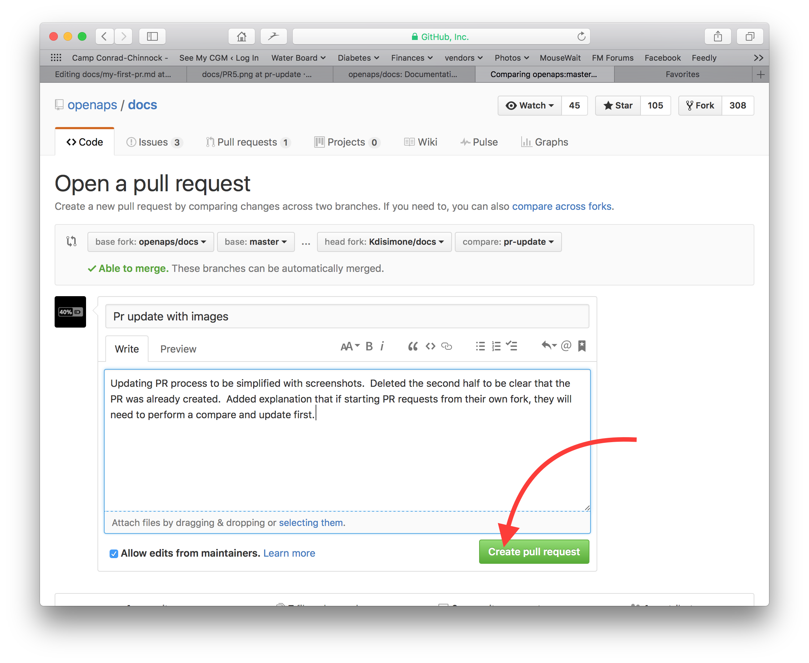

# Comment éditer la documentation

**Cette description est juste pour l'édition de la documentation en anglais. Toutes les nouvelles informations doivent être ajoutées d'abord en Anglais. Si vous voulez traduire la documentation dans d'autres langues (merci), utilisez [crowdin](https://crowdin.com/project/androidapsdocs).**

Pour savoir comment mettre en forme le texte (titre, gras...) et créer des liens, voir la section [« Syntaxe du code »](#code-syntax) de cette page.

## Généralités

Si vous avez des questions, des commentaires ou de nouvelles idées, vous pouvez contacter l'équipe de documentation via [discord](https://discord.gg/4fQUWHZ4Mw).

À un moment, on vous proposera de faire une pull request (PR). C'est la façon dont vos modifications de la documentation sont vraiment placées sur les pages web d'AAPS, qui sont stockées sur GitHub. Faire une PR n'est en fait pas très difficile, et c'est une très bonne façon de contribuer. Vous lisez cette documentation en ce moment parce que des personnes comme vous ont fait des PR. Ne craignez pas de vous tromper ou d’éditer les mauvais documents. Vos modifications sont vérifiées avant d'être fusionnées dans le dépôt « officiel » de la documentation AAPS. Vous ne pouvez pas abîmer les originaux par erreur pendant le processus. Le processus général est :

- Apportez des modifications au code ou à la documentation en modifiant le contenu existant.
- Vérifiez deux fois que vos modifications vous semblent bonnes.
- Prenez quelques notes sur ce qui a changé afin que les personnes puissent comprendre les modifications.
- Créer un Pull Request, qui demande aux administrateurs d'utiliser vos modifications.
- Ils feront une vérification et soit (1) ils fusionneront vos modifications, (2) ils vous feront un retour au sujet de vos modifications, ou (3) ils commenceront un nouveau document avec vos modifications.

(Remarque : Si vous êtes un apprenant visuel, il y a une vidéo YouTube [ici](https://youtu.be/4b6tsL0_kzg) montrant le flux de travail PR.)

Pour notre exemple, nous allons faire une modification à AndroidAPSdocs. Cela peut être fait sur n'importe quel PC Windows, Mac, etc. (n'importe quel ordinateur avec un accès à Internet).

1. Allez sur <https://github.com/openaps/AndroidAPSdocs> et cliquez sur Fork en haut à droite pour créer votre propre copie du dépôt.


2. Allez sur n'importe quelle page et accédez à la page que vous souhaitez modifier. Vous pouvez cliquer sur le lien "Edit in GitHub" dans le coin supérieur droit. C'est possible seulement pour les pages en anglais. 


Ou cliquez sur l'icône de crayon qui s'affiche dans la barre du haut du contenu de la page à modifier. Pour cela, vous devez déjà être connecté à votre compte GitHub (si vous n'en avez pas, il est simple d'en créer un).


3. L'une ou l'autre des options de l'étape 2 créera une nouvelle branche dans VOTRE repository Github où vos modifications seront enregistrées. Effectuez vos modifications dans le fichier.

Nous utilisons markdown pour les pages de documentation. Les fichiers ont l'extension « .md ». La spécification Markdown n'est pas fixe. Pour le moment, nous utilisons myst_parser pour nos fichiers markdown. Faites attention à utiliser la bonne syntaxe, comme [décrit ci-dessous](#code-syntax).


4. Vous avez travaillé dans l'onglet "<>Edit file". Choisissez l'onglet "Preview changes" pour avoir un regard neuf et vérifier que tout ce que vous avez modifié ressemble à ce que vous vouliez (fautes de frappe comprises). Si vous voyez que c'est perfectible, revenez à l'onglet d'édition pour faire vos améliorations. 


5. Une fois vos modifications terminées, faites défiler jusqu'au bas de la page. Dans la zone du bas, indiquez vos commentaires dans le champ texte qui indique "Add an optional extended description...". Le titre par défaut est le nom de fichier. Essayez d'ajouter une phrase qui explique la **raison** de la modification. Indiquer la raison permet d'aider les valideurs à comprendre ce que vous essayez de faire avec le PR.


6. Cliquez sur le bouton vert "Propose file changes" ou "Commit changes". Dans la page qui s'affiche, cliquez sur "Create Pull Request" et de nouveau dans la page suivante, cliquez sur "Create Pull Request".



7. Cela termine l'ouverture d'un Pull Request, PR. GitHub attribue un numéro à la PR. Il se trouve après le titre et un caractère dièse. Retournez sur cette page pour vérifier si vous avez un retour (ou si vous avez des notifications GitHub envoyées par email, vous recevrez des emails vous indiquant toutes activités sur le PR). La modification sera maintenant dans une liste de PR que l'équipe de documentation va examiner et elle vous fera éventuellement des commentaires avant de l'intégrer dans la documentation principale d'AAPS ! Si vous voulez suivre l'avancement de la PR, vous pouvez cliquer sur l'icône de la cloche dans le coin supérieur droit de votre compte GitHub pour voir toutes vos PR.


PS : Votre fork et votre branche seront toujours dans votre propre compte GitHub. Après avoir reçu une notification indiquant que votre PR avait été fusionné, vous pouvez supprimer votre branche si vous en avez terminé (la zone de notification de l'étape 8 fournira un lien pour supprimer la branche une fois qu'elle a été fermée ou fusionnée). Pour les modifications ultérieures, si vous suivez cette procédure, les éditions débuteront toujours par une version mise à jour des documents AndroidAPSdocs. Si vous choisissez une autre méthode pour démarrer une PR (par ex. en partant de la branche master de votre fork comme point de départ), vous devez vérifier que votre dépôt est à jour : faites d'abord une « comparaison » (compare), puis fusionnez toutes les mises à jour faites depuis la dernière mise à jour de votre fork. Comme les gens ont tendance à oublier de mettre à jour leur fork, nous recommandons d'utiliser la procédure décrite ci-dessus pour faire vos PR jusqu'à ce que vous vous familiarisiez avec les exécutions des "comparaisons".

(edit-the-docs-code-syntax)=

## Syntaxe du Code

Nous utilisons markdown pour les pages de la documentation. Les fichiers ont le suffixe « .md ».

Markdown est un langage de mise en forme de texte très simple, qui sépare le contenu du texte de sa mise en forme.

L'auteur marque seulement, par exemple, un titre comme titre de niveau 1, et le processeur markdown génère pendant le traitement le code HTML nécessaire pour afficher ce titre en HTML.

L'idée derrière est que

- l'auteur doit d'abord penser au texte, et pas à la mise en forme,
- le texte markdown peut être échangé entre différents outils markdown, au lieu d'utiliser par ex. des outils propriétaires comme Microsoft Windows et
- vous pouvez générer plusieurs formats de sortie à partir d'un fichier markdown.

Markdown n'est pas un standard fixé à 100 % et nous essayons de rester aussi proches que possible du standard, pour

- rester flexible pour pouvoir changer d'outils de markdown si nécessaire ou contraints par les innovations des outils markdown et des services de markdown SaaS
- nous permettre d'utiliser des services de traduction pour traduire l'anglais dans une langue cible comme le français ou l'allemand. Ils peuvent travailler avec markdown, mais pas avec des codes de mise en forme complexes, car ils ne savent pas séparer le contenu de la mise en page, ce qui pourrait être fatal.

### Titres

- Titre 1 : `# headline`
- Titre 2 : `## headline`
- Titre 3 : `### headline`
- Titre 4 : `#### headline`

Nous essayons d'éviter d'autres niveaux de titres.

### Formatage du texte

- **gras** : `**text**`
- *italique* : `*text*`
- ***gras italique*** : `***text***`

### Liste numérotée

    1. premier
    1. deuxième
    1. troisième
    

1. premier
2. deuxième
3. troisième

### Liste non numérotée

    - un élément
    - un autre élément
    - et un autre élément
    

- un élément
- un autre élément
- et un autre élément

### Liste à plusieurs niveaux

Vous pouvez insérer des "sous-listes" dans les listes en ajoutant 4 espaces de plus à droite que le niveau précédent.

    1. premier
    1. deuxième
    1. troisième
      1. un élément
      1. un autre élément
      1. et un autre élément
    1. quatre
    1. cinq
    1. six
    

1. premier
2. deuxième
3. troisième 
    1. un élément
    2. un autre élément
    3. et un autre élément
4. quatre
5. cinq
6. six

### Images

Pour inclure des images, vous utilisez cette syntaxe de markdown.

- images : ``

Le type d'image doit être PNG ou JPEG.

Les noms des images doivent suivre une des règles de nommage suivantes. Dans l'exemple j'utilise png comme extension. Si vous utilisez JPEG, utilisez plutôt jpeg comme extension.

- `filename-image-xx.png` où xx est un nombre unique à deux chiffres pour les images de ce fichier.
- `filename-image-xx.png` où xx est un nom parlant choisi par l'auteur du fichier md.

Les images sont situées dans le dossier images pour la langue anglaise et propagées automatiquement vers les autres langues par Crowdin. Vous n'avez rien à faire pour cela !

Pour le moment, nous ne traduisons pas les images : les images doivent contenir le **moins de texte possible** pour rester accessibles aux lecteurs qui ne parlent pas anglais.

(make-a-PR-image-size)= Utilisez une taille raisonnable pour les images qui doivent être lisibles sur PC, tablette et mobiles.

- Les captures d'écran de pages web doivent être au maximum de **1050 pixels de largeur**.
- Les diagrammes de processus doivent faire au maximum **1050 pixels de largeur**.
- Les captures d'écran de l'application doivent faire au maximum **500 pixels de largeur**. Ne les placez pas côte à côte si ce n'est pas nécessaire.
- Les captures d'écran de la montre (**Wear OS**) doivent faire au maximum **360 pixels de largeur**. N'agrandissez jamais une capture d'écran plus petite.

### Liens

#### Liens externes

Les liens externes sont des liens vers des sites Web externes.

- lien externe : `[alt text](www.url.tld)`

#### Liens internes au début d'un fichier md

Les liens internes vers les pages sont des liens vers le début d'un fichier md hébergé sur notre propre serveur.

- lien interne vers une page .md : `[alt text](../folder/file.md)`

#### Liens internes vers des références nommées

Les liens internes vers des références nommées sont des liens vers n'importe quel endroit d'un fichier md hébergé sur notre propre serveur, où une référence a été placée comme cible du lien.

Ajouter une référence nommée à l'emplacement dans le fichier md cible vers lequel vous voulez vous diriger.

`(name-of-my-md-file-this-is-my-fancy-named-reference)=`

La référence nommée doit être unique dans tous les fichiers md de la documentation AndroidAPSDocs et pas seulement dans le fichier md dans lequel elle réside !

C'est donc une bonne pratique de commencer par le nom du fichier, puis le nom de référence que vous avez sélectionné.

Utilisez uniquement des lettres minuscules et séparez les mots par un trait d'union.

Ensuite, faites un lien vers cette référence dans le texte que vous écrivez, avec le type de lien suivant.

- Liens internes vers des références nommées : `[alt text](name-of-my-md-file-this-is-my-fancy-named-reference)`

### Notes, avertissements, notes repliables

Vous pouvez ajouter des encadrés de note et d'avertissement dans la documentation.

Vous pouvez aussi ajouter des notes repliables pour les informations détaillées, afin que les utilisateurs qui ne s'intéressent pas aux détails ne soient pas découragés de lire le texte. Utilisez-les avec prudence, car la documentation doit être aussi facile à lire que possible.

#### Notes

    ```{admonition} Titre de la note
    :class: note
    Ceci est une note.
    ```
    

```{admonition} Titre de la note :class: note Ceci est une note.

    <br />#### Avertissements
    
    ````
    ```{admonition} Warning
    :class: warning
    Ceci est un avertissement.
    

    ```{admonition} Titre de l'avertissement
    :class: warning
    Ceci est un avertissement.
    ```
    
    #### Notes repliables
    
    

    {admonition} lectures plus détaillées pour les lecteurs intéressés
    :class: dropdown
    
    Cette note a été repliée,
    ce qui veut dire que vous pouvez ajouter ici un contenu plus long,
    sans qu'il prenne trop de place sur la page.
    

````

```{admonition} lectures plus détaillées pour les lecteurs intéressés :class: dropdown Cette note a été repliée, ce qui veut dire que vous pouvez ajouter ici un contenu plus long, sans qu'il prenne trop de place sur la page.

```

## Tableaux

Évitez les tableaux avec des textes longs : leur contenu est difficile à mettre en forme en Markdown, ils ne tiennent souvent pas dans la largeur d'un écran de téléphone, et ils ne s'afficheront probablement pas de la même façon après traduction.

## Guide de style

### Sommaire

1. Conseils pour écrire en anglais

2. Remarques d'écriture propres à AAPS

3. Références utiles

###  1\. Conseils pour écrire en anglais

#### Utilisez un langage adapté au lecteur

Utilisez un anglais simple (plain English) quand c'est possible. Cela aide les lecteurs dont l'anglais n'est pas la langue maternelle et facilite aussi la traduction des documents AAPS dans d'autres langues. Écrivez comme si vous parliez avec l'utilisateur : imaginez que vous êtes assis en face de la personne pour qui vous écrivez. N'oubliez pas : la plupart des utilisateurs d'AAPS n'ont pas de connaissances en programmation. Le diabète lui-même a aussi beaucoup de jargon et d'abréviations. Pensez que certaines personnes ont peut-être été diagnostiquées récemment, ont peut-être moins d'expérience que vous avec le diabète, ou ont peut-être reçu une autre éducation sur le diabète. Si vous utilisez une abréviation, écrivez-la en entier la première fois, avec l'abréviation juste après entre parenthèses, comme “super micro bolus (SMB)”. Ajoutez aussi un lien vers le glossaire. Les termes techniques que le lecteur ne connaît peut-être pas peuvent aussi être expliqués entre parenthèses.

Au lieu de : *“What causes high postprandial BG peaks in closed loop?"*

Utilisez : *“What causes a high BG peak **after lunch** (postprandial) in closed loop?"*

##### Utilisez des mots simples que tout le monde peut comprendre

Vous trouverez ici une liste de A à Z de mots alternatifs pour rendre votre texte plus facile à comprendre :

<https://www.plainenglish.co.uk/the-a-z-of-alternative-words.html>

#### Questions de vie privée et de licence :

En particulier si vous enregistrez une vidéo ou des captures d'écran, veillez à ne pas montrer vos informations privées (clé API, mots de passe). Vérifiez que le contenu YouTube n'est pas répertorié publiquement et qu'il faut un lien depuis la documentation pour le voir. Évitez d'attirer l'attention sur des contenus qui ne respectent pas le droit d'auteur (BYODA, etc.).

#### Faites des phrases courtes, allez à l'essentiel

- Un texte clair doit avoir une longueur moyenne de phrase de 15 à 20 mots.

- Cela ne veut pas dire que toutes les phrases doivent avoir la même longueur. Soyez percutant. Variez votre texte en mélangeant des phrases courtes (comme la précédente) avec des phrases plus longues (comme celle-ci).

- Gardez une seule idée principale par phrase, avec peut-être un autre point lié.

- Il vous arrivera quand même d'écrire une longue phrase de temps en temps, surtout pour expliquer un point compliqué. Mais la plupart des longues phrases peuvent être coupées d'une façon ou d'une autre.

- Supprimez les mots faibles : “you can”, “there is/are/were”, “in order to”.

- Placez les mots clés au début des titres, des phrases et des paragraphes.

- Soyez visuel ! Quand c'est possible, ajoutez un petit diagramme, une capture d'écran ou une vidéo.

#### N'ayez pas peur de donner des instructions

Les ordres sont la façon la plus rapide de donner des instructions, mais les auteurs ont parfois peur de donner des ordres et écrivent “you should do this” au lieu de simplement “do this”. Les gens ont peut-être peur que les ordres paraissent trop durs. Vous pouvez souvent résoudre ce problème en ajoutant le mot 'please' devant. Mais si quelque chose doit être fait, il vaut mieux ne pas écrire ‘please’, car cela donne au lecteur la possibilité de refuser.

Au lieu de : *“You should just think of it as a complete statement."*

Utilisez : *“Think of it as a complete statement.”*

#### Utilisez surtout des verbes à la voix active plutôt qu'à la voix passive

Exemple de **verbe à la voix active** :

- *“The pump (subject) delivers (verb) the insulin (object).”*

Ici, “delivers” est un verbe à la voix active. La phrase dit d'abord qui délivre, puis ce qui est délivré.

Exemple de **verbe à la voix passive** :

- *“The insulin (subject) is delivered (verb) by the pump (object)”*

Ici, *“delivered”* est un verbe à la voix passive. Le sujet et l'objet sont inversés par rapport à la phrase à la voix active. Nous avons dû rendre la phrase plus longue en ajoutant “is” et “by the”. Pensez aussi à commencer par le verbe à la voix active.

Au lieu de : *“You can connect your pump with the phone through the AAPS pump menu, and there are a number of pumps available for you to connect with.”*

Utilisez : *“Connect your desired pump to the phone through the AAPS pump menu.”*

Les verbes à la voix passive peuvent poser des problèmes :

- Ils peuvent prêter à confusion.

- Ils rendent souvent le texte plus long et plus lourd.

- Ils rendent le texte moins vivant.

##### Bons usages de la voix passive

Il y a des cas où la voix passive peut être adaptée.

- Pour rendre quelque chose moins agressif : 'this bill has not been paid' (passif) est plus doux que 'you have not paid this bill' (actif).

- Pour éviter d'accuser quelqu'un : 'a mistake was made' (passif) plutôt que 'You made a mistake' (actif).

- Quand vous ne savez pas qui ou quoi fait l'action : 'the England team has been picked'.

- Si cela sonne simplement mieux.

#### Évitez les nominalisations

Une nominalisation est le nom de quelque chose qui n'est pas un objet physique, comme un processus, une technique ou une émotion. Les nominalisations sont formées à partir de verbes.

Par exemple :

| Verbe     | Nominalisation |
| --------- | -------------- |
| complete  | completion     |
| introduce | introduction   |
| provide   | provision      |
| fail      | failure        |

Elles sont souvent utilisées **à la place** des verbes dont elles viennent, mais elles peuvent donner l'impression que rien ne se passe vraiment. Trop de nominalisations peuvent rendre un texte très ennuyeux et lourd à lire.

Au lieu de : *“The implementation of the method has been done by a team.”*

Utilisez : *“A team has implemented the method.”*

#### Utilisez des listes quand c'est adapté

Les listes sont excellentes pour découper l'information. Il existe deux types principaux de listes :

- Une phrase continue avec plusieurs points mis en avant au début, au milieu ou à la fin.

- Des puces séparées, avec une phrase d'introduction.

Dans la liste à puces ci-dessus, chaque point est une phrase complète. Chaque point commence donc par une majuscule et se termine par un point. Utilisez des puces plutôt que des numéros ou des lettres : elles attirent l'attention sur chaque point sans donner d'information en plus à retenir.

#### Idées reçues

- Vous pouvez commencer une phrase par **and, but, because, so or however**.

- Vous pouvez séparer un infinitif (split infinitive). Vous pouvez donc écrire **“to boldly go”**.

- Vous pouvez terminer une phrase par une préposition. Par exemple : In fact, it is something **we should stand up for**.

- Et **vous** pouvez utiliser le même **mot** deux fois dans une phrase si **vous** ne trouvez pas de meilleur **mot**.

#### Adapter le style d'écriture au but du texte

Pour que la documentation reste claire et courte, nous écrivons les différentes sections de la documentation dans différents styles.

Un style « explication » est utilisé pour les sections d'introduction, de contexte et d'approfondissement des connaissances.

Un style « guide pratique » (avec un minimum d'explications) est utilisé pour la compilation, la configuration d'AAPS et certaines sections de dépannage.

Un tutoriel aide l'élève à acquérir les compétences de base. L'utilisateur va **apprendre en faisant**.


#####  Tutoriels (par ex. apprendre à un enfant à battre des blancs en neige)

- le narrateur s'adresse directement au lecteur : In this tutorial **you** will (we) peut être utilisé dans de rares cas pour donner l'idée « nous faisons cela ensemble »

- Futur -> pour montrer le but final

- Impératif -> pour faire les tâches -> Étapes concrètes - évitez les concepts abstraits

- Passé -> pour montrer les tâches réalisées -> Résultats rapides et visibles tout de suite

- Explications minimales -> seulement ce qui est nécessaire pour réaliser la tâche - **quoi et pourquoi**

- Ignorez les options/alternatives/…. Pas d'ambiguïté

- Transitions entre étapes : terminez une étape par une phrase qui mène à l'étape suivante, dans une suite logique. Example: *You have now installed the Let’s Encrypt client, but before obtaining certificates, you need to make sure that all required ports are open. To do this, you will update your firewall settings in the next step.*

- Titre du **tutoriel** (titre de niveau 1)

- Introduction (sans titre)

- Conditions préalables (titre de niveau 2)

- Étapes :

- Étape 1 — Faire la première chose (titre de niveau 2)

- Étape 2 — Faire la chose suivante (titre de niveau 2)

- Étape n — Faire la dernière chose (titre de niveau 2)

- Conclusion (titre de niveau 2)
    
    - **Le langage des tutoriels**
        
        *In this tutorial, you will…*
        
        Décrivez ce que l'apprenant va réaliser (attention, pas : “you will learn…”).
        
        *First, do x. Now, do y. Now that you have done y, do z.*
        
        Aucune place pour l'ambiguïté ou le doute.
        
        *We must always do x before we do y because… (see Explanation for more details).*
        
        Donnez un minimum d'explications sur les actions, dans le langage le plus simple possible. Mettez un lien vers une explication plus détaillée.
        
        *The output should look something like this…*
        
        Dites clairement à l'apprenant ce qu'il doit attendre.
        
        *Notice that… Remember that…*
        
        Donnez à l'apprenant beaucoup d'indices pour l'aider à confirmer qu'il est sur la bonne voie et à se repérer.
        
        *You have built a secure, three-layer hylomorphic stasis engine…*
        
        Décrivez (et admirez, avec modération) ce que l'apprenant a réalisé (attention, pas : “you have learned…”)

#####  Guides pratiques (par ex. une recette)

Le but d'un guide pratique est d'aider un utilisateur déjà compétent à réaliser correctement une tâche précise.

- COMMENT faire

- le narrateur s'adresse directement au lecteur : In this tutorial **you** will

- Futur -> pour montrer le but final

- Impératif conditionnel -> to get X do y (pour obtenir X, faites Y) -> Étapes concrètes - évitez les concepts abstraits

- Explications minimales -> seulement ce qui est nécessaire pour réaliser la tâche -> **quoi et pourquoi**

- Ignorez les options/alternatives/…. Pas d'ambiguïté, mais vous pouvez mettre un lien vers l'entrée de référence ou l'entrée d'explication

- **Guide pratique** : Titre (titre de niveau 1)

- Paragraphe d'introduction

- Conditions préalables facultatives (paragraphe, ou titre de niveau 2 s'il y en a plus d'une)

- Étapes :

- Étape 1 — Faire la première chose (titre de niveau 2)

- Étape 2 — Faire la chose suivante (titre de niveau 2)

- Étape n — Faire la dernière chose (titre de niveau 2)

- Paragraphe de conclusion
    
    - **Le langage des guides pratiques**
        
        *This guide shows you how to…*
        
        Décrivez clairement le problème ou la tâche que le guide aide l'utilisateur à résoudre.
        
        *If you want x, do y. To achieve w, do z.*
        
        Utilisez l'impératif conditionnel.
        
        *Refer to the x reference guide for a full list of options.*
        
        Ne surchargez pas votre guide pratique avec tout ce que l'utilisateur pourrait faire en lien avec x.

#####  Explication (par ex. la science qui explique pourquoi les blancs d'œufs deviennent fermes quand on les bat)

Une explication clarifie, approfondit et élargit la compréhension d'un sujet par le lecteur.

- POURQUOI

- Commencez par **À propos**

- Donnez le contexte, mettez un lien vers TOUTES les références utiles

- Discutez des options/alternatives

- Ne donnez pas d'instructions ni de référence (mettez un lien vers elles)

- Indiquez ce qui est inconnu, ce qui peut encore changer, etc…

- Titre **À propos** (titre de niveau 1)

- Introduction (sans titre)

- Conditions préalables facultatives (titre de niveau 2)

- Sous-sujet 1 (titre de niveau 2)

- Conclusion (titre de niveau 2)
    
    - **Le langage des explications**
    
    *The reason for x is because historically, y…*
    
    Expliquez.
    
    *W is better than z, because…*
    
    Donnez des avis, et même des opinions, quand c'est adapté.
    
    *An x in system y is analogous to a w in system z. However…*
    
    Donnez un contexte qui aide le lecteur.
    
    *Some users prefer w (because z). This can be a good approach, but…*
    
    Comparez les alternatives.
    
    *An x interacts with a y as follows:…*
    
    Dévoilez les secrets internes de la machine, pour aider à comprendre pourquoi quelque chose fonctionne comme il fonctionne.

### 2\. Remarques d'écriture et de mise à jour propres à AAPS

#### Auteur et éditeur

Pour écrire ou mettre à jour la documentation AAPS, voyez le processus comme deux étapes. Elles peuvent être faites par la même personne à des moments différents, ou par plusieurs personnes.

Un **auteur (par ex. vous !)** écrit ou modifie une section de la documentation sur un ton court et naturel, puis la transmet à l'éditeur.

L'**éditeur (par ex. un autre utilisateur d'AAPS, ou la personne qui reçoit la pull request)** vérifie que le guide de style est respecté et modifie la section pour qu'elle soit claire et accessible, en supprimant autant de mots que possible (surtout pour les sections tutoriel et guide pratique). Lire le texte à voix haute peut aider.

#### Points généraux sur AAPS

- Pour les valeurs de glycémie, indiquez à chaque fois mg/dl et mmol/l (pensez-y aussi pour les captures d'écran si possible).

- Pour rester cohérent, écrivez « AAPS » plutôt que « Android APS ».

- Indiquez clairement la version d'Android Studio/AAPS pour laquelle vous écrivez, ou avec laquelle les captures d'écran ont été faites.

### 3\. Références utiles

<https://dev.readthedocs.io/en/latest/style-guide.html>

[Diátaxis (diataxis.fr)](https://diataxis.fr/)

[Technical Writer Style Guide Examples | Technical Writer HQ](https://technicalwriterhq.com/writing/technical-writing/technical-writer-style-guide/)

[DigitalOcean's Technical Writing Guidelines | DigitalOcean](https://www.digitalocean.com/community/tutorials/digitalocean-s-technical-writing-guidelines)

[Top 10 tips for Microsoft style and voice - Microsoft Style Guide | Microsoft Learn](https://learn.microsoft.com/en-us/style-guide/top-10-tips-style-voice?source=recommendations)

<https://www.plainenglish.co.uk/how-to-write-in-plain-english.html>

<https://developers.google.com/style>

<https://www.mongodb.com/docs/meta/style-guide/screenshots/screenshot-guidelines/>