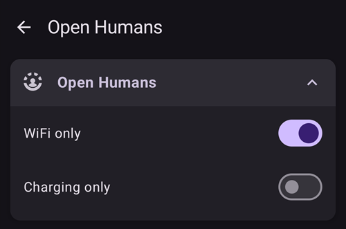

# Téléversement Open Humans

## Donner vos données pour la science

Vous pouvez aider la communauté en faisant don de vos données à des projets de recherche ! Cela aide les scientifiques à avancer, à développer de nouvelles idées scientifiques et à élargir les esprits concernant les systèmes de boucle fermée open source. AAPS is ready to synchronize your data with [Open Humans](https://www.openhumans.org), a platform allowing you to upload, connect, and store your personal data – such as genetics, activity and health data.

Vous gardez le contrôle total sur l'utilisation de vos données et sur les projets que vous voulez soutenir en leur donnant accès à vos données. Selon les projets que vous avez rejoint, les données sont évaluées et utilisées par eux de différentes manières.

Les données suivantes seront envoyées sur votre compte Open Humans :

- Glycémies
- Événements Careportal (sauf les notes)
- Bolus étendus
- Changements de profil
- Doses Quotidiennes Totales
- Basales temporaires
- Cibles temporaires
- Préférences
- Version de l'application
- Modèle d’appareil
- Dimensions de l'écran

Les informations secrètes ou privées telles que votre URL Nightscout ou votre API secret ne seront pas téléchargées.

## Paramètres

1. Créez votre compte sur [Open Humans](https://www.openhumans.org) si ce n'est pas déjà fait. Vous pouvez réutiliser vos comptes Google ou Facebook existants si vous le souhaitez.
2. Enable the **Open Humans** plugin in [**Configuration** > **Communication**](../SettingUpAaps/ConfigBuilder.md).


3. Tap **Settings** on the **Open Humans** card. You can restrict uploads to times when the phone uses Wi-Fi (**WiFi only**) and/or is charging (**Charging only**).



4. Tap **Open plugin** on the **Open Humans** card, then tap **Setup**.


5. On the **Welcome to Open Humans** screen, tap **Next**. Read the **Consent** screen carefully: it shows the terms of use and which data is uploaded and not uploaded.
6. Switch on **I understand and agree.** (1) and tap **Login to Open Humans** (2).


7. Le site web Open Humans sera ouvert. Veuillez vous connecter avec vos identifiants.
8. Decide whether you want to hide your AAPS Uploader membership in your public Open Humans profile (1).
9. Click **Authorize project** (2).


```{admonition} Older screenshot
:class: note
The screenshots above show an earlier version of the Open Humans website and still use the old project name **AndroidAPS Uploader**. The steps are the same.
```

10. Back in **AAPS**, the **Final touches** screen asks whether you want to proceed. Tap **Proceed**.
11. Wait until **We're done!** appears, then tap **Close**. From now on, your phone uploads data in the background from time to time.
12. The **Open Humans** plugin screen now shows your **Project Member ID**. Tap **Upload now** if you want to start an upload right away.
13. Tap **Logout** if you want to stop uploading data to Open Humans.
14. La notification Android vous informera sur le téléversement en cours.


```{admonition} Older screenshot
:class: note
The screenshot above is from an earlier **AAPS** version. In **AAPS** 4 the confirmation screens are **Final touches** and **We're done!**, there is no queue size, and the buttons are **Upload now** and **Logout**.
```

15. Vous pouvez gérer vos données en vous connectant sur le [site web Open Humans](https://www.openhumans.org).


## Opportunités de partage

### [Le projet 'OPEN'](https://www.open-diabetes.eu/)

Le projet "OPEN" rassemble un consortium international et intersectoriel de patients innovateurs, de médecins, de spécialistes des sciences sociales, d'informaticiens et d'organisations de défense des patients afin d'étudier les divers aspects des systèmes de pancréas artificiels à faire soi-même (DIY APS) qui sont utilisés par un nombre croissant de personnes atteintes de diabète. Pour plus de détails, voir leur [site web](https://www.open-diabetes.eu/).

En septembre 2020, le projet 'OPEN' a lancé une [enquête](https://survey.open-diabetes.eu/) incluant l'option de donner des données que vous avez téléchargées sur Open Humans. Un [tutoriel](https://open-diabetes.eu/en/open-survey/survey-tutorials/) sur comment faire don de vos données au projet 'OPEN' est disponible sur leur site et dans le cadre de l'enquête.

### [Données communes OpenAPS](https://www.openhumans.org/activity/openaps-data-commons/)

OpenAPS Data Commons a été créé pour permettre facilement de partager les jeux de données de la communauté DIYAPS pour la recherche. Les données sont partagées à la fois avec des chercheurs traditionnels qui créeront des études de recherche traditionnelles et avec des groupes ou des individus de la communauté qui souhaitent examiner les données dans le cadre de leurs propres projets de recherche. The OpenAPS Data Commons uses the 'Open Humans' platform to enable people to easily upload and share their data from DIYAPS including AAPS, Loop, and OpenAPS.

Vous pouvez envoyer vos données dans Open Humans par l'un des trois moyens suivants :

1. use the AAPS uploader option to get your data into Open Humans
2. utilisez le transfert de données Nightscout pour déverser vos données dans Open Humans
3. téléchargez manuellement des fichiers de données dans Open Humans.

Une fois que vous avez créé un compte et remonté vos données dans Open Humans, assurez-vous également de rejoindre OpenAPS Data Commons afin de donner vos données pour la recherche si vous le souhaitez.

## Conditions d’Utilisation

Ceci est un outil open source qui copiera vos données dans [Open Humans](https://www.openhumans.org). Nous ne nous réservons aucun droit de partager vos données avec des tiers sans votre autorisation explicite. Les données que le projet et l'application reçoivent sont identifiées via un identifiant utilisateur aléatoire et ne seront transmises de manière sécurisée à un compte Open Humans qu'avec votre autorisation. Vous pouvez arrêter le téléchargement et supprimer vos données à tout moment via [www.openhumans.org](https://www.openhumans.org). Ayez conscience que certains projets qui reçoivent les données ne le supportent pas.

Voir aussi les [Conditions d'utilisation Open Humans](https://www.openhumans.org/terms/).

## Protection des données

Open Humans s'occupe de la protection de votre vie privée en vous assignant un identifiant numérique pour chaque projet. Cela permet aux projets de vous reconnaître mais pas vous identifier. The Application ID uploaded by AAPS is similar and only helps administrate the data. Plus d'informations peuvent être trouvées ici :

- [Règles d'utilisation des données Open Humans](https://www.openhumans.org/data-use/)
- [Open Humans et GDPR](https://www.openhumans.org/gdpr/)
